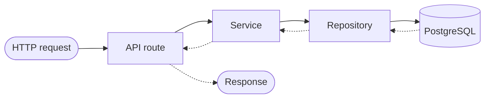
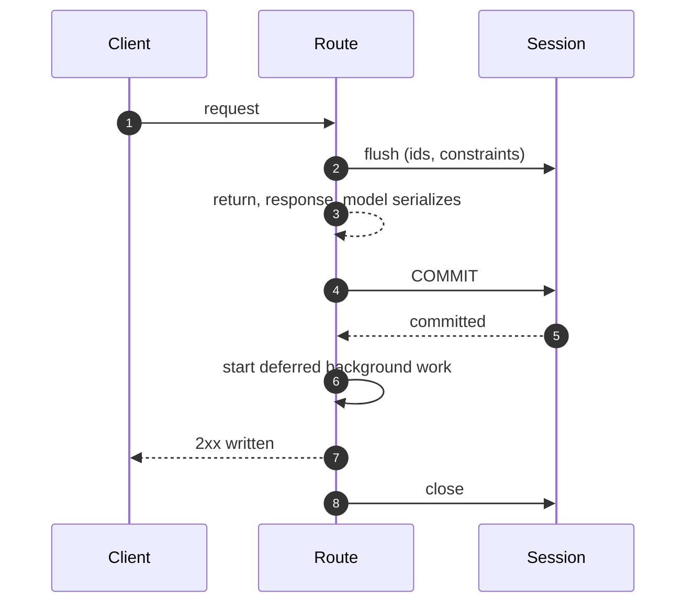

# Архитектура { #architecture }

Проект следует слоистой архитектуре **Repository + Service**. Каждая
функция — пользователи, диалоги, файлы, документы RAG, источники
синхронизации — следует одному и тому же шаблону: **Модели → Схемы → Репозитории
→ Сервисы → Эндпоинты** (Models → Schemas → Repositories → Services → Endpoints).

## Путь запроса { #request-flow }



Маршруты никогда не содержат прямых обращений к базе данных. Весь доступ к
данным идёт через сервисы, которые, в свою очередь, делегируют репозиториям.

!!! info "Это тест, а не соглашение"

    `backend/tests/test_route_layering.py` падает, если маршрут импортирует
    репозиторий, — и так же громко падает, если в его списке разрешённых
    исключений остался пункт, который больше не действует.

Правило успело отклониться в пяти модулях, прежде чем что-либо его проверяло, —
и ни один из них не был утечкой, потому что каждый обработчик передавал ту
область доступа, которую знал. В этом и цена: область доступа, которой владеет
маршрут, — это область доступа, которую не видит ни один тест сервиса, и
следующему читателю сущности нужно знать, что передать то же самое. Единственное
исключение — `Literal` порядков сортировки, импортированный как тип, а не как
доступ к данным.

## Структура каталогов (`backend/app/`) { #directory-structure-backendapp }

| Каталог / файл | Назначение |
|-----------|---------|
| `api/routes/v1/` | HTTP-эндпоинты, проверка запросов, аутентификация |
| `api/deps.py` | Внедрение зависимостей (сессия БД, текущий пользователь) |
| **`services/`** | **Бизнес-логика, оркестрация** |
| ↳ `user.py` | CRUD пользователей, обновление профиля |
| ↳ `conversation.py` | Управление диалогами и сообщениями |
| ↳ `message_rating.py` | CRUD оценок сообщений, статистика, экспорт |
| ↳ `file_upload.py` | Обработка загрузки файлов чата |
| ↳ `file_storage.py` | Абстракция хранилища файлов (локальное / S3) |
| ↳ `rag_document.py` | Жизненный цикл документов RAG |
| ↳ `rag_sync.py` | Оркестрация синхронизации удалённых источников |
| ↳ `sync_source.py` | CRUD источников синхронизации и история запусков одного источника |
| ↳ `audit.py` | Чтение журнала аудита собственной организации вызывающего |
| **`repositories/`** | **Слой доступа к данным, запросы к базе** |
| ↳ `user.py` | Запросы пользователей |
| ↳ `conversation.py` | Запросы диалогов |
| ↳ `chat_file.py` | Запросы файлов чата |
| ↳ `message_rating.py` | Запросы оценок сообщений |
| ↳ `rag_document.py` | Запросы документов RAG |
| ↳ `sync_log.py` | Запросы журналов синхронизации |
| ↳ `sync_source.py` | Запросы источников синхронизации |
| **`schemas/`** | **Модели запросов и ответов Pydantic** |
| ↳ `user.py` | Схемы пользователей |
| ↳ `conversation.py` | Схемы диалогов и сообщений |
| ↳ `file.py` | Схемы загрузки файлов |
| ↳ `message_rating.py` | Схемы оценок сообщений |
| ↳ `rag.py` | Схемы запросов и ответов RAG |
| ↳ `sync_source.py` | Схемы источников синхронизации |
| **`db/models/`** | **Модели SQLAlchemy 2.1** |
| ↳ `user.py` | Модель пользователя |
| ↳ `conversation.py` | Модели диалогов и сообщений |
| ↳ `chat_file.py` | Модель файла чата |
| ↳ `message_rating.py` | Модель оценки сообщения |
| ↳ `webhook.py` | Модель вебхука |
| ↳ `rag_document.py` | Модель документа RAG |
| ↳ `sync_log.py` | Модель журнала синхронизации |
| ↳ `sync_source.py` | Модель источника синхронизации |
| `core/config.py` | Настройки через pydantic-settings |
| `core/security.py` | Утилиты JWT и API-ключей |
| `agents/` | ИИ-агенты и инструменты |
| `rag/` | Модуль RAG (эмбеддинги, векторное хранилище, поиск) |
| `rag/connectors/` | Коннекторы синхронизации (Google Drive, S3, сайты) |
| `commands/` | CLI-команды в стиле Django |

## Ответственность слоёв { #layer-responsibilities }

### Маршруты API (`api/routes/v1/`) { #api-routes-apiroutesv1 }
- Обработка HTTP-запросов и ответов
- Проверка входных данных через схемы Pydantic
- Проверки аутентификации и авторизации
- **Никогда** не содержат прямых обращений к БД — всегда делегируют сервису
- **Никогда** не разбирают недоверенный ввод в выражении маршрута. Если там
  выбрасывается `ValidationError`, это `ValueError`, но не
  `RequestValidationError`, поэтому его не отобразит ни один обработчик, и
  вызывающему ответят 500 с `details: null`; именно так каждая ошибка в
  отредактированной вручную спецификации YAML сообщалась как падение (#873).
  Разбор — дело владеющего сервиса, и отказ тоже: `import_spec` в
  `AgentRegistryService` отвечает на сломанный документ кодом 400 с именем поля и
  никогда не цитирует присланное обратно вызывающему.

### Сервисы (`services/`) { #services-services }
- Бизнес-логика и проверка
- Оркестрируют один или несколько вызовов репозитория
- Выбрасывают доменные исключения (`NotFoundError`, `AlreadyExistsError` и т. п.)
- Управляют границами транзакций

### Репозитории (`repositories/`) { #repositories-repositories }
- Только операции с базой данных
- Никакой бизнес-логики
- Используют `db.flush()`, а не `commit()` — транзакцией владеет сессия запроса
  и [фиксирует её до отправки ответа](#the-requests-transaction)
- Возвращают доменные модели

### Схемы (`schemas/`) { #schemas-schemas }
- Отдельные модели `Create`, `Update` и `Response` для каждой сущности
- Схемы `Response` используют `model_config = ConfigDict(from_attributes=True)` для преобразования из ORM

### Модели (`db/models/`) { #models-dbmodels }
- Определения моделей SQLAlchemy 2.1
- Связи, индексы и значения столбцов по умолчанию живут здесь

### Коннекторы RAG (`rag/connectors/`) { #rag-connectors-ragconnectors }
- Подключаемые адаптеры синхронизации, реализующие `BaseSyncConnector`
- Каждый коннектор предоставляет `list_files()` и `download_file()`
- Регистрируются в `CONNECTOR_REGISTRY` для обнаружения во время выполнения

## Транзакция запроса { #the-requests-transaction }

Один запрос, одна сессия, одна транзакция, зафиксированная в одном месте, — и
место значит не меньше самого факта.

Маршрут запрашивает `DBSession` (`app/api/deps.py`), которая разрешается в
`get_db_session` (`app/db/session.py`). Всё ниже маршрута делит эту одну сессию:
сервисы принимают её в конструкторе, репозитории — первым аргументом, и ни те,
ни другие никогда не вызывают `commit()` — за одним намеренным исключением:
путь запуска агента и голосовой звонок, который является запуском; о нём
[ниже](#the-run-paths-two-commits). `flush()` отправляет инструкции, чтобы
строка получила идентификатор и ограничения были проверены; фиксация происходит
один раз, на выходе.

**На выходе значит до записи ответа.** Псевдоним объявляет
`Depends(get_db_session, scope="function")`, который регистрирует завершение
сессии в стеке обработчиков выхода, который FastAPI проходит между возвратом
операции маршрута и `await response(scope, receive, send)`. Поэтому порядок для
запроса таков:

1. маршрут возвращает результат, и `response_model` сериализует то, что он вернул;
2. транзакция фиксируется — или, если что-то выбросило исключение, откатывается;
3. запускается отложенная запросом фоновая работа (ниже);
4. ответ записывается в сокет;
5. сессия закрывается.



!!! danger "2xx означает, что запись читается, а не просто принята"

    Этот порядок и есть весь контракт. Голый `Depends(get_db_session)` где угодно
    снова вводит поведение FastAPI по умолчанию и меняет местами шаги 2 и 4 —
    `tests/api/test_db_session_scope.py` падает на одном таком.

Именно этот порядок позволяет клиенту действовать по собственному ответу. По
умолчанию FastAPI для зависимости с `yield` использует `scope="request"`, что
ставит шаги 2 и 4 наоборот, — так было и здесь до [#353][353], где принятие
приглашения ответило 204, а созданная им строка членства оставалась невидимой
для следующего же запроса 21,7 мс, и токен приглашения был потрачен за 34 мс до
того, как зафиксировалась транзакция, его создавшая.

Три следствия, которые стоит знать, прежде чем писать маршрут:

- **Фиксация, которая не удалась, — это 500, а не строка в журнале.** Ответ ещё
  не записан, поэтому отложенное ограничение или потерянное соединение доходят
  до клиента как ошибка, а не обнаруживаются за уже отправленным 2xx. Шаг 3
  тоже не выполняется: работа, ждавшая транзакции, которой не случилось,
  отбрасывается с предупреждением, называющим её.
- **Всё, что проглатывает ошибку базы данных, обязано сбросить сессию.**
  Инструкция, выбросившая исключение, оставляет транзакцию прерванной, и
  фиксация на шаге 2 тоже падает. Таков случай в кодовой базе — проверки
  здоровья (`app/services/health.py`): они намеренно отказываются пробрасывать
  ошибку, поэтому откатываются перед возвратом.
- **Тело, создаваемое во время отправки ответа, требует другой сессии.**
  `StreamingResponse` поверх генератора итерируется на шаге 3, когда сессия уже
  закрыта. Такие эндпоинты берут `StreamingDBSession`, которая сохраняет область
  по умолчанию FastAPI и потому работает только на чтение: её транзакция
  разрешается после того, как клиенту ответили. Ровно один эндпоинт её
  использует — экспорт оценок в CSV, — и `tests/api/test_db_session_scope.py`
  отклоняет второй, пока о нём не принято решение.

Работа, переживающая запрос, эту сессию не использует вовсе. Обработчики
WebSocket и команды CLI открывают `get_db_context()`, а задачи воркера —
`get_worker_db_context()`; все три идут через одну и ту же `_managed_session`,
поэтому фиксируют при чистом выходе из собственного `async with` и запускают
отложенную работу в том же месте — которое с ответом никак не связано.

Допуск канала тоже фиксируется до подготовки запуска:
`ChannelMessageRouter._route_inner` сохраняет допущенную личность, сеанс и
диалог после проверок доступа и ограничения частоты. Учётные данные
платформенного MCP используют независимую транзакцию и ссылаются на этот
диалог; один `flush` там не виден. Если допуск не может зафиксироваться,
подготовка не начинается.

Личные сеансы программирования тоже пересекают границы внешних эффектов:
`PersonalCodingSessionFactory` фиксирует владение приватным рабочим
пространством до начала работы с учётными данными, затем фиксирует исходный код
и аудит допуска перед собственной задачей. Защищённая очистка терминала
фиксирует хранение или поставленное в очередь удалённое удаление, даже когда
задача выбрасывает исключение или отменяется. Изменения согласия учётной записи
и удаление владельца ставят очистку контейнеров в очередь в собственной
транзакции, прежде чем каскадно удалятся строки учётной записи и рабочего
пространства. Откат сохраняет и метаданные сеанса, и его обязанность удалённой
очистки.

### Две фиксации пути запуска { #the-run-paths-two-commits }

Один путь намеренно фиксируется раньше, чем «на выходе»: **запуск агента.**

Механизм выполнения фиксирует один раз *до вызова модели* и ещё раз в
терминальном `finally` — `AgentRunnerService._run`, а для потокового чата —
`ChatAgentRunner.run`.

Вызов модели занимает от секунд до минут, и транзакция, оставленная открытой на
всё это время, держит соединение из пула в состоянии `idle in transaction`.
Пятнадцать одновременных запусков когда-то исчерпывали весь пул ([#12][12]).

Фиксация заранее даёт ещё две вещи: строка запуска читается из любой другой
сессии на протяжении всей жизни запуска, а выход возобновлённого запуска из
очереди согласований становится долговечным до того, как одобренный вызов
повторён, — поэтому падение посреди повтора не может выдать одно и то же
согласование дважды ([#3][3]).

Терминальная фиксация — вторая половина. Контекст сессии фиксирует только при
чистом выходе, а запуск, завершившийся сбоем, остановленный бюджетом или
отменённый, чистым не является; запуск же, отсутствующий в истории, — это
запуск, за который никто не отвечает.

Обе границы доказаны на реальной базе данных в
`tests/integration/test_run_commit_boundary.py`.

**Голосовой звонок — это запуск, и он сохраняет те же две фиксации**
([#54][54]). Звонок держит свой сокет до пятидесяти минут, поэтому фиксируется
там же, где путь запуска, а всё промежуточное записывает через собственные сессии:

- `VoiceCallStarter.start` фиксирует, когда пройдены все отказы, записав и
  строку `voice_calls`, и её запуск, — до вызова провайдера. Строки
  согласований, сигнал активности и голосовая очистка нуждаются в том, чтобы эти
  строки читались из других сессий; отказ до этой точки откатывает всё, поэтому
  отклонённый звонок не оставляет ничего в «Активности».
- Каждый сохранённый ход, каждый 15-секундный сигнал активности и каждая запись
  согласования открывают собственную сессию `get_db_context()` и фиксируются
  там, никогда — в общей сессии запуска: ход долговечен в момент, когда он
  сказан, а падение теряет не больше хода, который шёл.
- Завершение `VoiceCallSession` — защищённый `finally` — записывает завершение
  строки звонка, затем завершает вызов у провайдера, доводит запуск до конца и
  фиксирует снова: терминальная фиксация, при любом выходе. Конец записывается первым,
  чтобы переподключение, ждущее его, не ждало ещё и завершения звонка.

`tests/test_voice_starter.py::test_a_started_call_is_committed_with_its_row_and_a_voice_run`
и `tests/test_voice_session.py::test_every_exit_path_hangs_up_the_provider_call`
держат оба конца.

### Вторая ранняя фиксация { #the-one-other-early-commit }

`SessionService.detect_refresh_reuse` — вторая, и по обратной причине: не
потому, что транзакция держалась бы слишком долго, а потому, что её вот-вот
выбросят. Refresh-токен, не совпавший ни с одним живым сеансом, может быть
повтором того, который сеанс уже сменил, и ответ — оборвать эту цепочку и
записать это, а затем отказать вызывающему, что выбрасывает
`AuthenticationError` через ветку *исключения* контекста сессии и откатывает
запрос.

Без фиксации это 401, всё ещё живая скомпрометированная цепочка и никакой
записи о том, что что-то произошло.
`test_the_response_survives_the_refusal_that_follows_it` откатывается после
вызова и проверяет, что осталось на месте
([#1519](https://github.com/vstorm-co/agenticos/issues/1519)).

### Вебхук, который ждёт своего ответа { #a-webhook-that-waits-for-its-answer }

`WorkflowExposureService._answer` — третья. Вебхук, в графе которого есть шаг
«Ответ на вебхук», отвечает отправителю тем, что записывает этот шаг, поэтому
запрос должен ждать запуск, который ещё не начался, — а начаться он не может,
пока допуск не виден воркеру. Сервис фиксирует запуск и его запись доставки
(первая задача диспетчеризации запуска фиксируется вместе с ними, и `NOTIFY`,
будящий воркер, срабатывает при этой фиксации), а затем опрашивает ответ
запуска. После фиксации ничего не пишется, поэтому закрывающей фиксации нечего
делать. `TestAnsweringTheSender` проводит запуск через реальное получение
задачи.

Видимость работает в обе стороны. Всё, что раньше рассуждало, будто «строку
выполняющегося запуска нельзя увидеть», теперь рассуждает о строке, которую
*видно*, и планировщик триггеров агентов — единственное место, которое
рассуждало по-старому.

Его защита от перекрытия срабатывает при любом незавершённом запуске в диалоге
триггера — теперь сюда входит и живой запуск одновременного `run_now` или
срабатывания события, защита, которую прежняя невидимость дать не могла.

Между тем воркер, умерший посреди запуска, оставляет строку `running`, которую
ничто в процессе уже не завершит. Процесс, выполняющий запуск, отмечает его
живым каждые `RUN_HEARTBEAT_SECONDS`, а строку, переставшую подавать признаки
жизни, ограничивает ежеминутная очистка устаревших запусков, которая завершает
её как `failed` после `STALE_RUN_REAPED_AFTER_SECONDS`. Собственный признак
жизни планового срабатывания остаётся арендой, которую он продлевает
(`app/repositories/agent_trigger.py::claim_due`).

В разделе [Управление](governance.md#a-run-whose-process-died) сказано, что
очистка решает и что намеренно оставляет в покое.

### Отправка фоновой работы из запроса { #dispatching-background-work-from-a-request }

**Работа, которая должна произойти, — это задача, поставленная в очередь в
транзакции самого запроса.** `app.services.background_jobs.enqueue` пишет строку
задачи в сессии запроса, поэтому она фиксируется вместе со строками, которые
называет, или не фиксируется вовсе:

```python
from app.services.background_jobs import enqueue
from app.worker.jobs import FIRE_TRIGGER, FireTrigger

await enqueue(self.db, FIRE_TRIGGER, FireTrigger(trigger_id=trigger.id), organization_id=org_id)
```

Запрос, который откатился, ничего не ставит в очередь, а зафиксированный будит
воркеров пула через `NOTIFY`, и PostgreSQL доставляет `NOTIFY` только при фиксации, поэтому
ни один воркер не может захватить задачу раньше, чем появится строка, которую он
читает. Так #417 закрывается по построению: загрузка отвечала
`{"status": "processing"}` и оставалась в этом состоянии, потому что работа
начиналась до фиксации и её собственная сессия не видела документ. Загрузка,
синхронизация, начатая кем-то, каждое срабатывание триггера — по расписанию, по
доставке или «запустить сейчас» — асинхронный запуск через API и очистка при
удалении того, что живёт вне базы, передаются именно так.

Ручной запуск триггера существует и по второй причине, которую стоит назвать:
раньше `POST
/agents/{id}/triggers/{id}/run` *дожидался* запуска, который сам же и начинал,
поэтому агент, работающий дольше таймаута чтения прокси, отвечал 504 — а запуск
продолжался и фиксировался. Это сообщение об ошибке для того, что работало, и
приглашение нажать кнопку ещё раз ([#658][658]). Теперь маршрут отвечает `202`,
как только задача поставлена в очередь.

**Удаление, чьи входные данные уничтожает его собственная фиксация, ставит
очистку в очередь в этой же фиксации.** Удаление организации передаёт дальше пути в
хранилище и имена коллекций, последнюю запись о которых удаляет её транзакция,
поэтому `queue_external_state_cleanup` пишет их в задачи очистки в той же сессии:
сбой между фиксацией и очисткой ничего не теряет, а задача повторяется, пока файлы
и векторные коллекции не исчезнут.

**Работа, которой позволено потеряться, использует `spawn_after_commit`**
(`app/core/background.py`): короткая работа по мере возможности в цикле событий
самого API, например запись доступности MCP-сервера или отвязка файлов, на которые
приложение больше не ссылается. Она ставит корутину в очередь сессии и запускает её
через две инструкции после `commit()`; порядок доказан на настоящей базе в
`tests/integration/test_flow_starts_after_commit.py`. При остановке lifespan
`await`-ит `background.drain()`, прежде чем освободить то, что читают эти задачи.

Из того, где живёт эта очередь, следуют две вещи:

- **Она принадлежит сессии, а не запросу.** Сервису, передающему работу, не нужно
  знать, вызвали ли его из маршрута, обработчика WebSocket, CLI или воркера —
  поэтому это не `BackgroundTasks` из FastAPI, чья гарантия касается ответа и
  которой у остальных трёх вызывающих сторон нет.
- **Откатившаяся транзакция ничего не запускает.** Поставленные в очередь корутины
  закрываются: запуск работы, строку которой выбросили, лишь переносит сбой туда,
  где его труднее объяснить.

`spawn` остаётся правильным для работы, которая сама владеет всем нужным и не
касается ни одной строки: вебхуки каналов передают ему каждую доставку, чтобы
провайдеру ответили сразу. Ничто из этого не переживает перезапуск; задача —
переживает. См. [Добавить фоновую задачу](howto/add-background-task.md).

[3]: https://github.com/vstorm-co/agenticos/issues/3
[12]: https://github.com/vstorm-co/agenticos/issues/12
[54]: https://github.com/vstorm-co/agenticos/issues/54
[353]: https://github.com/vstorm-co/agenticos/issues/353
[417]: https://github.com/vstorm-co/agenticos/issues/417
[658]: https://github.com/vstorm-co/agenticos/issues/658

## Запуски сценариев: исходящая очередь и короткие транзакции { #workflow-runs-an-outbox-and-short-transactions }

Запуск сценария может длиться дни — узел может ждать согласования, — поэтому
позицию не держит ни один процесс. Её держит Postgres: `dispatch_outbox` называет
каждый готовый узел, а каждая задача `workflow-dispatch-node` захватывает одну
строку, выполняет одну попытку и завершает её. Код —
в `app/services/workflow_execution/dispatcher.py`.

Каждая попытка — это три коротких транзакции вокруг вызова, который не держит ни
одной. Захват фиксирует аренду строки; строка попытки фиксируется в состоянии
`in_flight` до вызова обработчика, чтобы воркер, умерший посреди вызова, оставил
что-то, что найдёт механизм сверки; а завершение фиксирует результат, стоимость и
строку исходящей очереди следующего узла вместе, так что результат никогда не
становится долговечным без своего следующего шага.

Задача, которая будит воркера для этого следующего узла, ставится в очередь
вместе со своей строкой в той же транзакции, а у узла, который должен сработать
позже (таймер, задержка повтора), задача имеет `run_after` на это время;
периодический опрос и сверка — лишь подстраховка для задачи, которую отменили или
которая умерла. Пока обработчик работает, воркер продлевает аренду в собственных
транзакциях, а продление, не нашедшее захвата, сообщает об этом обработчику.

Каждый переход состояния после захвата защищён токеном захвата и тем, что строку
всё ещё захватывают, под блокировкой, взятой в одном порядке — запуск, запуск
узла, исходящая очередь, — как у диспетчера, так и у механизма сверки. Стоимость —
единственная запись, которая не подчиняется этому правилу: то, что потратил вызов,
записывается, даже когда его результат приходит слишком поздно, чтобы его принять.
Прерванная попытка
никогда не считается ни успешной, ни неуспешной: она становится `uncertain`, и
автоматически повторяется только узел, объявленный идемпотентным.

## Запуски агентов: возможность не обращается к базе { #agent-runs-a-capability-never-fetches }

У описанной слоистости есть ещё одно правило внутри запуска агента, и именно из-за
него механизм выполнения такой большой. **Возможность не касается базы данных.**
Всё, что возможности нужно от базы, — имена коллекций, которые привязывает её
спецификация, навыки, которые она может загрузить, рабочее пространство, в которое
она пишет, агенты-исполнители, которых она может вызвать, — сервис разрешает *до*
начала запуска и передаёт как `resources`, словарь, который возможность может
читать и не может пополнять. Модель спрашивает, *что* искать; она никогда не узнаёт *где*.

Две записи в этом словаре — это стыки с другими подсистемами, а не просто данные:

| Ресурс | Оставлен механизмом выполнения | Читает |
|---|---|---|
| `WORKSPACE_RESOURCE` | открытое рабочее пространство, которое запуск также получает как `ctx.workspace` | `tool_output_limits` и агент-исполнитель, использующий общий `sandbox` |
| `SUBAGENT_RUNTIME_RESOURCE` | разрешённое дерево поручений | возможность `subagents` |

Поручение — самый острый случай для этого правила. Агент-исполнитель — это строка;
его закреплённая версия, его коллекции, его навыки и его секреты — тоже строки, и
каждая из них должна пройти `resolve_access`, прежде чем её прочитают. Поэтому
механизм выполнения обходит всё дерево — вложенность, ограничение глубины, отказ
агенту-исполнителю, который уже выполняется выше него в том же запуске, — пока ещё
держит сессию и контекст авторизации, и оставляет после себя замыкания, которые
собирают уже разрешённого агента, плюс регистратор, пишущий одну строку. Во время
выполнения остаётся работа процессора и Pydantic AI.

Иначе быть не может: `AsyncSession` запроса разделяется всем, что участвует в
запуске, и не безопасна при параллельных обращениях, поэтому дерево, обойдённое
во время выполнения, было бы запросом изнутри вызова инструмента — а параллельный
вызов был бы несколькими такими запросами сразу, что испортит сессию, которой
пользуется остальной запрос, а не просто замедлит работу.

Отсутствие ресурса — никогда не ошибка. Предпросмотр, юнит-тест или агент, у
которого удалили всех агентов-исполнителей, ничего не разрешает, и возможность
тогда не предлагает ни одного агента-исполнителя вместо того, чтобы возбуждать
исключение, — ровно так же, как возможность рабочего пространства переходит на
хранение в памяти.

### Схема { #schema }

`0007_delegated_runs` добавляет два столбца в `agent_runs`.

**`parent_run_id`** — самоссылочный внешний ключ, говорящий, какой запуск поручил
этот, и именно он делает месячный итог организации честным — см.
[Управление](governance.md#what-a-delegated-run-is-recorded-as).

Он объявлен как `ON DELETE SET NULL` по той же арифметике: удаление родителя
убирает строку, которая содержала эту стоимость, поэтому строка поручения, ставшая
верхнеуровневой, — та, которая *должна* начать считаться. Каскадное удаление
стёрло бы запись о потраченных деньгах.

**`subagent_task_id`** — собственный идентификатор задачи библиотеки
делегирования; он связывает строку с дескриптором, который модель родителя видела
в своём транскрипте. Поскольку внешний ключ может обнулить только свой собственный
столбец, этот дескриптор переживает удаление и скрывается `AgentRunRead` — вместо
того чтобы обнуляться триггером на самой горячей по вставкам таблице в схеме.

Индекс по `parent_run_id` обслуживает `list_runs(parent_run_id=...)`, а это и есть
то, что запрашивает `GET /runs?parent_run_id=`. О том, почему история запусков
никогда не перечисляет строки двух видов вместе, см.
[Управление](governance.md#what-run-history-shows).

## Удаление участника или организации { #deleting-a-member-or-a-tenant }

Несколько внешних ключей при удалении вызвали бы ровно ту запись, которую
запрещает ограничение `CHECK`, — так что каскад, объявленный схемой, и инвариант,
объявленный ею же, расходятся, и удаление падает внутри базы как 500, вместо того
чтобы сделать хоть что-то. Три пары согласуются в сервисе до того, как строка исчезнет,
внутри транзакции самого запроса:

- **Личный секрет уходящего участника.** `organization_secrets.owner_user_id`
  объявлен как `SET NULL`, но `ck_secret_private_needs_owner` запрещает личный
  секрет без владельца. `UserService.delete` сначала переводит личные секреты
  уходящего в видимость организации, поэтому `NULL`, который пишет каскад, законен,
  а ключ остаётся доступным организации, а не брошенным.
- **Организации создателя.** `organizations.created_by_user_id` объявлен как
  `RESTRICT`, а регистрация по умолчанию создаёт личную организацию, поэтому голый
  `DELETE users` никогда не работал для настоящей учётной записи. Личная
  организация удаляется вместе с владельцем; общая передаётся другому владельцу, а
  если передать некому — в удалении отказывают.
- **Коллекция уровня организации.** `knowledge_bases.organization_id` объявлен как
  `SET NULL`, но `ck_knowledge_bases_org_scope_has_org` запрещает строку уровня
  организации без организации. `OrganizationService.delete` явно удаляет коллекции
  уровня организации — вместе с векторной таблицей — до того, как исчезнет строка
  организации; личная коллекция, которая лишь несёт id организации, остаётся на
  `SET NULL`, что её область и позволяет. Поскольку удаление векторной таблицы
  требует хранилища, привязанного к запросу, маршрут удаления подключает его через
  отдельную зависимость; все остальные маршруты организации пользуются обычным
  сервисом и не строят хранилище, которого никогда не коснутся.

## Что запуск передал своей модели и почему это таблица { #what-a-run-handed-its-model-and-why-it-is-a-table }

`run_manifests` хранит одну строку на запуск: инструкции в том виде, в каком они
были составлены и отправлены, каждое определение инструмента в том виде, в каком
его получил провайдер, настройки, одну запись на каждый запрос к модели и список
сообщений последнего запроса. Её пишет `AgentRunnerService.finish` на любом пути
из запуска, а читает `GET /runs/{id}/manifest` — см.
[Концепции](concepts.md#a-run-and-what-it-handed-the-model) о том, что записывается
и почему это нельзя восстановить из спецификации.

Три решения о слоистости стоит записать, потому что каждое из них — место, где
очевидная альтернатива неверна.

**Таблица, а не столбец в `agent_runs`.** Эта таблица перечисляется чаще всего в
продукте — история запусков, вкладка «Расходы», показатели на странице «Обзор»,
экспорт в CSV, — и документ JSONB со схемой JSON каждого инструмента читали бы все
они, чтобы ответить на вопрос, который не задаёт никто. Одна строка на запуск,
`ON DELETE CASCADE` с обеих сторон — от запуска и от организации, — читается
только экраном подробностей.

**Запись происходит в `app/agents/manifest.py`, а не в сервисе.** Модель, с которой
строится агент, обёрнута (`RecordingModel`, `WrapperModel` — та же форма, которой
`MeteredModel` записывает расходы субагента), поэтому записывается
`ModelRequestParameters` в том виде, в каком его получил провайдер: после каждого
хука `prepare`, после того как поиск инструментов скрыл то, что скрывает, после
того как добавлен инструмент вывода. Сервис сохраняет то, что собрала обёртка, и
ничего не решает насчёт его содержимого.

**Вложение в транскрипте читается через запуск, а не через того, кто его
загрузил.**

`GET /files/{id}` ограничен `ChatFile.user_id` — это верная область для поля ввода
чата и неверная для проверки запуска. Чтение запуска — право организации, а не
того, кто его запустил, поэтому карточки вложений в транскрипте коллеги
отрисовывались, а каждый просмотр отвечал 404.

`GET /runs/{run_id}/files/{file_id}` авторизует так же, как транскрипт, —
организация, затем `runs:view`, — и затем пропускает файл, только если его
`message_id` указывает на ход диалога самого запуска. Это ровно та область доступа,
которую транскрипт уже даёт, и не шире.

Оба маршрута отдают байты через `_chat_file_bytes.py`, поэтому то, что браузер
может *показать*, не зависит от того, какой из них авторизовал чтение.

**Запись защищена *и* вложена.** До неё доходят из блока `finally`, поэтому
исключение, возбуждённое при записи неудавшегося запуска, подменило бы собой сбой.
Проглотить его недостаточно: неудачный `flush` оставляет сессию непригодной, поэтому
терминальная запись самого запуска потерялась бы ради записи, которую никто не
просил. Она выполняется внутри `begin_nested()` по той же причине, что и у
`TranscriptService._attach`: SAVEPOINT — это то, что делает «эта запись может
безвредно провалиться» правдой, а не благим пожеланием.

## Отказ, который называет поле { #a-refusal-that-names-a-field }

Каждый отказ уходит в одном конверте, `{"error": {"code", "message", "details"}}`, а
отказ из-за *поля* называет его в одной форме:

```json
{"details": {"fields": [{"field": "spec.name", "message": "String should have at most 128 characters"}]}}
```

`fieldProblems` в `frontend/src/lib/api-error.ts` читает это и ничего больше, и
именно поэтому форма может отметить проблемный ввод, а не показывать фразу, ради
которой читателю придётся перечитывать страницу. `app/core/field_errors.py` —
единственное место, где он строится, и у него три точки входа. Две из них читают
Pydantic, и **то, кто вы как вызывающий, решает, что означает первый элемент
`loc`**:

| | Для | `loc` начинается с |
|---|---|---|
| `request_field_problems` | `validation_exception_handler`, каждый `RequestValidationError` | откуда пришло значение (`body`, `query`, …), и это отбрасывается |
| `field_problems(…, root=…)` | сервиса, проверяющего документ, который не может проверить схема маршрута, — переопределение индексации для одной загрузки, правленную руками спецификацию в YAML, блок конфигурации возможности | поля этого документа, сообщаемого ниже `root` |
| `refused_field(field, message, **context)` | правила, которое сервис формулирует прозой, а не моделью, — эндпоинт, несущий пароль, бот Mattermost, потерявший свой сервер, документ YAML, который так и не разобрался | — он отвечает `BadRequestError`, чтобы вызывающий его возбудил |

`refused_field` называет фразу один раз, потому что `message` конверта и `message`
поля — одна и та же фраза; тот, кто возбуждает исключение и нуждается в другом
статусе, строит те же `details` через `field_details`. Восемнадцать мест вызова
вместо этого отвечали `details={"field": "<name>"}` — в единственном числе, с фразой
в конверте, — и ни одна форма это не читала: тот же дефект в третьей форме
([#891](https://github.com/vstorm-co/agenticos/issues/891)). Четвёртый вариант был
`details={"<field>": <value>}`, где ключом было имя поля, а значением — то, что
вызывающий только что отправил: `model_profile.py` отвечал на отклонённый id модели
этим же id — и в теле ответа, и в строке журнала рядом
([#898](https://github.com/vstorm-co/agenticos/issues/898)).

Решение по строке, наоборот, прочитало бы неверно спецификацию, у которой
запрещённый ключ верхнего уровня буквально называется `body`: это одна форма,
выдающая себя за две, — ошибка, ради прекращения которой модуль и существует.

Ещё два свойства стоит знать, прежде чем добавлять место вызова. Он читает только
`loc` и `msg`, поэтому отклонённое значение не может вернуться рядом с полем,
которое оно сломало, — и именно поэтому те места вызова передают ему `exc.errors()`
без фильтрации. А `root` — это то, как форма вызывающего называет весь документ,
поэтому каждый путь отсчитывается от него: это даёт `model_validator(mode="after")`
место, куда попасть, — он сообщает `loc: ()`, потому что нарушенное им правило
касается сразу двух полей, — и заставляет точки входа согласоваться: переопределение,
отклонённое при загрузке, называет ровно то же, что называет 422, когда та же пара
приходит в настройках самой коллекции.

Передача вместо этого собственного `exc.errors()` Pydantic была
[#882](https://github.com/vstorm-co/agenticos/issues/882) — вторая форма, несущая
`input`, `ctx` и `url`, которую на фронтенде не читало ничто.

**Сводный отказ несёт обе половины.**

`validate_spec` сообщает обо всех проблемах в спецификации сразу, а большинство из
них — сломанные ссылки, у которых нет входных данных, чтобы их отметить. Поэтому он
отвечает `details.problems` — по строке на каждую, их перечисляет Конструктор, — и
`details.fields` для того подмножества, которое называет поле.

Когда часть из них можно снять одним нажатием, он отвечает ещё и `details.fixes`,
списком кодов: `use_state_workspace` переводит рабочее пространство на сохранённый
бэкенд `state`, которому не нужно подключение к песочнице, а `stop_sharing_unbound`
убирает из `share_with_delegates` то, чем агент поделиться не может. Конструктор
предлагает кнопку для каждого кода, который знает, и игнорирует остальные.
Исправление сохраняет черновик и проверяет его заново; оно никогда не публикует.

Конфигурация возможности — единственная часть спецификации, которая рисуется
сгенерированной формой, поэтому её отказы называют входные данные:
`capabilities.knowledge.config.default_top_k`, а для возможности, настроенной внутри
агента-исполнителя, перед этим стоит `specialists.researcher.`, потому что
Конструктор рисует по одной форме на специалиста.

Оставить только фразу — это была вторая половина #882. Сохранение черновика вообще
не проверяет схему конфигурации, поэтому проверка при публикации — единственное
место, где опечатка в настройке вообще отклоняется.

**Два вида отказа намеренно не называют поле**, и граница между ними и остальными —
это то, что мешает одной форме снова означать две вещи:

- **Отказ из-за значения, которое никто из вызывающих не отправлял.** Имя
  удалённого файла выбирает тот, кто может положить файл в синхронизируемую папку,
  и обе проверки в `app/services/rag/remote_names.py` выполняются внутри фоновой
  синхронизации, где читателем является журнал, а не форма. То же с источником
  Google Drive, прочитанным без своих учётных данных: строка сохранена, и именно
  `validate_config` коннектора, выведенный из его `CONFIG_MODEL`, отклоняет её на
  маршруте.
- **Конфликт.** `AlreadyExistsError` сообщает факт о строке, которая уже существует,
  а не о форме того, что отправили, — и то, какой из собственных входов формы
  произвёл занятое значение, знает только форма, потому что имя для упоминаний
  агента выводится из имени, которое никто не вводил как имя для упоминаний. Это
  заявляет `identifiedBy` у `submitFailure` на клиенте, поэтому 409 несёт занятое
  значение и ни одного поля.

## Ключевые файлы { #key-files }

- Точка входа: `app/main.py`
- Конфигурация: `app/core/config.py`
- Зависимости: `app/api/deps.py`
- Утилиты аутентификации: `app/core/security.py`
- Обработчики исключений: `app/api/exception_handlers.py`
- Отказы на уровне поля: `app/core/field_errors.py`

## Аутентификация и авторизация { #authentication-authorization }

### Методы аутентификации { #authentication-methods }

Проект поддерживает два метода аутентификации, и оба всегда доступны:

1. **JWT (JSON Web Tokens)** — используются фронтендом и клиентами API.
   - Вход через `POST /api/v1/auth/login` возвращает `access_token` + `refresh_token`.
   - Токены доступа истекают через `ACCESS_TOKEN_EXPIRE_MINUTES` (по умолчанию 30 мин).
   - Токены обновления истекают через `REFRESH_TOKEN_EXPIRE_MINUTES` (по умолчанию 7 дней).
   - Фронтенд хранит токены в cookie с флагом HTTP-only.
   - Аутентификация WebSocket передаёт JWT параметром запроса (`?token=<jwt>`) или в cookie.

2. **API-ключ** — используется для межсерверного и программного доступа.
   - Передаётся в заголовке `X-API-Key` (настраивается через `API_KEY_HEADER`).
   - Один общий ключ, задаваемый переменной окружения `API_KEY`.
   - Использует сравнение за постоянное время (`secrets.compare_digest`), чтобы предотвратить атаки по времени.

### Где оказывается новый сеанс { #where-a-fresh-session-lands }

Три двери устанавливают сеанс тремя путями — форма пароля, обратный вызов OAuth и
волшебная ссылка, — и ровно одна из них решает, куда в итоге попадёт посетитель:
`postSignInDestination` в `frontend/src/lib/auth-landing.ts`, который учитывает
глубокую ссылку, только если она ведёт на путь того же источника, а иначе отвечает
страницей «Обзор». Три ответа в трёх местах — это расхождение, и оно дважды было
настоящим: по оси ролей, где место после входа разветвлялось по роли, и по оси
провайдера, где круговой обход OAuth терял `?returnTo=`.

Различается у дверей только то, как путь *путешествует*:

| Дверь | Как путь доходит до места после входа |
|---|---|
| Форма пароля | он не покидал вкладку — читается прямо из `?returnTo=` |
| Обратный вызов OAuth | `sessionStorage`, что допустимо, потому что круговой обход начинается и заканчивается в той же вкладке на этом источнике |
| Волшебная ссылка | подписанное утверждение в токене, потому что по ссылке переходят из письма — другая вкладка, часто другое приложение, где `sessionStorage` пуст по построению |

Путь волшебной ссылки отклоняется при **запросе**, а не фильтруется на месте после
входа: `MagicLinkRequest.return_to` принимает путь на этом экземпляре и ничего со
схемой, вторым ведущим слешем, обратным слешем или управляющим символом, поэтому
токен, который можно было бы заставить содержать произвольную строку, никогда не
существует. Место после входа всё равно судит его снова: проверка, которая
выполняется один раз, на сервере, над значением, которое затем проходит через
письмо, — это проверка, на которую клиент не может положиться как на состоявшуюся.

Поэтому `POST /auth/magic-link/verify` отвечает `MagicLinkToken` — пара токенов плюс
`return_to`, ещё не применённый. Собственная схема вместо поля, допускающего null, в
`Token`, потому что остальным трём ответам с токеном нечего нести в качестве пути
возврата, а поле, которое в большинстве из них всегда null, — это поле, которое
клиент учится игнорировать.

### Авторизация { #authorization }

У пользователя нет столбца роли, и нет зависимости маршрута, основанной на роли.
Что участник может делать внутри организации — это разрешение из каталога в
`app/core/permissions.py`, а то, какие строки он может трогать, разрешается для
каждой строки отдельно — см. [Разрешения](permissions.md) о всей модели.

Две зависимости, и только две:

| Псевдоним | Означает |
|---|---|
| `CurrentUser` | любой аутентифицированный пользователь |
| `CurrentAppAdmin` | администратор платформы (`users.is_app_admin`), для `/admin/*` и массовых маршрутов `/rag` |

Всё остальное идёт через одно из:

```python
# A permission, on a collection route.
@router.post("/agents", dependencies=[Depends(require(Perm.AGENTS_EDIT))])
async def create_agent(...): ...

# A permission on one row, resolved in the service.
if not await resolve_access(db, ctx, agent, Perm.AGENTS_EDIT, resource_type=AGENT):
    raise AuthorizationError(...)

# A permission decided by a parameter, resolved in the service: scope=org
# demands runs:view, scope=own only a signed-in caller. See Permissions,
# "Where the gates go".
return await service.usage(ctx, scope=scope, ...)
```

!!! note "`require(...)` — не для маршрута одного ресурса"

    Ролевая проверка не видит выданные доступы на строке, поэтому она отклонила бы
    Viewer с явно выданным доступом `edit` прежде, чем `resolve_access` вообще
    расширил бы его доступ. Та же форма действует, когда вопрос решает *параметр*:
    `GET /stats/usage?scope=own` должен быть доступен обычному участнику, поэтому
    его проверка живёт в сервисе. `tests/api/test_platform_routes.py` требует всего
    этого.

!!! note "Личное предпочтение не несёт проверки вовсе"

    Строка с областью `(user_id, organization_id)`, которую читает и пишет только её
    владелец, — не данные организации, поэтому никакое разрешение её не охраняет и
    нет маршрута, который добрался бы до чужой.
    `GET`/`PUT`/`DELETE /me/dashboard-layout` (сохранённая раскладка страницы
    «Обзор») и её полка `/presets` под ним (именованные раскладки, между которыми
    человек переключается) — это и есть образец: `CurrentUser` + `ActiveOrg`, каждый запрос
    фильтруется по **обоим** id. Составной ключ — это вся граница организации:
    раскладка или сохранённый обзор, созданные в одной организации, невидимы в
    другой *даже для своего владельца*, а проверка только по пользователю это
    пропустила бы, поэтому `tests/integration/test_dashboard_layout.py` и
    `tests/integration/test_dashboard_preset.py` покрывают ровно это. Маршрута
    *применить сохранённый обзор* нет: применение — это `PUT` клиента,
    отправляющий записи обзора как активную раскладку, поэтому у страницы «Обзор»
    остаётся один путь записи и одна проверка для того, что она рисует.

    Размещение может также нести `options` — собственное окно карточки (`period`),
    подачу (`style`) и сужение (`agent_id`, `user_id`). **Сохранённая опция — это
    запрос, никогда не разрешение**: она доходит до `GET /stats/usage` как параметр
    запроса и отклоняется там, если вызывающий не вправе прочитать то, что она
    просит, — как если бы он набрал этот URL руками. Сужение до коллеги — это
    чтение чужих строк, поэтому это `scope=org` и за `runs:view`; `scope=own` с
    `user_id` — это 422, а не молчаливое переосмысление. При записи стиль и окно
    проверяются по закрытым множествам, которые объявляет реестр фронтенда
    (`tests/test_dashboard_registry.py` держит два зеркала равными); при чтении
    опции возвращаются дословно, потому что агент, удалённый с тех пор, не должен
    утянуть за собой всю раскладку.

`UserRole`, `User.has_role()`, `RoleChecker`, `CurrentAdmin` и `CurrentSuperuser`
были моделью шаблона и исчезли вместе со столбцом `users.role`, который ушёл при
слиянии миграций в `0001_baseline`. Это был третий ответ на вопрос, у которого уже было
два.

### Защита от IDOR { #idor-protection }

Два предиката, и они не взаимозаменяемы. **Организация ограничивает чтение;
пользователь сужает его дальше.**

- Эндпоинты диалогов передают `organization_id=active_org.id`. Без него диалог
  ищется по одному первичному ключу, и любой вошедший вызывающий, знающий UUID,
  читает — или дописывает в — диалог в другой организации.
- Они также передают `user_id=current_user.id`, что ограничивает строку её
  владельцем или тем, кому к ней открыли доступ. Одной проверки организации мало: без
  этого каждый участник организации может читать и дописывать в диалог любого
  другого участника.
- **Общий доступ даёт запись только на уровне `edit`.** Чтение и запись — два
  вопроса, `_may_read` и `_may_write`, — а общий доступ раньше отвечал на оба,
  какой бы уровень ни нёс, так что два уровня, которые предлагает диалог доступа,
  значили одно и то же: диалог, открытый с правом *просмотра*, можно было
  переименовать, заархивировать, удалить или дописать в него ход с
  `role: "assistant"`, который все читают в `/chat`, а модель получает обратно как
  свои собственные слова. Уровень указан тому, кто его выдаёт, поэтому применяется
  именно этот уровень (#931).
- В `transcript` один аргумент делает две работы — он авторизует, *и* он обогащает
  каждое сообщение собственной оценкой вызывающего. Из-за этой перегрузки его
  авторизующая половина так долго отсутствовала: маршрут передавал его, аргумент
  был очевидно на месте при проверке, а он делал другую работу.
- Скачивание файлов проверяет `chat_file.user_id == current_user.id`, а прикрепление
  файла к сообщению несёт того же владельца в `WHERE`: ход, называющий id файла
  другого пользователя — или файл, уже прикреплённый к сообщению, — отклоняется, а
  не применяется молча.

`ConversationService` делает различение невозможным опустить: `organization_id` —
**обязательный** ключевой аргумент типа `UUID` при каждом чтении и записи диалога.
Раньше по умолчанию был `None`, `None` означал отсутствие ограничения, а пропуск
неотличим от намерения: два маршрута, обслуживающие обычных участников, просто не
передавали его, и любой вошедший пользователь мог читать и дописывать в любой
диалог экземпляра.

### Избранное принадлежит читателю, а не ветке { #a-favourite-belongs-to-the-reader-not-to-the-thread }

`conversation_favourites` — это строка на `(user_id, conversation_id)`, а не
логическое значение в `conversations`, потому что с диалогом можно поделиться, а у
ветки канала есть участники, а не владелец: столбец позволил бы звезде одного
человека решать, где ветка стоит для всех, кто её видит.

Четыре следствия, которые стоит знать:

- **`POST`/`DELETE /conversations/{id}/favourite` авторизуются как *чтение*.**
  Звезда говорит, где ветка стоит в боковой панели того, кто её поставил, и ничего
  не меняет в самой ветке, поэтому тот, кому открыли доступ к диалогу, может
  пометить её так же, как это может владелец. `for_write` здесь отказал бы читателю, для
  которого эта возможность и существует. Оба маршрута несут `Auth` по той же
  причине, что и любое другое чтение одного диалога: без контекста
  `_may_read_trigger_log` отвечает false, и журнал запусков триггера, который
  вызывающий может открыть через `runs:view`, оказался бы тем, который он не может
  пометить (#1254).
- **`is_favourite` — это значение вызывающего, и оно проставляется в
  `get_conversation`** — том единственном чтении, через которое идёт каждое
  чтение с областью читателя, а не в каждом маршруте. Оно доходило до двух ответов
  из восьми, пока каждый маршрут должен был помнить сам, поэтому `GET` или PATCH
  говорил человеку, пометившему ветку, что он не помечал её (#1254). Чтение без
  читателя — список администрирования, путь запуска, разрешающий ветку, — чужих
  звёзд не заказывает и не платит за это запросом, а чтение, которое только
  *авторизует*, выключает его явно через `include_favourite=False`. Это чтения,
  результат которых отбрасывается или не является диалогом:
  `GET /conversations/{id}/messages`, который разрешает ветку один раз, через
  `transcript`, и для страницы, и для её стоимости; три маршрута рабочего
  пространства; каждый ход существующего чата, через `agent._resolve_in_org`; и
  записи — `add_message`, `delete_conversation` и `set_favourite`, который
  перезаписывает сам флаг. Включено по умолчанию — вот что не даёт маршруту,
  который *действительно* сериализует диалог, забыть; выключено — осознанное
  действие в месте вызова.
- **Пометка звёздочкой идемпотентна при конкуренции**, потому что вставка —
  `ON CONFLICT DO NOTHING`, а не чтение с последующей вставкой. Два
  перекрывающихся POST для одной и той же пары оба не увидели строку, и второй
  нарушил первичный ключ; клиент к тому же сериализует собственную пометку, ожидающую отправки
  для каждого диалога, поэтому при двойном щелчке DELETE не может получить ответ
  раньше POST, за которым он следовал.
- **Полоса — это `ORDER BY`, а не группировка страницы.** Боковая панель разбита
  на страницы, поэтому избранное, отсортированное на вторую страницу по свежести,
  оказалось бы под пятьюдесятью ветками, которые избранным не являются. Внутри
  каждой полосы выбранная сортировка всё ещё действует, а архив не делится на
  полосы вовсе: звезда переживает архивацию, но полоса внутри архива была бы вторым
  местом, где искать то, что архивация только что перенесла.

**Прочитать диалог поперёк организаций больше нельзя.** Сторожевое значение, которое это
обозначал (`UNSCOPED`), имел ровно одного вызывающего,
`/admin/conversations/{id}`, и оба ушли вместе с браузером диалогов всего
экземпляра: «Активность» отвечает на вопрос «что произошло» стоимостью, моделью,
трассировкой и тем, что было передано модели рядом с ними, — а это и был тот
вопрос, для которого использовался тот экран. От него осталось
`GET /admin/conversations?user_id=`: ветки одной указанной учётной записи,
перечисляемые для выдвижной панели пользователя в администрировании и никогда не
читаемые.

### Что запрашивает выдвижная панель пользователя в администрировании { #what-the-admin-user-drawer-asks-for }

`GET /admin/users/{id}/detail` — собственный маршрут, а не поля в
`GET /admin/users/{id}`, потому что это **представление**, собранное из трёх
таблиц — членств, сеансов и строки пользователя, — а пользователь читается в
десятке мест, которым ничего из этого не нужно.

Он существует потому, что панель не отвечала ни на один из вопросов, которые
действительно есть у администратора, открывающего строку: она показывала id, адрес
электронной почты, уже присутствующий в таблице, отображаемое имя и дату
присоединения (#942). Теперь она отвечает, где у этого человека есть доступ и с
какими полномочиями, когда он был здесь в последний раз и не осталось ли где-то его
активного входа. `last_seen_at` равен **null, а не отсутствует** для учётной записи,
которая никогда не входила, потому что «создана и никогда не использовалась» и
«неактивна с марта» — разные решения.

Весь маршрут — `CurrentAppAdmin`: каждое поле в нём о ком-то другом.

О разрешениях на уровне эндпоинтов целиком см. `docs/permissions.md`.

## Обработка файлов в чате { #file-processing-in-chat }

Когда пользователь загружает файл в интерфейсе чата, выполняется такой конвейер:

```
Upload (POST /files/upload)
  -> Validate (MIME type + size)
  -> Classify (image / pdf / docx / text)
  -> Parse (extract text content)
  -> Store (save to media/{user_id}/)
  -> Record (create ChatFile in DB)
  -> Link (attach to message when sent)
```

### Поддерживаемые типы файлов { #supported-file-types }

| Категория | Расширения | Обработка |
|----------|-----------|------------|
| Изображения | JPEG, PNG, WebP, GIF | Хранятся как есть, отправляются в LLM как двоичные данные для распознавания изображений |
| PDF | .pdf | Текст извлекается настроенным парсером |
| Документы | .docx | Текст извлекается через python-docx |
| Текст | .txt, .md | Напрямую декодируется как UTF-8 |

### Выбор парсера { #parser-selection }
Вложения чата читаются через PyMuPDF, и это не настраивается: вложение не
принадлежит ни одной коллекции, поэтому нет сохранённой конфигурации, из которой
можно было бы взять выбор парсера. Выбор парсера относится к коллекциям знаний, где
это настройка для каждой коллекции.

### Хранение { #storage }

Файлы сохраняются в `media/{user_id}/` через `FileStorageService`. Модель
`ChatFile` хранит `storage_path`, `filename`, `mime_type`, `size`, `file_type` и
`parsed_content` (извлечённый текст). Только владелец файла может обращаться к своим
файлам.

### Ограничения размера { #size-limits }

Их два, потому что и способов загрузки два. `MAX_UPLOAD_SIZE_MB` (по умолчанию 50MB) —
предел для документа базы знаний; `CHAT_MAX_UPLOAD_SIZE_MB` (по умолчанию 10MB) —
то, что можно прикрепить в чате. Это отдельные настройки, а не одна, потому что
документ делится на фрагменты и читается обратно через поиск, а вложение для агента
без рабочего пространства вставляется в промпт целиком — один и тот же размер
сказывается на каждом по-разному. `GET /api/v1/health` публикует оба.

## Система RAG { #rag-system }

### Обзор архитектуры { #architecture-overview }

Система RAG (Retrieval Augmented Generation) даёт базу знаний, которую ИИ-агент
может искать во время диалогов. Она состоит из:

```
Documents -> Parse -> Chunk -> Embed -> Vector Store
                                            |
User Query -> Embed -> Search -> Rerank? -> Results -> Agent Prompt
```

### Ключевой принцип: RAG глобальна { #key-principle-rag-is-global }

**Коллекции общие для ВСЕХ пользователей.** Изоляции документов по пользователю
нет. Это значит:

- Любой аутентифицированный пользователь может **искать** в любой коллекции.
- Только **администраторы** могут создавать и удалять коллекции, загружать
  документы, настраивать источники синхронизации и смотреть журналы синхронизации.
- База знаний служит общим ресурсом всей организации.

### Компоненты { #components }

| Компонент | Файл | Назначение |
|-----------|------|---------|
| `DocumentProcessor` | `rag/documents.py` | Разбирает файлы в текст (PDF, DOCX, TXT, изображения) |
| `IngestionService` | `rag/ingestion.py` | Организует разбор → фрагменты → эмбеддинги → хранение |
| `RetrievalService` | `rag/retrieval.py` | Обрабатывает поисковые запросы с фильтрацией и оценкой |
| `EmbeddingService` | `rag/embeddings.py` | Строит эмбеддинги через настроенного провайдера |
| `BaseVectorStore` | `rag/vectorstore.py` | Абстрактный интерфейс для операций с векторной базой |
| `PgVectorStore` | `rag/vectorstore.py` | Реализация для pgvector (PostgreSQL) |

### Конвейер индексации { #ingestion-pipeline }

Документы можно проиндексировать через:

1. **CLI** — `uv run agenticos cmd rag-ingest <path>`
2. **API** — `POST /api/v1/rag/collections/{name}/ingest` (только администратор,
   загрузка файла)
3. **Источники синхронизации** — настроенные коннекторы (Google Drive, S3, сайты),
   которые забирают документы по расписанию или по требованию и удаляют то, чего их
   источник больше не содержит.

Каждый проиндексированный документ:
- разбирается в текст (парсер выбирается для каждой коллекции, может быть
  переопределён для одной загрузки);
- делится на фрагменты (`chunk_size` / `chunk_overlap`, тоже для каждой коллекции);
- получает эмбеддинги от настроенного провайдера эмбеддингов;
- сохраняется в векторной базе;
- отслеживается в SQL моделью `RAGDocument` со статусом (`processing`, `done`,
  `error`).

### Режимы синхронизации { #sync-modes }

| Режим | Поведение |
|------|----------|
| `full` | Заменить все документы (проиндексировать всё заново) |
| `new_only` | Добавить новые файлы, проиндексировать заново файлы, чей хеш содержимого изменился, пропустить неизменённые |
| `update_only` | Проиндексировать заново только изменённые файлы, новые файлы пропустить полностью |

### Коннекторы синхронизации { #sync-connectors }

Удалённые источники документов используют подключаемые коннекторы в
`app/services/rag/connectors/`. Каждый коннектор реализует `BaseSyncConnector` с
`list_files()` и `_fetch()`, объявляет `SECRET_KIND`, называющий секрет хранилища,
которым он аутентифицируется, и объявляет `CONFIG_MODEL` — модель Pydantic,
описывающую, как найти документы, публикуемую мастеру настройки как JSON Schema.
`download_file()` конкретна и решает, куда файл может лечь. О том, как добавить
такой, см. `docs/patterns.md`, а разобранный пример — в
`docs/howto/add-sync-connector.md`.

## Итоги { #recap }

- **Маршруты → сервисы → репозитории.** Маршрут никогда не импортирует
  репозиторий.
- Репозиторий использует `db.flush()` и `db.refresh()`, **никогда** не
  `db.commit()`. Сессия запроса фиксируется один раз, до того как записан ответ.
- Путь запуска агента — главное разрешённое исключение: он фиксируется до вызова
  модели и ещё раз в терминальном `finally`. `MLService._record_failure` — другое,
  и по зеркальной причине: запись об использовании при *отказе* должна пережить
  откат, который этот отказ вызывает.
- Два разрешённых исключения. Путь запуска агента фиксируется до вызова модели и
  ещё раз в терминальном `finally`; `SessionService.detect_refresh_reuse` фиксирует
  сеанс, который только что отозвал, и запись о том, почему, потому что его
  вызывающий сразу после этого возбуждает 401, и откат отменил бы оба.
- Вебхук, граф которого отвечает на свои доставки, фиксирует допуск в
  `WorkflowExposureService._answer`, чтобы запуск мог начаться, пока запрос ждёт
  своего шага «Ответ на вебхук».
- Фоновая работа, которая должна произойти, — это **задача, поставленная в очередь
  в транзакции запроса** (`enqueue`); работа по мере возможности, читающая строку,
  которую записал этот запрос, передаётся через **`spawn_after_commit`**, никогда
  через `spawn`.
- Тонкий домен — это модуль; толстый — подпакет с фасадом, и ничто снаружи не
  импортирует его подмодули.


Телефонные эффекты тоже требуют долговечной границы: `telephony.runtime.dial`,
входящий допуск, перевод и завершение звонка фиксируют своё намерение до обращений
к провайдеру. Неизвестное принятие сохраняет это намерение для подписанных обратных
вызовов и очистки; автоматического повторного набора не бывает. Приём медиа
фиксирует свою одноразовую заявку до открытия сеанса модели.
