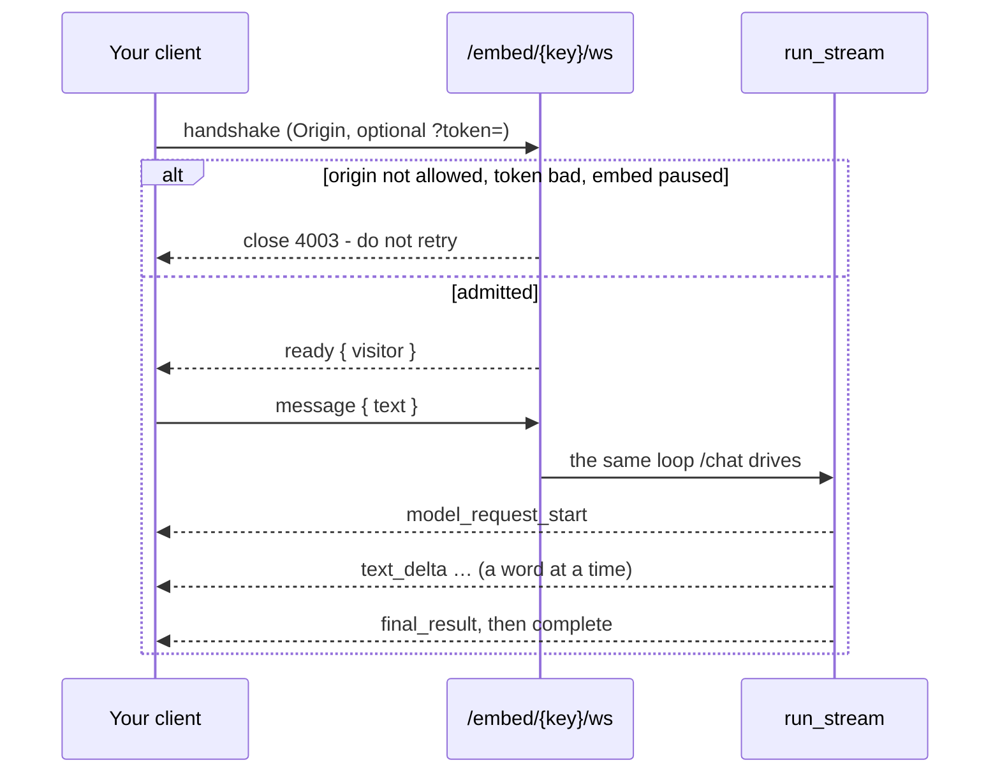
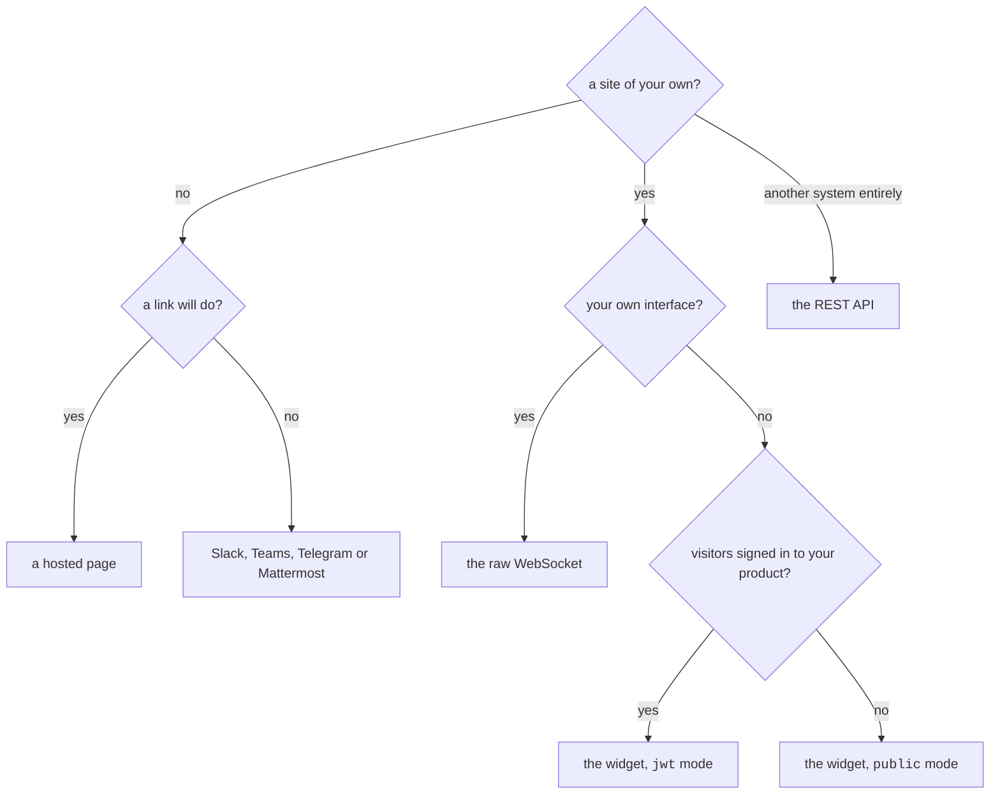

# Поместите агента туда, где уже есть люди { #putting-an-agent-where-people-already-are }

Агент, который отвечает только в Обзоре, — демонстрация. Один и тот же
опубликованный агент отвечает в восьми местах, и в каждом из них работает *одна и
та же замороженная версия* — с тем же бюджетом, тем же механизмом согласования и
теми же проверками организации: меняется способ доступа, а не агент.

| Где | Что нужно | Кто посетитель |
|---|---|---|
| **Обзор** (Dashboard) | ничего | вошедший участник |
| **Виджет для сайта** (Website widget) | тег `<script>` | анонимный посетитель или пользователь, за которого ручается ваш бэкенд |
| **Чистый WebSocket** (Raw WebSocket) | ключ встраивания | кто угодно, как решит ваша интеграция |
| **Размещённая страница** (A hosted page) | ссылка | анонимный посетитель, и больше ничего |
| **API** | сеанс | тот, у кого есть учётные данные |
| **Slack** | токен бота | учётная запись Slack, по желанию связанная с участником |
| **Telegram** | токен бота | учётная запись Telegram, по желанию связанная |
| **Mattermost** | токен бота и URL вашего сервера | учётная запись Mattermost, по желанию связанная |

Обзор открывается и как [приложение для компьютера](desktop.md): окно вокруг той
же консоли, загруженное с того же сервера, без ничего встроенного.

!!! abstract "Три правила действуют на любом способе доступа, и их обеспечивает механизм выполнения"

    - **Запуск всегда принадлежит ровно одной организации.**
    - **Лимит расходов проверяется перед каждым запросом к модели, никогда
      после.**
    - **Неудачный запуск остаётся в истории вместе с тем, что потратил** — токены
      были израсходованы до того, как он сломался, а бюджет, который это не
      учитывает, не бюджет.

!!! info "Три из этих восьми — одна таблица, и её строки различаются значением `kind`"

    Виджет, чистый сокет и размещённая страница — каждый из них *встраивание*, и
    вид фиксируется при создании, потому что уже вставленный тег, уже написанный
    клиент и уже отправленная ссылка указывают на одну и ту же строку.

Один публичный ключ, один счётчик лимита частоты, один бюджет, один переключатель
паузы и один набор отказов. Различается то, что можно настроить, и то, что
допускает посетителя, — поэтому Конструктор сначала спрашивает, какой вариант вам
нужен, и только потом всё остальное, и поэтому у страницы нет списка разрешённых
источников — его не игнорируют, его просто нет.

Каждый запуск записывает способ доступа, который его допустил, — `web`, `embed`,
`api`, `slack`, `telegram` или `mattermost`, — и именно по нему строится диаграмма
по способам доступа в Обзоре. Все три вида встраивания записываются как `embed`.
Две исторические особенности: запуски виджета, записанные до появления значения
`embed`, хранятся как `web`, а запуски Mattermost того же времени — как `api`. Ни
то ни другое не заполняется задним числом — переписывать историю значило бы
гадать, — поэтому диаграммы за старые периоды относят эти запуски к тому способу
доступа, под которым они записаны.

**Что позволено постороннему, позволено лишь в пределах лимита частоты.**

Способы доступа, доступные без сеанса, несут лимит, который считается в Redis
экземпляра, поэтому он действует для всех воркеров:

- API запуска, **на каждого вызывающего**;
- скрипт виджета и его допуск, **на каждый адрес**, каждый на своём счётчике;
- конфигурация размещённой страницы, **на каждую страницу** — её загружает сервер
  фронтенда, а не браузер, поэтому адрес там указывает на контейнер и сложил бы
  всех посетителей экземпляра в один счётчик.

Скрипт считается отдельно от следующего за ним допуска, потому что загрузка
страницы расходует и то и другое, а общий счётчик для обоих превращало число,
которое задаёт оператор, в треть самого себя.

Их задают `RATE_LIMIT_RUN_PER_MINUTE`, `RATE_LIMIT_EMBED_PER_MINUTE` и
`RATE_LIMIT_HOSTED_PAGE_PER_MINUTE`, а в разделе [настройки](configuration.md#rate-limiting)
есть одна оговорка, которую стоит прочитать до вывода в рабочую эксплуатацию, —
за прокси каждый посетитель приходит как прокси, если не сказать иначе.

А *расходы* на размещённой странице ограничивает сокет, который страница
открывает, и он считается на каждый адрес так же, как у виджета.

---


!!! tip "Интегрируете, а не настраиваете?"

    [HTTP API](api.md) описывает аутентификацию, заголовок организации, запуск
    агента по HTTP, два эндпоинта WebSocket и формат ошибок.

## Автоматическое участие в каналах { #automatic-channel-participation }

Автоматическое участие выключено у каждой привязки, пока участник с правом
**Управление каналами** (Manage channels) не включит его в **Доступность →
Мессенджеры → Настроить** (Availability → Chat apps → Configure). Выберите
отдельную модель для принятия решений, промпт фокуса, автоматическое наблюдение за всеми
каналами, доступными боту, и два интервала: по умолчанию 20 минут до упоминания
агента в диалоге и 1 минуту после. Явное упоминание по-прежнему запускает сразу.
Проверку вызывают только новые сообщения людей; пустые интервалы не приводят к
вызову модели.

Воркер объединяет в пакет не более 20 сообщений по 2 000 символов каждое.
Штатные квитанции доставки дедуплицируют сообщения в течение семи дней, а
окна ссылок истекают через семь дней без активности. Задачи переживают
перезапуски, но платный анализ и ответ никогда не повторяются автоматически.
Правка или отключение привязки, отзыв её учётной записи выполнения или ответ на
прямое упоминание вытесняют поставленное в очередь участие. «Активность»
фиксирует решение малой модели отдельно от ответа полного агента и записывает обе
стоимости, включая неудачные вызовы.

Автоматические ответы используют основную модель и инструкции опубликованного
агента, сохраняя его бюджет, защитные проверки и настройки поиска инструментов.

Они могут использовать только учётные записи MCP организации, явно привязанные к
этому агенту, в пределах списков разрешённых подключений и привязок. Личные
подключения, учётные данные MCP платформы и другие возможности действий
недоступны. Действующие правила согласования MCP сохраняются: вызов, требующий
согласования, отклоняется без приостановки и без выполнения. Агент объясняет
следующий шаг и просит кого-нибудь упомянуть его в ветке; обычный запуск затем
идёт от имени этого человека и по его обычным настройкам согласования.

Учётная запись выполнения — это участник, сохранивший настройку; его текущее
членство и разрешение на управление каналами проверяются заново перед запросами к
модели и перед доставкой.

Пассивное наблюдение требует настоящего потока групповых сообщений: потока
WebSocket Mattermost или отслеживаемого исходящего вебхука; полных событий
сообщений Slack, а не только `app_mention`; согласия на все сообщения ресурса в
Teams; доставки в Telegram с нужными настройками приватности и администратора;
либо доступа к сообщениям и intents Discord. Наблюдаются только те сообщения,
которые доставляет провайдер. SMS, электронная почта и iMessage сохраняют обычное
поведение «запрос — ответ»; этот фоновый режим канала им недоступен.

## Виджет для сайта { #the-website-widget }

Самый короткий путь. Опубликуйте агента, создайте встраивание, вставьте две
строки.

### 1. Создайте встраивание { #1-create-the-embed }

В Конструкторе откройте агента → **Доступность** (Availability) → *Виджет для
сайта* (Website widget). Вы выбираете:

- **Разрешённые сайты** (Allowed sites) — сайты, с которых можно открыть этот
  виджет. **Пустой список не разрешает ничего**, поэтому публикация без него
  отклоняется, а не создаёт виджет, который нигде не отвечает. Ключ в теге script
  публичен по своей природе, так что именно список источников мешает кому-то
  другому запускать вашего агента за ваш счёт. То же правило действует для
  сокета, рукопожатие которого проверяется по тому же списку.
- **Кто может его использовать** (Who can use) — `public` (анонимные
  посетители) или `jwt` (ваш бэкенд ручается за каждого посетителя; см. ниже).
- **Внешний вид** (Look) — заголовок и строка под ним, приветствие, что написано в
  пустом поле, что написано на кнопке запуска, акцентный цвет и в каком углу она
  висит. Все семь, причём приветствие рисует сам виджет, а не отправляет модели:
  приветствие в истории модели — это ход, который агент считает своим.
- **Предлагаемые сообщения** (Suggested messages) — до четырёх первых сообщений,
  предложенных кнопками под приветствием; клик отправляет одно из них от имени
  посетителя.
- **Источники** (Sources) — по умолчанию выключены. Когда включены, ответ,
  опиравшийся на базу знаний, называет эти документы под собой: только имена
  файлов, никогда отрывки, отдельным кадром `sources`.
- **Контекст** (Context) — примечание, добавляемое к первому сообщению
  посетителя: *«Вы на странице тарифов»*, *«Отвечайте по-немецки»*. Оно никогда
  не заменяет инструкции самого агента, которые принадлежат опубликованной
  версии.
- **Лимит частоты** (Rate limit) — сообщений на посетителя в минуту.
- **Голосовой ввод** (Voice input) — `off`, `browser` или `server`; это решает,
  куда уходит голос посетителя. См.
  [диктовку в виджете или на размещённой странице](#dictation-on-a-widget-or-a-hosted-page).

!!! danger "Пустой список источников не разрешает ничего, и это сделано намеренно"

    Ключ в теге script публичен по своей природе, поэтому список источников —
    единственное, что мешает кому-то другому запускать вашего агента за ваш счёт.
    Публикация без него отклоняется, а не создаёт виджет, который нигде не
    отвечает.

### 2. Вставьте фрагмент кода { #2-paste-the-snippet }

```html
<script src="https://your-api.example.com/api/v1/embed/PUBLIC_KEY/widget.js" async></script>
```

Вот и вся интеграция. У скрипта нет зависимостей, нет шага сборки и нет
фреймворка — он работает на странице, которая уже загружает React, jQuery или
вообще ничего.

### 3. (Необязательно) расскажите ему о посетителе { #3-optional-tell-it-about-the-visitor }

Виджет может **объявлять переменные** — имя, обязательна ли она, и строка о том,
для чего она, — а страница их передаёт:

```html
<script>window.AgenticOSContext = { plan: "pro", locale: "pl" };</script>
<script src="https://your-api.example.com/api/v1/embed/PUBLIC_KEY/widget.js" async></script>
```

Фрагмент, который выдаёт Конструктор, уже содержит эту строку с вашими ключами,
как только вы объявили хоть одну переменную.

Они добавляются к инструкциям агента как помеченный блок данных, под строкой о
том, что это сведения о посетителе, а не инструкции, и что проверить их нельзя.
Последнее верно для каждой из них, в том числе на виджете с `jwt`: виджет читает
`window.AgenticOSContext`, а токен подтверждает, *кто такой посетитель*, а не
*что страница о нём сказала*. Поэтому ничто здесь не может решать, что агенту
разрешено делать.

Отсюда следуют три правила:

- **Ключ, который никто не объявил, отбрасывается.** Страницу посетитель может
  править; без объявления любой придуманный им ключ стал бы строкой внутри
  инструкций агента.
- **Отсутствующее обязательное значение опускает свою строку, и это записывается
  в журнал.** `required` — обещание интегратора самому себе: его принудительное
  исполнение стоило бы посетителю ответа из-за чужой ошибки в экземпляре.
- **Отправляются один раз за диалог**, до первого вопроса, и читаются из каждого
  кадра, а не при подключении: одностраничное приложение узнаёт, кто перед ним, не
  переподключаясь.

### 4. (Необязательно) расскажите ему, кто посетитель { #4-optional-tell-it-who-the-visitor-is }

Для виджета внутри вашего собственного продукта со входом задайте токен **до**
загрузки скрипта. Его подписывает ваш бэкенд; мы проверяем подпись и никогда не
видим вашу базу пользователей:

```html
<script>window.AgenticOSToken = "<%= agenticos_token_for(current_user) %>";</script>
<script src="https://your-api.example.com/api/v1/embed/PUBLIC_KEY/widget.js" async></script>
```

Как его выпустить, на любом языке, умеющем подписывать JWT:

```python
import time, jwt   # PyJWT

token = jwt.encode(
    {"sub": str(user.id), "iat": int(time.time())},
    EMBED_SIGNING_SECRET,          # the secret you set on the embed
    algorithm="HS256",
)
```

- `sub` обязателен. Он определяет посетителя для лимита частоты, и токен без него
  отклоняется — иначе один утёкший токен стал бы всем бюджетом виджета.
- **`iat` обязателен и должен быть в пределах последних 12 часов** — его проверяют
  не только тогда, когда он есть. Токен без `iat` или с устаревшим значением
  отклоняется, поэтому утёкший из браузера токен не может работать вечно.
  Заданный вами `exp` тоже учитывается, но только чтобы **сократить** это окно
  (просроченный токен отклоняется); продлить токен сверх 12-часового потолка он не
  может.
- Выпускайте его на каждой загрузке страницы, на стороне сервера.

!!! danger "Никогда не отдавайте секрет подписи в браузер"

    Он подписывает *любого* посетителя. Токен, который он выпускает, — это то,
    что браузеру позволено хранить, и только в течение двенадцати часов, которые
    даёт `iat`.

---

## Чистый WebSocket { #the-raw-websocket }

Виджет — клиент задокументированного протокола, а не чёрный ящик. Если вам нужен
свой интерфейс — мобильное приложение, киоск, компонент в вашей дизайн-системе, —
говорите с тем же сокетом:

```
wss://your-api.example.com/api/v1/embed/PUBLIC_KEY/ws[?token=SIGNED_JWT]
```

**Собирать это вручную не нужно.** Опубликуйте такой сокет в Конструкторе — агент
→ **Доступность** (Availability) → *Чистый WebSocket* (Raw WebSocket) — и его
строка напечатает URL, построенный из базового URL самого экземпляра, с кнопкой
копирования. **Виджет** печатает то же самое рядом со своим тегом script, потому
что виджет — клиент этого протокола: переход на собственный интерфейс — шаг, а не
переписывание. `?token=` там не печатается: в режиме `jwt` токен выпускает ваш
бэкенд для каждого посетителя, а настоящий токен на экране консоли — это
работающие учётные данные, которые можно прочитать через плечо.

!!! bug "Первое, что идёт не так: отсутствующий `Origin`"

    Рукопожатие должно нести `Origin`, который есть в списке разрешённых у
    встраивания.
    **Браузер отправляет его за вас; ваш собственный клиент не отправляет ничего,
    если вы не зададите,** — мобильное приложение, киоск, серверный ретранслятор.
    Выглядит это не как сообщение об ошибке, а как `4003` в таблице ниже.



**Кадры, которые вы отправляете**

```json
{ "type": "message", "text": "Do you ship to Poland?" }
```

Это весь входящий словарь, плюс `context` (что страница говорит о посетителе) и
`file_ids` (что он прикрепил, на странице, которая принимает файлы).

Каждый кадр `message` учитывается в лимите на соединение, включая пустые и искажённые
сообщения. Корректные сообщения ещё и расходуют существующую квоту посетителя;
искажённый ввод не может исчерпать счётчик, общий с другими анонимными
посетителями. Кадр может назвать не более трёх идентификаторов файлов; слишком
длинные списки отклоняются до разбора. Некорректные идентификаторы в допустимом по
длине списке отбрасываются и записываются одной сводной строкой журнала без их
значений.

**Словарь намеренно не включает три поля, которые несёт кадр самого Обзора:**
агента, профиль модели и окружение.

Кадр, который мог бы выбрать модель, означал бы, что посетитель выбирает её за счёт
оператора, а кадр, который мог бы выбрать агента, — что посетитель говорит с
тем, чего никто не публиковал под этим ключом. Все три берутся из строки
встраивания.

Неизвестное поле **игнорируется, а не отклоняется**. Клиент, закэшированный в
чьём-то браузере, может быть старше этого сервера, и закрытие сокета из-за него
унесло бы с собой диалог.

**Кадры, которые вы получаете**

!!! note "Это словарь кадров самого Обзора, а не второй"

    `/chat` и этот сокет приводят в действие один цикл
    (`app/services/run_stream.py`), поэтому ответ приходит сюда слово за словом
    так же, как там. Раньше размещённая страница показывала один кусок текста
    после тридцати секунд пустоты, и виноват в этом был цикл, а не транспорт.

Каждый кадр несёт `{ "type": …, "data": { … } }`.

| `type` | `data` | Что значит |
|---|---|---|
| `ready` | `visitor` | Соединение установлено. `visitor: true`, когда токен опознал человека. |
| `history` | `messages` | Что было сказано в ветке, которую этот посетитель продолжает, — **размещённая страница с анонимным посетителем**, единственное соединение, которое несёт ключ непрерывности: диалог виджета живёт столько же, сколько его сокет, а посетителя `jwt` называет его токен. Каждая запись — `role`, `text` и `at`, поэтому воспроизведённый ход сохраняет время под собой. |
| `model_request_start` | — | Агент обратился к модели. Покажите индикатор. |
| `part_start` | `index`, `part_type`; `tool_name`, `tool_call_id` для `ToolCallPart` | Начинается блок ответа. Вызов инструмента называет себя здесь, чтобы клиент мог показать его, пока идут его аргументы. Отправляется только для блока, который этот способ доступа действительно передаёт: страница, не показывающая рассуждения, не объявляет `ThinkingPart`, ведь одно объявление уже говорит о том, что агент рассуждал. |
| `text_delta` | `index`, `content` | Слова ответа. Дописывайте их. |
| `thinking_delta` | `index`, `content` | Рассуждения модели. **Только если оператор их включил.** |
| `call_tools_start` | — | Агент вот-вот воспользуется инструментами. |
| `tool_call` | `tool_call_id`, `tool_name`, `args` | Шаг. `args` — только когда оператор показывает результаты. |
| `tool_call_delta` | `index`, `args_delta` | Аргументы вызова по мере их поступления. |
| `tool_result` | `tool_call_id`, `content` | Что вернул шаг. |
| `sources` | `names` | Документы, которые вернул поиск по знаниям, по названиям. **Только у виджета, где оператор включил источники**, и никогда отрывки. |
| `final_result_start` | `tool_name` | Ответ формирует инструмент вывода. |
| `final_result` | `output` | Чем закончился запуск. Пусто у хода, который приостановлен. |
| `complete` | — | Ход закончен. Он **не несёт расхода**: сколько стоил запуск — дело оператора, а не посетителя. |
| `error` | `message` | То, что посетитель должен увидеть: лимит частоты, исчерпанный бюджет, отказ, ход, не давший ничего. |
| `compaction_started`, `compaction_finished`, `compaction_impossible` | по кадру | Агент приводит в порядок свои заметки, потому что ветка переросла окно модели. Отправляется всегда, какими бы ни были переключатели оператора: сводка занимает десятки секунд, а способ доступа, который передаёт потоком и молчит, просто замирает на это время ([#936](https://github.com/vstorm-co/agenticos/issues/936)). |

Некоторые кадры Обзора никогда не доходят до публичного сокета, и это отказы, а не
настройки. **`user_prompt_processed`** несёт промпт *в собранном виде* —
примечание о размещении и переданный блок над тем, что набрал посетитель, — а это
текст оператора, и читать его обратно посетителю не положено.

**`ask_user` и `tool_approval_required` здесь некому отвечать, но отказывают они
по-разному.** Посетитель не может одобрить побочный эффект в чужой организации,
поэтому `tool_approval_required` **приостанавливает** запуск точно так же, как это
происходит в канале, и ход заканчивается кадром `error` о том, что решать должен
человек, — но, в отличие от канала, без ссылки на `/runs`: там читатель —
участник, который может её открыть, а здесь это посторонний со ссылкой. `ask_user`
**не** приостанавливает: `AgentDeps.ask_user` на этом способе доступа равен `None`,
поэтому инструмент *отказывает*, когда модель его вызывает (`app/agents/ask_user.py`),
и модель продолжает отвечать без этих данных — ухудшенный ответ, а не
приостановленный запуск.

**Клиент игнорирует то, чего не рисует**, и `widget.js` — разобранный пример: он
читает `model_request_start`, `text_delta`, `final_result`, `complete` и `error`
для ответа, `tool_call` и `tool_result`, чтобы показать каждый шаг плашкой
(*Поиск по базе знаний*), и `sources` для документов, которые назвал ответ.
Рассуждения он игнорирует намеренно. Он носит лицо агента, отрисовывает ответ из
Markdown в узлы, а не в HTML, следует светлой или тёмной настройке посетителя и
заполняет экран телефона.

**Коды закрытия**

| Код | Значение |
|---|---|
| `4003` | Отказ. Источник не разрешён, токен не прошёл или виджет на паузе. Не повторяйте — ответ не изменится. |
| `4029` | Слишком много соединений с этого адреса за последнюю минуту. Отступите и повторите. |
| `1011` | Этот клиент не читал. Кадр добирался до него дольше 30 секунд, поэтому сервер перестал писать, а не стал держать сеанс базы данных хода и открытый поток провайдера на каждый кадр. Переподключитесь; размещённая страница продолжит свою ветку. |

Отказ намеренно сделан одним кодом с одним сообщением. Страница не из списка
разрешённых узнаёт, что ей нельзя, и ничего о том, помог бы токен.

`4029` отделён от него по противоположной причине: «нельзя» и «можно, но слишком
часто» требуют от клиента противоположного — остановиться навсегда и повторить
позже, — поэтому клиент, который их не различает, либо упорно бьётся в отказ,
либо отказывается от лимита. Сколько соединений получает адрес, задаёт
`RATE_LIMIT_EMBED_PER_MINUTE`; сколько *сообщений* получает посетитель после
подключения — лимит частоты самого виджета, заданный в Конструкторе.

Минимальный клиент:

```js
const socket = new WebSocket(`${BASE}/api/v1/embed/${KEY}/ws`);
let answer = "";
socket.onmessage = (event) => {
  const { type, data } = JSON.parse(event.data);
  if (type === "text_delta") render((answer += data.content));
  if (type === "final_result" && data.output) render((answer = data.output));
  if (type === "complete") answer = "";
  if (type === "error") render(data.message);
};
socket.send(JSON.stringify({ type: "message", text: "hello" }));
```

`final_result` присваивается, а не дописывается: это то, чем запуск *закончился*, и
у провайдера, не приславшего ни одной дельты, он остаётся единственной копией
ответа.

---

## Что предлагает каждый способ доступа и почему различия — это различия { #what-each-surface-offers-and-why-the-differences-are-differences }

Три способа доступа проводят одного и того же агента через один и тот же механизм
выполнения: чат Обзора, этот сокет и публичный API. Они **не** предлагают один и
тот же запуск, и до [#936](https://github.com/vstorm-co/agenticos/issues/936) нигде
не было сказано, какие из различий — решения.

Теперь есть. У каждого «нет» ниже есть причина, а причина — это либо «здесь это
было бы неправильно», либо «это ещё не сделано», но никогда молчание.

Последний столбец — Teams (#1985), представляющий соседние с ним чат-платформы.

| | `/chat` (Обзор) | Чистый WebSocket | Публичный API | Teams |
|---|---|---|---|---|
| Потоковая передача | да | да, отфильтрованная по тому, что показывает оператор | **нет** — POST и есть путь без потока; вариант с SSE — отдельный вопрос | сообщение, переписываемое по мере поступления ответа |
| Вложения | да | да (`file_ids`) **на размещённой странице** — эндпоинт загрузки разрешает ключ через `find_page`, поэтому у виджета или чистого сокета нет маршрута, который выдал бы идентификатор | да (`file_ids`), и они маршрутизируются так же, как везде | да, из личного чата; файл возвращается через карточку согласия Teams |
| Непрерывность диалога | да | да (`continuity_key`), на размещённой странице с анонимным посетителем | да (`conversation_id`) | чат или ветка канала |
| `environment_id` | да | **нет, намеренно** — см. ниже | да | **нет** — решает привязка, как на любой чат-платформе |
| Переопределение модели | да | **нет, намеренно**: публичный способ доступа не должен позволять посетителю выбирать, за что он платит | **нет**: запрос не несёт `model_profile_id`. Какую версию запускать, всё ещё решает вызывающий через `environment_id`, а окружение может закрепить ту, что никогда не была по умолчанию | **нет**, как на любой чат-платформе |
| `ask_user` | да | **нет, пока** — см. ниже | **нет, и правильно**: на HTTP-запросе никто не ждёт, чтобы ответить на вопрос | да, как Adaptive Card |
| Уведомление о сжатии | да | да | не применимо — нечего передавать потоком | нет — ответ приходит, когда готов |
| Кадры поручений | да | **нет, намеренно**: при подключении приёмника библиотека открывает *потоковый* запрос на каждого дочернего агента, поэтому агент-исполнитель, чей провайдер не умеет поток, ломается в тот момент, когда за ним наблюдают | не применимо — нечего передавать потоком, чтобы их нарисовать | **нет** — ответ приходит, когда готов, а его шаги не рисуются |
| Согласования: приостанавливают запуск | да | да | да | да |
| Согласования: путь к решению | да (`/runs`) | одно предложение, намеренно: постороннему со ссылкой не показывают URL в чужую консоль | да — результат несёт `parked`, называя, что ждёт и куда отправлять согласование | да — Adaptive Card, решает участник, который её нажимает |
| Упоминания через `@` | да (`mentions`) | **нет, пока**: у виджета нет меню, из которого выбирают, а упоминание посетителя потребовало бы той же проверки, что действие совершается от его имени | **нет, пока**: скрипт называет нужное прямо в сообщении | **нет**, как на любой чат-платформе |

### `environment_id` в сокете, и почему им распоряжается публикующий { #environment_id-on-the-socket-and-why-it-is-the-publishers }

В API оно есть, потому что вызывающий — это организация: опробовать окружение
разработки перед переводом в окружение — её собственная работа с её собственным
агентом. Вызывающий сокета — тот, у кого есть ключ встраивания, а у виджета это
браузер постороннего. Кадр, который выбирал бы окружение, позволил бы посетителю
выбрать, какая *версия* агента ему отвечает, — в том числе та, которую организация
не переводила, а это противоположность смыслу публикации версии.

Поэтому в таком виде это отклоняется. Если собственной интеграции нужно
запускать названное окружение, место для этого — собственная конфигурация
встраивания, где публикующий выбирает один раз, и каждый посетитель получает один
и тот же ответ.

### `ask_user` в сокете, и что для него нужно { #ask_user-on-the-socket-and-what-it-would-need }

В docstring модуля `ask_user` сказано, что пауза и продолжение живут «в сеансе
WebSocket», и имеется в виду сеанс *чата*. Этот сокет так же живой, и человек точно
так же сидит там же, — поэтому агенту-исполнителю, который хотел бы спросить, сообщают,
что достучаться ни до кого не удалось: для запуска по расписанию это правильный
ответ, а здесь — неправильный.

Здесь это не закрыто, потому что недостающая половина не на стороне сервера. В
словаре кадров нет ни `ask_user`, ни `ask_user_response`, а у виджета нет формы,
чтобы её отрисовать, — поэтому подключение обратного вызова приостанавливало бы
запуски из-за вопроса, на который некому ответить, а это хуже отказа. Что нужно: два
кадра, форма виджета и решение насчёт *размещённой страницы*, где спрашиваемый —
посторонний, а вопрос может нести всё, что агент решил сказать.

### Согласования в сокете: решено, и намеренно не расширено { #approvals-on-the-socket-decided-and-deliberately-not-widened }

Приостановленный запуск отвечает посетителю: «Для этого нужно, чтобы кто-то одобрил
его, прежде чем он сможет выполниться», — и так остаётся. Чистый сокет подаётся
как интерфейс, который вы строите сами, — мобильное приложение, киоск, — и собственному
клиенту с вошедшим пользователем в принципе можно было бы отдать
приостановленный вызов и способ его решить. Это не сделано, потому что ключ
встраивания не опознаёт *участника*: он опознаёт опубликованный способ доступа
экземпляра, а человек на другом конце может быть любым, кого пустила интеграция.
Решение о согласовании — действие участника, закрытое проверкой `approvals:decide`,
и ему место на способе доступа, который знает, кто спрашивает.

## Размещённая страница { #a-hosted-page }

Самая короткая интеграция из возможных: **отправьте кому-нибудь ссылку.** Ни
собственного сайта, ни тега `<script>`, ни клиента, который надо написать, ни
входа.

В Конструкторе откройте агента → **Доступность** (Availability) → *Размещённая
страница* (Hosted page). Сайт называть не нужно, и вставлять нечего — форма
спрашивает заголовок, приветствие, акцент и логотип, всё необязательное, и
публикует:

```
https://your-app.example.com/e/PUBLIC_KEY
```

Это **встраивание, как и другие два**: тот же вид ключа, тот же лимит частоты, тот
же бюджет и тот же переключатель паузы. Пауза останавливает страницу сразу — и
каждую ссылку, уже отправленную с ней.

### Что его защищает { #what-protects-it }

Произнесите эту часть вслух перед публикацией, потому что в ней вся модель
безопасности:

> **Размещённую ссылку в режиме `public` защищают непредсказуемость ключа, лимит
> частоты встраивания, его бюджет и его переключатель паузы. И ничего больше.**

У кого есть ссылка, тот может говорить с агентом. В этом смысл ссылки, и поэтому
ключ — это 24 случайных байта, а не что-то читаемое.

Списка разрешённых источников здесь намеренно нет, и форма его не предлагает:
список разрешённых — это правило о сайтах *других людей*, а эта страница — та,
которую обслуживаем мы. Страница допускается с собственного источника экземпляра —
он выводится из `FRONTEND_URL` и никогда не зашит в код — и ниоткуда больше.
Ограничение `CHECK` отклоняет страницу, которая вообще несёт список, потому что
сохранённый читается как то, что защищает ссылку, а это не так.

### Две вещи, которые размещённая страница отклоняет { #two-things-a-hosted-page-refuses }

Обе отклоняются при публикации, с сообщением, а не молчаливым откатом к виджету:

- **Страница не может использовать режим `jwt`**, и форма его не предлагает. Токен
  пришлось бы передавать в URL, а значит, в историю браузера, в заголовки
  `Referer` и в каждый чат-клиент, куда вставят ссылку, — а трюк с фрагментом,
  который часть этого обходит, лишает ссылку свойства «отправь её, и она
  работает». Для интеграции на каждого пользователя используйте виджет или сокет;
  на `jwt` это не влияет. То же правило держит ограничение `CHECK` в базе
  данных.
- **Обязательная переменная, не безопасная для URL, не может быть на странице** —
  см. ниже.

### Переменные из адресной строки { #variables-from-the-address-bar }

У размещённой страницы нет вашей страницы, с которой можно прочитать
`window.AgenticOSContext`. Единственный источник объявленной переменной для неё —
URL самого посетителя:

```
https://your-app.example.com/e/PUBLIC_KEY?var_plan=pro
```

**Параметр запроса — это ввод, которым управляет посетитель**, поэтому это
выключено для каждой переменной и включено только там, где кто-то так решил:
отметьте *URL-safe* у переменной в Конструкторе. Без этого параметр
`?var_user_tier=premium`, набранный в адресной строке, отбрасывается — в этом и
смысл. Всё, что вовсе не объявлено, отбрасывается, как и в виджете.

Поэтому же *обязательную* переменную нужно помечать: на этом способе доступа URL —
единственный способ её передать, так что обязательная и не безопасная для URL
переменная — обещание, которое страница структурно не может сдержать.

### Возвращение к ней { #coming-back-to-it }

Диалог виджета живёт столько же, сколько его сокет. Ссылка в закладках — более
сильное обещание, поэтому страница хранит случайный ключ посетителя в
`localStorage` — один на публичный ключ, — а сервер сопоставляет его с диалогом.
Повторное открытие ссылки воспроизводит ветку, и агенту напоминают то же окно,
которое читает посетитель.

**Ключ — это Bearer-токен для этого диалога**: у кого он есть,
тот продолжает ветку, включая то, что в ней уже сказано. Это 128 случайных бит и
ничего о человеке. Очистка данных сайта начинает новую ветку.

Этот ключ — всё, что хранит страница, поэтому **размещённая страница и общий
диалог не показывают запрос согласия на cookie** — эти два способа доступа, которые
получает тот, кто не является участником, — единственные два без необязательного
cookie, на который нужно согласие.
Раньше здесь появлялся баннер продукта: он спрашивал разрешение на аналитику,
которую этот экземпляр не запускает, и при этом висел над полем ввода и закрывал
кнопку «Отправить» (#644). Запрос согласия ради одного необходимого ключа — запрос,
единственный эффект которого — перекрытие элементов.

Это обеспечивается, а не предполагается: сокет принимает от 32 до 64
шестнадцатеричных символов в нижнем регистре как `visitor` и **отбрасывает всё
остальное**, открывая вместо этого новую ветку. Это важно для вашего собственного
клиента (ниже): привязка непрерывности к идентификатору клиента, адресу почты или
счётчику дала бы каждому из ваших пользователей диалог, в который следующий может
войти, угадав его. Отброшенный ключ стоит потери непрерывности, но никогда — диалога,
поэтому устаревшее значение в чьём-то браузере — это не страница, которая не
загрузится.

### Что она предлагает { #what-it-offers }

Три варианта, и каждый принадлежит оператору, а не странице: возможность, которую
страница включила бы себе сама, была бы такой, которую никто не может выключить.

- **Кнопка для нового диалога** (A button to start a fresh thread), по умолчанию
  включена. Она выпускает новый ключ непрерывности, поэтому старая ветка не
  удаляется: она просто перестаёт быть той, которую продолжает этот браузер.
- **Голосовой ввод** (Voice input), по умолчанию выключен: `browser` диктует
  браузером самого посетителя, а `server` — провайдером распознавания речи
  организации. Что именно выбрано, решает, куда уходит голос посетителя, — см.
  [диктовку в виджете или на размещённой странице](#dictation-on-a-widget-or-a-hosted-page).
  Страница, опубликованная до появления этого выбора, сохраняет то, что было: её
  прежний *микрофон в поле ввода* стал `browser`, а отсутствие микрофона — `off`.
- **Возможность прикрепить файл** (A way to attach a file), по умолчанию выключена.
  См. ниже: это единственное на этом способе доступа, что позволяет постороннему
  *что-то сохранить*.

### Куда может писать посторонний со ссылкой { #what-a-stranger-holding-the-link-can-write-to }

Всё остальное на публичном способе доступа читает. Этот пишет, поэтому стоит точно
сказать, что посетитель может положить и куда.

**Посетитель может сохранить файл**, и только если оператор поставил галочку. Байты идут
тем же путём, что и загрузка участника, — список разрешённых MIME-типов,
`CHAT_MAX_UPLOAD_SIZE_MB` (по умолчанию 10 МБ — собственный потолок чата, а не
больший `MAX_UPLOAD_SIZE_MB` базы знаний), парсер, хранилище, строка `ChatFile`, —
но перед этим стоят три сужения:

| | |
|---|---|
| **Свой потолок у этого способа доступа** | `EMBED_MAX_UPLOAD_SIZE_MB`, по умолчанию 5 МБ. Участник, загружающий пятидесятимегабайтный экспорт, — это человек, которого организация наняла; та же квота на публичной ссылке — способ заполнить диск с адреса, которого никто не знает. Это потолок *поверх* `CHAT_MAX_UPLOAD_SIZE_MB`, никогда не способ его обойти |
| **Лимит на адрес и на посетителя** | `RATE_LIMIT_EMBED_UPLOAD_PER_MINUTE` в общем Redis, и **оба** должны это разрешать. Если считать только ключ непрерывности, это ничего не ограничивает: браузер выпускает его сам, и любые 32 шестнадцатеричных символа — допустимы, поэтому скрипт меняет его на каждый файл. Если считать только адрес, один браузер за общим адресом потратит всё за всех |
| **Три файла на сообщение** | Ограничивает, какую долю промпта одного хода составляет чужой документ |

Эти три ограничивают то, что *сохраняется*. А то, что посторонний может заставить
этот экземпляр *получить*, ограничивает слой выше всех них, потому что
тело multipart разбирается до того, как выполняется маршрут: запрос, объявляющий
больше потолка всего запроса, получает 413, не будучи прочитанным. См.
[настройки](configuration.md#the-size-of-a-request-as-opposed-to-the-size-of-a-file),
в том числе то, что они не покрывают.

**Строка принадлежит участнику, опубликовавшему страницу**, потому что
`chat_files.user_id` — `NOT NULL`, а у посетителя нет учётной записи: тот же ответ,
что уже дан на вопрос, от чьего имени *выполняется* публичный ход. Поэтому
страница, чей публикующий потерял учётную запись, вообще не может принимать файлы
и говорит «недоступно», а не сохраняет их ни за кем.

**Куда файл потом попадает — решает механизм выполнения, а не этот способ
доступа.** Это маршрутизация из раздела [Обработка файлов](file-processing.md), без
изменений: в рабочее пространство агента, если оно у него есть, и в промпт, если
нет, а изображение — обоими путями, до потолка встроенных данных. Ничто в файле
посетителя не является особым случаем.

Кадр может назвать только файл, который принадлежит владельцу этой страницы и ещё
не привязан к сообщению, поэтому идентификатор нельзя воспроизвести во втором ходе
или в чужой ветке. Это соразмерно, а не полно, и достаточным его делает сам
идентификатор: `uuid4` — это 122 случайных бита, поэтому идентификатор другого
посетителя — значение, которое никто не может получить, если ему его не передали.

**Больше посетитель писать ничего не может.** Ни базы знаний, ни собственного
пути в рабочем пространстве, ни конфигурации, ни переменной, которая не объявлена
и не безопасна для URL. Строку диалога и ходы в ней платформа записывает *о* нём.

### Что посетитель видит о работе { #what-the-visitor-sees-of-the-work }

Ещё три переключателя, и это **фильтры на то, что отправляет сервер**, а не на то,
что рисует страница. В этом различии весь замысел: рассуждения, спрятанные в CSS, —
это рассуждения агента, лежащие в инструментах разработчика постороннего человека, а
страница — как раз то место, где у постороннего они открыты. Посетитель, который
откроет свои, увидит отмеченное здесь и ничего больше.

| Переключатель | По умолчанию | Что пропускает |
|---|---|---|
| **Что делает агент** (What the agent is doing) | включён | Одна строка на шаг — *Ищу документы*, *Выполнил запрос*. Включён, потому что страница, которая молчит тридцать секунд, читается как сломанная |
| **Что вернул каждый шаг** (What each step returned) | выключен | Аргументы, с которыми вызвали шаг, и то, что вернулось. Написано для модели, поэтому именно здесь всплывает что-то внутреннее: адрес, строка из системы, отрывок, который никто не собирался публиковать |
| **Рассуждения агента** (The agent's reasoning) | выключены | То, что модель говорит себе перед ответом. Написано не для того, чтобы это читали, и это не ответ, за который оператор может
поручиться |

*Что вернул каждый шаг* нельзя включить отдельно — нет шага, который он мог бы
раскрыть, и сервер отбрасывает оба, что бы ни говорила конфигурация.

**Ход выглядит как ход в веб-чате**, вплоть до обрамления: имя агента над ответом,
аватар в боковом поле — логотип страницы, если он есть, и первая буква имени агента, если
нет, — время под каждым ходом с той стороны, где он находится, и одна карточка поля
ввода с полем и его элементами управления внутри.

Три вещи, которые веб-чат там рисует, намеренно отсутствуют, и все три — то же
решение, что и панели ниже: сколько стоил ход, сколько стоил месяц и какого агента
и модель запускать.

Последнее потому, что кадр, который мог бы выбрать модель, означал бы, что посетитель
выбирает её за счёт оператора.

**Ход отрисовывают собственные компоненты веб-чата**, а не второй набор, похожий на
них.

`TurnParts` — это то, что отрисовывает Обзор и что отрисовывает страница. Поэтому
рассуждения — тот же раскрывающийся блок, ответ — тот же Markdown, а череда вызовов
инструментов — та же лента: иконка из `src/lib/tool-catalog.ts`, формулировка из
`toolStep` и те же рендереры, раскрывающиеся под шагом для поиска по знаниям,
поиска в интернете, диаграммы, выполненного кода, загруженного навыка, записанного
файла.

Второй таблицы имён инструментов и второго рендерера хода намеренно нет (#144). А
чего страница *не* рисует — это всё, что связано с членством в организации; см.
ниже.

Одно читается иначе по необходимости: вызов, пришедший с MCP-сервера, в Обзоре
называется *Linear · Create issue*, а здесь — очеловеченным именем, потому что это
соответствие берётся из списка подключений организации, а для его чтения нужен
сеанс.

**Сгенерированное изображение, запись речи или видео тоже проигрывается на
странице** (#2309). Консоль читает такое через `/api/v1/generated/{filename}`, а для
этого нужен сеанс, которого у посетителя нет. Поэтому, отправляя результат
сгенерированного изображения, речи или видео с именем файла, который сохранили
инструменты самого этого запуска, сокет добавляет `token`, а страница
читает файл через `/api/embed/<key>/generated/<file>?token=…`, который отдаёт его
потоком и пропускает диапазоны байтов для проигрывателя.

Токен — это HMAC под `SECRET_KEY` экземпляра от ключа страницы, этого одного файла
и срока истечения через шесть часов. Он не открывает ничего другого: ни файл
другого диалога, ни файл другой организации, ни любое другое имя. Плохой,
просроченный или отсутствующий токен получает тот же 404, что и отсутствующий файл.
Он добавляется при отправке кадра, поэтому транскрипт не хранит ни одного, а
карточка — это результат того шага: она показывается только там, где включено *Что
вернул каждый шаг*. Интеграция через сокет находит тот же адрес в `url` полезной
нагрузки, как путь API.

Результат, называющий файл, который этот запуск не сохранял, не получает токен, как
бы ни назывался вернувший его инструмент. Одну ссылку можно запрашивать 120 раз в
минуту — запас для диапазонов байтов проигрывателя, — а ссылка сверх этого получает
429.

**У виджета и чистого сокета нет переключателей, и они получают эти значения по
умолчанию**, взятые из `PageConfig`, а не повторённые: вторая копия «по умолчанию
выключено» — это копия, которая может разойтись с той, что человек читает в
Конструкторе. А то, что `widget.js` после этого *рисует*, ещё уже, и об этом
сказано выше.

Ни один из них не принимает и файлов, и это свойство маршрута, а не клиента:
эндпоинт загрузки разрешает ключ через `find_page`, поэтому ключ виджета
доходит до неё и получает ответ «недоступно». Виджет живёт на странице, которую
оператор и так контролирует, — там и место его собственному выбору файлов.

### Что намеренно доступно только участникам { #what-is-deliberately-member-only }

Веб-чат рисует три панели, которых публичный способ доступа не рисует, и каждый
пропуск — решение, а не пробел; он записан здесь, чтобы его не пересматривали как
пробел.

| Панель | На публичном способе доступа | Почему |
|---|---|---|
| **Полоса расхода** | Нет, и это не переключатель | Она сообщает токены хода, его стоимость, месяц против лимита организации и заполненность рабочего пространства. Платит не посетитель, и оставшийся бюджет оператора — это факт об операторе. `complete` вовсе не несёт расхода, так что на клиенте нечего скрывать |
| **Панель файлов** | Нет | Она перечисляет всё в *рабочем пространстве* агента, а оно общее для диалогов всех, кто пользуется этим агентом. Постороннему, прикрепившему один файл, показали бы каждый файл, который агенту когда-либо давали. Его собственное вложение — на его собственном ходу, и это то, что ему положено |
| **Панель поручений** | Нет | Она называет агентов-исполнителей по `slug`, что каждому поручили и сколько каждый стоил, — форму графа агентов организации. Страница, которая её показывала бы, публиковала бы внутреннюю оргструктуру любому, у кого есть ссылка. Поручение всё равно *выполняется*: это один шаг `tool_call` с именем `task`, под тем же переключателем, что и любой другой шаг |

Общий приём за всеми тремя: то, что видит участник, — *об организации*, а то, что
видит посетитель, — *о его собственном ходе*. Панель, которая пересекает эту
границу, доступна только участникам, чего бы ни стоила её отрисовка.

### Как это выглядит { #what-it-looks-like }

Ответ отрисовывается как **Markdown** — так же, как в веб-чате: агент, которому
велено отвечать в Markdown, отвечает в нём независимо от того, переосмысливает ли
страница звёздочки. То, что набрал *посетитель*, не переосмысливается: это не
документ.

Четыре поля, все необязательные:

| Поле | По умолчанию |
|---|---|
| **Заголовок страницы** (Page title) | имя агента |
| **Приветственное сообщение** (Welcome message) | нет. **Markdown**, написанный в том же редакторе, что и примечание о размещении, и отрисованный на странице как Markdown. Показывается до первого вопроса и никогда не отправляется модели — приветствие в истории модели — это ход, который агент считает своим |
| **Акцентный цвет** (Accent colour) | `#4f46e5`. Светлая и тёмная темы всё равно следуют системе посетителя |
| **Логотип** (Logo) | аватар агента; аватар организации, ваш загруженный файл или ничего. Что бы вы ни выбрали, страница показывает **ничего**, а не сломанное изображение, когда за этим нет файла: агент без аватара — обычное дело, а браузер не отличает 404 от медленно загружающегося изображения |

Три из этих четырёх — изображения, которые платформа уже хранит. Четвёртое
принимает файл — PNG, JPEG, WebP или GIF, до 2 МБ, — и его можно добавить только
когда страница существует, потому что загрузке нужна строка, к которой
прикрепиться.

Страница загружает его со **своего собственного источника**, а не из API: `img-src`
в `next.config.ts` исключает API по простому `http`, поэтому страница, нацелившая
`` на него, отрисовывала сломанный значок и в разработке, и на любом
экземпляре, который завершает TLS в другом месте. `/api/embed/<key>/logo` на
фронтенде проксирует его.

**URL от вас оно тоже не принимает.** Страница, которую обслуживаем мы,
загружающая изображение, заданное оператором, — это ещё одна вещь, которую нужно
обезопасить. А сохранённый путь — это *столбец*, записанный маршрутом загрузки и
никогда конфигурацией, которую вы отправляете: путь читается обратно и отдаётся
потоком публичным маршрутом, поэтому путь, принятый из тела запроса, означал бы
вызывающего, называющего любой файл, который может открыть процесс.

**И оно не принимает ни ваше имя файла, ни ваше слово о том, что это за файл.**

Поскольку страница загружает логотип со своего собственного источника, какой бы тип
ни нёс этот ответ, это тип, которому браузер доверяет на этом источнике, — а
`script-src` там разрешает встроенный скрипт.

Загрузка принимается по `Content-Type`, который *объявил* её клиент, а это не
доказательство о байтах. Поэтому имя на диске выводится вместо этого из типа
(`logo.png`, `logo.jpg`, `logo.webp`, `logo.gif`), и маршрут API, и прокси
фронтенда отказываются отвечать чем-либо, что не является одним из этих четырёх
типов изображений.

Сохранённый `.html` или `.svg` — отсюда или из аватара, загруженного годы назад
другим маршрутом — отдаётся как **ничего вообще**, а не как скрипт.

Страница — `noindex`. Секретная ссылка — не страница для индексации, а поисковый
робот, который по ней прошёл, её опубликовал.

---

## Диктовка в виджете или на размещённой странице { #dictation-on-a-widget-or-a-hosted-page }

У виджета и у размещённой страницы есть настройка `dictation`: `off`, `browser` или
`server`. **`browser`** распознаёт речь браузером самого посетителя, поэтому звук
уходит поставщику браузера — Google для Chrome, Apple для Safari — и до этого
экземпляра ничего не доходит. Браузеру без распознавателя, в том числе Firefox,
микрофон не показывают. **`server`** записывает прямо на странице и отправляет звук сюда,
где его расшифровывает провайдер распознавания речи организации: переопределение
агента и его ключ, если оно есть, иначе значение организации по умолчанию и её
ключ — тот же порядок выбора, что и у
[диктовки в чате](ml-services.md#dictation-in-chat).

Движок организации для `/chat` ничего не решает ни на одном из этих способов
доступа. Организация, которая держит участников на распознавателе браузера, всё
равно может дать публичной странице диктовку `server`, и наоборот.

**Включение `server` отклоняется**, пока для агента не находится ни один провайдер
с рабочим ключом, и форма встраивания показывает этот вариант недоступным с
причиной. Проверяется только сам переключатель, поэтому страницу, чей ключ потом
удалили, всё ещё можно переименовать. Пока ничего не находится, её публичная
конфигурация говорит `off`, и посетители не видят микрофона, а не микрофон, который
откажет. Агент ещё и должен быть опубликован: запись для агента,
которого никто не запускает, отклоняется до того, как за что-либо заплачено.

**Размещённая страница** использует собственный рекордер поля ввода консоли: панель
записи с волной и таймером, подсказки под полем и свечение голоса. Его тексты
следуют языку посетителя и не называют ни администратора, ни настройки. **У
виджета** свой рекордер на чистом JavaScript: кнопка микрофона, полоса уровня в
акцентном цвете, таймер, Stop и Cancel, а также одна строка под полем, когда
что-то идёт не так. Его тексты на английском, как и остальная часть виджета, и свечения у него
нет. В обоих текст попадает в поле и никогда не отправляется сам; Enter
останавливает запись, а Escape её отбрасывает.

Оба пишут в формате, который сервер объявляет в `dictation_format` публичной
конфигурации: PCM WAV, 16 кГц, моно, 16 бит, собранный из сэмплов микрофона, — если
только экземпляр [не принимает сжатый
звук](deployment.md#what-a-dictation-may-be-uploaded-as) и провайдер не берёт то,
что делает `MediaRecorder`: WebM, Ogg или MP4. Mistral, который не документирует ни
WebM, ни Opus, в любом случае получает WAV.

### Эндпоинт { #the-endpoint }

`POST /api/v1/embed/{public_key}/dictation` принимает `file` в multipart и
необязательный `duration`, а отвечает `{"text": ...}`. Допуск следует за способом
доступа. **Виджет** допускается так же, как его сокет: `Origin` должен быть в его
списке разрешённых, а в режиме `jwt` токен посетителя передаётся полем формы с
именем `token` — никогда в URL, который попадает в журналы доступа, и никогда в
заголовке, для которого понадобился бы предварительный запрос CORS, а его чужой
сайт не проходит. **Размещённая страница** отправляет свой ключ непрерывности в
`X-Visitor-Key`, собственном заголовке, который может отправить только собственный
источник этого экземпляра. **Чистому сокету** некуда диктовать, и он получает 404.

Отказы несут тот же `details.reason`, что и у
[маршрута поля ввода](ml-services.md#dictation-in-chat): 400 `empty`,
`unsupported_type` или `too_large`, 503 `not_configured`, `provider_error` или
`timeout`. В отличие от маршрута поля ввода, сжатая запись, длину которой не удаётся
прочитать, здесь отклоняется как `unsupported_type`
([ниже](#what-it-costs-and-what-bounds-it)). Всё, что касается самого встраивания, —
неизвестное, на паузе, не на `server`, источник, который оно не разрешает, — это 404. После того как виджет допущен, каждый ответ несёт его источник в
`Access-Control-Allow-Origin`, включая отказы; иначе браузер скроет причину, и
посетитель воспримет слишком длинную запись как отсутствие сети.

### Сколько это стоит и что это ограничивает { #what-it-costs-and-what-bounds-it }

Транскрипция **не входит ни в один бюджет модели**: бюджет встраивания считает
запуски, а не диктовки. Расходы постороннего ограничивают два лимита частоты и
самая длинная диктовка организации. Каждый адрес может отправлять
`RATE_LIMIT_EMBED_DICTATION_PER_MINUTE` записей в минуту (по умолчанию 6), и то же
может каждый посетитель виджета с `jwt` — по субъекту токена. Каждая страница или
виджет принимает `RATE_LIMIT_EMBED_DICTATION_PER_LINK_PER_MINUTE` в минуту (по
умолчанию 10) от всех вместе, сколько бы адресов ни перебирал скрипт.

Адрес учитывается до того, как найдена ссылка, поэтому отклонённый запрос тратит
минуту собственного адреса. Десять запросов ссылки расходуются только после того,
как посетитель допущен, поэтому вызывающий без действующего токена `jwt` не может
израсходовать их за тех посетителей, у кого он есть. На размещённой странице или в
публичном виджете допускаются все, поэтому любой, у кого есть ссылка, всё равно
может израсходовать её минуту; организации это не стоит ничего сверх этих десяти
записей.

Пока Redis экземпляра недоступен, эти лимиты **не снимаются**: каждый воркер
считает те же квоты в собственной памяти, пока Redis не вернётся. Тогда потолок
равен лимиту, умноженному на число воркеров API, а не полному отсутствию потолка.
Лимиты начала голосового звонка ведут себя так же.

**Длительность измеряется до обращения к провайдеру**, и запись длиннее
`dictation_max_seconds` отклоняется как `too_large` — с тремя секундами запаса на
остановку браузера, которая происходит раз в секунду. По умолчанию запись — это
несжатый PCM, и её длительность равна размеру: сервер считает выборки, поэтому
цифра не может быть неправдой. Там, где экземпляр принимает сжатое аудио,
длительность записи WebM, Ogg или MP4 читается из её собственного заголовка —
последней страницы Ogg, отметок времени блоков WebM, заголовков фильма или
фрагмента MP4, — а запись, длительность которой прочитать нельзя, отклоняется как
`unsupported_type`. Одного ограничения по байтам было бы мало: Opus на низком
битрейте укладывает часы в байты пятиминутной записи.

!!! danger "Худший случай для утёкшей или публичной ссылки"

    Лимит ссылки, умноженный на самую длинную диктовку: 10 записей в минуту до
    300 секунд каждая — это 50 минут аудио каждую минуту. При примерно $0.006 в
    минуту, то есть по прайс-листу `whisper-1`, это около $0.30 в минуту, $18 в
    час или $430 в день — счёт за это выставляется на учётную запись провайдера
    организации. Уменьшите `dictation_max_seconds` или лимит ссылки,
    приостановите встраивание или оставьте его на `browser`, если это слишком много.

    С несжатым PCM по умолчанию это верно точно: ни один файл не может вместить
    больше секунд, чем говорит его размер. Там, где экземпляр принимает сжатое аудио, это
    верно только для файла, заголовок которого сообщает его настоящую длительность,
    как у любого браузера. Файл, собранный вручную с заниженной длительностью,
    ограничивается вместо этого лимитом байтов — `dictation_max_seconds` плюс три
    секунды при 32 000 байт в секунду, — а аудио с низким битрейтом может заполнить
    его примерно в сорок раз большим числом секунд. Это риск, который
    администратор принимает, когда включает эту возможность.

Каждая попытка, дошедшая до провайдера, оставляет запись об использовании со
способом запуска (`hosted` или `widget`) и агентом, но **без человека**: посетитель
не участник, и вызов не принадлежит публикующему. Аудио никогда не сохраняется.

**Запрос доступа к микрофону принадлежит сайту заказчика.** Браузер спрашивает от
имени страницы, на которой работает виджет, поэтому сайт, отправляющий
`Permissions-Policy: microphone=()`, `<iframe>` без `allow="microphone"` или
работающий по обычному HTTP, блокирует его. Виджет сообщает об этом под своим
полем ввода, а не отказывает молча.

## Голосовые звонки в виджете или на размещённой странице { #voice-calls-on-a-widget-or-a-hosted-page }

У виджета и у размещённой страницы есть переключатель **Голосовые звонки**
(Voice calls) с ключом `voice_conversation`, по умолчанию выключенный и отдельный
от диктовки. Когда он включён, посетители могут вести с агентом
[голосовой звонок](voice.md): тот же звонок, который участник совершает из `/chat`,
с теми же ограничениями, выполняется в контексте публикующего и записывается со
способом запуска `embed`.

**Включить его нельзя**, пока у агента нет опубликованного раздела «Голос», с
которым можно провести звонок. Проверяется только сам переключатель, поэтому
встраивание, у агента которого голос пропал позже, всё ещё можно редактировать.
Пока звонок не может начаться, публичная конфигурация говорит `voice_conversation: false`
и посетителям не предлагают звонок; когда может, конфигурация также сообщает,
какой транспорт использует звонок (`voice_transport`).

**На размещённой странице** в поле ввода появляется кнопка звонка, и звонок идёт в
[панели звонка](console.md#voice-calls) самой консоли: состояние, время относительно
лимита звонка, осциллограмма, выключение микрофона, режим рации и «Завершить», а
субтитры — внутри произносимого сообщения. Она урезана до того, что нужно
посетителю: никаких элементов согласования, никакого счёта минут организации, а
завершения и отказы — словами посетителя. Каждый сохранённый ход присоединяется к
ветке страницы, поэтому посетитель может продолжить печатать; **Новый чат**
(New chat) завершает звонок.

**В виджете** звонок — это отдельный скрипт `voice.js`, который загружается, когда
посетитель впервые открывает панель, и только если публичная конфигурация
предлагает звонки, поэтому скрипт, который скачивает каждый посетитель, остаётся
небольшим. Он отдаётся по `/api/v1/embed/{public_key}/voice.js` на том же счётчике,
что и скрипт виджета, а его URL несёт хеш скрипта, поэтому кэшированная копия
никогда не сочетается с более новым виджетом.

Строка ввода виджета превращается в урезанную панель звонка — индикатор уровня в
акцентном цвете виджета, состояние, время относительно лимита, «Выключить
микрофон» и «Завершить», — без режима рации и без карточки согласования. Субтитры
попадают в список сообщений и уступают место сохранённым ходам, а отказ, лимит или
занятая линия показываются одной строкой под панелью. «Завершить», закрытие панели,
уход со страницы или соединение, которое не удалось установить, завершают звонок и
освобождают микрофон, аудио и соединение; соединение, оборвавшееся посреди звонка,
повторяется один раз в течение восьми секунд. Тексты звонка в виджете — на
английском, как и всё остальное в нём.

**Звонок в виджете — отдельный диалог.** Набранный в виджете чат не хранит ключ
посетителя — каждая загрузка страницы начинается заново, — поэтому ходы звонка
сохраняются в диалог этого звонка, а сообщение, набранное после него, начинает
другой. На экране они делят один список; для агента сказанное в звонке не является
контекстом для того, что наберут дальше. У размещённой страницы есть ключ
посетителя, и там звонок и набор текста — одна ветка.

**Посетитель не может ничего одобрить.** Инструменты, требующие согласования,
полностью исключены из звонка посетителя, поэтому агент к ним не прибегает; он прямо
говорит, когда чего-то там сделать не может. Звонок также получает примечание о
размещении встраивания и объявленные переменные страницы — точно так же, как
набранное сообщение, — поэтому агент ведёт себя одинаково в обоих случаях.

**Посетителю говорят только то, что ему нужно.** Переключатели в разделе
[что посетитель видит о работе](#what-the-visitor-sees-of-the-work) фильтруют
кадры звонка так же, как фильтруют набранные ответы: без **Что делает агент**
(What the agent is doing) посетителю не сообщают, что отработал инструмент, а без
**Что вернул каждый шаг** (What each step returned) шаг не несёт, с чем вызвали
инструмент и что вернулось. Лимит, который видит посетитель, — собственный лимит
звонка, а отказ, касающийся настройки, цены или бюджета оператора, говорит только,
что звонки сейчас недоступны. Приостановка встраивания, выключение его звонков или
указание другого агента завершает звонки на нём в пределах одного сигнала
активности. Кадры описаны [на странице API](api.md#voice-calls).

### Сокет звонка { #the-call-socket }

`/api/v1/embed/{public_key}/voice/ws` говорит те же кадры, что и `/api/v1/ws/voice`
консоли ([API](api.md#voice-calls)). Допуск следует способу доступа, как и у сокета
чата. **Виджет** допускается по своему списку разрешённых сайтов, а в режиме `jwt` —
по токену заказчика в `?token=`. **Размещённая страница** допускается по
собственному источнику этого экземпляра и ключу непрерывности в `?visitor=`, и
звонок попадает в ветку, которую держит этот ключ, поэтому оборвавшийся звонок
может там возобновиться. **Чистый сокет** звонить не с чего.

Сокет закрывается с `4029` при превышении лимита частоты и с `4003` для всего, что
касается встраивания, — неизвестного, приостановленного, чистого сокета, выключенных
звонков, недопущенного источника, — не уточняя, что именно. Всё после допуска —
собственный отказ звонка, присланный кадром `ended` с его причиной.

### Сколько звонок стоит публичной ссылке { #what-a-call-costs-a-public-link }

Звонки входят в бюджеты: каждый — это запуск, который считается по бюджетам агента
и организации и длится не дольше самого долгого звонка агента. Сверх того, у
публичной ссылки есть собственные лимиты:

| Лимит | По умолчанию | Что считается |
|---|---|---|
| `RATE_LIMIT_EMBED_VOICE_PER_MINUTE` | 3 | Начала звонков на адрес и на субъект токена посетителя в виджете с `jwt` |
| `RATE_LIMIT_EMBED_VOICE_PER_LINK_PER_MINUTE` | 6 | Начала звонков на одной странице или в одном виджете, от всех вместе |
| `VOICE_MAX_CALLS_PER_EMBED` | 3 | Одновременно открытые звонки на одном встраивании; следующему вызывающему отказывают как `line_busy` |

Собственный `rate_limit_per_minute` встраивания считает **сообщения**, а не начала
звонков, поэтому звонки он не ограничивает. Адрес учитывается до того, как найден
ключ, поэтому отклонённое начало тратит минуту своего адреса; начала ссылки
расходуются только после того, как посетитель допущен. Лимит субъекта `jwt` — это
частота начал, а не потолок открытых звонков; сами открытые звонки, как и у всех,
ограничивает лимит встраивания.

!!! danger "Худший случай для утёкшей ссылки"

    Три одновременно открытых звонка, каждый не дольше самого долгого звонка
    агента — по умолчанию 10 минут, максимум 50, — тратят не более трёх минут
    звонка в минуту — счёт на учётную запись провайдера организации. Останавливают это
    бюджеты агента и организации: каждый звонок перед началом сверяется с тем, что
    осталось, и завершается, когда бюджет исчерпан, включая запуски участников.
    Дайте агенту собственный бюджет, приостановите встраивание или выключите его
    звонки, если это слишком много.

---

## Публичный API { #the-public-api }

Никакого фронтенда и никакого браузера. Один запрос — один ответ:

```bash
curl -X POST https://your-api.example.com/api/v1/agents/AGENT_ID/run \
  -H "Authorization: Bearer $TOKEN" \
  -H "X-Organization-Id: $ORG_ID" \
  -H "Content-Type: application/json" \
  -d '{"prompt": "Summarise this week's refunds"}'
```

Он идёт через тот же механизм выполнения, что и любой другой способ запуска,
поэтому запуск записывается, бюджет применяется, а стоимость попадает в тот же
Обзор — вызывающий через API не может обойти управление, просто не пользуясь
интерфейсом. Запуски помечаются `api`.

Ответ несёт `run_id`, `output`, `status` и то, сколько он стоил. `status` со
значением `awaiting_approval` при пустом `output` означает, что вызов инструмента
ожидает решения: запуск стоит в очереди согласований и продолжится, когда кто-то
примет решение.

Ограничение — на вызывающего, а не на адрес (офис за одним NAT — это не один
вызывающий), по `RATE_LIMIT_RUN_PER_MINUTE`.

## Другие агенты, через A2A { #a2a }

Агент другой системы может отправлять агенту задачи по
[протоколу Agent2Agent](https://a2a-protocol.org). Он выключен для каждого агента,
пока тот, кто вправе его публиковать, не включит **Agent2Agent (A2A)** на вкладке
**Доступность** (Availability), где показаны два адреса, которые нужно передать
другой стороне:

- **карточка агента** по адресу `/api/v1/a2a/{agent_id}/.well-known/agent-card.json`,
  читаемая без ключа — имя агента, описание, версия, его единственный навык и
  способ аутентификации;
- **эндпоинт** для задач, `POST /api/v1/a2a/{agent_id}`, JSON-RPC 2.0.

Вызывающий присылает API-ключ организации или выданный этим экземпляром токен
доступа OAuth как Bearer-токен, и ему должно быть разрешено запускать агента: тому,
кому не разрешено, отказывают с HTTP `403`, а `404` — когда он вообще не вправе
видеть агента, поскольку A2A оставляет авторизацию транспорту. `message/send`
принимает только текстовые части и отклоняет сообщение с частью данных или файла с
`-32005`, а не запускает его по одному тексту.

`message/send` запускает опубликованную версию как обычный запуск с пометкой `a2a`,
поэтому применяются бюджет, согласование, журнал аудита и «Активность».
Идентификатор задачи — это идентификатор запуска, а её `contextId` — диалог, в
который запуск попадает, поэтому повторная отправка продолжает этот диалог. Запуск,
остановившийся на согласовании, отвечает `input-required`; решение принимают в
консоли, а `tasks/get` с тех пор показывает, на чём он стоит.

Задачу читает тот, кто её отправил, или тот, кто вправе читать каждый запуск
(`runs:view`); для всех остальных её идентификатор неизвестен. Сообщение,
называющее `taskId`, отклоняется, а не выполняется рядом с ожидающей задачей: чтобы
спросить что-то новое, отправьте его без него, в том же `contextId`.

Ответ даётся синхронно: `message/stream`, push-уведомления и `tasks/cancel`
отклоняются по имени, а карточка говорит, что потоковая передача не предлагается.
Агент, который не обслуживается, — выключен, не опубликован, в архиве или
принадлежит другой организации, — отвечает `404` и на карточку, и на эндпоинт.

---

## SMS { #sms }

Сообщение на номер Twilio доходит до агента так же, как личное сообщение на любой
другой платформе: через тот же маршрутизатор, привязанную учётную запись, политику
доступа и бюджеты (#2082). Новый здесь только транспорт.

**Добавьте бота** в разделе **Каналы → SMS** (Channels → SMS (Twilio)). Его токен —
это SID учётной записи Twilio, токен аутентификации и номер, с которого он
отправляет, соединённые двоеточиями: `ACxxxxxxxx:auth_token:+15551234567`. Бот SMS
работает только через вебхук; после сохранения вставьте показанный для него URL
вебхука в настройку входящих сообщений номера в консоли Twilio. Адрес, который
подписывает Twilio, строится из `PUBLIC_BASE_URL`, поэтому эта настройка должна быть
тем адресом, по которому Twilio действительно обращается: за прокси, который его
переписывает, каждое сообщение отклоняется.

**Кто пишет.** Запрос принимается только с действительной подписью Twilio —
HMAC-SHA1 от адреса, который вызвал Twilio, и полей запроса, под токеном
аутентификации, — а всё остальное получает 403, прежде чем из него прочитают хоть
слово. Действительная подпись доказывает, что запрос пришёл от Twilio. Она не
доказывает, кто отправитель: номер — это заявление, поэтому человек действует со
своими разрешениями, только когда привязал этот номер к своей учётной записи, как
любую другую учётную запись канала. Привязка истекает через
`SMS_LINK_MAX_AGE_DAYS` (по умолчанию 90, `0` хранит её вечно), потому что номер
могут переназначить или перехватить; человек привязывает его заново.

**Что приходит в ответ.** Вебхук отвечает сразу, а агент отвечает через API Twilio,
когда у него есть ответ. Ответ — обычный текст: маркеры markdown удалены, а ссылка
написана полностью — и обрезан примерно на 1 500 символах с примечанием, что
остальное — в AgenticOS, поэтому один вопрос стоит нескольких сегментов, а не
дюжины. SMS не умеет передавать потоком, редактировать сообщение или нажимать
кнопку, поэтому согласование или вопрос приходят нумерованными строками, а ответ
даётся сообщением на номер.

Если пришёл один номер, называющий вариант промпта, отправленного на этот номер, —
это и есть ответ. Промпты, ожидающие одновременно, никогда не делят номера: второй
продолжает там, где остановился первый, поэтому за 1 и 2 идут 3 и 4, а решение одного
оставляет другой открытым. Промпт остаётся открытым сутки, поэтому множественный
выбор занимает несколько номеров; любой другой текст — обычное сообщение. Номера
доходят до 999 и затем начинаются с 1 заново, пропуская ещё открытые и выданные за
последнюю неделю, поэтому ответ на старое сообщение не может решить более новый
запрос, если он опоздал больше чем на неделю.

Входящие файлы MMS, включая сообщения без текста, проходят обычный конвейер
вложений канала после проверок учётной записи и доступа. Читается до десяти файлов; их
URL медиа должны указывать на учётную запись Twilio бота и на входящее сообщение.
Аутентифицированные загрузки отклоняют перенаправления, останавливаются на
`CHAT_MAX_UPLOAD_SIZE_MB` и имеют общий срок 30 секунд. Общий путь загрузки
проверяет тип и содержимое и сохраняет каждый принятый файл в диалоге. Номер,
присланный вместе с файлом, — это сообщение, а не нумерованное согласование.

Исходящие ответы могут отправлять явно указанные файлы рабочего пространства и
диаграммы как MMS, включая ответы только с медиа. Обычный инструмент файлов канала
по-прежнему решает, какой файл отправляется и куда. Адаптер отклоняет
неподдерживаемые типы, пустые файлы, больше десяти вложений или свыше 5 МБ текста
и медиа вместе. Изображения JPEG/PNG/GIF могут использовать весь этот объём; другие
принимаемые типы, включая PDF и CSV, ограничены 500 КБ. Поддержка оператора связи
и пункта назначения по-прежнему действует; отказ провайдера остаётся ошибкой.

Для MMS нужны публично доступный HTTPS `PUBLIC_BASE_URL` и общий Redis.
Подготавливаются только копии, явно переданные исходящему адаптеру, каждая под
случайными учётными данными загрузки на 15 минут. Запросы GET и HEAD от Twilio
используют эти учётные данные; исходное защищённое хранилище файлов никогда не
раскрывается. Его исходящая очередь ограничена десятью минутами — меньше времени
жизни копии. Эти ссылки не пишутся в чат и не возвращаются модели. То, что API
принял сообщение, означает, что оно отправлено, а не что оператор связи его доставил. См.
[принимаемые медиа и ограничения Twilio](https://www.twilio.com/docs/messaging/guides/accepted-mime-types).

## Эл. почта { #email }

Письмо на адрес доходит до агента так же, как личное сообщение на любой другой
платформе: через тот же маршрутизатор, привязанную учётную запись, политику доступа
и бюджеты (#2082). Новый здесь только транспорт.

**Добавьте бота** в разделе **Каналы → Эл. почта** (Channels → Email). Его токен —
адрес, с которого бот отвечает, например `agent@mail.example.com`, а ответы уходят
через собственного провайдера электронной почты экземпляра, поэтому `EMAIL_PROVIDER`
должен быть провайдером, который действительно доставляет: бот на провайдере `log`
отказывается отвечать, а не делает вид, что ответил. Бот электронной почты работает
только через вебхук и требует секрет: нажмите **Сгенерировать** (Generate), затем
скопируйте его в ретранслятор.

**Ретранслятор.** Почта не опрашивается. То, что её принимает, — Cloudflare Email Worker,
входящий маршрут Postmark или Mailgun, скрипт на почтовом сервере, — отправляет POST
на URL, показанный для бота после сохранения, один JSON-документ на сообщение:

```json
{"from": "ada@acme.com", "subject": "Invoice", "text": "Please send it",
 "sender_authentication": {"dmarc": "pass", "from": "ada@acme.com"},
 "message_id": "<1@acme>", "in_reply_to": "<0@acme>", "references": ["<0@acme>"],
 "attachments": [{"filename": "a.pdf", "content_type": "application/pdf",
                  "content_base64": "..."}]}
```

и подписывает его двумя заголовками: `X-AgenticOS-Timestamp` (секунды unix) и
`X-AgenticOS-Signature` — `sha256=` плюс шестнадцатеричный HMAC-SHA256 от
`timestamp.body` под секретом. Запрос без действительной подписи или с расхождением
во времени больше пяти минут получает 403, прежде чем из него прочитают хоть слово, а бот без
секрета отклоняет всё. Тело ограничено 25 МБ, читается до десяти вложений, а
идентификатор сообщения, который уже встречался, игнорируется, поэтому повтор ретранслятора
запускает агента один раз.

Входящие вложения делят общий предел живого кэша в 64 МиБ закодированных данных и
1 024 файла на бота. Каждая доставка сохраняется атомарно; исчерпание возвращает 429
с Retry-After, прежде чем будет закэширован какой-либо файл или ветка. Чтение или
отбрасывание файлов немедленно освобождает их ёмкость. Непрочитанные файлы истекают
через 15 минут, и следующая операция с кэшем освобождает их ёмкость. Ошибки
обработки также отбрасывают неиспользованные вложения. Ответы и промпты сохраняют
ветку своего входящего сообщения, даже если тем временем приходит другое.

Вебхук фиксирует задачу `process-email-delivery` до возврата 200. Задача сохраняет
проверенное тело сообщения, включая вложения, поэтому перезапуск API или истёкший
кэш не может стереть принятую работу. Дедупликация по Message-ID фиксируется вместе
с этой задачей; откатанный запрос остаётся доступным для повтора. Воркеры заново
проверяют бота и организацию, упорядочивают доставки одному корреспонденту и
записывают неудачные попытки в **Администрирование → Фоновые задачи**
(Admin → Background jobs). Нагрузки завершённых задач подчиняются
`BACKGROUND_JOB_RETENTION_DAYS`; администраторы экземпляра могут их просматривать.

Вебхуки SMS и iMessage фиксируют задачу `process-channel-delivery` до подтверждения
действительного сообщения. Нагрузка и квитанция Message-ID делят одну транзакцию базы
данных, поэтому откат допускает повтор, а перезапуски API сохраняют принятую работу.
Воркеры заново проверяют организацию бота, платформу и активное состояние, затем
разрешают нумерованные ответы по текущим промптам; просроченные привязки SMS не
могут одобрить старые запросы. Нагрузки доставки подчиняются политике хранения
фоновых задач и видны администраторам экземпляра.

**Кто пишет.** Подпись доказывает, что запрос отправил ретранслятор, а не кто написал
письмо: адрес — это заявление. Человек действует со своими разрешениями, только
когда привязал этот адрес к своей учётной записи, как любую другую учётную запись
канала. Каждое сообщение должно содержать
`sender_authentication: {"dmarc": "pass", "from": "ada@acme.com"}`, подтверждая
успешное прохождение DMARC с выравниванием для именно того адреса From в заголовке. Ретранслятор должен
выводить этот вердикт из своего доверенного принимающего почтового сервера и никогда
из заголовков аутентификации, присланных отправителем.

Отсутствующие, неудачные или несовпадающие подтверждения игнорируются до поиска
учётной записи, сохранения вложений или обработки согласований. Существующие ретрансляторы
должны добавить это поле до обновления; одной подписи HMAC больше недостаточно,
чтобы принять сообщение.

**Что приходит в ответ.** Вебхук отвечает сразу, а агент отвечает письмом как
ответом на последнее сообщение отправителя: `Re:` и та же тема, с установленными
`In-Reply-To` и `References`, чтобы почтовый клиент положил его в ветку, и с
приложенными файлами, которые создал агент. Цитируемая под ответом история
обрезается до того, как её прочитает агент. Согласование или вопрос приходят
нумерованными строками, а ответ даётся письмом с одним только номером; номера ведут
себя как в SMS, и промпт остаётся открытым сутки.

Входящие `references` должны быть списком строк без CR и LF; сохраняемые записи не
должны превышать 998 символов. Некорректные значения references игнорируются до
обработки сообщения. Свёрнутые темы разворачиваются до создания заголовков ответа.


## Slack { #slack }

1. **api.slack.com/apps → Create New App → From scratch.** Назовите его и выберите
   рабочее пространство.
2. **OAuth & Permissions → Bot Token Scopes → Add an OAuth Scope**, и добавьте
   тринадцать ниже. *Install to Workspace* остаётся неактивным, пока не добавлен
   хотя бы один, — именно этого ждёт пустое приложение.
3. **Install App → Install to Workspace → Allow.** Скопируйте **Bot User OAuth
   Token** (`xoxb-…`).
4. **Event Subscriptions → Enable Events → Subscribe to bot events**, и добавьте
   пять событий ниже.
5. Зарегистрируйте бота: **Каналы → Добавить канал** (Channels → Add channel),
   платформа `slack`, вставьте токен бота.
6. Выберите транспорт — Socket Mode не требует ничего открытого наружу и подходит
   для ноутбука:
     - **Socket Mode.** *Basic Information → App-Level Tokens → Generate*, область
       `connections:write`; вставьте токен `xapp-` в настройки бота здесь. Никакого
       Request URL, никакого signing secret.
     - **Events API.** Сначала вставьте signing secret из *Basic Information → App
       Credentials* в настройки бота, затем задайте в Slack *Request URL* равным
       `https://your-api.example.com/api/v1/slack/BOT_ID/events` — id бота есть в его
       строке в разделе **Каналы** (Channels).
7. **App Home → Messages Tab**: включите его и отметьте *Allow users to send Slash
   commands and messages from the messages tab*. Без этого Slack скрывает поле
   сообщений бота, и личное сообщение становится невозможным.
8. Опубликуйте агента, затем привяжите его: Конструктор → агент →
   **Доступность** (Availability) → бот.
9. Пригласите бота в канал — `/invite @your-bot` — и упомяните его.

!!! tip "Или вставьте манифест и пропустите шаги 2, 4, 6 и 7"

    **App Manifest** в левой навигации задаёт всю конфигурацию сразу — области,
    события, Socket Mode и вкладку сообщений, — и это меньше подвержено ошибкам,
    чем одиннадцать проходов через выбор областей. Создайте приложение *from a
    manifest* или вставьте это поверх манифеста существующего:

    ```yaml
    display_information:
      name: Support Copilot
    features:
      bot_user:
        display_name: Support Copilot
        always_online: true
      app_home:
        messages_tab_enabled: true
        messages_tab_read_only_enabled: false
    oauth_config:
      scopes:
        bot:
          - chat:write
          - files:write
          - files:read
          - app_mentions:read
          - users:read
          - channels:read
          - groups:read
          - channels:history
          - groups:history
          - im:history
          - mpim:history
          - im:read
          - mpim:read
    settings:
      event_subscriptions:
        bot_events:
          - app_mention
          - message.channels
          - message.groups
          - message.im
          - message.mpim
      socket_mode_enabled: true
      token_rotation_enabled: false
    ```

    Для Events API вместо этого задайте `socket_mode_enabled: false` и добавьте
    `request_url` в `event_subscriptions` — и сначала прочитайте следующее
    предупреждение, потому что Slack проверяет этот URL в момент сохранения
    манифеста.

!!! danger "Signing secret вводится до Request URL, а не после"

    Slack проверяет новый Request URL, отправляя на него подписанный вызов
    `url_verification`, и этот вызов идёт тем же путём, что и любое другое событие.
    Бот без signing secret отвечает **500 на все из них**, поэтому Slack сообщает
    «Your request URL didn't respond with the correct challenge value» — а это
    читается как проблема сети, хотя ею не является.

!!! warning "Не включайте ротацию токенов"

    *Advanced token security via token rotation* в верхней части **OAuth &
    Permissions** заставляет токен `xoxb-` истекать. Этот экземпляр хранит
    статический токен бота в хранилище секретов и не обновляет его, поэтому бот
    работает, а затем останавливается. Redirect URLs, PKCE, области пользовательских
    токенов, диапазоны IP и Enterprise-Managed Authorization на этой странице тоже
    не используются — не трогайте их.

### Приложение Slack из одного манифеста { #the-slack-app-from-one-manifest }

Шаги выше собирают приложение вручную. Настройки бота здесь также предлагают
**Скопировать манифест приложения Slack** (Copy Slack app manifest): в Slack
выберите *Create New App → From a manifest*, вставьте, установите и вставьте токен
бота и signing secret обратно сюда. Манифест направляет каждый запрос на этот
экземпляр и включает то, что делает бота приложением, а не просто ботом:

- **Панель помощника.** Новой ветке в разделённом окне ИИ-приложений Slack
  предлагаются три предложенных промпта, а ветка говорит *is thinking…*, пока агент
  работает.
- **App Home.** Собственная вкладка бота называет его агента, сообщает, сколько
  запусков человека ждут согласования, и ссылается на консоль и Архитектора.
- **`/agent <question>`** спрашивает агента там, где это набрано, а ярлык сообщения
  **Ask the agent about this** спрашивает о сообщении в его собственной ветке. Оба
  работают точно как упоминание: та же проверка привязки, лимиты и аудит.
- **Кнопки** в согласованиях и вопросах — см.
  [Согласования и вопросы в виде кнопок](#approvals-and-questions-as-buttons).
- **Разворачивание ссылок.** Ссылка из консоли на одного из агентов организации
  показывает его имя.

Бот обслуживает ровно одного агента, поэтому в личном сообщении нет выбора агента;
второй агент — это второй бот.

Манифест **готов для организации**, поэтому администратор Enterprise Grid может
установить приложение один раз для каждого рабочего пространства в организации;
обычное рабочее пространство устанавливает его как раньше. Каждый ответ называет
собственное рабочее пространство спрашивающего — это нужно Slack, чтобы передавать
его потоком в Grid.

### В какую сторону идёт соединение { #which-way-the-connection-runs }

Настройки бота спрашивают, **как Slack обращается к AgenticOS**:

- **Slack обращается к этому экземпляру.** Slack отправляет каждое сообщение на
  публичный адрес этого экземпляра, а подлинность проверяется signing secret. Манифест называет
  URL.
- **AgenticOS подключается к Slack.** Экземпляр сам открывает соединение
  (Socket Mode) с токеном `xapp-` уровня приложения, поэтому ему не нужен публичный
  адрес — выбор для экземпляра за межсетевым экраном или на собственной инфраструктуре.
  Манифест включает Socket Mode и не называет URL, потому что по нему некому было
  бы ответить.

Форма запрашивает только те учётные данные, которые использует выбранное
направление.

### Ответы, которые Slack рисует сам { #answers-slack-draws-itself }

ИИ-приложения Slack рисуют ответ по мере его написания, а не редактируют его на
месте. Ответ идёт потоком под вопросом, и каждое действие агента по пути — поиск в
интернете, поиск в базе знаний, вычисление — это строка, которая переходит из
«выполняется» в «готово» или «ошибка». Шаг, прочитавший веб-страницы, ссылается на
них. Настройки бота показывают шаги как **Временную шкалу** (A timeline), или как один
**План** (A plan) с вопросом в заголовке, или выключают потоковую передачу, и тогда
остаётся ответ, редактируемый раз в секунду. Потоковая передача также
отключается сама, если Slack отказывается её начать.

Таблица Markdown в ответе рисуется как таблица Slack, а диаграмма приходит
изображением, как и всегда. Так же и [визуализация](reference/capabilities.md#visuals),
которую рисует браузер экземпляра, когда `VISUAL_RENDER_CDP_URL` указывает на него. Если
готовый ответ не совпадает с тем, что передавалось потоком, — защитная проверка на
выходе что-то вырезала, — переданное сообщение переписывается целиком.

### Области и события { #scopes-and-events }

Четырнадцать областей токена бота, и каждая оправдана вызовом, который делает
адаптер:

| Область | Что её требует |
|---|---|
| `chat:write` | `chat.postMessage` и `chat.update` для ответа, переписываемого по мере написания |
| `files:write` | `files.upload` — диаграмма или файл, который агент отправляет обратно |
| `files:read` | вложение, которое кто-то опубликовал, загруженное из `url_private_download` |
| `app_mentions:read` | упоминание в канале |
| `channels:history`, `groups:history`, `im:history`, `mpim:history` | события `message` и `conversations.history` для транскрипта канала |
| `channels:read`, `groups:read` | `conversations.info`, `.list` и `.members` — поиски канала, которые может вызывать агент |
| `im:read`, `mpim:read` | `conversations.members` в личном сообщении. Легко упустить, и тогда всё тихо: проверка членства отказывает, когда не может подтвердить, поэтому диалог, в котором никого не удалось подтвердить, **исчезает из списка диалогов**, а не выдаёт ошибку |
| `users:read` | `users.info`, который превращает идентификаторы участников в людей |
| `users:read.email` | `users.lookupByEmail`, который находит нового участника, чтобы [поприветствовать](#a-welcome-for-a-new-member). Приложение Slack, установленное до его добавления, продолжает работать без него и никого не приветствует, пока его не переустановят из нового манифеста |

Пять событий бота: `app_mention`, `message.channels`, `message.groups`,
`message.im`, `message.mpim`.

`message.channels` и `message.groups` доставляют **каждое** сообщение в каждом
канале, где есть бот, а не только те, что его называют, — и это намеренно, поэтому
подпишитесь на оба. Решает, заговорит ли бот, правило ниже, прочитанное из события:
Slack подставляет `<@U0123>` вместо настоящего упоминания, поэтому адаптер знает,
какие сообщения адресованы ему, и не трогает остальные. То, что весь разговор
продолжает приходить, понадобится агенту, решающему *сам*, заслуживает ли сообщение
ответа; подписку, суженную до `app_mention`, нельзя расширить задним числом, не
заставив каждого оператора править своё приложение Slack.

| Где | Когда отвечает |
|---|---|
| **Личное сообщение** | Всегда. В комнате больше никого нет, поэтому требовать упоминания значило бы просить кого-то обращаться к единственному участнику |
| **Групповое личное сообщение** | Только когда его назвали. Его делят несколько человек, поэтому это комната, а не разговор с одним человеком |
| **Канал** | Только когда его назвали — `@the-bot` или `@agent-slug` для агента за ним |

Упоминание в любом месте сообщения считается, не только в начале. Имя для
упоминаний, набранное без того, чтобы Slack его распознал, остаётся обычным текстом
и не является упоминанием — платформа его не доставила, — а `@channel`, `@all`,
`@here` и `@everyone` адресованы комнате, а не агенту.

**Сообщение с прикреплённым файлом — это сообщение.** Slack помечает его
`subtype: file_share`, и до агента доходят и файл, и подпись к нему — изображение с
подписью *«что ты видишь?»* под ним — это один ход, а не два. Отклоняется
по-прежнему то, чем платформа описывает канал, а не то, что кто-то в нём говорит:
правка, удаление, присоединение, смена темы и всё, что опубликовал сам бот.

Бот видит то, с чем было установлено приложение, и ничего сверх этого. Добавление
области позже означает переустановку приложения, которая создаёт новый токен
`xoxb-`, — вставьте и его, иначе бот сохранит прежний доступ.

!!! info "Бот, который ничего не отвечает: что сообщается, а что нет"

    Соединение — сообщается. Опрашиваемый бот, чей поток не открылся или постоянно
    падает, несёт значок **Не подключено** (Not connected) в своей строке в разделе
    **Каналы** (Channels), с причиной на нём — супервизор знает её, а до #1351
    писал её в журнал контейнера и больше никуда.

    Остальное по-прежнему молчит, и вот порядок, в котором это проверяют: к боту не
    привязан агент (строка об этом говорит), не хватает области или подписки на
    событие, затем неверный `BOT_ID` в Request URL. Последний не может сообщить о
    себе сам: маршрут событий отвечает **200 и ничего не делает** для
    идентификатора бота, которого не может найти, — намеренно, потому что
    проверяющий должен узнать только, что эндпоинт существует, а URL уже это
    сказал.

Работает в каналах и в личных сообщениях. Сообщение от привязанной учётной записи
выполняется от имени этого человека — никогда от имени бота; сообщение от учётной
записи, которую никто не привязал, выполняется под привязкой и только в канале.
Личное сообщение сначала просит привязать учётную запись.

Привязанная учётная запись, чей участник покинул организацию или чья учётная запись
деактивирована, считается непривязанной: в личном сообщении отказывают, в канале
выполняют под привязкой. Отключение сотрудника не очищает ни строку членства, ни
привязку учётной записи чата, поэтому роль читается только с членства, по которому
ещё можно войти.

### Один диалог на ветку { #one-conversation-per-thread }

**Единица — ветка, и теперь это включает личное сообщение.** Отправьте боту
сообщение, и он ответит в ветке, корнем которой будет ваше сообщение; эта ветка — один
диалог и хранит свой контекст, пока в ней отвечают. Ответьте внутри уже
существующей ветки, и диалог присоединится к ней.

Поэтому два человека, спрашивающие о разном в одном канале, получают два диалога,
и ни один не читает контекст другого; а один человек, спрашивающий о двух разных
вещах в личном сообщении, получает два по той же причине.

!!! warning "Продолжить диалог — значит ответить в его ветке"

    Новое сообщение, набранное внизу чата, — это **новый** диалог без памяти о
    предыдущем. Таков размен, и он намеренный: чат, ключ которого — он сам, никогда
    не переключается, поэтому за считанные дни уходит за окно контекста, и каждый ход
    платит за всю историю позади. Ветка на вопрос — это контекст на тему вместо
    одного длинного транскрипта, который кому-то приходится обрезать.

    Раньше ключом личного сообщения был чат. Диалоги, созданные до этого,
    не переносятся — к ним просто перестают обращаться, и ничего в них не теряется.

!!! info "Это было неправильно до недавнего времени"

    Раньше ключом упоминания в начале канала был канал, а ключом ветки, которую
    открывал ответ, — сама ветка. Это были два диалога, поэтому агент
    отвечал на вопрос, а затем, через одно сообщение в только что созданной им
    ветке, не помнил его — и вдобавок каждое не связанное упоминание в этом канале
    сваливалось в один диалог.

    Теперь ключом первого сообщения служит ветка, которую ответ *откроет*,
    поэтому обе половины совпадают. Диалоги, созданные до исправления, не
    переносятся; к ним просто перестают обращаться, и ничего в них не теряется.

## Telegram { #telegram }

1. Создайте бота с @BotFather, скопируйте токен.
2. **Каналы → Добавить канал** (Channels → Add channel), платформа `telegram`.
3. Зарегистрируйте вебхук из интерфейса или запустите опрос в разработке —
   публичный URL не нужен.

Регистрация вебхука передаёт Telegram секрет бота, и **бот без секрета отклоняет
каждый вызов вебхука**, а не доверяет ему. Поэтому бот, переключённый с опроса на
режим вебхука, должен зарегистрировать вебхук, прежде чем на что-либо ответить:
секрет создаётся при смене режима, а Telegram узнаёт его только при регистрации
вебхука.

Бот настраивает своё меню команд — `/agents` говорит, какой агент отвечает и что он
делает, рядом с `/new`, `/link` и `/help`, — показывает *печатает…*, пока работает,
и называет текущий шаг, отправляет ответы как HTML Telegram, преобразованный из
Markdown агента, чтобы блоки кода и ссылки сохранились, и отвечает в теме
группы-форума именно в этой теме.

## Mattermost { #mattermost }

Mattermost размещается самостоятельно, поэтому бот несёт **URL вашего сервера**, а
также свой токен — запасного api.mattermost.com нет. Регистрация без него
отклоняется, а не принимается с тем, чтобы это выяснилось позже: бот, который не
знает своего сервера, не может ответить, открыть свой поток событий и получить
файл, который кто-то приложил.

Два пути; выберите по тому, может ли ваш Mattermost достучаться до этого экземпляра.

**Поток событий (ничего не открыто).** Верный выбор за VPN.

1. В Mattermost: *Integrations → Bot Accounts → Add Bot Account*. Скопируйте токен,
   который он показывает один раз, — это **токен бота** (bot token).
2. Зарегистрируйте его: **Каналы → Добавить канал** (Channels → Add channel),
   платформа `mattermost`, вставьте токен и задайте **URL сервера** (Server URL)
   для вашего Mattermost, например `https://mattermost.acme.internal` или
   `http://mattermost:8065` внутри compose. Оставьте токен вебхука пустым.
3. Добавьте бота в **команду**, чего *Integrations → Bot Accounts* не делает:
   *System Console → User Management → Users*, найдите его, **Manage Teams**,
   добавьте команду — или `mmctl team users add <team> <bot>`. До этого канал
   отказывается его принимать, говоря, что он «is not a part of this team».
4. Пригласите бота в канал. Экземпляр открывает аутентифицированный WebSocket к
   вашему серверу, и каждое событие `posted` приходит по нему.

**Каждое** сообщение — вот что важно знать об этом транспорте: сокет — это не
подписка на сообщения, адресованные боту, это канал. Поэтому правило — то же, что
соблюдает коллега, и оно принадлежит боту, а не одному способу до него добраться;
исходящий вебхук ниже подчиняется той же таблице:

| Где | Когда отвечает |
|---|---|
| **Личное сообщение** | Всегда. В комнате больше никого нет, поэтому требовать упоминания значило бы просить кого-то обращаться к единственному участнику |
| **Канал** | Только когда его назвали — `@the-bot` или `@agent-slug` для одного из агентов, открытых в нём |

*Как* он узнаёт, что его назвали, — дело транспорта, потому что две нагрузки
говорят разное:

| Транспорт | Что он читает |
|---|---|
| **Поток событий** | Собственный список упоминаний Mattermost в каждом событии `posted`, сверенный с учётной записью, которую бот определяет один раз за сеанс |
| **Исходящий вебхук** | `trigger_word`, по которому сработала интеграция. Тело не несёт списка упоминаний, поэтому `@the-bot` здесь прочитать нельзя — задайте в качестве слова-триггера имя для упоминаний бота, если люди должны до него так доходить |

`@agent-slug` не нуждается ни в том, ни в другом и работает в обоих: он читается из
текста, потому что `slug` — это имя в *этом* продукте, и поэтому его никогда нет в
списке упоминаний.

Поток читает список, а не сопоставляет текст, по той же причине: `@ada` — это
кто-то, чьё отображаемое имя бот не может определить, а бот по имени `bot` не должен
отвечать на слово «robot». На имя для упоминаний, которое не называет ни бота, ни
одного из его агентов, бот отвечает в личном сообщении и не реагирует в канале, потому что
там это чей-то коллега.

**`@channel`, `@all`, `@here` и `@everyone` адресованы комнате, а не агенту.** Они
имеют форму `slug`, а упоминание всего канала вносит каждого участника канала —
включая бота — в собственный список упоминаний платформы, поэтому объявление
читается как сообщение, называющее агента, которого ни у кого нет. Эти четыре имени
для упоминаний здесь никогда не считаются упоминанием, а агент, названный в честь
одного из них, получает `-agent` в конце своего имени, чтобы оставаться доступным.

Если собственную учётную запись бота определить нельзя, поток отвечает на всё, как
делал до появления этого правила: замолчать на сервере, который не сказал, кто мы, —
худший из двух сбоев. У вебхука такого запасного поведения нет, и оно ему не
нужно: интеграция без слова-триггера — это фильтр канала, а фильтр канала ничего не
говорит о том, кому было адресовано сообщение.

**Исходящий вебхук.** Для Mattermost, который может достучаться до этого API.

1. Создайте учётную запись бота и зарегистрируйте её точно как выше.
2. *System Console → Integrations → Outgoing Webhooks → Add*, с URL обратного
   вызова `https://your-api.example.com/api/v1/mattermost/BOT_ID/webhook` — id бота
   есть в строке, как только он зарегистрирован, а `channel-webhook-register`
   печатает весь URL. Его **слова-триггеры** (trigger words) — это то, что адресует
   бота на этом транспорте, согласно таблице выше; оставьте их пустыми, и в канале
   до него дойдёт только `@agent-slug`.
3. Mattermost показывает **токен** (token), когда вебхук сохранён. Вставьте его в
   поле **Токен вебхука** (Webhook token) бота здесь.

Токен — единственное, в чём люди ошибаются дважды, поэтому стоит сказать точно:
**Mattermost создаёт его, а вы вставляете его в AgenticOS** — противоположное
направление по сравнению с Telegram, где этот экземпляр создаёт секрет и передаёт
его при регистрации вебхука. Для Mattermost ничего не создаётся локально, потому что
локально созданное значение — то, которое Mattermost никогда не пришлёт.

Mattermost не подписывает тела вебхуков, как Slack, — токен в нагрузке и есть вся
проверка, — поэтому **бот без токена вебхука отклоняет каждый вызов**, а не доверяет
ему. Строка бота говорит об этом значком.

Любой из путей можно выполнить из командной строки — единственный способ для
экземпляра, на который не направлен браузер:

```bash
uv run agenticos cmd channel-add-bot \
    --platform mattermost --name "Ops" --token <bot-token> \
    --org <organization-id> \
    --api-base-url https://mattermost.acme.internal \
    --webhook-secret <token-from-mattermost>   # omit for the event stream

uv run agenticos cmd channel-test-message --bot-id <uuid> --chat-id <channel-id>
```

**Каким может быть URL сервера.** Проверяются схема и форма — http или https, хост,
без `user:pass@` — а внутренний или loopback-адрес намеренно разрешён, потому что
самостоятельно размещённый Mattermost за VPN — это тот экземпляр, для которого всё
существует. Адреса метаданных экземпляра — исключение, они отклоняются. Граница,
которая действительно держится, — разрешение управлять ботами каналов, а не эта
проверка.

Согласования и вопросы приходят кнопками. Mattermost вызывает каждую кнопку обратно
по `https://your-api.example.com/api/v1/mattermost/BOT_ID/actions`, поэтому сервер
Mattermost должен достучаться до API; в частной сети добавьте хост API в
*System Console → Developer → Allow untrusted internal connections to*.

### `/agent` в Mattermost { #agent-in-mattermost }

Слеш-команда спрашивает агента там, где её набрали, как `/agent` в Slack. В
Mattermost: *Integrations → Slash Commands → Add Slash Command*: слово-триггер
`agent`, метод `POST` и URL запроса, который показывают настройки бота. Затем
Mattermost показывает токен; вставьте его в **Токен слеш-команды**
(Slash command token) бота. Каждый запрос несёт его, а бот без него отклоняет все.

## Microsoft Teams { #microsoft-teams }

Бот Teams — это ресурс **Azure Bot**, созданный как **одноклиентский**
(single-tenant) в вашем клиенте Entra — Microsoft перестала создавать ресурсы ботов
для нескольких клиентов в июле 2025 года — и доступный по собственному протоколу
Bot Connector, а не через SDK (#1985).

1. На портале Azure создайте **Azure Bot** типа *Single Tenant*. В разделе
   *Configuration* скопируйте **Microsoft App ID** и идентификатор клиента, а в
   *Certificates & secrets* регистрации приложения создайте **секрет клиента**
   (client secret).
2. Зарегистрируйте его: **Каналы → Добавить канал** (Channels → Add channel),
   платформа `teams`, с секретом в качестве токена и идентификаторами приложения и
   клиента рядом.
3. Вставьте **messaging endpoint**, который показывают
   настройки бота, в конфигурацию Azure Bot и включите его канал
   **Microsoft Teams**.
4. **Скачайте пакет приложения** из настроек бота — манифест и две его иконки,
   собранные для этого бота, — и загрузите его в каталог приложений Teams вашего
   клиента. Добавьте приложение в личный чат, групповой чат или команду.

**Каждое действие проверяется до чтения.** Connector подписывает каждое из них JWT:
его подпись сверяется с ключами, которые публикует издатель, издателем должен быть
Bot Framework или ваш собственный клиент, аудиторией — идентификатор приложения этого
бота, срок не должен истечь, а служба, которую он называет, должна быть той же, что
у самого действия. Запрос, проваливший любую из этих проверок, получает 401. Бот
работает в одном клиенте, поэтому действие из другого клиента тоже отклоняется, а
токен бота отправляется только на адрес Bot Connector.

| Где | Когда отвечает |
|---|---|
| Личный чат | Каждое сообщение. Чат — это один диалог |
| Групповой чат | Когда его @упомянули |
| Канал | Когда его @упомянули — в ветке, где его спросили; каждая ветка — свой диалог |

**Кто говорит** — это идентификатор объекта Entra участника, одинаковый во всех
чатах клиента. Там, где этот экземпляр выполняет вход через Entra в том же клиенте,
непривязанная учётная запись Teams привязывается к участнику, который входит с
адресом, который Teams сообщает в своём списке участников, без ссылки, по которой нужно щёлкать;
везде ещё действует поток привязки, как на любой платформе, и `require_link` решает
так же, как там.

**Согласования и вопросы — это Adaptive Cards.** Нажатие решается от имени участника,
который его нажал, а карточка заменяется тем, что выбрали. Файл, который отправляет
агент, доходит до личного чата через карточку согласия Teams; в групповом чате или
канале ответ вместо этого называет его, потому что там Teams не принимает файлы от ботов. Диаграмма рисуется прямо в сообщении.

**Триггер может публиковать свой ответ в Teams.** Каждый диалог, в котором есть бот,
запоминается, и триггер может назвать один из командных каналов или групповых чатов
организации: тогда ответ каждого срабатывания публикуется там новым сообщением под
именем триггера. Личный чат не предлагается никогда — он чей-то собственный.

## Discord { #discord }

Бот Discord — это приложение в Discord Developer Portal, с которым говорят по
собственному Gateway и REST API Discord без библиотеки посередине (#2079).
Сообщения, слеш-команды и нажатия кнопок приходят по одному соединению Gateway бота,
поэтому **экземпляру не нужен публичный адрес для Discord**, и у бота Discord нет
режима вебхука.

1. В [Developer Portal](https://discord.com/developers/applications) создайте
   приложение. В разделе **Bot** сбросьте и скопируйте **токен** (token) и включите
   **Message Content Intent**. Без него Discord отказывает в соединении, а строка
   бота говорит, какой переключатель включить. В разделе **Installation** задайте
   для **Install Link** значение *None*, затем выключите **Public Bot** в разделе
   **Bot**. Любой может добавить публичного бота на свой сервер, поэтому бот
   отказывается подключаться, пока он публичный. Тот, кого сделали публичным во
   время работы, перестаёт работать при следующем добавлении на сервер.
2. В разделе **OAuth2 → URL Generator** отметьте области `bot` и
   `applications.commands` и разрешения **View Channels**, **Send Messages**,
   **Send Messages in Threads**, **Create Public Threads**,
   **Read Message History** и **Attach Files**, затем откройте URL, чтобы добавить
   бота на сервер. Без **Attach Files** файл или диаграмма, которую отправляет
   агент, отклоняется, и текст, опубликованный вместе с ней, тоже теряется.
3. Зарегистрируйте его: **Каналы → Добавить канал** (Channels → Add channel),
   платформа `discord`, с токеном.

**Одобряйте серверы явно.** В форме добавления и редактирования бота введите
**Одобренные ID серверов Discord** (Approved Discord server IDs). Включите режим
разработчика Discord, скопируйте ID каждого сервера и разделяйте ID запятыми или
пробелами. Для CLI передайте `--discord-guild 123456789012345678` в
`channel-add-bot`; повторите параметр для нескольких серверов. Пустой список
разрешает только личные сообщения. Установки, объявленные READY, не являются
одобрениями, и удаление с повторным добавлением не обходит список.

`/ask` подтверждает приватно до поиска канала или допуска к базе данных. Публично
публикуется только вопрос допущенного отправителя; отказы и приглашения привязать
учётную запись остаются приватными. Приглашения привязать расходуют лимит частоты
отправителя. Одобрение сервера определяет, где можно отвечать; `jwt_linked` или
`require_link` по-прежнему решает, требуется ли учётная запись организации. Для доступа из консоли
к сохранённому транскрипту нужны и **View Channel**, и **Read Message History**, а
для приватной ветки — ещё и членство.

Бот регистрирует свои команды при подключении: `/ask`, `/agents`, `/new`, `/link`,
`/unlink` и `/help`, а также **Ask the agent** в разделе *Apps* у любого сообщения.
Discord может показывать новые команды на каждом сервере не сразу.

| Где | Когда отвечает |
|---|---|
| Личное сообщение | Каждое сообщение. Личное сообщение — один диалог, и `/new` начинает его заново |
| Канал сервера | Когда его @упомянули или сообщение отвечает ему. Ответ открывает ветку на вопросе, и ветка — это диалог |
| Ветка, которую открыл бот | Каждое сообщение в ней |
| `/ask` | Где угодно: вопрос до 2 000 символов публикуется, а ответ уходит в ветку под ним |
| *Apps → Ask the agent* | На любом сообщении: агента спрашивают об этом сообщении, в ветке на нём |

`/agents`, `/link` и другие команды отвечают приватно тому, кто их запустил. `/new`
начинает диалог ветки заново; в канале сервера, где каждое упоминание и так начинает
новый, он вместо этого так и говорит. В канале, где бот не может открывать ветки,
ответ публикуется ответом на вопрос, и ответ на него продолжает этот диалог.

**Ответ пишется на месте.** Бот публикует одно сообщение и редактирует его по мере
поступления ответа, переходя после 2 000 символов в следующие сообщения.
Записывается только текст, который защитные проверки уже проверили, поэтому скрытый
секрет не показывается даже на мгновение. Ничто опубликованное ботом не может никого
упомянуть: `@everyone` и упоминания ролей в ответе остаются обычным текстом.

**Согласования и вопросы — это кнопки** или списки для вопроса с более чем 25
вариантами. Под каждым ответом стоят кнопки «палец вверх» и «палец вниз», а «палец
вниз» открывает форму Discord с вопросом, что было не так. На сам вопрос Discord
реакции не ставит.

**Кто говорит** — это ID пользователя Discord, привязанный к участнику через `/link`,
как на любой платформе. Диалог из канала сервера виден в консоли тем, кто всё ещё
может видеть этот канал, по ролям сервера и переопределениям разрешений канала — так
на Discord и означает «быть в канале». Приватная ветка доступна только по
приглашению, поэтому это отдельная комната: диалог из неё виден только тем, кто всё
ещё в этой ветке, а заметки, которые агент там ведёт, не передаются каналу.

**Ветка, в которую бота приводят на полпути, сначала читается.** Последние сообщения
в ней — с тем, кто их написал и когда, — и файлы, которые там опубликовали люди,
доходят до агента до того, как он ответит, как в Slack и Mattermost; файлы, которые
опубликовал сам бот, исключаются. Для этого нужен **Read Message History**, а
`read_channel_history` читает ветку или канал так же, где это позволяет привязка.

### Роли сервера как группы { #discord-roles }

Администратор может связать роль на одном из серверов бота с группой организации
(#2569). Откройте **Каналы** (Channels), затем действие **Роли Discord**
(Discord roles) в строке бота. Сервер и роль выбираются из того, что бот сам читает
из Discord, поэтому `@everyone` и роли, которыми Discord управляет для бота, не
предлагаются. Связывание роли требует `members:manage`, а маршруты — ещё и
`channels:manage`.

Привязанный участник, у которого есть роль, помещается в группу перед каждым
сообщением, которое он отправляет любому боту Discord организации, и снова задачей
`sync-discord-roles` каждые 15 минут. Он покидает группу, когда роль отбирают, и
именно задача замечает это у того, кто перестал писать боту. Бот запрашивает у
Discord роли по одному участнику за раз, поэтому ему не нужен привилегированный
intent, а новое связывание помещает людей при их следующем сообщении, а не сразу.

Эти проверки перед сообщением учитываются в `rate_limit_rpm` отправителя по
отдельной квоте, включая такие команды, как `/help`. Отправителя, превысившего её,
просят замедлиться, и Discord больше не спрашивают до конца минуты.

Связывание может также называть роль организации. Тогда привязанный обладатель роли,
ещё не являющийся участником, вступает в организацию с этой ролью, что избавляет от
приглашения каждого человека на сервере сообщества по одному. Называние роли требует
`roles:manage` и допускается, только если роль вызывающего строго выше её. Порядок между
несколькими подходящими ролями и правила о том, чего синхронизация никогда не
трогает, — те же, что соблюдает
[синхронизация каталога](directory.md#what-the-sync-never-touches):

- Считается только привязанная учётная запись. Пользователь Discord, который никогда
  не запускал `/link`, никуда не помещается, какие бы роли у него ни были.
- Роль совпадает только на сервере, который называет связывание, и читается ботом,
  который держит это связывание. Тот же ID роли на сервере другого бота не совпадает
  ни с чем.
- Синхронизация меняет только созданные ею строки, помеченные **Discord** на
  странице участников и в группе. Членство в группе, добавленное вручную, остаётся,
  когда роль отбирают; членство, созданное администратором, сохраняет свою роль, а
  владельца никогда не понижают и не удаляют. Тот, кого синхронизация приняла в
  организацию, покидает все её группы, когда синхронизация их удаляет, как и тот,
  кого удалили вручную.
- Если сервер прочитать нельзя, его связанные группы остаются. Его возможные роли
  организации могут сохранить только те полномочия, которые у человека уже были;
  нечитаемое связывание `viewer` не может сохранить `admin`. Подтверждённые выданные
  доступы по-прежнему действуют.

У каждой синхронизации общий сетевой срок в десять секунд. Поиски по REST делят
`rate_limit_rpm` бота на привязанного пользователя по всем его учётным записям —
отдельно от квоты на проверку сообщений одного пользователя. Удаление связанной
группы тоже требует `channels:manage`.

Обнаружение серверов допускает один одновременный запрос на организацию, делит
десятисекундный срок между постраничным чтением и чтением ролей и читает роли не
более чем для восьми серверов одновременно. Обнаружение останавливается выше
поддерживаемого предела в 2 500 серверов; неполный ответ явно завершается ошибкой.

Отвязка учётной записи Discord забирает то, что дали её роли, если только это не
заслуживает другая привязанная учётная запись Discord. Удаление связывания забирает
то, что оно дало, при следующем сообщении каждого человека или следующем запуске
задачи. Удаление бота или связанной группы либо выдача боту нового токена забирает то
же самое, поэтому требует того же, что удаление каждого из этих связываний. Каждое
изменение есть в журнале аудита как `discord.member_added`, `discord.role_changed`,
`discord.member_removed`, `discord.group_joined` или `discord.group_left`, а создание
или удаление связывания — как `discord.mapping_created` или
`discord.mapping_deleted`.

Пока не сделано: одно соединение обслуживает бота не более чем на 2 500 серверах,
после чего Discord требует шардинга, и бот останавливается с этой причиной.
Инструменты участников канала, сведений о нём и поиска на Discord не предлагаются.

Доступ из каталога имеет приоритет, когда членство дают оба источника. При входе
выданный каталогом доступ перенимает строку, управляемую Discord; когда он
заканчивается, оставшийся доступ Discord перенимает её без отзыва учётных данных.
См. [передача членства](directory.md#what-the-sync-never-touches).

## Matrix { #matrix }

Бот Matrix — обычная учётная запись на вашем homeserver, с которой говорят по
Client-Server API без библиотеки посередине (#2081). Всё приходит
через длинный опрос `/sync` бота, поэтому **экземпляру не нужен публичный
адрес для Matrix**, и у бота Matrix нет режима вебхука. Место, на котором бот
перестал читать, хранится в Redis экземпляра, поэтому после перезапуска он
продолжает оттуда. При первом запуске учётной записи история комнат
пропускается: бот на неё не отвечает.

Ограниченный пакет `/sync` восстанавливается хронологическими страницами по 50
с последнего сохранённого курсора синхронизации, в том числе после перезапуска.
Каждая страница принимается до чтения следующей; курсор сдвигается только после
успешной обработки всего пакета.

!!! warning "Пока только незашифрованные комнаты"

    Бот читает комнаты без сквозного шифрования. Он отклоняет приглашение в
    зашифрованную комнату или личный чат, сообщая причину, которую видит
    приглашающий, и молчит в комнате, где шифрование включат позже. Шифрование
    — второй этап #2081. Адаптер проверяет текущее шифрование комнаты перед
    приёмом сообщений и перед публикацией ответов, правок и реакций. Если
    состояние прочитать нельзя, он не отправляет открытый текст. Если в
    приглашении нет сведений о шифровании, бот проверяет после вступления и
    выходит, если шифрование есть.

1. Создайте учётную запись бота на homeserver, например `@agent:example.org`.
2. Получите для неё **токен доступа** (access token):
    - На homeserver с Matrix Authentication Service (MAS) выпустите токен
      совместимости на хосте MAS:
      `mas-cli manage issue-compatibility-token <username>`. MAS 1.5 и новее
      умеет также создавать личный сеанс в настройках учётной записи.
    - На homeserver без MAS войдите один раз с паролем учётной записи:
      `curl -XPOST https://matrix.example.org/_matrix/client/v3/login -d
      '{"type":"m.login.password","identifier":{"type":"m.id.user","user":"agent"},"password":"…"}'`
      и сохраните `access_token` из ответа. Не выходите из этого сеанса: его
      токен принадлежит боту.
3. Зарегистрируйте его: **Каналы → Добавить канал** (Channels → Add channel),
   платформа `matrix`, с токеном и **URL homeserver** (client URL) —
   `https://matrix.example.org`. Когда поток открывается, бот спрашивает
   homeserver, кто он. Токен, который homeserver отклоняет, останавливает бота,
   и об этом сказано в его строке.
4. Пригласите бота в комнату или начните с ним личный чат. Он вступает, если
   приглашающий допущен его политикой доступа, и иначе отклоняет приглашение.

**Снимите лимит частоты для бота.** Ответ — это одно сообщение, которое
правится раз в секунду, пока идёт поток, и стандартный лимит частоты сообщений
Synapse начинает сдерживать его через несколько секунд. Бот ждёт столько,
сколько скажет homeserver, поэтому ничего не теряется, но длинный ответ тогда
появляется рывками. В Synapse администратор освобождает бота от ограничения
через `POST /_synapse/admin/v1/users/@agent:example.org/override_ratelimit` и
`{"messages_per_second": 0, "burst_count": 0}`.

| Где | Когда отвечает |
|---|---|
| Личный чат (комната бота и одного человека) | На каждое сообщение |
| Комната | Когда в сообщении есть упоминание бота. Ответ открывает ветку под вопросом, и эта ветка — диалог |
| Ветка, в которой бота спросили | На каждое сообщение в ней |

Упоминание — это бот, названный в `m.mentions` сообщения, встроенная метка-ссылка
на него или набранное имя для упоминаний: `@` и идентификатор пользователя
бота, его localpart или отображаемое имя, как в `@AgenticOS what can you do?`.
Некоторые клиенты отправляют набранное имя обычным текстом, поэтому оно
засчитывается и без такой метки. Имя без `@`, имя внутри кода и более длинное имя
вроде `@agent-ops` — нет.

На `@room` бот отвечает, только когда политика бота велит отвечать на упоминания
всего канала. Как и везде, личный чат тоже ведётся ветками: ответ в ветке ответа
продолжает диалог, а новое сообщение внизу начинает новый.

**Ответ пишется на месте.** Бот публикует одно сообщение и правит его через
`m.replace`, пока ответ идёт потоком. После 4 000 символов ответ продолжается в
следующих сообщениях той же ветки. Пишется только текст, который уже прошёл
защитные проверки. Ничто опубликованное ботом не может никого уведомить: каждое
сообщение несёт пустой `m.mentions`. Ответы отправляются как Markdown,
преобразованный в HTML, а HTML в выводе модели экранируется и никогда не
отправляется как разметка.

**Согласования и вопросы нумеруются.** В Matrix нет кнопок, а опросы не входят в
спецификацию, поэтому промпт перечисляет свои варианты нумерованными строками в
ветке. Ответ, состоящий только из номера, решает его, как и в разделе
[SMS](#sms). Бот ставит 👀 на вопрос, когда тот приходит, и показывает, что
печатает, пока работает.

**Команды в Element.** Element читает сообщение, начинающееся с `/`, как одну
из своих команд. `/help` открывает собственную справку Element и до бота не
доходит. Любая другая команда бота, например `/new` или `/link`, открывает
диалог Element *Unknown command*, где **Send as message** отправляет её. Если начать сообщение с `//`, как в `//help`, оно
уходит сразу.

Классификация личных чатов заново проверяет текущих участников комнаты перед
каждым сообщением, поэтому молча вошедший третий участник не сохраняет личный
доступ. Классификации групп кэшируются только в пределах текущего пакета
синхронизации. Личные ответы, правки, промпты и загрузки тоже заново проверяют
исходного получателя непосредственно перед доставкой, в том числе в
возобновлённых запусках. Комната, в которую вошли новые участники или которая
заменила получателя, не может получить этот личный ход; ходы группы
используют отдельный диалог.

Загрузки медиа не следуют перенаправлениям. Homeserver должен отдавать
аутентифицированные медиа напрямую; перенаправленные загрузки с CDN
отклоняются.

**Файлы** (Files), которые публикуют люди, загружаются через аутентифицированные
медиа homeserver с токеном бота, в пределах ограничения на загрузку; файлы и
диаграммы, которые отправляет агент, загружаются так же. **Ветка, в которую бота
ввели по ходу, сначала читается**, как в Slack и Mattermost. Каждое сообщение
читается в том виде, который задаёт последняя правка, а файлы, которые бот
опубликовал сам, исключаются. Где привязка это позволяет, агент может описать
комнату, перечислить её участников и прочитать её историю.

**Кто говорит** — это идентификатор пользователя Matrix (`@ada:example.org`)
вместе с настроенным URL homeserver. `/link` подтверждает эту пару; другой
homeserver требует отдельной привязки, даже если заявляет тот же идентификатор
пользователя. Страница подтверждения и подключённые учётные записи показывают
URL сервера. Регистр хоста, порты по умолчанию и завершающие слеши
нормализуются; разные пути остаются разными адресами. Смена сервера бота не
может возобновить старую учётную запись или отправить старый ответ через новый сервер.
Диалог из комнаты показывается в консоли тем, кто всё ещё в этой комнате.

## Бот, который не может запуститься, останавливается, а не повторяет попытки { #a-bot-that-cannot-start-stops-rather-than-retrying }

Опрос Telegram, Socket Mode в Slack, поток событий Mattermost, Discord Gateway и
синхронизация Matrix работают под одним супервизором, который переподключает
оборванный сеанс. Отсутствующее или отклонённое значение конфигурации — не
оборванный сеанс, и супервизор обращается с ним иначе: записывает бота как
неработающего с причиной, пишет одну строку в журнал и останавливается. Ничего
из того, что он делал бы, не изменило бы строку — оператору нужно добавить
токен Slack `xapp-` или URL сервера Mattermost либо заменить токен бота, который
отклоняет Telegram.

Это важнее, чем кажется. Повторный запуск, который сразу завершается ошибкой,
никогда не приостанавливается, поэтому супервизор крутится, не передавая
управление, и все остальные задачи процесса — запросы, проверки
работоспособности, сокеты чата — перестают планироваться. API остаётся поднятым
и не отвечает ни на что. Оба состояния триггера — обычные строки, которые кто-то
ещё не заполнил, поэтому сбой ждал одного перезапуска в любой момент.

Если бот молчит, прежде чем предполагать проблему с сетью, поищите в журнале
`not started`.

Оборванный сеанс — другое дело: его повторяют, ожидая пять секунд и удваивая
паузу до минуты, чтобы каждый бот на лежащем час сервере не бомбил его 720 раз.
Сеанс, завершившийся чисто, начинает лестницу заново. Строка, которая пишется в
журнал перед каждым ожиданием, называет предстоящую задержку, и один и тот же
цикл обслуживает все эти платформы, поэтому политика не может разойтись между
ними.

---

## Согласования и вопросы в виде кнопок { #approvals-and-questions-as-buttons }

Запуск, начатый в Slack, Telegram, Mattermost, Teams или Discord, может
остановиться ради человека: вызов инструмента, требующий проверки, ждёт
решения, или агент задаёт вопрос `ask_user`. Чату предлагаются варианты там, где
он есть: сообщение на каждое согласование с кнопками **Одобрить** (Approve) и
**Отклонить** (Reject), сообщение на каждый вопрос с его вариантами и кнопкой
**Пропустить** (Skip). Нажатие решает или отвечает, запуск продолжается, и его
ответ публикуется в том же чате; нажатое сообщение сохраняет текст вопроса и
показывает, что выбрано.

Вопрос, требующий нескольких ответов, остаётся открытым: каждое нажатие
добавляет или убирает вариант, чату сообщается, что выбрано сейчас, а
кнопка **Готово** (Done) отправляет выбор. Запуск продолжается, когда улажено
всё, ради чего он остановился, — каждое согласование решено, каждый заданный
вопрос отвечен, сколько бы сообщений это ни заняло, — и последний ответ
отправляет их все вместе.

Вопрос, который требует ответа словами самого человека, — как и вопрос вообще
без вариантов, — говорит об этом под собой: ответом становится его следующее
сообщение в этом чате, а не новый ход диалога рядом с запуском, который всё ещё
ждёт. Засчитывается только сообщение от того, кому вопрос задан, и его получает
самый старый такой вопрос.

Вопрос можно задать только привязанному участнику. Отправитель без привязанной
учётной записи работает от имени публикующего привязки, поэтому вопрос, который
агент ему задаёт, отклоняется и ход диалога продолжается без ответа, вместо того
чтобы ждать кнопок, которые мог бы нажать только публикующий.

Согласование выглядит как просьба агента его собственным голосом: что он хочет
сделать и единственный аргумент, который говорит, о чём речь, — *Мне нужно ваше
согласование, чтобы **поискать в Notion**: «что нового в релизах»*. Инструмент с
MCP-сервера называется по своему сервису и действию, а не по id с префиксом, а
остальные аргументы остаются в разделе **Согласования** (Approvals) консоли, где
тот же запрос открывается этой одной строкой и прячет остальные за кнопкой
**Подробности** (Details).

Нажатие действует от имени того, кто нажал, через его привязанную учётную
запись: для решения нужно `approvals:decide`, а ответить на вопрос может только
тот, кому он задан. Решение, принятое в другом месте, действует от имени того,
кто его принял, включая администратора платформы
([ниже](#decided-outside-the-chat)). Нажавшему без привязки предлагают отправить
`/link`. Запуск ждёт ответа `QUESTION_EXPIRY_HOURS`, а решения —
`APPROVAL_EXPIRY_HOURS`, как и везде. Slack подписывает свои нажатия; Mattermost
не подписывает ничего, поэтому каждая кнопка несёт собственную подпись этого
экземпляра поверх своего значения, и нажатие без неё отклоняется.

Кто нажал, тоже не берётся из тела нажатия: id триггера, который сервер
Mattermost подписывает для каждого нажатия, называет человека, и он сверяется с
открытым ключом, который публикует сервер, поэтому нажатие, которое никто не
может доказать, тоже отклоняется.

**Просмотр, которому нужен человек.** Агент с возможностью
[«Веб-браузер»](reference/capabilities.md#browser-automation) публикует ссылку на
просмотр в реальном времени в своём шаге — *Смотреть или перехватить
управление* — одинаково в Slack, Telegram и Mattermost. Когда странице нужен
человек — вход или капча, — шаг меняется на *Нужно ваше решение* и говорит, что
именно нужно, и называет, у кого браузер, пока его держит человек. Ссылка
открывает консоль, поэтому для перехвата нужна учётная запись консоли: человек,
для которого идёт запуск, или тот, кто может редактировать агента.

### Решение вне чата { #decided-outside-the-chat }

Запрос, отправленный в чат, можно также решить в разделе **Согласования**
консоли, в веб-чате или через HTTP API. Когда человек делает это и этим
улаживается последнее, чего ждёт запуск, сервер продолжает запуск от его имени и
публикует ответ в чате, где был задан вопрос. Консоль сообщает об этом вместо
того, чтобы возобновлять запуск самой, поэтому запуск продолжается один раз.
Вопрос работает так же, когда на него отвечает в консоли тот, кому он задан.

Решение, принятое с помощью API-ключа, записывается и не продолжает запуск:
запуск, начатый человеком, продолжает только человек. В API `continues_in_chat`
сообщает клиенту, какой это случай (см.
[Запуск агента](api.md#running-an-agent)).

Три исхода, которые случаются вне чата, публикуют там по одному фиксированному
сообщению, чтобы никто не ждал кнопок, которые больше ничего не делают. Открытые
кнопки чата улаживаются в тот же момент.

| Исход | Что сообщают чату |
|---|---|
| У запуска истёк срок: через `APPROVAL_EXPIRY_HOURS` для решения или `QUESTION_EXPIRY_HOURS` для вопроса | «Срок этого запроса истёк без решения.» |
| Кто-то нажимает **Остановить** (Stop) в консоли | «Этот запуск остановлен из консоли.» |
| Запуск был решён, но ничто не продолжило его примерно в течение часа | «Решение записано, но запуск не удалось продолжить.» |

Последнее — страховка. Она молчит в двух случаях: когда решению больше 7 дней и
когда чату уже сообщили, что запуск не удалось продолжить. Каждый раз, когда
запуск приостанавливается, чат слышит не больше одного уведомления.

Кнопка, нажатая после того, как на запрос ответили в другом месте, отвечает «На
это уже ответили.» и ничего не меняет.

Продолжение может быть отклонено: например, если чат с тех пор начат заново, его
политика доступа теперь отклоняет того, кто задал вопрос, тот, кто принял решение,
больше не может решать согласования, бот был удалён из агента или агента больше
нельзя собрать. Чату сообщают один раз: «Это было решено вне чата, но запуск не
удалось продолжить.» Кнопка **Возобновить** (Resume) на странице запуска всё ещё
работает — примерно в течение часа после последнего решения. Запуск идёт как
раньше, без проверки комнаты, и публикует ответ только в чате, который
по-прежнему допускает спрашивавшего. Проверка членства, на которую платформа не
может ответить, не останавливает продолжение.

У запуска, приостановленного до 1.29.0, чат не записан, поэтому консоль
продолжает его, как всегда делала. Если никто не возобновит его примерно в
течение часа после последнего решения, страховка завершает его без сообщения.

Воркер отправляет обязательные ответы и уведомления об исходе из долговечных
задач, сохранённых в той же транзакции, что и результат или исход. Перезапуск
или временный сбой отправки повторяет доставку до трёх раз, не повторяя агента
или одобренные инструменты. Бот, сеанс чата и политика доступа проверяются ещё
раз перед отправкой. Отозванный адресат не получает ничего. Платформы без
идемпотентности отправки могут показать дубликат, если отправка удалась, а её
подтверждение потерялось; это доставка как минимум один раз, а не обещание ровно
одного сообщения. Исчерпанные попытки видны в разделе
**Администрирование → Фоновые задачи** (Admin → Background jobs)
(`deliver-channel-handback`).

### Следующие шаги в виде кнопок { #next-steps-as-buttons }

За ответом агента с возможностью
[«Последующие сообщения»](reference/capabilities.md#follow-ups), в котором
предложены следующие шаги, идёт сообщение с кнопками, по одной на шаг, — *Сделай
это таблицей*, *Делай это каждый понедельник*. Нажатие — это нажавший, который
говорит этот шаг: на такое нажатие отвечают как на следующее сообщение этого
человека в этом чате, с соблюдением всего, что действует для набранного
сообщения, — привязки, политики доступа бота, лимита частоты, — и нажатое
сообщение после этого показывает шаг вместо своих кнопок.

Каждое сообщение нажимается один раз; нажать может любой в комнате, и ответ
принадлежит ему. Ответ, который остановился на согласовании или вопросе,
предлагает вместо этого их. Карточки настройки, которые агент может предложить,
рисуются только в консоли.

## Приветствие новому участнику { #a-welcome-for-a-new-member }

Когда кто-то вступает в организацию — по приглашению, присоединяясь к
организации по умолчанию или через синхронизацию с каталогом, — каждый активный
бот Slack, Mattermost и Teams этой организации ищет его по адресу электронной
почты и, если находит, отправляет одно личное сообщение на языке консоли этого
человека: кто он такой, что спрашивать можно прямо здесь и адрес консоли. Это фоновая
задача, которая выполняется один раз; бот, который не может найти человека, или
платформа, которая отказывает, ничего больше не стоит. Для поиска Slack нужна
область `users:read.email`; Teams находит человека в списке клиента.

## Реакции и оценки { #reactions-and-ratings }

Новые боты подтверждают получение вопроса эмодзи 👀 (`eyes`) в Slack, Telegram и
Mattermost или встроенной реакцией `emphasize` в iMessage. Оценки ответов
изначально отключены. Обе настройки можно изменить; существующие боты сохраняют
выбранные значения. Карточки согласований и вопросов Mattermost сохраняют запрос
и показывают окончательное решение после того, как их кнопки убраны. Повторные
нажатия на запрос, на который уже ответили, подтверждаются молча. Упоминание,
добавленное правкой, может начать ход диалога только для сообщения, замеченного
и проигнорированного за последние 15 минут; уже обработанные или более старые
сообщения никогда не начинают новый ход диалога из правки, а недоступные общие
квитанции отключают приём правок.


Две общие черты, которые есть у каждой чат-платформы здесь, обе включаются в
настройках бота:

- **Реакция на вопрос.** Бот реагирует эмодзи, названным в его настройках, в
  момент, когда приходит вопрос, на который он будет отвечать, — скажем, `eyes`, —
  чтобы спрашивающий видел, что его услышали. Slack и Mattermost
  принимают название любого эмодзи; Telegram допускает фиксированный набор, и
  принимаемые им названия — `eyes`, `+1`, `ok_hand`, `fire`, `thinking_face`,
  `writing_hand`, `zap` и `hourglass`.
- **Оценки под ответами.** Завершённый ответ несёт большой палец вверх и большой
  палец вниз. Нажатие — это оценка, которую нажавший ставит ответу этого запуска,
  та же оценка, которую записывает консоль, и повторное нажатие меняет её. После
  большого пальца вниз в модальном окне Slack или диалоге Mattermost спрашивается
  **что было не так?**; ответ сохраняется как комментарий к оценке. Telegram
  принимает большие пальцы без вопроса.

**Mattermost не требует учётной записи AgenticOS для оценки.** Голос принадлежит
участнику, чью учётную запись подписал сервер. Каждый участник может изменить свой
голос; кнопки остаются доступны всем, а подтверждение видит только нажавший.
Комментарий к большому пальцу вниз принадлежит тому же участнику. Slack и
Telegram сохраняют требование привязанного участника; для одобрения вызова
инструмента по-прежнему нужно членство. У оценок, созданных в канале, `user_id` в
ответах API равен null, а не приписывается владельцу бота. Перед включением этой
версии обновите базу данных. Откат удаляет оценки, созданные в канале, и
сохраняет голоса учётных записей.

Карточка *Качество ответов* на странице «Обзор» включает эти голоса и разбивает
их по способу запуска, поэтому разница между консолью и Mattermost остаётся
видимой.

## Что общего у всех каналов { #what-every-channel-shares }

- **Автоматически загружается только текущая ветка.** Новая ветка начинается с
  чистого листа. Когда агент присоединяется к существующей ветке, он импортирует
  страницу провайдера не более чем из 100 сообщений, отбираемую по политике
  доступа бота. Каждое следующее упоминание обновляет обсуждение с
  предыдущего хода диалога, включая сообщения людей между упоминаниями. Другие
  диалоги в канале требуют `read_channel_history` и разрешения привязки на
  историю канала.

    Импортированные сообщения сохраняют исходного автора и отметку времени как
    справочные данные, но никогда — как ходы ассистента или новые запросы.
    Собственные квитанции платформы о сообщениях не дают импортировать сообщение
    дважды, в том числе после сжатия. Усечённая страница провайдера оставляет
    постоянное уведомление о том, что более ранний контекст отсутствует и его
    можно прочитать инструментом истории. Неудачное обновление также сообщает
    агенту, что ему может не хватать контекста.

    Канонический диалог использует тот же механизм истории и сжатия, что и
    веб-чат, с недавним окном из 200 сохранённых сообщений и сохранённой
    сводкой. После того как эта история сжата в сводку, канал не добавляет
    исходную ветку снова. `/new` начинает новый канонический диалог, не
    перезагружая предыдущее обсуждение. Где это поддерживается, один раз
    загружается до четырёх файлов из более ранних веток — с обычными
    ограничениями вложений и требованиями к привязанному пользователю.

- **Обычные входящие сообщения долговечны.** Сообщения Slack, Mattermost,
  Telegram, Teams и Discord попадают в очередь задач PostgreSQL до того, как
  завершится их ответ на вебхук или собственный приём. Воркер обрабатывает
  сообщения последовательно для каждого бота и ветки. После начала выполнения
  потерянный воркер не повторяет автоматически оплаченный запуск агента или
  эффекты его инструментов. Операторы могут просматривать неудачные задачи; новый
  запрос должен проверить, какие действия уже произошли.

    Окончательный ответ сохраняется в завершающей транзакции запуска.
    Неотправленный ответ можно доставить из этого снимка, не запуская модель
    снова. Перед обращением к провайдеру отправка фиксируется как начатая:
    неоднозначный исход транспорта записывается как неподтверждённый и не
    повторяется вслепую.
    Потоковые заглушки и необязательные взаимодействия в интерфейсе выполняются
    по возможности. Команды Slack `/agent` и ярлыки сообщений используют
    долговечный приём и в HTTP, и в Socket Mode; их подтверждение следует за
    зафиксированной задачей. Опрос Telegram записывает каждый пакет сообщений до
    того, как SDK сдвигает свой offset. Discord определяет метаданные сообщений вне
    цикла приёма Gateway, сохраняя отзывчивость последующих взаимодействий.
    Решения по промптам и другие собственные действия интерфейса сохраняют
    прежнюю обработку взаимодействий.

    Перед постановкой в очередь приём проверяет политику доступа бота и отдельный
    лимит частоты на отправителя при настроенном RPM. Транзакции сериализуют
    ограничения на активные задачи: 100 сообщений / 2 МиБ на бота и 1 000 / 16
    МиБ на организацию; у управляющих запросов отдельные ограничения — 8 / 32
    КиБ и 64 / 256 КиБ. Слишком большие или лишние доставки подтверждаются и
    отбрасываются, не сохраняя ещё одну задачу. Вход ограничен 64 КиБ текста,
    десятью файлами и 128 КиБ нормализованных данных. Дескрипторы вложений
    шифруются хранилищем секретов для организации и участвуют в `vault-rotate`.

    Сохранённые задачи тоже учитываются до очистки, включая успешные, без
    повторов и отменённые строки. Хранение сообщений ограничено 10 000 задач / 32 МиБ на
    бота и 100 000 / 256 МиБ на организацию; управляющих запросов — 1 000 / 2 МиБ
    и 10 000 / 16 МиБ. Завершение задачи освобождает активную ёмкость, но не
    сохранённое хранилище. Обычная очистка через 14 дней освобождает и
    сохранённые счётчики, и байты.

    Квоты сохранённых сообщений включают снимки ожидающих ответов и компактные
    квитанции о завершении. Задачи завершающего ответа отбрасывают дублирующие
    тела ответов, аргументы и результаты инструментов и списки созданных файлов;
    канонический запуск и транскрипт сохраняют запись о выполнении. Правка
    Mattermost должна пройти проверку, пока существует квитанция исходного
    проигнорированного сообщения, и её долговечный приём переживает более долгое
    ожидание в очереди. Разные правки этого исходного сообщения делят один
    долговечный ключ идемпотентности.

    Обязательная привязка учётной записи проверяется до сохранения адресованного
    сообщения. Адресация Telegram определяется до выбора очереди управляющих
    запросов. Отказы по политике доступа и ограничению частоты всё равно отвечают
    адресованному отправителю. Сохранённое использование одним отправителем
    ограничено 1 000 сообщений / 4 МиБ и 100 управляющих запросов / 256 КиБ на
    бота, чтобы оставалось место другим отправителям.

    Слеш-команды Discord и команды из контекстного меню сообщений тоже используют
    долговечный приём. Отложенные учётные данные ответа шифруются хранилищем
    секретов организации, ротируются вместе с дескрипторами вложений и
    восстанавливаются только во время маршрутизации. Запрошенные файлы ответа
    сохраняются в рамках квоты и срока хранения созданных файлов организации до
    фиксации окончательного снимка, чтобы восстановление могло доставить их без
    повторного выполнения инструментов. Пустые завершающие ответы используют
    уведомление о статусе запуска, а не внутренний текст ошибки. Запрос остановки
    фиксируется до своего подтверждения и предпочитает корневую задачу
    отправителя, которая ещё выполняется, более новому завершённому побочному
    вопросу. Импорт веток платформы исключает вопросы `/btw`.

- **Отправитель может добавить контекст, пока идёт запуск.** До своего следующего
  запроса к модели воркер поглощает до восьми поставленных в очередь текстовых
  дополнений от того же отправителя в той же ветке. Проверки доступа и входные
  защитные проверки выполняются заново. Сообщение другого человека, файл,
  несвязанная команда или позднее дополнение остаются в очереди для своего хода
  диалога. Поглощаются только сообщения, адресованные боту. Это работает и между
  воркерами. `/status` и `/stop` (или просто `status` и `stop`) относятся только
  к последнему корневому запуску самого отправителя в этой ветке. Остановка
  вступает в силу до следующего запроса к модели; уже выполняющееся действие
  может завершиться. `/btw` использует отдельную запись в очереди и всегда
  выполняется без инструментов, в том числе когда основным ходом диалога владеет
  другой воркер.

- **Отсутствующие личные сервисы объясняют свои требования.** Если агенту нужен
  недоступный личный сервис MCP, `check_service_access` возвращает причину,
  недостающие шаги и, где уместно, ссылку на настройки. Привязка учётной записи канала
  и подключение сервиса — отдельные шаги. Ни одна удалённая операция не
  начинается, и учётная запись публикующего или организации не заменяет личную
  учётную запись отправителя. Ответ, использующий личный источник, всё равно
  уходит участникам текущей ветки.

- **Готовность отделяет конфигурацию от подтверждённого доступа.** Команда
  проверки в таблице **Каналы** (Channels) проверяет бота, транспорт, привязку,
  опубликованного агента, а также привязанную учётную запись и личные подключения
  вошедшего пользователя. Она не делает вызовов модели и не проверяет
  авторизацию у провайдера. Вебхуки и отсутствующие сигналы активности считаются
  неподтверждёнными, а не доказательством того, что доставка работает. Обзор
  также различает отключённых, неизвестных и приостановленных ботов.

- **Один бот отвечает как один агент.** Бот как пользователь — единая личность в
  чате: тот же аватар, то же имя, какой бы агент ни подготовил ответ. Поэтому бот
  обслуживает ровно одного агента, а привязка второго отклоняется — в списке
  выбора Конструктора, который не предлагает бота, на котором уже есть чужой
  агент, и в базе данных, которая и делает это правдой.

    А вот агент может и наоборот: один агент может отвечать в боте
    Slack, боте Telegram и на двух серверах Mattermost одновременно, и каждая из
    этих привязок несёт собственные инструкции, собственные поиски по каналам и
    собственную область рабочего пространства.

    Это заменило маршрутизацию нескольких агентов за одним ботом через `@slug`.
    Она работала, но выглядела плохо: кому-то в канале приходилось набирать имя
    для упоминаний, чтобы выбрать между невидимыми ему агентами, а сообщение, не
    назвавшее никого, получало в ответ список имён для упоминаний вместо ответа.
    Второй бот стоит оператору двух минут и заставляет чат говорить, с каким
    агентом он разговаривает, чего никакая маршрутизация не даёт. `@slug`
    по-прежнему разбирается — как псевдоним агента за этим ботом, и отклоняется,
    если называет любого другого.

- **Голосовое сообщение транскрибируется, если бот не выключен.** Это
  единственное вложение, которое нельзя передать агенту как файл: PDF он читает,
  на скриншот смотрит, а `audio/ogg` для него — просто число байтов.

    Запись загружается, транскрибируется и **вплетается в тот же ход диалога**
    как помеченная цитата — `[Voice message, transcribed]` — а не отправляется
    вторым сообщением. Помечена намеренно: распознавание речи путает имена,
    числа и всё, что сказано сквозь шум, поэтому агент, которому сообщили
    источник, может не утверждать цифру, которую расслышал наполовину, и переспросить,
    тогда как агент, которому не сказали ничего, выдаст её за факт. Это же и
    удерживает запись цитатой, а не инструкциями, которые кто-то набрал.
    Голосовая заметка с подписью остаётся одним сообщением, потому что именно так
    её и отправили.

    Форма каждого бота в разделе **Каналы** предлагает три ответа.
    **Наследовать** (Inherit) — значение по умолчанию — использует провайдера и
    модель агента, которого обслуживает бот, затем организации, и язык агента,
    затем организации
    ([порядок](ml-services.md#which-engine-a-recording-reaches)). **Выбрать**
    (Choose) задаёт собственную пару бота — провайдера и одну из его моделей из
    `app/core/catalog/speech_to_text_models.json` — и ключ хранилища секретов, с
    которым она отправляется. **Выкл.** (Off) никогда не транскрибирует, что бы
    ни говорили агент и организация. **Наследовать** рядом с выбором указывает, к
    чему он разрешается, кто из двоих его выбрал и нужен ли этому уровню ключ.

    **Собственной паре бота нужен собственный ключ**: API-ключ, назначение
    которого — этот провайдер, и который **виден всей организации**, потому что
    голосовые заметки бота оплачиваются от имени того, кто ему пишет. Личный
    ключ участника отклоняется при сохранении бота, а ключ, ставший личным позже,
    перестаёт использоваться. Выбор предлагает только подходящие ключи,
    сообщает, когда у провайдера их нет, и ведёт в хранилище секретов, чтобы
    добавить ключ. Бот, который наследует, берёт ключ унаследованного уровня
    вместе с его парой, но никогда — собственный ключ. После удаления ключа пара
    просит другой,
    и бот ничего не транскрибирует, пока кто-нибудь не выберет ключ.

    Наследование ничего не стоит, пока кто-нибудь не настроит провайдера: если
    его нет ни у агента, ни у организации, ничего не транскрибируется, поэтому
    расход средств провайдера организации остаётся решением организации. Бот,
    зарегистрированный из CLI или клиентом, который не передаёт переключатель,
    наследует.

    **Голосовая заметка ограничена самой длинной диктовкой организации**, прежде
    чем провайдеру заплатят: её длительность читается из файла там, где
    её называет контейнер (Ogg, WebM, MP4, WAV, MP3), иначе — как сообщила
    платформа. Более длинная заметка отклоняется со строкой об этом, как и
    заметка, длительность которой не называет ни один из источников — например,
    MP3 из Mattermost с лишним тегом после последнего кадра. Одни байты её не
    ограничивают — 25 МБ аудио с низким битрейтом это часы, — а лимит отправителя
    считает сообщения, а не минуты. В записи использования указывается
    длительность от провайдера, иначе измеренная здесь.

    Бот, который не может слушать, говорит об этом, а не отбрасывает запись,
    потому что голосовая заметка без реакции неотличима от сломанного бота, и
    называет причину, потому что исправляют их разные люди: бот выключен или
    никто не настроил провайдера. Бот без привязанного агента, бот, чей агент
    архивирован или не имеет версии для запуска, не транскрибирует вообще ничего,
    поскольку сообщение всё равно отклоняется.

    Каждая запись, отправленная провайдеру, оставляет
    [запись использования](ml-services.md#what-is-recorded) с ботом, его агентом и
    человеком, к которому привязан отправитель, — пока этот человек ещё участник
    организации, — с длительностью записи там, где её называют Telegram, Slack или
    провайдер.

    !!! note "Обновление: бот, который не транскрибировал, по-прежнему не будет"

        До появления этого переключателя бот без пары был ботом, который не
        транскрибирует, и API очищал пару, чтобы выключить транскрипцию. Миграция
        `0151_bot_transcription_switch.py` переключает каждого такого бота **в
        положение «выключено»**, поэтому ни один из них при обновлении не
        начинает отправлять аудио провайдеру; бот с парой сохраняет её. С этого
        момента клиент, очищающий пару, получает режим **Наследовать**, а
        **Выкл.** — это `transcribe_voice_notes: false`, что тоже очищает пару.
        Язык организации или агента теперь доходит и до бота с собственной парой.

        Раньше бот с парой транскрибировал через первый профиль модели —
        выбранный по названию, — у которого был ключ для его провайдера. Та же
        миграция записывает этот ключ как собственный ключ бота, если ключ виден
        организации и относится к провайдеру, а у профиля нет собственного
        `base_url`.
        Бот без такого профиля сохраняет пару без ключа: его форма говорит
        «выберите ключ», и он ничего не транскрибирует, пока кто-нибудь не
        выберет.

    Что считается голосовым сообщением, определяется по типу файла, а каждая
    платформа типизирует свои файлы по-своему. Голосовая заметка или аудиофайл
    Telegram считается всегда. В Slack аудиоклип, записанный в поле ввода,
    считается при любом типе, который даёт ему Slack, — клип из мобильного
    приложения может прийти как `video/mp4`, — как и любой загруженный аудиофайл.
    Файл, который платформа оставила без типа, считается, когда его расширение
    называет аудио: `.m4a`, `.mp3`, `.ogg`, `.oga`, `.opus`, `.webm` или `.wav`.
    Нетипизированный `.mp4`, который Slack не пометил как клип, остаётся обычным
    файлом: это гораздо чаще видео, и транскрипция выставила бы счёт за звуковую
    дорожку.

    В Mattermost считается любая загрузка аудио — по типу или расширению.
    Исходящий вебхук передаёт только id каждого файла, поэтому для бота в режиме
    вебхука маршрутизатор сначала ищет файл через `GET /api/v4/files/{id}/info`;
    неудачный поиск оставляет его обычным вложением. Клип Slack, пришедший до
    того, как Slack закончил его обрабатывать, ещё не имеет URL для скачивания и
    пропускается, поскольку бот не подписан на следующее событие `file_shared`.
    Бэкенд записывает в журнал и то и другое, а также каждую запись, которую
    направляет на транскрипцию, с её типом и именем файла, — это строка, которую
    нужно прочитать, когда запись не услышана.

    Провайдеру запись отправляется как `voice.<ext>`, с именем по её типу, а не
    по тому, как файл назвал кто-то: OpenAI и Groq выбирают декодер по имени и
    отклоняют `.opus` или имя без расширения, хотя аудио прочитать умеют.
    Голосовая заметка Telegram — это Ogg/Opus, а клип, записанный в приложении
    Slack для компьютера, — WebM, и Mistral не указывает ни один из них как
    принимаемый формат, поэтому бот Telegram или Slack, обращающийся к Mistral —
    выбранному или унаследованному, — может не суметь транскрибировать; форма об
    этом говорит.

    Голосовые сообщения, отправленные в ветку до того, как бот к ней
    присоединился, не транскрибируются. Первое упоминание читает более ранние
    файлы ветки, и транскрипция каждой записи среди них выставила бы счёт за аудио
    всей ветки ради одного вопроса. Вместо этого каждое называется в ответе:
    «Голосовые сообщения, отправленные до того, как я присоединился к этой ветке,
    не транскрибируются — отправьте ещё раз здесь.»

    Поставляются три провайдера: OpenAI, Groq и Mistral, и все они обслуживают
    `POST /audio/transcriptions` от OpenAI. Добавление модели — это запись в том
    файле. Каждый сбой — нет учётных данных, запись больше лимита эндпоинта,
    отказ, тайм-аут — сообщается в ответе, и ход диалога продолжается без неё.

- **Политика доступа для каждого бота** — открытая, список разрешённых, только группы
  или `jwt_linked`: «должен быть привязан к участнику», в канале так же, как в
  личном сообщении, без второго переключателя, который нужно перевернуть.
- **Учётные данные можно добавить или заменить после регистрации.** Карандаш в
  строке бота открывает его: переименовать, вставить обновлённый токен или
  указать учётные данные, которых не было под рукой при регистрации, — обычный
  случай в Slack, где токен `xapp-` создаётся на другом экране несколькими
  минутами позже.

    Каждые учётные данные здесь запечатаны в состоянии покоя и **никогда не
    читаются обратно**, поэтому каждое поле начинается пустым, и пустое поле
    означает *оставить сохранённое*, а не *очистить его*. Отправляется только то,
    что кто-то набрал. Чего диалог не предлагает, так это платформы, потому что
    она определяет, какие учётные данные несёт строка и как доходят сообщения, и
    транспорта, потому что переход в режим вебхука — лишь половина дела: вебхук
    всё ещё нужно зарегистрировать на платформе, а бот, который сообщает
    `webhook` без него, ни на что не отвечает. `channel-webhook-register` делает
    обе половины.
- **Привязка и где она обязательна** — каждый запуск кому-то принадлежит:
  бюджет, который он тратит, то, что он может читать, и запись аудита, которую он
  пишет, — всё это кому-то приписано. Откуда берётся этот *кто-то*, зависит от
  того, говорят ли с ботом лично или он стоит в комнате.

    **Личное сообщение требует учётной записи.** Это диалог с одним человеком,
    поэтому непривязанная учётная запись чата отклоняется, пока не укажет её.

    **Канал отвечает любому в нём.** Кто мог пригласить бота, тот и выбрал
    аудиторию, поэтому отправитель без привязанной учётной записи не отклоняется:
    ход диалога идёт от имени *привязки*, которая его допустила, — роли того, кто
    привязал агента к этому боту (если он с тех пор покинул организацию, роль
    снижается до `viewer`), — а учётная запись чата, набравшая сообщение, записывается в
    запуске. Это расширение реально и о нём стоит сказать: любой, кто может
    говорить в канале, может тратить бюджет организации и дотянуться до того, до
    чего дотягивается создатель привязки, — та же сделка, что и у публичного
    виджета. Потолки — лимит частоты на учётную запись чата, политика
    доступа и месячный лимит организации. Лимит частоты (`rate_limit_rpm` в
    политике доступа бота, по умолчанию десять в минуту) считается в общем Redis
    экземпляра, поэтому действует на всех API-воркеров, а не по разу на воркер.

    Установите **`require_link`** в политике доступа бота, чтобы отклонять и в
    каналах, — это прежнее поведение. Режим **`jwt_linked`** отклоняет сам по
    себе: режим, названный ради привязанной учётной записи, требует её, а раньше
    не решал ничего, если не был установлен ещё и `require_link`.

    Привязка по-прежнему важна в канале, и её стоит делать: привязанный
    отправитель работает как *он сам*, а не от имени привязки, а привязка позже
    позволяет приписать ему его прежние ходы в канале — запуск
    указывает на учётную запись чата, и у этой учётной записи появляется человек.
    Только пока этот человек — участник, который может войти: привязанный
    отправитель, который ушёл или чья учётная запись деактивирована, допускается
    как незнакомец — от имени привязки в канале, с отказом в личном сообщении.

    Это же и позволяет агенту дотянуться до *их* инструментов. Привязка к
    [личной учётной записи каждого](mcp.md#whose-account-a-binding-speaks-through)
    обращается к Notion или Jira от имени того, кто написал сообщение, в канале
    так же, как в личном сообщении, — а у непривязанного отправителя нет учётной
    записи, через которую говорить, поэтому агент велит ему сначала выполнить
    `/link`.

    **Ветка канала — это один диалог с несколькими людьми**, и он появляется в
    списке диалогов у каждого, чья привязанная учётная запись чата в нём писала, —
    не только у того, кто заговорил первым, и не ни у кого, как прежде
    бывало с веткой без привязанного говорящего. Каждый ход диалога записывает учётную
    запись, которая его написала, поэтому комната выглядит как комната, а не как
    один человек, говорящий сам с собой. Привязка задним числом и ставит прежнюю
    ветку перед кем-то, без обратного заполнения: ход указывает на учётную запись
    чата, и у учётной записи появляется человек.

    **Список `/chat` по умолчанию не показывает ветки каналов.**
    `GET /conversations` принимает `hide_channels`, по умолчанию true, чтобы
    боковая панель не заполнялась ветками, в которых отвечает бот; они всё равно
    открываются по своей ссылке, а `hide_channels=false` снова показывает их в
    списке.

    **Сказать что-то — это заявка; платформа решает, действительна ли она.**
    Запись хода диалога говорит, кто *говорил*, и до [#641][641] это была вся
    проверка — удалённый из канала человек продолжал читать ветку, включая всё
    сказанное после его ухода. Теперь каждая заявка на участие подтверждается по
    текущему членству на платформе (`getChatMember` в Telegram,
    `conversations.members` в Slack, поиск участника по пользователю в Mattermost)
    до того, как список покажет ветку, и до того, как она откроется, за общим
    кэшем Redis примерно на минуту. Проверка **при сбое отклоняет**: платформа,
    которая не может ответить, бот, которого больше нет, и ветка, чей канал больше
    ничто не называет, — `/new` перенацеливает сеанс на новый диалог, — все
    отклоняют участие, а не доверяют заявке. Владелец ветки и все, кому её явно
    открыли доступ, сохраняют свой доступ в любом случае; проверка членства
    ограничивает участие и ничего больше.

    **И участие открывает ветку, но не делает её своей.** Сказанное в комнате
    допускает вас к её чтению; переименование, архивирование, удаление или
    добавление хода остаются за владельцем ветки и всеми, кому её явно открыли
    доступ. Иначе один человек, сказавший в канале «спасибо», мог бы удалить весь
    транскрипт комнаты или написать ход от имени агента, который все прочитают, а
    модель на следующем ходе получит обратно как свои собственные слова.

    У ветки, первый говорящий в которой так и не привязал учётную запись, нет
    владельца, и там менять её могут *участники* — тот же набор, что может её
    открыть. Нет никого, у кого запись была бы отнята, а альтернативой была вся
    организация: любой участник мог удалить транскрипт, чей пункт в списке он
    никогда не видел ([#701][701]). Запись опирается на то же подтверждённое
    участие, что и чтение: заявка, которую платформа больше не подтверждает, не
    даёт ни того, ни другого ([#641][641]).

[701]: https://github.com/vstorm-co/agenticos/issues/701

[641]: https://github.com/vstorm-co/agenticos/issues/641

    Отказ подсказывает выход. Напишите боту, и он ответит URL; откройте его, и
    Обзор — где вы уже вошли — назовёт учётную запись чата и попросит
    подтвердить. Ничего не набирается и никакой код не копируется. Попросить
    снова можно в любой момент, отправив боту `link` (или `/link` там, где
    платформа доставляет слеш; Mattermost — нет).

    Что подключено и как это отключить — в разделе
    **Настройки → Профиль → Учётные записи в чатах** (Settings → Profile → Chat
    accounts). Отключение очищает владельца и сохраняет строку, поэтому диалоги,
    которые на ней висят, сохраняются: человек после этого всё ещё пишет боту с
    той же учётной записи.

    **Только в личном сообщении.** URL — это Bearer-токен: кто
    его откроет, тот и заявляет эту учётную запись чата. В канале бот вместо этого
    велит написать ему лично и ничего не выпускает. Ссылка действует пятнадцать
    минут, годится один раз, а новый запрос выводит из строя предыдущую.
- **Ответ, который видно, как пишется.** Бот публикует сообщение в момент, когда
  приходит ваш вопрос, и переписывает его по мере появления ответа — включая то,
  что он делает тем временем («Ищу в интернете…», «Рисую диаграмму…»), когда
  прежде тишина была самой долгой, потому что вызов инструмента, пока выполняется,
  не даёт текста. Правка примерно раз в секунду: на каждый токен были бы сотни
  записей в секунду к серверу, который часто чей-то собственный. Платформа,
  которая не умеет править отправленное сообщение, просто получает готовый ответ,
  как раньше. У агента с
  [защитной проверкой вывода](reference/capabilities.md#guardrails) ответ вместо
  этого переписывается по шагу, и каждый шаг публикуется только после проверки.
- **Каждая привязка несёт свои дополнительные инструкции**, добавляемые к
  инструкциям агента только на этом способе запуска. Текущие умолчания
  форматирования берутся из экземпляра: Slack пишет ссылки как `<url|text>`,
  Mattermost отрисовывает заголовки и таблицы, а Telegram отклоняет сообщения с
  незакрытым форматированием. Новая привязка не сохраняет копию этих умолчаний.
  Добавляйте, правьте или очищайте пользовательские инструкции, не замораживая
  указания платформы на версии, установленной в тот день. Это формирует доставку;
  назначение агента принадлежит его опубликованной версии.
- **Бот отвечает, как только зарегистрирован.** Опрашивающий бот — длинный опрос
  Telegram, Socket Mode Slack, поток событий Mattermost — достигается через
  соединение, которое держит процесс API, и это соединение открывается при записи
  строки, а не при следующем перезапуске. Пауза, удаление, смена токена или адреса
  сервера и переключение между опросом и вебхуками вступают в силу немедленно по
  той же причине: поток открывается заново, чтобы соответствовать тому, что
  теперь говорит строка. Он открывается *после* фиксации транзакции, поэтому
  неудачная регистрация не оставляет за собой соединения.
- **Одно соединение на бота, сколько бы ни было API-воркеров.** Telegram разрешает
  один `getUpdates` на бота, а два сокета Mattermost получали бы каждое событие,
  поэтому воркер, держащий соединение бота, держит на него аренду в общем Redis и
  продлевает её каждые 10 секунд. Остальные этого бота не трогают. Воркер,
  который завершается, передаёт своих ботов другому примерно за 10 секунд, а тот,
  который падает, — примерно за 40. Правка, обслуженная другим воркером, сразу
  открывает новое соединение, а старое закрывается при следующем продлении его
  держателя. Когда Redis недоступен, подключается каждый воркер, как раньше.
- **Второго опрашивающего Telegram замечают, а не борются с ним.** Когда Telegram
  завершает опрос бота, потому что другой процесс опрашивает тот же токен,
  воркер, не держащий аренду бота, сразу закрывает свою копию. Держатель
  продолжает опрос и помечает бота как неработающего на странице «Каналы»: «другой
  процесс опрашивает токен этого бота». Этот процесс вне экземпляра — обычно
  второй экземпляр или скрипт с тем же токеном, — и остановить его может только
  его владелец.
- **Контекст канала передаётся автоматически при каждом запуске.** Запуски в
  Mattermost, Slack, Teams и Telegram получают название канала, его назначение,
  тему, видимость, заявленное число участников и ограниченный видимый список
  участников, в том числе при существующих или очищенных промптах привязки.
  `{channel_members}` — читаемое имя для списка участников; `{member_list}`
  остаётся псевдонимом. Остальные заполнители — `{channel_name}`,
  `{channel_purpose}`, `{channel_topic}`, `{channel_visibility}` и
  `{member_count}`.

    Контекст разрешается один раз на источник за запуск и не кэшируется между
    ходами диалога: не более 50 видимых участников и 2000 символов на значение.
    Telegram возвращает администраторов, а не всё членство. У каждого источника
    тайм-аут пять секунд; недоступные значения остаются неизвестными. Значения
    приводятся к плоскому виду и передаются как недоверенные данные диалога, вне
    системных инструкций. Slack передаёт собственные ID участников без запросов профиля на
    каждого человека. Редактируемый текст привязки добавляет указания рядом с
    этом контекстом среды выполнения.

- **Выберите, начинают ли групповые упоминания запуск.** В диалоге создания или
  правки бота *Отвечать на упоминания группы* по умолчанию выключено. Прямые
  обращения продолжают работать. Включение также допускает `@all`, `@here` и
  `@channel` в Mattermost, собственные упоминания комнаты в Slack и
  структурированные упоминания канала или команды в Teams. Учётная запись отправителя,
  проверки доступа и лимиты частоты по-прежнему действуют. Код в цитате и
  упоминания посторонних пользователей не считаются.

    Teams требует, чтобы обновлённый пакет приложения был установлен или обновлён
    в целевой команде или чате, с согласием владельца на
    `ChannelMessage.Read.Group` и `ChatMessage.Read.Chat`. Эти разрешения
    запрашиваются только при включённом переключателе. Telegram использует явные
    текстовые псевдонимы `@all`, `@here`, `@channel` и `@everyone`; они не
    уведомляют группу. Telegram должен доставлять боту сообщения группы, поэтому
    проверьте режим приватности BotFather. Собственные упоминания, команды и
    ответы разрешаются по фактической учётной записи бота в Telegram. Discord считает
    `@everyone` и `@here` только тогда, когда отправитель может их упоминать, то
    есть когда Discord уведомляет комнату.

- **Запрошенная доставка файла из рабочего пространства тоже требует
  согласования.** Предоставление `send_channel_file` делает её доступной; запрос
  всё равно ждёт явного подтверждения, прежде чем байты будут опубликованы.
- **Запуски в каналах используют те же настройки согласования MCP и Mirage, что и
  веб-чат.** Политика привязки и переопределение каждого инструмента применяются,
  включая «Без подтверждения» для инструмента без пометки «только чтение».
  Обязательные согласования всё равно запрашиваются. Подключения платформы
  сохраняют свою минимальную политику для всей платформы. Это относится к личным
  подключениям и подключениям организации, агентам-исполнителям и возобновлённым
  вызовам. Личные подключения требуют привязанной учётной записи текущего отправителя и
  авторизованного подключения; привязка не даёт дополнительных разрешений.
  Непривязанные участники используют инструменты MCP организации по той же
  настроенной политике согласования. Справочные метаданные канала отправляются
  после результатов инструментов, в том числе после повторных возобновлений
  согласования.

Полная история комнаты остаётся доступной, включая сообщения других участников.
Поэтому «Без подтверждения» разрешает и вызовы инструментов под влиянием этого
контекста; выбирайте его только для доверенных инструментов и комнат, а
«Спрашивать» — когда каждая запись требует подтверждения.

Сообщения канала хранят только текст отправителя. Метки автора разрешаются из
учётных записей канала непосредственно перед отправкой модели, вне системных
инструкций. Консоль и действия копирования, закрепления и ярлыков получают
обычное тело. Сохранённые истории и приостановленные запуски хранят непрозрачные
ссылки на учётные записи, а манифесты опускают внедрённые справочные части канала.
Удаление учётной записи удаляет её учётные записи канала, поэтому будущие запросы не
могут разрешить метки платформы этого человека; общие тела сообщений остаются.

Консоль и каналы обмена сообщениями используют одну и ту же историю диалога.
Когда история общая, каждый ход ассистента сохраняет записанные имена
инструментов и их статусы по порядку. Аргументы и результаты могут зависеть от
разрешений исходного отправителя. Чтобы ответить на уточняющий вопрос, которому
нужны эти данные, агент может сделать новое авторизованное чтение.

Редактируемые названия каналов, темы, назначения и метки авторов проходят
настроенные входные проверки, прежде чем достичь модели. Вырезанные значения
заменяют исходные; заблокированные справочные значения удерживаются,
пока в остальном допустимый вопрос может продолжаться. Фиксированный синтаксис
конверта, идентификаторы платформы и перечисления типов чата не проверяются как
текст вопроса.

Справочные данные об авторе передаются отдельно от текущего сообщения, поэтому
входные защитные проверки проверяют настоящий вопрос.

И явные обращения `@slug`, и ответы по умолчанию получают сохранённую историю
диалога вместе с начальным контекстом ветки канала.

Опубликованные приложения можно дорабатывать из другого диалога без исходной
песочницы. Используйте `read_artifact`, чтобы восстановить сохранённый исходный
код, и `publish_artifact` с тем же именем и правками или заменяющим содержимым.
Приложение сохраняет свою ссылку и историю версий. Просмотр приложения не даёт
доступа к редактированию; существующие проверки разрешений по-прежнему действуют.

- **Агенту говорят, где он отвечает и чья учётная запись доступна.** Указания
  времени выполнения называют средство общения и консоль экземпляра, объясняют,
  что инструменты используют управляемое рабочее пространство, и отличают
  подключения MCP организации от личных сервисов. Личные сервисы требуют и
  привязанной учётной записи отправителя, и авторизованного подключения этого человека.
  Привязка использует просто `link` в личном сообщении; приватному URL
  подключения не место в канале. Агент сообщает фактические результаты
  инструментов и даёт один конкретный следующий шаг, когда не хватает
  аутентификации или возможности.
- **Повторно доставленное сообщение получает один ответ.** Каждая платформа
  доставляет как минимум один раз: маршруты вебхуков отвечают 200 до любой работы,
  чтобы медленный обработчик не вызывал повтор, но ответ 200, потерянный в пути,
  — прокси его уронил, под перезапустился, — так и не был получен, и следующая
  повторная доставка — это допустимый, подписанный, совершенно новый запрос с тем
  же сообщением. Первая доставка захватывает сообщение в Redis (один атомарный
  `SET NX` по тому, что платформа называет сообщением, внутри его чата) в точке,
  которую пересекают все входящие пути — три маршрута вебхуков и три опрашивающих
  потока одинаково, — поэтому повтор подтверждается и отбрасывается, какой бы
  API-воркер его ни получил. Захват живёт пятнадцать минут, что переживает окно
  повторов любой платформы.

    Захват берётся при получении, поэтому запуск, который процесс не смог
    завершить, возвращает его: повторная доставка после отменённого запуска или
    та, которую уронил перезапускающийся под, получает ответ, а не считается
    дубликатом. Это важнее всего для опрашивающих потоков, которые перечитывают
    сообщение, на котором процесс умер. Ошибка, которую ловит сам маршрутизатор, —
    не это: маршрутизатор один раз извиняется перед отправителем и сохраняет захват, поэтому
    повторная доставка платформы не повторяет сбой, который только снова бы упал.

    Гарантия при сбое склоняется в сторону приёма, но никогда — в сторону отказа.
    Сообщение, пришедшее без id сообщения платформы, и Redis, до которого нельзя
    дотянуться, — и то и другое обрабатывается, а не отклоняется: продублированный
    ответ — более редкий и дешёвый сбой, чем потерянный вопрос, — и каждый случай
    пишет предупреждение, что гарантия для этой доставки не действовала. Ничего
    не отклоняется по одному лишь заголовку повтора платформы:
    `x-slack-retry-num` в Slack говорит, что идёт повторная доставка, а не что
    первая попытка зашла достаточно далеко, чтобы что-то сделать, а
    `reason=http_error` означает, что она явно не зашла. Заголовок записывается в
    журнал; решает захват.
- **Лимиты частоты** для каждого чата задаются на боте: кто может с ним
  говорить и как часто — решает оператор, в отличие от всего вышесказанного, что
  решает автор агента.
- **Диаграммы отрисовываются как изображения** там, где платформа это
  поддерживает, и заменяются текстовой таблицей там, где нет.
- **Сколько стоил ход диалога** — сказано или только записано, — см. ниже.
- **Файлы в обе стороны** — см. ниже.
- **Кто делит рабочее пространство, для каждого способа запуска.** Спецификация
  агента задаёт значение по умолчанию; каждая привязка может его переопределить,
  потому что веб-чат и канал Slack — не один и тот же вопрос о совместном
  использовании.

### Что записывает каждый способ запуска { #what-each-surface-records }

Каждый способ запуска доходит до одного и того же механизма выполнения, поэтому
каждый запуск получает свою строку — стоимость, статус, токены и бюджет,
проверенный по нему. Получает он и свой **транскрипт**: вопрос, ответ и каждый
вызов инструмента с аргументами, с которыми он был сделан, и с тем, что
вернулось. Это важно, потому что подробности запуска читаются из этих строк:
чего ничто не записало, того не покажет ни одна страница.

Для всего, кроме веб-чата, транскрипт пишет механизм выполнения, а не способ
запуска. Раньше это было работой способа запуска, и четыре из них её не делали:
виджет, упоминание, API и каждый возобновлённый запуск не записывали вообще
ничего, поэтому организации выставляли счёт за ответ без строки о том, что
спросили. То, что должен помнить каждый способ запуска, не запомнит следующий.

Веб-чат по-прежнему пишет свой сам, потому что у него есть события, которые нужно
приложить, и сокет, по которому нужно ответить, — и он пишет при обоих
окончаниях. **Незавершённый ход записывается в той мере, в какой успел**, из того
же текста, который передавался клиенту, поэтому сохраняется то, что его читатель
действительно видел.

| Способ запуска | Что попадает в `messages` и `tool_calls` |
|---|---|
| Веб-чат, запуск завершён | Всё — промпт, рассуждения, аргументы и результаты инструментов, модель и версия, а также порядок, в котором всё происходило |
| Веб-чат, запуск прерван | То же самое в той мере, в какой успел. Запуск, который завершился с ошибкой, упёрся в бюджет, был остановлен или потерял сокет, сохраняет уже переданные слова, приписанные версии, которая их произвела, без выдуманной для него цифры стоимости — учёт живёт в строке запуска |
| Агент по умолчанию у бота канала | Всё, кроме рассуждений, которые открывает только запуск с потоковой передачей |
| `@mention` в канале | То же самое, но из записанного промпта убрано имя для упоминаний |
| Встроенный виджет | То же самое. Посетитель анонимен; запуск и ходы принадлежат владельцу виджета |
| HTTP API | То же самое, когда вызов несёт `conversation_id`. Без него — ничего: ход некуда записать, ветки нет, а строка запуска всё равно остаётся записью о том, что он был |
| A2A | То же самое. Каждая задача попадает в диалог — новый или тот, который называет её `contextId` |
| Запуск, возобновлённый после согласования | Его продолжение — ответ и сделанные вызовы, причём вызовы даже тогда, когда ответа нет; так бывает у продолжения, которое снова останавливается на втором вызове, требующем согласования. Хода пользователя нет: запуск подхватывает с вызова, на котором остановился, а придуманный вопрос вложил бы слова в чужой рот |

**Записывается то, что написал человек, а не собранный вокруг этого промпт.**

Каждый способ запуска собирает что-то большее, прежде чем это увидит модель:
`AttachmentRouter` дописывает справку о каждом файле, а встроенный виджет
добавляет в начало заметку о размещении от оператора.

Запись такого рода помещала справку самой платформы в транскрипт как чужие слова.
Файл, отправленный в Mattermost, читался как `co tu widzisz`, за которым шло
`--- Attached file: … (/uploads/…, 43 KB, image)`, а первый ход каждого диалога в
виджете читался так, будто посетитель зачитывает страницу, на которой находится.

**Сам файл — это строка на этом ходе**, и именно её Обзор рисует как карточку —
так же, как загрузка, сделанная там же.

Одну вещь намеренно не записывают: **заметки о доставке** ответа в канале —
*этот файл был слишком большим, чтобы отправить* — остаются вне транскрипта,
потому что они о том, чего ответ не смог вместить, а не о том, что сказал агент.

### Как выглядит ход в веб-чате { #what-a-turn-looks-like-in-web-chat }

**Работа — это повествование, а не стопка карточек.** Каждый вызов инструмента —
одна строка — *Записал test1.md*, *Искал TODO в app.py*, *Запустил pytest -q*,
*Linear · Создать задачу* — написанная в том времени, в котором она верна:
настоящее, пока вызов идёт, прошедшее, когда он закончился. Строка называет
*предмет*, а не функцию, потому что `write_file` — не то, что кто-либо хочет
читать. Каждая строка раскрывается в то, что вызов действительно произвёл, а
необработанные аргументы и вывод остаются ещё одним щелчком глубже для того, кто
отлаживает именно его.

Последовательные вызовы висят на одной ленте, и **видимой остаётся только
последняя строка**. Предыдущие сворачиваются в «4 предыдущих шага», что говорит о
проделанной работе, не выталкивая ответ с экрана.

Три вида запусков не сворачиваются никогда: тот, что содержит сбой; тот, что
содержит вызов, остановленный до согласования; и тот, что содержит шаг, результат
которого *и есть* ответ, — сегодня это график.

Первые два — это строка в ходе, которая чего-то просит. Третий здесь потому, что
ход, нарисовавший три графика, сворачивал два из них, а три графика — это три
ответа, а не один с двумя сносками.

Какие инструменты относятся к этому виду, определяется `opensOnSight` в
`lib/tool-catalog.ts` — та же строка, которую читает шаг, решая, раскрываться ли
ему, поэтому лента и шаг не могут разойтись. Шаг, который просто сработал,
ничем не помечен, поэтому метка означает ровно то, что говорит.

Когда ход ответил, **работа над ответом сворачивается в одну строку** — *Работал
12 с · 3 шага* — а рассуждения, вызовы и короткое повествование между ними прячутся
за ней, в одном щелчке. Длительность — это длительность запуска, от начала до
конца, поэтому она включает любое ожидание согласования. Пока ход ещё работает, на
том же месте написано *Работает 5 с…* и по нему проходит блик.

Что никогда не сворачивается, остаётся на странице: три вида запусков выше,
вопрос, который задал агент, то, что человек добавил посреди хода, и отрывок,
достаточно длинный, чтобы быть самостоятельным ответом.

**Что раскрывается само, следует за тем, на что кто-то смотрит, кроме случаев,
когда результат и есть суть.**

Вызов, который завершается, пока ход передаётся потоком, раскрывается на месте:
код, который выполнился, или файл, который был записан, — это ответ, а не сноска к
нему.

*Открытый заново* диалог показывает по одной строке на каждый прошлый вызов и
держит раскрытым ровно один: последний вызов самого свежего хода, который
**использовал инструмент**, — тот результат, за которым читатель и вернулся.

Самый свежий *ход* — неверный ориентир, и именно так это было написано сначала:
агент, который записывает файл, а потом отвечает о нём прозой, заканчивает
транскрипт текстом, и файл, только что записанный, оказывался свёрнут. Раскрытие
всех завершённых вызовов при открытии превращало открытый заново чат в стену;
нераскрытие ни одного прятало то, что просили.

График — исключение с обеих сторон. Он раскрывается там, где находится, и при
любом способе чтения хода, потому что картинка, которую никто не видит, — не
ответ.

### Тот же ход: как его смотрят и как открывают заново { #the-same-turn-watched-and-reopened }

**Ход — это одно сообщение, и его порядок записывается, а не угадывается.** Обе
половины этого когда-то были неверны, и вместе они делали транскрипт в реальном
времени и перезагруженный транскрипт двумя разными документами.

Многошаговый ход делает один запрос к модели на каждый круг работы с
инструментами, и клиент раньше открывал сообщение на каждом из них — поэтому ход,
нарисовавший три графика, приходил как четыре пузыря, каждый со своим аватаром.
Один ход — это одна строка `messages`, так что только один из этих пузырей мог
совпасть с сохранённым; остальные сохраняли временный идентификатор, не несли ни
стоимости, ни оценки и исчезали при перезагрузке.

И строка говорила, что содержал ход, но не говорила когда. `content`, `thinking`
и `tool_calls` — три отдельных поля, поэтому клиенту приходилось восстанавливать порядок, и
единственный, который он мог восстановить, был: рассуждения, затем все
инструменты, затем ответ. У хода, который представил графики, нарисовал их и потом
подвёл итог, есть два блока текста и один столбец, куда их положить: вступление
отбрасывалось при сохранении, а итог появлялся над работой, которую описывал.

Поэтому `messages.parts` хранит последовательность так, как она передавалась, —
`{"type": "text"|"thinking",
"text": …}` и `{"type": "tool", "tool_call_id": …}`, по порядку, — и оба способа
запуска рисуют один и тот же массив, а не совпадают случайно. Аргументы и
результат инструмента остаются в `tool_calls`; хронология называет вызов, а не
копирует его.

Он равен null у хода из одной части, где нет последовательности, которую надо
сохранять, и на каждом ходе ассистента, записанном до того, как это появилось.
Такие строки всё ещё читаемы — текст лежит в тех столбцах, где всегда лежал, — но
их порядок никогда не записывался и не может быть восстановлен, поэтому клиент,
увидевший null, откатывается к восстановлению порядка. Этот запасной вариант —
догадка, и он сохранён только для них.

**Запись заканчивается файлом, а не предложением о нём.** `write_file` отвечает
«Wrote 1 lines to /workspace/test1.md»; транскрипт же показывает карточку с
именем файла, с *Открыть* — тот же просмотрщик, который использует экран
**Рабочие пространства** (Workspaces), — и *Скачать*. Путь сверяется с
собственным списком диалога, а не берётся из аргументов на веру, потому что
инструмент, вызванный с `test1.md`, сообщает `/workspace/test1.md`, а рабочее
пространство может хранить любой из них; при отсутствии совпадения карточка
рисуется без элементов управления, которые бы не сработали.

**Вызов MCP называется по своему серверу.** Ничто в вызове инструмента не
записывает, откуда он пришёл, — единственный след — префикс, который бэкенд
добавляет к инструментам подключения, а это имя подключения, — поэтому фронтенд
сверяет этот префикс с серверами, которые видит вызывающий, и показывает рядом с
шагом логотип самого сервера. При промахе показывается очеловеченное имя
инструмента, то есть так, как было раньше.

**Поручение — это панель, а не пауза.**

Когда агент передаёт работу
[агенту-исполнителю или специалисту](concepts.md#delegate-vs-inline-specialist),
это поручение — целый диалог второго агента, происходящий внутри одного хода
первого. Само по себе это вызов инструмента с именем
`task`, который замолкает на тридцать секунд.

Поэтому оно передаётся потоком в собственную панель: какой специалист работает,
его текст и его рассуждения по мере генерации, его *собственные* вызовы
инструментов — которые могут дотянуться до коллекции, которую родитель даже не
видит, — а при закрытии его статус, его токены и его долю стоимости хода.

Каждый кадр несёт идентификатор задачи поручения и его глубину. Разветвление на
три — это три панели, а переплетение трёх специалистов в один абзац хуже, чем
отсутствие потоковой передачи вовсе. Открывающий кадр также несёт идентификатор
задачи поручения, *внутри* которого он был сделан, поэтому специалист, который
поручает дальше, вкладывается в нужную панель, а не в ту, что началась последней.

Текст дочернего агента **никогда** не вкладывается в ответ родителя. Это вложило бы в уста
родителя слова, которых его собственная модель не генерировала, а диалог
сохраняется вместе с ними.

**Одобренный вызов — не конец хода, и остаток его тоже рисуется.**

Одобрение продолжает запуск по HTTP, поэтому о продолжении ничего не приходит в
сокет этого диалога. Его шаги возвращаются в собственном ответе возобновления и
добавляются как ещё один ход ассистента: сделанные вызовы, затем то, что он
сказал.

Без них вторая половина хода была невидима, и запуск, останавливавшийся дважды,
был худшим вариантом этого: одобряешь команду, видишь, что ничего не происходит, и
тебя просят одобрить вторую команду, а на экране нет шага, объясняющего первую.

Новый остановленный вызов рисуется в этом ходе как *ожидает человека*, и это тот
же шаг, на который записывается следующее решение.

**Один запуск — один ход на экране, сколько бы сообщений он ни занял.**

Запуск, который останавливается, записывает то, что успел сделать, и каждое
продолжение записывается по мере происходящего, а не вкладывается обратно в
предыдущее сообщение: переписывать ход, который кто-то уже прочитал, хуже, чем
дописать в него.

Поэтому один запуск может оставить три строки ассистента, а три аватарки и три
имени агента, нарисованные вниз по странице, читаются как три агента, отвечающие
на один вопрос.

`MessageList` группирует *подряд идущие* сообщения ассистента с одинаковым
`run_id` в один ход: аватарка и имя один раз, вверху. Подряд идущие — часть
правила: человек, заговоривший между двумя отрезками, означает, что ход
действительно начинается заново, — а сообщение без записанного запуска не
группируется никогда, потому что отсутствие означает «не записано», а не «тот же
запуск».

В реальном времени идентификатор запуска приходит в кадре
`tool_approval_required` — единственном кадре, который его называет, и единственном
ходе, которому он нужен. При перезагрузке он берётся из сохранённого сообщения.

**Время и стоимость идут под концом хода**, один раз, сколько бы сообщений он ни
занял. Запуск сообщает, сколько израсходовал, когда *останавливается*, поэтому
цифра записывается на первом отрезке — нарисованная там, она висела посреди
ответа, а под его концом не было ничего. Последний отрезок показывает итог
запуска: каждая цифра накопительная на тот момент, поэтому поздняя заменяет
раннюю, а не прибавляется к ней, и продолжение берёт числа из собственного ответа
возобновления.

**То, что вернул одобренный вызов, записывается на шаге, который был одобрен.**
Строка пишется открытой, когда запуск останавливается, — он ещё не выполнялся, — а
возобновление, которое наконец его выполняет, производит *возврат* без вызова,
которому он принадлежит, потому что вызов был сделан предыдущим выполнением.
Поэтому оно закрывает существующую строку, а не пишет новый шаг: альтернатива —
одна и та же команда дважды в одном ходе, а альтернативой *этому* был единственный
вызов, который человек намеренно проверил, и он же — единственный, который ни во
что не раскрывался.

**Проигранный заново шаг никогда не анимируется.**

Вызов инструмента хранится как выполняющийся, пока что-то не запишет его исход, а
не всякое окончание его записывает: согласование, срок которого истёк, ничего не
выполняет, поэтому шаг, на котором оно остановилось, был записан открытым и таким
и остался.

При чтении он пульсировал в настоящем времени под диалогом, закончившимся
несколько дней назад, обещая результат, который ничто не собиралось доставить.

Поэтому обход, снимающий согласования с истёкшим сроком, теперь закрывает и шаг —
единственное окончание, при котором вызов не выполнялся, — а проигранный вызов,
всё ещё помеченный как выполняющийся, рисуется как **незавершённый**: прошедшее
время, без спиннера, без результата.

Не ошибка и не успех. Исход, который никто не записал.

**И панель принадлежит своему диалогу, а не вкладке.** Открытие другой ветки
убирает с экрана панель согласования и любой ожидающий вопрос — так же, как уже
убирает панели поручений. Оставленное там согласование было не просто устаревшим,
а действующим: *Одобрить* всё ещё решало судьбу вызова из-под транскрипта другого
агента, а шаг, который оно закрывает, находится в сообщениях, которые больше не
загружены, так что на экране ничто не менялось, сообщая, что это произошло.
Очистка ничего не теряет, потому что очередь согласований хранит ту же строку.
Единственный переход, который не является переключением, — первый ход, узнающий
идентификатор своего диалога посреди потока, и панель его переживает.

Агент-исполнитель тоже может остановиться ради человека: инструмент с обязательной
проверкой внутри специалиста останавливает весь ход в очереди согласований.

Панель тогда закрывается в состояние *ожидает человека*, а не крутится на
«работает» столько, сколько займёт согласующий, и поручение сохраняет
идентификатор задачи, под которым остановилось, поэтому его личность переживает
возобновление, а рядом с первой панелью не появляется вторая.

Само возобновление идёт по HTTP (`POST /runs/{id}/resume`), а он не несёт кадров
поручения. Поэтому ожидающая панель переводится в собственный исход
возобновлённого запуска — завершён, с ошибкой или отменён — из этого ответа.
Возобновление, которое снова останавливается на новом решении, оставляет её ждать.

Ответ ассистента **не** в пузыре; в пузыре только сообщение человека. Ответ — это
проза с заголовками, кодом и таблицами, и скруглённая заливка вокруг неё спорит с
каждым из них.

**Каждое слово на любом из этих экранов берётся из `frontend/messages/en.json`.**
Английский — исходный язык; `pl.json` и `de.json` содержат только то, что
действительно переведено, — `src/i18n.ts` подмешивает английский под каждую
локаль, поэтому отсутствующий перевод показывает английский, а не ключ. `make lint`
запускает `frontend/scripts/check-i18n.ts`, который падает в обе стороны: и на
тексте, оставленном в компоненте, и на ключе, который компонент читает, а каталог
не содержит.

### Поручение на способе запуска, который не умеет его показать { #a-delegation-on-a-surface-that-cannot-show-one }

Все остальные способы запуска — Slack, Telegram, Mattermost, встроенный виджет,
REST API — не получают кадров поручения вообще. Поручение всё равно выполняется и
всё равно записывается; о нём просто не рассказывают — та же договорённость, что и
у `ask_user`.

Это умолчание принципиально, а не просто удобно, и это единственное, что нужно
знать, прежде чем добавлять способ запуска, которому нужны панели.

!!! danger "Подключение обработчика к поручению меняет транспорт, а не только наблюдаемость"

    Библиотека проводит каждого дочернего агента через `iter()` и открывает для него
    **потоковый** запрос.

    Поэтому агент-исполнитель, чья модель или провайдер не умеет потоковую
    передачу, отлично работает из API и перестаёт работать в тот момент, когда
    кто-то открывает окно чата: та же опубликованная версия, тот же агент, отказ
    на одном способе запуска.

Вот почему обработчик подключается только там, где есть приёмник, а не безусловно
ради того единственного способа запуска, который их рисует.
`tests/test_subagents_library_contract.py` закрепляет это свойство библиотеки,
поэтому выпуск, который начнёт откатываться к обычному запросу, станет красным и
скажет об этом.

### Файлы { #files }

Раньше таблицу, которую кто-то отправил боту, просто отбрасывали. У `IncomingMessage` не было
поля для вложения, поэтому ни один адаптер его не разбирал, и агент отвечал о
документе, которого не получал.

Теперь сообщение с файлом — с подписью или без — доходит до агента так же, как
загрузка из веба, и **читается обратно так же**: файл — это строка на ходе, с
которым он пришёл, поэтому ветка в `/chat` показывает карточку, а не справку,
которую получила модель.

Загрузка без подписи — всё равно ход, и её сообщение называет, что пришло, —
`Attached image: photo.jpg` — вместо того чтобы оставаться пустым над карточкой,
потому что пустое сообщение пользователя читается как «человек ничего не прислал».

**На каждом транспорте, потому что у каждого адаптера ровно один парсер.**

У каждой платформы два способа входа — вебхук и поток либо длинный опрос, — и
второй раньше собирал собственное нормализованное сообщение. Цикл опроса Telegram
читал текст и ничего больше; исходящий вебхук Mattermost не читал `file_ids`
вовсе.

Теперь оба возвращают своё обновление в ту форму, которую присылает платформа, и
передают его одному и тому же `parse_incoming`, поэтому что считается сообщением,
решается **один раз**. Раньше это решалось дважды, и копии расходились во мнениях
о файлах — что важнее всего именно на тех путях, которые действительно работают в
экземпляре, развёрнутом на собственной инфраструктуре.

То, что *передаётся* каждому транспорту, по-прежнему различается, и это дело
платформы, а не наше: цикл опроса Telegram подписан только на новые сообщения,
поэтому правка доходит до приёмника вебхука и никогда до опросчика.

**Входящее** — это путь загрузки из веба, достигнутый иначе. Байты приходят с
платформы вместо браузера и затем проходят ровно то же, что получает загрузка из
веба: список разрешённых MIME-типов, `MAX_UPLOAD_SIZE`, парсер, хранилище и
строку `ChatFile`. Бот — самая открытая точка входа на платформе —
кто угодно в канале может отправить на него файл, — поэтому он не должен стать и
самой снисходительной. Оттуда файл идёт по маршрутизации из
[Обработки файлов](file-processing.md): вставляется в контекст для агента без
рабочего пространства, пишется в `/uploads` со ссылкой для того, у кого оно есть.

Размер проверяется дважды намеренно: против того, что платформа *заявляет*, прежде
чем что-либо скачать, потому что скачать гигабайт, а потом отклонить его, — это и
есть атака, и против самих байтов после, потому что заявление — не измерение.

**Файл, на котором выполнялся ход, принадлежит этому ходу.** Его строка `ChatFile`
привязана к сообщению пользователя, которое пишет транскрипт запуска, — точно так
же, как загрузка из веба привязана к сообщению, которое кто-то набрал, — поэтому
транскрипт ветки канала показывает таблицу рядом с вопросом, к которому её приложили. Здесь это важнее, чем звучит: `chat_files` не несёт организацию, поэтому
строка без сообщения ограничена только отправителем и доступна через
`GET /files/{id}` своему владельцу и никому больше. Каждый ход в канале раньше
оставлял такую строку, потому что привязку делал тот единственный способ запуска,
который пишет собственный транскрипт.

Привязка расширяет *метаданные*, а не байты. Диалог канала принадлежит тому, кто
заговорил в нём первым, поэтому в общем канале файл коллеги теперь появляется в
транскрипте, который могут читать другие участники — как имя, тип и размер.
Скачивание по-прежнему отвечает только владельцу, и это правильная половина,
которую нужно держать в тайне, и та половина, о которой читателю нужно сказать:
плашка есть, а байты не его.

Получение файла требует второго аутентифицированного запроса на каждой платформе,
поэтому вложение приходит как дескриптор, а не как содержимое:

| | |
|---|---|
| Slack | Приватный URL из события, получаемый с токеном бота. Когда токен не может прочитать файл, Slack отвечает **200 со страницей входа**, а не 401, поэтому проверяется тип содержимого — иначе страница входа сохранилась бы как таблица пользователя |
| Telegram | `getFile` превращает `file_id` в путь, который истекает, затем API файлов. Фотография приходит в нескольких размерах; сохраняется самый большой |
| Mattermost | `/files/{id}` на собственном сервере этого бота. Бот, у которого сервер не записан, говорит об этом, а не гадает, на сервер какой компании отправить токен |
| Teams | Файл в личном чате несёт URL для скачивания, который Teams уже авторизовал; картинка, вставленная в сообщение, получается из Bot Connector с токеном бота, который больше никуда не идёт |

**Записи пока не поддерживаются.** Telegram кладёт каждый вид медиа в своё поле,
поэтому голосовая заметка приходит вообще без текста — и до этого изменения она
разбиралась как ничто и исчезала без строки в журнале. Теперь она читается,
отклоняется, и отказ говорит то, что действительно верно: запись пришла, и здесь
её пока нечему слушать. Транскрипция —
[#54](https://github.com/vstorm-co/agenticos/issues/54); когда она появится, аудио
войдёт в список разрешённых, а этот отказ уйдёт.

Файл, который отклонён, — неподдерживаемый тип, запись, слишком большой,
несостоявшееся скачивание — **называется в ответе**. Один плохой файл из трёх не
теряет остальные два и вопрос, пришедший с ними, а бот, молча игнорирующий
вложение, выглядит ровно как бот, который его прочитал.

**Ход, отклонённый до выполнения, возвращает свои файлы.**

Байты получаются и сохраняются до того, как определён агент, поэтому отказ,
возникший до запуска, — когда на этом боте не открыт доступ ни к одному агенту
или когда учётная запись чата отправителя ничья, — раньше оставлял строки и файлы,
к которым не будет сообщения, которое их когда-либо привяжет. `chat_files` не
несёт организацию, поэтому непривязанная строка ограничена только `user_id`, и её
ничто не собирает.

Теперь и то и другое удаляется до отправки отказа, и отказ отправляется
независимо от того, удалось ли это
([#661](https://github.com/vstorm-co/agenticos/issues/661)).

Ход, который действительно выполнялся, сохраняет свои файлы: они его питали, и
запуск есть в транскрипте.

**Исходящие** файлы отправляются только через `send_channel_file`, когда
пользователь просит получить или скачать файл. Создание, чтение или правка файла
рабочего пространства его не прикрепляет. Выдайте инструмент для каждой привязки
бота в разделе *Где доступен этот агент*. Существующие привязки сохраняют
выбранные инструменты; включите это действие явно после обновления. Инструмент
производит побочные эффекты и следует обычной политике согласований. Он отправляет
только названный файл рабочего пространства, отклоняет внутренние пути и файлы
больше 8 МБ и допускает не больше трёх попыток на ход. Сбои платформы сообщаются
вместо заявлений о доставке. Teams может потребовать принятия в личном чате.
Графики и запрошенные визуализации сохраняют отдельную доставку картинкой.

Каждый файл несёт тип, который подразумевает его имя, а не плоский
`application/octet-stream`, поэтому график, написанный агентом, приходит картинкой
на платформах, которые читают это поле, а не блобом, который кому-то нужно
скачать, чтобы опознать.

Не более 3 файлов по 8 МБ каждый — ниже собственного лимита каждой платформы,
чтобы отказ был наш и его можно было объяснить, а не приходил непрозрачной ошибкой
API. Всё сверх лимита называется в ответе и остаётся в рабочем пространстве.

График остаётся отдельно от всего этого. На этих платформах он *фотография*,
отрисованная прямо в сообщении, и в этом весь смысл возможности `charts`: добавить
его в список вложений значило бы заставлять каждый график приходить загрузкой.

### Как сказать, сколько стоил ход { #saying-what-a-turn-cost }

Бот, который перестал отвечать, потому что его организация упёрлась в месячный
лимит, выглядит сломанным. Единственная разница между «сломан» и «бюджет
кончился» — то, что кто-то сказал об этом заранее, поэтому бот может сообщать,
сколько потратил ход: токены, стоимость, сколько месяца уже прошло и насколько
заполнено рабочее пространство за ним.

В веб-чате те же две цифры стоят под полем ввода, и берутся они из разных мест,
потому что измеряют разное.

**Стоимость** — это самый свежий измеренный ответ *в диалоге на экране*. Она
читается из транскрипта, поэтому есть уже при открытии ветки, а не после
следующего сообщения, — и фильтруется по идентификатору диалога, потому что
хранилище ещё держит сообщения предыдущей ветки в тот миг между щелчком и
приходом выборки. До появления фильтра она показывала их под новым диалогом.

**Заполнение** — это рабочее пространство в его нынешнем виде. Живой ход сообщает
его — резидентная память контейнера может прийти только от его хоста, — а
открытый заново диалог читает его из списка рабочих пространств, который несёт
потолок, до которого заполняется сохранённое рабочее пространство. Без этого
«рабочее пространство заполнено на 0%» появлялось только после того, как кто-то
отправлял сообщение, — в единственный момент, когда это никому не нужно.

Выбирается **для каждой привязки**, в Конструкторе, в разделе *Где доступен этот
агент*, — рядом с дополнительными инструкциями и запросами к каналу, потому что
то, несёт ли ответ подпись со стоимостью, — это часть того, что этот агент говорит на
этом способе запуска. Раньше настройка жила на боте, пока бот не стал обслуживать
одного агента, где она была настройкой оператора в таблице серверов и токенов,
рядом с которой не было ничего об агенте.

| Режим | |
|---|---|
| `log only` | Записывается и не произносится. Несказанное всё равно измерено: «бот замолчал» — вопрос, который кто-то задаёт дни спустя |
| `near a limit` | Говорится, когда бюджет или рабочее пространство переходит порог (по умолчанию 80%). **По умолчанию** |
| `every n messages` | Говорится каждый n-й ход *этого чата*, а не бота |
| `every reply` | Говорится каждый ход |

`near a limit` выбран по умолчанию, а не `log only`, потому что умолчание в виде
молчания оставило бы каждого уже зарегистрированного бота ровно в том состоянии,
которое это и призвано предотвращать. И не `every reply`, потому что подпись под
каждым сообщением в оживлённом канале — другой способ сделать предупреждение
бесполезным.

Рабочее пространство считается так же, как деньги. Сохранённое рабочее
пространство, которое заполнилось, начинает *отклонять записи*, и агент сообщает
об этом как об ошибке инструмента посреди работы; бот, следивший только за
бюджетом, замолчал бы на другом лимите, ничего не сказав.

Измерение чего-то стоит для контейнера: его память — это обращение к хосту на каждую
песочницу. Поэтому `log only` никогда не спрашивает, а каждый другой режим
спрашивает об одном сеансе, а не перечисляет их все.

В `/chat` нет аргумента в пользу тишины, поэтому цифры отправляются всегда: клиент рисует их
под полем ввода и решает, что показать. Три вещи, которые он показывает, а подпись
в канале — нет:

- **Сначала собственный лимит агента**, а лимит организации — только после 80%.
  Лимит организации останавливает все агенты сразу и принадлежит кому-то другому;
  собственный лимит агента — тот, который может поднять любой, кто на него смотрит.
- **Вход и выход отдельно**, под каждым ответом и под полем ввода. Они стоят
  на порядок по-разному, поэтому итог не может сказать, был ли ход дорогим из-за
  длинного контекста или из-за длинного ответа — а полоса расхода всегда описывает только
  *последний* ход, что в длинном диалоге скрывает, какой ответ стоил денег. Только
  живые ходы: использование измеряется, когда запуск завершается, и не хранится по
  сообщениям, поэтому перезагруженный диалог не показывает ничего.
- **Сами файлы**, в панели рядом с транскриптом, которая читает
  `GET /conversations/{id}/workspace`. Она перечитывается, когда ход заканчивается,
  а не по таймеру, и полностью отсутствует — не пуста — у агента, который не
  хранит файлов, а таких большинство. Она называет, чьи это файлы, потому что в
  области `agent` одно рабочее пространство общее, и найденный файл, который вы не
  создавали, читается как утечка, пока что-то на экране это не объяснит. Файл —
  это плитка, и её открытие открывает тот же просмотрщик, который использует экран
  **Рабочие пространства** (Workspaces): картинка, PDF, проигрыватель для аудио и
  видео, markdown как предпросмотр или исходный текст и всегда скачивание — читая
  `…/workspace/file` для текста и `…/workspace/raw` для байтов. Через *диалог*, а
  не идентификатор рабочего пространства, намеренно: именно это оставляет эти
  файлы доступными тому, с кем поделились чатом.

### Переопределение того, кто делит рабочее пространство { #overriding-who-shares-the-workspace }

В Slack `thread_ts` вкладывается в идентификатор чата — поэтому ветка *и есть*
диалог, и агент, чья спецификация говорит `conversation`, получает одно рабочее
пространство на ветку. В оживлённом канале это пятьдесят контейнеров и `429` для
пятьдесят первого ответившего. Привязка может вместо этого сказать `channel`, и
тогда все ветки этого канала делят одно.

Выбор такой же, как в спецификации (`run`, `conversation`, `channel`, `user`,
`agent`), плюс «как говорит агент» — это значение по умолчанию, и оно ничего не
хранит. Элемент управления находится на привязке в Конструкторе и появляется
только у агента, который вообще хранит файлы.

Область `user` — это то, что переносит рабочее пространство *между* способами
запуска: человек, который начал в веб-чате и продолжил в Slack, — это один
`ChannelIdentity`, привязанный к одной учётной записи, поэтому он находит те же
файлы. `conversation` и `channel` намеренно этого не делают: они называют место, а
место не следует за человеком на другую платформу.

### Что агент может узнать о канале { #what-the-agent-may-look-up-about-the-channel }

Бот, отвечающий в `~support`, знает слова, которые кто-то набрал, и ничего больше.
Он не знает, что канал называется `~support`, кто в нём, для чего он заведён и что
в нём говорили десять минут назад — поэтому *«к кому мне обратиться по оплате?»* и
*«сведи вкратце, что мы решили выше»* — вопросы, на которые он может ответить
только догадкой.

Пять инструментов это меняют, и каждый выдаётся **для каждой привязки**, в разделе
*Где доступен этот агент*:

| Инструмент | Отвечает | Slack | Telegram | Mattermost | Teams |
|---|---|:-:|:-:|:-:|:-:|
| `get_channel_info` | Имя, назначение, тема, размер | ✅ | ✅ | ✅ | ✅ |
| `list_channel_members` | Кто здесь | ✅ | только администраторы | ✅ | ✅ |
| `search_channels` | Какие ещё есть каналы | ✅ | — | ✅ | — |
| `read_channel_history` | Недавние сообщения в этом канале или `scope="thread"` для этой ветки | ✅ | — | ✅ | — |
| `send_channel_file` | Отправить запрошенный файл рабочего пространства | ✅ | ✅ | ✅ | ✅ |

Чтобы подключить учётную запись, отправьте в личном сообщении просто `link` (без
слеша). Откройте приватную ссылку подключения, будучи вошедшим в AgenticOS, затем
вернитесь в канал. Когда файлы более ранней ветки требуют привязки, бот объясняет
это, не скачивая их, и повторяет попытку после подключения. Картинки канала
используют удвоенное разрешение CSS; очень широкие горизонтальные схемы Mermaid
получают вертикальную раскладку только для PNG.

Изображения, запрошенные через `generate_image`, прикрепляются к ответам на всех
четырёх чат-платформах, наряду с существующей поддержкой графиков и диаграмм.
Сохранённые изображения читаются в пределах организации запуска, ограничены 8 МиБ
и 16 мегапикселями и преобразуются в PNG; отсутствующие, некорректные или слишком
большие изображения дают уведомление о доставке. Teams дополнительно подгоняет
встроенные картинки под свои лимиты. Создание обычного файла рабочего пространства
по-прежнему не отправляет его: для этого нужен `send_channel_file`. Контекст ветки
сохраняет исходные отметки времени сообщений; относительное время относится к этим
отметкам, а не к тому, когда агент присоединился к ветке.

Прикрепляются только файлы, записанные как созданные инструментами самого запуска.
Имя инструмента или текст результата не могут дать доступ к медиа другого диалога.
Отклонение согласования на генерацию изображения не вызывает уведомления об
отсутствующем изображении. Существующие ветки обновляют текст один раз, не
скачивая заново более ранние вложения.

Для каждой привязки, а не для каждого агента: организация может привязать одного
агента к двум серверам Mattermost и трём рабочим пространствам Slack, а у вопроса
*«может ли он читать, что говорили в этом канале»* разные ответы для внутреннего и
для клиентского. Переключатель в **Инструментах**
(Toolbox) агента давал бы один ответ на все пять, поэтому такого переключателя нет:
публикация отклоняет спецификацию, несущую `channel_tools`, а запуск собирает
привязку из строки, которая приняла сообщение, — так же, как он добавляет промпт
этой привязки.

Новые привязки включают каждый инструмент, который поддерживает их платформа.
Существующие привязки сохраняют свой выбранный набор; отключите любой инструмент,
которым агент не должен пользоваться. То, на что платформа не может ответить, не
предлагается: Telegram не даёт боту каталога чатов для поиска и способа прочитать
сообщения, которые ему не присылали, а `getChatAdministrators` — это всё, что он
может перечислить, поэтому список участников Telegram — список администраторов, и
он так и говорит.

Три вещи, которые стоит знать, прежде чем их выдавать:

- **Членство бота — вся граница разрешений.** Каждый вызов идёт через собственный
  токен бота, поэтому агент видит ровно то, что видит бот. Нашего списка
  разрешённого, который мог бы разойтись с собственным списком платформы, нет.
- **Модель никогда не называет идентификатор канала или ветки.**
  `read_channel_history` по умолчанию использует `scope="channel"` для недавних
  сообщений в текущем канале; `scope="thread"` читает только привязанную ветку. Ни
  один из них не может читать другой канал. Результаты — ограниченное недавнее
  окно, а не доказательство, что более старых сообщений нет. Автоматическое
  дополнение контекста по-прежнему только для ветки.
- **`read_channel_history` — тот, который стоит закрыть проверкой.** Это чтение,
  поэтому по умолчанию он не спрашивает, но он кладёт чужие сообщения в транскрипт
  запуска, который кто-то прочитает недели спустя. Переопределение `tool_approval`
  на привязке — способ заставить его спрашивать.

Автоматический контекст канала включает имя, назначение и ограниченный видимый
список участников, помеченные как данные, а не инструкции. Эти инструменты,
выдаваемые для каждой привязки, дают дополнительные запросы и явную доставку
файлов; снятие выдачи инструмента не убирает автоматический контекст.

## Бот, сообщения которого запускают сценарий { #a-bot-whose-messages-start-a-workflow }

Сценарий с триггером **Сообщение в канале** (Channel message) забирает сообщения
бота вместо его агента. До него доходят только сообщения, на которые ответил бы
агент, и из них только те, что подходят под фильтр триггера: сообщение, называющее
другого агента через `@handle`, всё равно идёт туда, а на то, что фильтр оставляет,
отвечает агент бота, как раньше. Сценарий отвечает собственным шагом
**Отправить сообщение** (Send a message) в ту ветку, откуда пришло сообщение. См.
[Из сообщения канала](workflows.md#from-a-channel-message).

## Выбор { #choosing }



- Свой сайт, без учётных записей → **виджет, режим `public`**.
- Внутри вашего продукта, для каждого пользователя → **виджет, режим `jwt`**.
- Полностью свой интерфейс → **WebSocket**.
- Своего сайта нет, и ссылки достаточно → **размещённая страница**.
- Там, где команда уже общается → **Slack, Teams, Telegram или Mattermost**.
- Совсем другая система → REST API (`POST /api/v1/agents/{id}/run`).

!!! success "Первые четыре — один объект"

    Виджет, клиент сокета и размещённая страница — три способа добраться до
    одного и того же встраивания, с одним набором отказов между ними, — поэтому у
    вопроса «кто может говорить с этим агентом» ровно один ответ, через любой из
    этих трёх.

## Итог { #recap }

- **Один механизм выполнения за каждым способом запуска.** Веб-чат, размещённая
  страница, виджет, API, Slack, Teams, Telegram и Mattermost доходят до одного и
  того же кода, поэтому управление нельзя обойти со стороны вызывающего.
- Бот отвечает как **один агент**, а упоминание выполняется как **отправитель** —
  никогда как бот.
- Что может **посторонний**, он может в пределах лимита частоты: публичные способы
  запуска несут лимиты частоты на вызывающего и на адрес, посчитанные в Redis.
- Записывается **то, что написал человек**, а не собранный вокруг этого промпт.
- **Поручение — это панель**, а не пауза, а подключение к нему обработчика меняет
  транспорт, поэтому он подключается только там, где есть приёмник.

Пост в канале, содержащий только упоминание бота или пробелы, игнорируется после
удаления упоминания — до захвата доставки и до запуска. Это не даёт отправить
пустое сообщение пользователя в API моделей, которые его отбрасывают, а затем
отклоняют предшествующий ответ ассистента как предзаполнение. Пост, содержащий только
вложения, по-прежнему идёт по конвейеру вложений.

## Текущие умолчания каналов { #current-channel-defaults }

Форматирование канала и указания по ведению диалога берутся из текущего экземпляра
при каждом запуске. Промпты старых привязок хранят собственные дополнения; новые
полные правки явно помечаются как замены. Обновления удаляют точные распознанные
копии ранее поставлявшихся умолчаний, сохраняя окружающий собственный текст;
отредактированный или неизвестный текст не трогают. Очистка собственного промпта
сохраняет умолчания платформы и контекст канала. Переписывание старых строк промпта
во время выполнения для совместимости не требуется.

Откат возвращает сохранённые умолчания канала из предыдущего выпуска, сохраняя
собственные дополнения, включая привязки, созданные после обновления. Остальные
способы запуска не меняются.

## Уведомления через привязанные каналы { #linked-notifications }

Выберите приватное место доставки для каждой платформы и организации в
**Настройки → Уведомления** (Settings → Notifications): Slack, Telegram,
Mattermost, Teams, Discord, SMS и iMessage используют существующую привязанную
учётную запись бота.
Электронная почта и push сохраняют собственную настройку. Настройки событий и
переопределения автоматизаций применяются в момент отправки вместе с разрешениями
на ресурсы и текущим состоянием общего инцидента. Одна лишь привязка учётной записи
чата не включает доставку.

Slack получает уведомления Block Kit в виде обычного текста со ссылкой на существующий
инцидент. Открытие ссылки использует обычную авторизацию консоли. Подтверждение или
решение по инциденту останавливает ожидающие внешние уведомления по всем каналам. Статус
отправки сообщения записывает принятие платформой; инцидент сохраняет собственное
состояние подтверждения.

Подтверждённый [HTTP 429 от Slack](https://docs.slack.dev/apis/web-api/rate-limits/)
допускает ограниченную повторную попытку после `Retry-After`. Клиент уведомлений
отключает [повторы SDK](https://docs.slack.dev/tools/python-slack-sdk/web/), поэтому
тайм-ауты и неизвестные исходы остаются видимыми сбоями, а не дублирующими
отправками. См. [политику уведомлений](governance.md) об отзыве маршрута, деградации
согласований и подробностях миграции.

## iMessage через Mac компании { #imessage }

Этот транспорт обеспечивает принадлежащий компании Mac с запущенными Messages и
[BlueBubbles](https://docs.bluebubbles.app/server/developer-guides/rest-api-and-webhooks).
Держите его вошедшим в систему и в сети, выдайте BlueBubbles запрашиваемые права macOS и
включите его REST API. В разделе **Каналы** (Channels) зарегистрируйте **iMessage**
с HTTP-URL моста и паролем его сервера как токеном бота. Пароль запечатан в
хранилище секретов организации; URL не должен содержать учётных данных, строки
запроса или фрагмента.

Привяжите опубликованного агента, затем отредактируйте канал и выберите
**Зарегистрировать вебхук iMessage** (Register iMessage webhook) после сохранения
всех изменений. Замена эндпоинта или пароля отзывает предыдущие учётные данные
обратного вызова; зарегистрируйте снова. AgenticOS регистрирует только
`new-message` по адресу `/api/v1/imessage/{bot_id}/webhook`. AgenticOS создаёт
отдельные учётные данные обратного вызова и регистрирует их как
HTTP Basic-аутентификацию.
Настройте HTTPS для трафика, пересекающего недоверенную сеть. Если у AgenticOS
приватный адрес, администратор BlueBubbles должен явно разрешить вебхукам API
достучаться до локальных адресов. Удаление вебхука удаляет только обратные вызовы,
называющие этого бота на этом экземпляре.

Текст и файлы используют транспорт AppleScript в BlueBubbles. Необязательные
подтверждения tapback требуют его Private API. Привязанные приватные отправители
получают отдельный диалог канала; привязка учётной записи не даёт боту или мосту доступа
к существующей приватной истории консоли; группы сохраняют свой отдельный диалог и
требуют обычного упоминания агента. Согласования используют существующие
нумерованные подсказки: отвечайте отображённым номером. Собственные эхо-сообщения, tapback и
системные события не начинают новый ход. Входящие вложения получаются только по
GUID с настроенного моста и по-прежнему подчиняются лимиту загрузки.

Выберите привязанный приватный диалог в
**Настройки → Уведомления** (Settings → Notifications), чтобы включить это.
Группа никогда не бывает местом доставки приватных уведомлений. Принятие мостом
записывает отправку, а не доставку Apple или подтверждение получателя.
Отключённый мост даёт видимый сбой; неопределённая отправка не повторяется
автоматически.

[Apple Messages for Business](https://www.apple.com/legal/privacy/data/en/messages-for-business/)
— отдельный бизнес-сервис. Его
[настройка провайдера](https://learn.microsoft.com/en-us/dynamics365/customer-service/administer/configure-apple-messages-for-business-channel)
требует учётной записи Messages for Business и провайдера обмена сообщениями; этот
адаптер для Mac такую интеграцию не разворачивает.

Запросы к вебхуку SMS ограничены 64 КиБ и десятисекундным сроком чтения до проверки
подписи. Нумерованные ответы SMS и iMessage захватывают идентификатор сообщения
провайдера до отправки, поэтому повторная доставка не может переключить ожидающий
выбор дважды.

Входящая почта читается как ограниченный поток (максимум 25 МиБ) до проверки
подписи, включая запросы без достоверного Content-Length.

До долговечного приёма почты каждая организация ограничена 4 096 сохранённых задач
доставки и 256 МиБ сохранённых тел, включая завершённые и неудавшиеся доставки.
Принятие сериализуется между воркерами; повторяющиеся Message-ID остаются
идемпотентными. Заполненная квота возвращает HTTP 429 до сохранения очередного
тела; очистка хранения или удаление сохранённых задач освобождает ёмкость.

## Старая история и аутентифицированные предпросмотры { #history-pages-and-live-views }

`read_channel_history` поддерживает `query` (буквальный текст), `author_id`,
`after` и `before` (метки времени ISO с часовым поясом). Границы времени не
включаются. Передайте `cursor="start"`, чтобы листать без фильтров; используйте
возвращённый курсор с теми же фильтрами, областью и лимитом, чтобы продолжить.
Страница может не содержать совпадений и всё равно иметь продолжение. Каждый вызов
сканирует ограниченную страницу, а не весь архив; текст возвращённых сообщений
по-прежнему ограничен 500 символами.

Mattermost использует свой поисковый индекс, чтобы найти текстовое или временное
окно в канале команды, а затем продолжает по страницам собственных идентификаторов
сообщений, в том числе в экземплярах без Elasticsearch. Охват поиска зависит от
этого индекса и от хранения. Индексированный поиск недоступен в личных диалогах;
чтобы просмотреть их историю, используйте собственные страницы без поиска по
тексту и времени. Страницы ветки используют привязанную ветку и собственные позиции
времени и идентификатора. Slack использует собственный курсор и границы меток
времени с фильтрацией по тексту и автору внутри каждой страницы. Остальные адаптеры
явно сообщают, когда постраничный просмотр с фильтрами не поддерживается; чтение
недавней истории сохраняет прежнее поведение.

Местом назначения остаётся текущий канал или ветка. Курсор нельзя повторно использовать в
другом месте или с изменёнными фильтрами. Существующие выданные доступы к истории
и согласования по-прежнему действуют. Более старые сообщения — это свидетельства, а
не новые инструкции; служебные события не начинают платных запусков.

Действия браузера и компьютера могут показывать аутентифицированную ссылку на
просмотр в реальном времени во время выполнения. Итоговый ответ в канале и ответы,
возобновлённые после согласования, сохраняют доступные ссылки, включая инструменты,
переименованные в агенте. Открытие ссылки требует входа и существующих разрешений
на запуск и просмотр; оно не открывает комнате личный рабочий стол. Доступность
предпросмотра следует за настроенным сервисом просмотра в реальном времени и его
хранением, а не обещает постоянную запись.

## Действия в подключённых мессенджерах { #connected-messaging-actions }

Флажки в разделе **Что этот агент может делать** (What this agent may do) выдают
настоящие инструменты. Инструменты диалога работают только во входящем канале или
ветке; инструкции привязки — отдельный текст, добавленный к этому способу запуска.
Группа **Из любого запуска** (From any run) выдаёт `find_chat_channels`,
`read_chat_messages` и `send_chat_message` на выбранном боте Mattermost или Slack.
Новые привязки включают эти действия вместе с поддерживаемыми инструментами
диалога; существующие выборы сохраняются. Включённое действие доходит до каждого
канала, в который вступил бот, в том числе когда агент работает в веб-чате, другом
привязанном диалоге канала или автоматизации. `list_chat_connections` обнаруживает
выданных ботов и проверенное текущее место назначения.

Сервис при каждой операции заново проверяет членство в организации, доступ к
агенту, действующую привязку и бота, а затем членство в месте назначения и владение
веткой. Он никогда не вступает в каналы и не одалживает бота другого агента. Поиск
и история — ограниченные страницы; следуйте их курсорам и считайте пустые
совпадения одной просканированной страницей. Сбои провайдера — это отказы, а не
пустые результаты. Отправка следует политике согласований; неподтверждённую
отправку нужно проверить в месте назначения, прежде чем повторять. Остальные
платформы сохраняют существующие инструменты диалога; межканальные действия
предлагаются только там, где адаптер проверяет членство.

Прежде чем создавать повторяющийся отчёт, согласуйте его часовой пояс, частоту и
место назначения, в том числе использовать ли ту же ветку повторно или начинать
новый пост.
Внесите в его промпт проверенные идентификаторы бота, канала и ветки и полную
задачу, с `send_chat_message` как финальной доставкой, и выберите журнал запуска для
копии в консоли.

Новые автоматизации автоматически принимают начальную доступную конфигурацию
агента в пределах разрешений создателя. Более поздние расширения источников или
поведения требуют проверки доступа владельцем, включая изменённые инструкции или
действующие навыки. Отсутствующие необязательные учётные записи MCP не блокируют
несвязанную работу. Отправка по-прежнему следует согласованиям и обязательным
проверкам агента; не обещайте доставку без участия человека, если требуется
согласование. Действительно заблокированная настройка сохраняется
приостановленной. Чините существующую автоматизацию, а не создавайте дубликаты и не
меняйте общие привязки агента без договорённости.

Долгая работа передаёт текст и настоящие этапы работы инструментов потоком. Пока
инструмент выполняется, прогресс в текстовом канале сохраняет текущий этап и после
промежуточного предложения; ограниченные обновления активности показывают
прошедшее время и завершённые шаги, но никогда выдуманный процент. Финальный ответ
заменяет этот временный статус. Платформы с собственной потоковой передачей
сохраняют свою хронологию.

### Реакции по выбору агента { #agent-chosen-reactions }

Новые привязки ботов включают каждый инструмент, который поддерживает их платформа,
в том числе **Реакция эмодзи** (React with emoji), где она доступна. Существующие
привязки сохраняют свои выбранные настройки. Реакции сопровождают текстовый ответ:
короткое подтверждение для простого запроса или содержательный отчёт, когда нужно.
Бот никогда не удаляет своё сообщение о ходе работы после реакции. Он может реагировать на
несколько более ранних сообщений, прочитанных из своей принятой истории канала;
непривязанный отправитель не получает доступа к другим каналам. Неудавшиеся или
частичные реакции сообщаются честно.

| Платформа | Собственные реакции через это подключение | Лимит и область |
| --- | --- | --- |
| Mattermost, Slack | Да | До восьми различных названий стандартных эмодзи; проверенное доступное сообщение |
| Discord | Да | До восьми различных названий стандартных эмодзи; текущее принятое сообщение |
| Telegram | Да | Одна реакция; текущее принятое сообщение; Telegram может ограничивать доступные эмодзи |
| iMessage | Tapback в BlueBubbles | Один поддерживаемый tapback на текущем принятом сообщении; требуется Private API |
| Microsoft Teams | Нет с текущими учётными данными Bot Connector | Реакции Graph требуют делегированного разрешения пользователя; разрешение приложения не поддерживается |
| Twilio SMS, электронная почта | В этих адаптерах нет собственного протокола реакций | Эмодзи можно отправить обычным текстом |

Установкам Slack нужен `reactions:read` в дополнение к `reactions:write`;
переустановите приложение после обновления его манифеста. Инструмент реакций
сообщает фактический исход, а не молча заменяет неподдерживаемый выбор. Обнаружение
подключений сообщает лимит реакций каждой платформы и область места назначения.
Ограничение текущим сообщением в Telegram, Discord и iMessage не даёт модели
угадать получателя или позаимствовать чужой идентификатор сообщения.

Электронная почта, iMessage и Twilio MMS также предоставляют явную доставку файлов
рабочего пространства в текущем диалоге. MMS по-прежнему подчиняется настройкам
медиа экземпляра и лимитам вложений Twilio. Сгенерированные графики, отправленные по
почте, становятся вложениями-изображениями.

Поле инструкций канала показывает текущие умолчания, включая ссылки
`{{channel_name}}` и `{{channel_members}}`. Сохранение отредактированного полного
промпта устанавливает `prompt_replaces_defaults`; он один раз заменяет указания по
оформлению, не дублируя текст умолчаний. Собственные промпты старых привязок
сохраняют дополняющий смысл. Очистка поля восстанавливает действующие умолчания
экземпляра. Идентичность, разрешения и доверенный контекст среды выполнения через это
поле изменить нельзя. Бот может реагировать на своё принятое входящее сообщение или
более ранние сообщения, действительно прочитанные из привязанного канала, не
заимствуя учётную запись публикующего, к которой приписан непривязанный отправитель; действия в других
каналах по-прежнему требуют опознанного участника и явных выдач.
