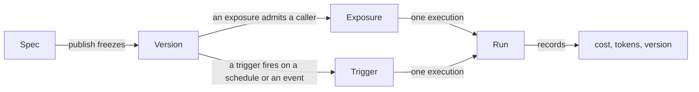

# Понятия { #concepts }

Пять существительных. На них построено всё в продукте, и большая часть путаницы
вокруг него — оттого, что одно принимают за другое.

Если вы не прочитаете на этой странице ничего другого, прочитайте первые два.

## Спецификация { #spec }

**Агент как данные.**

Инструкции, профиль модели, привязки возможностей, ссылки на коллекции и навыки,
бюджет и кому сообщать, когда что-то происходит. Она определена в
[`app/agents/spec.py`](reference/spec.md) и проверяется Pydantic.

У агента ровно один *черновик* спецификации, который правят и постоянно сохраняют
в Конструкторе.

Каждое сохранение сверяется с черновиком, от которого началось. Если его изменили
другая вкладка или действие на стороне сервера, сохранение приостанавливается, а
ваши правки остаются на экране. Скопируйте всё, что хотите сохранить, прежде чем
выбрать **Загрузить последний черновик** (Reload latest draft). Затем перенесите
эти правки в последнюю версию: устаревшее сохранение не может её перезаписать.

Для опубликованного агента с изменениями в черновике выберите
**Ещё → Сбросить черновик** (More → Discard draft), чтобы сбросить черновик до
последней опубликованной версии. Неопубликованные правки отбрасываются без
создания версии и без сдвига какого-либо окружения. Если до подтверждения
успевает пройти другая правка или публикация, сброс отклоняется. У агента, который
ни разу не публиковался, нет версии, до которой можно сбросить.

В спецификации держатся два правила, и именно они делают её полезной.

!!! abstract "Ссылки, а не значения"

    Спецификация называет профиль модели, коллекцию, идентификатор инструмента.
    Она никогда не содержит строку модели, строку подключения или секрет.

    Именно поэтому её безопасно закоммитить в свой репозиторий, и поэтому
    организация может сменить ключ, не трогая ни одного агента.

!!! abstract "Аддитивная эволюция"

    Новые поля получают значения по умолчанию, поэтому агент, опубликованный
    сегодня, загрузится и после обновления. Удаление или переименование поля — это
    миграция, а не правка.

!!! info "Ответ может быть данными"

    По умолчанию агент отвечает текстом. Переключите **Формат ответа**
    (Answer format) на структурированные данные — или задайте `output_schema` в
    спецификации, — и он ответит объектом с именованными полями: у модели
    запрашивают именно такую форму, а ответ, который её нарушает, отправляется на
    исправление, прежде чем запуск завершится. API возвращает объект как
    `structured`, чат и каналы показывают его блоком JSON, а шаг `agent.run`
    передаёт его дальше.

!!! info "Шаблон — это спецификация, которую кто-то уже написал"

    [Шаблоны агентов](first-agent.md#3-build-the-agent), которые поставляются
    вместе с платформой, — это спецификации со всем, что может знать папка в
    образе: инструкции, возможности и навыки, которые нужно установить. В них не
    указаны ни модель, ни коллекция: это UUID, которых нет ни у кого за пределами
    вашего экземпляра, — поэтому установленный шаблон — черновик.

!!! note "Категории и теги лежат рядом со спецификацией, а не в ней"

    Запись агента также несёт редактируемые **категории** и **теги** — метки
    уровня организации для поиска и фильтрации агентов. Как и аватар, они не
    меняют ни того, что запускает агент, ни смысла его экспортированного YAML,
    поэтому расстановка тегов заново не требует ни публикации, ни новой версии;
    это метаданные записи, а не поле спецификации.

    Они остаются вне переносимого артефакта, и в этом весь смысл держать их вне
    спецификации: при экспорте спецификации категории и теги не выводятся; при
    импорте существующие категории и теги цели не меняются (в файле их нет,
    поэтому он их не очищает и не перезаписывает); и только клон начинается без
    тегов.

## Версия { #version }

**Замороженная спецификация.**

Публикация копирует черновик в версию. Окружения решают, какая версия обслуживает
каждый способ запуска, а запуски записывают, какая версия выполнялась.

Поэтому на вопрос *что этот агент делал в прошлый вторник* можно ответить и после
дюжины правок. Поэтому же откат публикует **новую** версию, скопированную со
старой, а не удаляет историю: в хронологии видно, что откат был, вместо того
чтобы делать вид, будто плохой версии никогда не существовало.

Сохранения черновика, публикации, откаты и изменения окружений для одного агента
выполняются последовательно. Сохранение, которое ждёт за публикацией, после неё
остаётся содержимым черновика; публикация его не перезаписывает. Одновременные
публикации получают разные номера версий, а перевод версии в окружение по умолчанию
выравнивает версию, с которой работает агент, по этому окружению. Новые запуски
могут начинаться, пока публикация проходит проверку.

### Окружения { #environments }

**Окружения** (Environments) — именованные указатели на версии; каждое говорит,
может ли публикация его сдвинуть.

!!! important "Публикация создаёт версию. Куда её поместить — отдельное решение"

    Раньше публикация перенаправляла окружение по умолчанию, каким бы оно ни было,
    поэтому исправление промпта в том же нажатии меняло то, что отвечал
    действующий бот, и на экране об этом не было ни слова.

Поэтому окружение либо:

- **ждёт, пока на него переведут версию** — так должно вести себя `production`,
  когда рядом появляется `dev` или `staging`; либо
- **следует за каждой публикацией** — этого обычно и хочется от `dev`, в котором
  кто-то дорабатывает агента, и так ведёт себя `production`, пока он остаётся
  единственным окружением.

Два следствия, которые стоит назвать:

1. **Первая** публикация создаёт `production` на только что созданной версии,
   потому что агенту без окружения вообще негде работать, и дальше
   `production` следует за публикациями, пока кто-нибудь не закрепит на нём версию.
   Окружение, добавленное позже, ждёт, пока на него переведут версию, если ему не
   сказано иное.
2. **Откат попадает туда же**, куда и публикация, — это и *есть* публикация более
   старой спецификации. Поэтому вернуть старую версию к людям — одно нажатие на её
   строке истории (перевести в окружение), а не побочный эффект восстановления
   черновика.

Бот канала, привязанный к окружению, обслуживает его версию.
`Agent.current_version_id` — указатель окружения по умолчанию; через него
разрешается способ запуска, в котором не названо окружение, поэтому он сдвигается
вместе с этим окружением.

!!! tip "Версии не обязаны становиться действующими все сразу"

    [Окружение](environments.md) — это имя, закреплённое за версией, поэтому
    `staging` может обслуживать версию 7, пока `production` остаётся на 6.
    Публикация создаёт версию; куда её поместить — отдельное решение.

## Способ доступа { #exposure }

**Где агент доступен и кому.**

Веб-чат, ключ HTTP API, публичная ссылка, бот Slack или Telegram, виджет для
встраивания.

!!! success "Каждый способ запуска идёт через один механизм выполнения"

    Бюджеты, согласования, журнал аудита и проверки разрешений одинаковы независимо
    от того, пришёл запуск из окна чата или из упоминания в Slack, потому что
    агента выполняет ровно один путь в коде.

У каналов есть два правила, которые стоит назвать отдельно:

- **Бот отвечает как один агент.** В чате это одна личность, поэтому привязать
  второго агента к одному боту нельзя: такая привязка отклоняется, а `@slug` —
  псевдоним агента за ботом, а не способ выбрать одного из нескольких.
- **Запуск выполняется от имени отправителя**, никогда от имени бота. Несвязанная
  учётная запись чата отклоняется, а не запускается без роли: запуск, за который
  некому ответить, хуже, чем запуск, которого не было.

## Триггер { #trigger }

**Когда агент работает, а за клавиатурой никого нет.**

Как и способ доступа, триггер — это операционное состояние рядом с агентом, а не
часть спецификации. Вы добавляете, приостанавливаете и удаляете его, не создавая
версию, и он не экспортируется в ваш YAML: он несёт то, чего спецификация не
может, — например субъект и время последнего срабатывания.

### Он выполняется от имени человека { #it-runs-as-a-person }

Запуск по триггеру выполняется **от имени участника, создавшего триггер**, причём
при каждом срабатывании участник определяется заново, и никогда — от имени
придуманного служебного пользователя. Это снова правило упоминания в канале, и по
той же причине.

Когда этот участник больше не может запускать агента — он покинул организацию или
его выданный доступ к агенту отозван, — триггер **отключается сам и записывает
причину**, вместо того чтобы бесконечно повторять отклонённый запрос.

### Это не диалог того человека { #it-is-not-that-persons-conversation }

Создатель одалживает срабатыванию свои **полномочия**: роль и выданные доступы. Он
не одалживает ему свою **личность**. Запуск без участия человека никто не слушает,
поэтому он ни перед кем конкретным не отчитывается — так же, как посетитель
виджета для встраивания. Эти хранилища, заведённые на человека, для него закрыты:

- [Память](reference/capabilities.md#memory-files): каждый инструмент отвечает, что
  у диалога нет памяти.
- [Прошлые диалоги](reference/capabilities.md#conversation-search): оба инструмента
  отказывают.
- [Личная привязка MCP](mcp.md#whose-account-a-binding-speaks-through): собственные
  Notion или почтовый ящик создателя отсутствуют, и агенту объясняют почему.
- [Приложения](reference/capabilities.md#artifacts): `publish_artifact` по-прежнему
  публикует, и страница остаётся личной для создателя, но `read_artifact`
  отказывает, поэтому срабатывание перепубликует целую страницу, а не правит её.

Это сделано намеренно. Хранилище, заведённое для человека, читается обратно этому
человеку, и срабатывание, которое никто не начинал, не должно писать в него от его
имени. [Песочница](sandbox.md) с `session_scope: user` держится того же правила: у
срабатывания там нет своего рабочего пространства.

### Если создатель не разрешит ему действовать от своего имени { #unless-its-creator-lets-it-run-as-them }

**Запускать от моего имени** (Run as me) — настройка триггера, и это единственное
исключение: включить её может только сам создатель и только для себя. Тогда
срабатывание получает доступ к его памяти и его собственным подключениям MCP так
же, как его собственный чат, — утреннее *скажи, что важного в моей почте*,
недоступное по умолчанию, — на таких условиях:

- **Расписание читает и пишет память; событие только читает её.** В промпте
  события есть письмо или тело вебхука, которые никто не проверял, и заметка,
  написанная по ним, читалась бы в каждом последующем чате как собственная заметка
  создателя.
- **Прошлые диалоги остаются закрытыми** в любом случае.
- **Чужая правка отключает её.** Изменение сообщения, окружения, фильтра или канала
  Teams в триггере, который создали не вы, отключает её, чтобы никто не переписывал
  то, что выполняется от вашего имени, и не отправлял ответ куда-то ещё.
  Администратор, вошедший от вашего имени, или скрипт с вашим API-ключом включить её
  не могут.
- **Так же действует новая версия, опубликованная не вами.** Публикация, перевод в
  окружение или откат, сделанные кем угодно другим, отключают её — как и сделанные
  через ваш API-ключ или администратором, вошедшим от вашего имени.
- **Возобновление и дата окончания — ваши.** Пока триггер действует от вашего
  имени, никто другой не может возобновить его, изменить или очистить дату
  окончания, поднять или снять лимиты сбоев и расходов: такие попытки отклоняются,
  пока они не отключат «Запускать от моего имени». Любой, кто может его
  редактировать, по-прежнему может приостановить его или ужесточить эти лимиты.
- **Запись это фиксирует.** Запуск называет триггер, который его вызвал, и каждая
  запись аудита, которую делает срабатывание, несёт `via_trigger` с участником, от
  чьего имени оно действовало.
- **Он может работать на компьютере самого создателя.** С включённым «Запускать от
  моего имени» создатель может указать триггеру папку на своём компьютере в
  **Где работать** (Work on); тогда каждое срабатывание работает там через
  [приложение для компьютера](desktop.md#work-on-this-computer). Отключение
  «Запускать от моего имени» очищает её, а срабатывание, которое действует не от
  имени своего создателя, к компьютеру не допускается.

Это правило определяет, как проектировать агента, который работает по триггеру:

| Чего требует запуск без участия человека | Что использовать |
|---|---|
| Постоянные факты или предпочтения | Собственный промпт триггера, [файл контекста](context.md), привязанный к агенту, или память создателя с включённым «Запускать от моего имени» |
| Состояние, которое переносится от срабатывания к срабатыванию | [Песочница](sandbox.md) с `session_scope: conversation`: каждое срабатывание одного триггера дописывается в один и тот же диалог журнала запусков |
| Почтовый ящик или другой внешний сервис | Подключение, привязанное к учётной записи организации, или собственное создателя с включённым «Запускать от моего имени» |

[Наблюдение за конкурентами](howto/competitor-monitoring.md) и
[личный помощник](howto/personal-assistant.md) соблюдают это правило и
показывают обходной путь.

### Всё остальное — обычный запуск { #everything-else-is-an-ordinary-run }

Потому что он идёт через тот же механизм выполнения: бюджет соблюдается так же,
согласование приостанавливает его так же, журнал аудита называет его так же.

Ему проставляется способ запуска `schedule`, поэтому по вопросу *как используется
этот агент* можно отличить запуск без участия человека от запуска человека. Каждое
срабатывание — отдельный запуск в разделе «Активность», а его ответы накапливаются
в одном диалоге журнала запусков, который триггер открывает один раз — сразу, в
момент создания триггера, поэтому этот диалог кликабелен ещё до первого
срабатывания. Триггер также может публиковать каждый ответ в канал или групповой
чат Teams, где находится бот его организации
([Microsoft Teams](channels.md#microsoft-teams)).

### Два способа срабатывания { #two-ways-to-fire }

=== "Расписание"

    Срабатывает по часам, в одной из двух форм:

    - **Интервал** — «каждые N секунд», минимум минута, потому что сигнал
      активности забирает наступившие срабатывания раз в минуту.
    - Выражение **cron**, вычисляемое в UTC — `0 9 * * *` для 09:00 каждого дня,
      или любой crontab из пяти полей. Форма из шести полей со столбцом секунд
      отклоняется: секунды — это ритм, который сигнал активности раз в минуту
      соблюсти не может.

    Сервис вычисляет следующее срабатывание для каждого одинаково, а запуск,
    который длится дольше своего интервала, завершается до следующего срабатывания,
    а не наслаивается сам на себя.

=== "Событие"

    Срабатывает по поступлению: задача на GitHub (issue), входящее письмо или
    универсальный источник API — всё, что умеет отправлять подписанный JSON через
    POST, поэтому шаг кода в Zapier или Make либо небольшой скрипт покрывает всё
    остальное, по чему вы хотите срабатывать.

    Оно приходит как подписанный вебхук; платформа проверяет его по секрету
    триггера, [запечатанному в хранилище секретов](secrets.md), сопоставляет с
    необязательным фильтром источника, и затем агент запускается с полезной
    нагрузкой, дописанной к его промпту.

    У события **нет следующего срабатывания** — ничего не наступает, пока не
    придёт доставка, — поэтому сигнал активности его не видит.

    Добавление источника — это значение в одном перечислении и ветка в одном
    модуле. В записи оно ничего не меняет.

### Запустить сейчас { #run-now }

Любой триггер можно ещё и **запустить сейчас**: одно дополнительное срабатывание
по требованию, которое не трогает его ритм.

Оно *принимается*, а не ожидается. Запрос отвечает, как только срабатывание
поставлено в очередь как задача для воркера — через ту же надёжную дверь, через
которую проходит срабатывание по расписанию или по доставке, — и запуск появляется
в диалоге журнала запусков триггера по мере выполнения.

Так агент, который работает минутами, не держит запрос браузера открытым, пока
прокси не сдастся, а принятое срабатывание переживает процесс API, который его
принял.

Все расписания и события в организации перечислены вместе по всем её агентам, и
каждый список отфильтрован до тех, которые вы можете запускать, — по тому же
разрешению `agents:run` на ресурс, которое нужно и для создания триггера.

!!! tip "В продукте они называются «Автоматизации»"

    Оба семейства вместе — это **Автоматизации** (Routines): одно общее имя,
    которое используют навигация, боковая панель чата, знакомство и польский текст
    (*Rutyny*), так что человек встречает одно слово везде, где появляется эта
    функция.

    Список по всей организации находится по адресу `/routines`, а на странице
    «Обзор» есть **виджет «Автоматизации»** (Routines widget) — добавляемая
    карточка, показывающая ритм каждой автоматизации, следующее срабатывание и
    исход, стоимость и оценку последнего запуска. Та половина организации, где всё
    работает без участия человека, видна с того же взгляда, что и та, где работают
    люди.

[Триггеры и расписания](triggers.md) — это вся история.

## Запуск { #run }

**Одно выполнение.** У него есть субъект, версия, способ запуска, статус, счётчики
токенов и стоимость.

**Запуск, который завершился с ошибкой, всё равно записывает, сколько он
потратил.**

То, *как* он завершился, — это отдельный статус, а не `failed`, потому что
оператор, отбирающий проблемы, не должен пробираться через случаи, когда платформа
работает правильно:

| Статус | Запуск |
|---|---|
| `failed` | сломался |
| `budget_exceeded` | достиг лимита — лимит расходов делает свою работу |
| `guardrail_blocked` | был отклонён [защитной проверкой](reference/capabilities.md#guardrails) |
| `loop_stopped` | продолжал повторять одни и те же вызовы инструментов после предупреждения и был [остановлен](governance.md#step-limits) |
| `cancelled` | был остановлен: кнопкой остановки в поле ввода, закрытым сокетом, поручением, отменённым сверху. На любом способе запуска, а не только на потоковом |
| `awaiting_approval` | ждёт согласования и **возобновляем** — его история сообщений сохранена, поэтому решение применяется к диалогу, к которому он относится |

Запуск, который останавливается *внутри поручения*, хранит по одному уровню на
агента, каждый со своим диалогом, поэтому одобрение продолжает остановленного
агента-исполнителя, а не начинает его работу заново.

!!! note "Запуск может содержать другой запуск"

    Поручение получает собственную запись `agent_runs` с `parent_run_id`, поэтому
    на вопрос *сколько исследователь стоил в этом месяце* есть ответ — при этом оба
    делят один журнал расходов.

    Статуса `delegated` намеренно нет. `parent_run_id` отвечает на вопрос «как этот
    запуск начался»; статус отвечает на вопрос «как он закончился». Два вопроса.

### Запуск и его транскрипт { #a-run-and-its-transcript }

Запуск говорит, сколько он стоил. `messages.run_id` говорит, что он *сделал*.

Каждый ход, созданный запуском, несёт идентификатор этого запуска, поэтому «шаги
этого запуска» — это один запрос, а не догадка; именно его читает переход из истории
запусков через `GET /runs/{id}/transcript`.

Это чтение **по разрешению, а не по праву владения**. Коллега с `runs:view` читает
запуск, начатый кем-то другим, потому что запуск принадлежит организации, а не
тому, кто его начал. Запуск другой организации читается как отсутствующий — с тем
же 404, которым отвечает неизвестный идентификатор, — а запуск, выполнявшийся без
диалога, сообщает об этом `conversation_id` со значением null, а не пустым списком.

Это отдельный маршрут, а не фильтр эндпоинта диалога, поэтому сам эндпоинт
диалога остаётся ограниченным владельцем. См.
[Управление](governance.md#what-run-history-shows).

`?scope=conversation` расширяет то же чтение до всей ветки диалога, в которой
находится запуск, — для подробного вида, который показывает запуск в контексте и
прокручивает к нему. Это удобство, а не расширение доступа: каждый ход, который
пишет запуск, несёт свой `run_id` — включая вопрос пользователя, — поэтому
обладатель `runs:view` и так мог собрать ветку, перебирая транскрипты её запусков.
Подробное чтение также несёт `prev_run_id` / `next_run_id` — запуски по обе стороны
*в том же диалоге*, — поэтому листать ветку — это две стрелки, а не походы обратно
к списку.

!!! warning "Связь — это столбец, а не временное окно, и это намеренно"

    Два запуска, начатые в одном диалоге, перемежаются. Выборка сообщений в окне
    между `started_at` и `ended_at` возвращает ходы первого запуска *и* второго, а
    запуск без `ended_at` — отменённый или ещё идущий — не возвращает вообще
    ничего.

    И то и другое неверно так, что читатель этого не увидит.

Промпт записывается *до* того, как появляется запись запуска, потому что сборка,
которая отклоняется, — удалённый секрет, профиль модели, убранный при
развёртывании, — не должна терять то, что кто-то набрал. Он связывается, как только
появляется запуск, к которому его можно привязать.

Удаление запуска обнуляет столбец, а не удаляет ходы: слова всё равно были сказаны,
а диалог — то место, где их читают.

Связать ход — не то же самое, что записать его. Что на самом деле пишет каждый
способ запуска — отдельный вопрос, на который этот столбец ответить не может: он
связывает уже существующие записи. Непотоковые способы запуска пишет механизм
выполнения, а не они сами, и именно это сделало их единообразными; исключения — в
разделе [Способы запуска](channels.md#what-each-surface-records).

История запусков фильтруется именно по этому. `GET /runs` принимает список статусов
через запятую (`?status=failed,budget_exceeded`), потому что вопрос оператора — это
*набор* исходов, а не один статус за раз. Неизвестный статус отклоняется, а не
молча не совпадает ни с чем: пустая страница должна означать «таких запусков нет».

### Запуск и то, что он передал модели { #a-run-and-what-it-handed-the-model }

Транскрипт говорит, что спросили и что пришло в ответ. Он не говорит, что модели
**дали** — какой промпт, какие инструменты, как они описаны, с какими настройками, —
и ничего из этого потом не выводится.

То, что сказали модели, — это инструкции спецификации плюс инструкции платформы,
плюс всё, что дописала привязка канала, плюс привязанные навыки, плюс то
[системное напоминание](reference/capabilities.md), которое сработало на этом
запросе. То, что она могла вызвать, — это реестр возможностей плюс MCP-серверы
организации минус всё, что скрыл [поиск инструментов](mcp.md).

Восстанавливать это из сохранённой спецификации значило бы написать вторую
реализацию сборщика, а вторая реализация — это то, что расходится с первой.

Поэтому это **записывается, а не восстанавливается**. Модель, на которой работает
агент, обёрнута, и каждый запрос записывается по мере прохождения:

- инструкции и системные части;
- каждое определение инструмента точно таким, каким его передали провайдеру;
- отправленные настройки;
- одна запись на запрос с его длительностью, токенами и тем, что он попросил
  вызвать дальше;
- весь список сообщений последнего запроса.

Значит, хранится ровно то, что было отправлено.

`GET /runs/{id}/manifest` читает её обратно с той же проверкой разрешений, что и
транскрипт: сначала существование проверяется по вашей организации, затем
`runs:view`.

!!! danger "Две вещи, которых он намеренно не делает"

    Он никогда не записывает сквозную передачу провайдеру (`extra_headers`,
    `extra_body`), потому что именно там едут учётные данные провайдера, а
    [хранилище секретов](secrets.md) — единственное место, где хранится секрет.

    А запуск, который так и не дошёл до модели — остановлен бюджетом, заблокирован
    защитной проверкой на входе, — ничего не записывает и отвечает 404, потому что
    пустой документ утверждал бы, что агенту не дали ни промпта, ни инструментов.

Слишком большая запись **урезается, а не отклоняется**, и сообщает об этом. По
этапам, каждый измеряется: сначала уходят сообщения, затем схемы аргументов
инструментов, затем описания инструментов и последним — сам промпт. Последние два
обрезают до узнаваемой длины, а не отбрасывают, потому что собственные инструкции
агента и описание внешнего инструмента MCP не ограничены и именно из-за них запись
оказывается слишком большой, когда сообщения и схемы уже убраны.

При любом исходе сохраняются настройки и каскад запросов.

Запрос, который **завершился с ошибкой**, — такая же запись в этом каскаде,
потоковая или нет. В ней хранится класс исключения и никогда его сообщение, потому
что SDK провайдера кладёт в эту строку URL сбоя — а значит, и ключ в его строке
запроса.

---

## Ещё три, потому что их легко спутать { #three-more-because-they-are-easy-to-confuse }

### Возможность и инструмент { #capability-vs-tool }

**Возможность** — это единица, которую кто-то выдаёт агенту: `knowledge`,
`web_research`, `code_execution`. Она может давать несколько **инструментов** и
несёт конфигурацию и политику согласования.

Согласование определяется от самого конкретного к общему:

1. собственное переопределение инструмента, затем
2. режим возможности, затем
3. отсутствие согласования, когда ни то, ни другое ничего не говорит.

Конструктор называет *результат* словами, а не описывает правило: правило, которое
читателю приходится прокручивать в голове, — это настройка, которую никто не
решается трогать.

Что поставляется — в [каталоге возможностей](reference/capabilities.md), а как
добавить новую — в разделе [Добавление возможности](howto/add-capability.md).

!!! note "Инструменты MCP — исключение из всего перечисленного"

    Инструменты, которые приходят с [MCP-сервера](mcp.md), обнаруживаются во время
    выполнения, поэтому никто их не объявлял, и ничто их не ограничивает.

### Коллекция и навык { #collection-vs-skill }

**Коллекция** — это документы, разбитые на фрагменты, с построенными эмбеддингами,
и её *ищут*. Модель выбирает, что искать; расширить область поиска она не может
никогда.

**Навык** — это папка Markdown: `SKILL.md` и какие угодно файлы рядом с ним, — и
его *читают*. Описание — единственная часть, которую модель видит перед тем, как
решить, открывать ли его, поэтому описание навыка должно говорить,
**когда он применим**, а не что внутри.

Практическая разница: поиск стоит одного вызова эмбеддингов на каждое обращение и
возвращает фрагменты. Навык ничего не стоит, пока его не откроют, а затем
возвращает весь документ.

Формат и полное сравнение — в разделе [Навыки](skills.md).

### Агент-исполнитель и встроенный специалист { #delegate-vs-inline-specialist }

Агент может передать часть работы другому агенту. Назвать этого другого агента
можно двумя способами; в словаре самого Конструктора они похожи, и почти всё
важное в поручении следует из того, какой из них вы выбрали.

**Агент-исполнитель** — это другой опубликованный агент в организации, указанный
через `agent_id` *и* `agent_version_id`, то есть закреплённый. К нему обращаются по
его `slug` — тому же имени для упоминаний, которое разрешает упоминание в канале.

**Встроенный специалист** определяется внутри спецификации самого родителя: имя,
описание, которое модель родителя читает перед тем, как поручить, инструкции и —
поскольку суммаризатор, не умеющий читать коллекцию, бесполезен, — собственная
модель, собственные возможности, собственные коллекции и навыки и собственный
лимит шагов.

Так что специалист — агент во всём, кроме одного. Агентом здесь что-то делают
четыре вещи:

| | Опубликованный агент-исполнитель | Встроенный специалист |
|---|---|---|
| **Версионируется** | да — закреплён, и закрепление сдвигается, только когда его сдвигают | **нет** |
| **Проверяется разрешениями при публикации** | да — `agents:run` на этой записи | да — те же проверки области, секрета, коллекции и навыка, что получают собственные привязки родителя |
| **Собственные возможности** | да — из его опубликованной спецификации | да — свои плюс то, что даёт родитель |
| **Считается и ограничивается** | да | да — лимитами запуска, а это [то, что действует внутри любого поручения](governance.md#delegation-spends-the-parents-budget) |

**Недостающее — это версия**, и всё, чего специалист не может, следует из этого:
ничто другое не может на него сослаться, правка родителя меняет его, у него нет
собственной записи запуска, и он не может поручать дальше.

Опубликованного агента-исполнителя можно проверить и экспортировать. Специалист —
это абзац в чужой спецификации.

Поэтому специалиста берите для работы, которая не должна требовать публикации
агента, — «сведи это в три пункта», — а агента-исполнителя — для возможности,
которой организация владеет и пользуется повторно.

Рядом с ними есть третий вид: **внешний агент** — агент другого поставщика,
доступный по A2A и зарегистрированный в организации через его карточку агента. Его
вызывают так же и списывают стоимость на тот же бюджет, но здесь он не
версионируется — его владелец меняет его на своей стороне, — поэтому ссылка
называет регистрацию, а не версию. См.
[Внешние агенты по A2A](reference/capabilities.md#remote-agents).

#### Динамические специалисты и выход из положения { #dynamic-specialists-and-the-way-out }

Третий вид лежит ниже встроенного: **динамический специалист**, придуманный моделью
во время выполнения при
[`allow_dynamic`](reference/capabilities.md#delegation).

Это специалист, который даже не записан в спецификации родителя, и он нигде не
сохраняется: сохранить его значило бы опубликовать агента, а публикация — действие
человека.

Это правило — решение, а не ограничение, и доказательство тому — выход: человек
может **сделать специалиста черновиком агента**.

Сделать черновиком агента можно встроенного специалиста в Конструкторе и
динамического — из панели поручений в чате, пока запуск, создавший его, ещё на
экране: это единственное окно, когда определение динамического специалиста можно
прочитать, потому что оно едет в открывающем кадре поручения, и после хода его ничто
не хранит.

Это действие создаёт обычный черновик из инструкций, модели, возможностей,
коллекций и навыков специалиста; владелец — тот, кто сделал его черновиком, и
действует обычная проверка `agents:edit`. На этом всё останавливается: публикации
нет, новый агент не закрепляется как исполнитель своего родителя, а специалист, из
которого он вышел, не удаляется. Каждое из этого — следующее решение, и перед ним
стоит обычная проверка.

Без этого выхода единственным способом сохранить хорошего специалиста было
переписать его инструкции из журнала чата, а это порождает агента, чьё происхождение
никто не видит, — ровно тот случай агента вне учёта, который правило о
несохранении и призвано предотвратить.

!!! important "Одно понятие «агента», используемое рекурсивно"

    Риск, для сдерживания которого эта форма и существует, — это *второе*,
    параллельное понятие агента: такое, по которому не проходит проверка при
    публикации и которого не видит модель разрешений. Специалист был бы очевидным
    местом для него: он не похож на агента, и именно поэтому так и тянет через него
    дотянуться до коллекции, которую никто не открывал, или до возможности,
    которую никто не выдавал.

    Его сдерживает отказ писать второй формат. Специалист — типизированное
    *подмножество* спецификации, использующее те же привязки возможностей,
    проверяемое тем же рекурсивным проходом публикации и собираемое тем же
    сборщиком. Один тип спецификации, один валидатор, один сборщик, один
    компонент Конструктора — и каждый используется рекурсивно. Если у какого-то из
    них появится вторая копия для специалистов, эта копия и есть ошибка.

**Закрепление падает громко, а не дрейфует.** Если закреплённой версии
агента-исполнителя больше нет, запуск завершается с ошибкой и называет исполнителя.
Отката к его текущей версии намеренно нет: смысл закрепления в том, что без решения
ничего не меняется, а тихое обновление хуже отказа, ведь о нём никто не узнает.

Цена этого платится в Конструкторе, который сравнивает каждое закрепление с тем, что
исполнитель публикует сейчас, и предлагает его сдвинуть.

Потолки и инструменты — в описании
[возможности `subagents`](reference/capabilities.md#delegation), а кто кому может
поручать — в разделе
[Разрешения](permissions.md#delegation-is-not-a-privilege-boundary).

---

## Помощники для оценки { #system-agents }

Оценка использует определённых в коде помощников для оценивания, генерации
кейсов и предложения улучшений. Они настраиваются вместе с набором данных и не
появляются в каталоге агентов как агенты, которых можно создать или отредактировать.
Архитектор и помощники AgenticOS остаются обычными агентами продукта.

Вкладка **Оценивание** (Grading) набора данных выбирает модель оценивания,
инструкции, критерии и проходной балл. **Настройки** (Settings) выбирают модель и
инструкции для генерации кейсов и улучшения агента — с тем же выбором модели и
редактором Markdown, что и в Конструкторе агентов. Сначала инструкции берутся из
определённых в коде значений по умолчанию. Изменения требуют `datasets:edit`;
добавление модели требует ещё и `connections:manage`.

Поставленные в очередь генерации, запросы на редактирование и сеансы улучшения
сохраняют модель и инструкции, с которыми были приняты. Правка настроек влияет на
последующую работу. Исторические идентификаторы помощников и опубликованные версии
остаются в хранилище для атрибуции запусков, бюджетов и старых закреплений; они не
расходуют лимит пользовательских агентов экземпляра.

### Изоляция { #system-agent-spec }

Помощники идут через существующий механизм выполнения агентов на способе запуска
`eval`. Доступ вызывающего, учётные данные модели и бюджеты проверяются до платных
вызовов; стоимость и сбои остаются видны в разделе «Активность». Изоляция блокирует
запись в продуктивные подключения и держит чтение знаний в пределах обращающегося
человека. Помощника нельзя открыть через чат, канал, расписание или поручение.

### Существующая работа { #retiring-a-system-agent }

Миграция сохраняет модель и инструкции существующих модулей оценки и поставленной в
очередь работы. Исторические запуски и закрепления наборов проверок сохраняют свои
исходные идентификаторы. Общего для всей организации переключателя помощи ИИ или
настройки модели оценивания нет; настройте набор данных и используйте существующие
разрешения и бюджеты.

## Профили моделей { #model-profiles }

**Профиль модели** — это именованная модель, за которой стоит сохранённый ключ:
`openai default`, `OpenRouter prod`. Агенты указывают на профили, а не на строки
моделей.

В этой косвенности весь смысл. Сменить ключ или перевести всех агентов с одной
модели на другую — это правка одного профиля, а не сорока спецификаций.

Профиль без учётных данных за ним помечается `no key` везде, где появляется,
потому что это единственный факт, решающий, может ли агент вообще работать. В
списках выбора его нет, а публикация отклоняет его, пока у него снова не появится
ключ. Профиль, который используют агенты, нельзя удалить; см.
[Смена ключа или эндпоинта профиля](models.md#changing-a-profiles-key-or-endpoint).

Цены берутся из [`genai-prices`](https://github.com/pydantic/genai-prices), которую
поддерживает Pydantic, а не из таблицы в этом репозитории: таблица, которую ведут
вручную, не умеет выражать ступенчатые цены и незаметно устаревает. Модель, которой
пакет не знает, записывается с нулём и предупреждением, а итог запуска помечается
как нижняя граница, а не угадывается.

Двадцать семь провайдеров, нужные каждому учётные данные и поведение резервных
моделей — в разделе [Модели и провайдеры](models.md).

## Организации { #organizations }

Каждый ресурс привязан к организации.

Изоляцию обеспечивает **схема** — столбцы `NOT NULL`, проверочные ограничения,
уникальные ограничения в разрезе организации, — а не только слой сервисов, поэтому
пропущенное условие `WHERE` становится нарушением ограничения, а не утечкой данных.

Хранилище секретов идёт дальше: шифротекст секрета привязан к организации, которая
его сохранила, поэтому скопированную между организациями запись нельзя расшифровать.

## Итог { #recap }

- **Спецификация** — это агент как данные: она хранит ссылки и никогда — значения.
- **Публикация** замораживает её в **версию**, а *окружение* — отдельное решение о
  том, с какой версией встречаются люди.
- **Способ доступа** — это где агент доступен; **триггер** — когда он работает, а за
  клавиатурой никого нет. И то и другое — операционное состояние рядом со
  спецификацией, а не в ней.
- **Запуск** — одно выполнение, и он записывает, сколько стоил, даже когда
  завершился с ошибкой.
- Каждый способ запуска, каждый триггер и каждое поручение идут через **один
  механизм выполнения**, поэтому управление нельзя обойти со стороны вызывающего.

## Дальше { #next }

- :material-account-key:{ .lg .middle } **[Разрешения](permissions.md)**

    Роли, области действия и выданные доступы.

- :material-shield-check:{ .lg .middle } **[Управление](governance.md)**

    Бюджеты, согласования, оповещения, аудит.

- :material-toolbox:{ .lg .middle } **[Возможности](reference/capabilities.md)**

    Что можно дать агенту.

- :material-connection:{ .lg .middle } **[MCP](mcp.md)**

    Инструменты, которые здесь никому не нужно писать.

Ещё: [Модели](models.md) — о провайдерах и стоимости, [Секреты](secrets.md) — о
том, почему шифротекст не может переехать в другую организацию, и
[Архитектура](architecture.md) — о том, как устроен код.
