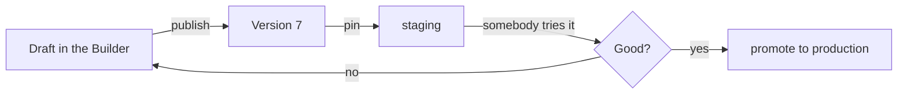

# Окружения { #environments }

Публикация агента создаёт [версию](concepts.md#version). **Окружение** — это имя,
которое указывает на одну из них — `production`, `staging`, `dev`, — чтобы новую
версию можно было где-то опробовать, прежде чем с ней встретятся все.

Без окружений публикация и выпуск — одно действие. С ними это два решения:
создать версию и поместить её куда-то.

## Что такое окружение { #what-an-environment-is }

Имя, версия, к которой оно закреплено, и, если нужно, собственный приёмник
трассировки. У каждого агента есть окружение **по умолчанию**, и именно его
получает способ запуска, для которого ничего не указано.

| | |
|---|---|
| **Название** (Name) | Строчные буквы и дефисы, до 64 символов: имя попадает в URL и становится меткой трассировки, поэтому `Production (EU)` и `production-eu` не должны быть двумя разными вещами |
| **Версия** (Version) | Какая опубликованная версия отвечает здесь. Незакреплённого состояния нет |
| **Следует за последней** (Tracks latest) | Переводит ли публикация это окружение на новую версию сама. По умолчанию выключено |
| **Трассировка** (Tracing) | Токен записи Logfire из хранилища секретов, чтобы запуски этого окружения попадали в собственный проект |
| **Тестовые подключения** (Test connections) | MCP-серверы и ключи из хранилища, на которые это окружение отвечает тестовыми: песочница CRM, тестовый почтовый ящик. Только в именованных окружениях |

!!! info "Не бывает окружения без версии"

    Незакреплённое окружение было бы именем, которое ничего не обслуживает, и
    первое сообщение, направленное в него, сломалось бы далеко от формы, которая
    его создала. Создайте окружение, не назвав версию, и оно начнёт с того, что
    обслуживает окружение по умолчанию.

## Порядок работы, для которого это нужно { #the-workflow-it-is-for }

1. Отредактируйте черновик, опубликуйте. Это создаёт версию и не меняет ничего
   из того, чем кто-либо пользуется.
2. Направьте `staging` на неё и привяжите к `staging` тестового бота Slack или
   приватную ссылку.
3. Проверьте её на настоящих вопросах.
4. Переведите `production` на ту же версию — одна правка, без повторной
   публикации.

Откат — то же движение назад: перенаправьте `production` на версию, которая
работала. Старая версия по-прежнему на месте, её можно прочитать и запустить.

[Набор проверок](evals.md#suites), настроенный запускаться при переводе, проверяет
каждую версию, переведённую в его окружение, против той, которую она заменила, и
сообщает владельцу, когда результат не проходит. Сам по себе он только сообщает;
окружение, которое называет его
[обязательной проверкой](#guarding-a-promotion-with-evals), ждёт, пока он
пройдёт.

## Защита перевода в окружение оценками { #guarding-a-promotion-with-evals }

Окружение может назвать [наборы проверок](evals.md#suites), которые его
**защищают**. Тогда оно принимает версию только после того, как каждая
обязательная проверка прошла именно на этой версии, с той версией набора данных,
тем оцениванием и той публикацией судьи, к которым она привязана, и уложилась в
порог, который действует сейчас; прохождение, полученное до переноса закрепления
или до поднятия планки, не считается. Перевод, который этому не отвечает,
отклоняется (`409`, `PROMOTION_BLOCKED`), и в отказе названы каждая проверка и её
состояние: не пройдена, не определена, не запускалась и почему, проверяется,
устарела, не проверялась или приостановлена.

Прохождение засчитывается для того окружения, рядом с которым его получили: оно
измерено против версии, которую это окружение обслуживает сейчас, и оценено по
оцениванию из его закрепления; прохождение рядом с версией staging ничего не
говорит о замене версии production. Приостановленная проверка задерживает версию,
что бы она ни нашла до приостановки.

Набор проверок, который защищает окружение, **закреплён** за версией набора
данных, оцениванием и опубликованной версией судьи, которые у него были, когда он
стал обязательной проверкой. Редактировать набор данных — его кейсы, его
оценивание, его судью — по-прежнему может любой, кому это позволено, и это не
меняет того, что проверяет обязательная проверка.

Панель набора проверок сообщает, когда набор данных или его судья ушли вперёд, а
**Перенести закрепление** (Move the pin) (`POST /api/v1/agents/{id}/eval-suites/{suite}/pin`)
переносит обязательную проверку на последнюю версию, оценивание и публикацию
судьи; для этого нужно `promotions:override`, и это записывается как изменение
обязательных проверок.
Набор проверок, который перестал защищать, снова читает последнее, а тот, в
наборе данных которого ещё нет кейсов, не может стать обязательной проверкой.
Проверка, заведённая до того, как обязательные проверки стали закрепляемыми, и
указывающая на набор данных, где кейсов тогда не было, не закреплена: она
задерживает каждую версию, пока её не закрепит тот, кто может переводить в
окружение в обход проверок.

Судья — собственный судья набора данных или судья оценок — остаётся на той
публикации, что была при закреплении проверки. Переопубликованный судья не
оценивает обязательную проверку, пока закрепление не перенесено, а прохождение,
оцененное другой публикацией, не считается. Проверка, закреплённая в тот момент,
когда у её судьи не было публикации, оставляет критерии судьи неоценёнными, пока
закрепление не перенесено.

Диалог перевода показывает то же самое и запускает проверки, которые не прошли на
версии, каждую рядом с версией, которую окружение обслуживает сейчас
(`POST /api/v1/agents/{id}/environments/{env}/gate/run`;
`GET …/gate?version_id=` читает условия перевода). Проверка, которой нужен судья, при
выключенной [помощи ИИ](governance.md#ai-assistance) говорит об этом, а не
блокирует без причины.

**Обход проверок** всё равно переводит версию. Для него нужно
`promotions:override` — оно есть у владельцев и администраторов — и причина не
короче десяти символов, данная человеком, вошедшим от своего имени, а не через
API-ключ. Сведения об обходе, о том, кто его сделал, и результат каждой проверки
попадают в журнал аудита и в версию в истории, а владельцу каждой непройденной
проверки сообщают.

Смена того, какие наборы проверок защищают окружение, требует того же разрешения,
ведь снятая проверка пропустит то, что остановила бы; так же и ослабление того,
что проверяет защищающий набор: более низкая или снятая планка в его пороге,
другой набор данных, другое окружение или тестовые подключения этого окружения.
Более строгий порог обхода не требует; он записывается так же, и прохождение под
старой планкой больше не считается. Набор проверок, который защищает окружение, и
набор данных, который он проверяет, нельзя удалить, пока этот набор проверок не
перестанет защищать окружение.

Защищённое окружение с включённым переключателем **Следует за последней**
(Tracks latest) не переходит на публикацию сразу: публикация запускает его
обязательные проверки на новой версии, и окружение переходит, когда пройдут все,
с записью, что его перевели условия перевода. Окружение, чьи проверки не прошли,
остаётся на месте, и в его строке сказано, что оно ждёт.

## `tracks_latest`, и почему он выключен { #tracks_latest-and-why-it-is-off }

Окружение, у которого включено **Следует за последней**, перенаправляется каждой
публикацией. Это верная настройка для `dev` и почти никогда не верная для
`production`.

Выключено по умолчанию намеренно: публикация создаёт версию, а решать, где эта
версия работает, — отдельное действие. Связать их значит допустить, что
недоделанная правка дойдёт до клиента, потому что кто-то нажал «Опубликовать»,
чтобы сохранить работу.

Единственное исключение — `production`, который создаёт первая публикация. Пока
он единственное окружение агента, переводить не из чего, поэтому он следует за
публикациями; закрепите его, как только рядом появится `dev` или `staging`.

## Привязка способа запуска к окружению { #binding-a-surface-to-one }

[Способ доступа](concepts.md#exposure) — бот Slack, виджет, размещённая страница,
аудитория API — может назвать окружение, которое обслуживает. Если он его не
назвал, он получает окружение по умолчанию.

Именно это делает разделение полезным: бот для разработки, привязанный к `dev`,
обслуживает то, что закреплено в `dev`, а виджет на вашем сайте остаётся на
`production`, пока вы его не переведёте. Один агент, две аудитории, две версии,
одна отчётность.

Страница, которую публикует агент, подчиняется тому же разделению. Запуск в
именованном окружении публикует собственное
[приложение](artifacts.md#one-name-one-link), поэтому попытка `dev` на недельном
отчёте никогда не переопубликует страницу, которую открывают читатели production.
Окружение, в котором ещё работает запуск или ждёт согласования, нельзя удалить до
конца запуска: удаление передало бы этот запуск окружению по умолчанию, а его
страницы — страницам production. То же действует, пока запуск оценки в нём стоит в
очереди или идёт, иначе он продолжился бы с подключениями production.

## Тестовые подключения { #test-connections }

Версия — это одна и та же спецификация, где бы она ни работала, поэтому `staging`
иначе обращался бы к той же CRM и тому же почтовому ящику, что и `production`.
Вместо этого именованное окружение может отвечать на привязку **тестовым
подключением**: [MCP-сервер](mcp.md) организации — песочницей, ключ возможности
из хранилища — тестовым ключом. Спецификация не меняется, поэтому перевод версии
не несёт с собой тестовых учётных данных.

| Привязка | Заменяется на | Что видит модель |
|---|---|---|
| Подключение MCP организации | Другое подключение MCP организации | Имена инструментов подключения production, чтобы staging и production были сопоставимы |
| Ключ возможности из хранилища | Другой ключ того же вида и назначения | Ничего: возможность никогда не узнаёт, какой ключ ей дали |

Их использует каждый запуск в окружении: бот Slack, привязанный к `staging`,
вызов API, называющий его, расписание и каждый субагент, которого эти запуски
вызывают. Набор инструментов тестового подключения сужен списком разрешённых
инструментов подключения production, собственным списком разрешённых инструментов
тестового подключения и списком разрешённых инструментов самой привязки.

!!! warning "Выключено, но никогда не production"

    Привязку можно в окружении выключить вместо замены. Так же и ту, чья тестовая
    сторона была удалена, отключена или потеряла учётные данные: в этом
    окружении привязка гаснет, пока кто-нибудь не выберет другое тестовое
    подключение. Сторона production не бывает запасным вариантом. Возможность,
    чей тестовый ключ удалён, отклоняет запуск, а не работает без ключа.

Окружение по умолчанию не несёт тестовых подключений: это то, в чём работает
способ запуска, не назвавший окружения, то есть production. Обе стороны замены
должны принадлежать самой организации, а тестовый ключ — быть виден тому, кто его
задаёт. Хранятся только идентификаторы; тестовый ключ остаётся в
[хранилище секретов](secrets.md), а запись аудита сообщает, сколько замен есть, а
не что в них лежит.

### В оценке { #in-an-eval }

Оценка запускает агента по-настоящему, поэтому и его инструменты действовали бы
по-настоящему: агент, который отправляет почту, отправил бы по письму на каждый
кейс. Запуск, начатый **изолированно** — а именно так идёт оценка, — выполняет
инструмент, только когда это безопасно:

| Инструмент | Что происходит |
|---|---|
| Обращается к тестовому подключению MCP окружения | Выполняется, против тестовой системы |
| Только читает | Выполняется на обычном подключении |
| Пишет, на тестовом ключе из хранилища | Выполняется, только если его возможность объявляет, что цель задаёт один только ключ; иначе **не выполняется** и записывается |
| Пишет, без тестового подключения | **Не выполняется.** Записывается как предполагаемый вызов с его аргументами |

Тестовый ключ заменяет учётные данные, но URL или узел в конфигурации
возможности всё ещё могут направить записи в production. Поэтому заменённый ключ
позволяет возможности писать в оценке, только когда возможность объявляет
`test_key_isolates`, а [каталог](reference/capabilities.md#what-an-eval-runs)
перечисляет, какие это делают.

Инструмент MCP считается читающим, только когда его сервер помечает его
`readOnlyHint` и подключение настроено доверять этой пометке; по умолчанию оно не
доверяет, потому что пометка — это заявление самого сервера. Инструмент
возможности объявляет это в реестре, а
[каталог](reference/capabilities.md#what-an-eval-runs) перечисляет, какие это
делают. **Инструмент, который ничего не объявляет, пишет.** Модель получает
сообщение, что вызов не отправлен, а предполагаемый вызов сохраняется вместе с
запуском для оценивания.

Изолированный запуск может также отвечать по записи того запуска, из которого
взят кейс, — по вызовам, которые сохранил его транскрипт. Вызов сопоставляется по
инструменту, аргументам и порядку среди одинаковых вызовов и получает исходный
результат; вызов, которого нет в записи, не выполняется и записывается как
расходящийся. Запуск, чей транскрипт потерял вызов, не воспроизводится вовсе. У
изолированного запуска некого просить о согласовании, поэтому вызов, который агент
выполняет только после согласования, тоже не выполняется и записывается как тот,
что требовал согласования.

## Как это опробовать из Конструктора { #trying-it-from-the-builder }

**Проверка** (Test) в шапке Конструктора открывает чат рядом с Конструктором, а не
поверх него: тот же чат, что и `/chat`, с потоковой выдачей, шагами инструментов,
карточками согласования и вопросами. Он отвечает как **черновик**, с вашими
неопубликованными правками, или как версия любого окружения и указывает, какая
именно. Чтобы проверить черновик, ничего не публикуется: он должен пройти те
проверки, которые делает публикация, а запустить его может только тот, кому
позволено редактировать агента. Запуск, остановленный на согласовании,
продолжается на черновике в том виде, каким он был при старте запуска.

Каждый ход — это **тестовый запуск**: с бюджетом и записью, как любой другой,
помеченный `test` в «Активности» и отбираемый там (**С тестовыми запусками**,
**Без тестовых запусков**, **Только тестовые запуски**; `?test=true` или `false`
в `GET /api/v1/runs`). Панель начинает новый диалог, отправляет последнее
сообщение заново после правки и хранит несколько закреплённых промптов, чтобы
запускать их в один клик. Её ширина, то, что отвечает, и закреплённые промпты
запоминаются для каждого агента в вашем браузере. Фрейм чата отправляет
`draft: true` или `test: true` с `environment_id` на каждом ходе.

**Сравнить** (Compare) ставит два чата рядом — черновик и production или два
окружения — и поле над ними спрашивает обоих одно и то же сразу, так что ответы
различаются только тем, кто отвечает. **Что меняет черновик**
(What the draft changes) показывает черновик против опубликованной версии тем же диффом, который
рисует история версий. Нажатие <kbd>T</kbd> в любом месте Конструктора, вне
текстового поля, открывает или закрывает панель.

## Трассировка по окружениям { #tracing-per-environment }

Окружение может нести собственный токен записи Logfire, запечатанный в
[хранилище секретов](secrets.md), и имя сервиса. Его запуски трассируются в тот
проект с меткой имени окружения.

Именно это держит эксперимент в staging вне панели, по которой кто-то следит за
инцидентами production, — и это на уровне окружения, а не экземпляра, потому что
это действительно два разных проекта.

Куда идут трассировки — решает окружение; *сколько они несут* — решает агент.
Блок [наблюдаемости](reference/spec.md#observability) в спецификации агента имеет
режим `content`: `full` записывает сообщение, вывод модели и каждый аргумент
инструмента; `none` записывает только время, токены, стоимость и имена
инструментов. Для проекта по медицинским, юридическим или HR-данным именно
`none` не даёт копии защищённого содержимого покинуть машину. Токен окружения
перенаправляет запуск, но не отменяет этот выбор.

## Чем окружение по умолчанию не является { #what-the-default-environment-is-not }

Окружением по умолчанию **управляет публикация**, а не этот API. Его нельзя
удалить, переименовать другое окружение в него или вручную переключить, какое из
них по умолчанию.

Отдать вопрос «что получает способ запуска, ничего не назвавший» в две руки
значит, что они в конце концов разойдутся, и это расхождение проявится в том,
что клиент встретит версию, которую никто не выпускал.

## Кратко { #recap }

- Окружение — это **имя, закреплённое за версией**; у каждого агента есть
  окружение по умолчанию.
- Публикация создаёт версию. **Куда её поместить — отдельное решение**; поэтому у
  добавляемого вами окружения `tracks_latest` выключен, а `production`, созданный
  первой публикацией, следует за публикациями, пока вы его не закрепите.
- **Способ запуска может назвать своё окружение**, поэтому бот для разработки и
  публичный виджет могут обслуживать разные версии одного агента.
- **Откат — это перенаправление**, потому что старые версии остаются читаемыми и
  запускаемыми.
- Окружение можно **защитить наборами проверок**: версия попадает в него, только
  когда они пройдут на этой версии, или в обход них — с причиной и
  `promotions:override`.
- Именованное окружение может отвечать на привязки **тестовыми подключениями**;
  привязка без такого подключения там выключена, но никогда не переходит на
  production. В оценке инструмент, который пишет без тестового подключения,
  **записывается, но не выполняется**.
- Окружением по умолчанию управляет публикация, и его намеренно нельзя
  редактировать здесь.
