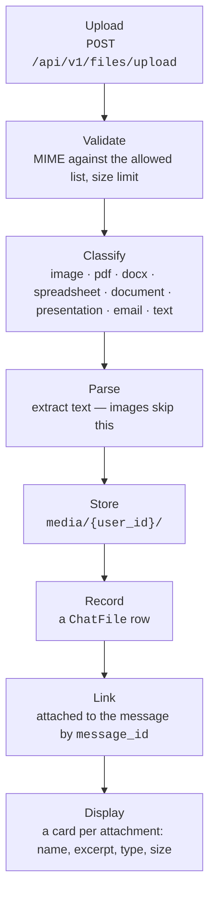
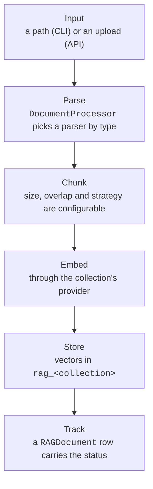

# Обработка файлов { #file-processing }

Этот документ описывает, как обрабатываются файлы в двух контекстах: загрузка
файлов в чате, которые принадлежат человеку, загрузившему их, и индексация
документов RAG, которая принадлежит коллекции и доступ к которой определяется тем,
[кто может до неё добраться](#who-may-reach-a-collection).

## Загрузка файлов в чате { #chat-file-uploads }

Когда пользователь загружает файл в интерфейсе чата, выполняется такой конвейер:

### Поток { #flow }



Ответ на загрузку несёт `preview` — первые три строки извлечённого текста, не
длиннее 240 символов, — чтобы карточка показывала, что *внутри* файла, а не только
как он называется. Браузер не может вывести его сам: PDF остаётся байтами, пока
этот сервис его не разберёт, а у клиента после ответа на загрузку есть только
идентификатор и имя файла. Для изображения и для файла, который не смог прочитать
ни один парсер, это `null`, а карточка без выдержки показывает только миниатюру или
имя.

### Блокирующая работа идёт вне цикла запросов, в собственном пуле { #the-blocking-work-runs-off-the-request-loop-on-its-own-pool }

Разбор загрузки — PyMuPDF по каждой странице, openpyxl по каждой ячейке,
декодирование всего файла — и чтение или запись его байтов блокируют без точки
приостановки. Поэтому они выполняются в потоке, а не в цикле запросов; иначе одна
большая загрузка заморозила бы каждый другой запрос и поток агента на воркере.

Они выполняются в **отдельном ограниченном** пуле (`app/core/blocking.py`, размер
задаётся `FILE_IO_MAX_WORKERS`), а не в общем исполнителе по умолчанию из
`asyncio`. Тот исполнитель несёт ещё хеширование паролей `bcrypt` и DNS для
закреплённых хостов, и всплеск загрузок не должен занять там каждого воркера,
оставив вход и исходящие запросы в очереди за неограниченным накоплением буферов
загрузки ([#1108](https://github.com/vstorm-co/agenticos/issues/1108)).

Запись тоже **безопасна при отмене**. Исполнитель не может прервать выполняющийся
`write_bytes`, поэтому отменённая загрузка дожидается записи и удаляет созданный
файл: вызывающая сторона так и не получает путь в хранилище, иначе она не смогла
бы ни зарегистрировать осиротевший файл, ни убрать его.

### Вся страница — цель перетаскивания { #the-whole-page-is-the-drop-target }

Файл, перетащенный на чат, принимается **в любом его месте**, а не только на поле
ввода. Раньше целью было только поле ввода, и прикрепить что-то превращалось в
игру «попади в полоску высотой несколько сантиметров», а промах не оставался без
последствий: браузер по умолчанию *открывает* перетащенный файл, поэтому вкладка
уходила с диалога вместе со всем, что в нём было напечатано наполовину. Тот же
`preventDefault`, который позволяет странице принять файл, мешает браузеру его
принять, поэтому обработчик на `window` чинит обе половины разом.

Пока файл находится над страницей, её закрывает оверлей: фон размыт, посередине
карточка с пунктирной рамкой, а на ней написано ограничение размера одного файла, —
видео на 60 МБ, отклонённое *после* перетаскивания, это лишний круг, который никому
не нужен. Оверлей выносится в `body`, а не позиционируется от поля ввода, потому что
`fixed` измеряется относительно ближайшего преобразованного предка, и один
`backdrop-blur` на обёртке выше тихо сжал бы оверлей до угла.

Двух вещей он намеренно не делает. Перетаскивание чего-либо **кроме** файлов —
выделенного текста, ссылки, одной из собственных перетаскиваемых строк приложения —
остаётся полностью без внимания, его даже не предотвращают. И ничего не
принимается, пока поле ввода отключено: диалог в архиве, запуск, ожидающий
согласования. То, что оверлей не появляется, и говорит об этом.

### Длинная вставка — это файл { #a-long-paste-is-a-file }

Вставка в поле ввода более **2 000 символов** загружает текст как
`pasted-<date>.txt` вместо того, чтобы вставить его. Текстовая область остаётся
нетронутой, поэтому вопрос набирается рядом с тем, о чём он, а транскрипт хранит
вложение, а не один огромный пузырь.

Порог — это весь замысел. Тот, кто вставляет абзац и нажимает Enter, хотел, чтобы
это *было* сообщением, поэтому порог стоит выше любого текста, который человек
вставил бы как вопрос (примерно 350 слов), и ниже любого документа. Ниже него
ничего не изменилось: текст попадает в текстовую область, как всегда.

Дальше это обычное вложение `text/plain`, и всё ниже относится к нему без
изменений, в чём и смысл: агент с рабочим пространством получает вставку как файл,
который может открыть, а агент без него — текст в своём промпте.

### Поддерживаемые типы файлов { #supported-file-types }

| Категория | MIME-типы | Расширения | Обработка |
|----------|-----------|------------|------------|
| **Изображения** (Images) | image/jpeg, image/png, image/webp, image/gif | .jpg, .png, .webp, .gif | Хранится как есть. Отправляется LLM как `BinaryContent` для визуального анализа. |
| **TIFF** | image/tiff | .tiff, .tif | Хранится как есть; при показе модели преобразуется в PNG-страницы, не больше `CHAT_TIFF_MAX_INLINE_PAGES`. В браузере не показывается встроенно — отдаётся как файл для скачивания. |
| **PDF** | application/pdf | .pdf | Текст извлекается настроенным парсером PDF. Добавляется в промпт как контекст. |
| **DOCX** | …wordprocessingml.document | .docx | Абзацы извлекаются через `python-docx`. Добавляются в промпт как контекст. |
| **DOC** | application/msword | .doc | Преобразуется в текст управляемым подпроцессом LibreOffice (`soffice`). Нужен LibreOffice в образе; без него текст сообщается как недоступный. |
| **Электронная таблица** (Spreadsheet) | …spreadsheetml.sheet, …ms-excel.sheet.macroEnabled.12, application/vnd.ms-excel, …opendocument.spreadsheet | .xlsx, .xlsm, .xls, .ods | Читается каждый лист, с названием, строки разделены табуляцией: `openpyxl` для OOXML, `xlrd` для устаревшего `.xls`, `odfpy` для `.ods`. Добавляется в промпт как контекст. |
| **Презентация** (Presentation) | …presentationml.presentation, …opendocument.presentation | .pptx, .odp | Текст фигур, ячейки таблиц и заметки к слайдам через `python-pptx` (`.pptx`) или `odfpy` (`.odp`). Добавляется в промпт как контекст. |
| **Документ (OpenDocument)** | …opendocument.text | .odt | Абзацы через `odfpy`. Добавляется в промпт как контекст. |
| **Электронная почта** (Email) | application/vnd.ms-outlook | .msg | Заголовки и тело читаются из потоков OLE/MAPI через `olefile` (BSD); встроенные вложения перечисляются по имени, без рекурсии. Добавляется в промпт как контекст. |
| **Текст** (Text) | text/plain, text/markdown, text/csv, text/html, text/xml, application/xml, application/json | .txt, .md, .csv, .html, .xml, .json | Декодируется напрямую как UTF-8 (XML — по объявленным BOM/кодировке). Добавляется в промпт как контекст. |
| **Архив** (Archive) | application/zip, application/x-zip-compressed, application/gzip, application/x-gzip | .zip, .tar.gz, .tgz | Читается целиком при загрузке и отклоняется, если небезопасен (см. [Архивы](#archives)). Его текст — список того, что в нём лежит. Распаковывается в рабочее пространство; агент без рабочего пространства его отклоняет. |

### Куда попадает вложение, зависит от агента { #where-an-attachment-goes-depends-on-the-agent }

Столбец «добавляется в промпт» выше — это то, что происходит у агента **без
рабочего пространства**, и это весь файл, на каждом ходу. Отчёт на двести страниц
стоит своего полного веса в токенах, когда пользователь задаёт первый вопрос, и
снова, когда спрашивает «а что с мартом?»; CSV на пятьдесят мегабайт не приложить
вообще.

Агент с [возможностью `sandbox`](reference/capabilities.md#files-shell) получает
файл вместо текста:

| Вложение | Без рабочего пространства | С рабочим пространством |
|---|---|---|
| text, csv, md, json, xml | разобранный текст вставляется прямо в промпт | записывается в `uploads/`, сообщение несёт ссылку и первые 20 строк |
| pdf, docx, spreadsheet, document, presentation, email | разобранный текст вставляется прямо в промпт | записывается в `uploads/`, рядом кладётся извлечённый текст, если среда выполнения не может прочитать файл (`email` получает его всегда: `lit` не читает `.msg`); ссылка и первые 20 строк |
| image | `BinaryContent` | `BinaryContent` **и** записывается; ссылка указывает путь |
| tiff | PNG-страницы как `BinaryContent`, отмечен предел страниц | записывается исходный `.tiff`; показываются PNG-страницы, отмечен предел страниц |
| архив (`.zip`, `.tar.gz`) | отклоняется: модели сообщают, что у агента нет рабочего пространства, куда его распаковать, и ничего из него не вставляется | распаковывается в `uploads/<id>-<name>/`; ссылка указывает папку и перечисляет верх дерева |

Если рабочее пространство недоступно, когда приложено изображение, модель всё равно
получает изображение напрямую в пределах лимитов байтов на изображение и на ход.
Промпт объясняет, что рабочее пространство недоступно.

### Архивы { #archives }

`.zip` или `.tar.gz` — так агенту передают репозиторий или любую папку с
файлами. Платформа распаковывает его на сервере до запуска агента, а не отдаёт
архив агенту на распаковку. У сохранённого рабочего пространства нет оболочки, где
можно запустить `unzip`, образ песочницы не обязательно её имеет, а архив —
известный способ записать что-то за пределы папки. Одну проверку на сервере можно
протестировать; агента, запускающего `tar -xf` на том, что ему дали, — нельзя.

Архив читается целиком при загрузке. Загрузка отклоняется с 400, и ничего не
сохраняется, если:

- путь элемента выходит за пределы архива (`../`), начинается с корня (`/etc/x`)
  или с диска (`C:/`), содержит обратную косую черту или управляющий символ;
- элемент — символическая ссылка, жёсткая ссылка, файл устройства или FIFO;
- один и тот же путь встречается дважды — или сразу и как файл, и как папка;
- элемент зашифрован, или файл не является тем архивом, который обещает его имя;
- в нём больше `WORKSPACE_ARCHIVE_MAX_ENTRIES` файлов и папок (5 000), он
  распаковывается более чем до `WORKSPACE_ARCHIVE_MAX_BYTES` (200 МиБ) или более
  чем в `WORKSPACE_ARCHIVE_MAX_RATIO` раз больше собственного размера (100) —
  бомба распаковки. Размеры измеряются при чтении элементов, а не берутся из
  заголовков архива, которые могут лгать;
- один файл в нём распаковывается более чем до `WORKSPACE_ARCHIVE_MAX_MEMBER_BYTES`
  (50 МиБ), поскольку при распаковке в памяти держится один файл за раз.

Лимит загрузки, `CHAT_MAX_UPLOAD_SIZE_MB`, применяется к самому архиву.

Для агента с рабочим пространством элементы записываются в
`uploads/<first 8 hex of the file id>-<archive name without .zip>/`, с сохранением
папок — `repo.zip` с `repo/src/app.py` превращается в
`uploads/3f2a1b9c-repo/repo/src/app.py`. Ссылка указывает эту папку и начинается с
первых строк списка элементов. Элементы записываются по одному, поэтому в памяти
одновременно только один элемент. Если рабочее пространство отказывает в записи
на середине или ход диалога останавливают во время распаковки, папка удаляется:
модели сообщают, что архив записать не удалось, и полураспакованное дерево никогда
не принимают за целое.

Агенту без рабочего пространства распаковать архив некуда. Модели сообщают, что
открыть архив она не может, и не дают список элементов, потому что список путей
позволил бы ей отвечать на вопросы о коде, который она не может прочитать.

Чтобы забрать файлы обратно, панель **Файлы** (Files) в чате предлагает каждую
папку и всё рабочее пространство как `.zip` — см.
[Песочница: загрузка папки](sandbox.md#downloading-a-folder-as-a-zip).

**Следующий ход диалога тоже получает файл.** То, что вложение добавило к
промпту, — вставленный текст либо ссылка и её начало, — хранится рядом с сообщением
и воспроизводится вместе с историей, так что «а что насчёт марта» доходит до
модели, которая всё ещё знает, что файл на месте. Картинка называется в этой
истории, а не отправляется снова; агент, которому нужно взглянуть на неё ещё раз,
просит её или открывает из `uploads/`, если у него есть рабочее пространство.

**Файл из прерванного хода диалога возвращает следующий.** Файл привязывается к
сообщению, с которым пришёл, до начала запуска, поэтому прикрепить его снова
нельзя. Если запуск, отвечавший на это сообщение, завершился, не дойдя до конца, —
упал, был отменён или остановлен бюджетом либо защитой от зацикливания, — следующий
ход диалога того же агента для этого человека в этом диалоге записывает файл
обратно в `uploads/` (вместе с извлечённым текстом там, где рабочее пространство не
может прочитать оригинал, и только этим текстом, если пропал лишь он) перед первым
использованием рабочего пространства: сразу для сохранённого рабочего пространства,
при первом использовании — для песочницы.

Запуску велено перечислить `uploads/`, прежде чем говорить, что файла нет, и
сказать, что файл вернуть не удалось, если его там всё ещё нет.

Возвращаются только собственные файлы этого человека, только из прерванных ходов
диалога этого агента, не более 50 последних, и только пока этот агент не завершит
ход диалога для того же человека, начавшийся после окончания прерванного и
действительно дошедший до настройки вложений в своём рабочем пространстве.
Завершённый ход диалога без рабочего пространства или без использования своей
песочницы оставляет это окно открытым. Ход диалога, выполненный с API-ключом, для
посетителя виджета или освобождённый от согласования другим человеком, этот срок
не завершает. Файл, удалённый после этого, остаётся удалённым.

Некоторые файлы не возвращаются: файлы хода диалога, заблокированного защитной
проверкой, поскольку проверка на входе отклонила то, что этот ход диалога нёс;
файлы промпта, запуск для которого так и не открывался и который не принадлежит
никакому агенту; файлы хода диалога, выполненного с API-ключом или для посетителя
виджета.

Когда у агента есть защитная проверка на входе, каждый файл перед возвратом тоже
проверяется — по тому, что прочитала бы проверка: его имя, путь и первые строки.
Ход диалога может остановиться раньше, чем проверка прочитает его вход, например
из-за бюджета, поэтому файл, который проверка отклонила, не записывается, а в
журнале остаётся только его id. Если отклонены все файлы, запуску не сообщают, что
хоть какой-то может вернуться. Без защитной проверки на входе ничего не меняется.

**Извлечённый текст идёт вместе с файлом только там, где оригинал прочитать нечем.**
Раньше `.txt` с результатом разбора записывался рядом с каждым PDF, `.docx` и
таблицей, исходя из того, что у оболочки нет библиотеки ни для одного из них:
`read_file` на `.xlsx` возвращает абракадабру, а у `run_python` вообще нет файловой
системы. В среде выполнения с `lit` это рассуждение устарело:
`lit parse q3.xlsx -o q3.md` — одна команда, с OCR для скана и LibreOffice для
устаревших форматов (`sandbox.md`), так что соседний файл — вторая копия
содержимого на диске ради экономии одного вызова инструмента.

Во всех остальных случаях он по-прежнему записывается, и предикат здесь не тип
бэкенда: рабочее пространство `state` — это файлы вовсе без оболочки, песочница
Daytona и собственная среда выполнения экземпляра несут то, что несёт их образ, и
ни у одной из них нет `lit`. Условие — описал ли этот экземпляр среду выполнения
модели: тот же брифинг, который запуск добавляет к своим инструкциям. Если модели
сказали, что у неё есть `lit`, соседнего файла нет; во всех остальных случаях текст
кладётся рядом с файлом.

Разбор в любом случае по-прежнему идёт на сервере, потому что *текст* — это то, что
получает агент без рабочего пространства и откуда берётся 20-строчное начало в
сообщении. Принять загрузку без разбора значило бы отдать агенту с рабочим
пространством нечитаемые байты, а агенту без него — вообще ничего.

**Ограничения.** Отсканированный PDF или TIFF даёт изображение, а не текст из OCR:
в пути чата нет OCR (в базе знаний он есть, через LiteParse). Таблицы Office и DOCX
сплющиваются в текст с табуляцией или переводами строк. Для DOC нужен LibreOffice в
образе; без него текст сообщается как недоступный. Встроенные вложения `.msg`
перечисляются по имени, но не извлекаются. Многостраничный TIFF показывает модели
до `CHAT_TIFF_MAX_INLINE_PAGES` страниц; агент с рабочим пространством открывает
остальные из оригинала на диске. Извлечённый текст ограничен
`CHAT_PARSED_TEXT_MAX_CHARS`, а бюджеты промпта на файл и на ход диалога
ограничивают то, что вставляется агенту без рабочего пространства.

**Предел — это бюджет, который тратят читатели, а не отсечение после разбора.** PDF
загружается постранично и останавливается на странице, перешедшей предел, или
после 2 000 страниц. `.xlsx` читает строки потоком, останавливается на нужной строке
и читает не более миллиона ячеек, так что лист, объявивший огромный пустой
диапазон, не стоит ничего лишнего, а лист, остановленный по этому счёту,
заканчивается примечанием об этом. DOCX, PPTX, ODT и ODP прекращают извлекать
текст на абзаце или слайде, но их библиотеки сначала распаковывают и разбирают весь
файл — в пределах лимитов размера архива. Простой текст, `.msg` и `.doc` читаются
целиком. Текст, вышедший за предел, заканчивается маркером о том, что остальная
часть документа опущена.

**Об отвергнутой записи говорится один раз, и про рабочее пространство.** Запуск,
чьё рабочее пространство не принимает файл, — это запуск, у которого откажут и
оболочка, и файловые инструменты, а строка про каждый файл этого сказать не может:
ход диалога воспринимал каждую неудачу как проблему с командой, которую только что
написал, и продолжал пытаться — `ls`, затем `curl` на `data:` URI, затем три
обходных пути, предложенных человеку, за два хода диалога. Теперь одно предложение
говорит, что рабочее пространство недоступно и что следующая попытка провалится
так же.

**Ход диалога, который блокирует защитная проверка на входе, ничего не
записывает.** Ссылка и её начало проходят проверку на входной стороне агента до записи
файла, поэтому файл из заблокированного хода диалога никогда не попадает в
`uploads/`, и следующий ход диалога не может его открыть. См.
[Защитные проверки](reference/capabilities.md#guardrails).

Ссылка — это то, что модель на самом деле читает:

```
Attached file: raport.csv (/uploads/3f2a1b9c-raport.csv, 2.4 MB, text)
First 20 lines:
month,total
jan,10
...
```

Достаточно, чтобы отличить выгрузку продаж от журнала и увидеть названия
столбцов, — а это то, что нужно модели, чтобы решить, оправдывает ли чтение
остального один вызов инструмента. Файл перестал быть контекстом и стал данными.

Четыре вещи в ней сделаны намеренно:

- **Изображения идут в обе стороны.** Модель по-прежнему должна *видеть* картинку
  — для этого и нужна мультимодальная модель, и строка с путём её не заменяет, — и
  вместе с тем должна иметь возможность изменить её размер или обрезать, а для
  этого нужны байты в файловой системе. Сверх `SANDBOX_INLINE_IMAGE_MAX_BYTES`
  сохраняется только файл, потому что дальше платить за байты дважды уже не стоит.
- **PDF получает обе половины.** Байты — это то, что человек просил передать;
  текст, который платформа уже извлекла, — та половина, которую оболочка
  действительно может прочитать.
- **Один и тот же файл записывается один раз.** Путь выводится из id `ChatFile`,
  поэтому повторное прикрепление на пятом ходу диалога разрешается в путь, который
  у файла уже есть, — загрузка стоит одной записи, а не по одной на каждый ход
  диалога до конца разговора.
- **Имени файла не доверяют.** `../../etc/passwd` превращается в `etc_passwd`; два
  файла с именем `report.csv` не могут перезаписать друг друга.

Файл, который не удаётся сохранить, — рабочее пространство заполнено, — откатывается
к встроенному пути, а не исчезает, а файл, который хранилище не может загрузить,
пропускается, а не проваливает ход диалога: человек задал вопрос, и ответить без
вложения лучше, чем не ответить.

Маршрутизация выполняется в `app/services/attachments.py`, её вызывает механизм
выполнения чата, а не каждый способ доступа отдельно. Иначе нельзя: куда попадает
файл, зависит от того, есть ли у агента рабочее пространство, а это решает
`prepare`, который ещё не выполнялся, когда способ доступа собирает свой промпт.

### Разбор PDF (чат) { #pdf-parsing-chat }

Вложения чата читаются через **PyMuPDF**, и это не настраивается. Вложение не
принадлежит никакой коллекции, поэтому нет сохранённой конфигурации, из которой
можно было бы взять выбор парсера. Символы NUL удаляются из извлечённого текста до
сохранения, чтобы PostgreSQL принял загрузку. Исходные байты PDF сохраняются.

Переменная `CHAT_PDF_PARSER`, которая раньше выбирала один из трёх парсеров,
удалена. Обе альтернативы были обёрнуты в `except Exception: return
self._parse_pdf_pymupdf(data)`, поэтому экземпляр,
задавший `llamaparse` или `liteparse`, всё равно молча использовал PyMuPDF — а
ветка LiteParse вообще не могла работать: она вызывала метод `parse_async`,
которого биндинг не определяет.

### Ограничения размера { #size-limits }

!!! warning "Два потолка, и у браузера есть своя копия одного из них"

    Вложение чата отклоняется по `CHAT_MAX_UPLOAD_SIZE_MB` (10 МБ); документ базы
    знаний — по `MAX_UPLOAD_SIZE_MB` (50 МБ). Контейнер фронтенда читает тот же
    `CHAT_MAX_UPLOAD_SIZE_MB` во время выполнения, поэтому задайте обоим
    контейнерам одно значение: слишком высокое на стороне браузера — и поле ввода
    принимает файл, который API отклоняет; слишком низкое — и оно отклоняет файл,
    который API бы принял.

- Максимальный размер вложения: `CHAT_MAX_UPLOAD_SIZE_MB` (по умолчанию:
  **10 МБ**). Это собственный лимит раздела — вложение чата отклоняется по этому
  числу, а не по большему `MAX_UPLOAD_SIZE_MB` базы знаний, и это два отдельных
  параметра, потому что вложение для агента без рабочего пространства вставляется
  в промпт целиком, а документ базы знаний режется на фрагменты и для него
  строятся векторы.
- Документ базы знаний ограничен вместо этого `MAX_UPLOAD_SIZE_MB` (по умолчанию:
  **50 МБ**).
- Всё тело запроса ограничено сверх обоих — по большему из них плюс допуск на
  multipart, — поэтому поднятие любого потолка поднимает и его.
- Лимит применяется на сервере после чтения содержимого файла. Собственная проверка
  браузера читает тот же `CHAT_MAX_UPLOAD_SIZE_MB` из окружения контейнера
  фронтенда, поэтому обоим контейнерам стоит задать одно значение: слишком
  высокое — и поле ввода принимает файл, который API отклоняет; слишком низкое — и
  оно отклоняет файл, который API бы принял.

### Хранилище { #storage }

Каждый загруженный файл — вложение чата, аватар, логотип экземпляра, оригинал
документа базы знаний — проходит через одно хранилище, выбранное параметром
`FILE_STORAGE_BACKEND` при развёртывании и никогда не отдельно для организации.
Каким бы ни было хранилище, строка записывает один и тот же **путь хранения**:
`{owner}/{uuid}_{filename}`.

`local`, значение по умолчанию, пишет их под `MEDIA_DIR`:

```
media/
  {user_id}/
    a1b2c3d4e5f6_document.pdf
    f6e5d4c3b2a1_screenshot.png
    ...
```

`s3` пишет те же пути как ключи объектов в S3-совместимом бакете, под
`FILE_STORAGE_S3_PREFIX`, и просит хранилище зашифровать каждый из них — SSE-S3 по
умолчанию, SSE-KMS с ключом, который называет экземпляр. Настройки см. в разделе
[Конфигурация](configuration.md#uploaded-files-at-rest).

Индексация базы знаний при локальном хранилище по-прежнему требует, чтобы API и
воркер делили `MEDIA_DIR/_rag_tmp`. С S3 каждое выполнение воркера скачивает свой
сохранённый объект и удаляет временную копию по завершении, при сбое парсера или
отмене. Никакой временный том API не разделяется между подами; см. [Развёртывание
в Kubernetes](kubernetes.md). Принудительно завершённый дочерний процесс может
оставить временную копию, пока под не будет заменён.

!!! info "Какое хранилище запускать и что каждое из них требует от вас"

    Локальное — честный ответ для одного хоста: зашифруйте том, и файлы защищены
    так же, как диск. Оно перестаёт быть ответом на второй реплике API — два
    контейнера, два диска, и файл, загруженный в один, на другом даёт 404, — и
    когда клиент хочет держать свои файлы под ключом, который контролирует сам.

    Переключение хранилища не переносит то, что уже содержит другое, и здесь
    ничего этого не мигрирует. Это решение принимается при настройке экземпляра;
    более позднее переключение требует скопировать файлы вручную, а пути с обеих
    сторон одинаковы, так что копии достаточно.

    Рабочие пространства агентов не лежат ни в одном из хранилищ. Рабочее
    пространство `state` живёт в этой базе данных, а `docker` — в собственном
    хранилище хоста песочницы, так что объектное хранилище не меняет их
    расположение — см. [Песочница](sandbox.md).

`agenticos cmd doctor` печатает, какое хранилище использует работающий экземпляр и
включено ли шифрование.

### Вложения письма в сценарии { #mail-attachments-in-a-workflow }

[Сценарий](workflows.md#from-an-email), запущенный письмом Gmail или Outlook,
сохраняет вложения письма как файлы этого запуска — внутри запуска и никогда в
опросе, который читал почтовый ящик. Они подчиняются тому же списку разрешённых
типов файлов и лимиту размера, что и загрузка в чат: из вложений, которые
перечисляет почтовый ящик, учитываются только первые 10 на письмо и 25 МиБ на
письмо. Пропущенное перечисляется с причиной, а тестовый запуск ничего не
скачивает.

`.zip` или `.tar.gz` пропускается как `type_not_allowed`: чат проверяет архив
элемент за элементом перед распаковкой (см. [Архивы](#archives)), а архив, который
получает сценарий, не проверяет никто.

HTML-файл в сценарии, например сохранённая страница или вложение, читается узлом
[`html.parse`](reference/workflow-nodes.md#html-parse), а не `text.extract`,
который читает документы и вернул бы разметку как текст.

### Модель ChatFile { #chatfile-model }

Модель базы данных `ChatFile` отслеживает загруженные файлы:

| Поле | Тип | Описание |
|-------|------|-------------|
| `id` | UUID | Первичный ключ |
| `user_id` | UUID/FK | Владелец (используется для контроля доступа) |
| `filename` | String | Исходное имя файла |
| `mime_type` | String | Разрешённый (канонический) MIME-тип — `.tiff`, пришедший как `application/octet-stream`, хранится как `image/tiff`, чтобы пути скачивания и встроенного преобразования читали одно надёжное поле. Строки, загруженные до FA-013, сохраняют объявленный тип; читатели терпят оба. |
| `size` | Integer | Размер файла в байтах |
| `storage_path` | String | Относительный путь в хранилище |
| `file_type` | String | Классифицированный тип: `image`, `pdf`, `docx`, `spreadsheet`, `document`, `presentation`, `email`, `text` |
| `parsed_content` | Text | Извлечённое текстовое содержимое (NULL для изображений) |
| `message_id` | UUID/FK | Связанное сообщение (задаётся при отправке сообщения) |
| `created_at` | DateTime | Время загрузки |

### Владение и доступ { #ownership-access }

- Скачать свои файлы может только владелец файла (`GET /files/{id}`).
- Метод `FileUploadService.get_user_file()` сравнивает `chat_file.user_id` с id
  запрашивающего пользователя. При несовпадении возвращает `NotFoundError`.
- **Владение — это всё правило, и ничто его не расширяет.** Ни разрешение, ни роль
  в организации, ни выданный доступ не достают до чужого файла чата через этот
  API — в отличие от коллекции, которую выданный доступ может открыть. Сравнение
  идёт по `user_id`, и второй ветки для более широкого случая нет.
- **Шаг привязки следует тому же правилу.** Сообщение прикрепляет только
  *непривязанные* собственные файлы отправителя: id, называющий чужой файл или
  файл, который уже висит на сообщении, отклоняется, а не применяется молча, — так
  что ход диалога не может ни показать чужое имя файла, ни снять вложение с
  сообщения, на котором оно уже держится.

## Индексация документов в RAG { #rag-document-ingestion }

Когда документы индексируются в базу знаний RAG (через CLI или API), разбор,
нарезку на фрагменты и построение векторов выполняет другой конвейер.

### Поток индексации { #ingestion-flow }



!!! note "Через API порядок обратный"

    Строка `RAGDocument` записывается **первой**, а четыре средних шага
    выполняются в фоновой задаче со своим сеансом — поэтому загрузка отвечает
    `202 {"status": "processing"}`, а не ждёт.

Одновременные первые записи в одну коллекцию ждут, пока её таблица и индексы будут
созданы в одной транзакции. Если создание не удалось, эта транзакция откатывается,
и ожидающая запись может создать таблицу.

У загрузки есть два адреса, по которым она может прийти —
`POST /rag/collections/{name}/ingest` и `POST /kb/{kb_id}/documents` — и оба
отвечают **202** с одним и тем же `RAGIngestResponse`, со всеми его полями, включая
`"document_id": null`. Идентификатор документа в векторном хранилище не существует,
пока воркер его не проиндексирует.

Один из двух раньше вообще опускал ключ вместо того, чтобы отправить его null,
поэтому клиент, нормализующий ответ, получал разную форму от каждого
([#560](https://github.com/vstorm-co/agenticos/issues/560)).

**Ждите `complete`, а не векторов.** `GET /rag/collections/{name}/info` сообщает
`indexing_status` по отслеживаемым документам коллекции: `indexing`, пока хоть один
из них всё ещё `processing` — в очереди или индексируется, — и `complete`, когда ни
одного такого нет. `processing_count`, `indexed_count` и `failed_count` говорят,
сколько документов в каждом состоянии. Документ с ошибкой находится в терминальном
состоянии, поэтому он не удерживает коллекцию в `indexing`; он показывается в
`failed_count`. Раньше поле было константой `complete`, а `total_vectors` растёт,
пока воркер разбирает пакет, так что скрипт, ждавший любого из них, опрашивал
наполовину построенную коллекцию
([#2486](https://github.com/vstorm-co/agenticos/issues/2486)).

`GET /kb/{kb_id}/ingestion` отвечает тем же для одной базы знаний, считая документы,
которые перечисляет её страница, а не всё под её именем коллекции, которое может
делить другая база; страница базы знаний показывает это состояние рядом с числом
документов. Документ, оставленный в `processing`, удерживает любой из ответов в
`indexing`, пока его не удалят или, для синхронизированного документа, пока его
источник не синхронизируется снова.

!!! danger "Задача запускается после коммита транзакции запроса"

    Она передаётся через `spawn_after_commit`, **не** через `spawn`, и запускается
    самим сеансом, как только строка становится надёжно записана.

    Отправленная хоть немного раньше, она искала бы документ по id, ничего не
    находила и останавливалась, оставляя уже подтверждённую загрузку в `processing`
    навсегда ([#417](https://github.com/vstorm-co/agenticos/issues/417)).

То же относится к синхронизации: строка `SyncLog` существует раньше, чем
начинается её поток. См. [Отправка фоновой работы из
запроса](architecture.md#dispatching-background-work-from-a-request).

**Каждый поток строит собственный движок для векторного хранилища и освобождает его
вместе с работой потока.**

**Один цикл событий владеет пулами процесса, а всё остальное строит собственный
движок.** Жизненный цикл API забирает их при старте: он обслуживает каждый запрос и
освобождает их при остановке, поэтому это единственный цикл событий, чьи соединения
они могут кэшировать. Воркер забирает их так же для своего единственного цикла
событий, и каждый дочерний процесс индексации — для своего. Вне владеющего цикла
событий `get_db_context` ведёт себя как `get_worker_db_context` — движок `NullPool`
на вызов, освобождаемый в конце, — потому что до него доходят из циклов событий
каналов и из резолвера эмбеддингов агента, каждый в своём цикле событий
([#1079](https://github.com/vstorm-co/agenticos/issues/1079)).

Поиск по знаниям агента следует тому же правилу для своего векторного хранилища:
хранилище процесса во владеющем цикле событий, а `agent_vector_engine` — без пула —
в любом другом месте. Это единственный код, обращающийся к векторному хранилищу,
который не может знать, в каком цикле событий он работает, а его хранилище поиска
кэшируется на весь срок жизни процесса, поэтому хранилище с пулом, разделённое
между двумя циклами событий одного воркера, отдаёт второму соединение, открытое
первым. То, что пул сохраняется для
API, и ограничивает это: `NullPool` открывает соединение при каждом захвате и
ничего не ограничивает, а пул встаёт в очередь при
`DB_POOL_SIZE + DB_MAX_OVERFLOW`.

### Поддерживаемые форматы { #supported-formats }

`.txt`, `.md` и `.docx` читаются встроенными парсерами Python независимо от парсера
коллекции. Сверх них набор зависит от парсера:

| Парсер | Также читает | Требуется |
|--------|-----------|-------|
| PyMuPDF | `.pdf` | ничего |
| LiteParse | `.pdf`; изображения (`.png`, `.jpg`, `.tiff`, `.svg`, …); офисные форматы (`.xlsx`, `.pptx`, `.odt`, `.csv`, `.rtf`, …) | LibreOffice **только для офисных форматов** — изображения преобразуются нативно |
| LlamaParse | `.pdf`, `.pptx`, `.xlsx`, `.csv`, `.rtf`, `.epub`, `.html`, изображения | Ключ LlamaParse в хранилище секретов организации, на который ссылается коллекция (`llamaparse_secret_id`). Ключа экземпляра нет |

Dockerfile бэкенда устанавливает LibreOffice и Tesseract, поэтому офисные форматы и
OCR работают из коробки в контейнере. Если бэкенд запущен вне Docker, загрузка
офисного файла в коллекцию LiteParse отклоняется с сообщением, в котором указан
LibreOffice, вместо сбоя во время преобразования.

`GET /api/v1/rag/supported-formats?parser=liteparse` отвечает для одного парсера.
Эти наборы — то, что `DocumentProcessor` действительно умеет направлять, и они
закреплены файлом `backend/tests/test_supported_formats.py`, потому что раньше
они были лишь пожеланием: `.xlsx` принимался, сохранялся, получал строку документа и
отправлялся, а затем умирал в воркере с «Unsupported file type».

### Выбор парсера (RAG) { #parser-selection-rag }

Задаётся для коллекции, на `/rag`, и переопределяется для отдельной загрузки — это
не переменная окружения. Хранится в `knowledge_bases.ingestion_config`.

| Парсер | Лучше всего подходит |
|--------|----------|
| PyMuPDF (по умолчанию) | Быстрая локальная обработка, документы с большим объёмом текста; единственный, кто извлекает встроенные изображения для описания |
| LiteParse | Локально, без ключа, учитывает вёрстку; читает офисные форматы и изображения; вывод в markdown |
| LlamaParse | Сложные вёрстки и сканированные PDF; облако, оплата за страницу |

### Параметры LiteParse { #liteparse-options }

| Параметр | По умолчанию | Примечания |
|---------|---------|-------|
| `liteparse_output_format` | `markdown` | Восстанавливает заголовки, таблицы и списки — то, по чему разбивает стратегия `markdown`. `text` сохраняет пространственную сетку. |
| `auto_ocr` | `true` | Выполняет дешёвую проверку текстового слоя LiteParse для каждого документа и запускает OCR только там, где нужно. Основную часть стоимости разбора даёт OCR. |
| `ocr_language` | `eng` | Коды Tesseract — три буквы, соединённые `+` для нескольких (`eng+pol`). Язык без установленного пакета не читает ничего; добавьте `tesseract-ocr-<lang>` в Dockerfile. |
| `liteparse_dpi` | `150` | Выше — читает бледные сканы, медленнее. |
| `max_pages` | `1000` | Параметр, ограничивающий стоимость одного документа; `parse_timeout_seconds` ограничивает только ожидание. |

### Настройка разбиения на фрагменты { #chunking-configuration }

Для коллекции, рядом с парсером:

| Параметр | По умолчанию | Описание |
|---------|---------|-------------|
| `chunk_size` | `2500` | Максимум символов на фрагмент |
| `chunk_overlap` | `200` | Символы перекрытия; должно быть меньше `chunk_size` |
| `chunking_strategy` | `recursive` | Стратегия: `recursive`, `markdown`, `fixed` |

**Сравнение стратегий:**

| Стратегия | Лучше всего подходит |
|----------|----------|
| `recursive` | Общий текст; режет по абзацу, затем по строке, затем по слову, затем по символу |
| `markdown` | Markdown и структурированные документы; режет на границах заголовков, затем по размеру внутри каждого раздела |
| `fixed` | Одинаковые размеры фрагментов; режет только по концам строк, поэтому длинная строка выдаётся целиком |

Все три живут в `app/services/rag/_splitters.py`, который заменил
`langchain-text-splitters` в
[#158](https://github.com/vstorm-co/agenticos/issues/158) — восемь пакетов за ним
включали `langsmith`, второй SDK внешней телеметрии в платформе,
стандартизовавшейся на Logfire.

Три вещи о них стоит знать, прежде чем настраивать числа:

- **`chunk_overlap` — это потолок, а не гарантия.** Фрагмент повторяет столько из
  предыдущего, сколько ещё помещается в `chunk_size`, что часто меньше настройки, а
  иногда и вовсе ничего.
- **Кусок, в котором не осталось разделителя, выдаётся целиком, а не режется.**
  `fixed` режет только по концам строк, поэтому строка в 4 КБ становится фрагментом
  в 4 КБ; модуль разбиения пишет предупреждение в журнал, вместо того чтобы отдать модели
  эмбеддингов то, что она отклонит. Предупреждение означает *сверх* `chunk_size` —
  строка ровно из `chunk_size` символов в пределах лимита и проходит молча.
- **`markdown` оставляет заголовок во фрагменте**, а до #158 не применял ни
  `chunk_size`, ни `chunk_overlap` — раздел в 50 КБ между двумя `##` был одним
  фрагментом. Теперь он применяет рекурсивное разбиение к каждому разделу, так
  что обе настройки значат в этой стратегии то же, что и в остальных.

Границы фрагментов — это то, с чем сопоставляется поиск, поэтому коллекция,
проиндексированная до этого изменения, сохраняет фрагменты, с которыми была
проиндексирована.
Загрузите документ заново или повторите `uv run agenticos cmd rag-ingest`, чтобы
нарезать его заново.

**Сколько фрагментов у документа, определяет, сколько длится его сохранение, но уже
не число обращений к базе.**

`insert_document` записывает их по 200 строк на оператор (`executemany`, который
asyncpg конвейеризует). Раньше он выполнял один `INSERT` на фрагмент в цикле Python
внутри одной открытой транзакции — так что PDF на 200 страниц при `chunk_size` по
умолчанию давал от тысячи до трёх тысяч последовательных обращений к базе: от пяти
до пятнадцати секунд против управляемого Postgres с задержкой 3–5 мс, ещё до того,
как оплачен хоть один эмбеддинг
([#950](https://github.com/vstorm-co/agenticos/issues/950)).

Запись идёт пакетами, а не одним оператором на весь документ, потому что список
параметров держится в памяти, и каждая строка несёт свой эмбеддинг в виде текста —
при 3072 измерениях это десятки килобайт на строку.

**Переопределение проверяется по объединённой паре, а не по собственному значению.**

Поле `ingestion` для отдельной загрузки несёт только то, что меняет, поэтому
`chunk_overlap: 4096`, отправленный коллекции с нарезкой по 2500, — это два по
отдельности законных числа и одна конфигурация, которая повторяет почти всё, что
уже пройдено.

Объединение проверяется заново, и загрузка отклоняется с **400**, называющим обе
настройки в `details.fields`, — до сохранения файла и до появления строки документа,
так что повторять или убирать нечего.

До [#874](https://github.com/vstorm-co/agenticos/issues/874) загрузка отвечала 500 с пустым
`details`: объединение поднимало необработанную ошибку Pydantic, до обработчика
которой дело не доходит.
Та же пара, отправленная как собственная конфигурация коллекции, всегда отклонялась с
422, потому что там это поле тела JSON, и FastAPI проверяет его до входа в маршрут.

Оба отказа называют одни и те же поля: `ingestion_config` для правила пары и
`ingestion_config.chunk_size` для отдельной настройки, — так что форма помечает одно
место, какой бы эндпоинт ни отказал. (Правило пары называет объект, потому что Pydantic
не относит `model_validator(mode="after")` ни к одному из двух полей, о которых
идёт речь.) До [#882](https://github.com/vstorm-co/agenticos/issues/882) ответ 400 называл
поля
под `details.errors` в собственном формате ошибок Pydantic, которого на фронтенде
никто не читал: предложение доходило до всплывающего уведомления, а ни одно поле
ввода так и не подсвечивалось.

### Эмбеддинги: модель, чей эндпоинт отвечает и чей ключ платит { #embeddings-the-model-whose-endpoint-answers-and-whose-key-pays }

Все три решаются **для коллекции**, а не для экземпляра, в
`app/services/embedding_resolution.py` по каталогу в
`app/core/catalog/embedding_providers.json`:

| | |
|---|---|
| **Модель и размерность** | Записываются в базе знаний при создании (`embedding_model`, `embedding_dim`) и после этого никогда не меняются — `PgVectorStore` один раз пишет `embedding vector(N)`, поэтому вторую модель либо нельзя записать, либо она молча сравнивается с векторами из другого пространства. Новая коллекция выбирает одну из моделей, которые обслуживает её провайдер; умолчания экземпляра нет. |
| **Провайдер** | Какой OpenAI-совместимый эндпоинт обслуживает эту модель (`embedding_provider`). **Меняется**, в отличие от модели: одна и та же модель той же размерности даёт векторы в одном и том же пространстве, откуда бы её ни обслуживали, поэтому `PATCH /kb/{id}` переводит коллекцию между провайдерами и оставляет всё уже проиндексированное действительным. |
| **Учётные данные** | Ключ из хранилища секретов, выбранный для коллекции (`embedding_secret_id`); по нему выставляется счёт организации, и он должен быть ключом **для этого провайдера**. Ключа эмбеддингов для всего экземпляра нет: новая личная или организационная коллекция обязана его назвать, а коллекция без пригодного ключа отказывается индексировать и искать, пока он не появится. Провайдер `ollama` — **без ключа** (Ollama в сети самого экземпляра), поэтому коллекция на нём не называет ключ и получает отказ, если попытается; вместо этого она называет **локальный сервис** (`embedding_endpoint_id`) — строку в разделе **Знания → Интеграции** (Knowledge → Integrations) с адресом: собственным адресом организации или адресом для всего экземпляра, который зарегистрировал администратор платформы. **Коллекция уровня приложения** не принадлежит никакой организации и потому не имеет хранилища, из которого можно назвать ключ; она может строить векторы только через провайдера без ключа в сервисе для всего экземпляра, а выбор провайдера с ключом для неё отклоняется там, где выбирали провайдера. |

К какой базе знаний относится имя коллекции — это тоже зависит от организации.
`collection_name` индексируется, но **не уникален** — две организации могут назвать
коллекцию одинаково и делить одну векторную таблицу, — поэтому разрешение ограничено
организацией, *для которой* строятся векторы: индексирующего потока, ищущего агента.
Выбор строки, которую база данных отсортировала первой, разрешил бы модель другой
организации и расшифровал бы *её* ключ в хранилище секретов для этого запроса,
выставив счёт ей и пропустив текст этой организации через её учётные данные
([#913](https://github.com/vstorm-co/agenticos/issues/913)). Поэтому общее имя
разрешается в собственную конфигурацию каждой организации, с откатом к коллекции
уровня приложения, но никогда — к третьей организации.

Откат возможен только к базе уровня приложения: личная база вне любой организации
тоже не имеет организации, но она принадлежит одному человеку
([#2537](https://github.com/vstorm-co/agenticos/issues/2537)).

Источник синхронизации записывает базу знаний, в которую синхронизирует
(`knowledge_base_id`), а не только имя коллекции, и только эта база перечисляет его,
запускает и показывает его историю. Источник, добавленный на вкладке
**Синхронизировать** (Sync) базы, записывает эту базу, поэтому две базы с общим
именем каждая хранят свои источники. Маршрут, который привязывает источник к
коллекции по имени, записывает базу, в которую разрешается имя для организации
вызывающего (разрешение выше), и проверяет доступ на запись к этой базе.

`rag-source-add` записывает организационную базу, которую проверил, а
`--knowledge-base` называет одну, когда имя держат несколько баз организации
([#2551](https://github.com/vstorm-co/agenticos/issues/2551)).

Источник без базы знаний не синхронизируется. Миграция, добавившая столбец, дала
каждому существующему источнику базу, в которую тот писал раньше, и деактивировало
источник, чью коллекцию не держит ни одна база его организации или экземпляра,
записав в журнал его id: укажите ему базу знаний и верните `is_active` в true, чтобы
синхронизировать его снова. Оно также записало в журнал каждый источник, который оставило
на личной базе участника, пока у организации есть организационная база с тем же
именем, — туда такой источник и синхронизировал раньше: перенесите его, если он
принадлежит организационной базе.

!!! warning "Одно имя коллекции — одно пространство эмбеддингов"

    Разрешение по организации безопасно только потому, что все строки с одним
    именем коллекции согласны в том, как строятся векторы. База знаний, созданная
    на имя, которое уже существует, **перенимает** модель, размерность, провайдера и
    ключ хранилища этой коллекции, а явный выбор, который расходится с ними,
    отклоняется, а не тихо переопределяется. Без этого одна физическая таблица
    могла бы держать два пространства эмбеддингов: pgvector прямо отказывает в
    сравнении там, где размерности различаются, а где они случайно совпадают,
    ранжирует векторы одной модели против другой и отвечает правдоподобной
    чепухой.

Раньше провайдер был жёстко зашит: каждый запрос шёл на `openrouter.ai`, поэтому
организация с ключом OpenAI не могла им пользоваться, перенос ключа в другую учётную
запись означал пересоздание коллекции и повторную индексацию в неё каждого документа,
а ничто не мешало коллекции отправить учётные данные одного поставщика на адрес
другого. Каталог — это ещё и то, чем отвечает `GET /rag/embedding-models`, поэтому
форма создания предлагает модели, которые провайдер действительно может обслужить;
раньше она предлагала каждую модель, для которой у этой сборки была известна
*размерность*, три из них — веса sentence-transformer, которые здесь вызвать нечем.

Коллекция OpenRouter может назвать собственный **эндпоинт** (`embedding_base_url`),
например региональный `https://eu.openrouter.ai/api/v1`. Региональный эндпоинт
обслуживает подмножество каталога, и только он знает, какое именно, поэтому
`GET /rag/embedding-models/openrouter?base_url=…` спрашивает его и отвечает моделями
каталога, которые тот перечисляет. Размерность по-прежнему даёт каталог, потому что
в списке она не указана. Форма создания предлагает этот более узкий список, а сервис
отклоняет коллекцию, чью модель эндпоинт не назвал: по `embedding_model`, когда её
создают, и по `embedding_base_url`, когда переносят существующую.

Эндпоинт, который не удаётся спросить, не принимается за отказ: форма перечисляет
весь каталог и говорит, что это не подтверждено. Модель, которую эндпоинт не
обслуживает, раньше принималась, а затем каждая загрузка падала с ошибкой OpenRouter
«No endpoints found supporting your data region», сохранённой как общая подсказка
проверить ключ; теперь 404 от эндпоинта эмбеддингов сохраняется как модель, которую
он не обслуживает.

Ключ проверяется при создании. Ключ, который держит другая организация, ключ не того
назначения или ключ, которого сам выбирающий не видит, отклоняется там, где человек,
делающий выбор, может это исправить.

Последний случай — причина, по которой для привязки нужен `secrets:view` на ключе, а
не только `collections:edit` на коллекции: **привязать ключ — значит дать его
взаймы**, ведь эмбеддинги коллекции выставляют счёт на него для всех, кто может
писать в коллекцию.

Список выбора предлагал только те ключи, которые выбирающий видит, — но API
принимает id, а id
можно угадать. До [#912](https://github.com/vstorm-co/agenticos/issues/912) участник
мог привязать **личный** ключ другого участника, указав его UUID.

Ключ, которого вызывающий не видит, отклоняется как ключ, которого нет в хранилище
секретов, поэтому отказ не может перечислить чужие личные секреты.

Во время построения векторов резолвер ничего не отклоняет: выбранный ключ, который с
тех пор удалили, который не удаётся расшифровать или в котором нет API-ключа,
разрешается в *отсутствие* ключа, потому что *чей ключ платит* никогда не должен
решать, *можно ли прочитать строку коллекции*. Затем клиент эмбеддингов отклоняет
индексацию или поиск сообщением, где указаны коллекция, её провайдер и то, что
именно случилось, — ключа для всего экземпляра, к которому можно откатиться, нет,
поэтому отказ никогда не советует переменную.

Эта деградация объявляется, а не подразумевается. Разрешение несёт, на каком из пяти
источников оно остановилось, и индексация записывает в журнал воркера каждое
деградировавшее разрешение, включая коллекцию, которая просто не называет ключ. До #306 воркер
индексации был единственным вызывающим, который вообще не спрашивал резолвер,
поэтому каждый загруженный документ строился моделью экземпляра и ключом для всего
экземпляра, что бы ни выбрала его коллекция; этого ключа больше нет.

### Векторное хранилище { #vector-storage }
Векторы хранятся в **pgvector** в уже существующей базе данных PostgreSQL.
Дополнительные сервисы не нужны.

**Одна таблица на коллекцию, создаётся во время выполнения.**

Хранилище выполняет `CREATE TABLE IF NOT EXISTS rag_<collection>` при первой записи
в коллекцию, поэтому эти таблицы существуют в базе данных и больше нигде. Ни одна
модель их не объявляет, и ни одна миграция их не создаёт: их в экземпляре столько,
сколько баз знаний кто-то создал.

Alembic ими не владеет, и `alembic/env.py` говорит об этом через `include_name`. Без
этого `make db-check` читал каждую как таблицу, которую модели удалили, и падал на
любой базе, куда хоть раз индексировали документ.

Предикат живёт в `app/db/vector_tables.py` и намеренно уже префикса: `rag_documents`
— *это* таблица модели, и её исключение отключило бы проверку для единственной
таблицы, через которую пишет индексация.

Хранилище отвечает на тот же вопрос тем же предикатом: `list_collections`, который
печатает `rag-collections`, сообщает о таблице `rag_` только когда её не объявляет
ни одна модель. При сопоставлении только по префиксу он сообщал о `rag_documents`
как о коллекции с именем `documents` — которую никто не создавал, чей «счётчик
векторов» был числом проиндексированных документов и которую затем любой вызывающий
мог попросить искать.

#### Как можно называть коллекцию { #what-a-collection-may-be-called }

Имя коллекции — строка, которую выбирает вызывающий и из которой хранилище строит
идентификаторы, поэтому **одна функция решает, годится ли оно**, —
`validate_collection_name` в `app/db/vector_tables.py`. Четыре отказа, каждый — 400:

| Отклоняется | Потому что |
|---|---|
| Не голый идентификатор — `foo-bar`, `2024_reports`, что угодно с пробелом или кавычкой | Хранилище подставляет имя в DDL без кавычек. Ведущая цифра только *кажется* безопасной: префикс `rag_` даёт букву, которой имени не хватает. |
| Любая заглавная буква — `Handbook` | Postgres сворачивает идентификатор без кавычек, поэтому `Handbook` и `handbook` — одна таблица. Ничто выше базы данных этого не видит: везде ещё имена сравниваются как целые строки, так что это две строки, которые платформа считает двумя коллекциями. Отклоняется, а не приводится к нижнему регистру: хранить имя, которое вызывающий не набрал, — ровно та переинтерпретация, которую это правило и призвано не допускать. |
| Длиннее 45 символов | Postgres хранит 63 байта идентификатора и молча обрезает остальное. `rag_<name>` помещается в 59, а `rag_<name>_embedding_idx` — нет, и граница задана самым длинным идентификатором, а не самым коротким. |
| `all` | Зарезервировано. |
| Таблица, которой владеют модели, — `documents` | См. ниже. |

Два из них — один и тот же сбой, достигнутый по-разному, и оба стоят отдельного
предложения. **Граница длины** — та, что выглядит педантизмом, но им не является.

Две коллекции, совпадающие до точки обрезания, — **один объект**:

- **Одна таблица**, если имя было слишком длинным — тогда `DROP` любой из организаций
  уничтожает векторы другой, и каждый поиск затрагивает обе.
- **Один индекс**, если слишком длинным было только имя индекса, что тише:
  `CREATE INDEX IF NOT EXISTS` находит индекс первой коллекции уже на месте и не
  строит ничего, оставляя вторую без индекса с той размерностью, при которой
  строилась первая.

Ничто выше базы данных не видит ни того, ни другого, потому что везде ещё имя
коллекции сравнивается как целая строка.

Вот почему ещё важен **регистр**: написание — более короткая дорога к той же общей
таблице, и отказ от заглавных букв закрывает заодно вторую. `_collection_exists`
сравнивал `rag_Handbook` с `information_schema.tables`, где хранится свёрнутое имя,
поэтому совпадения никогда не было, и `search`, `get_documents` и
`get_document_chunks` отвечали **пусто** для любой коллекции с заглавной буквой.

Этот путь убран, а не исправлен: такое имя теперь отклоняется там, где строится имя
таблицы, прежде чем что-либо успеет спросить.

**Коллекцию нельзя назвать по таблице, которой владеют модели**, — это предикат
таблиц времени выполнения, прочитанный третьим способом: его спрашивают об имени до
того, как его таблица существует. Отказ и в API, и в самом хранилище, потому что
`rag-drop <name>` доходит до хранилища без маршрута посередине. Имя, из-за которого
это стало нужно, — `documents`: с префиксом оно *и есть* таблица отслеживания,
поэтому удаление такой коллекции направляло `DROP TABLE IF EXISTS` на историю
индексации каждой организации. Отказ выводится, а не перечисляется, поэтому
модель-таблица с префиксом `rag_`, добавленная позже, покрыта, а коллекция
`documents_archive`, которую буквальное исключение задело бы, не затронута.

**И имя должно быть свободно.**

Пространство имён векторов глобально для экземпляра: две базы знаний с одним именем
коллекции делят одну таблицу. Поэтому имя, уже занятое за пределами доступа
вызывающего, отклоняется с 409 — `CollectionAccessService.claim`, который вызывают и `POST /kb`,
и `POST /rag/collections/{name}`.

Раньше это делал только один из них. `POST /kb` записывал любой `collection_name`,
который ему присылали, поэтому участник с `collections:edit` мог нацелить базу знаний
на векторную таблицу другой организации и затем читать и писать её через все
проверки — ведь коллекция разрешается через ту базу знаний, которую вызывающий
*может* читать, а теперь одна из них — его.

Имя, которое вызывающий не задал, выводится из отображаемого имени плюс шесть
случайных hex-символов и занимается на том же пути, а не принимается на веру за
случайность.

**Не свободно и имя, на котором лежит содержимое, не принадлежащее ни одной базе.**
`rag-ingest` пишет строки отслеживания и таблицу `rag_<name>` без базы знаний и без
организации. Поэтому `claim` отклоняет имя, которого не держит ни одна база, если на
нём есть непривязанные строки, описывающие фрагменты любой организации, кроме
организации вызывающего, или векторная таблица с такими фрагментами. Раньше
участник с `collections:edit` мог создать базу на коллекции оператора и удалить её,
уничтожив заодно фрагменты оператора
([#2747](https://github.com/vstorm-co/agenticos/issues/2747)). Имя, которое держит
база, не проверяется: вызывающий может писать в каждый держатель и всё равно мог бы
удалить или очистить их все. Администратор платформы может перенять такое имя;
неудавшаяся строка без векторного id не описывает фрагмент и не держит имя.
`rag-ingest`, принудительно остановленный посреди файла, оставляет строку
`processing`, которая держит имя, пока администратор платформы не перенимет её или
не запустит `rag-drop <name>`.

Содержимое, приходящее *после* того, как база заняла имя, здесь отклонить нельзя,
поэтому удаление щадит его вместо этого: таблица последнего держателя остаётся, пока
на ней есть непривязанный фрагмент, который база не забирает, как описано ниже в
разделе об удалении базы.

**И имя посреди удаления не свободно.** Удаление коллекции убирает её строки базы
знаний в рамках запроса, но физическую векторную таблицу `rag_<name>` удаляет только
*после* коммита запроса, передавая это надёжному воркеру, — так что откат сохраняет
таблицу рядом со строками, которые восстанавливает, а процесс, который падает
посреди очистки, не оставляет её сиротой.

Между этим коммитом и удалением у имени нет строки, но его таблица всё ещё держит
фрагменты прежней организации, поэтому `claim` отклоняет и имя, зарезервированное в
`collection_teardowns`, — строку, закоммиченную *вместе* с удалением и очищаемую,
когда таблица исчезнет. Без неё попытка занять имя в этом окне заставила бы
`CREATE TABLE IF NOT EXISTS` принять оставшуюся таблицу и прочитать данные другой
организации (#1362).

**Загрузка** на зарезервированное имя отклоняется по тем же основаниям:
`RAGDocumentService.dispatch_upload` проверяет резервирование до создания коллекции,
поэтому индексация, проскочившая в окно, не может воссоздать таблицу, которую
вот-вот уничтожат, и потерять в ней свои фрагменты (#1364).

**Пути индексации воркера** — синхронизация, повтор — проверяют резервирование тоже,
на проверке
`still_wanted` прямо перед записью векторов, поэтому синхронизация в очищенную базу
по умолчанию (чью строку очистка сохраняет) останавливается, а не наполняет заново
таблицу, которую удаляют (#1382). Обе — проверки резервирования по возможности,
а не сериализация под блокировкой. Запись, привязанная к базе, полагается на них и на
блокировки своей базы и строки, а закрытие последнего узкого окна оставлено на #1382.

Запись фрагмента без базы держит блокировку удаления до своего коммита, как описано
ниже в разделе об удалении последнего держателя.

Резервирование, чьё удаление так и не запускалось, — потерянное из-за падения между
коммитом и отправкой или из-за удаления, которое не удаётся навсегда, — блокировало
бы своё имя вечно, поскольку больше никто его не повторяет. **Ежечасная очистка**
(`teardown-reservation-sweep`) убирает такие: для любого резервирования старше часа
она повторяет удаление и освобождает имя, так что имя не теряется навсегда из-за
одного запуска воркера (#1364).

**База по умолчанию очищается, а не удаляется.** Удаление коллекции по умолчанию
сохраняет её строку базы знаний — организация сохраняет пригодную базу по
умолчанию, — но её векторная таблица всё равно удаляется, так что документы,
удалённые вместе с ней, перестают находиться поиском, а не остаются в таблице,
которую ничто не перечисляет (#1361). Поиск читает отсутствующую таблицу как пустую,
и следующая загрузка создаёт её заново.

Таблица сохраняется только тогда, когда то же имя всё ещё держит соседняя база,
поскольку пространство имён векторов не уникально для организации и её
удаление забрало бы и их фрагменты (#913). Тогда уходят только собственные строки
документов и файлы удалённой базы, а её фрагменты убираются из сохранённой таблицы,
как и при удалении базы ниже.

Непривязанные строки документов организации базы (загрузки до того, как документы
стали записывать свою базу) тоже уходят, вместе со своими файлами и фрагментами, если
только имя не держит другая база этой организации и всё ещё их перечисляет.
Раньше удаление стирало каждую строку документов под именем, включая строки
другой организации (#2560).

`rag-drop <name>` проходит через то же удаление. Раньше он удалял векторную таблицу
напрямую, без проверки ссылок, блокировки или резервирования, и оставлял строки
документов, поэтому мог уничтожить таблицу, которую другая база всё ещё использовала.
Теперь он очищает единственную базу, которая держит имя, или удаляет имя, которого не
держит ни одна база (заполненное `rag-ingest`), вместе с его строками документов.
Когда имя держат несколько баз, он отказывает и перечисляет их id;
`--knowledge-base <id>` называет ту, которую очистить, а таблица остаётся для
остальных. Воркер удаляет таблицу и убирает файлы после коммита команды (#2560).

Таблица последнего держателя уходит, что бы она ни содержала: оператор попросил
удаления и владеет содержимым, которое удаление из консоли пощадило бы (#2747).

`documents` было ещё и коллекцией **по умолчанию**, поэтому быстрый старт в CLI
раньше целился в таблицу отслеживания; теперь по умолчанию `default`. База знаний,
созданная со старым именем до появления этого изменения, всё ещё существует и всё
ещё удаляется, но проиндексировать в неё ничего нельзя: удалите её и создайте базу с
другим именем. Ничего при этом не теряется: индексация в эту коллекцию никогда не
удавалась, потому что построение векторного индекса на таблице без столбца
`embedding` падает.

Удаление базы отсоединяет и деактивирует ровно те источники синхронизации, которые
её записывают, кто бы ещё ни держал имя. Они сохраняют конфигурацию своего
коннектора, но требуют явного переназначения и повторной активации, прежде чем снова
синхронизироваться; другая база с тем же именем их не наследует. Очистка базы по
умолчанию тоже отсоединяет и деактивирует её источники: её строка остаётся, но
источник, оставленный на ней, синхронизировал бы удалённое содержимое обратно.
Индексация из CLI отклоняет имя, зарезервированное под поставленное в очередь
удаление, пока очистка его не освободит.

### Кто может добраться до коллекции { #who-may-reach-a-collection }

Коллекции не глобальны, и никто внутри организации не является «администратором» для
этой цели — ролей на маршруте здесь нет, только разрешения
([разрешения](permissions.md)).

У коллекции два имени. Одно — векторная таблица, в которой живут фрагменты, и это
строка, которую любой вызывающий может набрать в URL; другое — строка
`knowledge_bases`, которая ею владеет, и только эта строка знает организацию. **Строка
и есть источник полномочий**: каждый маршрут `/rag` и `/kb` разрешает имя через неё, в
`app/services/collection_access.py`, прежде чем коснуться вектора, документа или
источника синхронизации. Список и маршруты отдельных ресурсов читают правило из этого
одного места, потому что именно две копии его — `/rag/collections` фильтровал по
организации, а `/rag/collections/{name}/info` нет — однажды позволили одной
организации прочитать данные другой.

Три области на строке, и четвёртой нет:

| Область | Может читать | Может писать |
|---|---|---|
| `personal` | её владелец | её владелец |
| `org` | `collections:view`, доходящее до строки | `collections:edit`, доходящее до строки |
| `app` | кто угодно в экземпляре | администратор платформы (`is_app_admin`) |

«Дойти до строки» — это `resolve_access`, то же решение, которое принимает каждый
ресурс, которым можно поделиться: область вызывающего для этого разрешения,
расширенная любым явным выданным доступом на эту коллекцию. Выданный доступ расширяет
то, что позволяет роль, и никогда не сужает, поэтому **Viewer с явно выданным
доступом `edit` может управлять этой коллекцией** — случай, в котором проверка роли
отказала бы, даже не посмотрев. Поэтому маршруты отдельных ресурсов не несут
`require(...)`, а передают решение сервису.

Что это даёт, по операциям:

| | |
|---|---|
| Поиск — `POST /rag/search` и инструмент поиска агента | `collections:view`. Каждая названная коллекция разрешается до чтения первого вектора, и коллекция, до которой вызывающий не может дойти, отклоняет **весь** поиск, а не тихо выпадает из него |
| Чтение — перечисление коллекций и документов, статистика коллекции, разобранный текст документа или его исходный файл, журналы синхронизации и индексации | `collections:view`, и каждый ответ содержит только те коллекции, до которых вызывающий может дойти |
| Запись — создание и удаление коллекции, загрузка, индексация, повтор, удаление документа, настройка или отмена источника синхронизации | `collections:edit` |
| `POST /rag/sync/local` | Единственное исключение, и оно сохраняет `is_app_admin`: его `path` называет каталог на **сервере**, а не что-то, чем владеет организация, поэтому если открыть этот маршрут для `collections:edit`, каждый участник получил бы чтение произвольных серверных файлов, проиндексированных в коллекцию, которую затем сможет искать |

Отказ сообщается как **«Collection not found»**, с тем же сообщением и подробностями,
которые даёт отсутствующая коллекция. Всё иное превратило бы API в оракул: эти имена
выводятся из того, как люди называют свои базы знаний, поэтому подтверждение того,
что `acme_handbook_d1fac1` где-то существует, — уже информация.

**Внутри коллекции нет изоляции по документам.** Доступ решается на коллекции,
поэтому дойти до неё — значит дойти до каждого документа в ней, и это то, что стоит
взвесить, решая, что и куда индексировать.

### Сужение поиска { #narrowing-a-search }

`POST /rag/search` и инструмент поиска агента принимают рядом с запросом объект
`filters`. Четыре измерения, и все они проставляются на каждый фрагмент при
индексации:

| Поле | Что это |
|---|---|
| `source` | Откуда пришёл документ — загрузка, коннектор синхронизации — из фиксированного словаря |
| `document_type` | Тип файла после разбора, выводится при индексации, а не передаётся |
| `organizational_unit` | Единственное измерение, которое задаёт автор и которое зависит от корпуса |
| `date_from` / `date_to` | Включающий диапазон по собственной дате документа |

**Внутри поля — ИЛИ, между полями — И.** `source: ["upload", "google_drive"]` совпадает
с любым из них; добавление `document_type: ["pdf"]` сужает выборку до PDF среди
этих двух. Фрагмент, у которого нет значения по измерению, по которому идёт
фильтрация, **не проходит фильтр** — такой фрагмент исключается, а не допускается,
поэтому фильтр никогда не расширяет то, до чего уже дошёл запрос. Пустой список
отклоняется с 422, а не читается как «совпасть со всем», — то же правило «отказ
вместо молчания», которому следует остальная страница.

**Фильтр не может добраться до другой организации.** Ограничение по организации
строится из собственной уже разрешённой коллекции вызывающего, а не из тела запроса —
поля, где её можно назвать, нет — и добавляется к запросу через И до вычисления
top-k, поэтому избирательный фильтр не может вытащить строку из-за пределов
области. Коллекция уровня приложения, общая для всего экземпляра, сопоставляется
по *отсутствию проставленной организации*, а не по равенству, которое не
выполнилось бы ни у одной организации; именно это позволяет всем читать общую
базу, и никто не читает чужое.

**Фильтр не может добраться и до другой базы знаний с тем же именем.** Одна
организация не различает все пары: у базы уровня приложения и у
личной базы вне любой организации её нет, а у базы организации и у личной базы
участника в ней она одна и та же. Поэтому каждый фрагмент записывает ещё и базу
знаний, для которой проиндексирован, и поиск, подсчёт векторов, поиск замены и
удаление читают только фрагменты своей базы; удаление документа убирает и его
собственные фрагменты без базы. Фрагмент, записанный до того, как фрагменты стали
записывать свою базу, и не отнесённый к базе при миграции, сопоставляется по своей
организации, как раньше, — кроме личной базы вне любой организации, чьи поиск и
подсчёт не берут таких фрагментов
([#2537](https://github.com/vstorm-co/agenticos/issues/2537)).

Удаление базы знаний, чьё имя коллекции всё ещё держит другая база, сохраняет
общую таблицу, а задача очистки, поставленная в очередь вместе с удалением,
убирает фрагменты, отнесённые к удалённой базе. Очистка организации и удаление
учётной записи делают то же для удаляемых баз, как и удаление коллекции
(`DELETE /rag/collections/{name}`), которое к тому же удаляет только строки
документов этой базы; для сохранённой базы по умолчанию оно убирает только
фрагменты удалённых документов, поэтому загрузка, сделанная после удаления,
сохраняет свои, а фрагмент без строки документа остаётся
([#2560](https://github.com/vstorm-co/agenticos/issues/2560)).

Удаление базы знаний (`DELETE /kb/{id}`), когда её имя держит другая база, тоже
удаляет не отнесённые к базе строки документов её организации вместе с их файлами
и фрагментами, если только имя не держит другая база этой организации и всё ещё
их перечисляет, — то же правило, что при удалении коллекции
([#2560](https://github.com/vstorm-co/agenticos/issues/2560)). Иначе фрагменты без
базы остаются, сопоставляясь по своей организации, а строки документов без базы
остаются в списках баз своей организации
([#2537](https://github.com/vstorm-co/agenticos/issues/2537)).

Когда имя не держит никакая другая база, оба маршрута и `rag-drop` удаляют одни и
те же строки вместе с их файлами: собственные строки базы и строки без базы её
организации. Для базы организации или личной базы это строки её организации, для
базы уровня приложения — строки без организации (то, что пишет `rag-ingest`), а
для личной базы вне организации — никакие.

Затем оба маршрута сохраняют таблицу, если в ней есть фрагмент без базы, который
база не забирает: `rag-ingest` оператора или синхронизация из CLI в занятое имя
либо фрагмент другой организации. Занятие имени (`claim`) не может отклонить
содержимое, пришедшее после этого, а у вызывающего нет над ним власти. Удаляются только
фрагменты, которые забирает база, а остальные строки под этим именем остаются как
есть.

Если только база не является базой по умолчанию, которая остаётся на этом имени,
имя остаётся таким, каким его оставляет `rag-ingest`: ни одна база его не держит,
`rag-drop <name>` его удаляет, а `claim` отклоняет его всем, кроме администратора
платформы и организации, чьи фрагменты — всё, что там осталось
([#2747](https://github.com/vstorm-co/agenticos/issues/2747)).

Запись фрагмента без базы держит имя до коммита, поэтому таблицу спрашивают только
после того, как закончится любая такая уже идущая запись. Запись, которая доходит
до имени, пока оно зарезервировано, отклоняется, и файл приходится индексировать
заново. Задача очистки удаляет только зарезервированное имя, поэтому повторный
запуск задачи оставляет запись, сделанную после её первого удаления.

Большой документ может держать имя несколько секунд. Создание на этом имени
(`POST /kb`, `POST /rag/collections/{name}`) ждёт одну секунду, а затем отвечает
409 с просьбой повторить, потому что каждый ждущий запрос занимает соединение с
базой данных, и их достаточно, чтобы отклонить все остальные запросы. Удаление
ждёт окончания записи.

Личная база вне организации не забирает фрагменты без базы, хотя фрагмент,
который называют её собственные строки, уходит вместе с ней. Устаревший фрагмент
без базы, без организации и без строки отслеживания имеет неизвестную
принадлежность. Он сохраняет таблицу, но **не читается через базу уровня
приложения**, даже после того, как администратор платформы перенимет имя
([#2773](https://github.com/vstorm-co/agenticos/issues/2773)).

База уровня приложения забирает глобальные фрагменты без базы и строки
отслеживания только когда их `writer_kind` — `operator`. Новые записи
`rag-ingest` и синхронизации из CLI фиксируют это происхождение; индексации
платформы записывают `document`, что переживает удаление пользователя или базы.
Миграция `0300_unfiled_writer_provenance.py` считает старые метки происхождения
недоверенными, сохраняет определённую принадлежность документа и отправляет в
карантин всё неоднозначное как `legacy_unknown`. Чтение без базы в пределах
организации сохраняет ограничение по организации.

**Действие при обновлении:** проверьте удержанную коллекцию из оболочки на
сервере. Команда обращается только к базе данных и печатает сводные счётчики,
никогда не содержимое документов:

```bash
uv run agenticos cmd rag-unfiled-provenance <name>
```

Только после того, как вы изучили источник и подтвердили, что его неизвестные
глобальные данные без базы — это импорт оператора, предназначенный для каждой
организации, запустите:

```bash
uv run agenticos cmd rag-unfiled-provenance <name> --confirm-operator
```

Это требует интерактивного подтверждения (`--yes` подаёт его для автоматизации).
Обновление атомарно и повторяемо, и оно пропускает фрагменты и строки с известной
принадлежностью документа. Держите неопределённые данные в карантине;
проиндексируйте их заново в базу, для которой они предназначены, или, когда их надо удалить,
используйте существующую процедуру оператора `rag-drop <name>`. Занятие имени в
консоли никогда не подтверждает происхождение его данных.

Иначе — и всегда для `rag-drop` — задача очистки удаляет таблицу. Строки без базы
другой организации под этим именем остаются вместе со своими файлами, потому что
у вызывающего нет над ними власти. После исчезновения таблицы за ними ничего не
стоит, поэтому они помечаются как документы с ошибкой: следующая база этой
организации на этом имени перечисляет их с ошибкой, загруженный документ приходится
загружать заново, а синхронизация индексирует синхронизированный документ
повторно.

Раньше `DELETE /kb/{id}` оставлял строки организации без базы за удалённой
таблицей, всё ещё перечисленными как проиндексированные, а удаление коллекции
удаляло каждую строку под этим именем, какой бы организации она ни принадлежала
([#2568](https://github.com/vstorm-co/agenticos/issues/2568)).

Загрузка или синхронизация, которая ещё индексирует файл для базы, когда ту
удаляют, не оставляет после себя фрагментов. Запись берёт блокировку строки базы,
конфликтующую с блокировкой удаления, в транзакции, которая вставляет фрагменты:
запись, пришедшая второй, обнаруживает, что базы больше нет, ничего не пишет и
терпит неудачу на шаге индексации, а запись, пришедшая первой, коммитится до
удаления, чья очистка затем убирает её фрагменты
([#2561](https://github.com/vstorm-co/agenticos/issues/2561)).

Отдельный документ, удалённый, пока он ещё индексируется, тоже не оставляет
фрагментов. У его строки нет идентификатора документа в векторном хранилище, пока
индексация его не запишет, поэтому удалению может быть нечего убирать; воркер,
который обнаруживает, что строка исчезла, когда он записывает результат, ставит в
очередь в той же транзакции задачу, убирающую только что записанные фрагменты, и
она повторяется, если удаление не удалось. Удаление, которое обнаруживает только
что записанный идентификатор, ставит в очередь то же надёжное удаление по
идентификатору, который держит его удалённая строка
([#2565](https://github.com/vstorm-co/agenticos/issues/2565)).

Локальная синхронизация, поставленная в очередь для базы, удалённой до её запуска,
заканчивается ошибкой и ничего не пишет
([#2561](https://github.com/vstorm-co/agenticos/issues/2561)).

Агент ищет по базам знаний, к которым привязан, в пределах их собственных областей,
а не разрешая их имена заново. Агент, привязанный к двум базам с общим именем,
ищет в их объединённой области, исключая другие базы с тем же именем.

**`GET /rag/collections/{name}/filter-values`** отвечает значениями
`organizational_unit`, которые действительно есть в коллекции, в пределах той же
области. Он существует потому, что это измерение — то, что написали авторы:
угаданное значение возвращает молча пусто, а это читается как «про это ничего
нет», а не как «такого подразделения нет».

### Откуда берётся организационная единица { #where-the-organizational-unit-comes-from }

Пишут её двое, и больше её ничто не задаёт. **Источник синхронизации** несёт
значение по умолчанию, которое наследует каждый принесённый им документ: общая
папка принадлежит отделу, и никто не размечает тысячу синхронизированных файлов по
одному. **Загрузка** называет её для этого файла в multipart-теле рядом с
`ingestion`, и она записывается в собственную строку документа, а не передаётся
воркеру, поэтому запуск, поставленный в очередь до появления поля, всё равно её
применит. Консоль предлагает и то и другое: поле на последнем шаге мастера
синхронизации и поле в разделе *Как читаются и куда попадают следующие загрузки*,
которое действует для каждого добавленного файла, пока его не очистят.

Это свободный текст намеренно. Словарь — то, что реально использует корпус
экземпляра, а `filter-values` сообщает, что коллекция действительно содержит:
закрытый список пришлось бы вести ещё до того, как первый документ можно будет к
чему-то отнести. Пустое значение — не значение: оно записывается как *без
единицы*, поэтому фасет никогда не предлагает вариант с именем `""`.

**Ничего не заполняется задним числом.** Документ, проиндексированный до того, как
его источник или загрузивший назвали единицу, не несёт никакой, и никакое правило
не может решить, к какой единице он должен был относиться. Такой документ
исключается любым фильтром по этому измерению — фрагменты не проходят фильтр, —
пока его не проиндексируют заново. До
[#1777](https://github.com/vstorm-co/agenticos/issues/1777) поле не писал никто,
поэтому фильтр не совпадал ни с чем, а `filter-values` отвечал пустым списком для
каждой коллекции в каждом экземпляре.

!!! warning "Старая строка `filter` устарела"

    `POST /rag/search` раньше принимал строку `filter`, из которой когда-либо
    учитывалось только `parent_doc_id == "<id>"` — каждое другое условие
    отбрасывалось без единого слова. Теперь он принимает это одно выражение и
    **отклоняет всё остальное с 400**, а не игнорирует. Используйте `filters`;
    передать и строку, и `filters.parent_doc_id` — конфликт, тоже 400.

### Отслеживание документов { #document-tracking }


Проиндексированные документы отслеживаются в базе SQL через модель `RAGDocument`:

| Поле | Описание |
|-------|-------------|
| `collection_name` | Целевая коллекция |
| `filename` | Исходное имя файла |
| `filesize` | Размер файла в байтах |
| `filetype` | Расширение файла (без точки) |
| `status` | `processing`, `done` или `error` — члены `DocumentStatus` и единственные три значения, которые держит столбец. Счётчик *проиндексированных* документов коллекции фильтрует по `done`; он фильтровал по четвёртому значению, которого до [#148](https://github.com/vstorm-co/agenticos/issues/148) никто никогда не записывал, поэтому каждая база знаний сообщала `indexed_count: 0`, сколько бы документов ни было завершено |
| `error_message` | Что не удалось, если `status` — `error`; см. ниже |
| `vector_document_id` | Идентификатор в векторном хранилище |
| `chunk_count` | Число созданных фрагментов. Записывается с [#147](https://github.com/vstorm-co/agenticos/issues/147); документ, проиндексированный раньше, держит `0`, и карточка его коллекции занижает данные, пока его не проиндексируют заново |
| `storage_path` | Путь к исходному файлу (для повторной индексации и скачивания) |
| `organizational_unit` | К какой части организации относится этот документ — из загрузки или унаследованная от источника синхронизации. `null` для документа, который никуда не отнесли |
| `created_at` | Время начала индексации |
| `completed_at` | Время завершения индексации |

**Замена снимает строку, которую заменила.** Каждый путь индексации — загрузка,
CLI, запуск синхронизации — пишет *новую* строку отслеживания, а индексация с
`replace=true` удаляет векторный документ, который заменяет, и вставляет новый.
Так что старая строка остаётся описывать векторы, которых никто не держит: её
`chunk_count` продолжает прибавляться к итогам коллекции, а её представлению
разобранного содержимого нечего читать. Поэтому завершение индексации удаляет
строки отслеживания, указывающие на векторный документ, который она заменила,
вместе с их сохранёнными копиями файла. Без этого каталог, синхронизируемый
каждую ночь, сообщал бы о коллекции, растущей на собственный объём каждую ночь.

**Синхронизированный документ не хранит оригинала и говорит об этом.** Путь
загрузки сохраняет копию под `rag/{collection}`, а синхронизация — нет: байты
синхронизированного файла живут в той системе, откуда он пришёл, а зеркалирование
каждого из них на диск этого экземпляра ради работы одной кнопки — это расход на
корпус, а не на сбой. Поэтому `storage_path` у них пуст, а `has_file` имеет значение false — это
и должен читать интерфейс, предлагающий скачивание. **Повторный запуск
синхронизации и есть повтор** — с
[#990](https://github.com/vstorm-co/agenticos/issues/990) она пропускает всё
неизменное и заново забирает ровно то, у чего нет документа, поэтому повтор
четырёх сбоев из сорока стоит четыре передачи, а не сорок.

**Каждый путь открывает строку до того, как файл проиндексирован.**

Записанная после, строка, чья запись не удалась — сбой базы данных, имя длиннее
столбца, — оставляла векторный документ сохранённым и неотслеживаемым. Следующий
запуск `new_only` затем совпадал с его хешем и *пропускал* файл ещё до записи
строки, поэтому тот навсегда оставался доступным для поиска, невидимым и
неудаляемым.

Худший случай такого порядка — строка, которая говорит `processing` рядом с
документом, который завершился: это видно и можно удалить.

Синхронизация коннектора перестала писать строки после
[#992](https://github.com/vstorm-co/agenticos/issues/992), а синхронизация
локального каталога — в [#997](https://github.com/vstorm-co/agenticos/issues/997),
что заодно дало локально синхронизированному файлу, который не разбирается, строку
и причину. У него не было ни того, ни другого, поэтому журнал синхронизации,
говорящий «четыре из сорока не удались», не называл ни одного из них.

**Синхронизированная строка говорит, какой файл она отслеживает**, в
`source_path`: `gdrive://<id>`, `s3://bucket/key` или абсолютный путь для
локальной синхронизации или синхронизации из CLI. Именно это снимает предыдущую
попытку для *того же файла* — неудачный разбор не пишет векторов, поэтому снятию в
`complete_ingestion` не с чем совпасть, и обе строки раньше выживали, по одной
лишней на каждый сбой, и каждая считалась в `document_count` коллекции
([#996](https://github.com/vstorm-co/agenticos/issues/996)).

**Загрузка не хранит адреса**, а значит, ничего и не снимает. Её единственное имя —
базовое имя файла, а это не адрес: два человека могут загрузить разные
`report.pdf` и при `replace=false` иметь в виду, что существуют оба. Снятие по
такому имени удалило бы неудачную строку первого — его диагноз, его повтор и его
сохранённый файл — для вызывающего, который ничего подобного не просил. Адрес
`NULL` не совпадает ни с каким сравнением, и это и есть нужный ответ, а не то, что
надо обходить; таков он у каждой строки, записанной до появления столбца.

Что именно может забрать снятие, решают четыре вещи, и каждую из них сначала
сделали неправильно:

- **По адресу, никогда по имени файла.** Это то же столкновение, которое
  [#990](https://github.com/vstorm-co/agenticos/issues/990) убрал на стороне
  векторов, только пришедшее с другой стороны: `a/readme.md` и `b/readme.md` в одном бакете
  делят базовое имя, поэтому совпадение по имени удаляет строку другого файла.
- **В области новой строки, никогда по имени коллекции.** Имя не уникально,
  поэтому две организации или две базы одной могут синхронизировать в него один и
  тот же путь. Строка, отнесённая к базе, снимает только строки, которые
  перечисляет эта база, — свои и не отнесённые к базе строки её организации, — а
  строка без базы только не отнесённые к базе строки своей организации
  ([#2747](https://github.com/vstorm-co/agenticos/issues/2747)).
- **`ERROR`, а не «нет идентификатора вектора».** Это разные множества, и
  обращаться с ними как с одним — гонка: строка `PROCESSING` принадлежит ещё
  идущей попытке, и при двух перекрывающихся индексациях одного источника вторая
  удалила бы живую строку первой — после чего первая завершается, заменяет
  векторы и не находит строки, которую надо завершить.
- **Неудачная *замена* — не неудачная индексация.** `ingest_file` вставляет новый
  документ до удаления того, который заменяет, поэтому удаление, при котором
  возникает исключение, раньше возвращало ошибку, хотя векторы уже лежали на
  месте, — строка `ERROR` без идентификатора вектора, которую следующая попытка
  сняла бы, оставив их без владельца. Успешная вставка — это и есть весь ответ:
  задержавшийся старый документ записывается в журнал, а дубликат, который можно
  увидеть и удалить, — не тот сбой, о котором надо сообщать.

Синхронизация коннектора не писала строк вовсе до
[#992](https://github.com/vstorm-co/agenticos/issues/992): предложение выше было
верно только для загрузки, CLI и *локальной* синхронизации. Документ из папки
Drive был доступен для поиска и невидим: отсутствовал на вкладке «Документы» базы
знаний (`GET /kb/{kb_id}/documents` читает `get_for_kb`), отсутствовал в
собственном `document_count` коллекции, был недостижим для удаления, а сбой
представал числом в журнале синхронизации, и нигде не было причины по каждому
файлу.

Неудачные индексации можно повторить через `POST /rag/documents/{id}/retry`. Он
заново читает `storage_path` — копию, которую загрузка хранила ровно для этого, —
и снова запускает разбор, заменяя всё, что проиндексировала неудачная попытка.
Документ, который не завершился сбоем, или документ без сохранённого файла — тот, что
старше загрузок, хранящих свои, или тот, который проиндексировала
синхронизация, — отклоняется с 400, а не переводится в `processing`
([#441](https://github.com/vstorm-co/agenticos/issues/441)).

Повтор также отклоняет документ организации, не отнесённый ни к какой базе
знаний: его фрагменты были бы записаны в масштабе всего экземпляра, где база
организации, которая его перечисляет, не читает, поэтому его надо загрузить
заново. Документ без организации принадлежит базе уровня приложения, которая там
читает, и его повторяют
([#2568](https://github.com/vstorm-co/agenticos/issues/2568)).

### Что говорит неудачная индексация { #what-a-failed-ingest-says }

`error_message` — это сохранённый столбец, который показывается на странице
документов и в истории синхронизации источника всем, кто видит коллекцию. Поэтому
он несёт сводку, а не то, что сказал отказавший клиент:

```
The document could not be indexed (AuthenticationError) - check the
collection's embedding credential, then retry the upload. The worker log has
the full error.
```

Три части, и каждая здесь не просто так. **Этап** — разбор, индексация, запись
результата или целая синхронизация — единственное, что читатель не может
восстановить потом, и он отделяет файл, который парсер этой коллекции не читает,
от учётных данных, которые отклонил провайдер. **Тип исключения** сохранён, потому
что имя класса — это символ: оно говорит, что учётные данные отклонили или что
вышестоящая система не ответила вовремя, не называя хост, который это сказал.
**Совет** — то, что читатель действительно может сделать.

Об одном сбое сообщают до трёх обработчиков — этап, который выбросил исключение,
проверка, что возвращённый сбой не `done`, и страховочный обработчик потока, — и
строка остаётся за **первым** записавшим, потому что он самый внутренний и самый
конкретный. Повтор очищает сообщение, поэтому следующая попытка записывает своё.

Отказ, который платформа подняла сама, передаётся целиком, потому что его
сообщение написано здесь и это самое полезное, что можно показать: *«Для этой
коллекции не настроены учётные данные для эмбеддингов»*, *«Месячный бюджет
организации исчерпан: потрачено $40,15 из лимита $40,00»*.

**Не** сохраняется собственный текст отказавшего клиента. SDK провайдера, `httpx`,
`boto3` и клиент Google Drive кладут в сообщение исключения запрос, который
делали, а это регулярно означает эндпоинт, внутренний хост, бакет или URL с
ключом в строке запроса; и, в отличие от тела ошибки HTTP, столбец читают снова
недели спустя все, кто откроет неудачный документ.

Этот текст не потерян: каждое из этих мест вызова записывает его через
`logger.exception`, поэтому в журнале воркера есть сообщение и трассировка, а у
задачи, которая пробрасывает исключение дальше, есть её тип, сообщение и последние
кадры в её строке в `background_jobs`, где их читает только владелец экземпляра.
`app/services/rag/failures.py` — то место, где столбец и журнал разделены.

Журнал — аудитория меньше, чем у столбца, но не безопасная: считайте журнал
воркера тем, что читают только операторы, и посмотрите [#440], почему фильтр
вырезания, который поставляется с этим экземпляром, сейчас его не вычищает.

[#440]: https://github.com/vstorm-co/agenticos/issues/440


### Операции синхронизации { #sync-operations }

Операции синхронизации отслеживаются через модель `SyncLog`, которая записывает
источник, режим, общее число файлов, счётчики проиндексированных, обновлённых,
пропущенных и неудачных, а также время. Историю синхронизации смотрите через
`GET /rag/sync/logs`.

**Какому сохранённому документу соответствует файл — это один вопрос, и на него
отвечает индекс.**

`IngestionService.existing_document` передаёт его в `find_existing_document`
хранилища, который ищет документ по одному ключу метаданных за раз — `source_path`,
затем `filename`, под которым документ не фигурировал по другому пути, затем
`content_hash` — в этом порядке старшинства, останавливаясь на первом попадании.

Он отвечает и идентификатором документа, **и** его сохранённым `content_hash`, и
эти двое возвращаются вместе намеренно: это факты об *одном* документе.
Вычисленные раздельными поисками с разными правилами, они могли разойтись, и тогда
синхронизация сравнивала хеш живого файла с хешем другого документа и либо каждую
ночь заново строила эмбеддинги для неизменного файла, либо пропускала изменённый
как актуальный ([#548](https://github.com/vstorm-co/agenticos/issues/548)).

`PgVectorStore` обслуживает каждый поиск из **хеш**-индекса по этому ключу
метаданных. Хеш, а не btree, потому что поиски только на равенство, а
`source_path` не ограничен по длине: btree упёрся бы в предел размера строки и
уронил бы вместе с собой индексацию.

Индексы создаются вместе с таблицей времени выполнения и заполняются для старых
коллекций миграцией `0058_backfill_rag_lookup_indexes`. Благодаря этому проверка —
это несколько индексных запросов, а не чтение всей таблицы `rag_<collection>` в
память воркера, как было раньше, — по одному разу на каждый проиндексированный
документ, в коллекции, где могли быть сотни тысяч фрагментов
([#1102](https://github.com/vstorm-co/agenticos/issues/1102), половина
[#27](https://github.com/vstorm-co/agenticos/issues/27) про индексацию; другая её
половина добавила постраничность в список отслеживаемых документов).

Запасной вариант базового класса всё ещё отвечает, читая список, — для хранилища,
на индекс которого нельзя опереться.

`new_only` пропускает файл, чей сохранённый хеш совпадает, `update_only`
пропускает неизменный и игнорирует новый, а `full` заменяет всё, с чем совпадёт.
Хранилище, которое не может ответить по списку, считается «без совпадения», а не
совпадением: неудачный запрос — не доказательство отсутствия документа, но если
действовать по нему так, будто документ *был*, его удалили бы.

**Оба потока, и они обязаны совпадать.** Один столбец `sync_mode` управляет и
локальным каталогом, и коннектором, поэтому режим, значащий для каждого своё, —
это дефект, что бы каждый из них ни делал по отдельности.

Синхронизация коннектора не реализовала ничего из этого до
[#990](https://github.com/vstorm-co/agenticos/issues/990). `sync_mode` доходил
только до аргумента `replace` у `ingest_file`, а `ingest_file` никогда не
пропускает, поэтому при режиме по умолчанию `new_only` предыдущий документ не
находился и не удалялся, и **вторая копия** вставлялась при каждом запуске.

Неделя ночных синхронизаций — это семь копий каждого фрагмента, ранжируемых друг
против друга в каждом поиске, и каждая оплачена эмбеддингами. Счётчик `skipped`
рядом инициализировался и никогда не увеличивался, а значит, журнал синхронизации
каждую ночь правдиво сообщал `skipped=0`.

Место принятия решения у них разное, потому что загрузка байтов удалённого
файла чего-то стоит. `update_only` не нужны байты, чтобы пропустить файл, которого
он никогда не видел, поэтому этот ответ даётся до скачивания; хешу они нужны,
поэтому неизменный файл распознаётся после скачивания и до построения эмбеддингов,
то есть до более дорогой части. Сохранённый документ без `content_hash`
индексируется заново, а не считается актуальным: пропуск файла, который мог
измениться, — это ответ, который ничто потом не исправит. Заменённый файл
считается **обновлением**, а не индексацией, и это читается из
`replaced_document_id`, а не из собственного предложения результата.

**Две вещи о сопоставлении, и обе решают, выживет ли документ.**

Предпоследнее средство `existing_document` — совпадение по *имени файла*, и оно
существует для того, чтобы файл, загруженный через браузер и позже
синхронизированный из папки, откуда он пришёл, заменялся, а не дублировался:
загрузка хранит имя файла как свой `source_path`, поэтому эти двое совпадают, и он
остаётся достижимым по имени.

Документ, называющий **другой** адрес, для него не кандидат. В бакете, где рядом
лежат `a/readme.md` и `b/readme.md`, второй ключ находил документ первого по имени,
поэтому при равном содержимом он его пропускал, а при неравном заменял первый — и
так или иначе первая синхронизация не могла сохранить оба, и ничего об этом не
говорила.

То же столкновение касалось двух локальных файлов с одним именем в разных
каталогах.

А замена **вставляет до того, как удаляет**. `insert_document` — там, где
вычисляются эмбеддинги, поэтому провайдер, отказавший между двумя инструкциями,
раньше оставлял коллекцию ни с одним из документов — навсегда, потому что
неудачная индексация возвращается как результат, а не порождает исключение, и ничто
её не повторяет. Состояние, когда на время вставки существуют оба документа, поиск
переживёт; состояние, когда нет ни одного, — нет.

История одного источника — `GET /kb/{kb_id}/sync-sources/{source_id}/logs`.
Источник должен принадлежать этой базе, иначе маршрут возвращает **404**. Каждый
записанный запуск сохраняет свою исходную базу и организацию как границу доступа:
переназначение источника не даёт новой базе доступа к более ранним приватным
запускам. Фильтрация происходит до ограничения страницы. Устаревшие запуски без
записанной базы по-прежнему связываются с базой через свой источник. Удаление записанной
базы архивирует историческую ссылку на источник до того, как идентификатор базы
очищается, поэтому эта история не может стать видимой через переназначенный
источник.

Сверка, отметки о неизменных документах и отслеживание векторов используют область
документов целевой базы. Переназначение источника очищает его кэшированное
состояние синхронизации и последний статус; завершение запуска, допущенного для
старой цели, не может их восстановить.

### Что не вправе решать источник синхронизации { #what-a-sync-source-is-not-allowed-to-decide }

!!! danger "Кто может положить файл в общую папку, тот выбирает строку, с которой будет иметь дело следующая синхронизация"

    Две из этих строк раньше принимались как есть: имя файла, которое было путём
    (`../../../../home/app/.ssh/authorized_keys` — законное имя в Drive), и
    идентификатор папки, который доходил до языка запросов Drive. `remote_names.py`
    отклоняет и то и другое, а `BaseSyncConnector` — не коннектор — решает, куда
    ляжет байт, поэтому коннектор, добавленный позже, наследует отказ, а не должен
    его помнить.

Содержимое источника — не то, чему может доверять экземпляр, а в папке Drive,
открытой за пределы организации, оно не принадлежит даже ей: для этого совместный
доступ к папкам и *существует*.

!!! danger "Имя файла — это метка, а не компонент пути"

    `../../../../home/app/.ssh/authorized_keys` — законное имя файла в Drive, и
    коннектор записывал `dest_dir / file.name` дословно: за пределы временного
    каталога, который создал воркер, туда, куда мог писать его uid, а затем
    индексировал оттуда.

Теперь имя сводится к своему последнему компоненту, а результат *разрешается и
подтверждается* как дочерний элемент каталога синхронизации. Так `..`, его
кодировки, его похожие написания и символическая ссылка, уже лежащая в каталоге,
становятся **одним вопросом**, а не списком написаний, за которым надо следить.

Имя, которое вовсе не компонент, — `..`, `.`, `/` — отклоняется. Всё остальное
ложится внутрь как один файл.

**Место назначения определяет `BaseSyncConnector`, а не коннектор.** Реализация
получает путь и пишет в него (`_fetch`), и именно поэтому коннектор, добавленный
позже, наследует отказ, а не должен его помнить.

**Идентификатор папки доходит до языка запросов.** Запрос Drive оборачивает
идентификатор родителя в одинарные кавычки, поэтому
`x' in parents or name contains 'salary` — это правильно построенный, более широкий
запрос. Теперь идентификатор
папки проверяется по тому, что может выдать Google, — буквы, цифры, `-` и `_`, —
там, где строится запрос, а через эту одну воронку проходят и настроенная папка, и
каждый идентификатор подпапки. `validate_config` задаёт тот же вопрос, поэтому на
враждебное значение отвечает маршрут, который его принял, а не журнал
синхронизации час спустя.

**Источник Google Drive работает на своих учётных данных или не работает вовсе.**
Коннектор раньше откатывался к `GOOGLE_DRIVE_CREDENTIALS_FILE`, когда
`service_account_json` отсутствовал, а это значило, что идентификатор папки
организации выбирал, что перечисляется под сервисной учётной записью *оператора* и
что этой учётной записи открыли. Откат убран; настройка теперь обслуживает только
команду CLI `rag-sync-gdrive`, которую оператор запускает из своей оболочки.

### Учётные данные — секрет хранилища, а не поле конфигурации { #the-credential-is-a-vault-secret-not-a-config-field }

!!! danger "Учётные данные никогда не попадают в `CONFIG_MODEL` коннектора"

    `sync_sources.config` говорит, как *найти* документы. Аутентифицирует секрет из
    хранилища секретов, который источник называет в `secret_id`, и запасного
    варианта для всего экземпляра нет, потому что откат означает, что
    идентификатор папки одной организации выбирает, что читается от имени
    оператора.

То, что источник называет в `secret_id`, — это `gcp_service_account` для Drive,
пара `aws_credentials` для S3 или `git_token` для репозитория Git; коннектор
объявляет это как `SECRET_KIND` и предлагает мастеру как `secret_kind` в списке
коннекторов.

Раньше это лежало в `config` и шифровалось `app/core/crypto.py` — один ключ Fernet
для всего экземпляра поверх учётных данных каждой организации, то есть та самая
слабость, ради устранения которой существует хранилище секретов, и единственное
место, где утверждение `CLAUDE.md` «второго механизма нет» было неправдой. Этот
модуль удалён ([#937](https://github.com/vstorm-co/agenticos/issues/937)). Отсюда
следует три вещи:

- **Учётные данные вводятся один раз, дальше на них ссылаются.** Пять баз знаний,
  питаемых из одной папки Drive, раньше означали один и тот же JSON, вставленный
  пять раз, сменённый пять раз и отозванный в пяти местах. Клонирование интеграции
  теперь копирует ссылку.
- **Мастер предлагает то, что есть у организации**, отфильтрованное до вида,
  который нужен коннектору, и даёт ссылку на хранилище секретов, когда там ничего
  нет: `InlineSecret` здесь не используется, потому что он умеет только
  `api_key`, а сервисная учётная запись — форма из нескольких полей, которой
  честное место — в хранилище секретов.
- **Сервис отклоняет конфигурацию, несущую учётные данные.** На отправку старых
  имён полей он отвечает «учётные данные не место в конфигурации источника», а не
  отбрасывает их молча, чтобы источник сохранился и потом не смог
  аутентифицироваться.

Чтение происходит там, где есть сеанс и организация: воркер расшифровывает секрет
для собственной организации источника и передаёт его коннектору рядом с
конфигурацией. Коннектор не может добраться до хранилища секретов сам, а источник,
чей секрет удалён, больше не синхронизируется: у коннекторов нет запасного
варианта для всего экземпляра, и он не должен появиться.

### Кто в итоге сможет прочитать то, что проиндексировал источник { #who-ends-up-able-to-read-what-a-source-ingested }

**Коллекция — это граница разрешений, а охват источника — это разрешения его
учётных данных, суженные его собственной конфигурацией.** Источник синхронизации
индексирует ровно в одну коллекцию, доступ решается на коллекции (см. [Кто может
добраться до коллекции](#who-may-reach-a-collection)), и изоляции по отдельным
документам внутри неё нет, поэтому **всё, что читает этот источник, становится
доступным для чтения каждому, кто может читать эту коллекцию.**

Эти две половины охвата не одинаково надёжны, и это стоит знать.

Источник Drive ограничен своим `folder_id`, а источник S3 — своими `bucket` и
`prefix`, поэтому широкие учётные данные, направленные на одну папку, индексируют
одну папку.

Но `config` — это поле строки, и его может менять любой, у кого есть
`collections:edit` на эту коллекцию.

!!! warning "Конфигурация сужает охват, и нельзя полагаться на то, что она удержит его узким"

    Собственные разрешения учётных данных — это потолок, который ничто в этом
    продукте поднять не может.

    Токен Confluence, годный для всего экземпляра, в источнике, который кто-то
    позже перенаправил на более широкое пространство, публикует весь экземпляр
    каждому участнику с `collections:view`. Тот же токен, ограниченный одним
    пространством, этого не может, что бы ни говорила конфигурация.

Это решение, которое кому-то придётся принять, и ответ платформы — сделать его
**явным, а не хитрым**. Альтернатива — зеркалировать собственные ACL каждого
источника в хранилище и фильтровать при поиске — не в планах, и причины стоит
назвать, чтобы её снова не предложили как очевидный выигрыш:

- **Нет карты идентичностей.** ACL SharePoint называет субъекты Entra, ACL
  Confluence — учётные записи Atlassian, и ни то ни другое не является строкой
  `organization_members`. Угадывать соответствие по адресу электронной почты — так
  платформа и выдаёт не тому человеку доступ к нужному документу.
- **ACL — движущаяся цель.** Разрешение, изменённое в источнике, здесь невидимо до
  следующей синхронизации, поэтому зеркалированный ACL — это *устаревшая
  авторизация*, хуже отсутствия: она выглядит как ответ.
- **У веб-краулера ACL нет вовсе**, а у репозитория Git он принадлежит
  платформе хостинга, а не документу. Модель, которая работает только для двух из
  возможных коннекторов, — не та модель.

Итак, правило для того, кто создаёт источник, и то, что обязан сказать шаг мастера:
**ограничивайте учётные данные, а не только конфигурацию.** Сервисная учётная
запись, открытая в одну папку; приложение Entra, согласованное на один сайт, а не
на клиента; токен Confluence, ограниченный пространством, — это та половина
охвата, которую правка источника расширить не может. Направить широкие учётные
данные на коллекцию `personal` сужает круг читателей, но не то, что
проиндексировано; узкие учётные данные на коллекции `org` — та форма, к которой
надо стремиться.

**Кто это решил — записывается.** Создание, клонирование, перенаправление и
удаление источника пишут по записи аудита — `sync_source.created`, `.updated`,
`.deleted` — с именем действующего лица, коннектора, коллекции и *идентификатора*
секрета, но никогда не самого документа конфигурации. Обновление, переносящее
источник в другую коллекцию, записывает и ту, которую он покинул, потому что
переименование и смена аудитории иначе дают одну и ту же запись. Клонирование
записывается как создание с указанием строки, из которой оно произошло: оно
направляет учётные данные, которые кто-то уже ограничил, в другую коллекцию,
поэтому его аудитория меняется, а с учётными данными не происходит ничего (#983).

**И это говорится до факта, а не только после него.**

Последний шаг мастера — тот, который решает коллекцию, — называет учётные данные и
аудиторию *вместе*, потому что решение состоит из этой пары:

> *«&lt;учётные данные&gt; имеют доступ ко всему разрешённому и ко всему, что
> индексирует источник, — всё это становится доступным для поиска в
> &lt;коллекция&gt; для …»*

У коннектора, который ничем не аутентифицируется, нет учётных данных, чтобы их
назвать, и предложение не выдумывает их. Оно не называет и те, чей читатель не
имеет `secrets:view`.

Каждая область заканчивает это предложение по-своему: `personal` — это её
владелец, `org` — все, кто может видеть коллекцию, `app` — все в экземпляре, — а
интеграция, не отнесённая ни к какой базе знаний, говорит, что искать в ней пока
ничего нельзя.

Предложение не ждёт *выбора* коллекции, который появляется только там, где есть из
чего выбирать. Случай, из которого это завели, — база знаний, предлагающая ровно
одну коллекцию, где выбирать нечего, а последствие то же (#982).

Клонирование говорит это тоже, и по причине выше: это единственный способ сменить
аудиторию источника из собственного интерфейса продукта. Перенаправление
существующего — это `PATCH` по `collection_name` в `/rag/sync/sources/{id}`.
Редактор источника на вкладке **Синхронизировать** (Sync) базы знаний его не
отправляет, а собственный `PATCH /kb/{kb_id}/sync-sources/{source_id}` этой базы
отклоняет `collection_name`, называющий другую базу, — поэтому перенаправить можно
через API и CLI, где это и записывает запись аудита выше.

### Что должен новый коннектор { #what-a-new-connector-owes }

Коннектор — это `list_files` + `_fetch` + `CONFIG_MODEL`, и вызовы API здесь —
дешёвая часть. `CONFIG_MODEL` — модель Pydantic с полями конфигурации; список
публикует её `model_json_schema()` как `config_schema`, поэтому мастер рисует форму
через `SchemaForm` — та же схема, которую публикует возможность
([#1093](https://github.com/vstorm-co/agenticos/issues/1093)).

**Объектное хранилище — это ещё меньше работы**: S3, Azure Blob и GCS — один коннектор
с тремя клиентами, поэтому `ObjectStoreConnector` держит цикл перечисления, адрес
`<scheme>://<container>/<key>` и пропуск маркеров каталогов, а подкласс поставляет
клиент, `SCHEME` и то, какое поле `CONFIG_MODEL` называет контейнер, — `bucket` для
S3 и GCS, `container` для Azure. `S3Connector` и есть этот подкласс
([#988](https://github.com/vstorm-co/agenticos/issues/988)); два его хука намеренно
блокирующие, потому что все три SDK такие, и общий класс запускает их в потоке
воркера.

Три вещи недёшевы, и коннектор без них — это счёт или сюрприз, а не функция:

- **Сигнал изменения.** Начиная с
  [#990](https://github.com/vstorm-co/agenticos/issues/990) путь синхронизации
  сравнивает одно, и это `content_hash` байтов, а значит, он скачивает файл, чтобы
  узнать, что тот не изменился. Это экономит эмбеддинги, но не передачу. Коннектор,
  который может ответить на вопрос «изменился?» *без* байтов, должен сказать об
  этом в своём докстринге — токен `delta` в Graph, `version.number` страницы, sha
  коммита, HTTP `ETag`, — потому что сигнал, который поток может прочитать до
  скачивания, отличает ночную синхронизацию, стоящую перечисления, от той, что
  стоит всей папки. `content_hash` — запасной вариант там, где удалённая система
  действительно не предлагает ничего.
- **Учётные данные, ограниченные на уровне источника.** См. раздел выше. Его
  `SECRET_KIND` говорит, какую форму имеют учётные данные; ничто в платформе не
  может сказать, насколько широко они выданы, поэтому указание принадлежит туда,
  где создаётся источник.
- **Число файлов, о котором кто-то подумал.** Чтение списка документов коллекции
  по-прежнему полное сканирование
  ([#27](https://github.com/vstorm-co/agenticos/issues/27)), поэтому коннектор,
  приносящий тысячи файлов, делает эту постраничность срочной, а не просто
  аккуратной.
- **Перечисление, которое знает, полное ли оно.** Синхронизация удаляет
  документы, которые её источник принёс раньше и больше не перечисляет, поэтому
  `list_files` возвращает `RemoteListing`, чьё `complete` говорит, всё ли
  перечисленное им — это всё. Перечисление, которое завершается или выбрасывает
  исключение, полно по построению. То, что может остановиться на полпути, —
  веб-краулер на своём потолке страниц или после страницы, которая не
  ответила, — говорит `complete=False`, и такой запуск ничего не удаляет
  ([#984](https://github.com/vstorm-co/agenticos/issues/984)). Удаление
  ограничено `rag_document_claims`, а не `source_path`: два источника могут
  питать одну коллекцию и перечислять один документ, поэтому каждый источник,
  который его перечисляет, делает о нём отметку. Источник, который перестаёт его
  перечислять, снимает свою отметку, и документ удаляется только тогда, когда его
  не отмечает ни один источник, питающий коллекцию
  ([#1879](https://github.com/vstorm-co/agenticos/issues/1879)).

**Коннектор синхронизации — не MCP-сервер.** MCP — это как агент обращается к
продукту *вживую*, посреди запуска; источник синхронизации — это плановое массовое
извлечение с обнаружением изменений, чей результат — фрагменты в pgvector.
Notion-как-инструмент — это MCP-сервер; Notion-как-корпус — это коннектор.
Несколько кандидатов честно являются и тем и другим, и вопрос, на который надо
ответить до написания, — какую половину вы строите; см. [mcp](mcp.md).

Какие коннекторы строятся и в каком порядке, решается в
[#938](https://github.com/vstorm-co/agenticos/issues/938): веб-краулер
([#984](https://github.com/vstorm-co/agenticos/issues/984), вышел как коннектор
`web` — см. [настройку сайта](howto/configure-sync-sources.md#website-setup)),
SharePoint и OneDrive ([#985](https://github.com/vstorm-co/agenticos/issues/985),
вышел как коннектор `sharepoint` — см. [настройку SharePoint и
OneDrive](howto/configure-sync-sources.md#sharepoint-and-onedrive-setup)), Confluence
([#986](https://github.com/vstorm-co/agenticos/issues/986)), документация
репозитория Git ([#987](https://github.com/vstorm-co/agenticos/issues/987)), а
затем Azure Blob и GCS, чьё условие выполнено: `S3Connector` — подкласс
`ObjectStoreConnector`, поэтому каждый из них — это клиент и `CONNECTOR_TYPE`, а не
вторая копия цикла перечисления
([#988](https://github.com/vstorm-co/agenticos/issues/988)).

Notion, Slack и архивы почты пока решено **не делать**, каждый по причине,
записанной там, — последние два потому, что диалог плохо извлекается, а интеграции
с каналами уже приводят агента *в* Slack.

### Отказ коннектора называет поле, о котором идёт речь { #a-connectors-refusal-names-the-field-it-is-about }

`validate_config` отвечает `ConfigRefusal` — предложение и поле, о котором это
предложение, — или `None`, когда конфигурация приемлема. Коннектор называет
собственное поле `CONFIG_MODEL`; `SyncSourceService` привязывает его к документу,
который отправил мастер (`folder_id` → `config.folder_id`), и поднимает с
`refused_field`, поэтому он доходит до браузера как `details["fields"]` в том
единственном виде, который читает форма (`app/core/field_errors.py`), и шаг
настройки отмечает ввод, который коннектор отклонил.

Раньше он отвечал `(bool, str | None)`, а флаг с предложением не может сказать,
*какой из четырёх полей ввода* неверен. Проверка идентификатора папки выше это знала, а
читатель — нет: мастер показывал одну строку текста под четырьмя полями.

Называть поле необязательно, и намеренно. Коннектор может отклонить конфигурацию,
не обвиняя какую-то её часть, — недоступное соединение, двое учётных данных, не
относящихся к одной учётной записи, — и `ConfigRefusal(message=...)` без поля там
честный ответ. Выдуманное имя поля отправило бы кого-то править значение, которое
приняли. `checked_drive_folder_id` не называет никакого по той же причине: его
вызывают из трёх мест, а форму для разметки отправили только в одно из них.

### Описание изображений { #image-description }

При обработке документов, содержащих изображения, система может по желанию
описывать изображения, используя возможности LLM распознавать изображения. Описание изображений —
настройка на уровне коллекции: включите её в настройках индексации базы знаний и
выберите там профиль модели с поддержкой изображений. Это тот же список выбора, что
и в Конструкторе агента, поэтому провайдера, модель и её ключ можно задать, не выходя
из диалога, — экземпляр, где профилей моделей ещё нет, не тупик. Чего он не
предлагает, так это удаления профиля: это относится туда, где управляют моделями
организации, а профиль, которым пользуются агенты, удалить нельзя вообще.

PyMuPDF пропускает извлечение встроенных изображений, когда описание изображений
выключено. Когда оно включено, каждый xref изображения извлекается один раз на
документ, повторные ссылки на странице схлопываются, а одинаковые байты
изображения описываются один раз. Каждая страница, ссылающаяся на изображение, всё
равно получает его описание в тексте для семантического поиска. Фрагменты несут
этот текст, не копируя встроенные изображения страницы.

## Из канала { #from-a-channel }

Файл, отправленный боту Slack, Teams, Telegram или Mattermost, попадает в этот же
путь, а не в параллельный. Адаптер забирает его собственными учётными данными бота,
он проходит ту же проверку, что и загрузка из браузера, и становится той же строкой
`ChatFile` — поэтому маршрутизация выше применяется без изменений, и канал не может
стать снисходительным путём.

Отличается только то, как выглядит отказ: формы, где показать ошибку, нет,
поэтому файл, который оказался слишком большим или неподдерживаемого типа,
называется в ответе бота. См. [Каналы](channels.md#files).

## Итог { #recap }

- Загрузка отвечает **202** и индексируется в воркере; её передают через
  `spawn_after_commit`, чтобы строка была надёжно сохранена до того, как что-то
  начнёт её искать.
- Разбор и ввод-вывод байтов идут в **выделенном ограниченном пуле**, а не в общем
  исполнителе, который заодно несёт хеширование паролей.
- **Одна таблица на коллекцию**, создаётся во время выполнения и не принадлежит
  ничему в Alembic, — и имя должно быть свободно, потому что пространство имён
  векторов общее для всего экземпляра.
- Каждый поток воркера создаёт и **освобождает собственный движок**. Ошибка
  соединения посреди большой пачки имеет именно такую форму.
- **Учётные данные — это потолок; конфигурация — нет.** Привязка широкого токена к
  коллекции публикует всё, до чего он может дотянуться, каждому, кто может видеть
  коллекцию.
