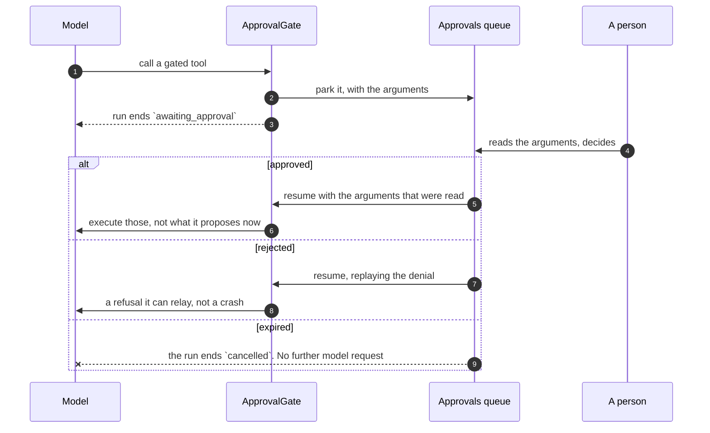

# Управление { #governance }

Бюджеты, согласования, оповещения и журнал аудита. Четыре вещи, благодаря которым
платформе для агентов можно доверить кредитную карту.

Все они действуют одинаково при любом способе запуска, потому что каждый способ
идёт через один механизм выполнения.

Самое новое из них — **триггер**: агент, который запускает себя по расписанию или
по входящему событию — задача на GitHub (issue), входящее письмо (см.
[Понятия](concepts.md#trigger)).

Он пользуется тем же реестром расходов, очередью согласований и журналом аудита.
[Политика действий без участия человека](#routine-action-consent) ужесточает, какие
вызовы требуют согласования; явное заранее данное согласие называет отдельные
действия и одну версию.

У работы без участия человека есть и определённые исходы для **отказа**:

- Запуск, который остановил бюджет, завершается с `budget_exceeded` и **ждёт
  следующего срабатывания**, а не повторяется.
- Запуск, который автор больше не вправе выполнить — он покинул организацию или
  потерял выданный доступ к агенту, — **отключает триггер** и пишет запись в
  журнал аудита с причиной.
- Запуск, который упал на самой модели — сбой провайдера, отозванный ключ, —
  записывается как `failed` и остаётся до следующего срабатывания, вместо того
  чтобы заставить сигнал активности биться в ту же стену снова. `last_run_id`
  триггера остаётся указывать на него, так что его история остаётся честной.

Отказ, который сигнал активности повторял бы каждую минуту, — это счёт или
оповещение, которое никогда не прекратится.

!!! warning "Что не проглатывается, так это сбой, который так и не стал записью"

    Если запуск дошёл до терминального состояния, а запись о нём не зафиксирована —
    запись транскрипта или состояния диалога упала, когда ответ уже был получен, —
    срабатывание **проваливает обработку**, а не сообщает об успехе. Наполовину
    записанный запуск откатывается, вместо того чтобы зафиксироваться как
    завершённый, когда за ним ничего нет.

Триггер события добавляет ещё один отказ на своей границе: вебхук, подпись которого
не сходится с собственным секретом триггера, получает 403 и вовсе не доходит до
механизма выполнения.

В автоматизациях GitHub при создании или редактировании триггеров на задачи,
пул-реквесты и комментарии показывается фильтр по автору. **Участники репозитория
(по умолчанию)** (Repository members (default)) пропускают `OWNER`, `MEMBER` и
`COLLABORATOR`; **Участники и контрибьюторы** (Members and contributors)
пропускают ещё и `CONTRIBUTOR`. **Любой** (Anyone) включает тех, кто пришёл
впервые, и остальных авторов сообщений. Это ассоциации автора в GitHub, а не роли
организации в AgenticOS. Отправители-боты и явно исключённый подключённый логин
блокируются при любом варианте. Фильтр по автору не применяется к push, запускам
рабочих процессов и релизам. Существующие автоматизации сохраняют свою политику;
конфигурация без `authors` по-прежнему означает `members`.

В истории автоматизации её владелец, вошедший в систему, видит **Последнее
отфильтрованное событие GitHub** (Latest filtered GitHub event): когда проверенный
вебхук не прошёл фильтр, почему и какова была политика по авторам на момент
получения. Эти диагностические сведения записывают и вебхуки каждой автоматизации,
и доставки GitHub App. Хранится только последний сохранённый образец, обновляемый
не чаще раза в минуту на автоматизацию по часам базы данных. Там нет ни тела
запроса, ни текста автора, ни секрета, и для него не создаётся запуск и не
тратится квота на приём запусков. Отсутствие диагностики значит, что отказ не
записан; оно не доказывает, что вебхук был доставлен. Публичные ответы вебхуков
остаются прежними.

## Доставка автоматизаций { #routine-delivery }

Автоматизация, созданная из личного чата через платформенный MCP, отвечает в этом
чате, если вы не выбрали другое назначение. Её карточка в диалоге показывает текущее
состояние, следующую активацию и существующие элементы управления: изменить,
приостановить и удалить. Журнал запусков остаётся доступен в разделе
«Автоматизации».

Прежде чем отправить готовый ответ, платформа заново проверяет действующее
членство автора и текущий доступ на запись к выбранному диалогу. Удалённое или
недоступное назначение оставляет ответ в журнале запусков и показывает на
автоматизации **Последний ответ недоступен в чате** (Last answer unavailable in
chat). Сбой базы данных при доставке сообщения изолирован, поэтому он не отменяет
завершённое срабатывание и не запускает агента снова.

Уведомления о завершении ссылаются на диалог только после успешной доставки.

`last_delivery_status` различает доставку, только запись в журнал, отсутствие
ответа и незавершённый запуск; исторические строки остаются неизвестными до
следующего срабатывания. Миграция `0265_trigger_delivery_status.py` добавляет этот
статус, не приписывая прошлым запускам успех.

Задайте `ends_at` со смещением UTC для работы, ограниченной по времени, и
`monthly_budget_usd` для более строгого месячного лимита. Инструмент обновления MCP
может снять любую из этих настроек. Обычный API-ключ не может
уполномочить автоматизацию пользоваться личными учётными записями того, кто его
выпустил. Фоновые запуски, вход от имени другого пользователя и возобновлённые
групповые или публичные ходы тоже не могут дать этих личных полномочий.

Политика версий позволяет следовать опубликованной версии по умолчанию или
закрепить одну неизменяемую версию. Закрепление не сдвигается при публикации.
Снимите его, чтобы снова следовать. Именованное окружение и закреплённая версия
взаимоисключающи; текущий доступ, бюджеты и согласования при этом продолжают
действовать.

Форма автоматизации может задать или снять её окончание. Дата использует часовой
пояс устройства, показанный рядом с полем, независимо от часового пояса расписания
`cron`, и отправляется в API как момент со смещением. Правка другого поля оставляет
существующее окончание без изменений.

Перед каждым инструментом автоматизация заново проверяет автора, действующее
членство, роль и выданные доступы на запуск, в том числе для агентов-исполнителей и
вызовов, разрешённых после согласования. Приостановка, удаление или истечение срока
автоматизации, отзыв личного согласия или изменение этих полномочий отклоняют
последующие инструменты. Эффект, уже отправленный во внешний сервис, эта проверка
отозвать не может. Миграция `0260_routine_run_origin` сохраняет происхождение при
удалении автоматизации; старое приостановленное расписание, происхождение которого
уже потеряно, отклоняется, а не занимает полномочия того, кто согласовал.

Ежеминутные проходы фиксируют истёкшие окончания независимо от следующей
активации, включая приостановленные автоматизации и наблюдения. Они отключают
активную работу, снимают оставшиеся блокировки автоматизаций и отменяют их
ожидающие уведомления, не запуская модель. Остановленный воркер догоняет после
перезапуска; уборка может подождать воркер или пакет, а проверки сроков для
инструментов и доставки ответов по-прежнему сразу отклоняют просроченную работу.

Миграция `0269_routine_end_cleanup.py` добавляет отметку срока и частичные индексы
ожидающих окончаний. Она не создаёт ни заменяющих автоматизаций, ни выданных
доступов, ни результатов наблюдений. Сдвиг окончания снова взводит уборку;
повторный проход не повторяет уже зафиксированные эффекты. Откат снимает только
эту бухгалтерию уборки, а не заданное окончание или идентичность автоматизации.

Подключение MCP, за которым ведётся наблюдение, также записывает поколение своей
авторизации.
Завершённое повторное согласие OAuth или явная замена токена либо эндпоинта
аннулирует старое согласие наблюдения на источник, даже если идентификатор
подключения не изменился. Обычное обновление токена, смена меток и учётной записи по
умолчанию эту идентичность не заменяют. Заново проверенный источник доступен более
поздним запускам; старый приостановленный запуск не может занять новое согласие.

После миграции `0270_mcp_authorization_generation.py` проверьте источники
существующих наблюдений явно (`review_sources=true` или **Снова одобрить
приложенные источники** в редакторе наблюдения). Старые политики остаются
читаемыми, но не могут угадать учётную запись за исторической авторизацией. Чтобы
определить учётную запись вне допущенного поколения, не читаются никакие учётные
данные провайдера. Дождитесь, пока старые воркеры доработают очередь, и обновите API
и воркеры вместе. Приостановите наблюдения перед откатом; возобновляйте только с
кодом, понимающим поколения, и проверенными источниками. Замена учётных данных
сбрасывает кешированный список инструментов старой учётной записи до следующей
успешной проверки.

Запуски автоматизаций сохраняют учётные записи MCP и псевдонимы инструментов,
допущенные для этого выполнения. Возобновление вызова переиспользует эти
псевдонимы: переименование учётной записи или выбор другой учётной записи по
умолчанию не перенаправляет существующее согласование. Агенты-исполнители остаются
в пределах допущенных учётных записей. Текущая принадлежность учётной записи,
эндпоинт, поколение авторизации и списки разрешённых инструментов проверяются
заново перед вызовами; новые или изменённые учётные записи отфильтровываются до
того, как разрешаются учётные данные.

Приостановленная автоматизация без этого состояния допуска не может продолжать
вызовы MCP управляемых учётных записей. Начните новый запуск, проверив её доступ.
Обычные значения интерактивных агентов по умолчанию и явные политики согласования
не меняются; исключения согласования автоматизации для конкретной учётной записи
по-прежнему отделены от этой проверки источников.

Встроенный MCP-сервер платформы AgenticOS требует режима **Запускается от имени
автора** (Act as creator), в том числе когда его привязывает опубликованный
агент-исполнитель. Без идентичности, стоящей за человеком, проверка источников и
создание автоматизации отклоняют эту конфигурацию с явным объяснением. Включите
режим «Запускается от имени автора» или снимите привязку к платформе с агента и
его агентов-исполнителей. Платформа никогда не занимает идентичность автора
автоматически.

История автоматизации перечисляет и заблокированные или неудачные попытки, которые
закончились до появления запуска агента. У каждой видны время, этап и направление
исправления. Они не несут расходов на модель и никогда не содержат промптов, ошибок
провайдера или учётных данных. Записи остаются, пока не удалены их автоматизация
или организация. Сбой доставки уведомления эту историю не убирает. Задача воркера,
запускающая триггер, записывает отдельный исход — заблокировано или неудачно;
завершение задачи в очереди не значит, что агент успешно отработал.

## Бюджеты { #budgets }

!!! abstract "Три уровня, и это не варианты одного числа"

    Лимит агента, отмеренный от общего итога организации, исчерпывается запусками
    соседей; лимит организации, отмеренный от одного агента, — вообще не потолок.
    См. [почему их нельзя свести в один](#why-they-cannot-be-collapsed).

| Уровень                    | Где задаётся               | Что измеряет                                    | Кто поднимает                                           |
| ------------------------ | ------------------------- | --------------------------------------------- | --------------------------------------------------- |
| **Месячный лимит агента**        | спецификация агента          | собственные запуски этого агента                         | тот, кто вправе редактировать агента                          |
| **Месячный лимит отдела**   | настройки отдела | запуски, которые начали его участники, на любом агенте        | тот, у кого есть `members:manage` и `budgets:manage` |
| **Месячный лимит организации** | настройки организации     | каждый запуск _и_ индексация в организации | тот, у кого есть `budgets:manage`                      |

Каждый месячный лимит считает всю стоимость запуска в том месяце, в котором запуск
начался, — так же, как отчёты о расходах. Запуск, перешагнувший границу месяца —
приостановленный на согласовании вечером последнего дня и одобренный первого, —
целиком попадает в предыдущий месяц, и при возобновлении сверяется с расходами
того месяца, а не нового.

**Новая организация заводится с уже заданным потолком** — `DEFAULT_ORG_MONTHLY_BUDGET_USD`
экземпляра ([конфигурация](configuration.md), 100 $ из коробки), — поэтому
неожиданный счёт из-за единственного вышедшего из-под контроля агента новой
организации не грозит. Дальше это обычный лимит: его можно править в строке
организации, и он применяется точно так же, как заданный вручную. Экземпляр, который
предпочитает стартовать без потолка, оставляет эту настройку пустой; в любом случае
лимит существующей организации из-за неё не меняется.

### Почему их нельзя свести в один { #why-they-cannot-be-collapsed }

Раньше их сводили через `min()`, и результат был неверным. Лимит агента, отмеренный
от общего итога организации, исчерпывается запусками соседей — именно поэтому он
перестаёт быть лимитом. Лимит организации, отмеренный от расходов одного агента, не
сработал бы никогда.

Поэтому каждый лимит измеряет свою величину, и поиск идёт вместе с лимитом. Агент с
лимитом 5 $ под потолком 50 $ теперь останавливается, когда _он_ потратил 5 $, и
отказ называет тот лимит, который действительно сработал, а не выводит его из того,
какое из двух чисел меньше.

Агент по-прежнему не может ослабить потолок организации: запись организации
присутствует со своим числом, что бы ни просила спецификация, а расходы агента —
часть расходов организации, поэтому агент со 100 $ под организацией с 10 $
останавливается на 10 $.

Оба лимита читаются там, где их расходы: лимит организации — в её собственной
строке (`GET /orgs/{org_id}`), а лимит каждого агента — как `budget_monthly_usd` в
списке агентов: число _опубликованной_ версии, потому что применяет именно его
механизм выполнения, а не то, что обещает сейчас черновик. Карточка «Запас
бюджета» на странице «Обзор» сводит их с `GET /spend`, поэтому приближение лимита
видно раньше, чем `budget_exceeded` начнёт появляться в истории запусков.

Это опубликованное число связывает каждый запуск агента, включая запуск более
старой версии: автоматизацию, окружение или шаг сценария, закреплённые на ней,
либо запуск, возобновлённый на версии, на которой он был приостановлен.
Закрепление решает, как агент себя ведёт, а не сколько он вправе потратить.

### Лимит отдела { #a-departments-cap }

У [отдела](departments.md#a-departments-budget) может быть собственный месячный
лимит. Он стоит между двумя другими: запуск сверяется с лимитом агента, затем с
каждым лимитированным отделом человека, который его начал, затем с лимитом
организации. Каждый отдел считает месяц своих участников, поэтому человека в
Finance и Sales останавливает тот из двух, который кончится первым, и отказ его
называет: _месячный бюджет отдела Sales исчерпан_.

Руководитель отдела и администраторы узнают, когда он переходит 80% своего месяца
— один раз, и ещё раз, когда его лимит останавливает запуск. Запуск, который никто
не начинал, — расписание, посетитель канала, — не относится ни к одному отделу и не
считается.

### Проверка идёт до запроса { #enforcement-is-before-the-request }

!!! danger "До, а не после"

    Проверка после означает, что запрос, который пробил бюджет, уже оплачен, — а
    цикл может каждый раз выходить за лимит на один дорогой вызов.

!!! important "Неудачный запуск всё равно записывает, сколько потратил"

    Бюджет, который игнорирует сбои, — не бюджет. Учёт идёт в блоке `finally` на
    каждом способе запуска, и фиксация явная, а не оставлена контексту сеанса —
    тот откатывается при любом исключении и вовсе не достигается при отмене.

!!! important "Базовый результат — это то, что потратили _другие_ запуски"

    Оба поиска не учитывают собственную строку запуска, который спрашивает.
    Возобновлённый запуск сохраняет свою строку, и к этому моменту `finish_run` уже
    зафиксировал, сколько он потратил, — а реестр заново заполняется той же цифрой,
    иначе завершение продолжения перезаписало бы стоимость лишь тем, что стоило
    продолжение. При подсчёте в обоих местах агент с лимитом 10 $, потративший 6 $
    и приостановленный, возвращался к `6 + 6 = 12` на своём первом запросе к модели
    и получал отказ при запасе в 4 $, сообщая владельцу, что достиг лимита, на 60%
    которого находился. Лимит организации считался дважды точно так же.

Защитная проверка — жёсткая остановка для запуска, который _видит_ расходы, а
собственная стоимость запуска попадает в его строку только при завершении.

Поэтому базовый результат, который читает запуск, — это сумма уже завершённых
запусков, и **параллельные запуски не видят друг друга**. Пятьдесят запусков,
начатых одновременно в организации, которой до лимита остался один вызов, читают
один и тот же результат ниже лимита, каждый продолжается и выходит за лимит вплоть
до их суммарной стоимости.

Это свойство агрегата, у которого нет отдельной строки для блокировки, — в отличие
от перерасхода на один запуск и на один цикл выше, который проверка до запроса
всё-таки ограничивает. Поэтому лимит — потолок **зафиксированных** расходов, а не
шлюз, который выстраивает одновременные запуски в очередь.

Экземпляр, которому нужен строгий лимит, пропускает запуски агентов через одну
очередь, а не параллельно.

### Оценки тратят те же бюджеты { #evals-spend-from-the-same-budgets }

[Запуск оценки](evals.md) состоит из обычных запусков, поэтому каждый кейс
сверяется с лимитами агента и организации перед каждым запросом к модели, и
потраченное считается в обоих — отдельного бюджета оценок нет. Поэтому большой
набор данных может израсходовать бюджет месяца, нужный рабочему трафику. При
запуске показывается, сколько останется у каждого лимита после того, как он
потратит расчётную стоимость, а если она больше остатка любого из них, запуск
отклоняется до того, как что-либо выполнится; см. [Какой бюджет
остаётся](evals.md#the-budget-it-leaves).

### Запуск стоит больше, чем его запросы к модели { #a-run-costs-more-than-its-model-requests }

Поиск по знаниям строит вектор вопроса, прежде чем искать по нему, и этот
эмбеддинг оплачивает запуск, который его запросил. Служба эмбеддингов глобальна для
процесса — она обслуживает сразу все запуски и все задачи индексации, — поэтому она
записывает расход на тот запуск, который _сейчас на счётчике_, а не принимает
бюджет аргументом.

Из-за этого счётчик — то, что способ запуска может забыть, и забыть молча: ни
исключения, ни предупреждения, только запуск, который сообщает меньше, чем
потратил, и месяц организации, который этого не видит. Поэтому счётчик принадлежит
подготовленному запуску, а не способу запуска. Открыть его — не отдельный шаг, о котором
должен помнить новый способ запуска: выполнить подготовленного агента без него
нельзя.

[Длинные диалоги](reference/capabilities.md#context-management) — второй случай. Их
стратегия суммирования пишет резюме через агента, которого строит сама, поэтому
этот запрос не проходит бюджетную проверку; возможность записывает его стоимость на
тот же счётчик. Быть _вне_ проверки имеет одно следствие, которое стоит знать:
расход записывается, а не отклоняется, поэтому сжатие, перешедшее лимит,
останавливает запуск на следующем за ним запросе.

### Стоимость, которую не удалось измерить, сообщает об этом { #a-cost-that-could-not-be-measured-says-so }

Выставленная Stav стоимость имеет приоритет над снимком: `usage.cost` вместе с
`cost_currency` либо заголовки `x-stav-cost` и `x-stav-cost-currency`. И Chat
Completions, и Responses включают потоковые запросы. USD используется напрямую;
NOK требует `STAV_NOK_PER_USD` ([конфигурация](configuration.md)), который
поддерживает оператор. Это NOK за доллар: значение `10` делило бы NOK на 10, а не
служило рекомендацией текущего курса. Никакой курс не запрашивается автоматически.
Структура usage сохраняет выставленную сумму, валюту, курс и стоимость в USD, а
реестр помечает источник как сообщённый провайдером. Некорректная стоимость,
неподдерживаемая валюта или отсутствующая конверсия оставляют резервный вариант из
каталога.

Без пригодной стоимости от провайдера расчёт откатывается к `genai-prices`. Он
знает не каждую модель. Когда запуск доходит до модели, для которой у
`genai-prices` нет записи, этот запрос записывается по нулю, а запуск помечается
`cost_is_partial`: итог занижен ровно на то, что стоили эти запросы, и честное его
прочтение — **нижняя граница**.

Этот флаг теперь идёт до самого низа. Он есть в строке запуска, в строке
сообщения, которую пишет ход, и в итоге, который сообщает диалог; каждый способ
запуска, который показывает деньги, ставит перед ним `≥`, а не цифру, которая
читается как точная. Null у сообщения, записанного до появления столбца, означает
_не записано_, и это не то же самое утверждение, что «точно»: клиент помечает
только то, что знает.

**Теперь его записывает каждый способ запуска, и каждый ход записывает свою
долю.** Сообщение, написанное каналом, API или виджетом, до недавнего времени не
несло стоимости вовсе, поэтому диалог в Slack нельзя было просуммировать.
Записывается _разница_ с тем, что уже заявляют более ранние ходы этого запуска, а
не цифра из строки запуска: строка запуска накопительная, а запуск, который
приостановился и был возобновлён, пишет два ответа ассистента — проставить обоим
строку значило бы посчитать приостановленную половину дважды. Поэтому сообщения
запуска в сумме дают ровно то, что запуск говорит, что потратил.

**Ход, на котором запуск остановили, сообщает об этом.** Отменённый запуск оставляет
то, что агент успел написать, когда сокет закрылся или нажали `stop`, и это
читается точно как законченный ответ, — поэтому читатель принимает обрезанный за
всё, что агент хотел сказать, и потраченные деньги выглядят так, будто купили
именно это. Транскрипт несёт статус запуска по ходам, и чат его помечает.

### Насколько заполнено окно контекста { #how-full-the-context-window-is }

Третий потолок, и тот, которого никто не ждёт. Бюджет отказывает сообщением, с
которым можно что-то сделать. Рабочее пространство отказывает в записи. А **окно
контекста** отклоняет провайдер, посреди ответа, и запуск просто падает.

Поэтому каждый агент несёт индикатор — не только тот, к которому привязаны
[Длинные диалоги](reference/capabilities.md#context-management), потому что
предупреждение важнее всего агенту, который _не_ будет сжимать. Он сообщает,
сколько токенов нёс последний запрос хода, _после_ любого сжатия: показание падает,
когда сжатие работает, потому что измеряет отправленное, а не то, что хранит
диалог.

Это число — собственные `input_tokens` провайдера, а не оценка истории. Подсчёт
символов не видит определений инструментов, а они оплачиваются в каждом запросе —
тысячи токенов у агента со знаниями, песочницей и делегированием, то есть треть
реальной цифры пропадает ровно тогда, когда эта цифра важна.

**Число хранится на ходе; доля — нет.**

Сколько истории есть — переживает смену модели. Какую долю окна это составляет —
нет, а чат позволяет менять модель между ходами.

История в 500 000 токенов — половина модели с контекстом 1M и **390%** модели с
контекстом 128K, и во втором случае это запрос, который провайдер отклоняет сразу. Доля,
замороженная вместе с показанием, всё равно читалась бы как «50%».

Поэтому знаменатель определяется там, где известен выбор: из записанного окна
самого профиля модели и реестра цен за ним. Где ни то, ни другое не может сказать,
**доля не рисуется вовсе**: процент от предположенного окна — догадка, поданная как
измерение.

Сжатие нужно ещё и из-за этого переключения. Его триггер — **доля,
определяемая на каждый запрос** по модели, к которой запрос идёт, поэтому история,
которая спокойно помещалась в старое окно, сжимается уже на следующем ходе под
новым — до того, как запрос уйдёт, а не после того, как провайдер его отклонил. У
агента без привязанного сжатия есть только индикатор, и больше ничего.

**Триггер измеряет то, что измерил провайдер.** Он опирается на самый свежий ответ,
несущий данные об использовании от провайдера, — `input_tokens` того запроса
учитывали инструкции, каждую схему инструментов и каждое предыдущее сообщение, — и
оценивает только то, что пришло после него. Поэтому воспроизведённый диалог несёт
стоимость каждого ответа: без опоры триггер считает символы, и реальный агент здесь
читал 9 токенов там, где провайдер выставил 3 859. Индикатор говорил 77%; триггер
не видел, что делать.

**Резюме сохраняется.** Сжатие переписывает сообщения одного запуска; история между
ходами восстанавливается из транскрипта, поэтому раньше резюме выбрасывалось на
границе хода, и следующий ход покупал новое по истории на один ход длиннее: два
подряд идущих хода реального диалога здесь каждый заплатили за резюме одних и тех
же пяти сообщений, а второй объявил, что суммирует девять. Поэтому сжатая история
записывается в диалог вместе с тем, как далеко она простирается, и следующий ход
начинается с неё и воспроизводит только то, что было сказано после. Открыв диалог
заново, вы увидите то же, что и модель.

Сохраняется только резюме. Отбрасывание самых старых сообщений и очистка
результатов инструментов ничего не стоят при повторе, а запись их сделала бы
постоянной потерю, которую сейчас пересматривают относительно окна на каждом ходе.

Одна настройка работать не может и сообщает об этом вместо запуска. Когда одни
инструкции и схемы инструментов уже превышают триггер, никакое резюме не опустит их
ниже: их нет в истории, чтобы их суммировать. Тогда каждый запрос покупал бы
резюме, которое ничего не меняет. Сжатие пропускается, чат объясняет почему, а
исправление — за автором: большее окно или большая доля.

Этот отказ опирается на число, которое производит _ответ_, поэтому ход не может
измерить свой до того, как ему надо решить, — а ход в чате обычно состоит из одного
запроса. Диалог несёт последнее показание, и запуск начинается с него. Первому
ходу диалога поэтому не на что опереться, и он сжимает как настроено; со второго отказ
уже доступен. Отклоняются только стратегии, которые что-то покупают: отбрасывание
самых старых сообщений и очистка результатов инструментов не вызывают модель,
поэтому выполняются при любом окне.

### Делегирование тратит бюджет родителя { #delegation-spends-the-parents-budget }

Запуск может содержать весь диалог другого агента — см. [агент-исполнитель против
встроенного специалиста](concepts.md#delegate-vs-inline-specialist). У одного
запуска **один реестр расходов**, и каждый агент-исполнитель пишет в него. Именно
поэтому лимит родителя видит расходы делегирования до своего следующего запроса к
модели — ровно в тот момент, когда делегирование умножает то, сколько может стоить
ход. Каждая запись помечена делегированием, которое её записало, и поэтому один
реестр всё же отвечает на вопрос «сколько стоил _этот_ агент-исполнитель» — см.
ниже.

Отсюда следует, что **лимиты, которые действуют внутри делегирования, —
родительские**. Собственный `budget.monthly_usd` агента-исполнителя не применяется
посреди родительского запуска: две проверки на одном реестре считали бы каждый
запрос дважды, а важен потолок того запуска, который начал человек. Собственный
лимит агента-исполнителя по-прежнему управляет запусками _самого
агента-исполнителя_.

При этом каждый агент-исполнитель оценивает свои запросы сам, потому что проверка
оценивает то, что записывает: агент-исполнитель на Anthropic, считаемый проверкой,
построенной для OpenAI, оценивался бы по чужому каталогу — молча и обычно как
неоценённый.

Есть ещё три потолка, потому что бюджет — плохой способ остановить веер: он
замечает только после того, как деньги ушли. `max_depth` ограничивает вложенность,
`max_fanout` — сколько делегирований идёт одновременно, а собственный `max_steps`
каждого агента-исполнителя ограничивает его цикл. См.
[возможность `subagents`](reference/capabilities.md#delegation).

Два из этих трёх — собственные у агента-исполнителя, и это та граница, которую
бюджет не переходит: `max_steps` читается из спецификации агента-исполнителя, а его
`max_depth` ограничивает, насколько глубоко _он_ может уйти, сколько бы места ни
оставалось у того, кто его вызвал. Лимит расходов — это лимит запуска, который
начал человек; лимит вложенности — решение, принятое автором агента-исполнителя и
прочитанное его проверяющими, поэтому вызывающий не может его расширить.

### Как записывается делегированный запуск { #what-a-delegated-run-is-recorded-as }

Делегирование **опубликованному** агенту получает собственную строку в
`agent_runs` с `parent_run_id` и идентификатором задачи делегирования. **Встроенный
специалист** не получает ничего: у него нет агента, которому можно её приписать,
поэтому его стоимость — стоимость _запуска_, а запись — это вызов инструмента в
транскрипте.

Чья именно строка — вопрос, на который ответил
[#228](https://github.com/vstorm-co/agenticos/issues/228).

- Специалист прямо под собственным агентом запуска попадает в **строку верхнего
  уровня**, которая и так и есть весь реестр.
- Специалист под **опубликованным агентом-исполнителем** попадает в строку _этого
  агента-исполнителя_, а не в верхнюю, поэтому месяц агента-исполнителя включает
  то, что потратил его специалист, — и это единственное место, куда это могло
  честно лечь.

Поэтому каждая запись реестра несёт две атрибуции: делегирование, которое её
создало, — для панели, и ближайшую строку агента, к которой она причисляется, — для
месяца.

Обе совпадают для каждого запроса, который опубликованный агент-исполнитель делает
сам, и расходятся только под встроенным специалистом: его панель сохраняет его
собственную долю, тогда как его расходы доходят до строки предка.

!!! important "Строка родителя — это главная запись; строка ребёнка — его доля в ней"

    Агент-исполнитель тратит в общий реестр, и **каждая запись в этом реестре
    несёт делегирование, которое её создало**. Стоимость делегирования — сумма его
    собственных записей: запросы, которые выпустил его собственный агент,
    оценённые один раз, тем же поиском, по которому считается итог запуска. Она
    точна в обоих режимах и на любой глубине и не зависит от того, когда
    делегирование было зафиксировано.

    Раньше она зависела ровно от этого, и это были два дефекта. Числом был *прирост*
    общего итога за время делегирования, поэтому фоновое делегирование —
    фиксируемое при следующем опросе, который может случиться уже после ответа
    родителя, — вбирало всё, что родитель потратил за это время: агент-исполнитель,
    потративший 0,01 $, записывался как 0,51 $, если потом родитель потратил 0,50 $.
    А у агента-исполнителя, который делегирует дальше, расходы его собственных
    агентов-исполнителей попадали в его окно, а их строки записывают их снова,
    поэтому его месячный итог считал и внуков.

    Разделять его на реестр *на каждого агента* — по-прежнему тот подход, которого
    надо избегать: именно он вообще не даёт лимиту родителя срабатывать. Один
    реестр с атрибуцией сохраняет оба свойства: лимит родителя видит каждый запрос
    до следующего, а каждая делегированная строка говорит, сколько потратил тот
    один агент, — включая его собственных встроенных специалистов и исключая его
    опубликованных агентов-исполнителей.

    Строка родителя остаётся главной записью запуска. Её `cost_usd` — это весь
    реестр, включая агентов-исполнителей, и именно это выставляется организации;
    строки детей делят те же деньги по агентам и никогда их не прибавляют.
    `cost_is_partial` тоже считается по строке: родитель на модели, которой
    `genai-prices` не знает, делает итог родителя нижней границей и ничего не
    говорит об агенте-исполнителе, работавшем на оценённой модели.

    `started_at` и `ended_at` делегированной строки — это **собственный** промежуток
    делегирования, снятый с дескриптора задачи, который библиотека ставит, когда
    агент-исполнитель начинает и когда заканчивает, а не момент, когда строку
    зафиксировали. При фиксации фоновое делегирование читалось как запуск нулевой
    длительности не в то время и шло после работы, завершившейся до него; два,
    которые действительно пересекались, записывались в один и тот же миг, и ничто
    не говорило, что они пересекались. Терминальный дескриптор с концом, но без
    начала — агент-исполнитель отменён или упал до начала выполнения — записывает
    нулевой промежуток в этот конец, никогда не null; а где библиотека отказывает ещё
    до появления дескриптора — неизвестный `chat_trace_id` — делегированная строка не
    пишется. Делегирование, приостановленное на согласовании, охватывает каждый ход,
    в котором шло: его самое раннее начало переносится через приостановку так же,
    как его стоимость (ниже), поэтому строка начинается, когда агент-исполнитель
    начал впервые, и кончается, когда он наконец закончил, — а не в момент
    возобновления, которое её зафиксировало. Эти два значения не складываются, как
    складывается стоимость: честный ответ — начало первого отрезка и конец
    последнего.

**Делегирование, приостановленное на согласовании, — больше одной доли.** Его ходы
шли в разных процессах против разных реестров, а реестр возобновлённого хода —
свежий объект, не содержащий ничего из того, что было до приостановки, поэтому строка
ребёнка записывает все отрезки вместе: приостановленное состояние хранит то, что
делегирование стоило, когда остановилось, а ход, который его завершает, прибавляет
свою долю. Строка пишется одна, один раз, тем ходом, где делегирование
заканчивается: агент-исполнитель, приостанавливавшийся дважды, оставляет три
отрезка и одну строку.

`cost_is_partial` переносится так же, и по причине, которая к деньгам не относится:
теперь он считается по строке, а не по запуску, поэтому агент-исполнитель, сделавший
неоценённый запрос _до_ согласования и возобновлённый на оценённой модели, иначе
заявлял бы в своей строке точную стоимость. Флаг истинен, если он был истинен хотя
бы для одного отрезка.

Это стоит сказать, потому что сбой, который он заменяет, был невидим. Строка
держала только то, что агент-исполнитель потратил _после_ последнего возобновления,
а при обычной форме — сделай работу, потом спроси разрешения действовать по
результату — это меньшая половина. Суммы сходились, потому что деньги всё время были
в строке родителя; неверным было каждое число, отвечающее на вопрос «сколько стоил
этот агент-исполнитель».

Строка ребёнка — то, что позволяет ответить на два разных вопроса, и арифметика у
них противоположная:

| Вопрос                               | Строки детей                                                                                                                                                                                                                                                                         |
| ------------------------------------------ | ---------------------------------------------------------------------------------------------------------------------------------------------------------------------------------------------------------------------------------------------------------------------------------- |
| **Сколько должна организация?**        | **исключены** — строка родителя уже содержит эти токены, поэтому учёт обеих выставляет организации один и тот же запрос дважды                                                                                                                                                       |
| **Сколько _этот агент_ стоил за месяц?** | **включены** — строки агента-исполнителя — единственное место, где записаны его собственные расходы, и каждая держит собственные запросы этого агента и его встроенных специалистов ([#228](https://github.com/vstorm-co/agenticos/issues/228)), но не его опубликованных агентов-исполнителей, у которых свои строки |

Второй — то, что позволяет ответить «исследователь стоил 40 $ за этот месяц», и то,
на что срабатывают отчёт об использовании по агенту или оповещение о бюджете этого
агента. Месячное число организации несёт ещё и расходы на индексацию, которых у
числа по агенту нет: индексация общей базы знаний — ничей агентский расход.

Сбойная строка ребёнка тоже подчиняется правилу родителя о том, что может говорить
`error`. Сбой, возникающий под агентом-исполнителем, — это клиент модели, чьё
сообщение может нести URL упавшего запроса — вместе с ключом, на нестандартном
эндпоинте, — поэтому строка и закрывающий кадр делегирования хранят то же выверенное
предложение, что и строка родителя, а собственный текст провайдера уходит в журнал
сервера.
Агент-исполнитель, остановленный своим лимитом использования или потолком бюджета,
сохраняет сообщение лимита целиком: это потолок делает свою работу, а не сбой,
который надо диагностировать.

Правило доходит и до транскрипта _родителя_. Когда агент делегирует в фоне, он
опрашивает `check_task` и `wait_tasks` ради исхода, и то, что они отвечают,
становится строкой вызова инструмента в диалоге — сохранённой целиком, потому что
ответ инструмента — собственный ответ инструмента, а не что-то, что составила эта
платформа. Поэтому они называют класс исключения, а не повторяют сообщение
провайдера, — так ведёт себя `subagents-pydantic-ai` 0.2.20, и именно поэтому здесь
есть нижняя граница.

**Показатель на странице «Обзор» за период несёт его же.** `GET /stats/usage`
отдаёт блок `cost` за любой период, выбранный фильтром, и этот блок — запуски
_плюс_ индексация, та же арифметика, которой измеряется месячный лимит, — а рядом
`model_usd` и `ingestion_usd`, чтобы читатель видел, куда ушли деньги, не вычитая.
До 0.0.152 он показывал только половину модели, и на одной карточке оказывались два
разных определения стоимости: заголовок двигался вместе с фильтром периода и считал
запуски, а строка месяца под ним считала весь счёт, и ничто не говорило, что они
отвечают на разные вопросы. На экземпляре, который индексирует документы, они
просто расходились.

При `scope=own` половина индексации — ноль, а не доля: документ индексирует воркер,
и `ingestion_spend` не записывает пользователя, поэтому начислять окну одного
человека за коллекцию, которую синхронизировал кто-то другой, значило бы выдумать
его расходы.

**Каждый запрос обязан говорить, на какой из двух он отвечает**, и вариант из
первого столбца — по умолчанию. Показатель месяца и разбивка по агентам за ним
исключают строки детей, поэтому складываются в итог, напечатанный над ними, — и
письмо об использовании организации сообщает тот же итог, а не сумму одного из них.
Только вопрос, заданный _об одном агенте_, включает их. Три из этих пяти запросов
вышли без такого различения, и каждый показывал 1,40 $ на 1,00 $ работы; если
добавляется новый, безопасный вариант — по умолчанию.

#### Два вопроса о провайдерах требуют третьего ответа { #the-two-vendor-questions-need-a-third-answer }

**По провайдерам** (By provider) и **По ключам** (By key) не могут использовать ни
один из двух столбцов, и ошибка здесь невидима на экране. Исключение строк детей
считает итог верно, а затем приписывает деньги агента-исполнителя провайдеру
_родителя_, потому что именно он провайдер в суммируемой строке: оркестратор на
OpenAI, передавший 0,40 $ работы агенту на Anthropic, показывал `openai $1.00` и ни
одной строки Anthropic. Включение их показывало `openai $1.00` + `anthropic $0.40`
— больше, чем счёт.

Поэтому эти два суммируют **собственные** расходы каждого запуска: его стоимость за
вычетом стоимости его прямых делегирований. `openai $0.60` + `anthropic $0.40` — и
верная атрибуция, и верный итог. Это вкладывается: у агента-исполнителя, который
делегировал дальше, внуки вычитаются им, один раз, — и в сумме по всем строкам всё
равно выходит счёт, потому что стоимость каждого ребёнка прибавляется его
собственной строкой и вычитается строкой родителя. Ключ работает так же и важнее:
ключ — это то, что кто-то перевыпускает, когда счёт выглядит неверным.

### Бюджет голосового звонка { #a-voice-calls-budget }

[Голосовой звонок](voice.md) — это запуск, и его расходы идут в бюджеты агента и
организации наравне с остальными. Отличаются три вещи, потому что звонок нельзя
проверить перед каждым запросом так, как проверяется текстовый запуск:

- **Перед началом** максимально возможная длительность звонка, умноженная на
  худшую цену модели за минуту, сверяется с остатком бюджета. Звонок, который
  не по карману, отклоняется, а не начинается и обрывается на середине.
- **Во время него** каждый ответ записывается в запуск по мере завершения, а
  расходы месяца перечитываются каждые 15 секунд, чтобы учитывать другие
  запуски, которые тратят в это время. Бюджет, кончившийся посреди звонка, даёт
  одну произнесённую фразу и завершает звонок с записью `budget_exceeded`.
- **Его длительность задаёт агент.** Звонок идёт не дольше самого долгого
  звонка агента — 10 минут по умолчанию и 50 максимум; отдельного лимита минут
  на звонки нет, так что бюджеты — единственное, что ограничивает расходы на
  звонки.

Звонок, чей процесс умер, закрывается периодической проверкой голосовых звонков
по стоимости, записанной его последним сигналом активности, — в отличие от
текстового запуска, чьи расходы умирают вместе с процессом.

### Проактивная работа { #proactive-work }

Ночные запуски предложений и сводок записываются под опубликованным стартовым
агентом **AgenticOS** организации (`agenticos` slug), чтобы у каждого была
строка, стоимость и трассировка, но стартовый агент не работает и не выбирает
модель: каждый такой запуск несёт [системную роль](#system-agents), которая
выполнила работу. Отдельную модель проактивности и её лимиты выбирают в
**Организации → Участники → Проактивность** (Organizations → Members →
Proactivity).

«Активность» показывает значок и фильтр **Проактивный запуск** (Proactive),
запросы к модели и их стоимость, а также записанный обмен, включая результаты
инструментов и финальный структурированный ответ. Неудачные проверки сохраняют
обмен, доступный до сбоя. Эти записи требуют `runs:view`, как и остальные записи
«Активности», и не создают диалогов в разделе «Чат». Старые запуски не могут
восстановить обмен, который никогда не записывался; слишком большие записи прямо
сообщают, что были усечены.

Поле модели использует тот же выбор провайдера, модели и ключа из хранилища
секретов, что и Конструктор. С правом `connections:manage` участник может создать
там профиль модели; без него он выбирает существующий профиль. Создание профиля
сразу его сохраняет. **Сохранить** (Save) применяет выбор к ночным предложениям
организации. Сводка перечисляет существующие результаты наблюдения без вызова
модели. Наблюдения за выбранными агентами делят лимит на человека.

Платформа может немного действовать по своей инициативе и не делает ничего
подобного, пока организация это не включит: карточка **Проактивность**
(Proactivity) на странице её участников (`budgets:manage`). После включения
фоновая задача смотрит недавние запросы каждого человека в выбранные организацией
дни и часы — в часовом поясе каждого человека или за час до рабочих часов,
указанных в его профиле, — и предлагает автоматизацию для запроса, который он
повторяет, профиль или первые сообщения, которые предлагает его пустой чат
([Консоль](console.md#chat)).

Каждое такое предложение — один вызов модели, на модели, которую организация выбрала
при включении (значения по умолчанию нет: `proactive_model_profile_id`
обязателен), записывается в историю запусков как запуск со способом
**Проактивный запуск** (Proactive) и считается в бюджете организации наравне с
любым другим. Человек может исключить себя в **Настройки → Ассистент**
(Settings → Assistant).

Каждый запрос к модели, который делает такой запуск, — первый и любой повтор —
сверяется с лимитом расходов человека на проактивность, месячным бюджетом агента,
которому он приписан, и бюджетом организации. Запуск, который упирается в один из
них на середине, останавливается там, завершается с `budget_exceeded` и сохраняет
то, что потратил. Эти запуски не относятся ни к одному отделу.

Ночной просмотр наступает через 20 часов после своей последней попытки. Наблюдения и
обслуживание памяти эти часы не сдвигают. Наблюдения по-прежнему считаются в лимите
расходов человека на проактивность.

Успешный просмотр записывает человека и отпечаток каждого прочитанного промпта, не
копируя текст. Поэтому завершение ранее прочитанного ожидания согласования или
вопроса не покупает ещё один вызов модели. Отложенный промпт остаётся
непрочитанным, пока его не включит более поздний просмотр; изменённый текст снова
считается непрочитанным. Неудачные вызовы модели не помечают промпты
прочитанными.

После обновления неклассифицированные старые фоновые запуски не откладывают
следующий просмотр. У существующих сообщений нет отметки о прочтении, поэтому
подходящие недавние промпты могут попасть в один дополнительный просмотр при
обычных переключателях и бюджетах.

Ночная задача читает только тот промпт, который прошёл входную
[защитную проверку](reference/capabilities.md#guardrails) агента, которому он был
отправлен, потому что у модели проактивности нет собственных защитных проверок:

- Промпт, отклонённый защитной проверкой, пропускается.
- Промпт, который не взял ни один запуск, пропускается: отправленный в архивного
  агента, отклонённый до открытия своего запуска и чатовый промпт, переданный в
  сценарий.
- Промпт, чей запуск ещё идёт, ждёт. Задача прочитает его следующей ночью, когда
  запуск закончится.
- Если запуск остановился до первого запроса к модели, например из-за бюджета,
  задача выполняет входную защитную проверку этого запуска на промпте и
  пропускает то, что она блокирует. Если версия агента исчезла, промпт
  пропускается.
- Если запуск удалён по сроку хранения, задача читает промпт только тогда, когда
  за ним следует ответ модели. Промпт из версий до 1.36.0 читается так же, поэтому
  отказ входной защитной проверки, после которого не осталось ответа, остаётся за
  бортом. Произнесённый ход не записывает модель, поэтому он пропускается, как
  только его запуск удалён.

Промпты автоматизаций проверяются по закреплённой версии агента, версии указанного
окружения или текущей версии агента — так, как работала бы автоматизация.
Отсутствующая цель или нечитаемая спецификация пропускаются, как и автоматизация,
последнее срабатывание которой было отклонено. Автоматизация, которая сработала,
но чей последний запуск удалён, тоже пропускается: неизвестный вердикт не может
снять отказ.

Промпт, который защитная проверка вырезала, проходит, и задача читает его как он
сохранён — с исходным, невырезанным текстом
([#2655](https://github.com/vstorm-co/agenticos/issues/2655)).

Сверх того, проактивные запуски каждого человека за календарный месяц ограничены
**лимитом проактивности** (proactive limit) организации — 1 $ по умолчанию,
задаётся на той же карточке (`proactive_limit_usd`). Человек, у которого ничего
не произошло, не стоит ничего: задача вызывает модель, только когда есть что
читать.

**Наблюдения** (Watches) работают через опубликованного агента, которого выбирает
человек, тем же механизмом выполнения, что чат и автоматизации, и с собственными
инструкциями и моделью агента. Наблюдения включаются отдельно
(`proactive_watches_enabled`); они делят лимит расходов организации на
проактивность на человека, а не модель предложений. Создайте наблюдение в
**Автоматизациях** (Routines), рядом с расписаниями агента через **Следить и
сообщать** (Watch and inform), рядом с личной учётной записью или попросив в
личном чате. Выберите агента, личную учётную запись, частоту и необязательное
время окончания. Наблюдение может следовать за публикациями, выбрать указанное
окружение или закрепить неизменяемую опубликованную версию. Минимальную частоту
всё равно задаёт организация (`proactive_watch_min_minutes`).

Выбранная публикация уже должна быть привязана к этому сервису личного каталога.
Наблюдение никогда не включает отсутствующую привязку и не подменяет агента.
Пользовательские серверы без привязки к личному каталогу здесь не поддерживаются.
Создание наблюдения одобряет конкретную учётную запись и эндпоинт, пересечение
списков разрешённых инструментов учётной записи и агента, а также текущие
приложенные базы знаний и файлы контекста. Более поздние публикации могут убрать
этот доступ, но не могут добавить учётные записи, инструменты или приложенные
источники. **Снова одобрить приложенные источники** (Approve current sources
again) явно обновляет это одобрение. Вновь выбранная основная учётная запись не
заменяет одобренную.

Каждый просмотр — обычный **проактивный** запуск, приписанный фактически
выбранному агенту и версии. Его инструменты-источники должны нести
`readOnlyHint`, а чтение, о котором привязка MCP агента спрашивает заранее, из
проверки исключается. Предустановка наблюдения разрешает только одобренную
учётную запись, знания и контекст, защитные проверки, планирование и системные
напоминания; веб-доступ, песочница, исполняемые навыки, запись в память и
делегирование недоступны. Обязательные интерактивные согласования отклоняются при
настройке, а не получают молчаливого освобождения от согласования. Текущее членство,
разрешение на запуск, согласие на источники, пауза и срок действия проверяются
заново перед инструментами и перед записью результатов.

Новые результаты наблюдения сохраняют во «Входящих» человека стабильную
идентичность наблюдения и элемента и возвращаются в исходный диалог; создание
вне чата использует его основной диалог. Только запрошенный срочный результат
наблюдения дополнительно отправляет немедленное уведомление. Режим по умолчанию
**Только когда меняется что-то важное** (Only when something relevant changes) не
создаёт сообщения в чате и уведомления о завершении, если прочитанное не
изменилось. Если доступ к диалогу пропал, результат наблюдения остаётся во
«Входящих», а вместо публикации в другом месте записывается
`delivery_unavailable`.

Последняя попытка отделена от последнего успешного чтения. Завершённый ответ
модели без успешного чтения источника или с неразрешённым неудачным запросом к
источнику — это `not_completed`. Недоступность источника и отозванный доступ
указываются явно; `budget_paused` сообщает об исчерпанных расходах. Эти сбои не
сдвигают отметку последнего успешного чтения. Непредвиденные ошибки по-прежнему
проваливают задачу.

`0261_watch_attempt_status.py` начинает историю попыток, не выдумывая прошлых
успехов. `0262_watch_agent_sources.py` сохраняет идентификаторы существующих
наблюдений, результаты, частоту и активные настройки, но не назначает угаданного
агента. Существующие наблюдения показывают `needs_agent` и не делают вызовов
модели, пока владелец не выберет опубликованного агента и не одобрит его
источники. Удаление наблюдения не стирает происхождение и политику одобренных
источников, которые сохраняет идущий или приостановленный запуск.

Создание или изменение наблюдения требует сеанса, в котором человек вошёл, или
доверенного личного чата с человеком. Обычные API-ключи, резервная учётная запись публикующего, фоновые автоматизации и вход от имени другого пользователя не могут
выдать этот постоянный доступ. Инструменты MCP платформы `list_watches`,
`create_watch`, `update_watch` и `delete_watch` используют тот же сервис и те же
идентификаторы. Полные запросы в личном чате создают или изменяют сразу;
публикация, приглашение, удаление и «запустить сейчас» сохраняют обычные политики
согласования.

Вместо этого наблюдение может выбрать **После каждой проверки, в том числе без
изменений** (After every check, including no changes) (`report_mode: every_check`). Тогда каждое успешное чтение доставляет согласованный отчёт в
исходный чат, даже если ничего нового не найдено, и использует общую систему
уведомлений. Неудачное или недоступное чтение никогда не превращается в отчёт об
отсутствии изменений. Запланированное срабатывание едет вместе с задачей в
очереди; его отметка отчёта фиксируется вместе с записями результатов, поэтому
повтор завершённого срабатывания не может повторить отчёт или заплатить за ещё
одно чтение. Второй вызов классификации не нужен.

Расписания и наблюдения наследуют ваши настройки уведомлений. **Уведомления для
этой автоматизации** (Notifications for this routine) позволяют выбрать любую
комбинацию почты, push-уведомлений на устройство, Slack, Telegram, Mattermost,
Microsoft Teams и SMS — или только приложение. `notification_channels: null`
означает наследование; пустой список отключает внешнюю доставку. Автоматизация не
может включить канал, отключённый в ваших настройках. Ожидающие отправки заново
проверяют действующую политику; пауза или удаление автоматизации их
останавливает. Обязательные оповещения о безопасности и конфигурации остаются
обязательными. Сообщения, принятые провайдером, отозвать нельзя.

В **Настройках → Уведомления** (Settings → Notifications) явно выберите по одному
привязанному личному чату на платформу для текущей организации. Одно лишь
подключение учётной записи никогда не включает уведомления. Групповые чаты,
учётная запись другого человека и боты другой организации исключены. Почта и push
сохраняют существующую настройку. Выбор чата в настройках событий меняет то,
переключатели какой платформы вы редактируете.

Назначения привязаны к конкретному подключению учётной записи и авторизации бота.
Отключение, повторное подключение, замена токена или сервера бота либо смена
назначения требуют нового выбора. Ранее поставленные в очередь доставки не
перенаправляются. Отправка заново проверяет членство, активность учётной записи,
политику доступа бота, срок действия ссылки SMS, настройки событий, доступ к
ресурсу и общее состояние исхода. Читатель, который больше не может решить
согласование, получает только сам факт ожидания, без ссылки на решение.

У чат-платформ нет общего контракта идемпотентной отправки. У неподтверждённой
отправки есть одна сохранённая попытка: тайм-аут, сбой провайдера или потеря
воркера оставляют видимую неудачную или неподтверждённую доставку. Ответ Slack
HTTP 429, явно отклоняющий отправку, может повториться после `Retry-After` — не
более пяти захватов всего. Перед каждой отправкой захват сбрасывает разрешение на
повтор; сбой на этой попытке не может её повторить. Старый токен передачи
отзывается при откладывании. Остальные сбои чата окончательны. Почта и push
сохраняют свои существующие правила повторов.

Уведомления в Slack используют ограниченные блоки простого текста и кнопку
**Открыть в AgenticOS** (Open in AgenticOS), ведущую к тому же инциденту с проверкой
доступа в консоли. Имена и сводки не могут создавать упоминания или автоматический
предпросмотр. Урезанное уведомление о согласовании сохраняет только факт ожидания и не
содержит ссылки на решение. Доставка означает, что платформа приняла сообщение;
подтверждение остаётся явным решением по общему инциденту. Миграция
`0273_notification_safe_retries.py` по умолчанию лишает существующие строки права
на повтор. Откат возвращает одноразовую доставку в чат.

Миграция `0271_notification_routes.py` добавляет явные маршруты и идентичности
авторизации. Прежде чем выбирать новые каналы, дождитесь, пока старые воркеры
доработают очередь, и обновите API и воркеры вместе. Ни одна существующая учётная
запись не подключается автоматически при обновлении. Откат удаляет чат-маршруты,
историю доставки в чат и настройки чата, а выбор в автоматизациях сужает до почты
и push; отменить внешние отправки он не может. Миграция
`0263_routine_notification_policy.py` ввела исходные элементы управления
автоматизаций.

### Паузы бюджета { #routine-budget-pauses }

Когда автоматизация достигает своего месячного лимита, её владелец получает одно
уведомление о бюджете на период и настроенный лимит. Наблюдение сообщает об общем
лимите человека на проактивную работу и направляет его к администратору, чтобы
тот пересмотрел лимит. Проверка останавливается до открытия запуска и до вызова
модели; уведомление сообщает о расходах за месяц. Существующие настройки
оповещений о бюджете и лимиты каналов автоматизации по-прежнему действуют.

Уведомление открывает один инцидент, по которому можно действовать, для этой
ответственности и месяца. Повторные проверки используют его же. Принятие или
отключение уведомлений отменяет ожидающие доставки. Когда у следующего
срабатывания снова есть бюджет или ответственность снята, открытые инциденты по
бюджету закрываются, а ожидающие отправки отменяются. Изменение настроенного
лимита позволяет новое уведомление о превышении; заглушённый инцидент остаётся
заглушённым до конца этого месяца.

### Согласие на действия { #routine-action-consent }

Действия сгруппированы по возможности или конкретной учётной записи MCP, и их
можно искать. Выберите или снимите группу либо весь доступный перечень; массовые
элементы управления охватывают и то, что скрыто поиском. Отдельные исключения
по-прежнему доступны. Проверка поддерживает до 1 000 выбранных действий; больший
выбор показывается, но сохранить его нельзя, пока он не уменьшен, — и он никогда
не усекается молча.

Изменение только названия или частоты сохраняет согласие. Когда меняется версия,
работа, инструкции или учётная запись, диалог объясняет, какая граница изменилась.
**Выбрать заново ранее проверенные действия** (Reselect previously reviewed
actions) — явный новый выбор по подходящим доступным идентичностям; он ничего не
даёт, пока вы не сохраните текущую проверку. Новые действия и изменённые учётные
записи не выбираются автоматически. Обязательные согласования, отзыв и проверки
устаревших согласий по-прежнему действуют.

Автоматизации, следующие версии по умолчанию, используют собственные правила
согласования действий агента, без дополнительного требования согласования на
уровне всей автоматизации. Ограниченные автоматизации дополнительно спрашивают
перед эффектами возможностей, изменениями локальных файлов и делегированием, а
также перед внешними вызовами MCP, не помеченными как read-only. Явные шлюзы агента
или подключения и обязательные согласования действуют в обоих режимах. Режим кода
остаётся отключённым для запусков автоматизаций, чтобы встроенные скрипты не могли
обойти проверки отдельных инструментов.

Записи в виртуальные таблицы AgenticOS выполняются в пределах их действующих
разрешений на таблицу и операцию без исключения для автоматизаций. Явная политика
согласования агента по-прежнему применяется к этим внутренним записям.

Создатель может открыть **Согласие на действия** (Action consent) у своей
автоматизации и выбрать действия возможностей и отдельные действия MCP в
указанной учётной записи. Для этого нужны `approvals:decide` и переключатель
организации `chat_may_waive_approvals`. API-ключ, агент, сеанс, открытый от имени
пользователя, или администратор, действующий за другого владельца, не могут его
выдать. Явно требуемые согласования от агента или привязки MCP здесь не подлежат
освобождению от согласования.

Исключение MCP называет конкретную учётную запись, хеш эндпоинта, поколение
авторизации и исходное имя действия. Отправка почты не разрешает удаление или
записи в другую учётную запись. Личные учётные записи предлагаются, только когда
автоматизация действует как её создатель. Выбор опирается на записанный список
инструментов подключения; проверьте подключение или спросите его администратора,
если список недоступен. Отозвать всё согласие можно и без рабочего списка
инструментов.

Проверка перечисляет возможности агента, AgenticOS и каждую другую учётную запись
MCP отдельными разделами, каждый со своими группами. Появляются только действия,
которые агент уже выполняет, не спрашивая: то, о чём он спрашивает заранее,
согласовать нельзя, поэтому оно не показывается. **Использовать настройки
агента** (Use the agent's settings) выбирает ровно эти действия и заменяет
текущий выбор; ничего не сохраняется, пока вы не выберете **Сохранить согласие**
(Save consent).

Панель **Проверенные источники** (Reviewed sources) над ней перечисляет источники
автоматизации по видам — возможности, навыки, базы знаний, таблицы, учётные
записи, — каждый вид свёрнут до счётчика, а каждый источник показан по имени.
Источник, которого больше нет, показывается как недоступный; его id виден при
наведении.

Когда автоматизация действует как её создатель, собственные инструменты сервера
AgenticOS перечислены в группах, которые показывает Конструктор: таблицы, задачи,
сценарии, агенты и остальное. Появляются только инструменты, которые что-то
меняют, потому что чтение не спрашивает; поиск инструментов тоже не спрашивает.
Инструмент, о котором агент спрашивает заранее, не показывается. Это покрывает
каждое изменение, которое его привязка не помечает как **Без подтверждения** (Run
freely), и инструменты, которые спрашивают всегда. Так автоматизация сохраняет
согласования агента или добавляет к ним и никогда не снимает ни одного.

Исключение платформы называет только инструмент: запуски автоматизации достигают
платформы только как её создатель — единственный, кто может его проверить.

Сохранение требует, чтобы версия и конфигурация, которые человек проверил,
оставались текущими. Согласие называет неизменяемую опубликованную версию,
стабильные идентификаторы возможностей и инструментов и конфигурацию
автоматизации. Изменение работы или назначения его обесценивает. Каждый запуск
сохраняет свои допущенные идентификаторы согласий; добавленное позже согласие не
может освободить приостановленный запуск, а отзыв с последующей выдачей создаёт
новую идентичность. Текущее членство, разрешения, политика организации и согласие
проверяются заново на каждом инструменте. Каждый вызов, освобождённый от
согласования, записывает одобренную строку с именем согласовавшего человека и
аргументами. Агенты-исполнители
требуют собственных решений; освобождение родителя не одалживается.

Постоянное согласие на действия также записывает текущие ревизии привязанных
навыков, ресурсов навыков, файлов контекста и инструкций проекта. Правка любого из
них обесценивает исключение, даже если опубликованная версия агента остаётся той
же или старый текст позже восстановлен. Проверьте действия заново, чтобы выдать
новое исключение. Существующие исключения без отпечатка ревизий остаются
действительными только для агентов без этих изменяемых источников инструкций.

`0267_routine_action_consents.py` не создаёт исключений для существующих
автоматизаций. Это меняет выполнение без участия человека: существующее действие
теперь может ждать согласования. Прежде чем возобновлять работу, дождитесь, пока
старые воркеры доработают очередь, и обновите API и воркеры вместе: старый воркер
не применяет этот шлюз. Откат удаляет сохранённые исключения; существующие строки
аудита согласований и уже выполненные эффекты остаются.

### Ответы возобновлённой автоматизации { #resumed-routine-answers }

Автоматизация, завершившаяся после согласования или ответа на вопрос, ставит
свой ответ для консоли в очередь в той же транзакции, что и своё конечное
состояние.
Передача хранит финальный текст и идентификаторы, поэтому перезапуск никогда не
требует ещё одного вызова модели. Квитанция, сообщение в чате и уведомление о
завершении фиксируются в одной транзакции; параллельные попытки и повторы не могут
дописать второй ответ. Авторизованное событие диалога обновляет открытый исходный
чат на месте после фиксации; старые подписчики событий сохраняют свой прежний
словарь.

Воркер проверяет текущее состояние автоматизации, срок, создателя и назначение.
Доставка в чат дополнительно проверяет активное членство, доступ к запуску агента и
текущий доступ на запись в личный диалог создателя. Архивные диалоги закрыты для
новых сообщений. Недоступное назначение сохраняет результат в «Активности» и
записывает недоступную доставку. Сбои базы данных оставляют квитанцию ожидающей до
трёх попыток задачи; **Администрирование → Фоновые задачи** (Admin → Background
jobs) показывает исчерпанную передачу. Уведомление о завершении ссылается на чат
только после успешной доставки. Продолжение во внешнем канале остаётся отдельной
работой по приёмке.

`0268_routine_answer_delivery.py` не создаёт исторических повторов. Обновляйте API
и воркеры вместе. Перед откатом доработайте или отмените ожидающие задачи
`deliver-routine-answer`: откат удаляет их сохранённые передачи, но не отзывает уже
доставленные сообщения.

### Инциденты сбоев { #routine-failure-incidents }

Неудачный запуск автоматизации, недоступный источник наблюдения или пропавшее
назначение в консоли открывают один инцидент для его владельца. Продолжающиеся
сбои обновляют последнюю причину и запуск инцидента без нового оповещения.
Принятие оставляет его требующим действий, но тихим; отключение уведомлений
оставляет эту причину тихой, в том числе после восстановления. Новый сбой после
подтверждённого восстановления снова открывает тот же инцидент и отправляет одно
новое уведомление.

Общий механизм выполнения сообщает о первоначальных, возобновлённых и подобранных
после сбоя запусках. Среди конечных результатов здоровье автоматизации меняет
только последний допущенный корневой запуск; поручённые дочерние запуски и позднее
завершение старых запусков не могут его переопределить. Наблюдение
восстанавливается после подтверждённого чтения источника; одного завершения
модели недостаточно. Поздние проверки независимо сохраняют новейшую попытку и
последнее успешное чтение. Проверка срока действия или удаление закрывает
нерешённые блокировки и отменяет ожидающие отправки. Приостановленные, истёкшие
или удалённые автоматизации не отправляют завершённый ответ в выбранный чат.

Часы наблюдения и восстановления не дают повторам колбэков и более старым
результатам отменить решение человека. Неудачная запись уведомления оставляет
новый инцидент с возможностью повтора. Лимиты агента и запуска делят инцидент
владельца, а не создают второе письмо о сбое. Уведомления о бюджете организации и
отдела остаются независимыми финансовыми оповещениями, в том числе для владельца,
который ещё и администратор. Их инцидент автоматизации остаётся в приложении,
когда финансовое уведомление уже всё им сообщает. Настройки бюджета по-прежнему
действуют.

`0266_routine_activation_clock.py` добавляет эти часы, не угадывая исторические
попытки. Идентификаторы существующих инцидентов о сбоях наблюдений сохраняются.
Разворачивайте API и воркеры вместе: воркер доставки должен понимать новые
метаданные уведомлений о бюджете. Откат удаляет часы и сохраняет существующие
инциденты, уведомления и решения.

### Системные агенты { #system-agents }

Часть работы принадлежит самой платформе и всё равно требует модели. **Системная
роль** даёт ей владельца, которого видит оператор: одна конфигурация на
организацию и роль, никогда не строка агента, никогда не по одной на задачу и
никогда не приписанная стартовому агенту или любому агенту, чьи инструкции не
выполнялись (#2575). **Организации → ИИ и сервисы** (Organizations → AI &
services) (`budgets:manage`) перечисляет каждую роль с тем, на чём она работает,
расходами за этот месяц и её недавними выполнениями.

| Роль                 | Что делает                                                                                                                                        | Настраивается                                                                |
| -------------------- | ------------------------------------------------------------------------------------------------------------------------------------------------- | ---------------------------------------------------------------------------- |
| `daily_briefing`     | Ночной обзор недели каждого человека и сводка, собранная по нему                                                                                  | На вкладке «Проактивность»: та же модель и тот же лимит, здесь только для чтения |
| `memory_maintenance` | Один раз читает завершённый допущенный ход и записывает устойчивые факты, предпочтения и решения из него как [утверждения](reference/capabilities.md#memory-claims) | Здесь: переключатель, модель и собственный месячный бюджет                   |

Ежедневная сводка читает текущую память личного профиля и память человека со
стартовым агентом вместе со старыми заметками. Предложения автоматизаций и
агентов требуют свидетельств из разных диалогов или дат и проверяются по прежним
предложениям и существующим автоматизациям. Обслуживание памяти сверяется с
текущими утверждениями в области источника и требует цитаты из хода пользователя,
прежде чем записать утверждение.

Обслуживание памяти не требует стартового агента AgenticOS. Его запуск сохраняет
исходного агента как ссылку для хранения и учитывается как `memory_maintenance`;
выполняются только инструкции извлечения платформы и выбранная для роли модель.
Удаление или снятие с публикации стартового агента не отключает извлечение для
других опубликованных агентов.

Роль отключается, а не удаляется. **Обслуживание памяти** (Memory maintenance)
требует явно выбранной модели и соблюдает свой месячный бюджет и лимит
организации. Оно читает завершённые ходы, только когда механизм выполнения
допустил реального человека с включённой записью в память: личный чат, сообщения
из привязанных каналов и собственные задачи человека по расписанию или в
сценарии. Виджеты для встраивания, API-ключи, вход от имени другого пользователя,
события от посторонних и делегирование исключены.

Задача в очереди сохраняет исходную аудиторию. Личный ход записывает утверждения в
профиль человека или в его отношения с агентом; групповой ход записывает только в
исходную комнату, даже если модель называет факт общим. Текущее членство и
стирание проверяются заново под блокировкой записи после ответа модели. Старые
задачи без аудитории остаются ограниченными личным веб-чатом. Обслуживание не
может поделиться утверждением или исправить его. Детерминированное сведение не
требует модели или роли.

### Что показывает история запусков { #what-run-history-shows }

**`GET /runs` перечисляет только корневые запуски, и его `total` считает их.** То
же умолчание, что у месячной суммы организации, и по той же причине: вперемешку
два вида строк нельзя прочитать по одному столбцу стоимости. Веер из трёх
делегирований — это один запуск, стоящий 1,00 $ на странице и 1,00 $ в счёте; в
общем списке это были четыре строки с 1,00 $ + 0,40 $ + 0,40 $ + 0,40 $ рядом с
суммой с начала месяца 1,00 $, и обе половины были правы насчёт разных вопросов.

Список использует ту же двустороннюю арифметику, что и суммы выше, по той же
причине — так что экран, суженный до одного агента, показывает, что сделал _этот
агент_, включая работу агентов-исполнителей:

| Запрос                                              | Ответ                                                                                                                                                                              |
| --------------------------------------------------- | ---------------------------------------------------------------------------------------------------------------------------------------------------------------------------------- |
| `GET /runs`                                        | Запуски, которые кто-то начал. `parent_run_id IS NULL`                                                                                                                             |
| `GET /runs?agent_id=<id>&include_delegations=true` | Собственная история одного агента. Именно это спрашивают панель недавних запусков Конструктора и `?agent=` в «Активности», потому что строки агента-исполнителя — единственная запись о том, что он сам делал |
| `GET /runs?parent_run_id=<id>`                     | Что поручил этот запуск — запрос, для которого существует `agent_runs_parent_run_id_idx`. Имеет приоритет над `include_delegations`                                               |
| `GET /runs/<id>`                                   | Один запуск, поручённый или нет. Куда ведёт ссылка из транскрипта                                                                                                                  |
| `GET /runs/<id>/transcript`                        | Ходы этого запуска по порядку — то, что представление запуска рисует как шаги. Авторизация, а не владение (ниже)                                                                  |

**Чтение запуска требует прав, но не владения.**

Коллега с правом `runs:view` читает запуск, который начал кто-то другой. Власть
над запуском принадлежит организации, потому что запуск — это то, за что
организации выставляют счёт и за что её держат ответственной, а не частная
собственность того, кто нажал «запустить».

Поэтому решение живёт в сервисе, а не в шлюзе маршрута: он сначала находит запуск
в организации вызывающего, затем проверяет `runs:view`.

Три следствия:

- Запуск в **другой организации** читается как отсутствующий — тот же 404, что
  отвечает id, которого никогда не было, вплоть до тела ответа, — так что по
  ответу нельзя узнать, что запуск существует.
- Запуск, выполненный **без диалога** (вызов API, не передавший
  `conversation_id`), не имеет транскрипта для чтения и сообщает об этом
  значением null в `conversation_id`, а не пустым списком, который читался бы как
  «он ничего не делал».
- Ничто из этого не расширяет `GET /conversations/{id}/messages`, который
  остаётся **ограниченным владельцем**. То, что транскрипт запуска может читать
  коллега, не должно делать читаемым и личный диалог, в котором он лежит.

**Каждый ход, который отдаёт транскрипт, несёт оценки, оставленные на нём
людьми** — собственный палец вверх или вниз читающего вызывающего, симпатии и
антипатии организации и комментарий самой свежей отрицательной оценки.

Обычная строка сообщения не содержит ничего из этого, поэтому оценки читаются из
`message_ratings` одним пакетом и прикрепляются к ходам. Ход, который никто не
оценивал, несёт их пустыми и читается точно так же, как обычное сообщение.

Именно это позволяет представлению запуска показывать ответы, получившие
отрицательную оценку, и слова, оставленные с ними, — диалоги, стоящие за числом
качества на странице «Обзор» (#209), — читать там же, где читается запуск, а не
только в экспорте оценок администратора платформы.

Показывается комментарий **отрицательной** оценки, никогда положительной, и самый
свежий, если ход собрал больше одного возражения.

### Что показывают агрегаты на странице «Обзор» { #what-the-dashboards-aggregates-show }

`GET /stats/usage` берёт те же две стороны и то же умолчание. Составной ответ —
это вопрос организации, поэтому каждый блок в нём считает только корневые строки:
стоимость за период и её разбивку по провайдерам (тот же двойной счёт выше), а
также общее число запусков, ряд по дням, разбивку по исходам, способы запуска,
перцентили задержки, число активных людей и таблицу по людям. Помимо стоимости,
строка агента-исполнителя _копирует_ `user_id` и `surface` своего родителя,
поэтому её подсчёт дополнительно выдумал бы второго человека и второе появление в
канале, которым кто-то воспользовался один раз.

Два агрегата берут другую сторону, и оба спрашивают про одного агента:

| Запрос                                       | Дочерние строки                                                                                                                                                                                                                                         |
| -------------------------------------------- | ------------------------------------------------------------------------------------------------------------------------------------------------------------------------------------------------------------------------------------------------------- |
| `by_agent` — карточка использования          | **включены.** Без них у агента, который выполняется четыреста раз в день как чей-то агент-исполнитель, нет своей строки, и карточка называет каждого опубликованного агента без неё забытым и предлагает его заархивировать. Поэтому её столбики могут превышать общее число запусков рядом; ничто их не суммирует |
| `?group_by=version` — карточка сравнения версий | **включены.** Иначе специалисту, который всегда выполняется только как агент-исполнитель, нечего было бы сравнивать между своими версиями                                                                                                                |

Инвариант, который сохраняется в любом случае: сегменты кольцевой диаграммы
исходов по-прежнему в сумме дают `total_runs`, а её сегмент `awaiting_approval`
считает те же приостановленные запуски, что и карточка согласований, потому что
все трое берутся с одной стороны переключателя.

Единственный запрос вообще без фильтра делегирований — это счётчик запусков
вызывающего, приостановленных в ожидании решения. Приостановленный дочерний
запуск — это застрявший родитель, и эта карточка отвечает на вопрос «почему мой
агент не завершается»; сегодня она ничего не меняет, потому что делегирование
пишется в базу уже завершённым и поэтому никогда не приостанавливается.

Последние две — это `?run=<id>` на странице «Активность»: один запуск,
делегирования под ним, каждое с меткой id задачи, который несли его кадры
`subagent_*`, и ссылка вверх на запуск, на который списали делегирование. Панель
делегирования в чате ссылается туда по `run_id`, который несёт её терминальный
кадр, — поэтому кадр его и несёт. Вкладывать строки агентов-исполнителей в
корневую таблицу здесь намеренно _не_ стали: табличный примитив, общий для всего
продукта, [предложен отдельно](https://github.com/vstorm-co/agenticos/issues/139),
и вложенность принадлежит ему, а не одной самодельной таблице запусков.

### Что показывает экран расходов { #what-the-cost-screen-shows }

`GET /spend` задаёт своё окно двумя способами, потому что страница спрашивает оба
вида: `days` для предустановок _последние N дней_, а `from`/`to` для _этого
месяца_, _прошлого месяца_ и календарного диапазона. `from` побеждает, когда
приходят оба, — явный диапазон конкретнее умолчания, которое никто не менял, — и
в этом случае `period_days` возвращается как null, а не повторяет число, которому
диапазон противоречит.

**Каждая панель на экране читает то же окно.** Строки по агентам, «По
провайдерам» (By provider) и «По ключам» (By key) берут разрешённые
`since`/`until`, а не собственный счётчик дней, поэтому две цифры рядом не могут
описывать разные запуски. Это тот же дефект, который #198 называет на одну панель
выше.

**Сумма с начала месяца полностью игнорирует окно**, и любой лимит агента,
измеряемый по ней, тоже. Месячный потолок, сравненный со скользящими семью днями,
читается как 20% использованных в тот день, когда лимит на самом деле был
достигнут.

Каждая строка по агенту несёт **две цифры стоимости под двумя разными именами**, и
таково правило всей этой страницы:

|                     |                                                                                                                                                                                   |
| ------------------- | --------------------------------------------------------------------------------------------------------------------------------------------------------------------------------- |
| `cost_usd`          | Его доля в окне, **только корневые запуски**, поэтому столбец суммируется в итог над ним                                                                                          |
| `month_to_date_usd` | Его **собственный** календарный месяц, строки агентов-исполнителей **включены**, — расходы, лимитом на которые служит его `monthly_cap_usd`. Она не суммируется в месяц организации и не рисуется так, будто суммируется |

`partial_run_count` говорит, насколько любая из этих цифр — факт: сколько
**корневых запусков** в окне не удалось оценить полностью, поэтому стоимость
оказывается нижней границей ровно на столько. _«3 из 40 запусков не удалось
оценить»_ — с этим читатель может что-то сделать; цифра со знаком плюса — нет.

Запуск попадает в счёт, когда у любой модели в его дереве не было цены, **включая
модели его агентов-исполнителей**, — дерево делит один реестр расходов, поэтому
неоценённый агент-исполнитель делает строку родителя тоже нижней границей. Именно
поэтому одна цифра обслуживает все три разбивки: «По провайдерам» и «По ключам»
суммируют собственные расходы каждой строки, включая строки агентов-исполнителей,
и нижняя граница в любой из них помечается счётчиком, который никогда не смотрел
на строку, вызвавшую её. Она **измеряет** «По агентам», где считаются те же
корневые строки, и только **помечает** две другие: она считает деревья, поэтому
один родитель с тремя неоценёнными агентами-исполнителями читается как `1`, тогда
как три цифры под ним — нижняя граница.

Дерево, которое **пересекает начало окна** — строка агента-исполнителя внутри
него, а строка его родителя до него, — считается через агента-исполнителя: строка
родителя, которая иначе несла бы метку, находится вне всех агрегатов страницы,
тогда как собственные расходы агента-исполнителя входят в обе разбивки. Метка
попадает на агента, в роли которого работал агент-исполнитель, один раз на
пересекающее дерево, сколько бы делегирований ни перешло границу, и только когда
собственные запросы агента-исполнителя остались без цены: оценённое делегирование
под неоценённым родителем вне окна не вызывает оговорки, потому что деньги самого
окна точны ([#620](https://github.com/vstorm-co/agenticos/issues/620)).

Строка теперь **одна на агента**, с `agent_name` в ней. Раньше она была одна на
агента _и модель_ и несла только `model_label` — так что вкладка перечисляла имена
моделей там, где читатель ждёт агента, и разбивала одного агента на две строки за
то, что он отвечал на двух моделях. Форма по моделям сохранилась там, где
спрашивают именно её: письмо об использовании по-прежнему группирует так.

**Кто потратил — четвёртая разбивка**, ниже «По провайдерам», «По ключам» и «По
агентам», — та, что отвечает людьми, а не провайдерами или агентами.

Она читает те же строки `group_by=user`, что и таблица использования на странице
«Обзор», — только корневые запуски, сначала самые занятые, — поэтому стоимость
агента-исполнителя попадает один раз, внутри запуска, который его начал. И она
охватывает окно, которое показывает остальная вкладка, а не собственное скользящее
умолчание.

**Когда это потрачено** — столбик на каждый день UTC в том же окне, из `by_day`:
собственные расходы каждого запуска, так что дни суммируются в счёт, который
разбивают разбивки. День без запусков рисуется нулём, а не пропускается. Каждая
разбивка несёт долю каждой строки в своём итоге, а агент с месячным лимитом
показывает месяц на текущий момент против него.

Назвать людей организации — тот же вызов, который делает карточка на странице
«Обзор», поэтому он требует того же шлюза: `runs:view`, которым обладают Builder
и Operator, а также Owner и Admin, и это сказано в его собственном тексте.

Вызывающий без `runs:view` её не видит. Карточки нет, и её вопрос никогда не
задаётся, вместо запроса, который возвращается отклонённым.

### Сужение очереди согласований { #narrowing-the-approvals-queue }

`GET /approvals` отдаёт два вида одних и тех же строк. По умолчанию только
ожидающие согласования — это очередь, по которой кто-то действует;
`?status=approved&status=rejected` — запись о том, что было решено, и она несёт
имя и заметку решившего, потому что голый UUID — не след ответственности. На
решённой строке намеренно нет элементов управления.

| Параметр                     |                                                                                                                                                                                                                                                                                                                       |
| ---------------------------- | --------------------------------------------------------------------------------------------------------------------------------------------------------------------------------------------------------------------------------------------------------------------------------------------------------------------- |
| `status`                     | Повторяется. Отсутствие означает «ожидает согласования» — очередь                                                                                                                                                                                                                                                     |
| `triggered_by_user_id`       | Чьи запуски приостановили вызов. Читается из `agent_runs`: согласование принадлежит запуску, а запуск — человеку. Исключает запуски, где публикующий замещал учётную запись чата, которая не привязана; такие строки несут `asked_in_chat` (платформа, имя и бот) вместо этого, а их поля `triggered_by_*` пусты       |
| `created_from`, `created_to` | Когда вызов был приостановлен, включительно с обеих сторон                                                                                                                                                                                                                                                            |
| `oldest_first`               | По умолчанию true, и это умолчание принципиально — см. выше: ничто не состаривает вызов, поэтому «сначала новые» похоронило бы строку, которую нужнее всего увидеть                                                                                                                                                          |

Каждая строка называет три вещи, которые живут в других таблицах: агента,
человека, чей запуск приостановил вызов, и человека, который решил. Агент и запуск —
внутренние соединения, потому что оба внешних ключа каскадные, так что
согласование не может пережить ни одного из них; двое людей — внешние соединения,
потому что решение должно пережить удаление учётной записи решившего, а посетитель
виджета анонимен с самого начала.

### Сужение истории запусков { #narrowing-run-history }

| Параметр                     |                                                                                                                                                                                                                                                                                                                 |
| ---------------------------- | --------------------------------------------------------------------------------------------------------------------------------------------------------------------------------------------------------------------------------------------------------------------------------------------------------------- |
| `status`                     | Повторяется. `?status=failed&status=budget_exceeded` — это запрос «покажи мне проблемы», и эти два статуса раздельны именно для того, чтобы запрос одного не был запросом другого                                                                                                                               |
| `surface`                    | Откуда пришёл запуск                                                                                                                                                                                                                                                                                            |
| `user_id`                    | От **имени** кого выполнялся запуск, а это не всегда тот, кто попросил: запуски виджета несут идентичность владельца виджета, потому что посетитель анонимен                                                                                                                                                         |
| `model_label`                | Модель **в том виде, в каком её записал запуск**, с точным совпадением. Не ищется в каталоге моделей: столбец — это то, что ответило, а профиль, из которого она пришла, с тех пор могли переименовать или удалить. Карточка моделей на странице «Обзор» считает те же строки, поэтому «запуски за этим столбиком» — одно и то же множество на обоих экранах |
| `started_from`, `started_to` | Включительно с обеих сторон, потому что средство выбора диапазона отдаёт целые дни                                                                                                                                                                                                                              |
| `environment_id`             | Запуски на версии, которую закрепляет окружение. **Но никогда не у поручённого запуска:** версия агента-исполнителя берётся из закрепления, поэтому этот столбец намеренно никогда не записывается для него, и сужение до `production` отбрасывает каждое делегирование. Экран, который включает делегирования, обязан это сказать |
| `exposure_id`                | Запуски, допущенные через одну привязку. Null для страницы «Обзор» и API                                                                                                                                                                                                                                        |
| `agent_version_id`           | Запуски, выполнившие одну замороженную спецификацию — «покажи мне строки за этим числом» в полосе версий                                                                                                                                                                                                        |
| `rated`                      | `down` или `up` — запуски, где кто-то оценил сообщение, которое произвёл запуск                                                                                                                                                                                                                                 |
| `order_by`, `descending`     | `started_at` (по умолчанию, сначала новые), `duration`, `cost` или `tokens`                                                                                                                                                                                                                                     |

**Каждый фильтр сужает и счётчик, а не только страницу**, поэтому `total` всегда
описывает строки под ним. Список и счётчик — два запроса, и фильтр, доходящий
только до одного из них, читается как ошибка постраничной навигации, а не как
забытое условие.

`started_from` также делает этот счётчик сверяемым с деньгами рядом с ним. Без
окна он читается как _за всё время_, тогда как цифра расходов читает один
календарный месяц, поэтому организация возрастом три года показывала «8 412
запусков» рядом с «31,20 $», и очевидное прочтение этой пары ошибалось на три
года. Число и цифра расходов на одном экране делят одно окно — или говорят, какое
окно у каждого.

Значение не своего типа отклоняется с 422, а не сопоставляется с пустотой:
`status` и `surface` — строковые столбцы, поэтому `?status=complete` иначе
ответил бы пустой страницей, а пустая страница читается как _на этой неделе ничего
не сломалось_. `order_by` принимает один из четырёх порядков, а не имя столбца, по
той же причине и ещё одной: `ORDER BY`, собранный из строки запроса, — поверхность
для инъекций.

**Каждый из них путешествует в URL**, и именно это позволяет карточке на странице
«Обзор» передать управление своим собственным строкам: `/runs?surface=mattermost&period=30d`
открывает «Активность» с уже выставленным фильтром и счётчиком, совпадающим с
карточкой, которая на неё сослалась. До #768 они были локальным состоянием, поэтому
показатель p95 был единственным числом на странице «Обзор», которое могло добраться
до запусков за собой, а три карточки не несли ссылки вовсе — указывать им было не
на что честное.

**Включая то, какая вкладка открыта.** `?tab=approvals` и `?tab=spend` открывают
очередь и экран расходов; история запусков — умолчание, и она никогда не
записывается.

Это адрес, который нужен ссылке на _решение_, и причина, по которой параметр
существует: и «Показать все» (See all) на карточке согласований, и оповещение о
том, что запуск приостановлен, были вынуждены указывать на историю запусков, где
ничего нельзя решить (#934).

Вкладка, названная ссылкой, **разрешается с учётом того, что читатель может
открыть**. `approvals` закрыт правом `approvals:decide`, поэтому ссылка с ним,
дошедшая до человека без разрешения, открывает историю запусков, а не полосу, у
выбранной вкладки которой нет содержимого.

Переключение вкладок закрывает открытое представление запуска и уносит с собой
`?run=`. Панель, которая переживает открывшую её вкладку, висит рядом с очередью, с
которой у неё нет ничего общего, — а ниже `lg` она заменяет список, так что полоса
оставалась живой, пока содержимое каждой вкладки было скрыто.

**Длительность вычисляется в SQL, по всему суженному набору.**

Именно это ведёт от _«p95 — 14,8 с»_ на странице «Обзор» к **тем самым запускам**.
Сортировка одной страницы из двадцати пяти сортирует не то множество, потому что
самый медленный запуск месяца не обязательно в тех строках, которые вернула
страница «сначала новые». `cost` и `tokens` устроены так же для денег и веса
контекста.

Запуск без `ended_at` сортируется **последним в обоих направлениях при всех трёх**.
У него нет длительности, он и не самый быстрый, а его стоимость и токены
записываются только при завершении, — отсортированный как есть, ещё идущий запуск
читался бы как самый дешёвый и лёгкий в организации.

Сколько идёт _ещё идущий_ запуск — другой вопрос, и ни один из этих порядков на
него не отвечает.

«Активность» показывает эту длительность тремя способами, и все три ведут к одному
запросу:

- Заголовок столбца **Заняло** (Took) — элемент сортировки, как и заголовок
  **Начат** (Started) рядом с ним и как любой сортируемый заголовок в продукте,
  поэтому щелчок переупорядочивает историю по `duration`, а не по двадцати пяти
  строкам на экране.
- **Показатель p95 на странице «Обзор» ведёт сюда**, отсортированный по длительности
  в том же окне: `?sort=duration` с `started_from` / `started_to` периода.

Так число и запуски за ним оказываются в одном щелчке друг от друга — правило,
которого уже держится остальное на этих двух страницах, и единственное измерение,
где они его не держались (#210).

**`rated=down` — очередь с самым сильным сигналом**: ответы, о которых живые люди
сказали, что они неверны, их собственными словами. Оценка висит на сообщении,
поэтому это соединение идёт через `messages.run_id`: два запуска в одном диалоге
сохраняют свои оценки, и поэтому существует этот столбец, а не временное окно по
диалогу. Это `EXISTS`, так что запуск, который не понравился трём людям, — одна
строка, а не три; а запуск, который один человек оценил положительно, а другой
отрицательно, совпадает и с `up`, и с `down`, потому что и то и другое о нём
верно. Свести это к одному вердикту на запуск значило бы выдумать консенсус,
которого строки не записывают.

Тот же факт едет в строке и без фильтра. `AgentRunRead.down_rated` равно `true`,
когда кто-либо оценил произведённый запуском ответ ниже нуля; это вычисляется для
страницы одним запросом, и именно это история запусков рисует как 👎. Это
ограничено организацией вызывающего, как и любое чтение здесь: запуск соседа,
оценённый отрицательно, никогда не помечается для другой организации.

**Комментарий**, с которым остался большой палец, читается в представлении запуска
(`?run=<id>`), а не в строке. Это написанный пользователем текст об одном диалоге,
и держать его за представлением — намеренная граница между меткой, которую видит
любой с `runs:view`, и словами, которые её объясняют.

Вот для какой связки построен `rated=down`: страница «Обзор» говорит, что качество
упало на четыре пункта, и именно здесь читаются диалоги, которые это сделали.

Тренд, который читает страница «Обзор», — `GET /api/v1/ratings/summary` (разбивка в
заголовке плюс ряд по дням): `scope=org` под `runs:view`, `scope=own` для
собственных диалогов участника, с тем же правилом области и словарём окон, что и
`GET /stats/usage` (см. [Разрешения](permissions.md)). Только счётчики —
комментарии остаются за представлением запуска выше.

Три цифры «Активности» над вкладками остаются принадлежащими организации, включая
число запусков, даже когда таблица ниже сужена до одного агента. Счётчик по агенту
рядом с месяцем организации был бы двумя вопросами под одной подписью — а счётчик
по агенту и есть тот, что включает делегирования.

**Осиротевшее делегирование сообщается без своего идентификатора.** `parent_run_id`
объявлен как `ON DELETE SET NULL`, поэтому удаление родителя оставляет строку,
которая корректно начинает идти в счёт, — но внешний ключ может обнулить только
свой столбец, и сохранённый `subagent_task_id` тогда называет транскрипт, ушедший
вместе с родителем. `AgentRunRead` скрывает его всякий раз, когда `parent_run_id`
равен null, так что ни один экран не предлагает идентификатор делегирования,
который никуда не ведёт.

### Экспорт в CSV { #exporting-to-csv }

Всё, что показывают три вкладки, можно забрать с экрана в CSV: строки, которые
кто-то сверяет со счётом, передаёт финансовой команде или прикладывает к аудиту.
Страница, которая отвечает на вопрос на экране, но не вне его, отправляет людей в
базу данных.

| Запрос                  | Ответ                                                                                    |
| ----------------------- | ---------------------------------------------------------------------------------------- |
| `GET /runs/export`      | История запусков, те же фильтры, что у `GET /runs`, и то же умолчание «только корневые». `runs:view` |
| `GET /approvals/export` | Запись согласований, те же фильтры, что у `GET /approvals`. `approvals:decide`           |
| `GET /spend/export`     | Разбивка расходов по агентам, то же окно, что у `GET /spend`. `runs:view`                |
| `GET /audit/export`     | Журнал аудита за окно, CSV или JSONL (`?fmt=`). `audit:read`                             |

Экспорт аудита — единственный, который предлагает ещё и **JSONL** (`?fmt=jsonl`),
по одному объекту JSON на строку, потому что журнал аудита так же часто
поглощается конвейером логов, как открывается в электронной таблице; оба описывают
одни и те же записи, причём `details` в ячейке CSV сплющен в строку JSON, а в
строках JSONL остаётся вложенным объектом. Он отдаёт ровно те поля, которые
раскрывает модель чтения `GET /audit`: сохранённого `ip_address` на этой вкладке
нет, поэтому его нет и в экспорте, — и, как любой экспорт здесь, он записывает своё
собственное чтение в журнал (`audit.export`, с указанием окна, формата и числа
строк).

Экспорт расходов несёт только цифры окна — `cost_usd`, `run_count` и
`partial_run_count`. `month_to_date_usd` и `monthly_cap_usd` с вкладки «Расходы» в
него не попадают: они читают календарный месяц, а `cost_usd` читает окно экспорта,
и два долларовых столбца на двух основаниях времени в одном скачанном файле
читатель, не видящий разницы, просуммирует. Скачанный файл несёт одно основание
времени — окно, которое у него попросили.

Экспорт — это массовое чтение, а не кнопка, и он отвечает на шесть вопросов, на
которые маршрутам списка отвечать не обязательно:

- **Изоляция организаций.** Каждый экспорт несёт шлюз вкладки, из которой он
  берётся, и каждое чтение ограничено организацией вызывающего: строки соседа до
  него никогда не доходят, включая строку, которой вызывающий владеет в
  организации, не той, из которой он спрашивает. Два экспорта под `runs:view` ещё
  и применяют **минимум `Scope.OWN` в запросе**: вызывающий, чей `runs:view` не
  достигает всей организации, экспортирует только свои строки,
  `WHERE user_id = <them>`, а переданный им `user_id` перезаписывается его
  собственным, а не расширяет выборку. Ни одна встроенная роль пока не имеет
  `runs:view` ниже `all`; минимум стоит на месте для того момента, когда будет
  принято решение об области для Member и Viewer.
- **Размер.** У экспорта по природе нет потолка, поэтому ему задают его намеренно.
  **Диапазон дат обязателен** — запрос без обоих концов отклоняется, — а совпадения
  **ограничены 10 000 строк**, выше чего запрос отклоняется с сообщением,
  называющим число и указывающим сузить диапазон. Никакого молчаливого
  усечения: обрезанный CSV хуже отклонённого, потому что электронная таблица
  суммирует всё, что придёт. Ограничение — это то, что позволяет собрать тело за
  один проход и зафиксировать запись аудита до того, как ответ уйдёт, а не отдавать
  его потоком по удерживаемому соединению.
- **Неполная стоимость.** `cost_is_partial` — отдельный столбец в экспорте
  запусков, а `partial_run_count` — отдельный столбец в экспорте расходов, поэтому
  нижняя граница переживает суммирование в электронной таблице. Запуск, единственная
  модель которого была без цены, экспортирует свою настоящую `cost_usd`, равную
  `0`, рядом с `cost_is_partial=true` — никогда не голый `0`, который читатель
  примет за бесплатный.
- **Поручённые запуски.** Экспорт запусков по умолчанию берёт только корневые
  строки, точно как список, поэтому сумма `cost_usd` даёт счёт, а не его двойную
  величину. Эта позиция видна в файле, а не только здесь: каждая строка несёт
  столбец `parent_run_id`, пустой для запуска, который кто-то начал, и заполненный
  для делегирования, так что читатель, включивший `include_delegations`, видит,
  какие строки посчитались бы дважды при суммировании целиком.
- **Персональные данные.** Каждый экспорт отдаёт ровно ту идентичность, которую уже
  показывает его вкладка. Таблица запусков показывает `user_id` без имени, поэтому
  экспорт запусков отдаёт только id: CSV «кто что запускал» с раскрытыми именами —
  то самое решение 3 о таблице по людям, от которого отказался проект
  «Активности», приехавшее в виде скачанного файла. Очередь согласований уже
  раскрывает почты
  того, кто вызвал, и того, кто решил, на экране, поэтому экспорт согласований их
  сохраняет. Он также несёт отображаемое имя или имя для упоминаний постороннего
  человека из чата, как их показывает очередь, в трёх столбцах:
  `asked_in_chat_platform`, `asked_in_chat_account` и `asked_in_chat_bot`. Для такой
  строки два столбца почты пусты, потому что публикующий их не запрашивал.
- **Аудит.** Каждый экспорт пишет одну запись `audit_log`: привилегированное
  массовое чтение, которое дёшево записать сейчас и невозможно восстановить потом.
  Она называет окно, применённые фильтры и число строк — никогда тело запроса.

### Закреплённый агент-исполнитель не двигается сам { #a-pinned-delegate-does-not-move-on-its-own }

Агент-исполнитель закреплён за версией, поэтому исправление, выпущенное его
автором, ничего не меняет для тех, кто его вызывает, пока кто-нибудь не
переопубликует родителя с новым закреплением. Это та же гарантия, которую
публикация даёт везде здесь, и она работает в обе стороны: ошибка, исправленная в
агенте-исполнителе, — ошибка, которая всё ещё живёт в каждом родителе, который не
сдвинулся.

Конструктор — то место, где это видно: он сравнивает каждое закрепление с тем, что
агент-исполнитель публикует сейчас, и предлагает его сдвинуть, потому что
устаревание, которое нигде не видно, — это ошибка, застывшая на месте.
Закрепление, версии которого больше нет, **проваливает запуск** и называет
агента-исполнителя; никогда не тихий откат к текущей версии.

**Архивация агента-исполнителя останавливает его ответы, в том числе как чьего-то
агента-исполнителя.** Закрепление на уже заархивированного агента отклоняется при
публикации, а агент, заархивированный после того, как его закрепили, проваливает запуск
вызвавшего с указанием имени, — иначе вывод агента из эксплуатации оставлял бы его
работать бесконечно в единственном месте, куда никто не смотрит, и автору, который
отправил его на покой, никто бы не сказал.

### Пределы шагов { #step-limits }

Другой вид вышедшего из-под контроля — цикл инструментов: дешёвый за вызов и
никогда не заканчивающийся. Бюджет только выставляет за него счёт. `max_steps`
ограничивает, сколько запросов к модели может сделать один запуск, и именно он его
останавливает.

Защита от циклов останавливает большинство циклов раньше и говорит почему. Она есть
у каждого агента и включена по умолчанию. Когда запуск вызывает один инструмент с
одними и теми же аргументами четыре раза подряд или проходит цикл из двух-трёх
вызовов три раза, модели сообщают, что она зациклилась, и просят сменить подход.
Если вызовы после этого предупреждения снова зацикливаются, запуск завершается как
`loop_stopped` с причиной, называющей инструменты, — никогда их аргументы. Вызовы с
разными аргументами никогда не считаются циклом, и считаются только вызовы самого
запуска. Конструктор задаёт оба порога или отключает защиту рядом с `max_steps`
(`loop_guard` в спецификации).

### Проверяющие запуска { #run-reviewers }

Долгий запуск дрейфует: инструкции размываются, утверждения накапливаются без
источника, агент уходит от запроса. Агент может нести до пяти проверяющих
(`reviewers` в спецификации, _Проверяющие запуска_ в Конструкторе рядом с
пределами), каждый — вторая, обычно более дешёвая модель с единственной задачей.
Каждые `every` запросов к модели проверяющий читает последние `window` токенов
запуска и либо оставляет всё как есть, либо отправляет одну короткую поправку,
которую модель запуска получает в своём следующем запросе с именем проверяющего.
Представление запуска перечисляет каждую поправку и того, кто её отправил.

Вызовы проверяющего сверяются с бюджетом агента и организации до того, как они
сделаны, и записываются в запуск по цене модели проверяющего. Отклонённый из-за
бюджета пропускается, а сбойный проверяющий записывается в журнал; ни то ни другое
не проваливает запуск. Агент без проверяющего не делает лишних вызовов модели.

### Режим кода { #code-mode }

Агент, который работает с записями — обновить десять строк, а потом подвести по ним
итог, — платит ходом модели за каждый зависимый вызов, и каждый ход заново
отправляет весь контекст. Если включён _Режим кода_ (`code_mode` в спецификации,
рядом с лимитами в Конструкторе), инструменты агента сворачиваются в один
инструмент `run_code`: модель пишет короткий скрипт Python, который выполняется в
песочнице Monty и вызывает инструменты в циклах и параллельно — до
`max_tool_calls` на скрипт.

Одновременно выполняется не более четырёх вызовов скрипта, остальные ждут, поэтому
скрипт, разветвляющийся на сотни вызовов в песочнице, не может открыть их все
сразу.

Каждый вызов из скрипта проходит те же защитные проверки, проверки бюджета и
разрешений, что и прямой вызов. Когда инструменту нужно согласование, запуск
приостанавливается на этом вызове. Уже начатые вызовы завершаются, прежде чем
сервер сохранит интерпретатор, готовые результаты, манифест и счётчик вызовов.
После решения любой воркер может продолжить скрипт без нового запроса к модели и не
повторяя выполненные операции. Отклонение вызова вызывает `RuntimeError` внутри
скрипта; его обработчик так и не выполняется. Одобрение самого `run_code` не
одобряет ни одну вложенную операцию.

Контрольная точка принадлежит серверу и ограничена по размеру. Сырой снимок
интерпретатора может занимать не больше 512 kB; все контрольные точки кода в одном
запуске — не больше 1 MB JSON. Атомарные резервы в базе данных ограничивают
хранимые контрольные точки: 8 MB на инициирующего пользователя (по всем
организациям) и 32 MB на организацию, включая выполняющиеся возобновления. Если
ёмкость исчерпана, запуск завершается сбоем, не сохраняя ожидающие согласования;
завершающая очистка освобождает его резерв.

Если она повреждена, идентичность инструмента изменилась или обновление
harness/Monty сделало её несовместимой, вызов явно завершается сбоем, не выполняя
ожидающий инструмент. Скрипт никогда не перезапускается с исходного текста.

Вопросы, делегирования и инструменты, чей вызов — это то, что видит человек (черновики,
графики, рисунки), остаются обычными. Сеансы, которые спрашивают перед каждым
инструментом, и запуски автоматизаций сохраняют политику обычных инструментов.
Просмотр запуска перечисляет каждый скрипт один раз, с его вызовами и их статусом
согласования и выполнения по всем возобновлениям.

### Отчётность { #reporting }

Запуск, который не удалось оценить — модель, которой нет в `genai-prices`, —
записывается с нулём и предупреждением, а итог помечается как **нижняя граница**,
а не угадывается. Интерфейс показывает это знаком `+` рядом с числом.

**Чтение и запись кэша учитываются раздельно.** Входные токены запуска включают те,
что провайдер отдал из кэша промпта, и те, что он в него записал, и все три
категории оцениваются по-разному: на Claude Sonnet 5.5 чтение из кэша стоит 5%
ставки за вход, а запись — 125%. Каждый запуск и каждый ответ хранит
`cache_read_tokens` и `cache_write_tokens` рядом с общим числом, стоимость
считается по этому разделению, а просмотр запуска и стоимость под каждым ответом
его показывают — именно это позволяет сверить запуск с консолью провайдера.

**Стоимость запуска включает его делегирования.** Запуск, который кто-то начал,
несёт весь реестр расходов, включая агентов-исполнителей; собственная запись
делегирования делит те же деньги по агентам, а просмотр запуска говорит, что его
делегирования уже внутри числа над ними. Сложив оба, вы посчитаете делегирования
дважды.

**Кэш промпта, который перестал давать попадания, помечается.** Кэширование
окупается, только пока начало каждого запроса остаётся неизменным; переставленный
список инструментов или отметка времени в инструкциях заставляет провайдера брать
полную цену за токены, которые он кэшировал. Каждый агент читает в каждом ответе те
показатели кэша, что сообщает сам провайдер, а запрос, у которого кэшированный префикс
развалился, помечается в каскаде запросов запуска — _сброс кеша_, пока провайдер
ещё должен был его держать, _кеш истёк_, когда истёк срок его хранения, — с числом
кэшированных токенов, которые не были прочитаны обратно, и записывается в журнал
вместе с агентом и моделью. Первый запрос хода сравнивается с тем, что закэшировал
предыдущий ход, когда оба обслуживает один и тот же воркер API.

Счётчики хранятся в каждом запуске, поэтому **Запуски → Расходы** (Runs → Spend)
подводит итог там, где кэш не удержался: карточка **Кеш промпта** (Prompt cache), по
строке на агента и модель, с её сбросами, истечениями и кэшированными токенами,
которые за окно не прочитались обратно, — мера промаха, а не того, что было
оплачено повторно, потому что сжатие тоже может уменьшить промпт, который держал
кэш. Пока весь кэш держался, карточка не показывается.

## Согласования { #approvals }

Инструмент, требующий согласования, приостанавливает запуск и ждёт человека. В
Конструкторе для возможности предлагаются **Всегда спрашивать** (Always ask) и
**Не спрашивать** (Never ask); отдельные инструменты могут также стоять на
**Как в возможности** (Follow the capability). Новые возможности, добавленные в
Конструкторе, начинаются с **Всегда спрашивать**. Существующие привязки, включая
пропущенное согласование и сохранённый `default`, сохраняют прежнюю политику.

Обязательные согласования могут приостанавливать не только чат, но и автоматизации
и каналы. Для работы без участия человека осознанно выбирайте, какие действия
могут выполняться без согласования. Обязательные согласования и более строгие
политики организации всё равно действуют. Инструментам, выполняемым провайдером,
нужен локально исполняемый метод, чтобы поддерживать согласование; публикация
отклоняет согласование, которое нельзя обеспечить.

Согласование разрешается от самого конкретного к общему:

1. переопределение самого инструмента, если оно есть
2. режим `approval` возможности (`required` | `never` | `default`)
3. без согласования, когда оба говорят `default`

`side_effecting` здесь больше ничего не решает. Конструктор показывает его рядом с
выбором, чтобы автор первым делом видел инструменты, которые действуют на внешний мир.

Конструктор формулирует результат словами, а не описывает правило, потому что
правило, которое читатель должен прокрутить в голове, — настройка, которую никто не
решается трогать.

Пять свойств, которые стоит знать:

- **Приостановленный запуск можно возобновить.** Его история сообщений сохранена,
  поэтому решение применяется к диалогу, к которому он относится, а не начинает всё
  заново.
- **Приостановленный запуск переживает перезагрузку и говорит об этом.** Транскрипт
  хранит вызов, на котором запуск остановился, как `awaiting_approval`, а не
  `running`, поэтому при повторном открытии диалог всё ещё показывает шаг в
  ожидании — а `GET /runs/{id}/parked` отвечает ожидающими вызовами (согласование,
  которое надо решить, инструмент, его аргументы), и именно так чат заново строит
  панель согласования, которую живой кадр `tool_approval_required` давал тому, кто
  смотрел. Для запуска, который не приостановлен, он отвечает пусто, и он закрыт
  правом `approvals:decide`, как и очередь, потому что его строки предлагаются к
  решению ([#601](https://github.com/vstorm-co/agenticos/issues/601)). Шаг не
  выглядит ждущим вечно: возобновление закрывает его тем, что вернул вызов,
  истечение — уведомлением об истечении срока.
- **Продолжение говорит, что оно сделало.** `POST /runs/{id}/resume` отвечает
  вызовами инструментов, которые сделало продолжение, по порядку, каждый с тем, что
  вернулось, — и транскрипт записывает их независимо от того, дошло ли оно до
  ответа. Раньше не было ни того, ни другого, и одно согласование могло скрыть
  неограниченный объём работы: агент выполнялся внутри запроса на возобновление, а
  не в сокете, который транслирует диалог, поэтому ничто не объявляло его вызовы, а
  запись в транскрипт пропускалась для отрезка без ответа. Запуск, который прочитал
  файл, а затем попросил выполнить вторую команду, не показывал ничего между двумя
  согласованиями и тоже ничего не записывал.
- **А то, что вернул сам одобренный вызов, попадает в шаг, который был одобрен.**
  Оно приходит отдельно от собственных вызовов продолжения (`settled`, а не
  `steps`), потому что его сделало выполнение, которое приостановилось:
  возобновление выдаёт его возврат без самого вызова, поэтому оно закрывает уже
  записанную строку, а не открывает новую. Запись его как шага поместила бы одну и
  ту же команду в ход дважды; а если не записывать его вовсе — так и было, пока это
  не исправили, — единственный вызов, который человек намеренно проверил, оставался
  единственным вызовом без вывода где бы то ни было.
- **Он остаётся возобновляемым, если продолжить его не удалось.** Запуск
  продолжается на версии, на которой приостановился, а спецификация этой версии
  могла перестать собираться с тех пор — удалён секрет, который называет привязка,
  убран профиль модели, возможность отброшена при развёртывании, закрыт доступ к
  подключению MCP. Спецификация собирается до того, как запуск покидает очередь
  согласований, поэтому отказ там отклоняет _попытку_: решение остаётся в силе, и
  возобновление снова работает, как только заработает спецификация. Запуск,
  запрошенный в чате, который никто не продолжил, завершает страховка примерно
  через час после его последнего решения.
- **Кто продолжает запуск, запрошенный в чате.** Решение человека в консоли, в
  веб-чате или через API продолжает запуск в его чате от его имени, и ответ
  публикуется там; решение ключа записывается и ничего не продолжает. Продолжение
  может потеряться или быть отклонено, и тогда запуск ждёт в `awaiting_approval` без
  ожидающих вызовов. Ежечасная страховка завершает такой запуск канала через
  `STRANDED_AFTER` (один час) после его последнего решения и сообщает чату один раз —
  но не когда решению больше 7 дней и не когда чату уже сообщили. Она смотрит только
  запуски каналов. См.
  [Решение вне чата](channels.md#decided-outside-the-chat).
- **Решённое согласование нельзя решить дважды.** Второе решение отклоняется — в том
  числе решение, пришедшее через секунду после того, как вызов забрала проверка
  истечения срока.
- **Приостановленный вызов отклоняется по истечении срока, как только проходит
  `APPROVAL_EXPIRY_HOURS`**, а запуск за ним закрывается, а не остаётся
  приостановленным навсегда. Статус — `expired` с null в `decided_by_user_id`, и
  именно это отличает истечение срока от отклонения в журнале подотчётности. Запуск,
  запрошенный в чате, также один раз сообщает этому чату, что срок запроса истёк.
  «Активность» по-прежнему показывает **возраст** самого старого ожидания, потому что
  очередь в пределах срока истечения — та, по которой ещё можно что-то сделать.
- **`required` работает с любой возможностью**, а не только с теми, что что-то
  меняют. «Это только читает, но в моей организации это всё равно кто-то одобряет» —
  настоящее решение, и его можно выразить.
- **Кроме инструмента, который выполняет провайдер модели: там согласование
  отклоняется при публикации.** Согласование оборачивает _выполнение инструмента_ —
  единственное место, где вызов можно удержать, — поэтому нативный запрос или
  нативный поиск, выполняемый на стороне провайдера, до него не доходит, а
  согласование на таком инструменте оставило бы очередь пустой, пока агент действует
  без одобрения. Какие конфигурации передают какие инструменты, объявляет сама
  возможность (`provider_executed` в её `register(...)`), поэтому отказ покрывает
  каждую возможность, у которой появляется метод, выполняемый провайдером, а не
  только те, о которых знал валидатор
  ([#857](https://github.com/vstorm-co/agenticos/issues/857)). Выберите метод,
  который этот экземпляр выполняет сам, или уберите требование согласования; и то и
  другое — законные агенты, и какой из них нужен, не решать за автора.
- **А версия, опубликованная до появления этого отказа, не запускается.** Ничто не
  перепроверяет замороженную версию — запуск загружает сохранённую спецификацию и
  собирает её, — поэтому та же проверка выполняется снова при сборке агента и
  отклоняет, а не подменяет метод по-тихому, чтобы согласование заработало. Цена
  реальна и намеренна: агент, который так работал, останавливается с сообщением, что
  изменить. Останавливается агент, оператор которого просил согласование, которого на
  самом деле никто никогда не спрашивал.
- **Приостановленный вызов может назвать, что означают его идентификаторы.**
  Инструмент может описать собственный вызов: записи в таблицу дают имя таблицы.
  Запись не называется никогда, потому что подпись записи — это текст одной из её
  ячеек, и согласование не выдаёт её. Имена разрешаются от имени человека запуска в
  момент приостановки вызова, поэтому не называется ничего, чего этот человек не
  может видеть, и хранятся в согласовании как `context`. Карточка в чате и страница
  «Согласования» начинаются с предложения, построенного из них, например «Открыть
  доступ к представлению Closed tickets из Support всем, кто может читать таблицу»,
  над аргументами, которые остаются тем, что выполняется. Предложение находится по
  стабильному идентификатору инструмента, поэтому инструмент, переименованный
  привязкой, его сохраняет. Неудачное или медленное описание приостанавливает вызов
  без него, а вызов, который уже решил возобновлённый запуск, не описывается снова.
- **Один шаг модели может приостановить несколько вызовов.** Модель, которая
  отвечает двумя вызовами, действующими на внешний мир, сразу — «отправь письмо клиенту и
  менеджеру по работе с ним», — приостанавливает оба, каждый со своей строкой
  согласования, решаемой отдельно. Строки пишутся в момент приостановки запуска, а
  не по мере закрытия каждого вызова согласованием, потому что вызовы выполняются
  одновременно, а сеанс базы данных запуска не безопасен для параллельной работы
  ([#169](https://github.com/vstorm-co/agenticos/issues/169)).

### Насколько диалог хочет, чтобы его спрашивали { #how-much-one-conversation-wants-to-be-asked }

Карточка согласования также предлагает **Разрешить этот инструмент в этом чате**
(Allow this tool in this chat) и **Всегда разрешать этот инструмент этому агенту**
(Always allow this tool for this agent). Они запоминают только названный инструмент
и учётную запись — для согласившегося человека и опубликованной версии агента. Им
нужны то же разрешение и тот же переключатель организации, что и **Одобрять всё**
(Approve everything). Они никогда не дают полномочий агенту-исполнителю или запуску
без участия человека. Смена версии агента требует нового выбора. Инструмент, который
спрашивает каждый раз, например `share_memory`, не запоминается никогда, и
**Одобрять всё** на него не отвечает: его карточка не предлагает ни одного из
вариантов, а сервер отказывается его запоминать.

Запомненные выборы хранятся на сервере. **Управление чатом → Предпочтения →
Запомненные согласования инструментов → Спрашивать снова** (Chat controls →
Preferences → Remembered tool approvals → Ask again) отзывает один, не стирая
исходное согласование. Перед каждым запомненным разрешением заново проверяются
текущее членство, разрешение на согласование и политика организации.
**Спрашивать обо всём** (Ask about everything) перекрывает запомненные выборы.
Каждое автоматическое разрешение по-прежнему записывает, кто согласился, и
фактические аргументы вызова.

Очередь согласований принадлежит организации, но некоторые вызовы цитируют то, что
читает человек их запуска, — факт, которым поделился бы `share_memory`. Эта цитата
доходит только до того, кто может видеть запуск: человека, для которого он
выполнялся, или участника, который читает все запуски и может просматривать агента.
Все остальные видят инструмент и аудиторию и пометку, что содержимое скрыто. Вызов,
который спрашивает каждый раз, одобряет только тот, кто может прочитать его цитату:
любой другой может его отклонить, а согласование от него отклоняется.

Правило выше — правило агента, решённое при публикации и для каждого инструмента, и
это правильное место для него: это утверждение о том, чем агент _является_. Чего оно
выразить не может — настроения одного сеанса: человек, который проходит двадцать
ходов с агентом, требующим согласования для трёх инструментов, отвечает на одни и те
же три вопроса каждый ход, и единственным выходом для него было переопубликовать
агента и навсегда изменить его для всех, чтобы починить один вечер
([#925](https://github.com/vstorm-co/agenticos/issues/925)).

Поэтому сеанс чата несёт **режим согласований** — в кадре отправки, рядом с
переопределением модели, — и он читается в запуск:

| Режим                                                    | Что он делает                                                                                                                                    |
| -------------------------------------------------------- | ------------------------------------------------------------------------------------------------------------------------------------------------ |
| **Как у агента** (Follow the agent), по умолчанию        | Решает спецификация. Ровно то поведение, что было до появления элемента управления, и то, что получает клиент, который ничего не отправляет         |
| **Одобрять всё** (Approve everything)                    | Постоянное согласие для этого диалога: каждый вызов, требующий согласования, разрешается без приостановки — и каждый всё равно пишет свою строку |
| **Спрашивать обо всём** (Ask about everything)           | Требовать согласования для каждого инструмента, до которого может дотянуться агент, включая те, что спецификация оставила без согласования, и те, которыми не владеет ни одна возможность |

Четыре вещи делают его настройкой сеанса, а не дырой в модели:

- **Это отклоняется, а не понижается.** Вызывающему, который не вправе дать
  освобождение от согласования, так и говорят; ход не выполняется тихо по
  спецификации, потому что человек, который считает, что выключил вопросы, а потом
  находит приостановленный запуск, услышал противоположное тому, что произошло.
  Проверка живёт в `AgentRunnerService.prepare` — единственной воронке, общей для
  нового и возобновлённого запуска, — а не в сокете, о котором вызывающий мог забыть.
- **Освобождение от согласования требует `approvals:decide` и разрешения
  организации.** Постоянное согласие _и есть_ то решение, которое существует, чтобы
  его записывала очередь согласований, а `member` и `builder` запускают агентов, не
  имея его, — поэтому без проверки разрешения обычный пользователь чата одним щелчком
  выдаёт себе полномочие, в котором API отказывает ему на соседнем эндпоинте.
  Собственный переключатель организации (`chat_may_waive_approvals`, включён по
  умолчанию для новых организаций, меняется тем, у кого есть `approvals:decide`) —
  потолок: без него намеренное требование согласования, заданное Builder для
  `send_email`, в один щелчок сводится на нет в каждом диалоге, и согласование для
  каждого инструмента становится лишь рекомендацией.
- **Нет канала — по-прежнему нет.** Освобождение от согласования возможно только в
  сеансе веб-чата. Расписание, вебхук, встраивание и канал — все отклоняются, потому
  что `ApprovalGate` уже отклоняет запуск, когда спросить некого, и постоянное
  согласие не должно стать обходом этого.
- **Каждый вызов, освобождённый от согласования, всё равно записывается.** Строка
  пишется как `approved` с указанием учётной записи, которая согласилась, и
  `decided_via = "standing"` — а запись согласований говорит об этом словами рядом с
  именем. Пропуск строки сделал бы запуск с освобождёнными вызовами неотличимым от
  агента, для которого согласование никогда не требовалось, то есть весь этот журнал
  тихо перестал бы им быть. Никто не читал эти аргументы до того, как они
  выполнились; строка — то место, где кто-то читает их после.

**Спрашивать обо всём ужесточает политику сеанса.** Для выбора этого более строгого
режима особого разрешения не нужно. Он включает вызовы MCP, которые обслуживает
механизм выполнения, хотя эти инструменты не объявлены возможностями. Списки
разрешённого у подключения и привязки определяют, какие инструменты MCP доступны;
удерживает их для человека собственная политика `approval` привязки — `writes` или
`all`, — которую режим по умолчанию **Как у агента** применяет так же, как политику
возможности (см. [какие вызовы ждут
человека](mcp.md#which-calls-wait-for-a-person)).

### Согласование внутри голосового звонка { #an-approval-inside-a-voice-call }

[Голосовой звонок](voice.md#approvals-in-a-call) не может встать на паузу и ждать
очередь, поэтому его согласования решаются в звонке, человеком на линии:

- Запрос сразу записывается в очередь, и звонок показывает инструмент, точные
  аргументы, с которыми он выполнится, и то, что было слышно от звонящего. Одобрение
  выполняет эти аргументы — один раз.
- Он решается **только через звонок** и только звонящим, у которого есть
  `approvals:decide`. `POST /approvals/{id}` отклоняет запрос, принадлежащий идущему
  звонку, а проверка устаревших согласований ниже пропускает голосовые запуски.
- **60 секунд** без решения — и срок истекает, без решившего, с тем же null, который
  пишет проверка. Когда звонок завершается по любой причине, истекает срок всего,
  чего он ещё ждал.
- Участнику без `approvals:decide` прямо об этом говорят, и инструмент отклоняется.
  Посетитель виджета или размещённой страницы никогда не видит инструмент, которому
  нужно согласование: он исключается из его звонка.

`approval_mode` следует спецификации агента, как и в текстовом чате, и каждое решение
доходит до журнала аудита, как любое другое.

### Решение, которое никто не принимает { #a-decision-nobody-makes }

Согласование ждёт человека, а некоторые ждут вечно: проверяющий ушёл, инструмент
запросили в пятницу, никто не знал, что это ему решать. Ничто в пути запроса не может
его завершить — вся посылка в том, что запрос не придёт, — поэтому ежечасная проверка
отклоняет по истечении срока всё, что всё ещё ожидает дольше `APPROVAL_EXPIRY_HOURS`
(три дня по умолчанию, что покрывает выходные).

!!! warning "Важен запуск, а не строка"

    Ожидающее согласование держит свой запуск в `awaiting_approval` бесконечно:
    работа, которая ни завершена, ни будет завершена.

Такой запуск висит в истории и в показателе возраста самого старого ожидания на
странице «Обзор», поэтому проверка спускается от каждого истёкшего вызова к запуску
за ним и завершает его как `cancelled` — никто не вернулся, а потраченное до
приостановки остаётся.

Три вещи, которых она намеренно не делает:

- **Она не продолжает запуск.** _Отклонённый_ вызов завершается возобновлением: отказ
  воспроизводится, и агент идёт дальше к ответу. Это запрос к модели по собственным
  ключам организации, и делать его по расписанию, для запуска, которого никто не
  ждёт, — расход, который не несут без спроса.
- **Она не завершает запуск, у которого хоть один вызов ещё в своём окне.** Запуск
  приостанавливается сразу на всех своих невыполненных вызовах, поэтому завершается,
  только когда ни один из них не ожидает.
- **Она не называет решившего.** `decided_by_user_id` остаётся null, как и субъект
  записи аудита, потому что именно этот факт и записывается. Null там означает
  платформу по расписанию, и ничто другое его не создаёт.

Это единственное чтение в кодовой базе, которое пересекает все организации, по той
причине, что у расписания нет организации, к которой его можно ограничить. Каждая
запись, которую она делает, всё равно остаётся в организации самой строки.

### Запуск, чей процесс умер { #a-run-whose-process-died }

Другое состояние, которое ничто внутри процесса никогда не разрешит.

Строка запуска фиксируется в состоянии `running` до вызова модели ([#12][12-issue]),
поэтому воркер, принудительно завершённый посреди запуска — из-за нехватки памяти или
развёртывания без дренажа, — оставляет долговечную строку, и завершить её больше
нечему: она висит в «Активности» вечно и блокирует любое расписание, для триггера
которого она была связанным запуском.

Пока работает его модель, процесс, выполняющий запуск, каждые
`RUN_HEARTBEAT_SECONDS` отмечает его живым. Проверка раз в минуту завершает всё, что
всё ещё `running` и не подавало признаков жизни в течение
`STALE_RUN_REAPED_AFTER_SECONDS` — две минуты по умолчанию, ноль это выключает, —
как **`failed`** и сообщает открытым консолям, чтобы чат перестал говорить
**Выполняется** (Working) над ходом, на который никто не отвечает, и предложил
спросить снова. Запуск голосового звонка оставлен сборщику голосовых звонков, который
вешает трубку. Этот запуск не останавливал никто — его остановила инфраструктура, — и
оператор, фильтрующий историю запусков по проблемам, ровно тот, кто должен его
увидеть.

Ошибка в строке — собственное предложение проверки. Процесс, который знал больше,
умер.

Возраст запуска здесь — его **последний переход**, а не первый старт. Возобновление
сохраняет исходный `started_at` — запуск охватывает оба отрезка, — поэтому запуск,
одобренный через дни после приостановки, стареет с момента, когда началось его
воспроизведение, а не от старта, из-за которого его забрали бы посреди
воспроизведения.

Порог не обязан быть точным ни в ту, ни в другую сторону, потому что живой запуск,
который проверка всё равно пометит как `failed`, вернёт себя обратно: его собственная
завершающая запись ложится позже и побеждает.

Чего запуск, завершённый проверкой, не может восстановить, так это свои **расходы**.
Журнал умер вместе с процессом, поэтому строка хранит нули, с которыми была открыта, а
не получает число, которое кто-то сверял бы со счётом.

И никому не пишут. Уведомление о сбое едет на `finish`, у которого под рукой агент и
его спецификация; у проверки нет ни того, ни другого.

[12-issue]: https://github.com/vstorm-co/agenticos/issues/12

### Согласование внутри делегирования { #an-approval-inside-a-delegation }

Инструменты агента-исполнителя требуют согласования по его собственной
спецификации, и он попадает в ту же очередь, в которой уже ждёт вызывающий родителя,
— специалисту, которому нужен человек, нужен человек, который стоит рядом.

Запись называет инструмент **агента-исполнителя** и аргументы, которые он предложил,
потому что её записало собственное согласование агента-исполнителя. И она называет,
**какой агент-исполнитель её вызывает**.

Без этой последней части очередь говорит `send_email`, не говоря, отправляет ли это
агент, с которым кто-то разговаривает, или специалист по имени `researcher`. Это
очередь, в которой одобряют вслепую, — а при делегировании то, что одобряют, часто
важнее, чем агент, с которым, как думает проверяющий, он имеет дело.

Удаление этого агента-исполнителя не стирает запись о том, что ему было разрешено:
строка сохраняет имя агента-исполнителя и теряет только ссылку на его исчезнувшего
агента. Это верно, даже когда удаление происходит, пока запуск ещё приостановлен, до
того, как записана строка согласования, — отложенная запись
([#169](https://github.com/vstorm-co/agenticos/issues/169)) определяет
агентов-исполнителей, которые ещё есть, и пишет null для исчезнувшего, ровно как
сделало бы удаление после того, как строка уже существовала.

Запуск родителя приостанавливается, а не получает нечто похожее на завершённое
делегирование. Об этом стоит сказать, потому что раньше было иначе: каждый агент,
собранный здесь, объявляет тип вывода, который позволяет запуску завершиться со
своими приостановленными вызовами как _выводом_, а не возбудить исключение, и
библиотека делегирования сериализовала этот объект и передавала модели родителя
`{"calls": [], "approvals": [...]}` как отчёт специалиста, с задачей, помеченной
завершённой. Это был путь по умолчанию, а не крайний случай, и в закреплённой версии
это исправлено.

Одобрение **продолжает агента-исполнителя**, а не поручает заново. Приостановленное
состояние — дерево: по уровню на агента, у каждого свой диалог и свои
приостановленные вызовы, — поэтому выдача согласования возобновляет остановленного
агента-исполнителя с места, где он остановился, с вердиктом, привязанным к вызову,
который проверяющий действительно видел. Вызов `task` родителя воспроизводится, и
делегирование находит место, на котором остановилось. Специалист внутри
агента-исполнителя ведёт себя так же, уровнем ниже.

Это важно, потому что альтернатива — не более медленное возобновление, а другой
ответ. Повторный запуск делегирования начал бы диалог агента-исполнителя с нуля и
позволил бы его модели во второй раз вызвать другой инструмент, так что одобренное
проверяющим не было бы тем, что выполнилось.

То, что агент-исполнитель уже потратил, едет вместе с его местом, поэтому строка,
записанная, когда делегирование наконец завершается, покрывает всё это, — см. [как
записывается делегированный запуск](#what-a-delegated-run-is-recorded-as). Обе
половины дерева хранятся на делегирование, а не на запуск, и именно это позволяет
специалисту тремя уровнями ниже приостановиться и всё равно считаться на своего
агента. Расходы сохраняются, даже когда _место_ агента-исполнителя сохранить не
удалось: история сообщений библиотеки — телеметрия по мере возможности, а
делегирование, запущенное заново с начала, всё равно потратило то, что потратило.

!!! warning "Согласование MCP задаётся в привязке"

    Настройка согласования возможности не покрывает инструменты MCP; это делает
    политика `approval` привязки — на любом способе запуска, где работает агент.
    `writes` удерживает инструменты, которые сервер не помечает как «только
    чтение», — это заявление самого сервера, поэтому выбирайте `all` для того,
    которым не управляете. В веб-чате **Спрашивать обо всём** (`ask_all`) тоже
    требует согласования для остального; не считайте, что более строгая настройка
    сеанса чата действует на расписание или другую точку входа. Инструменты,
    выполняемые внутри провайдера модели, не проходят через локальное согласование.

### Шаг сценария, который спрашивает человека { #workflow-step-approvals }

Сценарий спрашивает не инструментом, требующим согласования, а шагом
[`human.approval`](reference/workflow-nodes.md#human-approval): шаг пишет собственный
запрос — заголовок, детали, которые ему дали, кто может решить и до какого времени, —
и его запуск ждёт его. Вкладка **Согласования** (Approvals) перечисляет их над
вызовами инструментов, и решение по одному будит запуск, который идёт дальше по
ответу. Решение окончательно и записывается в журнал аудита вместе с тем, что
спрашивали, и остаётся в списке под **Решено** (Decided) рядом с собственными
записями вызовов инструментов. Шаг, который называет своих согласующих, могут
решить только они. Тот, который никто не решил вовремя, истекает, а отменённый запуск
отменяет свои запросы.

Шаг, который называет согласующих или [группы согласующих](#approval-groups),
сообщает этим согласующим и членам группы, у которых есть `approvals:decide`. Шаг, не
называющий ни тех, ни других, сообщает всем, у кого есть `approvals:decide`. Им
сообщают в колокольчике, а запрос возглавляет «Входящие» того, кто может его решить.

Шаг с признаком `editable` также показывает согласующему предложение, например
черновик ответа, который он может изменить до одобрения. Запись аудита фиксирует, был
ли шаг редактируемым, изменил ли его согласующий (`edited`), а также длину
предложения и одобренного текста (`proposal_length`, `final_length`) — но никогда сам
текст. Текст хранится в запросе открытым текстом, пока не удалена история запуска.

Запросы ещё и подсчитываются. Карточка статистики сценария и его API статистики
сообщают по шагам и по дням, сколько было одобрено как предложено, изменено,
отклонено или истекло, сколько времени люди тратили на решение и насколько их правки
его изменили — каждая правка как отношение от `0` до `1` (`edit_ratio`, тоже в записи
аудита); см. [Запуск сценария](workflows.md#running-a-workflow). Сводка по
организации, `GET /api/v1/workflow-approvals/stats`, требует `workflows:view` и
охватывает только сценарии, которые участник может видеть. Она не содержит ни
предложенного, ни одобренного текста и никакого числа по отдельному согласующему:
она считает запросы, а не людей.

### Записи о приложениях { #artifact-entries }

Страница, которая читает данные таблиц, открывается по согласию своего владельца, и
каждый шаг этого оставляет запись с человеком, который его сделал. Ни одна из них не
несёт запись, значение фильтра или строку: они хранят версии, отпечатки,
идентификаторы запросов и слова, которые человек подтвердил.

| Действие                                                                | Когда записывается                                                                                                                                                                                                                                                                                          |
| ----------------------------------------------------------------------- | ----------------------------------------------------------------------------------------------------------------------------------------------------------------------------------------------------------------------------------------------------------------------------------------------------------- |
| `artifact.published`                                                    | Версия была опубликована, с её номером, отпечатком её запросов к странице и `actions`, идентификаторами объявленных ею сценариев                                                                                                                                                                            |
| `artifact.data_consented`                                               | Владелец подтвердил данные версии, или их подтвердили автоматически (`automatic`). Называет версию и отпечаток, `for_owner`, когда за него подтвердил Owner или Admin, и `via_grant`, когда это дал выданный доступ `edit_data`                                                                             |
| `artifact.data_withdrawn`                                               | Редактор остановил передачу данных страницей; называет версию, которую получила аудитория, было ли включено автоматическое подтверждение и сколько выданных доступов `edit_data` он понизил до `edit`                                                                                                     |
| `artifact.auto_consent_changed`                                         | Владелец включил или выключил «Автоматически показывать данные новых версий» с текстом, который он подтвердил                                                                                                                                                                                               |
| `artifact.edit_data_granted`                                            | Владелец, либо Owner или Admin, дал человеку или группе «Может редактировать, включая данные», с текстом, который он подтвердил                                                                                                                                                                              |
| `artifact.owner_changed`                                                | Страница сменила владельца: старый и новый владелец, кто это сделал и какие выданные доступы `edit_data` при этом сняты                                                                                                                                                                                    |
| `artifact.share_requested`                                              | Был подан запрос — запрос `audience`, `access` или `version` — человеком или запуском его агента                                                                                                                                                                                                            |
| `artifact.share_request_approved` and `artifact.share_request_declined` | Запрос был решён, и кем                                                                                                                                                                                                                                                                                     |
| `organization.public_live_data_changed`                                 | Owner или Admin включил или выключил **Публичные страницы с актуальными данными** (Public pages with live data) для организации, со старым и новым значением                                                                                                                                                |
| `artifact.public_data_consented`                                        | Владелец, либо Owner или Admin за него, подтвердил, что любой, у кого есть публичная ссылка на страницу, и сайты, которые её встраивают, могут читать её данные. Называет версию, отпечаток, таблицы и столбцы, сайты встраивания и задан ли пароль, и `for_owner`, когда за него подтвердил кто-то другой |
| `artifact.public_data_withdrawn`                                        | Редактор отозвал это согласие, войдя от своего имени (не от имени другого пользователя), с отпечатком, который оно имело                                                                                                                                                                                    |
| `artifact.public_data_voided`                                           | Согласие было снято, потому что нечто под ним изменилось, с `reason`: `link_off`, `password_removed`, `origin_added`, `owner_changed`, `consent_withdrawn` или `archived`                                                                                                                                   |
| `artifact.action_started`                                               | Участник подтвердил и запустил сценарий из действия страницы. Называет страницу, версию, сценарий и запуск, но никогда входные значения — они лежат в запуске                                                                                                                                            |

**Публичные страницы с актуальными данными** (Public pages with live data) — настройка
организации, по умолчанию выключенная, в её настройках рядом с освобождением от
согласования. Она решает, могут ли данные страницы доходить до людей без учётной
записи через публичную ссылку или встраивание. В отличие от освобождения, она требует
`org:settings` — Owner или Admin — и менять её нужно, войдя от своего имени: сеанс,
вошедший от имени другого пользователя, отклоняется. Странице всё ещё нужно
[согласие владельца на публичные данные](artifacts.md#live-data-on-a-public-link).
Выключение этого переключателя — аварийный стоп: публичные страницы
теряют свои данные при следующей загрузке и сохраняют согласие, которое снова
действует, когда переключатель включают обратно.

Расширение видимости страницы или её выданных доступов фиксируется записями
`resource.share`, `resource.unshare` и `resource.visibility_changed`, как и для любого
другого ресурса. Инструмента `share_view` больше нет, а вместе с ним ушло и
согласование, которое для него требовалось.

## Оповещения { #alerts }

Каждое оповещение здесь — о запуске, на который никто не смотрит. Запуск в чате,
который остановился на своём бюджете, говорит об этом на экране; тот же запуск,
начатый упоминанием в Slack, расписанием или вызовом API, останавливается молча, и
первое, что об этом слышат, — чей-то вопрос, почему агент замолчал.

### В приложении, вместе с почтой { #in-app-alongside-email }

Каждое оповещение в этом разделе пишет две вещи: письмо, описанное ниже, и строку в
**колокольчике** в [Консоли](console.md#the-bell) — собственном списке консоли, а не
копии письма. Строка _и есть_ доставка в приложении; чтобы она появилась, больше
ничего не должно удаться. Почта — второй канал, с независимыми повторами, из той же
записи, поэтому один может отказать — адрес не принят, SMTP-релей лежит

- и при этом второй об этом так и не узнает.

Оба канала включаются независимо, для каждого события, в **Настройки → Уведомления**
(Settings → Notifications): человек может оставить строку в приложении для
согласований и выключить для них почту — или наоборот.

Запуск `eval` — один из многих, о которых оценка сообщает вместе; он не отправляет
отдельного уведомления о завершении или сбое.

Запросы на открытие доступа к странице и события смены её владельца называют страницу
и человека, но никогда её данные.

Та же страница несёт и каждое другое событие, которое доставляют уведомления:
запуск, завершившийся или упавший без участия человека, — завершение автоматизации,
названное по автоматизации и открывающееся началом её ответа, адресованное тому, кто
её настроил; просьба включить возможность для владельца агента; предложения, которые
[проактивная работа](#proactive-work) сделала человеку; **сбой** (failing) индексации
документа; итоговая цифра всей попытки синхронизации коннектора; и собственная
рассылка администратора платформы — `POST /admin/announcements`, пока не страница
консоли — адресованная по организации и, необязательно, по роли и ограниченная одним
или обоими каналами.

Документ, проиндексированный без ошибок, ничего не пишет, и это намеренно. Раньше он
писал по строке на каждый документ, что в обычном случае — папка файлов, добавленная сразу, —
означало уведомление на файл о том, что ничего не сломалось, и они хоронили те,
которые нужно было прочитать. Теперь об обычной индексации сообщает собственный
статус документа в его коллекции, а для запуска коннектора — единственная строка,
которую пишет `sync_completed`, когда завершается вся попытка. Сбой по-прежнему
доходит до того, кто загрузил файл, или до администраторов организации, если не
загрузил никто.

Единственное исключение — недельные и месячные отчёты об использовании, настроенные
на агенте, о которых ниже: оба делят одну унаследованную настройку почты, поэтому
выключение почты у одного отчёта выключает и у другого — строка в приложении у
каждого всё равно включается отдельно.

В отличие от всего вышеперечисленного, событие безопасности или изменение
конфигурации нельзя выключить ни на одном канале. Оно доходит до собственных
владельцев и администраторов этой организации — не до более широкой аудитории
`admins` выше и никогда до администраторов платформы этого экземпляра, если только у
самого действия нет организации, к которой его отнести, — тогда его вместо этого
получает каждый администратор платформы. Ничто из этого не расширяет то, что
описывает эта страница: это тот же список, куда попадают настроенные на агенте
оповещения выше, и правило отказа ниже по-прежнему действует на всё, что можно
выключить.

Но и не без ограничения: каждое ограничено двадцатью записями в минуту на субъект и
вид события, чтобы одна учётная запись, вносящая быстрые изменения, не затопила всех
администраторов, — запись аудита за каждым из них фиксируется в любом случае, в самом
журнале ([Аудит](#audit)), пережило ли уведомление этот предел.

За этим пределом список не просто замолкает. Одно извещение на субъект в минуту
занимает место остальных, говоря, что эта минута была загруженнее, чем перечисляет
список, и что каждое из этих событий есть в журнале. Это важно, потому что эти два
нельзя выключить: иначе субъект мог бы потратить запас на двадцать безобидных правок,
а потом сделать единственное, за чем стоит следить, и ничто бы об этом не сказало.
Извещение не несёт числа — подсчёт означал бы переписывать его при каждом следующем
событии, а это и есть поток, который предел существует, чтобы предотвратить.

Строка удаляется из списка через девяносто дней после того, как была записана, если
её _прочитали_, и через год — независимо от того, читали ли её вообще; оба срока
считаются от момента записи строки, а не от момента чтения, поэтому строка, открытая
за день до внешней границы, уходит вместе со всеми остальными строками того же
возраста. Это фоновая проверка, а не то, что запускает человек. Проверка почты не
отправит строку, мимо которой уже прошла, поэтому воркер, восстанавливающийся после
долгого простоя, не разошлёт уведомление по пути к его удалению.

[Очистка](console.md#the-bell) — другое, и не то же самое: человек сразу убирает
строку из своего списка, а сама строка хранится, пока до неё не дойдёт эта проверка.

Что переживает это — зависит от того, о чём было извещение. Событие безопасности,
изменение конфигурации и собственная рассылка администратора начинаются как запись
аудита, и эта запись переживает строку, которую показывал список ([Аудит](#audit)).
Исход запуска, результат индексации и отчёт об использовании не пишут собственной
записи аудита: запуск, документ и расходы, о которых они говорят, и есть запись, а
извещение — лишь то, как кто-то о них узнал; собственные вычисленные числа
периодического отчёта, которые не живут нигде, кроме уведомления, — единственное, что
истёкшая строка уносит с собой.

### Один исход, решённый один раз { #one-outcome }

Ожидающее согласование, сбойный запуск и результат наблюдения — то, на что кому-то
нужно действовать, поэтому каждый из них — **исход**: один элемент на человека и
причину, сколько бы мест о нём ни сообщали (#2575). Карточка над чатом, из которого
он пришёл, строка в колокольчике, push и письмо — это доставки одного исхода, а не
четыре элемента.

Исход принимают, решают или заглушают один раз — с карточки в чате или из
колокольчика, — и все места следуют за этим. Принятие помечает его прочитанным и
отменяет push и письмо, которые ещё ждут отправки; решение и заглушение тоже его
очищают. Доставку, которую воркер уже держит, перепроверяют прямо перед отправкой,
поэтому решённый тем временем исход не уходит. `POST /outcomes/{id}/settle` принимает
действие, а `GET /outcomes` перечисляет собственные исходы вызывающего, при желании —
для одного чата.

Решение по последнему ожидающему согласованию запуска закрывает его исход.
Заглушённая причина остаётся заглушённой. Для остальных уведомлений решённая или
принятая причина может снова открыться, когда возвращается; повторный результат
наблюдения сохраняет своё существующее состояние.

Каждый результат наблюдения, включая несрочный без уведомления в колокольчике,
делит инцидент со своей строкой во «Входящих» (Inbox) и карточкой в исходном чате.
**Готово** (Done) закрывает этот инцидент; отклонение результата наблюдения его
заглушает. Любое из действий отменяет ожидающие внешние доставки. Принятие
останавливает уведомления и будущие объявления в сводке, но оставляет результат
наблюдения доступным для действий во «Входящих» с меткой **Принято**
(Acknowledged). Удаление наблюдения закрывает его оставшиеся инциденты, прежде чем
удалить его результаты. Эти решения касаются только владеющего человека в той же
организации.

Только явное **Восстановить** (Restore) отклонённого результата наблюдения снова
открывает тот же инцидент. Оно не повторяет старые уведомления или доставки. Миграция
`0264_finding_outcome_state.py` связывает существующие результаты наблюдений с их
инцидентами, создаёт инциденты для несрочных результатов, сохраняет идентификаторы и прошлые
решения во «Входящих» и отменяет устаревшие ожидающие доставки. Откат убирает связь,
но не может обратить решения или отозвать сообщение, уже принятое его провайдером;
сохраните резервную копию до обновления.

### Настроено на агенте { #configured-on-the-agent }

Кто слышит об агенте — часть спецификации агента, в разделе **Лимиты → Оповещения**
(Limits → Alerts). Аудитория на весь экземпляр делала шумного агента и того, которого
нельзя пропустить, одной настройкой, поэтому единственным способом сделать первого
тише было оглохнуть ко второму.

| Оповещение                        | Срабатывает, когда                        | Аудитория по умолчанию                   |
| --------------------------------- | ----------------------------------------- | ---------------------------------------- |
| **Бюджет** (Budget)               | этот агент достиг своего месячного лимита | администраторы и владелец агента         |
| **Согласования** (Approvals)      | вызов инструмента приостановлен           | тот, кто начал запуск, плюс администраторы |
| **Использование** (Usage)         | раз в неделю и раз в месяц, сколько потратил этот агент | выключено                   |

У журнала сценария свои оповещения, заданные на странице журнала сценария, а не в
спецификации; см. [Оповещения](workflows.md#log-alerts). Они срабатывают, когда
подходящие строки правила достигают его порога в пределах его окна, и уходят
владельцу сценария, если правило не говорит иначе. Они следуют тем же настройкам
колокольчика и почты, что и остальная часть этого раздела, в разделе
**Оповещения журнала сценариев** (Workflow log alerts).

Аудитория — это список ролей, а не адресов:

| Аудитория   | Кому соответствует                                                         |
| ----------- | -------------------------------------------------------------------------- |
| `admins`    | владельцы и администраторы организации, **плюс администраторы платформы этого экземпляра** |
| `owner`     | владелец агента                                                            |
| `initiator` | тот, кто начал запуск; никто, для запуска, начатого расписанием            |
| `chosen`    | ровно те участники, что названы рядом с ней                                |

Роли, а не адреса, потому что спецификация экспортируется в репозиторий клиента и
переживает людей в нём: `admins` всё ещё означает нужных людей после реорганизации и
означает их в той организации, куда спецификацию импортируют. Названный участник,
который ушёл, не даёт ничего, а не возбуждает исключение, — очередь согласований не
должна замолкать из-за того, что один идентификатор больше не разрешается.

### Оповещение ведёт туда, где принимают решение { #an-alert-links-to-where-the-decision-is }

**Письмо о согласованиях открывает очередь** — `/runs?tab=approvals`, вкладку
«Согласования» в «Активности», единственное место, где есть «Одобрить» и «Отклонить».
Раньше оно открывало `/agents/{id}`, Конструктор: одно предложение прозы о том, что
вызовы инструментов попадают в очередь, и никакой очереди. Так единственное письмо,
весь смысл которого — _кому-то нужно решить, сейчас_, оказывалось на расстоянии поиска
от решения, а приостановленный запуск тем временем приближался к
`ApprovalService.expire_stale` (#935). URL для вкладки не было, пока #934 не положил
его в `?tab=`.

Оно намеренно **не** называет запуск через `&run=`, хотя оповещение его хранит:
элементы решения находятся в строке очереди, а ниже `lg` выбранный запуск заменяет
список — что скрыло бы их от читателя, который скорее всего читает с телефона.

Письмо о бюджете открывает агента, и для него это правильный адрес: лимит, о котором
оно сообщает, редактируется там.

### Оповещение о согласовании — это два письма { #the-approval-alert-is-two-emails }

`approvals:decide` есть у `owner`, `admin` и `operator`. Аудитория по умолчанию для
приостановленного вызова включает того, кто начал запуск, а Builder, запускающий
своего агента из чата, — обычный инициатор, поэтому оповещение регулярно доходило до
того, кому платформа отказала бы. Они получали **«ждёт вашего согласования»** с
кнопкой **Рассмотреть запрос** (Review the request), переходили по ней, и
«Активность» вовсе не рисовала вкладку «Согласования»: отказ приходил в виде
отсутствующей вкладки, а не предложения.

Поэтому аудитория делится по разрешению, а не урезается до него:

| Что есть у получателя | Что он получает                                                                                                            |
| --------------------- | -------------------------------------------------------------------------------------------------------------------------- |
| `approvals:decide`    | запрос со ссылкой на очередь                                                                                               |
| меньше                | _факт_: запуск удержан, а не провален; одобрить его может владелец, администратор или оператор, и от получателя ничего не требуется |

Урезание вместо этого оставило бы единственного человека, который точно ждёт запуск, —
того, кто его начал, — без единого слова о том, почему он остановился.

Второе письмо **не несёт ссылки**, и это намеренно, а не недоделано. То, что
`agents:view` — разрешение роли, не делает конкретного агента достижимым: доступ к
агенту разрешается по ресурсу, поэтому получатель `chosen` без выданного доступа к
приватному агенту получил бы второй призыв к действию, в котором платформа
отказывает, — тот же дефект в новом месте. От того читателя ничего не требуется,
поэтому ему ничего и не предлагается. И оно не утверждает, что кому-то ещё сообщили:
аудитория из одного человека без права решать означает, что тому, кто может решить,
не писали вовсе, и предложение, обещающее обратное, оставило бы его ждать кого-то,
кто так и не услышал.

Какие роли решают, читается из каталога разрешений, а не перечисляется рядом с ним:
роль, получившая или потерявшая `approvals:decide`, не должна оставлять маршрутизацию
позади, а это тот же дефект уровнем выше.

### Каждая ссылка называет свою организацию { #every-link-says-which-organization-it-is-about }

Консоль действует в той организации, которую читатель использовал последней:
`apiClient` проставляет `X-Organization-Id` из выбора, сохраняемого для каждого
браузера. Раньше ни один URL оповещения его не нёс, поэтому человек в двух
организациях, последний раз работавший в Globex, открывал оповещение о согласовании
для запуска в Acme и читал очередь **Globex** — скорее всего пустую, и она читалась
как _ничего не ждёт_ про запуск, который приостановлен и приближается к
`ApprovalService.expire_stale`. Ссылки на агентов ошибались тише: `/agents/{id}` не в
той организации — это отказ для агента, которого читатель действительно может видеть,
в одном переключении от него.

Поэтому каждая ссылка несёт `org=<id>`, собранный в одном месте —
`NotificationService._link`, который выбирает разделитель по пути, потому что ссылка
согласований уже несёт `?tab=approvals`, — а не в каждом из четырёх мест вызова, и
консоль подхватывает его ровно так, как подхватывает id в `/orgs/{id}`: страница, которая
называет организацию, _и есть_ эта организация. Подхват — это эффект раскладки в
`ActiveOrgGuard`, до сброса кэша организации и до собственных запросов страницы,
поэтому первый запрос, который делает страница, уже несёт нужную организацию. Путь
важнее параметра: ссылка говорит, о какой организации было оповещение, и не может
увести кого-то со страницы, на которой он стоит.

Читателю, который с тех пор покинул эту организацию, об этом говорят, а не
переключают тихо: отказ называет ссылку причиной, потому что тихое переключение — это
как страница другой организации становится ответом на оповещение. Назвать
организацию он не может: человек не участник, значит, её нет в его списке.

### Два правила, которые не обсуждаются { #two-rules-that-are-not-negotiable }

**Личное отключение уведомлений только вычитает.** Собственные переключатели каждого
получателя в **Настройки → Уведомления** (Settings → Notifications) применяются
последними. Агент
может решить, что администраторам стоит об этом слышать; администратор всё равно
может решить, что не хочет писем о бюджете. Ничто из написанного автором агента не
навязывает никому уведомления.

**Лимит организации полностью игнорирует спецификацию.** Этот предел останавливает
каждого агента в организации, и автор агента не может его поднять, поэтому его
оповещение уходит администраторам, что бы ни просил любой агент. Агент не может
заглушить лимит, которым не управляет.

### Молчание значимо { #silence-is-meaningful }

Организация, которая ничего не запускала, не получает отчёта. Еженедельное «0
запусков, $0.00» — это отчёт, который люди фильтром отправляют в папку, а потом
туда же попадает и тот, что был важен.

Цифра в этом отчёте — расходы организации за период: та же арифметика, по которой
проверяется лимит бюджета, с учётом индексации и с запусками агентов-исполнителей,
посчитанными один раз. Отчёт, итог которого расходится с лимитом, который
проверяет платформа, хуже отсутствия отчёта: оба числа выглядят авторитетными.

Отправка никогда не блокирует и никогда не выбрасывает исключение в вызывающий
код: запуск, который уже завершился, не должен снова падать из-за недоступного
SMTP.

## Платная работа по оценке { #ai-assistance }

Оценивание, генерация кейсов и улучшение — явные платные действия. Их модель и
инструкции принадлежат набору данных: **Оценивание** (Grading) настраивает модуль
оценки, **Настройки** (Settings) — генерацию и улучшение. Перед началом платной
работы консоль показывает расчётную стоимость.

Общеорганизационного переключателя помощи ИИ и общеорганизационной подмены модели
оценивания нет. Цена не выбирает якобы более сильную модель. Автоматически
созданный тестовый набор агента начинает с модели этого агента; выбор независимого
модуля оценки — явная настройка набора данных.

Действующие разрешения вызывающего, учётные данные модели, бюджеты организации и
лимиты запусков по-прежнему применяются. Каждый вызов измеряется и записывается на
странице «Активность». Работа в очереди сохраняет модель и инструкции, допущенные
при её старте; последующие изменения настроек влияют на последующую работу.
Существующие исторические строки помощника остаются для атрибуции и проверки
бюджета.

## Переопределение перевода в окружение { #promotion-overrides }

Окружение, [защищённое наборами проверок](environments.md#guarding-a-promotion-with-evals),
принимает версию, только когда они проходят на ней. Перевод в обход их — это
**переопределение**: для него нужны разрешение `promotions:override` (оно есть у
владельцев и администраторов, и его можно выдать настраиваемой роли), человек,
вошедший от своего имени, а не по API-ключу и не администратор, вошедший от имени
этого человека, и причина не короче десяти символов. Оно записывается в
[журнал аудита](#audit) как `agent.environment_promotion_overridden` вместе с
причиной и результатом каждой обязательной проверки, показывается на версии в
истории и отправляется владельцу каждой обязательной проверки, которая не прошла.

Смена наборов проверок, которые защищают окружение, смена закреплённой версии
обязательной проверки или ослабление того, что проверяет защищающий набор,
требуют того же разрешения; каждое из этого, как и более строгий порог,
записывается как `agent.environment_guards_changed`. Изменение оценивания набора
данных записывается как `dataset.scoring_changed` с указанием изменившихся частей,
а не их содержимого, а создание судьи набора данных — как `dataset.judge_created`.

## Аудит { #audit }

Действия, которые меняют доступ или тратят деньги, записываются вместе с
действующим лицом, а контекст без субъекта **выбрасывает исключение**, а не
пропускает отсутствие дальше. Поэтому запись без имени означает ровно две вещи, и
`action` говорит, какую: очистка просроченных согласований и команда оператора в
оболочке экземпляра.

Привязка учётных данных к коллекции — одно из таких действий. Записи
`sync_source` фиксируют создание, клонирование, перепривязку и удаление
источника, потому что эта строка решает, кто в итоге сможет читать то, что он
проиндексировал
([Обработка файлов](file-processing.md#who-ends-up-able-to-read-what-a-source-ingested)).

Привилегированное **массовое чтение** тоже записывается. Каждый экспорт в CSV
пишет запись `runs.export`, `approvals.export` или `spend.export` с указанием
периода и числа строк: вопрос «кто выгрузил всю таблицу с экрана» дёшево ответить
сейчас и невозможно восстановить потом.

Запись идёт в той же транзакции, что и действующий запрос, поэтому при сбое всё
отклоняется: запись, которую не удалось сохранить, откатывает описываемое ею
действие, а не позволяет привилегированному изменению остаться без аудита.

Чтение закрыто разрешением `audit:read`. Журнал существует именно для того, чтобы
призвать к ответу за обход со стороны администратора платформы.

Журнал и сам следит за своей честностью. Каждая запись входит в цепочку хешей
своей организации — она несёт хеш собственного содержимого, в который вложен хеш
предыдущей записи, — поэтому правка, перестановка или вставка записи либо
удаление одной из середины ломает все хеши после неё.

`agenticos cmd audit-verify` проходит каждую цепочку, пересчитывает хеши и
называет первую запись, которая больше не совпадает; без аргумента он проверяет
все цепочки, включая цепочку уровня экземпляра, где лежат действия без
организации — изменение настроек экземпляра, вход от имени другого пользователя,
управление пользователями со стороны администратора платформы, — и завершается с
ненулевым кодом, если хоть одна цепочка не сходится. Это **обнаружение, а не
предотвращение**: оператор с доступом к базе всё ещё может переписать строку и
пересчитать все хеши после неё, поэтому чистая проверка — свидетельство того, что
цепочку не подделывал никто, кто не пересобрал её заново, а не доказательство
неизменности строк.

Два удаления цепочка сама не поймает, потому что уцелевшие строки остаются
внутренне согласованными: отбрасывание самых новых записей цепочки и удаление
цепочки организации целиком. Их ловит **контрольная точка** — отметка максимального
значения для каждой организации, которую `record_audit` двигает рядом с каждой
записью под триггером базы, не дающим ей идти назад или быть удалённой.
`audit-verify` сообщает о цепочке, чья голова отстаёт от контрольной точки, и о
контрольной точке, чья цепочка исчезла.

Стоит точно понимать, что покрывает этот триггер: его легко прочитать как большее.
Он закрывает обычный путь записи — действия администратора платформы через
продукт и ошибки в этой кодовой базе, — а это и есть модель угроз, против которой
написан журнал.

Это не защита от того, у кого есть учётные данные самой базы. Приложение и его
миграции подключаются одной и той же ролью, и эта роль владеет таблицей
контрольных точек: она может удалить триггер, а `TRUNCATE` очищает таблицу,
вообще не вызывая триггер удаления строки. Суперпользователь может и то и другое.
Чтобы это закрыть, отметку надо держать там, куда роли этой базы не достанут: в
отдельном хранилище только для добавления или с блокировкой объектов. Это остаётся
запланированным продолжением.

Две аудируемые записи для одной организации не могут разветвить цепочку: каждая
дописывается под блокировкой организации, поэтому они выстраиваются в одну линию,
а не обе продолжают одну и ту же голову.

Действие под входом от имени другого пользователя называет обоих. Когда
администратор платформы действует как другая учётная запись, токен доступа несёт
администратора в утверждении `act`; каждая запись, которую создаёт этот запрос,
оставляет `actor_user_id` равным учётной записи, от имени которой действуют, и
добавляет `impersonator_user_id` — администратора за ней. Так на вопрос «кто читал
диалог этого клиента» находится человек, даже когда действие записано как действие
самого клиента. В обычном запросе оно равно null: никто не действует от
имени другого, и ничего не заполняется задним числом — было ли прошлое действие
под чужим входом, после факта узнать нельзя, а выдуманный ответ был бы ложным
обвинением, а не пропуском.

Сам вход от имени другого пользователя записывается с обеих сторон.
`admin.user.impersonate` называет учётную запись, строку сеанса, которой является
этот вход, и когда он истекает; `admin.user.impersonation_ended` называет тот же
сеанс, когда администратор его завершает, с администратором как действующим лицом.
Истечение не пишет ничего, потому что никто не действовал, — как и выход из всех
сеансов самим человеком, который завершает вход от чужого имени через
`DELETE /sessions` так же, как любой другой сеанс. Узнаёт ли об этом человек,
решает настройка экземпляра `notify_impersonated_users`
([Экземпляр](deployment.md#acting-as-another-account)); когда она выключена, а это
по умолчанию, единственная запись — этот журнал.

Вход от имени другого пользователя не может **привязать внешнюю идентичность**
к учётной записи, от имени которой действует. Подтверждение привязки чат-учётной
записи и завершение OAuth интеграции одинаково крепят идентичность к тому, кем
является запрос, а под чужим входом это цель — так учётная запись Telegram
администратора или его выданный доступ OAuth прикрепились бы к чужой учётной
записи и пережили бы час, на который ограничен вход от имени пользователя. Оба
действия отклоняются с 403, пока идёт такой вход, потому что администратор,
чинящий подключение участника, — не тот сценарий, который есть в этой платформе.
Участник привязывает свои учётные записи сам, от своего имени.

Граница — любые учётные данные, прикреплённые к участнику, а не только идентичность:
помимо чат-учётной записи и выданного доступа OAuth выше, Bearer-токен,
введённый в подключение участника, тоже отклоняется. Такой токен — не идентичность
администратора, но, запечатанный под областью хранилища секретов участника, он
говорит от имени той учётной записи, которой принадлежит, для всех агентов
участника, переживает час, на который ограничен вход от имени пользователя, и
записывается против участника. Что администратор по-прежнему делает от имени
участника, — это конфигурация, которая не хранит секрета: имя, URL, список
разрешённых инструментов, — и очистка сохранённого токена, которая ничего не
оставляет.

С общим подключением **организации** то же самое, хотя его и должен вводить
администратор: Bearer-токен, введённый в него под чужим входом, тоже
отклоняется, потому что, запечатанный под областью хранилища секретов организации,
он говорит от имени учётной записи самого администратора для всех агентов, которых
привязывает организация, и после часа, когда вход от имени пользователя
заканчивается. Создание подключения организации уже записывало администратора за
ним; обновление не записывало вообще ничего, поэтому токен, заменённый на
существующем подключении, теперь оставляет тот же след (#1521).

## Хранение { #retention }

До #1420 по расписанию не удалялось ничего. Диалоги с их файлами, строки запусков
и манифесты, рабочие пространства, память агентов, загруженные документы и записи
аудита жили, пока кто-нибудь не удалял организацию. Это проблема защиты данных в
одну сторону, а для аудита — проблема соответствия в другую: HIPAA §164.316(b)(2)
требует хранить запись аудита шесть лет, а GDPR хочет, чтобы всё остальное было
минимизировано. Поэтому срок задаётся **для каждого класса**, и оба обязательства
получают настройку.

Задаётся это в **Организации → рабочее пространство → Участники → Хранение**
(Organizations → a workspace → Members → Retention), при разрешении
`org:settings`. Очистка выполняется раз в сутки и **удаляет безвозвратно**:
политика, которая оставляла бы строки, не была бы политикой.

Данные [виртуальных таблиц](virtual-tables.md#limits-and-retention) попадают в ту
же очистку, по срокам уровня экземпляра, которые не задаёт ни одна организация:
квитанции идемпотентности — через 24 часа, отправленные строки исходящей очереди —
через 3 дня, история записей — через 365 дней, и это же удаляет историю удалённой
записи. Запись, которую она пишет, называет `table_receipts`, `table_outbox` или
`table_history` и количество.

Три собственных числа экземпляра — `retention_defaults`, `retention_max_days` и
`audit_retention_floor_days` — это поля настроек экземпляра, которые администратор
платформы пишет через `PATCH /admin/deployment-settings`, как и любую другую
настройку там. Формы в консоли для них пока нет; сроки для отдельных организаций
задаются на странице организации.

### Классы { #the-classes }

| Класс               | Что уходит вместе с ним                                                                                                                                                                                         | От чего отсчитывается                                                                |
| ------------------- | --------------------------------------------------------------------------------------------------------------------------------------------------------------------------------------------------------------- | ------------------------------------------------------------------------------------ |
| Диалоги             | Сообщения, вызовы инструментов и прикреплённые файлы; заблокированная партия исключает диалоги с незавершёнными запусками, а очистка файлов фиксируется как долговечная задача вместе с удалением строки            | Последняя активность диалога, поэтому диалог, к которому всё ещё возвращаются, не считается старым |
| Запуски             | Строка запуска, её манифест и её согласования по инструментам                                                                                                                                                    | Момент старта запуска                                                                |
| Рабочие пространства | Запись платформы о файлах агента. Для варианта хранения `state` строка _и есть_ хранилище; файлы песочницы убираются по собственному TTL песочницы. Файлы проекта хранятся, пока существует проект                    | Последнее использование                                                              |
| Приложения          | [Размещённая страница](artifacts.md), каждая версия, выданные доступы и публичная ссылка; очистка файлов ставится в очередь в той же транзакции                                                                   | Последняя публикация, поэтому отчёт, который расписание публикует заново, не считается старым |
| Память              | Файлы памяти агента                                                                                                                                                                                             | Последняя запись: заметку пишут один раз, а читают месяцами                          |
| Загруженные документы | Строка, её векторы и загруженный файл                                                                                                                                                                          | Момент загрузки                                                                      |
| Аудит               | Записи в журнале этой организации                                                                                                                                                                               | Момент записи                                                                        |

**Документ, который ещё индексируется, тоже не очищается.** Его держит воркер, и
если забрать его строку и сохранённый оригинал из-под индексации, которая затем
запишет векторы, останется содержимое, доступное для поиска, но не названное ни
одной последующей очисткой. Убираются только завершённые строки и строки с
ошибкой.

**Документ, синхронизированный коннектором, не очищается.** Его срок принадлежит
источнику, который его положил: удаление здесь стёрло бы строку, которую
следующая синхронизация `new_only` создаст заново из того же неизменённого файла,
сжигая расходы на эмбеддинги без всякого эффекта. Очищается то, что загрузил
человек, потому что его срок не принадлежит больше никому.

### Какое число побеждает { #which-number-wins }

Три слоя, которые разрешаются в `app/core/retention.py` и больше нигде:

1. **Значение по умолчанию экземпляра** — для организации, которая ничего не
   сказала. Отсутствие означает «навсегда»: платформа, которая при обновлении
   начала бы удалять историю существующего экземпляра, была бы платформой,
   которой никто не доверил бы и следующее обновление.
2. **Собственный срок организации** — короче или длиннее.
3. **Потолок экземпляра**: ничего из этого класса не живёт дольше N дней, и
   организация не может его поднять.

С аудитом всё наоборот. Экземпляр задаёт **нижнюю границу** — самый короткий срок,
который запись может прожить, шесть лет, если оператор не изменит его, — а
организация может его удлинить и никогда не укоротить. **Аудит пока не
очищается**: срок разрешается и о нём сообщают, и организация обязана держаться
нижней границы, но ни одна запись не удаляется, потому что цепочка хешей и её
контрольная точка только для добавления построены на том, что записи никуда не
деваются, и простое удаление заставит `audit-verify` сообщить об этом как о
подделке. Вывести цепочку из обращения и при этом доказать, что остальное цело,
здесь пока нечем — такого механизма нет, поэтому нижняя граница действует, а
очистка аудит не трогает.

Потолок всё равно применяется к аудиту там, где они друг другу не противоречат.
Где противоречат — побеждает нижняя граница, а противоречие сообщается. Журнал,
который администратор может укоротить, — не журнал, поэтому срок ниже нижней
границы **отклоняется**, а не тихо поднимается до неё: молча хранить записи дольше
числа на экране — это своя разновидность неправды.

Нижняя граница выше потолка — противоречие, и о нём сообщают, а не разрешают его.
Страница настроек называет класс; администратор решает, что применяется. Выбор
одного за другого оставил бы экземпляр ведущим себя не так, как говорит его
собственная страница настроек.

### Что переживает очистку { #what-survives-a-purge }

**Счёт.** Расходы за месяц — это сумма по `agent_runs`, поэтому их безвозвратное
удаление обнуляло бы цифру организации за месяц с начала периода, как только окно
проходило, и лимит бюджета, который на ней измеряется, перестал бы действовать до
конца месяца. Очистка читает, сколько стоили истекающие запуски,
прежде чем удалить их, и хранит итог для каждой организации за каждый месяц в
`purged_run_spend` — число и количество, без агента, модели и чьего-либо имени.
`app/services/spend.py` прибавляет его к живому итогу, и это единственное место,
где они встречаются.

**След самой очистки.** Одна запись на организацию за очистку, называющая класс и
количество и больше ничего: запись аудита, которая приводила бы удалённое
содержимое, хранила бы его дольше срока, который его удалил.

### Когда очистка не удаётся { #when-it-fails }

Сбой обрабатывается для каждого класса отдельно, а не для всей очистки.
Недоступное векторное хранилище не должно останавливать очистку диалогов, поэтому
каждый класс обрабатывается, его сбой записывается в журнал и называется в записи
аудита, а очистка идёт дальше. Следующий проход повторит его: партия, которая ничего не
удалила, просто повторится.

Удаления идут партиями по 500, максимум сорок проходов на класс за одну очистку.
Организация, пришедшая к политике в девяносто дней после двух лет, разбирает
накопленное за несколько дней, а не за одну очистку, которая держит блокировку
час, пока все остальные периодические процессы стоят в очереди за ней.

Каждый класс выполняется в точке сохранения, поэтому ошибка SQL откатывает этот
класс и его намерения очистки, не прерывая последующие классы. Файлы удаляются
только после фиксации удаления, долговечными задачами, чьи сбои хранилища видны и
повторяемы на странице «Фоновые задачи». Откатанное удаление оставляет свои файлы
целыми.

### До чего это не достаёт { #what-this-does-not-reach }

- **Резервные копии.** Очистка убирает строки и файлы из работающего экземпляра.
  Всё, что хранит ваш график резервного копирования, истекает по вашему решению, а
  восстановление вернёт то, что было в снимке.
- **То, что вы отправили наружу.** Журналы, отправленные во внешний сборщик,
  трассы в размещённом проекте наблюдаемости и всё, что хранит провайдер моделей,
  управляются собственными настройками этих сервисов, а не этой.
- **Управление памятью на уровне отдельной записи** — это
  [#1594](https://github.com/vstorm-co/agenticos/issues/1594), а стирание данных
  одного человека во всей организации — это
  [#1421](https://github.com/vstorm-co/agenticos/issues/1421). Эта страница о
  возрасте; те — о субъекте.

## Чего всё это не покрывает { #what-none-of-this-covers }

Стоит сказать прямо, потому что страница об управлении намекает на обратное:

- **Лимита частоты для отдельных агентов нет.** Существующие лимиты
  стоят на публичных способах доступа — виджет для встраивания считает сообщения
  на посетителя, бот канала — на каждого отправителя ([Каналы](channels.md)), — а
  не на экземпляре: бюджета запросов на агента нет, и собственные маршруты консоли
  не считаются.
- **Фильтрации содержимого нет.** Что агент сказал, то сказала модель.
- **Контроля исходящих соединений для MCP нет.** Привязанный сервер доступен по
  сети из воркера; ограничение того, куда можно ходить, — это конфигурация
  экземпляра, а не настройка здесь.

## Коротко { #recap }

- **Два лимита, и их нельзя свести в один.** Бюджет ограничивает деньги;
  лимит шагов — цикл, который дёшев за вызов и никогда не заканчивается.
- Бюджет проверяется **до** каждого запроса к модели, и запуск с ошибкой всё равно
  записывает, сколько потратил.
- Лимит бюджета — потолок для **зафиксированных** расходов. Параллельные запуски
  не видят друг друга, поэтому строгий лимит означает одну очередь.
- **Согласование решается один раз**, и второе решение по решённому согласованию
  отклоняется.
- Чтение запуска **требует прав, но не владения** — `runs:view` читает запуск
  коллеги, а запуск другой организации читается как отсутствующий.
- **Молчание значимо.** Оповещение, которое не пришло, означает, что событие не
  произошло, и верно это только потому, что здесь ничто не отдано на волю случая.
- **Перевод в окружение в обход оценок — это переопределение**, с причиной,
  отдельным разрешением и записью на версии.

## Справочник { #reference }

- [Понятия](concepts.md) — спецификация, версия, способ доступа, запуск.
- [Разрешения](permissions.md) — кто может всё это настроить.
- [Конфигурация](configuration.md) — настройки уровня экземпляра.

## Автоматическая пауза после повторных сбоев { #routine-health }

Автоматизации и наблюдения по умолчанию встают на паузу после **трёх неудачных
проверок подряд**. В форме автоматизации задайте предел от 1 до 20 или отключите
его. Считаются сбои провайдера и среды выполнения, недопустимые результаты
наблюдения и недоступные источники. Ожидание согласования, ожидание выключенного
компьютера, сбои доставки и остановки по бюджету не считаются: проверка, которую
отклонил бюджет, ждёт следующей, не добавляется к серии и не сбрасывает её. Пустая,
но подтверждённо успешная проверка сбрасывает серию. Прочие остановки по
разрешениям и бюджету по-прежнему действуют, даже когда этот предел отключён.

У каждого срабатывания есть одна долговечная запись о состоянии. Повторы не могут
увеличить счётчик, а поздние завершения оцениваются в порядке срабатываний.
Автоматическая пауза останавливает будущие срабатывания; запрос к модели, который
уже в пути, может завершиться.

Существующий инцидент владельца записывает паузу, а его уведомление использует
общие настройки и маршруты, на которые подписались. Непринятый инцидент получает
одно уведомление о паузе, заменяющее его прежнюю запись во «Входящих». Возобновление
или смена политики отменяют поставленные в очередь уведомления о паузе.
Принятие этого инцидента не сбрасывает состояние выполнения и не возобновляет
автоматизацию. После устранения проблемы явно возобновите её, чтобы начать новое
окно сбоев. Смена предела сбоев тоже начинает новое окно.

Список показывает, когда автоматизация была поставлена на паузу автоматически, и
число её сбоев. Метаданные состояния хранят не больше 50 записей на автоматизацию,
не содержат текста источников и ошибок провайдера, входят в ограниченную выгрузку
персональных данных владельца и удаляются вместе с владельцем или автоматизацией.
Миграция `0275_routine_health.py` включает значение по умолчанию и для существующих
автоматизаций: обновляйте API и воркеры вместе. Откат удаляет эти метаданные и
политику, сохраняя состояние паузы.

## Проверенные источники автоматизации { #routine-sources }

Новые автоматизации автоматически допускают исходную доступную конфигурацию
выбранного опубликованного агента в пределах текущих разрешений создателя.
Безопасное удаление источников и изменения, ограниченные моделью корневого агента
или метаданными отображения, могут проходить без проверки. Новые источники,
учётные записи или инструменты, изменённые инструкции или переменные, а также
изменённые возможности, действующие навыки, контекст или поведение
агентов-исполнителей требуют проверки доступа владельцем перед следующим
выполнением. Одна публикация общего агента не может расширить постоянные
полномочия человека. Отсутствующие необязательные учётные записи MCP не блокируют
несвязанную работу; обязательные входные данные событий, идентичность, выданные
доступы к ресурсам, бюджеты и обязательные согласования по-прежнему применяются.

Смена закреплённой версии агента-исполнителя требует проверки, включая публикацию
этого агента-исполнителя, меняющую только модель.

Владелец может вместо этого выбрать `restricted`, что замораживает проверенную
конфигурацию источников, точные учётные записи MCP, поколения учётных данных и
известные имена инструментов. Проверка включает закреплённых агентов-исполнителей,
знания, навыки, контекст, возможности и регистрации внешних агентов A2A. Новые
источники или изменённая авторизация учётной записи требуют ещё одной проверки.
Существующие политики без режима остаются ограниченными; обновление не расширяет их
молча.

Каждое допущенное выполнение сохраняет собственный снимок источников и учётных
записей. Приостановленный запуск не может воспользоваться более поздней учётной
записью, авторизацией или проверкой. Владение источником, отзыв и списки разрешённых
инструментов проверяются заново перед вызовами. Отсутствующие необязательные
инструменты сообщаются, а не считаются успешной работой. Владелец может явно
переключить режим существующей автоматизации в её настройках доступа, привязанных к
токену.

Миграция `0276_routine_sources.py` оставляет существующие автоматизации без
согласия. Дождитесь завершения работы старых воркеров, обновите API и воркеры
вместе, затем явно проверьте устаревшие автоматизации перед их запуском. Заменить
проверку может только владелец, работая в консоли; API-ключи, вход от имени другого
пользователя и агенты без участия человека этого сделать не могут.

Срабатывания автоматизаций с бюджетом делят ключ параллелизма очереди, поэтому
одновременные события не могут все допустить вызов модели, исходя из одного и того
же остатка по зафиксированным расходам. Извлечение памяти так же выстраивается в
очередь по роли обслуживания каждой организации. Каждая допущенная задача
проверяет текущий бюджет заново; один допущенный вызов всё равно может завершиться
за потолком.

Оповещения о приостановленных задачах уровня экземпляра сохраняют обычное состояние
прочтения и скрытия уведомлений; они не выдают себя за итоги организации.

### Автоматизации, рабочие чаты и «Входящие» { #routines-working-conversations-and-inbox }

**Автоматизации** (Routines) перечисляют вместе задачи по расписанию, задачи по
событию и шаблоны мониторинга только для чтения. Триггер решает, _когда_
автоматизация запускается; шаблон мониторинга ограничивает, _что_ она может делать.
Используйте одну автоматизацию на одну ответственность, а не создавайте наблюдение
и агента по расписанию для одного и того же почтового ящика.

Выберите **После каждого завершённого запуска** (After every completed run)
(`result_mode: report`, существующее значение по умолчанию) для регулярных отчётов
или **Только когда требуется внимание** (Only when something needs attention)
(`result_mode:
inbox`) для проверок, которые должны молчать. В режиме «Входящих»
агент возвращает подходящие элементы источника со стабильными идентификаторами
элемента и ревизии, контекстом и любым запрошенным полным черновиком. Пустой
результат не создаёт рабочего чата и уведомления о завершении. Каждый элемент
получает один личный рабочий чат и один инцидент во «Входящих». Повторные ревизии
источника надёжно распознаются как дубликаты, в том числе после того, как инцидент
решён. Новая ревизия обновляет тот же чат и открывает его инцидент заново;
заглушённый элемент остаётся заглушённым.

Откройте чат из «Входящих», чтобы отредактировать черновик или запросить следующее
действие. Чтение или правка черновика не отправляет его и не завершает инцидент.
Обычные разрешения на инструменты и согласование по-прежнему применяются.
Инструменты платформенного MCP `list_inbox_cases` и `settle_inbox_case` позволяют
агенту найти текущий инцидент и решить его после успешной запрошенной работы или явного
подтверждения, что она сделана. «Входящие» и чат делят его состояние и отменяют
ожидающие уведомления при решении. Мониторинг только для чтения может подготовить
текст черновика в рабочем чате, но не может сохранить или отправить черновик через
подключённый сервис.

Ночные предложения на основе диалогов остаются необязательными и независимыми: они
предлагают улучшения по недавним запросам и памяти, а не по ещё одному сканированию
почтового ящика. Мониторинг использует модель выбранного агента и не требует
настроенной модели предложений. Организация по-прежнему управляет доступностью
мониторинга, его частотой и общим бюджетом фоновой работы на человека. Обычные
автоматизации сохраняют свои лимиты агента, организации и необязательный лимит
автоматизации. Дни и время также управляют дайджестом несрочных результатов
наблюдения.

Утренний дайджест перечисляет ранее записанные несрочные результаты наблюдения без
нового вызова модели и сканирования источника. Это доставка уведомлений, а не
вторая автоматизация. Инструменты MCP «Входящих» предназначены для сеансов
вошедших пользователей и доверенных учётных данных запуска из личного чата;
последние ограничены инцидентами, принадлежащими этому чату. Обычные API-ключи, запуски
без участия человека и резервные учётные записи публикующего не могут читать или решать
личные инциденты «Входящих».

## Группы согласующих { #approval-groups }

Шаги сценария, требующие согласования человеком, и шаги вызова MCP могут называть
отдельных согласующих, группы организации или и то и другое. Решить может любой один
подходящий человек, и он должен независимо обладать разрешением `approvals:decide`.
Если не настроены ни пользователи, ни группы, применяется существующее
неограниченное правило по разрешениям. Настроенная пустая или удалённая группа
никогда не делает запрос неограниченным.

Членство в группе и статус активной учётной записи проверяются в момент решения.
Уведомления определяют подходящих участников группы при создании запроса и
устраняют пересечение с названными пользователями. Присоединившийся позже может
получить право решать без нового уведомления; вышедший или потерявший разрешение
его лишается.

Оповещения о согласованиях агента, бюджете и использовании тоже могут называть
группы среди выбранных получателей. Это только аудитории уведомлений: они не дают
разрешения на согласование и не ограничивают, кто может решать. Существующие личные
настройки уведомлений продолжают действовать.
