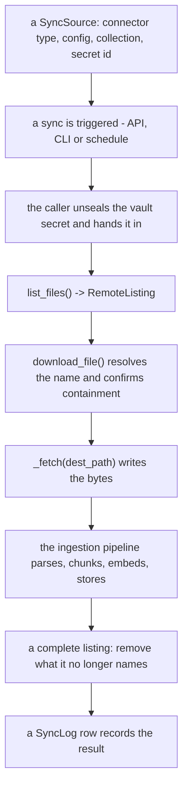

# Добавьте коннектор синхронизации { #add-a-sync-connector }

## Архитектура { #architecture }

Коннекторы синхронизации — это подключаемые адаптеры, которые забирают файлы
из внешних систем (облачных хранилищ, API SaaS и т. п.) для индексации
в конвейере RAG.

### Ключевые классы { #key-classes }

| Класс | Где | Назначение |
|-------|-----|------------|
| `BaseSyncConnector` | `app/services/rag/connectors/__init__.py` | Абстрактный базовый класс для всех коннекторов |
| `remote_names` | `app/services/rag/remote_names.py` | Куда можно записать удалённое имя и что может дойти до запроса |
| `RemoteFile` | `app/services/rag/connectors/__init__.py` | Модель Pydantic, описывающая удалённый файл |
| `RemoteListing` | `app/services/rag/connectors/__init__.py` | Что отвечает `list_files()`: файлы и все ли они |
| `ConfigRefusal` | `app/services/rag/connectors/__init__.py` | Почему конфигурация неприемлема и какое её поле |
| `CONFIG_MODEL` | собственный модуль коннектора | Модель Pydantic его полей конфигурации; список публикует её JSON Schema, и мастер рисует по ней форму |
| `EmptyConfig` | `app/services/rag/connectors/__init__.py` | `CONFIG_MODEL` базового класса по умолчанию — для коннектора, которому нечего настраивать |
| `ConnectorConfig` | `app/services/rag/connectors/__init__.py` | Собственный документ конфигурации источника в том виде, в каком его отправил мастер |
| `CONNECTOR_REGISTRY` | `app/services/rag/connectors/__init__.py` | Словарь, сопоставляющий строки типа коннектора классам |
| `SyncSource` | `app/db/models/sync_source.py` | Модель базы данных, хранящая конфигурации источников |
| `SyncLog` | `app/db/models/sync_log.py` | Модель базы данных, отслеживающая операции синхронизации |

### Поток { #flow }



1. Пользователь создаёт **SyncSource** (тип коннектора + конфигурация + имя
   коллекции + id секрета в хранилище, которым он аутентифицируется)
2. Пользователь запускает **синхронизацию** (через API, CLI или задачу
   по расписанию)
3. Тот, кто запускает синхронизацию, раскрывает этот секрет и передаёт его;
   `list_files()` коннектора возвращает `RemoteListing`
4. Для каждого файла `BaseSyncConnector.download_file()` решает, где ему можно
   оказаться, и вызывает `_fetch()` коннектора, чтобы записать его туда
5. Конвейер индексации разбирает, нарезает на фрагменты, строит эмбеддинги
   и сохраняет каждый файл
6. Если список был полным, из коллекции удаляются документы, которые этот
   источник принёс раньше и которых в списке больше нет
7. Запись **SyncLog** фиксирует результат

### Коннектор не выбирает место назначения { #a-connector-does-not-choose-the-destination }

!!! danger "Удалённое имя контролирует атакующий"

    Имя выбирает любой, кто может поделиться файлом в синхронизируемой папке,
    а `../../../etc/…` — допустимое имя в Google Drive. **Пишите в `dest_path`,
    который вам дали, и никуда больше** — коннектор, который выбирал бы путь
    сам, означал бы отдельное правило отказа, которое нужно помнить для каждого
    коннектора.

`download_file()` конкретный и не переопределяется. Он приводит
`RemoteFile.name` к пути внутри каталога синхронизации и убеждается, что
результат остаётся внутри, прежде чем записан хоть один байт, а затем передаёт
`_fetch()` `dest_path` для записи.

То же касается любого значения от вызывающей стороны, которое коннектор
подставляет в **запрос**: проверяйте его там, где строится запрос, сверяя
с тем, что удалённая система действительно может выдать. Оба ответа находятся
в `app/services/rag/remote_names.py`.

### И собственные учётные данные коннектор тоже не хранит { #a-connector-does-not-hold-its-own-credential-either }

`CONFIG_MODEL` говорит, как **найти** документы, и ничего больше. Учётные
данные — это секрет в хранилище, на который источник ссылается по id; его
раскрывает тот, кто запускает синхронизацию, и передаёт как `credential`.
Поэтому коннектор объявляет, какой вид секрета ему нужен (`SECRET_KIND`),
и ничего не читает из `config` для аутентификации.

!!! danger "Поле для токена в `CONFIG_MODEL` — это учётные данные в столбце JSONB"

    Именно это убрали `0042_sync_source_secret_id` и
    [#937](https://github.com/vstorm-co/agenticos/issues/937). Запасного
    варианта для всего экземпляра тоже нет: источник работает на тех учётных
    данных, которые называет, или не работает вовсе, потому что запасной
    вариант означал бы, что `folder_id` одной организации выбирает, что
    читается от имени *оператора*.

### Список говорит, весь ли это источник { #a-listing-says-whether-it-is-the-whole-source }

Синхронизация удаляет то, что источник принёс раньше и больше не перечисляет,
поэтому список — ещё и утверждение, что всё отсутствующее в нём исчезло. Это
утверждение и есть `RemoteListing.complete`. Коннектор, чей список либо
завершается, либо падает, — Drive, S3 — оставляет его по умолчанию, `True`.
Коннектор, который может остановиться на полпути и всё же имеет что
проиндексировать, — обход, упёршийся в потолок страниц или не сумевший
прочитать одну страницу, — возвращает найденное с `complete=False`. Тогда
запуск ничего не удаляет вместо того, чтобы удалить всё, до чего он
не добрался.

`RemoteListing.problems` несёт по предложению на каждый элемент, который список
не смог прочитать. Синхронизация считает каждый из них неудавшимся файлом
и показывает в журнале синхронизации, поэтому пишите своими словами: хост и код
состояния, никогда — текст удалённой системы.

### Два необязательных хука: изменение и очистка { #two-optional-hooks-change-and-cleanup }

`list_files()` и `_fetch()` — всё, что коннектор обязан написать. Ещё два метода
имеют значения по умолчанию, при которых коннектор работает так же, как Drive
и S3; коннектор переопределяет один из них, когда его источник может ответить
на заданный вопрос. `GitConnector` в `app/services/rag/connectors/git.py`
переопределяет оба, как и `SharePointConnector`
в `app/services/rag/connectors/sharepoint.py`, который использует `previous`.

| Хук | По умолчанию | Переопределяйте, когда |
|------|---------|------------------|
| `remote_version(config, credential, previous)` | `None`: каждый запуск перечисляет файлы | Источник может дёшево сказать, на какой точке находится всё его содержимое, — например, коммит или токен изменений. После запуска, в котором ничего не упало, синхронизация сохраняет это значение вместе с отпечатком конфигурации. Следующий запуск, который находит ту же пару, останавливается до `list_files()`. Значение должно меняться всякий раз, когда мог измениться любой перечисленный файл или сам список. `previous` — значение, сохранённое последним чистым запуском при той же конфигурации, или `None`. Источник, который умеет сообщать только об изменениях *с* некоторой точки, например delta-ссылка Graph, возвращает `previous` обратно, когда ничего не изменилось. |
| `aclose()` | ничего | Коннектор держит что-то между `list_files()` и загрузками, например клон или сеанс. Вызывается, когда синхронизация завершена, успешно или нет. |

## Шаг за шагом: коннектор Notion { #step-by-step-a-notion-connector }

В этом примере реализуется коннектор Notion, который забирает страницы
из рабочего пространства Notion.

### 1. Создайте файл коннектора { #1-create-the-connector-file }

```python
# app/services/rag/connectors/notion.py
import asyncio
import logging
from pathlib import Path
from typing import ClassVar

from pydantic import BaseModel, Field

from app.core.exceptions import BadRequestError
from app.core.secret_kinds import ApiKeySecret, SecretKind, StorableSecret
from app.services.rag.connectors import (
    BaseSyncConnector,
    ConfigRefusal,
    ConnectorConfig,
    RemoteFile,
    RemoteListing,
)

logger = logging.getLogger(__name__)


class NotionConfig(BaseModel):
    """What a Notion source needs to *find* its pages.

    The credential is not here - it is an `ApiKeySecret` the source names in
    `secret_id`. Both fields have a default, so neither is required.
    """

    database_id: str | None = Field(
        default=None,
        title="Database ID",
        description="Limit sync to a specific Notion database (optional)",
    )
    include_subpages: bool = Field(default=True, title="Include sub-pages")


class NotionConnector(BaseSyncConnector):
    """Sync connector for Notion pages."""

    CONNECTOR_TYPE: ClassVar[str] = "notion"
    DISPLAY_NAME: ClassVar[str] = "Notion"
    # Which vault secret authenticates this connector. The wizard offers the
    # organization's matching secrets and nothing else.
    SECRET_KIND: ClassVar[SecretKind] = SecretKind.API_KEY

    # The listing publishes this model's JSON Schema and the wizard draws it;
    # validate_config derives its required-field check from it. It holds no
    # credential - see "A connector does not hold its own credential either".
    CONFIG_MODEL: ClassVar[type[BaseModel]] = NotionConfig

    def _client(self, credential: StorableSecret | None):
        """The Notion client this source's own credential opens.

        Raises:
            BadRequestError: the source names no credential, its secret has been
                deleted, or the secret is not an API key.
        """
        from notion_client import Client

        if credential is None:
            raise BadRequestError(
                message=(
                    "This Notion source has no credential. Pick an API key in "
                    "the Vault and point the source at it."
                )
            )
        if not isinstance(credential, ApiKeySecret):
            raise BadRequestError(
                message="A Notion source needs an API key, and the one it names is not one."
            )
        return Client(auth=credential.api_key.get_secret_value())

    async def list_files(
        self, config: ConnectorConfig, credential: StorableSecret | None
    ) -> RemoteListing:
        """List Notion pages available for sync."""
        database_id = config.get("database_id", "")

        def _list() -> list[RemoteFile]:
            notion = self._client(credential)
            files: list[RemoteFile] = []

            if database_id:
                # Query a specific database
                response = notion.databases.query(database_id=database_id)
                pages = response.get("results", [])
            else:
                # Search all accessible pages
                response = notion.search(filter={"property": "object", "value": "page"})
                pages = response.get("results", [])

            for page in pages:
                page_id = page["id"]
                title = "Untitled"
                # Extract title from properties
                for prop in page.get("properties", {}).values():
                    if prop.get("type") == "title" and prop.get("title"):
                        title = prop["title"][0].get("plain_text", "Untitled")
                        break

                files.append(
                    RemoteFile(
                        id=page_id,
                        name=f"{title}.md",
                        mime_type="text/markdown",
                        size=None,
                        modified_at=page.get("last_edited_time"),
                        source_path=f"notion://{page_id}",
                    )
                )

            return files

        # Complete by default: the listing either returned every page or raised.
        return RemoteListing(files=await asyncio.to_thread(_list))

    async def _fetch(
        self,
        file: RemoteFile,
        dest_path: Path,
        config: ConnectorConfig,
        credential: StorableSecret | None,
    ) -> None:
        """Export a Notion page as Markdown to the path the base class chose."""
        def _download() -> None:
            notion = self._client(credential)

            # `dest_path` is already confirmed to be inside the sync directory.
            # Do not build a path from `file.name` — see "A connector does not
            # choose the destination" above.

            # Fetch page blocks and convert to markdown
            # (simplified — use a library like notion2md in practice)
            content = f"# {file.name.replace('.md', '')}\n\nPage content here..."
            dest_path.write_text(content)

            logger.info(f"Exported Notion page {file.id} -> {dest_path}")

        await asyncio.to_thread(_download)

    async def validate_config(self, config: ConnectorConfig) -> ConfigRefusal | None:
        """Refuse a config the wizard can still fix.

        Connectivity is not checked here: `validate_config` sees the config and
        not the credential, so "can this key reach Notion" is a question for the
        first sync. What it can answer is the shape of what was typed.
        """
        refusal = await super().validate_config(config)
        if refusal is not None:
            return refusal

        database_id = config.get("database_id", "")
        if database_id and not database_id.replace("-", "").isalnum():
            # `field=` names one input, and the sync-source wizard marks it.
            # Name it as `CONFIG_MODEL` does; where it sits in the request body
            # is not a connector's to know.
            return ConfigRefusal(
                message="A Notion database id is letters, digits and dashes",
                field="database_id",
            )
        return None
```

`validate_config` отвечает *почему нет* или `None`, когда конфигурация
приемлема. `ConfigRefusal(message="…", field="database_id")` называет одно поле:
`SyncSourceService` дополняет его до пути в полезной нагрузке
(`config.database_id`), возбуждает исключение с `refused_field`, и мастер помечает
этот ввод. Называйте поле так, как это делает `CONFIG_MODEL`: где оно находится в
теле запроса — не дело коннектора.

Если коннектор всё-таки где-то проверяет соединение, никогда не вставляйте
в сообщение текст исключения самого клиента: SDK кладёт туда выполнявшийся
запрос, а в нём регулярно оказывается URL с ключом. Запишите его в журнал
и откажите своими словами.

### 2. Зарегистрируйте в CONNECTOR_REGISTRY { #2-register-in-connector_registry }

Отредактируйте `app/services/rag/connectors/__init__.py` и добавьте:

```python
from app.services.rag.connectors.notion import NotionConnector

CONNECTOR_REGISTRY["notion"] = NotionConnector
```

### 3. Добавьте зависимость (если нужно) { #3-add-dependency-if-needed }

Если коннектору нужен сторонний пакет, добавьте его в `pyproject.toml`:

```bash
uv add notion-client
```

### 4. Проверьте через CLI { #4-test-via-cli }

```bash
# Store the credential once, then point a source at it
uv run agenticos cmd rag-source-add \
    --name "Engineering Wiki" \
    --type notion \
    --org <organization-id> \
    --secret-id <vault-secret-id> \
    --config '{"database_id": "abc123"}' \
    --collection knowledge-base
```

`--secret-id` называет запись в хранилище секретов этой организации; токен
никогда не появляется ни в командной строке, ни в конфигурации источника.

### 5. Проверьте через API { #5-test-via-api }

```bash
# Create sync source
curl -X POST http://localhost:8000/api/v1/rag/sync/sources \
    -H "Authorization: Bearer $TOKEN" \
    -H "Content-Type: application/json" \
    -d '{
        "name": "Engineering Wiki",
        "connector_type": "notion",
        "collection_name": "knowledge-base",
        "secret_id": "<vault-secret-id>",
        "config": {
            "database_id": "abc123",
            "include_subpages": true
        }
    }'

# Trigger sync
curl -X POST http://localhost:8000/api/v1/rag/sync/sources/{source_id}/trigger \
    -H "Authorization: Bearer $TOKEN"

# Check sync status
curl http://localhost:8000/api/v1/rag/sync/logs \
    -H "Authorization: Bearer $TOKEN"
```

## Справочник по CONFIG_MODEL { #config_model-reference }

Переменная класса `CONFIG_MODEL` — это модель Pydantic того, как **найти**
документы источника. `GET /api/v1/rag/sync/connectors` публикует её
`model_json_schema()` как `config_schema` — в той же форме, в какой
`config_schema` несёт возможность, — и мастер передаёт её в `SchemaForm` без
изменений. `validate_config` тоже читает модель: поле без значения
по умолчанию обязательно, и отказ называет `title` этого поля.

Обязательное поле — то, у которого нет значения по умолчанию, поэтому флага,
который можно написать с ошибкой, нет. Сопоставление, которое это заменило,
какое-то время было `dict[str, dict[str, Any]]`, и объявление
с `"require": True` молча отключало проверку этого поля — мастер рисовал
обязательное поле как необязательное (#562).

### Виды полей, которые рисует мастер { #field-kinds-the-wizard-draws }

`SchemaForm` рисует намеренно небольшую часть JSON Schema: строки, числа,
логические значения, перечисления и список строк. Коннектору, которому нужен
более богатый редактор, проще поставлять свой компонент, чем тянуть форму
к универсальному рендереру.

| Тип Python | Элемент интерфейса |
|-------------|-----------|
| `str` | Текстовое поле |
| `str` с `json_schema_extra={"x-textarea": True}` | Многострочный текст |
| `bool` | Переключатель |
| `int` / `float` | Числовое поле |
| `Literal["a", "b"]` | Выпадающий список |
| `list[str]` | Список через запятую |

Необязательное поле — это `T | None = None`. Pydantic выдаёт его как
`anyOf: [{type: "x"}, {type: "null"}]`, и форма смотрит сквозь ветвь null,
а не проваливается в текстовое поле.

### Свойства полей { #field-properties }

| Аргумент `Field(...)` | Что он делает |
|-----------------------|--------------|
| `title` | Подпись над полем и то, что называет отказ по обязательному полю |
| `description` | Текст подсказки под полем |
| `default` | Значение, которое применяет коннектор, когда ключ опущен. Ничего не сохраняется, пока поле не изменят |
| `json_schema_extra={"x-placeholder": "…"}` | Серая подсказка, которая показывается, пока поле пустое, и никогда не сохраняется, — для значения по умолчанию, определяемого на стороне сервера, например `region` у S3, откатывающегося к `S3_RAG_*` |

Свойства для секрета нет, и добавить его некуда: учётные данные — это секрет
в хранилище, на который источник ссылается по id, поэтому `SECRET_KIND` — это
способ коннектора сказать, что ему нужно.

### Пример { #example }

```python
from pydantic import BaseModel, Field


class WorkspaceConfig(BaseModel):
    workspace: str = Field(title="Workspace", description="Which workspace to read")
    max_files: int = Field(default=100, title="Max files to sync")
    recursive: bool = Field(default=True, title="Include nested items")


class WorkspaceConnector(BaseSyncConnector):
    CONFIG_MODEL: ClassVar[type[BaseModel]] = WorkspaceConfig
```

У `workspace` нет значения по умолчанию, поэтому это единственное обязательное
поле; поставляемые коннекторы (`GoogleDriveConfig`, `S3Config`, `WebConfig`) —
те модели, с которых стоит брать пример.

## Советы { #tips }

- Задайте `RemoteFile.source_path` уникальный URI (например, `notion://page_id`) — он используется для дедупликации между синхронизациями, и именно с ним удаление и сверяется: документ, чей `source_path` полный список больше не называет, удаляется
- Возвращайте `complete=False` из списка, который оборвался, и никогда не возбуждайте исключение для списка, которым ещё можно частично воспользоваться
- Оборачивайте блокирующие вызовы SDK в `asyncio.to_thread()`, чтобы они не блокировали цикл событий
- Реализуйте `validate_config()`, чтобы отказывать в конфигурации, которую мастер ещё может исправить: `ConfigRefusal` с указанным `field` заставляет его пометить именно это поле, а не показать одну фразу над четырьмя полями. Метод видит конфигурацию, а не учётные данные, поэтому «дотянется ли этот ключ до сервиса» — вопрос первой синхронизации, а не этого метода
- Объявите `SECRET_KIND` и читайте учётные данные из аргумента `credential`. Учётные данные никогда не попадают в `CONFIG_MODEL`, и запасного варианта для всего экземпляра, к которому можно откатиться, нет
- Настройки в `app/core/config.py` и `.env` — для значений, которые не называют субъекта: где находится хранилище, а не кто спрашивает (образец — `S3_RAG_ENDPOINT`)
- `_fetch()` пишет в переданный ему `dest_path` и ничего не возвращает: где это, отвечает базовый класс, а дальше всё делает конвейер индексации
