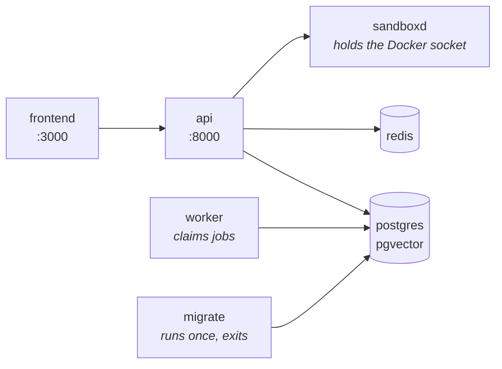
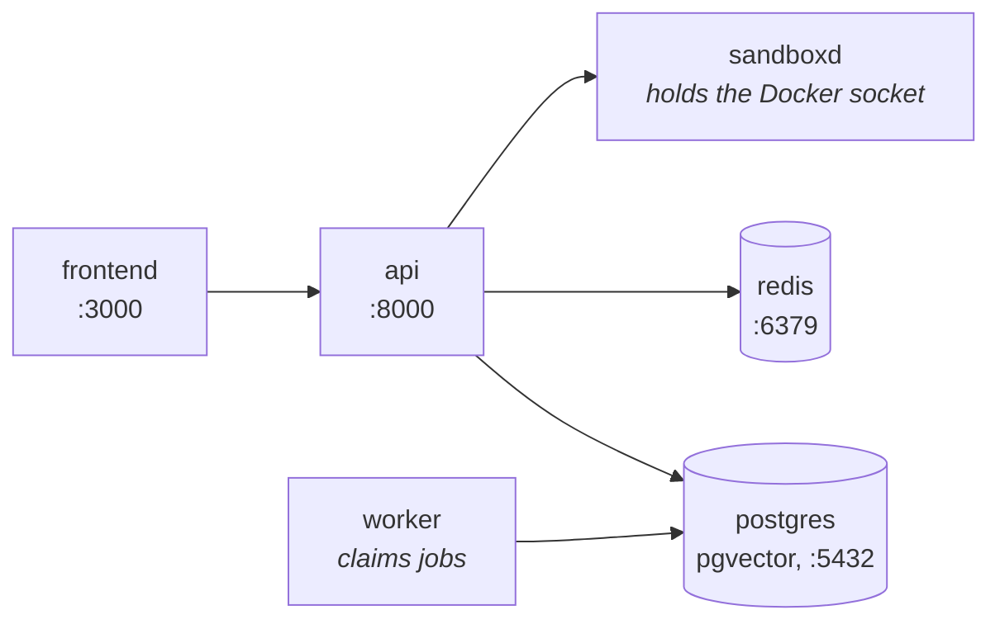

# Установка { #install }

Две команды ведут от машины с Docker к агенту, который отвечает: `docker compose up -d`
с одним скачанным файлом и первичная настройка внутри контейнера, который он
запустил. Эта страница — эти две команды, сборка из исходников для тех, кто
меняет код, и что делать, когда что-то не поднимается.

Каждый шаг идемпотентен — повторяйте любой из них, когда не уверены, что он
сработал.

## Одна команда { #one-command }

```bash
curl -fsSL https://raw.githubusercontent.com/vstorm-co/agenticos/main/scripts/quickstart.sh | bash
```

`scripts/quickstart.sh` требует Docker и ничего больше — плагин Compose версии
2.24 или новее, что он и проверяет. Он скачивает `docker-compose.yml` последнего
выпуска в `./agenticos`, пишет рядом `.env` (режим 0600) со сгенерированными
`SECRET_KEY`, `VAULT_MASTER_KEY` и токеном песочницы, задаёт четыре вопроса,
загружает опубликованные образы и поднимает стек, включая консоль, создаёт
организацию с владельцем и опубликованным агентом и по желанию зеркалирует реестр
MCP. Запущенный внутри клона, он вместо этого собирает те же образы из дерева.
`docker-compose.yml`, принадлежащий другому проекту, остаётся нетронутым: установка
идёт в `./agenticos` рядом с ним.

Он принимает `--check`, чтобы только сообщить, чего не хватает, `--dry-run`,
чтобы напечатать каждую команду, которую он выполнил бы, ничего не выполняя, и
`--yes` вместе с `--provider`, `--api-key`, `--email`, `--password` и `--org` для
установки без участия человека.

Всё ниже — то, что он делает, на случай, если вы предпочитаете сделать это сами;
и нет ни одного шага, который он делает, а вы не смогли бы.

## Требования { #requirements }

Развёртывания на Podman используют [ручной путь через провайдер Docker
Compose](deploy.md#podman-support) с дополнительным переопределением для сокета
песочницы и разрешений рабочего пространства. Быстрый старт поддерживает Docker;
`podman-compose` 1.6.0 не поддерживается.

| Чтобы | Нужно |
|---|---|
| **Запустить** | Docker с плагином Compose, 2.24 или новее — Docker Desktop, OrbStack или Engine с `docker-compose-plugin`. <https://docs.docker.com/get-docker/> |
| **Изменить** | Всё вышеперечисленное плюс GNU Make, [uv](https://docs.astral.sh/uv/) и [bun](https://bun.sh) — `make install` проверяет все три |

!!! warning "В Windows используйте WSL2"

    Makefile и помощники для оболочки предполагают bash. **WSL2** или **Git
    Bash**. Как только вы окажетесь внутри одного из них, всё ниже одинаково.

!!! note "Cookie входа и общие хосты"

    Консоль использует cookie `agenticos_access_token` и
    `agenticos_refresh_token`, чтобы приложения с типичными именами cookie не
    перезаписывали их случайно. После перехода со старых имён войдите ещё раз.
    Миграция `0173_revoke_cookie_sessions.py` завершает существующие сеансы
    входа, включая ротированные цепочки refresh-токенов и входы от имени другого
    пользователя. Клиентам API на основе сеансов тоже нужно войти заново;
    API-ключи это не затрагивает. Откат на прежнюю версию никогда не возвращает
    отозванные сеансы в строй.

    Дайте приложениям, не связанным между собой, отдельные имена хостов. Cookie
    общие для портов на одном имени хоста; особые имена приложения предотвращают
    случайные совпадения, но не мешают другому приложению на том же имени хоста
    получать ваши токены.

## Запуск из опубликованных образов { #run-it-from-the-published-images }

Продукт — это два образа, `ghcr.io/vstorm-co/agenticos-backend` и
`ghcr.io/vstorm-co/agenticos-frontend`, которые публикуются [с каждым
выпуском](https://github.com/vstorm-co/agenticos/releases) для amd64 и arm64.
`docker-compose.yml` в корне репозитория загружает их и запускает всё вокруг них,
и он работает сам по себе:

```bash
mkdir agenticos && cd agenticos
curl -fsSLO https://raw.githubusercontent.com/vstorm-co/agenticos/main/docker-compose.yml
docker compose up -d
```

Он загружает образы и запускает **Postgres (с pgvector), Redis, API, фоновый
воркер и консоль**, применяет миграции и отвечает на <http://localhost:3000>.
Первая загрузка — около 2 ГБ.



!!! success "Писать `.env` заранее не нужно"

    У каждой переменной в `docker-compose.yml` намеренно есть значение по
    умолчанию. Пишите `.env` рядом, когда есть что изменить, — всё это
    необязательно:

    | | |
    |---|---|
    | `AGENTICOS_VERSION` | Какой выпуск запускать. `latest`, если не задано; версия вроде `0.0.380`, чтобы закрепить одну, `edge` — что последним опубликовал `main`. Чтобы закрепить версию, положите рядом `docker-compose.yml` этого выпуска (`https://raw.githubusercontent.com/vstorm-co/agenticos/v<version>/docker-compose.yml`): этот файл закрепляет тот `sandboxd`, с которым говорит бэкенд этого выпуска |
    | `PUBLIC_API_URL`, `PUBLIC_WS_URL`, `PUBLIC_SITE_URL` | То, что *браузеру* велено вызывать, когда хост доступен по имени, отличному от `localhost`. `FRONTEND_URL` и `CORS_ORIGINS` бэкенда — тот же факт с его стороны |
    | `OAUTH_PROVIDERS`, `CHAT_MAX_UPLOAD_SIZE_MB` | Кнопки входа, которые предлагает консоль, и то, что поле ввода отклоняет перед загрузкой |
    | `SECRET_KEY`, `VAULT_MASTER_KEY` | Необязательны на ноутбуке, где по умолчанию стоят константа из репозитория и хранилище секретов, запечатанное под неё. `scripts/quickstart.sh` генерирует оба; вручную — `openssl rand -hex 32` для каждого, — и делайте резервную копию ключа хранилища вместе с базой данных, потому что дамп, восстановленный рядом с другим ключом, нечитаем |
    | Всё из `backend/.env.example` | Ключ провайдера, SMTP, токен Logfire — контейнеры читают тот же файл |

    Образы читают этот `.env` и `backend/.env`, когда он есть, поэтому клон
    хранит настройки там, где велит искать остальная документация.

Сервис песочницы — тот, что даёт агенту контейнер для запуска кода, — включается
профилем `sandbox`, потому что держит сокет Docker и отказывается запускаться без
собственного токена:

```bash
echo "SANDBOXD_TOKEN=$(head -c 32 /dev/urandom | base64)" >> .env
docker compose --profile sandbox up -d
```

Токен генерируется один раз, и после этого его не меняют. Повторная генерация
осиротит каждое рабочее пространство, которое держит сервис. (`scripts/quickstart.sh`
делает оба шага за вас.)

## Или соберите из клона { #or-build-it-from-a-clone }

```bash
git clone https://github.com/vstorm-co/agenticos
cd agenticos
make dev
```

В клоне рядом с базовым файлом лежит `docker-compose.override.yml`, и Compose
сливает их сам — поэтому тот же `docker compose up`, который в пустом каталоге
загружает образы, здесь собирает их из дерева, монтирует исходники и перезагружает
API при каждом изменении. Именно это запускает `make dev`, с включённым профилем
песочницы и `SANDBOXD_TOKEN`, сгенерированным сначала в `backend/.env`
(существующий он никогда не перегенерирует).

Когда вы всё-таки хотите что-то изменить — ключ провайдера на хосте, другое имя
базы данных, — правьте `backend/.env`. `make install` создаёт его из
`backend/.env.example`, когда его нет, и потом никогда не перезаписывает, поэтому
файл с вашими ключами переживает каждый повторный запуск.

Первая сборка занимает несколько минут: образ бэкенда содержит LibreOffice и
Tesseract для разбора документов, а консоль — это production-сборка Next.js.
Потом кеш слоёв Docker сокращает её примерно до минуты, а благодаря монтированию
изменение не требует пересборки вовсе.



Миграции выполняются как сервис `migrate` при каждом запуске стека и ничего не
делают, когда база уже на последней ревизии, — поэтому `make dev` — ещё и команда,
которую повторяют после любого изменения кода или конфигурации.

### Консоль в клоне { #the-console-in-a-clone }

```bash
make dev-frontend      # or: cd frontend && bun dev
```

!!! info "Не запускается через `make dev`, и это не упущение"

    В клоне консоль находится за профилем compose `console`, чтобы работа над API
    не пересобирала образ фронтенда и чтобы `bun dev` на вашем хосте не дрался с
    контейнером за порт 3000. Вне клона профиля нет: `docker compose up` запускает
    её вместе со всем остальным.

## Создайте организацию, владельца, модель и агента { #create-an-organization-an-owner-a-model-and-an-agent }

```bash
make platform-bootstrap BOOTSTRAP_API_KEY=sk-...               # in a clone
docker compose exec -T -e BOOTSTRAP_API_KEY=sk-... app \
  agenticos cmd bootstrap                                     # anywhere else
```

Именно эта команда превращает пустую базу данных в то, чем можно пользоваться.

Пустой AgenticOS — задача о курице и яйце: агенту нужна модель, модели нужен
ключ, ключу нужна организация — и эта команда проходит эту цепочку один раз:

| Она создаёт | |
|---|---|
| Организацию | `Acme`, или `--org` |
| Владельца | `admin@example.com` / `admin123`, или `--email` / `--password` |
| Запись в хранилище секретов | Ключ вашего провайдера, запечатанный для этой организации |
| Профиль модели | `gpt-4.1`, `claude-sonnet-4-6`, `gemini-2.5-pro` или `openai/gpt-4.1` — в зависимости от того, для какого провайдера ключ |
| Двух агентов | **Архитектора** (Architect) в углу каждой страницы и **AgenticOS** — оба опубликованы, если есть ключ |

Теперь откройте <http://localhost:3000>, войдите как `admin@example.com` /
`admin123` и спросите любого из них о чём-нибудь: **AgenticOS** в **Чате** (Chat)
или **Архитектора** в углу любой страницы.

AgenticOS — агент общего назначения: он читает, прежде чем действовать,
планирует многошаговую работу, правит файлы и запускает команды в своей
песочнице, исследует веб, поручает работу своим специалистам и проверяет, что
сделал. Он ещё и показывает по ходу дела, что умеет платформа: предлагает
автоматизацию, когда запрос повторится, говорит, что смог бы сделать, если
включить возможность, запоминает ваши предпочтения и переключает язык консоли,
когда вы об этом попросите. Каждый агент, созданный с нуля, начинается с его
копии.

Архитектор собирает агентов вместе с вами, решение за решением, от того, что
агент должен делать, до проверенного и опубликованного агента; он ещё и находит
агентов, запуски и базы знаний и объясняет, почему запуск завершился ошибкой и
сколько он стоил.

Откройте любого в Конструкторе, чтобы увидеть, как это сделано: каждое из
этого — включённая возможность, а инструкции агента — текстовое поле, которое
можно править.

!!! tip "Ключа провайдера ещё нет?"

    Не указывайте `BOOTSTRAP_API_KEY`. Всё всё равно создаётся, и оба агента
    сохраняются как **черновики**, а не как опубликованные версии: агент без
    модели не может отвечать, а опубликовать того, кто падает на первом
    сообщении, хуже, чем не публиковать.

    Добавьте ключ в **Настройки → ИИ-провайдеры** (Settings → AI providers), затем
    опубликуйте AgenticOS. Архитектор публикуется сам при первой модели
    организации.

!!! note "`make seed` — другое дело"

    Она создаёт `admin@example.com` как администратора платформы и больше ничего:
    ни организации, ни модели, ни агента. `make platform-bootstrap` создаёт этого
    пользователя тоже, поэтому на свежей установке вам нужен bootstrap.

    `make dev` печатает предложение запустить `seed`. Это более старый путь, и он
    по-прежнему годится, если вам нужен только вход администратора.

## Проверьте это { #check-it }

```bash
docker compose exec app agenticos cmd doctor
```

`doctor` задаёт те вопросы, которые задало бы первое сообщение. Доступна ли база
данных и на последней ли она ревизии? Расшифровывается ли хранилище секретов? Есть
ли профиль модели, за которым стоит ключ? Отвечает ли каждое зарегистрированное
подключение песочницы своей средой выполнения? Действительно ли выполняются
запланированные задачи?

Каждая строка называет недостающую часть, а не сообщает, что что-то не удалось.

## Итоги { #recap }

```bash
mkdir agenticos && cd agenticos
curl -fsSLO https://raw.githubusercontent.com/vstorm-co/agenticos/main/docker-compose.yml
docker compose up -d                                             # everything, from the published images
docker compose exec -T -e BOOTSTRAP_API_KEY=sk-... app \
  agenticos cmd bootstrap                                       # an org, an owner, a model, an agent
```

Затем <http://localhost:3000>, `admin@example.com` / `admin123`. Чтобы вместо
этого менять код: `git clone`, `make dev`, `make dev-frontend`,
`make platform-bootstrap`.

## Когда не поднимается { #when-it-does-not-come-up }

| Что вы видите | Почему |
|---|---|
| Индексация отвечает 500 с `extension "vector" is not available` | Обычный Postgres вместо `pgvector/pgvector:pg16`. См. ниже |
| `uv run` сообщает о версии Python, отличной от 3.15 | `backend/.venv` собран под версию выше закреплённой. Удалите его и повторите `uv sync` |
| Фронтенд загружается, но каждый запрос падает | API ещё запускается — он ждёт сервис `migrate` — или браузеру указали не тот хост: `PUBLIC_API_URL` и `PUBLIC_WS_URL` должны быть доступны оттуда, где находится браузер. `docker compose logs migrate app` |
| `docker compose up` падает с `unauthorized` на `ghcr.io/vstorm-co/...` | Пакет приватный, или мешает устаревший `docker login` в GHCR. Образы загружаются анонимно; выполните `docker logout ghcr.io` и попробуйте снова, а если всё равно отказывает, проблема в видимости пакета, а не в вашей машине |
| Сервис `app` в состоянии `Up` и `unhealthy`, и каждый запрос висит | Заклинивший цикл событий. Воркер снимает себя через 15 с, и что-то его заменяет, во всех трёх стеках, — поэтому если через минуту он всё ещё висит, значит, `EVENT_LOOP_WEDGED_AFTER` где-то равен `0`, что нужно отладчику и не нужно больше ничему. `docker inspect` показывает `137` при `OOMKilled=false`, а строка журнала над ним говорит, какая |
| Сервис `sandboxd` сразу завершается | В `.env` или `backend/.env` нет `SANDBOXD_TOKEN`. `make sandbox-token` в клоне или впишите его вручную, затем снова `up -d` |
| Страница „Файлы“ говорит `This host's files could not be read` и называет `workspace_root` | Сервис песочницы запустился, когда этого пути у него ещё не было. Пересоздайте его — `docker compose --profile sandbox up -d sandboxd` — и удалите через `docker rm` оставшиеся контейнеры `sandboxd-*`: сохранённый контейнер присоединяется с теми монтированиями, с которыми был создан, поэтому старый сеанс продолжает писать туда, где никто не может прочитать |
| `Stopped: another AgenticOS stack named 'agenticos' runs on this machine` | Compose называет проект по его каталогу, поэтому клон в `~/agenticos` и установка в `./agenticos` для Docker — один проект, и запуск второго перехватил бы контейнеры и базу данных первого — под только что сгенерированным `VAULT_MASTER_KEY`, который не может прочитать то, что запечатал первый. Установщик вместо этого отказывается; остановите другой стек (`docker compose down` сохраняет его тома) или установите под другим именем с `--dir` |
| Порт уже занят (3000, 5432, 6379, 8000, 4200) | На нём что-то другое. `make dev-down`, остановите другой процесс, запустите снова |
| Что-то ещё более странное | `make docker-clean` стирает контейнеры, сети **и тома** — все локальные данные, — затем `make dev` с нуля |

### База данных должна быть pgvector { #the-database-must-be-pgvector }

!!! danger "Не обычный Postgres"

    Если индексация документов отвечает 500 в свежем окружении, проверьте образ,
    прежде чем проверять что-либо ещё.

Хранилище поиска выполняет `CREATE EXTENSION IF NOT EXISTS vector` при первой
записи в коллекцию. Обычный Postgres отвечает `extension "vector" is not available` —
500 ещё до того, как зафиксирована хоть одна строка.

Каждый файл compose в этом репозитории закрепляет `pgvector/pgvector:pg16`.

## Повседневная работа { #day-to-day }

```bash
make dev           # start or restart (idempotent); in a clone, from source
make dev-down      # stop everything
make dev-logs      # tail logs
make dev-rebuild   # force-rebuild the backend image after a pyproject change
make dev-frontend  # start the console container (behind the `console` profile in a clone)
```

Вне клона те же четыре — `docker compose up -d`, `down`, `logs -f` и
`docker compose pull && docker compose up -d`, чтобы перейти на более новый
выпуск.

И где что находится:

| | |
|---|---|
| Фронтенд | <http://localhost:3000> |
| API | <http://localhost:8000> |
| Документация OpenAPI | <http://localhost:8000/docs> |
| Административная панель в стиле Django | <http://localhost:8000/admin> |
| Фоновые задачи | <http://localhost:3000/admin/background-jobs> — доступно владельцу экземпляра |
| Postgres | `localhost:5432` (`postgres` / `postgres`) — публикуется только файлом переопределения клона |
| Redis | `localhost:6379` — то же |

!!! warning "Сервис песочницы не публикуется, и намеренно"

    Она держит сокет Docker, а это неаутентифицированный API для root на хосте.
    Она доступна только изнутри сети compose, а API проксирует то, что из неё
    нужно видеть браузеру.

## Запуск бэкенда на вашем хосте { #running-the-backend-on-your-host }

Полезно для точек останова и отладки в IDE. Сервисы остаются в Docker; API — нет.

```bash
make install                                    # .env + uv sync + bun install + pre-commit
docker compose up -d db redis
make db-upgrade                                 # apply migrations
make run                                        # uvicorn --reload
```

`make install` — весь путь настройки: `backend/.env` из примера, если его нет,
`uv sync` для бэкенда, `bun install --frozen-lockfile` для
`frontend/node_modules` и хуки pre-commit.

Ни одну из трёх частей нельзя пропустить, и каждой в какой-то момент не хватало:

- **`backend/.env`** — то, что читает всё, работающее на вашем хосте: `db-check`,
  `db-upgrade`, `run` и pytest, всё через `app.core.config`. Без него
  `POSTGRES_PASSWORD` пуст, и `alembic check` отклоняется с
  `fe_sendauth: no password supplied`.
- **`frontend/node_modules`** содержит eslint, prettier, tsc, vitest и next,
  поэтому без фронтендной части не обойтись, даже если вы трогаете только Python.
  `make check` запускает все пять.

И то и другое создаётся для каждой рабочей копии и не разделяется между рабочими
деревьями, поэтому это нужно в каждом клоне, а не один раз на ноутбуке.

!!! note "Python закреплён на 3.15"

    `backend/.python-version` закрепляет её — так же, как `requires-python`,
    `backend/Dockerfile` и каждая задача CI. Если `uv run python -V` сообщает
    что-то другое, удалите `backend/.venv` и повторите `uv sync`: у более нового
    интерпретатора есть доступные API, которых нет у того, что идёт в комплекте.

## Окружения { #environments }

Три. Каждое запускает два опубликованных образа с `AGENTICOS_VERSION`, который
называет его файл окружения; только ноутбук вместо этого собирает их из дерева.

| Цель | Файлы Compose | Когда использовать |
|---|---|---|
| `docker compose up` | `docker-compose.yml` | Продукт из опубликованных образов. Консоль включена, миграции выполняются при запуске, у каждой переменной есть значение по умолчанию |
| `make dev` | `docker-compose.yml`<br>`docker-compose.override.yml` | Локально, в клоне. Переопределение собирает из исходников, монтирует их, перезагружает и публикует Postgres и Redis на хост |
| `make dev-server` | `docker-compose-dev.yml`<br>`docker-compose-dev.frontend.yml` | Развёрнутое окружение разработки. Загружает `edge`, без монтирования каталогов, без порта базы данных, подробное журналирование |
| `make prod` | `docker-compose-prod.yml`<br>`docker-compose-prod.frontend.yml` | Продакшен. Загружает закреплённый выпуск; ограничения ресурсов, внутренняя сеть данных, настроенный Postgres |

У каждого есть парные `-down`, `-logs` и `-frontend`. `make stage` сохранён как
псевдоним `make dev-server`, которым он и был раньше.

Обоим развёрнутым окружениям нужен обратный прокси перед ними, и дать его можно
двумя способами. По умолчанию стек публикует оба порта на loopback, и прокси на
хосте добирается до них: `nginx/nginx.conf` — этот шаблон, он разрешает
`backend:8000` и `frontend:3000` как сетевые псевдонимы. `make prod PROXY=traefik`
вместо этого добавляет два файла-надстройки, которые ставят контейнеры в сеть
существующего Traefik с метками, по которым он их находит. [Развёртывание](deploy.md)
проходит через оба варианта.

Прокси добирается до них по этим псевдонимам, поэтому продакшен публикует оба
порта на `127.0.0.1`, и ничто вне хоста не может достучаться до них напрямую. Это
граница безопасности, а не аккуратность: при включённом
[`RATE_LIMIT_TRUST_FORWARDED_FOR`](configuration.md#rate_limit_auth_per_minute-and-why-the-auth-surface-has-its-own)
тот, кто может пройти мимо прокси, выбирает адрес, по которому считаются его
запросы. Задайте `BIND_HOST=0.0.0.0` для прокси, работающего в другом месте.

Супервизор API различается во всех трёх, и в каждом умерший воркер
восстанавливается: локальный стек держит собственный супервизор перезагрузки, стек
разработки — один процесс, который Docker перезапускает при завершении, а
продакшен держит четыре воркера под `Multiprocess` uvicorn. Заклинивший, а не
умерший воркер обрабатывается везде одинаково: воркер убивает себя сам. См.
[Конфигурацию](configuration.md#a-worker-whose-event-loop-has-stopped-turning).

!!! warning "`PUBLIC_*` — это то, что сообщают браузеру, и читаются они при запуске"

    `PUBLIC_API_URL`, `PUBLIC_WS_URL` и `PUBLIC_SITE_URL` — адреса, которые
    консоль передаёт браузеру: WebSocket чата и перенаправление при входе
    обращаются к API напрямую, поэтому это должны быть имена, которые браузер
    может разрешить, и никогда — имя контейнера. Файлы фронтенда для dev-server и
    продакшена отказываются запускаться без них.

    Консоль читает их при старте контейнера, поэтому опубликованный образ
    одинаков для каждого экземпляра, а изменение — это перезапуск. Ошибка в одном
    из них — по-прежнему классический сбой: рендеринг на сервере продолжает
    работать по сети compose, пока каждый вызов из браузера уходит не на тот хост.

## Дальше { #next }

<div class="grid cards" markdown>

- :material-rocket-launch:{ .lg .middle } **[Ваш первый агент](first-agent.md)**

    От ключа до опубликованного агента, расходы которого учитываются.

- :material-lightbulb:{ .lg .middle } **[Концепции](concepts.md)**

    Что такое спецификация, версия и способ доступа на самом деле.

</div>

О каждой существующей настройке см. [Конфигурацию](configuration.md). Про
то, как вывести это на настоящий хост, см. [Развёртывание](deploy.md).
