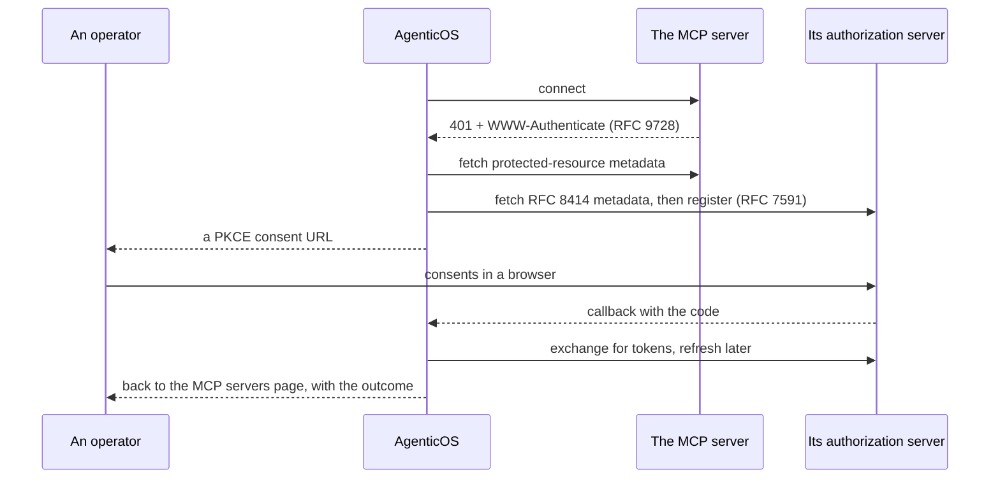

# MCP — инструменты, которые здесь никому не нужно писать { #mcp-the-tools-nobody-here-has-to-write }

Серверы [Model Context Protocol](https://modelcontextprotocol.io) — это ответ
платформы на «нельзя написать коннектор для всего».

Организация указывает на сервер, его инструменты появляются в Конструкторе, и на
нашей стороне не меняется ни строчки кода.

Всё в [каталоге возможностей](reference/capabilities.md) — код, который написали
мы и который обязан иметь покрытие 100%. Всё здесь — URL, который кто-то вставил.

!!! info "Это не альтернативы"

    **Возможность** — верная форма для того, что платформа должна гарантировать:
    контроль бюджета, песочница, поиск, который ссылается на свои источники.

    **MCP** — верная форма для десятков SaaS-продуктов, которыми компания
    пользуется, где единственная важная гарантия — «инструменты те, что опубликовал
    поставщик».

## Подключение { #a-connection }

Одна строка, указывающая на удалённый сервер. Транспорт — streamable HTTP или
server-sent events — выводится из URL, поэтому сервер только с SSE, вроде
Atlassian, работает рядом с сервером на streamable HTTP, и настраивать ничего не
нужно.

|  |  |
| --- | --- |
| `name` | Он же префикс инструментов. См. [Совпадения имён](#name-collisions) |
| `url` | Проверяется на SSRF, прежде чем мы к нему вообще обратимся |
| `auth_token` | Запечатан в [хранилище секретов](secrets.md), его не возвращает ни один эндпоинт |
| `allowed_tools` | Список разрешённых, или null — «всё, что предлагает сервер». Привязка сужает его — см. ниже |
| `is_enabled` | Выключено без потери учётных данных |
| `include_instructions` | Добавлять инструкции `initialize` самого сервера к инструкциям агента. По умолчанию выключено — это текст оператора сервера, читаемый как собственный текст агента, — и включается в диалоге редактирования подключения |
| `last_status` | Что показала последняя проверка и когда |

!!! warning "Адрес, до которого экземпляру нельзя достучаться, отклоняется, и отказ это объясняет"

    Если URL разрешается в адрес loopback, частный, link-local или shared-CGNAT;
    вообще не разрешается; несёт учётные данные в userinfo; использует схему,
    отличную от `http`/`https`; или просто сформирован неверно, — в ответ приходит
    **400**, а полем с ошибкой назван `url`: при создании, при редактировании и при
    запуске потока OAuth, личного и общего для организации одинаково.

    Сверх этого он называет **хост**, но никогда сам URL: в строке запроса URL
    может лежать ключ, а фраза, объясняющая отказ, написана в этом репозитории, а
    не взята из того, что разборщик URL сказал о присланном вами тексте.

    Раньше в ответ приходил 500 без подробностей, а в журнале — трассировка, что
    читается как поломка платформы, а не как адрес, который надо исправить
    ([#861](https://github.com/vstorm-co/agenticos/issues/861)): самостоятельное
    размещение и вставленный URL `localhost` — обычный случай, а не экзотический.

    Оператор может разрешить подключению достучаться до сервера в собственной сети
    экземпляра — например, до службы compose или сервера в VPN или tailnet. Для
    этого внесите его хост в
    [`OUTBOUND_PRIVATE_ALLOWLIST`](configuration.md#project-settings): точный хост,
    суффикс с ведущей точкой, вроде `.corp.example` (он не совпадает с самим
    `corp.example`), IP-адрес или диапазон CIDR, вроде `10.1.2.0/24`. Настройка
    охватывает и HTTP-шаги сценариев, коннекторы и A2A. `MCP_ALLOWED_HOSTS`
    принимает те же формы, но действует только на MCP, поэтому используйте её,
    когда до хоста не должно быть доступа ничему другому. Внесённый в список хост
    может разрешаться в частный адрес, но ответы loopback, link-local и metadata
    отклоняются, а внесённое имя, которое пока не разрешается, всё равно можно
    сохранить. URL по-прежнему должен быть `http` или `https`.

    На такой сервер из списка можно войти и по OAuth. Часто у такого сервера
    собственный вход, поэтому его запросы discovery, регистрации клиента и токена
    могут доходить до хостов из списка — и ни до какого другого частного адреса.
    Каждый запрос по-прежнему привязан к адресу, на котором его проверили, а
    внесённое имя, отвечающее адресом loopback, link-local или облачных метаданных,
    отклоняется. Список действует только на цепочку, начинающуюся на хосте из
    списка: вход на публичном сервере никогда не доходит до хоста из списка, даже
    если метаданные этого сервера его называют.

    После этого любая учётная запись на экземпляре может достучаться до любого
    порта на этом хосте. Поэтому вносите в список только сервер, который проверяет
    токен, и никогда — `localhost` или службу этого стека, вроде `app`, `db` или
    `redis`. Список читается при сохранении подключения и при каждом входе и
    обновлении токена. Удаление хоста не отключает сохранённое подключение, но
    OAuth-подключение к нему перестаёт обновлять свой токен.

    К серверу, который говорит только по stdio, подключиться нельзя, потому что
    подключение — это URL. Запустите мост stdio-to-Streamable-HTTP в частной сети,
    внесите хост моста в список и подключайтесь к нему. Мост должен сам проверять
    токен: до него может добраться любая учётная запись.

### Личное или общее для организации { #personal-or-organization-wide }

Два вида, и всё дело в различии. Диалог подключения спрашивает об этом одним
выбором, простыми словами: **Одна общая учётная запись** (One shared account) —
настраивается один раз, обычно администратором со служебной учётной записью, и
используется каждым агентом, — или **Моя учётная запись** (My own account), которой
пользуетесь вы и агенты, настроенные действовать за каждого человека. Сервер из
каталога, в который люди входят (Notion, Linear, Gmail), рекомендует учётную запись
каждого человека; сервер, принимающий ключ, рекомендует общую.

**Личная** (Personal) — это раздел **MCP-серверы → Вы** (MCP servers → You).
Ограничено одним участником, и им пользуется его собственный помощник, а также
агент, привязанный к учётной записи каждого человека, когда с ним говорит именно
этот человек.

Его учётные данные запечатаны под _участника_, а не под организацию: у личного
подключения организации нет, а его владелец может состоять в нескольких, поэтому
привязка к той, что была активна при добавлении, сделала бы токен нечитаемым в тот
же момент, когда он переключится.

**Организация** (Organization) ограничена организацией, требует `mcp:manage` и
является единственным видом, который спецификация опубликованного агента может
называть _по id_.

Сервер организации может принадлежать отделу. В разделе **Кто может пользоваться**
(Who can use it) диалог подключения предлагает **Все** (Everyone) — значение по
умолчанию — или **Выбранные люди** (Some people), которых находят, набирая имя;
тогда сервер становится частным и открывается каждому из них на уровне `use`. Они и
тот, кто его подключил, видят его и привязывают; владельцы и администраторы видят
все серверы. Кнопка **Кто может пользоваться** меняет это позже. Агент, уже
привязанный к серверу, продолжает работать у всех, кому можно запускать агента:
выбор решает, кто может выбрать сервер, а не кто получает ответ через него, поэтому
Конструктор отмечает это в разделе
[откуда агент берёт знания](departments.md#where-an-agents-knowledge-comes-from).

Опубликованного агента, который добирался бы до разных инструментов в зависимости от
того, чей сеанс его собрал, нельзя было бы проверить или осмыслить — в этом и весь
смысл ограничения. Личное подключение всё же доходит до агента одним способом:
привязка к [учётной записи каждого человека](#whose-account-a-binding-speaks-through)
называет службу, а тот, кто говорит с агентом, подставляет своё подключение к ней.

```
GET  /api/v1/me/mcp-connections     personal
GET  /api/v1/mcp-connections        organization, requires mcp:manage; each server
                                    narrowed to groups only for them
GET  /api/v1/workflows/{id}/mcp-connections   the servers a step of this workflow may
                                    bind - for whoever may edit it (role or grant); name,
                                    tools, no URL or credential
POST /api/v1/mcp-connections/{id}/test   probe it, list its tools, store the status
GET  /api/v1/mcp-connections/{id}/sharing   who it is narrowed to, and the same
                                            grant routes as an agent's
```

### Два имени, и они отвечают на разные вопросы { #two-names-and-they-answer-different-questions }

Подключение несёт **название** и **префикс инструментов**, и ограничен из них
только префикс. Префикс — строчные буквы, цифры и дефисы, уникальный среди серверов
организации, потому что из таких символов может состоять имя инструмента и именно
его читает модель, прежде чем вызвать инструмент. Название — свободный текст,
необязательный, и именно его видит человек.

Различие оправдывает себя в тот момент, когда организация подключает одну службу
дважды. Две учётные записи Notion вынуждены быть `notion` и `notion-2`, и ни одна не
говорит, до какого рабочего пространства доходит; `Marketing workspace` и `Engineering
handbook` — говорят.

!!! info "Префикс не исчезает никогда"

    Где бы ни показывалось название, рядом показывается префикс. Вызовы
    инструментов в запуске записываются под префиксом, поэтому название, заменившее
    его, оставило бы вопрос «почему этот вызов — `notion-2_search`» без ответа на
    странице, которая называет учётную запись. Очистите название, и подключение
    снова читается как свой префикс — как и было, пока вы его не задали.

Спецификация называет подключения организации в `mcp_servers`, по одной записи на
привязку. Удаление подключения, которое агент всё ещё называет, лишает агента этого
сервера, но не запуска.

### Какие инструменты и кто решает { #which-tools-and-who-decides }

Два списка разрешённых, и ни один не отменяет другой.

**На подключении**, `allowed_tools` — решение одного администратора за всех, кто к
нему привязан: инструменты, до которых эта организация готова доходить на этом
сервере вообще. **На привязке** он сужается внутри этого, для каждого агента. Так
один сервер может обслуживать агента только для чтения и агента с правом правки, не
подключая его дважды.

Во время выполнения они пересекаются. Агент не может добраться до инструмента,
который исключает подключение, включая исключённый уже после публикации агента:
привязка теряет этот инструмент, а не агент теряет сервер. Null с любой стороны
означает, что оттуда сужения нет, поэтому привязка, не называющая ничего, получает
всё, что разрешает подключение, — как и делала каждая привязка до появления этой
возможности.

Поэтому null у привязки заодно охватывает каждый инструмент, который сервер получит
позже. В Конструкторе **Добавлять инструменты, которые появятся на сервере позже**
(Add tools the server gains later) говорит, какая это привязка: включено — null;
выключено — она перечисляет сегодняшние инструменты, и добавленный позже остаётся за
бортом. Если после сужения отметить все инструменты заново, получится сегодняшний
список, а не null, и переключатель включается только тогда, когда отмечены все
инструменты: привязка не может сказать «эти и всё, что появится».

Конструктор перечисляет инструменты сервера по его **последней успешной проверке**,
записанной в подключении. Проверка обращается наружу, к третьей стороне, и требует
`connections:manage`; автор агента имеет `agents:edit` и нуждается в списке, чтобы
выбирать, поэтому список читается, а не запрашивается.

У подключения, которое ещё никто не проверял, нет каталога, который можно
предложить; средство выбора инструментов так и говорит и указывает на страницу
серверов, где подключение и проверяют. Привязка, которая уже называет инструменты,
показывает их, поэтому то, к чему она привязана, остаётся видимым, и сузить его
по-прежнему можно.

С [поиском инструментов](reference/capabilities.md#tool-search) подходящие
MCP-инструменты скрыты, пока агент не поищет их. Его настройки позволяют отложить
MCP-инструменты, инструменты возможностей или и то и другое и держать выбранные
пространства имён серверов или отдельные инструменты видимыми с первого запроса. Эти
исключения меняют момент, когда показывается схема инструмента; списки разрешённых на
подключении и на привязке по-прежнему решают, доступен ли он.

Новые шаблоны AgenticOS и Архитектора тоже откладывают инструменты возможностей,
оставляя вопросы и инструменты песочницы видимыми сразу, и используют локальный
поиск BM25, выдающий не более пяти результатов. Существующие опубликованные агенты
сохраняют свою настройку; обновите их настройки поиска инструментов, чтобы принять
эти значения по умолчанию. Поиск инструментов не убирает инструкции или историю
диалога, а сумма входных токенов складывается из всех запросов к модели.

Доступность браузера дополнительно следует за состоянием открытых вкладок:
открытие, чтение и перечисление вкладок остаются доступны для запуска или
восстановления сеанса. Закрытие и переключение требуют открытой вкладки; действия
на странице — активной вкладки. Поиск не может показать действие, недоступное в текущем состоянии. Изменения
доступности могут влиять на кеширование промптов у провайдера, поэтому меньше схем
инструментов само по себе ещё не означает меньшую стоимость.

### Какие вызовы ждут человека { #which-calls-wait-for-a-person }

Для внешнего сервера `approval: none` позволяет вызовам выполняться, `writes`
спрашивает перед инструментами без `readOnlyHint: true`, а `all` спрашивает и перед
чтением. Подсказку поставляет сервер; используйте `all`, если не доверяете его
классификации. Внешний MCP-клиент, вроде Claude Code, применяет свои собственные
настройки подтверждения.

Привязка платформы требует как минимум `writes`. Её доверенные значения по умолчанию
позволяют выполняться без подтверждения разрешённому чтению, подготовке черновиков,
обычным изменениям задач и записей таблиц, пустым базам знаний, проектам, диалогам,
навыкам, файлам контекста и кейсам наборов данных. Записи всё равно объявляют
`readOnlyHint: false`; это меняет согласование, а не разрешения или побочные
эффекты. `prepare_solution` готовит план; установка его через `install_solution`
по-прежнему требует подтверждения.

Записи задач всё равно спрашивают, когда могут запустить или перенести работу
агента: активная задача с назначенным агентом и следующим шагом «Агент». Задачи,
назначенные человеку, — а также завершённые, отменённые, заблокированные и
ожидающие — под это требование не подпадают. Обычные обновления записей доски
задач используют ту же проверку, и изменение по-прежнему требует прочитанной
ревизии. Upsert доски задач спрашивает, если его значения явно не выбирают Person
или терминальный либо ожидающий статус, потому что он может воссоздать удалённую
параллельно запись. Обычные записи таблиц не спрашивают снова лишь потому, что их
слушает уже одобренная автоматизация.

Каждое обновление схемы, удаление, публикация, смена действующей версии, перевод в
окружение, публичная ссылка на приложение, закрытие во «Входящих», выполнение или
платная операция требуют свежего ответа. Сюда входят тесты, оценки и шаги улучшения,
индексация и синхронизация, проверки подключений, определения автоматизаций и
немедленные запуски автоматизаций, окружения агентов, изменения профиля, модели и
эмбеддингов, приглашения и административные настройки и настройки проактивности.
«Одобрять всё», запомненные решения и постоянное согласие автоматизаций не могут
отменить эти требования. Личные настройки языка и интерфейса остаются без
согласования.

В Конструкторе используйте щит у каждого инструмента или элемент управления группы,
чтобы потребовать согласование для операции, которая иначе не требует его.
`tool_approval` с ключом по исходному имени инструмента на сервере хранит этот
выбор: `required` спрашивает, а `never` освобождает от обычного требования привязки.
Привязка, выставленная в `all`, спрашивает для каждой операции, которая иначе не
требовала бы согласования, включая чтение; обязательные и условные требования к
выполнению всё равно сильнее `never`. Смешанная группа показывает
**Для каждого инструмента** (Per tool). Вновь обнаруженные инструменты следуют
политике привязки; неизвестные записи платформы консервативно спрашивают, пока их
явно не классифицируют.

Эти правила действуют и для запусков из каналов и действий автоматизаций. Они не
дают привязанную учётную запись, подключение, доступ к ресурсу или более широкие
области OAuth. Исключения из согласования поставляет только доверенный каталог
платформы внутри процесса; удалённый сервер не может получить их, объявив
совпадающие метаданные.

### Чья учётная запись говорит через привязку { #whose-account-a-binding-speaks-through }

Привязка бывает одного из двух видов, и Конструктор спрашивает, какого, в настройках
сервера, которые заодно перечисляют ваши собственные учётные записи на этой службе.

**Учётная запись организации** (The organization's account) (`account: organization`)
называет одно из подключений организации и отвечает за всех, при любом способе
доступа. Это значение по умолчанию и тот ответ, против которого проверяют агента.

**Своя учётная запись у каждого** (Each person's own account) (`account: personal`)
называет вместо этого службу каталога — `catalog_key: notion` — а подключение не
называет вовсе. Кто говорит с агентом, подключает свой собственный Notion в разделе
**MCP-серверы → Вы** (MCP servers → You), и агент говорит с Notion от его имени: и в
«Обзоре», и в личном сообщении, и в канале одинаково. Тогда журнал в Notion говорит,
кто что сделал, — чего общая служебная учётная запись не может никогда.

Учётная запись — это автор _этого сообщения_, а не ветки. Аня спрашивает в `#ops` и
получает ответ из своего Notion; Бартек задаёт тот же вопрос в той же ветке и
получает свой — или ему предлагают подключить. Ветка — не граница, которую чьи-либо
учётные данные должны пересекать: если бы первый подключившийся отвечал за всех
после него, привязанный в канале Notion оказался бы у всего канала.

!!! info "Где никто не говорит, инструментов нет — и агент это говорит"

    У ключа API без [явного делегирования личного MCP](api.md#explicit-personal-mcp-delegation),
    у виджета для встраивания, у расписания, у триггера и у отправителя из канала,
    который не привязал свою учётную запись в чате, нет учётной записи, через которую
    говорить. Запуск идёт без этого сервера, все остальные привязки целы, и в его
    инструкции добавляется строка о том, какой службы не хватает и почему, —
    поэтому, когда кто-то просит Notion, агент отвечает ссылкой, которая его
    подключает (`/mcp-servers?connect=notion`), или словами «сначала отправьте
    этому боту `/link`», если не хватает именно чат-учётной записи.

    Чат в «Обзоре» спрашивает, когда агенту нужна служба, а не раньше. Служба,
    которую человек не подключил или должен снова авторизовать, предлагается модели
    как `connect_account`: когда для вопроса нужен Notion, запуск останавливается
    на карточке с кнопкой подключения, и, как только учётная запись подключена, тот
    же запуск продолжается с инструментами Notion. Если карточку пропустить, он
    продолжается без них. Элементы управления чата также перечисляют личные службы
    агента с их состоянием, чтобы новый участник видел, что подключить, прежде чем
    спрашивать. См. [страницу консоли](console.md#chat).

Префикс инструментов личной привязки — это ключ каталога, как бы каждый человек ни
назвал своё подключение, поэтому агент показывает всем `notion_search`.
`allowed_tools` на привязке — потолок администратора; собственное подключение
человека может сузить дальше, и эти два пересекаются.

!!! warning "Три вещи, которые отклоняет публикация"

    Личная привязка к ключу, которого нет в каталоге: ни одно подключение участника
    никогда с ней не совпадёт. Две личные привязки к одной службе: одни и те же
    инструменты дважды под одним именем. И личная привязка, чей ключ совпадает с
    именем подключения организации, привязанного к тому же агенту: это поставило бы
    два сервера под один префикс; Pydantic AI отклоняет повторяющиеся имена
    инструментов, и ход диалога прерывается.

!!! note "Столкновение, дошедшее до запуска, сужается, а не теряется"

    Публикация — это момент времени, а имя подключения можно изменить после неё,
    поэтому агент, опубликованный до этой проверки, или агент, чьё подключение
    переименовали в совпадающее имя, всё ещё может дойти до запуска с двумя
    серверами под одним префиксом. Такой запуск оставляет первый из них, ответивший
    на проверку, отбрасывает остальные и говорит модели, какой сервер в этом ходе
    недоступен — а когда оба несут одно имя, и через какую привязку он говорит, —
    вместо того чтобы потерять это в строке журнала, которую никто не читает.
    Исправление — переименовать одно из двух подключений, и это дело автора.

Агент может привязать службу обоими способами — Notion-справочник организации _и_
собственную учётную запись каждого человека — при условии, что подключение
организации не названо так же, как ключ каталога, который и есть префикс учётной
записи каждого человека.

### Несколько учётных записей одного сервера { #several-accounts-of-one-server }

Один агент может читать корпоративную почту и `info@` сразу. Человек, у которого на
службе несколько собственных учётных записей, доступен через **каждую из них**: та,
которую он отметил как основную в разделе **MCP-серверы → Вы** (MCP servers → You) —
а если такой нет, подключённая первой — сохраняет простой префикс, `outlook_send`, а
каждая другая добавляет свою метку, `outlook_info_send` (две метки, читающиеся
одинаково как имя инструмента, `Sales US` и `Sales-US`, различаются по короткому id
учётной записи у второй). Какие это учётные записи — выбор человека, заданный тем,
что он подключает; привязка его не сужает.

Учётные записи организации привязываются бок о бок так же: каждое её подключение к
серверу — собственная привязка под собственным именем, со своими инструментами. В
Конструкторе настройки сервера перечисляют его привязанные учётные записи с кнопкой
**Добавить ещё одну учётную запись** (Add another account). В разделе **Инструменты**
(Tools) выберите учётную запись, чьи инструменты и согласования вы хотите изменить.
Это изменение оставляет другие учётные записи нетронутыми. Где бы запуск ни доходил
до одной службы через несколько учётных записей, одна строка его инструкций называет
каждую учётную запись рядом с её префиксом и велит модели спросить, когда непонятно,
какую из них имеет в виду человек.

Вторую учётную запись на службе нужно назвать: именно её метка позволяет различить их
в каждом средстве выбора и согласовании, поэтому форма просит её до подключения, а API
отклоняет безымянную вторую учётную запись по полю `label`.

Тогда согласование говорит, какая учётная запись действует. Вызов через помеченное
подключение или через одну из нескольких учётных записей на одной службе несёт имя
этой учётной записи: чат, «Активность» и «Обзор» показывают его рядом с действием,
сообщение в Slack или Telegram спрашивает «_отправить в Gmail_ как _Work_», а письмо
о согласовании перечисляет его после инструмента. У единственной непомеченной учётной
записи нечего различать, поэтому ничего и не добавляется.

Диалог **Инструменты** подключения показывает **только чтение** (read-only) только
при явном `readOnlyHint: true`, **может менять данные** (may change data) при явном
false и **не объявлено** (not declared), когда аннотации не было или старая проверка
её не записала. Отсутствующие метаданные политика `writes` трактует консервативно;
они не доказывают, что инструмент пишет. Повторно проверьте старое подключение, чтобы
обновить его объявления. Эта классификация отдельна от того, доверяют ли
изолированные оценки подсказкам сервера.

## Аутентификация { #authentication }

Три режима — единственное, что действительно различается между серверами.

=== "Нет"

    Публичные серверы документации, в основном: серверу документации Cloudflare
    учётные данные не нужны вовсе.

=== "Токен"

    Bearer-токен, вставленный один раз и запечатанный.

    У каждой записи каталога своя подсказка, где его взять: общие инструкции —
    главная причина, по которой настройка токена не удаётся.

    `PATCH` с `auth_token: ""` очищает его.

=== "OAuth 2.1"

    Большинство рабочих серверов — Notion, Linear, Atlassian, Asana — возвращают
    `401` с заголовком `WWW-Authenticate`, указывающим на метаданные защищённого
    ресурса RFC 9728, и поток идёт оттуда.

    1. **Обнаружение** — проверить сервер, определить его сервер авторизации,
       получить метаданные RFC 8414.
    2. **Регистрация** — динамическая регистрация клиента по RFC 7591. Сервер,
       который не публикует эндпоинт регистрации (HubSpot — один из них), на этом
       шаге отказывает, и единственный обход — клиент, зарегистрированный у
       провайдера вручную: диалог подключения принимает его client ID и секрет в
       разделе *Свой клиент*, а также показывает URL перенаправления, который
       провайдер должен хранить в точности.
    3. **Согласие** — URL авторизации PKCE с `state` и индикатором ресурса
       RFC 8707; браузер идёт туда.
    4. **Обмен** — обратный вызов меняет код на токены, а затем перенаправляет
       браузер обратно на страницу MCP-серверов, которая говорит, получилось ли.
       Это единственное место, где можно узнать исход: человек смотрит на страницу,
       на которую сам не переходил.
    5. **Обновление** — когда истекает токен доступа.



### Проверяется каждый URL в этом потоке, а не только тот, что вы ввели { #every-url-in-that-flow-is-checked-not-just-the-one-you-typed }

!!! danger "Обнаружение означает, что большинство адресов, к которым мы обращаемся, выбирает удалённый сервер"

    Раньше хватало подключить один враждебный сервер: имя могло ответить
    публичным адресом на проверку и приватным — на запрос, который шёл следом
    ([#860](https://github.com/vstorm-co/agenticos/issues/860)).

    Теперь подключаются именно к тому адресу, который прошёл проверку.

Запрос уходит на IP, в который разрешилось имя, а исходный хост остаётся в заголовке
`Host` и в TLS SNI, поэтому сертификат по-прежнему сверяется с именем, и никто не
разрешает его повторно.

Эта вторая половина важна здесь сильнее, чем где-либо ещё в продукте. Адрес,
который вводит оператор, — только первый переход: сервер авторизации, эндпоинт
токена, эндпоинт регистрации и каждый переход после них названы в собственных
документах обнаружения удалённого сервера. Никому в вашей организации
не нужно быть атакующим.

Переходы выполняются по одному, не более пяти, и каждый проверяется отдельно.
`302` на новый хост разрешается заново, а не принимается на веру.

Если имя отвечает несколькими адресами, проверяется и сохраняется каждый, а после
адреса, отказавшего в соединении, берётся следующий — то же, что обычный клиент
получает от резолвера, не спрашивая DNS второй раз. Имя, которое отвечает одним
публичным адресом и одним приватным, отклоняется **целиком**, а не сужается до
публичной половины.

Остаются два пограничных случая, оба узких и оба намеренные:

- **URL согласия** проверяется и передаётся в чей-то браузер, который разрешает его
  сам. Закрепить здесь нечего.
- **Собственный URL подключения** проверяется при сохранении и разрешается снова,
  когда работает агент, — его вводит оператор, поэтому перепривязать имя может
  только тот, кто и есть оператор. Хост из списка (`OUTBOUND_PRIVATE_ALLOWLIST`
  или `MCP_ALLOWED_HOSTS`) тоже разрешается, и каждый ответ проверяется: приватный
  ответ проходит только для хоста, который список допускает, ответ loopback или
  метаданных — никогда, а внесённый по имени хост, который пока не разрешается, всё
  равно можно сохранить. OAuth-запросы подключения, собственный хост которого
  внесён в список, могут дойти до хостов из списка — закреплённых, как и любой
  другой переход.

Ничего из того, что выбирает _модель_, до этой проверки вообще не доходит, и не
должно: URL, который выбрал агент, требует `safe_download` из Pydantic AI.

!!! info "При исходящем прокси соединение устанавливает прокси"

    `HTTP_PROXY` и `HTTPS_PROXY` учитываются: иначе экземпляр, который требует
    исходящий прокси, потерял бы MCP OAuth целиком — а такой прокси сам по себе
    служит контролем исходящего трафика.

    На этом пути закреплённый адрес — то, что прокси *просят* достичь
    (`CONNECT 93.184.216.34:443` или строка запроса в абсолютной форме для простого
    HTTP), а не то, к чему подключается этот процесс, поэтому гарантия
    заканчивается на прокси. TLS по-прежнему сквозной, так что сертификат всё ещё
    сверяется с исходным именем.

    Прокси с политикой, который отклоняет голый адрес, отклонит и эти запросы;
    строка журнала, которая пишется при настроенном прокси, нужна, чтобы такой
    отказ можно было прочитать.

### Когда шаг не удаётся { #when-a-step-fails }

Шаг, который не удался, сообщает, **какой шаг прекратил работу и объект какого
класса возбудил ошибку**, но никогда — что написал клиент выше по потоку.

`httpx2` вставляет в сообщение неудавшийся запрос, а два запроса здесь — регистрация
клиента и выдача токена, так что цитирование перенесло бы в браузер эндпоинт токена,
к которому обращались с учётными данными. Ошибка pydantic на нечитаемый
ответ с токеном повторяет отклонённую полезную нагрузку, то есть сами токены. И то
и другое остаётся в журнале сервера — там, куда оператор и так смотрит.

**Документ обнаружения, называющий URL, к которому нельзя обратиться вообще, — такой
же ответ**: **400**, в котором сказано, какой эндпоинт непригоден и что он искажён.

Это другой отказ, нежели «этот сервер направил поток на заблокированный адрес». Один
говорит, что сервер нацелил нас туда, куда этот экземпляр не пойдёт, другой — что
он написал адрес, по которому ничто не дозвонится, а выдать один за другой значило
бы уверенно заявить, чья это вина.

Непригодная подсказка `WWW-Authenticate` обрывает этого _кандидата_ обнаружения, а
не поток: well-known URI после неё выводятся из URL, который ввёл оператор, и вполне
могут ответить.

До [#889](https://github.com/vstorm-co/agenticos/issues/889) в ответ приходил 500 с
пустым телом: `httpx2.InvalidURL` не наследуется от `httpx2.HTTPError`, поэтому
ни один перехват в потоке его не видел — и никакая проверка здесь не могла бы: URL
отклоняется, пока запрос строится, выше и проверки SSRF, и закреплённого клиента.
То, что не смог прочитать разборщик (`Invalid port: 'client_secret=…'`), —
собственный текст удалённого сервера, и он остаётся в журнале вместе со всем
остальным.

!!! warning "OAuth-подключение организации всё равно остаётся доступом, который выдал человек"

    `POST /mcp-connections/oauth/start` создаёт подключение, которым владеет
    организация, — для этого и нужна общая служебная учётная запись. Но у
    провайдера это доступ *того, кто дал согласие*: если отозвать его доступ там,
    сервер организации перестанет работать, пока его не авторизуют снова.

    Давайте согласие с учётной записью, которую контролирует организация.

### Три правила о токенах { #three-rules-about-tokens }

**Токен никогда не идёт за переехавшим URL.** Изменение URL подключения сбрасывает
его OAuth-данные, незавершённый поток и зеркалированные области доступа — и у
личных подключений, и у подключений организации, — поэтому подключение читается как
«требуется повторная авторизация», а не отправляет токен, выданный для одного хоста,
на другой.

В строке организации это ещё и граница между администраторами: если один держатель
`mcp:manage` перенастраивает подключение, которое авторизовал другой, на другой
адрес, платформа не должна доставить этот токен на новый хост.

**Отключённое подключение нигде не выдаёт токенов.** Путь инструментов агента его
пропускает, порталы триггеров тоже — вызывающий, сохранивший `connection_id`
триггера, не сможет продолжать перечислять репозитории или регистрировать хуки
учётными данными, которые администратор выключил.

**Удаление подключения освобождает то, что через него зарегистрировали.** У любого
[триггера событий](triggers.md), чей вебхук провайдера был автоматически
зарегистрирован токеном этой учётной записи, хук снимается — по возможности, пока
токен ещё существует, — и триггер переходит на ручную доставку. URL и секрет
триггера остаются, поэтому ручная перенастройка провайдера на него продолжает
работать.

Поток подключения портала GitHub умеет обновляться и в обратную сторону: организация,
которая подключила запись каталога GitHub как обычное подключение с Bearer-токеном до
появления OAuth-потока, получает ту же строку повторно авторизованной на месте — её
находят по ключу каталога, как бы она ни называлась, — а не отклонённой или
продублированной, и Bearer-токен продолжает работать, пока не придёт новое
согласие.

## Что происходит за ход { #what-happens-on-a-turn }

Каждый сервер проверяется коротким рукопожатием `tools/list` до начала хода, и
проверки идут параллельно. Серверу даётся 3 секунды на приём соединения и 10 секунд
на всё рукопожатие: тот, что проверяет токен каждого запроса у своего провайдера
идентификации, медленный, но не лежит. Сервер, ответивший на проверку в последние две
минуты с теми же учётными данными, повторно не проверяется: следующий ход диалога
подключает его сразу. Если он за это время упал, этот ход идёт дальше без его
инструментов, а следующий проверяет его снова.

Имя инструмента доходит до модели как префикс и собственное имя сервера,
соединённые вместе, — а провайдеры отклоняют имя длиннее 64 символов или содержащее
что-либо, кроме букв, цифр, `_` и `-`, и из-за этого отклоняют весь запрос. Такое имя
подгоняется: отклонённые символы заменяются, конец обрезается, добавляются восемь
шестнадцатеричных цифр хеша, чтобы два длинных имени остались двумя инструментами.
Сервер по-прежнему вызывается по своему настоящему имени.

!!! warning "Недоступный сервер пропускается с предупреждением, а не возбуждает ошибку"

    Инициализация повторяется один раз, прежде чем выполнится любой инструмент.
    Эта защита охватывает только что проверенные серверы, кэшированные
    подключения и встроенный MCP платформы. Неудача обнаружения оставляет
    остальные инструменты доступными. Сбой транспорта во время запроса
    инструмента сообщается модели как неудавшийся запрос с неизвестным исходом;
    операции записи никогда не повторяются автоматически. У инициализации локальной
    платформы есть 15 секунд на аутентификацию и холодную настройку, а удалённые
    подключения сохраняют трёхсекундный срок.

    Pydantic AI открывает каждый набор инструментов при старте запуска, поэтому
    неработающий сервер иначе сорвал бы весь ход: один истёкший токен в одном
    подключении вывел бы из строя каждого агента, который его называет, включая тех,
    кому он никогда не был нужен.

    Модель тогда отвечает **без** этих инструментов, и ей об этом говорят:
    инструкции хода называют сервер, сообщают, что он не ответил или отклонил
    соединение, и просят модель сказать, что до него не удалось достучаться,
    вместо того чтобы отчитаться пустым результатом. Это действует и для сервера,
    который ответил мгновение назад и падает, когда подключается ход. Для хода в
    чате это правильно, а вот если вы считали, что инструмент был там всегда, —
    нет.

Это осознанный размен. Узнать об этом можно через эндпоинт `/test` и `last_status`, а
[журнал аудита](governance.md#audit) записывает, что действительно выполнялось.

### В тестовом окружении и в оценке { #in-a-test-environment-and-in-an-eval }

Именованное [окружение](environments.md#test-connections) может отвечать на привязку
организации тестовым подключением — песочницей CRM в `staging`. Тогда ход доходит
до тестового сервера под именем рабочего подключения, и модель видит те же
инструменты; если тестовое подключение исчезло или отключено, привязка на этот ход
выключается, а рабочее подключение вместо него не используется никогда.

В оценке каждый вызов рабочего подключения приостанавливается и записывается вместе
с аргументами, а не выполняется. Единственное исключение — инструмент, который
сервер пометил `readOnlyHint`, в подключении, настроенном доверять этой пометке.
Пометка — заявление самого сервера, поэтому доверие к ней выключено во всех
подключениях. Чтобы включить его, откройте диалог **Инструменты** (Tools) этого
подключения. Диалог говорит, сколько инструментов заявляют эту пометку, и изменение
попадает в аудит вместе с этим числом.

### Подключение из Конструктора { #connecting-one-from-the-builder }

Вкладка **MCP** (MCP servers) агента перечисляет весь каталог, а не только то, для
чего есть учётные данные. Сервер без них — не флажок: идентификатора подключения,
который могла бы хранить спецификация, нет, — поэтому карточка открывает диалог
подключения **на месте**.

Сервер с токеном или вовсе без учётных данных подключается, не покидая страницу, и
новое подключение отмечается для агента, как только оно существует. Подключение
проверяет сервер, и его инструменты сразу появляются из этой проверки, поэтому
выбрать сервер, подключить его и указать, что агент может вызывать, — один путь.
Неудавшаяся проверка сообщает причину во всплывающем уведомлении, а подключение
остаётся, чтобы его можно было исправить.

!!! info "OAuth открывает вкладку"

    Экран согласия принадлежит провайдеру, так что остаться негде — но есть способ
    не потерять агента, которого вы редактировали. Завершите всё во вкладке,
    которая открылась, и вернитесь; сервер появится в списке, когда будет
    авторизован.

### Один сервер, подключённый несколько раз { #one-server-connected-several-times }

Организация может подключить один и тот же сервер несколько раз: Notion с доступом
только на чтение к одному рабочему пространству, другой — ограниченный одной базой,
третий — с администраторскими учётными данными. Это поддерживаемая форма, а не
обходной путь: имена уникальны в пределах организации, а не в пределах записи
каталога, и имя — это префикс инструментов, поэтому модель видит
`notion_readonly_search` и `notion_admin_search` как разные инструменты.

Привяжите тот, который нужен агенту, или несколько рядом — см. [несколько учётных
записей одного сервера](#several-accounts-of-one-server). Конструктор держит одну
карточку на сервер и перечисляет его учётные записи в настройках сервера, каждую под
её меткой и именем.

!!! tip "Всё различие — в имени"

    `notion` и `notion-2` никому ничего не говорят. Называйте подключение по тому,
    до чего оно может дотянуться, — `notion-handbook`, `notion-admin`: именно эту
    строку читает модель, решая, какой инструмент вызвать.

### Совпадения имён { #name-collisions }

!!! note "К именам инструментов добавляется префикс подключения"

    `github-work` становится `github_work_*`, потому что два сервера с одинаковым
    именем инструмента заставляют Pydantic AI возбуждать ошибку на дубликатах, а
    это срывает ход.

    Список разрешённых фильтрует *до* добавления префикса, поэтому сравнивается с
    именами без префикса, выбранными в интерфейсе.

Два подключения, имена которых сводятся к одному префиксу, дедуплицируются —
побеждает первое, с предупреждением, называющим проигравшего. Управляемые
экземпляром серверы идут первыми, поэтому выигрывают у подключения пользователя,
которое случайно взяло то же имя.

Префикс отделяет инструменты одного сервера от инструментов другого, но не от
остальных инструментов агента. Подключение с именем `request`, чей сервер предлагает
`capability`, показывает `request_capability`, который есть почти у каждого агента, а
`create` с `chart` попадает в `create_chart` возможности построения графиков.

Публикация отклоняет такую привязку, сравнивая инструменты, которые перечислила
последняя проверка подключения, с инструментами возможностей агента и собственными
инструментами платформы. Если такая привязка всё же доходит до запуска — сервер добавил
инструмент, подключение с тех пор переименовали, — весь сервер исключается из этого
хода, и модели говорят почему, как и при совпадении префиксов. Переименуйте
подключение или сузьте его инструменты.

### Состояние, пользователи и вызовы { #health-users-and-calls }

Карточка сервера на странице MCP-серверов сообщает, когда одна из его учётных
записей не ответила на последнюю проверку, а список его учётных записей — какая
именно и что она сказала; кто управляет MCP-серверами, может проверить его там
снова. Учётная запись OAuth, вход в которую не удалось продлить, показывается как
требующая авторизации, а не как недоступная, с кнопкой **Авторизовать** (Authorize),
чтобы войти снова.

Каждые пятнадцать минут экземпляр проверяет каждый сервер организации, и каждый
запуск проверяет серверы, к которым привязан его агент, перед ходом. Когда сервер
перестаёт отвечать, администраторы и владельцы привязанных к нему агентов получают
одно уведомление **MCP-сервер не отвечает** (MCP server not answering) за этот
простой, сколько бы проверок или запусков его ни обнаружили, и **MCP-сервер снова
отвечает** (MCP server answering again), когда он вернулся. Следующий простой снова
даёт оповещение. Оба уведомления есть в приложении и в почте, и каждый человек может
отключить любое из них в разделе **Настройки → Уведомления** (Settings →
Notifications). Собственное подключение участника не отправляет ни одного, а вход,
который нужно продлить, не считается простоем.

На странице MCP у каждой учётной записи организации перечислены привязанные к ней
агенты, а **Запросы агентов** (What agents asked it) показывает последние вызовы,
которые агенты сделали к её инструментам: какой инструмент, какой агент, чем всё
закончилось и в каком запуске это было. Что спросили и что ответили, не
показывается — это остаётся в диалоге. Каждый вызов записывает обслужившее его
подключение, поэтому собственное подключение участника с тем же именем не
перечисляется, а вызовы, сделанные до того, как это начали записывать, не
перечисляются вовсе. API: `used_by` в `GET /api/v1/mcp-connections` и
`GET /api/v1/mcp-connections/{id}/calls`.

**Добавить агенту** (Add to an agent) привязывает учётную запись в черновик
выбранного агента, а подключение её ключом или завершение её входа предлагают то же
самое.

## Каталог { #the-catalog }

Средство выбора, которое начинается с пустоты и просит URL, — это средство выбора,
которым никто не пользуется, поэтому распространённые серверы поставляются с
метаданными, нужными для подключения: URL, способ аутентификации и что сказать тому,
кто вставляет учётные данные.

Это список, который ведут вручную, **не** зеркало публичного реестра. Каждая
запись — небольшое обещание: что кто-то посмотрел на сервер, что поток
аутентификации работает, что описание честное, — а зеркальный реестр такого
обещания дать не может.

!!! info "Что зеркалирование действительно добавило бы"

    Официальный реестр был прочитан целиком в августе 2026 года: 20 100 записей, из
    них 7 127 — текущая версия активного сервера, 5 824 несут размещённый эндпоинт
    HTTPS, на 5 141 разном хосте. Так что «тысячи серверов», которые рекламирует
    реестр, — правда.

    Сверка с этим каталогом показала, что **четыре** из этих хостов принадлежали
    компаниям, которые узнало бы большинство читателей, и здесь отсутствовали —
    CircleCI, New Relic, Statsig и Lusha, все четыре теперь в списке. Остальные
    непокрытые хосты — серверы одного проекта, прокси на `workers.dev`,
    SEO-инструменты и игры: первые по алфавиту — поиск цен на землю, инструмент для
    подачи заявок подрядчиков и венгерский сервис расчёта стоимости окон.

    Оба факта стоит держать в голове одновременно. Каталог не беден записями потому,
    что никто не смотрел; он такой длины потому, что проверенный вручную список того,
    чем компания действительно пользуется, сходится примерно к сотне.

Каждая плановая проверка берёт не больше 64 включённых серверов организации, начиная
с тех, что проверялись дольше всех, и выполняет не больше восьми проверок
одновременно. Непригодные учётные данные тоже сдвигают время следующей проверки, не
создавая простоя. Поэтому крупные экземпляры охватывают все серверы за несколько
проверок подряд.

### Реестр — в том же списке и в базе данных { #the-registry-is-in-the-same-list-and-in-the-database }

Поэтому зеркало тоже поставляется, и **/mcp — это один список всех них**: сначала
отобранный каталог, потом зеркальный реестр, всё с разбиением на страницы — 4 700+
серверов, та цифра, которую показывает галерея. Не отобранная сетка с поиском,
который заходит дальше, а один список, одно разбиение на страницы, одна цифра.

Для этого понадобилась таблица. `mcp_registry_servers` общая для всего экземпляра и
не имеет `organization_id` — в этом и причина, почему это таблица, а не пять тысяч
строк на организацию: галерея навыков решила соседний вопрос наоборот, а разница в
том, что каталог не является данными организации. Её наполняет
`agenticos cmd mcp-registry-sync` — из вложенного снимка или, с `--fetch`, из живого
реестра.

Он держится в базе данных, потому что файл нельзя разбить на страницы. Тысячи записей
в памяти могли бы ответить на «серверы, совпадающие с „linear“», но не ответили бы на
«четвёртая страница всех их», не загрузив всё и не нарезав. Ранжирование переехало
вместе с этим в SQL по той же причине: ранжировать страницу — значит ранжировать то,
что на ней случайно оказалось. Три полосы — сервер, _который называется_ Linear,
затем имена, просто содержащие его, затем описания, где он упомянут, — внутри полосы
сначала более короткое имя, поэтому `Stripe` обходит `Sweden Payments (Stripe)`.

Это один список, у некоторых строк которого есть пометка, а не два списка. Строка
реестра несёт метку **Реестр** (Registry), а отобранная — вид аутентификации, потому
что эту разницу стоит знать, прежде чем кто-то вставит учётные данные: здесь её
никто не проверял, описание принадлежит издателю, и подсказки о токене нет — в
реестре нет такого поля, которое можно зеркалировать.

Из размера следуют три вещи, и каждая объясняет, почему это поиск, а не перечисление:

- **Страницы отдаёт сервер, а не фильтрует браузер.** По пятьдесят на страницу, и
  запрос, категория и страница — всё это запросы. Граница страницы попадает внутрь
  объединения — 99 отобранных строк при размере страницы 50, — поэтому арифметика
  живёт в `mcp_listing.page` с тестом на границе: ошибка на единицу там пропускает
  сервер или показывает его дважды в списке, где никто не заметил бы, какой именно.

  **Подключено** (Connected) включает каждый доступный сервис с сохранённой учётной
  записью организации или личной, в том числе свои серверы и записи каталога или
  реестра с других страниц. Несколько учётных записей делят одну карточку сервера.
  Отключённые учётные записи и учётные записи, требующие внимания, остаются видны
  для управления. Фильтры поиска, категории, входа и состояния подключения
  применяются до подсчёта и разбиения результатов на страницы.

  Сохранённые ссылки на сервер снова открывают диалог учётной записи, даже когда
  неудавшаяся или дублирующая проверка реестра скрывает сервер из **Все** (All).
  Сопоставление URL сохраняет регистр путей и значений запроса, поэтому разные
  эндпоинты остаются разными. Повторная авторизация учётной записи использует
  сохранённый URL этой учётной записи.

  Поиск по подключённым и по реестру ставит точные ключи серверов выше смежных
  результатов, поэтому сохранённая ссылка разрешается, даже когда другие описания
  упоминают тот же ключ. Записи реестра с одинаковыми именами сохраняют устойчивый
  порядок от страницы к странице.

  Если запись реестра удалить во время синхронизации, её сохранённый ключ каталога
  всё равно откроет существующие учётные записи. Возврат после входа во всплывающем
  окне обновляет обе страницы серверов и учётные записи в закладках.

- **Категория дотягивается и до зеркала.** В реестре категорий нет, поэтому каждая
  запись получает её при синхронизации из собственного имени и описания, считая
  слова, по которым известна каждая категория; запись, не называющая ни одного из
  них, попадает в _прочее_, а не угадывается в какую-то рубрику. Фильтр **Вход**
  (Sign-in) спрашивает, чего хочет сервер, — OAuth, токен, ничего, — а для
  зеркальной записи это то, что нашла проверка каталога.
- **Локальные значки.** Отобранные сервисы используют вложенные фирменные знаки.
  Строки реестра без известного логотипа получают пиктограмму сервиса или
  категории, а не загрузку favicon для каждого сервера. Личные неклассифицированные
  подключения сохраняют монограмму. Просмотр каталога работает офлайн и не раскрывает
  домены просматриваемых серверов стороннему сервису favicon.
- **Снимок, а не прокси.** Экземпляр AgenticOS не должен переставать работать из-за
  того, что чужой реестр лежит, а имя, которое разрешалось вчера и сегодня не
  разрешается ни во что, хуже того, которого там не было вовсе.

  `make platform-bootstrap` загружает его, так что у нового экземпляра он есть, даже
  если никто эту страницу не читал. `agenticos cmd mcp-registry-sync` обновляет его,
  а `--fetch` читает живой реестр вместо вложенного снимка. На экземпляре, который
  старше этой таблицы, список — это отобранная сотня, пока не пройдёт синхронизация,
  — а это то же, что было до всего этого, так что ничего не ухудшается, пока кто-то
  до неё не доберётся.

Сервер, которого нет ни в одном списке, всё равно достижим: **Свой сервер** (Custom
server) принимает любой URL и вовсе не нуждается в записи каталога.

!!! info "Четыре из них — шлюзы, и обещание у них другое"

    Composio, Pipedream, Activepieces и Smithery — это не API одного продукта:
    каждый — эндпоинт к сотням или тысячам других, а учётные данные лежат на
    их стороне. Поэтому запись каталога ручается за *шлюз*, а до чего агент
    действительно дотянется, решается в собственной консоли этого шлюза, тем, кто
    его там настроил.

    Это стоит знать, прежде чем сравнивать размеры каталогов с вендором,
    рекламирующим тысячи интеграций: такое число почти всегда — один эндпоинт
    этого рода, а не тысячи проверенных кем-то серверов. Обе формы полезны, и это не
    одно и то же заявление.

### Как поддерживается каталог { #how-the-catalog-is-kept }

Обещание устаревает. Официальный эталонный сервер Postgres был заархивирован из
`modelcontextprotocol/servers` в 2025 году, а этот каталог продолжал на него
ссылаться, так что единственным, что запись предлагала читателю, был 404. В октябре
2026 года Linear переехал с `/sse`, Pipedrive — на новый хост, а у двенадцати
отобранных записей был размещённый сервер, которого никто не записал. Поэтому теперь
каждый сервер из списка вызывается так, как его вызывает первое подключение, одной
командой:

```bash
uv run agenticos cmd mcp-catalog-check --report catalog-check.md
```

Она отправляет каждому серверу рукопожатие MCP без учётных данных и записывает, что
произошло: сервер ответил и перечислил свои инструменты (**открыт** (open), с
указанием, сколько из них только на чтение), отказал и публикует метаданные OAuth
(**вход** (sign in)), отказал без этих метаданных (**токен** (token)) или вовсе не
ответил как MCP-сервер (**недоступен** (unreachable), **неисправен** (broken) или
**отклонён** (refused) для адреса внутри сети). Две записи реестра по одному адресу —
это один сервер, и сохраняется более короткое имя. Никуда не выполняется вход:
работают ли инструменты после подключения — это проверяет само подключение.

Найденное видно на карточках. Сервер, который ответил, помечен **Проверено**
(Checked) с датой и с числом инструментов там, где он их перечислил. Отобранный
сервер, который не ответил, говорит об этом красным и остаётся в списке, потому что
его выбрал человек; зеркальная запись, которая не ответила или повторяет другую,
больше не предлагается. Отобранная запись, обещающая OAuth и не опубликовавшая для
него метаданные, не помечается проверенной, потому что её **Подключить** (Connect) —
это кнопка, которая бы отказала.

Проверка запускается перед каждым релизом с `--snapshot`, который пишет
`app/core/catalog/mcp_checks.json`; `make platform-bootstrap` наполняет его начальными
данными, так что новый экземпляр начинает с того, против чего проверялся релиз. Запустите команду на
экземпляре, чтобы проверить снова; её собственные результаты сохраняются поверх
вложенных. `--source catalog` проверяет только отобранный список примерно за десять
секунд; весь реестр занимает несколько минут. Отчёт перечисляет каждую отобранную
запись, что она заявляет, что было найдено и почему одна не прошла.

`(self-hosted)` ниже означает, что запись описывает сервер, но URL указываете вы:
либо потому, что он работает на вашей собственной инфраструктуре, либо потому, что
вендор выдаёт эндпоинт на каждую учётную запись.

### Разработка { #development }

| Сервер | Аутентификация | URL |
| --- | --- | --- |
| GitHub | token | `https://api.githubcopilot.com/mcp/` |
| Cloudflare docs | none | `https://docs.mcp.cloudflare.com/mcp` |
| GitLab | token | self-hosted |
| Postman | token | `https://mcp.postman.com/mcp` |
| Vercel | oauth | `https://mcp.vercel.com/` |
| Netlify | oauth | `https://mcp.netlify.com/mcp` |
| Railway | token | `https://mcp.railway.app/mcp` |
| Replit | oauth | `https://mcp.replit.com/server/mcp` |
| Hugging Face | token | `https://huggingface.co/mcp` |
| Buildkite | oauth | `https://mcp.buildkite.com/mcp` |
| Semgrep | token | `https://mcp.semgrep.ai/mcp` |
| Clerk | oauth | `https://mcp.clerk.com/mcp` |
| WorkOS | oauth | `https://mcp.workos.com/mcp` |
| Render | token | `https://mcp.render.com/mcp` |
| CircleCI | oauth | `https://mcp.circleci.com/v1/mcp` |

### Управление проектами { #project-management }

| Сервер | Аутентификация | URL |
| --- | --- | --- |
| Linear | oauth | `https://mcp.linear.app/mcp` |
| Jira & Confluence | oauth | `https://mcp.atlassian.com/v1/sse` |
| Asana | oauth | `https://mcp.asana.com/sse` |
| ClickUp | oauth | `https://mcp.clickup.com/mcp` |
| Trello | oauth | `https://mcp.trello.com/v1` |
| Todoist | oauth | `https://ai.todoist.net/mcp` |
| monday.com | oauth | `https://mcp.monday.com/mcp` |

### Данные и аналитика { #data-and-analytics }

| Сервер | Аутентификация | URL |
| --- | --- | --- |
| PostgreSQL | token | self-hosted |
| Supabase | token | `https://mcp.supabase.com/mcp` |
| Elasticsearch | token | self-hosted |
| Airtable | token | `https://mcp.airtable.com/mcp` |
| Snowflake | token | self-hosted |
| Databricks | token | self-hosted |
| Google BigQuery | oauth | `https://bigquery.googleapis.com/mcp` |
| PostHog | token | `https://mcp.posthog.com/mcp` |
| Mixpanel | token | `https://mcp.mixpanel.com/mcp` |
| Google Analytics 4 | token | self-hosted |
| Neon | oauth | `https://mcp.neon.tech/mcp` |
| Amplitude | token | `https://mcp.amplitude.com/mcp` |
| Firecrawl | token | `https://mcp.firecrawl.dev/mcp` |
| Exa | token | `https://mcp.exa.ai/mcp` |
| Tavily | token | `https://mcp.tavily.com/mcp` |
| Bright Data | token | `https://mcp.brightdata.com/mcp` |
| Qdrant | none | `https://mcp.qdrant.tech/mcp` |
| Statsig | token | `https://api.statsig.com/v1/mcp` |

### Коммуникации, поддержка, знания { #communication-support-knowledge }

| Сервер | Аутентификация | URL |
| --- | --- | --- |
| Slack | oauth | `https://mcp.slack.com/mcp` |
| Microsoft Work IQ | oauth | `https://workiq.svc.cloud.microsoft/mcp` |
| Google Workspace (на своей инфраструктуре) | oauth | self-hosted |
| Microsoft 365 (на своей инфраструктуре) | oauth | self-hosted |
| Zoom | oauth | self-hosted |
| Intercom | oauth | `https://mcp.intercom.com/sse` |
| Notion | oauth | `https://mcp.notion.com/mcp` |
| GitBook | token | `https://mcp.gitbook.com/mcp` |
| Sanity | token | `https://mcp.sanity.io/mcp` |
| DeepWiki | none | `https://mcp.deepwiki.com/mcp` |
| Supermemory | token | `https://mcp.supermemory.ai/mcp` |
| Contentful | token | `https://mcp.contentful.com/mcp` |
| Storyblok | token | `https://mcp.storyblok.com/mcp` |
| Vapi | token | `https://mcp.vapi.ai/mcp` |

### Финансы, продажи, торговля { #finance-sales-commerce }

| Сервер | Аутентификация | URL |
| --- | --- | --- |
| Stripe | token | `https://mcp.stripe.com` |
| PayPal | oauth | `https://mcp.paypal.com/sse` |
| Xero | oauth | `https://mcp.xero.com/mcp` |
| HubSpot | oauth | `https://mcp.hubspot.com/` |
| Shopify | oauth | self-hosted |
| Attio | oauth | `https://mcp.attio.com/mcp` |
| Pipedrive | oauth | `https://mcp.pipedrive.ai/mcp` |
| Lusha | oauth | `https://mcp.lusha.com` |

### Наблюдаемость { #observability }

| Сервер | Аутентификация | URL |
| --- | --- | --- |
| Sentry | oauth | `https://mcp.sentry.dev/mcp` |
| Grafana | token | `https://mcp.grafana.com/mcp` |
| PagerDuty | oauth | `https://mcp.pagerduty.com/mcp` |
| Datadog | token | `https://mcp.datadoghq.com/api/unstable/mcp-server/mcp` |
| Pydantic Logfire | token | `https://logfire-us.pydantic.dev/mcp` |
| LangSmith | token | `https://api.smith.langchain.com/mcp` |
| Honeycomb | token | `https://mcp.honeycomb.io/mcp` |
| New Relic | token | `https://mcp.newrelic.com/mcp` |

### Маркетинг и дизайн { #marketing-and-design }

| Сервер | Аутентификация | URL |
| --- | --- | --- |
| Mailchimp | oauth | `https://ai-inc.mailchimp.com/claude/mcp/v2` |
| Resend | token | `https://mcp.resend.com/mcp` |
| Webflow | oauth | `https://mcp.webflow.com/mcp` |
| Wix | oauth | `https://mcp.wix.com/mcp` |
| WordPress.com | oauth | `https://public-api.wordpress.com/wpcom/v2/mcp/v1` |
| Semrush | oauth | `https://mcp.semrush.com/v1/mcp` |
| Meta Ads | oauth | `https://mcp.facebook.com/ads` |
| Google Ads | token | self-hosted |
| Similarweb | token | `https://mcp.similarweb.com/mcp` |
| Figma | oauth | `https://mcp.figma.com/mcp` |
| Miro | oauth | `https://mcp.miro.com/mcp` |
| Lucid | oauth | `https://mcp.lucid.app/mcp` |
| Excalidraw | none | `https://mcp.excalidraw.com/mcp` |
| Canva | oauth | `https://mcp.canva.com/mcp` |
| Klaviyo | oauth | `https://mcp.klaviyo.com/mcp` |

### Автоматизация, хранение, продуктивность, медиа { #automation-storage-productivity-media }

| Сервер | Аутентификация | URL |
| --- | --- | --- |
| Zapier | oauth | `https://mcp.zapier.com/api/mcp/mcp` |
| Make | token | self-hosted |
| n8n | token | self-hosted |
| Box | oauth | `https://mcp.box.com/mcp` |
| Dropbox | oauth | `https://mcp.dropbox.com/mcp` |
| Calendly | oauth | `https://mcp.calendly.com/` |
| Typeform | oauth | `https://api.typeform.com/mcp` |
| SurveyMonkey | oauth | `https://mcp.surveymonkey.com/mcp` |
| DeepL | oauth | `https://mcp.deepl.com/v1/mcp` |
| ElevenLabs | oauth | `https://api.elevenlabs.io/v1/mcp` |
| Fireflies | token | `https://mcp.fireflies.ai/mcp` |
| Egnyte | oauth | `https://mcp-server.egnyte.com/mcp` |
| Apify | token | `https://mcp.apify.com` |
| Tally | token | `https://api.tally.so/mcp` |
| Pipedream | oauth | `https://mcp.pipedream.net/v2` |
| Composio | token | self-hosted |
| Activepieces | token | `https://mcp.activepieces.com/mcp` |
| Cal.com | token | `https://mcp.cal.com/mcp` |

### Всё остальное { #anything-else }

**Smithery** — token — `https://mcp.smithery.ai/mcp`. Шлюз реестра: серверы, до
которых через него дотягиваются, — те, что эта учётная запись установила на Smithery,
поэтому что умеет агент, решается там, а не здесь.

**Свой сервер** (Custom server) — любой MCP-сервер, достижимый по URL. Его
инструменты запрашиваются при подключении, и ничего в каталоге заранее быть не должно.
Каталог экономит кому-то поиск URL; он не фильтр.

Ввод адреса своего сервера спрашивает у него, могут ли люди входить: то же
обнаружение, что выполняет поток OAuth (сначала RFC 9728, затем RFC 8414), ничего не
регистрируя, через `POST /api/v1/me/mcp-connections/probe`. Если может, за вас
выбирается **OAuth** и «Подключить» открывает его вход; когда сервер не регистрирует
приложения сам, диалог просит идентификатор клиента и секрет, созданные у провайдера;
когда он не публикует метаданные OAuth, выбором остаются токен или полное отсутствие
учётных данных.

Чтобы добавить запись в список, см.
[Добавьте сервер в каталог MCP](howto/add-mcp-server.md).

<a id="outlook-setup"></a>

### Microsoft 365 и Outlook { #microsoft-365-and-outlook }

Две записи каталога достигают Microsoft 365, и делают они разное.

**Microsoft 365 (свой хостинг)** — это
[`softeria/ms-365-mcp-server`](https://github.com/softeria/ms-365-mcp-server), сервер,
который вы запускаете с `--http` и приложением, зарегистрированным в Microsoft Entra.
Он ищет и читает почту Outlook, создаёт черновики ответов в переписке, отправляет их
и управляет событиями календаря. Добавьте `--org-mode`, чтобы дойти до общих ящиков и
Teams. Введите его адрес, заканчивающийся на `/mcp`; каждое подключение входит как
одна учётная запись Microsoft. Хосту в вашей собственной сети нужны
`OUTBOUND_PRIVATE_ALLOWLIST` или `MCP_ALLOWED_HOSTS`, как выше. Это та запись,
которой сценарий отвечает на почту: см.
[ответ на письмо с одобренным черновиком](howto/answer-mail-with-approved-draft.md).

**Microsoft Work IQ** — собственный размещённый сервер Microsoft, чтобы спрашивать
сразу по почте, встречам, чатам и файлам одним вызовом. Он отличается тем, что
позволяет:

- Он блокирует изменения — создание, обновление, отправку, — пока администратор
  клиента не разрешит их политикой.
- Он тарифицируется в Copilot Credits и по умолчанию отвечает 25 результатами.
- Вход в него возможен только через Microsoft Entra и только от имени того, кто
  подключается: зарегистрируйте приложение с разрешением Work IQ и URL
  перенаправления этой консоли, который показывает диалог подключения, а затем
  введите идентификатор клиента этого приложения при подключении. Entra не
  регистрирует приложение на месте, поэтому идентификатор клиента необязательным не
  бывает.

Серверы Work IQ для отдельных приложений — Mail, Calendar, Teams, SharePoint,
OneDrive и Word — больше не в каталоге, потому что Microsoft держит их только для
совместимости. Уже созданное подключение к одному из них продолжает работать по
своему адресу. Агент, который привязывает один из них как собственный сервис каждого
человека, отклоняется при следующей публикации: привязывайте
**Microsoft 365 (свой хостинг)** или **Microsoft Work IQ**.

### Gmail и Google Workspace { #gmail-and-google-workspace }

### Официальные удалённые серверы Google { #official-google-remote-servers }

Каталог включает размещённые серверы Workspace от Google: Gmail, Calendar, Drive,
Docs, Sheets, Slides, Chat, People, Classroom и Universal Search. Это сервисы
Developer Preview, отдельные от самостоятельно размещаемой интеграции Workspace.
Вступите в программу предварительного доступа Google, включите API продукта и сервис
MCP и создайте веб-клиент OAuth, помеченный для агента на базе ИИ. Зарегистрируйте
точный URL перенаправления, показанный в диалоге подключения, и введите там
идентификатор клиента и секрет. Chat к тому же требует настроенного приложения Chat;
Classroom — тестового класса и ученика. См.
[руководство Google по настройке Workspace](https://developers.google.com/workspace/guides/configure-mcp-servers).

MCP-подключения на хостинге Google открывают обязательную настройку клиента до входа,
в том числе URL перенаправления и ссылку на руководство Google по настройке. Нужны и
идентификатор клиента, и секрет; AgenticOS не пытается автоматически
зарегистрировать клиента в Google. Другие провайдеры, отклоняющие регистрацию,
возвращают указания по восстановлению вместо общего отказа.

Облачные записи включают BigQuery, Cloud Storage, Cloud Run, Compute Engine, GKE,
Firestore, Cloud SQL, Spanner, Logging, Monitoring и другие. Включите API каждого
сервиса и выдайте учётной записи роль MCP Tool User и роли IAM для конкретного
продукта. О доступности, оплате и региональных ограничениях читайте в связанном
руководстве.
Secure Source Manager по умолчанию использует проверку кода в US Central, а Gemini
Enterprise Agent Platform — свой набор инструментов generate; измените эндпоинт
для другого документированного региона или набора инструментов.
[Каталог Google](https://docs.cloud.google.com/mcp/supported-products) тоже
перечисляет сервисы, чьи эндпоинты или аутентификация здесь пока не включены.

Google OAuth запрашивает офлайн-доступ и свежее согласие, чтобы учётная запись
получила токен обновления. Переподключите существующую учётную запись Google, если у
неё его нет. Публичное рукопожатие и обнаружение инструментов не означают, что
инструменты могут анонимно добраться до данных учётной записи: аудит каталога
проверяет и метаданные OAuth. Записи каталога появляются на существующих экземплярах
после обновления и перезапуска; учётные записи подключаются явно, а существующие URL
подключений и учётные данные сохраняются.

| Сервер | Официальный эндпоинт |
| --- | --- |
| Gmail | `https://gmailmcp.googleapis.com/mcp/v1` |
| Google Calendar | `https://calendarmcp.googleapis.com/mcp/v1` |
| Google Chat | `https://chatmcp.googleapis.com/mcp/v1` |
| Google Classroom | `https://classroommcp.googleapis.com/mcp/v1` |
| Google Docs | `https://docsmcp.googleapis.com/mcp/v1` |
| Google Drive | `https://drivemcp.googleapis.com/mcp/v1` |
| Google People API | `https://people.googleapis.com/mcp/v1` |
| Google Sheets | `https://sheetsmcp.googleapis.com/mcp/v1` |
| Google Slides | `https://slidesmcp.googleapis.com/mcp/v1` |
| Google Workspace Universal Search | `https://workspacemcp.googleapis.com/mcp/v1` |
| Google API keys | `https://apikeys.googleapis.com/mcp` |
| Google Agent Registry | `https://agentregistry.googleapis.com/mcp` |
| Google Agent Search | `https://discoveryengine.googleapis.com/mcp` |
| Google AlloyDB for PostgreSQL | `https://alloydb.googleapis.com/mcp` |
| Google Android Management API | `https://androidmanagement.googleapis.com/mcp` |
| Google Apigee API hub | `https://apihub.googleapis.com/mcp` |
| Google App Lifecycle Manager | `https://saasservicemgmt.googleapis.com/mcp` |
| Google App Topology | `https://apptopology.googleapis.com/mcp` |
| Google Audit Manager | `https://auditmanager.googleapis.com/mcp` |
| Google Backup and DR Service | `https://backupdr.googleapis.com/mcp` |
| Google BigQuery Data Transfer Service | `https://bigquerydatatransfer.googleapis.com/mcp` |
| Google BigQuery Migration Service | `https://bigquerymigration.googleapis.com/mcp` |
| Google Bigtable | `https://bigtableadmin.googleapis.com/mcp` |
| Google Capacity Planner | `https://capacityplanner.googleapis.com/mcp` |
| Google Cloud Asset Inventory | `https://cloudasset.googleapis.com/mcp` |
| Google Cloud CLI | `https://cloudcli.googleapis.com/mcp` |
| Google Cloud Location Finder | `https://cloudlocationfinder.googleapis.com/mcp` |
| Google Cloud Logging | `https://logging.googleapis.com/mcp` |
| Google Cloud Monitoring | `https://monitoring.googleapis.com/mcp` |
| Google Cloud NetApp Volumes | `https://netapp.googleapis.com/mcp` |
| Google Cloud Quotas | `https://cloudquotas.googleapis.com/mcp` |
| Google Cloud Run | `https://run.googleapis.com/mcp` |
| Google Cloud SQL | `https://sqladmin.googleapis.com/mcp` |
| Google Cloud Storage | `https://storage.googleapis.com/storage/mcp` |
| Google Cloud Support API | `https://cloudsupport.googleapis.com/mcp` |
| Google Cloud Trace | `https://cloudtrace.googleapis.com/mcp` |
| Google Compute Engine | `https://compute.googleapis.com/mcp` |
| Google Database Center | `https://databasecenter.googleapis.com/mcp` |
| Google Database Migration Service | `https://datamigration.googleapis.com/mcp` |
| Google Dataform | `https://dataform.googleapis.com/mcp` |
| Google Datastream | `https://datastream.googleapis.com/mcp` |
| Google Developer Connect | `https://developerconnect.googleapis.com/mcp` |
| Google Developer Knowledge API | `https://developerknowledge.googleapis.com/mcp` |
| Google Error Reporting | `https://clouderrorreporting.googleapis.com/mcp` |
| Google Filestore | `https://file.googleapis.com/mcp` |
| Google Firebase SQL Connect | `https://firebasedataconnect.googleapis.com/mcp` |
| Google Firestore | `https://firestore.googleapis.com/mcp` |
| Google GKE | `https://container.googleapis.com/mcp` |
| Google Gemini Cloud Assist | `https://geminicloudassist.googleapis.com/mcp` |
| Google Gemini Enterprise Agent Platform | `https://aiplatform.googleapis.com/mcp/generate` |
| Google Home Developer | `https://homedevelopers.googleapis.com/mcp` |
| Google Identity and Access Management | `https://iam.googleapis.com/mcp` |
| Google Knowledge Catalog | `https://dataplex.googleapis.com/mcp` |
| Google Managed Service for Apache Kafka | `https://managedkafka.googleapis.com/mcp` |
| Google Managed Service for Apache Spark | `https://dataproc.googleapis.com/mcp` |
| Google Maps Grounding Lite | `https://mapstools.googleapis.com/mcp` |
| Google Memorystore | `https://redis.googleapis.com/mcp` |
| Google Network Intelligence Center | `https://networkmanagement.googleapis.com/mcp` |
| Google Oracle Database@Google Cloud | `https://oracledatabase.googleapis.com/mcp` |
| Google Organization Policy Service | `https://orgpolicy.googleapis.com/mcp` |
| Google Pay and Wallet | `https://paydeveloper.googleapis.com/mcp` |
| Google Personalized Service Health | `https://servicehealth.googleapis.com/mcp` |
| Google Policy Assist | `https://policyassist.googleapis.com/mcp` |
| Google Policy Troubleshooter | `https://policytroubleshooter.googleapis.com/mcp` |
| Google Pub/Sub | `https://pubsub.googleapis.com/mcp` |
| Google Recommender | `https://recommender.googleapis.com/mcp` |
| Google Resource Manager | `https://cloudresourcemanager.googleapis.com/mcp` |
| Google Secure Source Manager | `https://securesourcemanager.us-central1.rep.googleapis.com/mcp/code_review` |
| Google Security Command Center Management | `https://securitycentermanagement.googleapis.com/mcp/manage-services` |
| Google Service Metadata API | `https://cloud.googleapis.com/mcp` |
| Google Spanner | `https://spanner.googleapis.com/mcp` |
| Google Stitch | `https://stitch.googleapis.com/mcp` |
| Google Unified Maintenance | `https://maintenance.googleapis.com/mcp` |

Сервисы каталога используют вложенные фирменные знаки, включая отдельные значки
приложений Workspace. Записи реестра без предоставленного логотипа получают
пиктограмму сервиса или категории, например календарь для CalendarMCP. Личные
неклассифицированные подключения сохраняют монограмму. Отрисовка этих значков не
запрашивает сторонние favicon.

**Google Workspace (свой хостинг)** — это
[`taylorwilsdon/google_workspace_mcp`](https://github.com/taylorwilsdon/google_workspace_mcp),
запускаемый с `--transport streamable-http` и `MCP_ENABLE_OAUTH21=true`, со своим
клиентом Google OAuth. Он ищет и читает Gmail, пишет и отправляет письма в переписке и
работает с Calendar, Drive и Sheets. Введите его адрес, заканчивающийся на `/mcp`;
каждое подключение входит как одна учётная запись Google.
[Ответ на письмо с одобренным черновиком](howto/answer-mail-with-approved-draft.md)
показывает, как он отвечает на почту из сценария.

Outlook доступен и через сторонние сервисы MCP. Вложенный реестр содержит записи
MintMCP для почты и календаря:

| Запись реестра | URL сервера |
| --- | --- |
| `com.mintmcp/outlook-email` | `https://outlook-email.mintmcp.com/mcp` |
| `com.mintmcp/outlook-calendar` | `https://outlook-calendar.mintmcp.com/mcp` |

Ищите запись в каталоге MCP или добавьте её URL как свой сервер. Следуйте
[инструкциям провайдера по настройке](https://www.mintmcp.com/servers), настройте
учётную запись и авторизацию, затем проверьте подключение и выберите инструменты,
которыми агент может пользоваться. Доступность, разрешения и любые платежи за сервис
зависят от этого провайдера. Запись реестра — не сквозная проверка сервиса со стороны
AgenticOS. Изучите режимы согласования ниже, прежде чем включать инструменты записи.

## AgenticOS как MCP-сервер { #agenticos-as-an-mcp-server }

Всё выше — это платформа, вызывающая другие серверы. Она и сама такой сервер:
**`/mcp`** на хосте API обслуживает MCP по streamable HTTP, поэтому Claude Code,
Claude Desktop или любой MCP-клиент могут управлять организацией — перечислять и
создавать агентов, запускать их, читать запуски и их стоимость, наполнять базы знаний
и искать по ним, приглашать участников.

Сервер построен на [FastMCP](https://gofastmcp.com): он обслуживает протокол и
эндпоинты OAuth 2.1, а AgenticOS поставляет инструменты и принимает все решения,
стоящие за входом.

Клиент входит через браузер: он регистрируется сам, открывает страницу согласия
консоли, где вы выбираете организацию и что ему можно, и получает токен, который
живёт час и продлевается сам. Ключ нигде не вставляется.

Регистрация не требует учётных данных, поэтому она ограничивается по IP-адресу так
же, как вход, а клиент, с которым никто не завершил вход, забывается через сутки.

В консоли раздел **Настройки → MCP-клиенты** (Settings → MCP clients) показывает URL
этого сервера и точную команду или конфигурацию для Claude Code, Codex, Claude Desktop,
Cursor и VS Code — для обоих способов входа.

```bash
claude mcp add --transport http agenticos https://<your-deployment>/mcp
```

Или подключитесь с [API-ключом организации](api.md#organization-api-keys), если
клиент не может открыть браузер:

```bash
claude mcp add --transport http agenticos https://<your-deployment>/mcp \
  --header "Authorization: Bearer $AGENTICOS_KEY"
```

Подключение действует как участник, выпустивший ключ, в пределах разрешений ключа.
Каждый инструмент — это вызов [публичного API](api.md) с этим ключом, поэтому он
отклоняется, подпадает под лимит частоты и попадает в аудит ровно так же, как тот же
запрос по HTTP; ожидаемый отказ возвращает явный конверт ошибки с именем недостающего
разрешения.

Одобрение личных автоматизаций и наблюдений требует явной области доступа
`personal:consent`, выбранной в разделе **Свой набор** (Custom) при выпуске ключа или
авторизации MCP-клиента. Она исключена из всех наборов, включая
**Полный доступ** (Full access). Подтверждение позволяет учётным данным
одобрять постоянные автоматизации и наблюдения, используя ваши личные подключения и
данные; обычные области `agents:run` и `runs:view` этого не дают. Существующие ключи
и авторизации MCP не получают личного согласия автоматически.

Проверки подключений обновляют обнаруженные инструменты и состояние. Поэтому
`test_my_connection` требует нового подтверждения при каждом вызове.

| Инструмент | Что нужно |
| --- | --- |
| `whoami` | — |
| `list_agents`, `get_agent`, `list_capabilities`, `get_capability`, `list_models`, `search_mcp_servers` | `agents:view` |
| `create_agent_draft`, `update_agent_draft`, `test_agent_draft` | `agents:edit` |
| `list_sandbox_connections`, `list_sandbox_runtimes`, `get_sandbox_policy` | `connections:view` |
| `list_org_connections` | `mcp:manage` |
| `list_mcp_connection_tools`, `get_mcp_connection_tool` | `mcp:manage` (организация); свои личные подключения (для ключа: `agents:run`) |
| `publish_agent` | `agents:publish` на этого агента |
| `discard_agent_draft` | `agents:edit`, на черновик, который вы создали и никогда не публиковали |
| `run_agent` | `agents:run` |
| `list_routines` | `agents:view` |
| `create_routine`, `run_routine_now` | `agents:run` на агента |
| `update_routine`, `delete_routine` | создатель автоматизации или `agents:edit` на её агента |
| `list_runs`, `get_run`, `read_run_transcript`, `read_run_tool_call`, `read_conversation`, `read_conversation_tool_call`, `list_conversations`, `get_spend` | `runs:view` |
| `create_conversation` | `agents:run` |
| `update_proactivity_settings` | `org:settings`, `budgets:manage` |
| `list_knowledge_bases`, `search_knowledge` | `collections:view` |
| `list_embedding_models` | — |
| `create_knowledge_base`, `add_document` | `collections:edit` |
| `list_skills` | `skills:view` |
| `create_skill` | `skills:edit` |
| `get_skill`, `list_skill_versions`, `get_skill_version` | `skills:view`; агенты, которых вызывающий не видит, только считаются |
| `update_skill`, `add_skill_resource` | `skills:edit` |
| `list_skill_improvements`, `get_skill_improvement` | `skills:view` и `runs:view` |
| `estimate_skill_improvement`, `start_skill_improvement`, `estimate_next_skill_improvement_step`, `run_next_skill_improvement_step`, `retry_skill_improvement_step`, `accept_skill_improvement`, `end_skill_improvement` | доступ на редактирование навыка и `runs:view`; закрепление худших агентов ещё и `agents:publish` на каждого |
| `change_skill_version` | доступ на редактирование агента; переход в действующую версию ещё и `agents:publish` |
| `list_skills_behind_main` | `skills:view` |
| `estimate_skill_update_check`, `start_skill_update_check`, `estimate_skill_catch_up`, `start_skill_catch_up` | доступ на редактирование навыка и `runs:view`; проверка обновления ещё и доступ к агенту |
| `return_skill_fork_to_main` | доступ на редактирование каждого агента; переход в действующую версию ещё и `agents:publish` |
| `list_context_files`, `get_context_file` | `context:view` |
| `create_context_file`, `update_context_file` | `context:edit` |
| `list_projects` | `projects:view` |
| `get_project` | доступ к этому проекту |
| `create_project` | `projects:edit` |
| `list_members` | `members:view` |
| `invite_member` | `members:manage` и `roles:manage` |
| `list_my_connections`, `test_my_connection`, `set_my_language`, `set_my_profile` | — (свои собственные; ключу для `test_my_connection` нужен `agents:run`) |
| `list_improvements`, `get_improvement` | доступ на чтение агента; темы знаний сеанса ещё требуют `runs:view`, как и перечисление всех открытых сеансов без указания агента |
| `estimate_improvement`, `start_improvement`, `use_attempt`, `accept_improvement`, `estimate_next_improvement_step`, `run_next_improvement_step`, `estimate_improve_again`, `improve_again`, `end_improvement` | доступ на редактирование агента и `runs:view`; запуск ещё и `datasets:run`, публикация — `agents:publish` |
| `list_datasets` | `datasets:view` |
| `get_eval_run` | `runs:view` |
| `estimate_knowledge_draft`, `draft_knowledge_topic` | `runs:view` и доступ на редактирование базы знаний этой темы |
| `list_watches`, `delete_watch` | собственные наблюдения вызывающего |
| `create_watch`, `update_watch` | сам человек — вошедший в систему, через выпущенный им ключ или токен MCP либо в своём личном чате; `agents:run` при выборе агента |

Инструмент платформы `read_conversation` пропускает ходы, отклонённые защитными
проверками, и цитаты из ответов. `list_conversations` пропускает диалоги, содержащие
отклонённые ходы, чтобы сгенерированное название не могло повторить их текст модели.
Консоль хранит полный транскрипт для своего уполномоченного читателя.

Инструменты «Улучшения» и оценок вызывают маршруты, которые ещё не входят в публичный
API: они отвечают встроенному «Архитектору» и MCP-клиенту, вошедшему через OAuth, и
отклоняют API-ключ организации так же, как это делает маршрут консоли. Это
собственные действия [мастера улучшения](authoring.md#the-improve-wizard), поэтому
действуют его проверки, а «Архитектор» пользуется теми, которые что-то меняют, только
когда его об этом просят. MCP-клиент тоже может начинать, принимать, публиковать и
завершать сеансы; там место карточки «Архитектора» занимает собственный запрос
подтверждения клиента.

Обнаружение проектов через `list_projects` возвращает только идентификаторы и имена
проектов. Инструкции и конфигурацию выбранного проекта читает `get_project`. Это
операция только на чтение, и она выполняется без согласования при политике `writes`,
с учётом уже имеющегося у вызывающего доступа к проекту.

Агента здесь можно построить целиком: набросать, отредактировать, попробовать как
неопубликованный черновик через `test_agent_draft` — тестовый запуск, учтённый в
бюджете и записанный, отклоняемый с причиной, когда черновик не прошёл бы публикацию,
— и опубликовать через `publish_agent`, который выполняет те же проверки, что кнопка
**Опубликовать** (Publish) в консоли. `cron_expression` автоматизации вычисляется в
UTC. `set_my_language` переключает язык консоли для вызывающего (`en`, `pl` или `de`)
на каждом устройстве, где он входит, а `set_my_profile` сохраняет его роль и то, чем
он занимается, о чём с тех пор сообщают каждому агенту. `create_skill` сохраняет
сработавшую процедуру как [навык](skills.md) — для «сделай из этого навык».

Намеренно отсутствует: работа с учётными данными и удаление чего-либо, кроме
черновика агента, который его вызывающий создал и никогда не публиковал, — отмена
черновика, сделанного по ошибке, — или автоматизации. Подключённые приложения
перечислены в **Настройки → MCP-клиенты** (Settings → MCP clients), где отключение
завершает их доступ и все токены, которые они держат. Вызовы, которые что-то меняют,
ждут согласования, как [сказано ниже](#which-calls-wait-for-a-person).

Инструменты черновиков принимают настроенные привязки возможностей наравне с простыми
идентификаторами. Например, `capabilities: [{id: sandbox, config: {backend: service,
include_execute: true}}]` даёт агенту для работы с кодом оболочку на хосте песочницы
организации по умолчанию. `list_capabilities` возвращает каждую `config_schema`;
`list_sandbox_connections`, `list_sandbox_runtimes` и `get_sandbox_policy` позволяют
определить доступные хосты, псевдонимы сред выполнения и ограничения хостов до выбора
настроек. Песочница только для файлов (`state`) выполнять команды не может.

`update_agent_draft.add_capabilities` обновляет или вставляет привязки: опущенные поля
сохраняют свои значения, а явно переданный `config` заменяет конфигурацию целиком.
Прочитайте текущий черновик сначала, чтобы сохранить настройки, которые вам ещё
нужны. Оба инструмента черновиков принимают `mcp_servers`: идентификаторы подключений
организации из `list_org_connections` или личные ключи каталога из
`search_mcp_servers`. Идентификатор личного подключения никогда не должен попадать
в общую спецификацию. Список привязок MCP заменяется целиком; `[]` отключает все.
Создание принимает ещё `skill_ids` и `collection_ids`. Тестирование и публикация
сохраняют те же правила проверки и согласования.

### Как отдать его агенту { #giving-it-to-an-agent }

Тот же сервер — ещё и привязка MCP, которая может быть у любого агента, так что
агент отвечает на вопросы «что вчера сломалось» или «какие агенты пользуются этой
базой знаний» по собственным записям платформы. В Конструкторе это первая карточка
в разделе **MCP-серверы** (MCP servers), названная по этому экземпляру; включите её
— и она привяжется как `mcp_servers: [{account: platform, approval: writes}]`.

- **Он действует от имени того, для кого работает агент.** Запуск выпускает
  краткоживущие учётные данные с разрешениями этого человека, поэтому агент,
  запущенный для Viewer, читает то, что может читать Viewer, и ничего не создаёт.
  Ничего нового не выдаётся, а где за запуском никого нет — публичный виджет,
  расписание, которое действует ни за кого, — привязки нет.
- **Изменения идут по доверенным умолчаниям платформы.** Черновики и обычные записи
  выполняются без подтверждения; значимые действия и работа, которая может породить
  новую задачу агента, спрашивают. `set_my_language` и `set_my_preferences` идут без
  согласования. Автор может потребовать подтверждение и для операций, которые по
  умолчанию его не требуют. См.
  [правила согласования](#which-calls-wait-for-a-person).

- **Инструменты можно сузить** в настройках карточки: они сгруппированы по тому, с
  чем работают, — таблицы, задачи, сценарии, агенты, базы знаний, навыки, проекты,
  автоматизации, приложения, запуски, подключения и учётная запись, — а каждый
  инструмент, меняющий что-то, помечен значком, который сообщает об этом при
  наведении.
- **Каждый инструмент выполняется свободно или сначала спрашивает.** Переключатель
  группы задаёт все её инструменты, а значок щита рядом с инструментом — только его.
  Спецификация хранит собственную настройку инструмента в `tool_approval` привязки,
  по имени инструмента; публикация отклоняет имя, которого платформа не предлагает.
  Разрешить изменению идти свободно — решение только об этом инструменте: умолчание
  привязки остаётся `writes`, а когда спрашивает каждое чтение — `all`, так что
  чтение, добавленное платформой позже, тоже спросит.
- **Некоторые инструменты спрашивают всегда.** `invite_member` и
  `update_proactivity_settings` меняют, у кого есть полномочия в организации, и
  выполняются с полномочиями человека, для которого работает агент, а не его автора,
  — поэтому агент, опубликованный Builder, не пригласит Admin через запуск Owner без
  вопроса. Их щит нельзя отключить, а публикация отклоняет `never` для любого из
  них. Каждый вызов ждёт собственного ответа: ни **Одобрять всё** (Approve all), ни
  запомненное решение не пропускают его.

Шаблон **AgenticOS** привязывает его именно так — и каждый агент, созданный с нуля,
тоже — поэтому агент может сразу посмотреть что-то в платформе, настроить
автоматизацию или переключить язык консоли, если его об этом попросят.

### Компьютер, телефон и локальные окружения { #desktop-mobile-and-local-environments }

MCP-сервер платформы объясняет те же различия между приложениями и окружениями, что
и запуски агентов: приложение для компьютера может использовать одобренную
локальную папку, браузер, модель или HTTP MCP-сервис, выбранные для диалога.
Мобильное приложение не выполняет работу на компьютере. Согласие самого устройства
всё равно требуется: MCP не может выбрать папку или предоставить доступ от имени
человека.

`create_project` принимает `backend` (`auto`, `state`, `service`) и необязательный
`sandbox_connection_id` для общего рабочего пространства на сервере. Возвращённый
`backend` не описывает личный выбор «Этот компьютер». Локальные папки остаются
отдельными от общих загрузок, а ответы в общем чате всё равно могут раскрыть
локальное содержимое. Руководство Архитектора включает страницы о приложении для
компьютера, мобильном приложении и песочнице; каждому запуску сообщают о локальных
ресурсах, реально выбранных после проверки.

## Чего MCP не даёт { #what-mcp-does-not-get-you }

- **Гарантии покрытия.** Записи каталога — это метаданные. Инструменты принадлежат
  вендору и могут измениться без вашего ведома от одного хода к другому.
- **Согласования, которое знает, что делает инструмент.** Политика привязки `writes`
  полагается на то, что сервер сам помечает свои инструменты только для чтения;
  инструмент с такой пометкой, который что-то меняет, выполняется без вопроса. Для
  сервера, который вы не контролируете, используйте `all` и сужайте `allowed_tools`.
  См. [какие вызовы ждут](#which-calls-wait-for-a-person).
- **Учёта затрат.** То, что сервер делает на своей стороне, не входит в
  [бюджет](governance.md#budgets) этой платформы. Учитываются только токены модели.

## Коротко { #recap }

- MCP-сервер — это **URL, который кто-то вставил**, и его инструменты появляются без
  развёртывания.
- **Личные** (Personal) подключения доступны помощнику одного участника; только
  **подключения организации** может называть опубликованная спецификация.
- Каждый адрес в потоке OAuth **проверяется и закрепляется**, включая те, которые
  выбрал удалённый сервер.
- Токен никогда не следует за перемещённым URL, отключённое подключение не выдаёт ни
  одного, а удаление подключения снимает регистрацию того, что оно
  зарегистрировало.
- Недоступный сервер **пропускается**, а не возбуждает ошибку: ход отвечает без этих
  инструментов.

Обновление OAuth выполняется в короткой независимой транзакции: оно блокирует и заново
проверяет учётную запись, меняет учётные данные и фиксирует их до того, как вернуть
токен. Отмена ждёт, пока эта единица работы завершится; более поздний откат запуска
не может её отменить. Если сохранение не удалось после того, как провайдер сменил
учётные данные, запрос явно завершается ошибкой, и учётной записи может снова
понадобиться авторизация. Опрос почты держит отдельную рекомендательную блокировку
на каждую учётную запись; каждый почтовый ящик фиксирует свой курсор вместе с
поставленными в очередь срабатываниями, а некорректный ответ откатывает только
работу этого ящика.

Очередь проверок состояния опирается на собственную индексированную метку времени.
Обновление учётных данных OAuth или опрос почты не могут отложить следующую проверку
сервера. Существующие серверы после миграции попадают в очередь как никогда не
проверявшиеся.

## Создание сценариев и таблиц { #workflow-and-table-tools }

MCP-сервер платформы даёт ещё и инструменты для сценариев и виртуальных таблиц.
Начните с `list_workflow_definitions`, `get_workflow_definition`,
`list_workflow_nodes` и `get_workflow_node`. Создавайте и сохраняйте приватные графы
через `create_workflow_draft` и `update_workflow_draft`, сохраняя
`expected_revision`. `test_workflow_draft` принимает необязательный `entry_node_id`;
прежде чем заявлять об успехе, изучите `get_workflow_execution` и
`get_workflow_execution_steps`. Тест может вызывать настоящие API и записывать
данные. `publish_workflow` активирует настроенные точки входа, требует существующих
разрешений на публикацию и не отдаёт модели одноразовые секреты подписи. Публикация
без участия человека всё равно требует сеанса человека; API-ключ не может сохранить
полномочия человека.

Прежде чем вызывать `run_workflow`, используйте `get_workflow_input_schema`, чтобы
изучить опубликованный входной контракт, ничего не выполняя. Он принимает
`workflow_id` и необязательный `version_id` и возвращает те же контракты
`input_schema` для каждой точки входа, что и
[эндпоинт обнаружения по HTTP](api.md#running-a-workflow). Выберите нужный
`entry_node_id` и отправьте соответствующие `fields`. Контракты JSON Schema Draft
2020-12, устаревшие простые поля и нетипизированные входы используют один и тот же
формат обнаружения; допуск проверяет данные по версии, допущенной к запуску.

Инструмент MCP возвращает только точки входа Manual/API, которые может запустить
парный `run_workflow`. Контракты Form и Called by a workflow остаются доступны через
обнаружение по HTTP для своих способов допуска.

`get_workflow_input_schema` отклоняет ответы больше 32 KiB закодированного JSON,
включая все возвращённые точки входа. Частичный контракт он не возвращает никогда.
Более крупные контракты изучайте через HTTP-эндпоинт вне контекста модели.

Для рабочих записей используйте `list_virtual_tables`, `get_virtual_table`,
`create_virtual_table`, `update_virtual_table_schema`, `query_virtual_table`,
`add_virtual_table_record` и `update_virtual_table_record`. Изменения схемы и записей
сохраняют проверки ревизий. Все инструменты работают с организацией, разрешениями и
выданными доступами вызывающего; обычные изменения черновиков и записей идут по
доверенным умолчаниям, а изменения схемы, выполнение и публикация спрашивают всегда.
Навыки Архитектора «Сборка сценариев» и «Виртуальные таблицы» объясняют, как
выбирать триггеры, как обернуть документированный HTTP API, когда в галерее MCP нет
нужной интеграции, и как привязать опубликованный вызываемый сценарий к агенту.
Учётные данные настраиваются в интерфейсе хранилища секретов и никогда не
встраиваются в графы или в вывод модели.

Сценарии и таблицы используют MCP-сервер платформы AgenticOS как общий интерфейс
инструментов. Разрешайте только те инструменты, которые нужны агенту. `run_workflow`
запускает опубликованный сценарий и возвращает допущенный запуск; результат
получайте, опрашивая `get_workflow_execution`. Инструменты таблиц включают
`get_virtual_table_record`, `virtual_table_record_exists`,
`upsert_virtual_table_record`, `delete_virtual_table_record` и
`list_virtual_table_views`. Обновления и удаления используют прочитанную ревизию,
обычные записи идут по умолчанию, а удаление спрашивает всегда, и выполнение задач
сохраняет своё условное требование. Список сохранённых представлений использует тот
же публичный API с аутентификацией и те же проверки доступа к таблице. Привязки к
прежней возможности «Сценарии» остаются редактируемыми. Возможность «Таблицы»
удалена: сохранённые доступы приложений переходят в `table_bindings`, а операции с
таблицами требуют явного подключения MCP платформы.

Ожидаемые отказы API возвращают явный конверт `error` со статусом HTTP, кодом,
сообщением и безопасными подробностями полей. Это отклонённая операция, а не
успешная запись. Конверт остаётся виден в истории чата; неожиданные сбои сервера
по-прежнему передаются как замаскированные ошибки MCP. Новые черновики сценариев
могут использовать `prepare_workflow_draft`, чтобы просмотреть таблицу и граф
вместе. Инструмент только для чтения `check_workflow_draft` проверяет, ничего не
выполняя. Обновление неизменённого Архитектора также устанавливает и привязывает его
навыки сборки сценариев и виртуальных таблиц, сохраняя существующие привязки и
отказываясь перезаписывать ожидающие изменения черновика.

Для уже настроенных Архитекторов выполните
`uv run agenticos cmd refresh-assistant --org <organization-id> --workflow-support`.

## Контекст и создание навыков { #context-and-skill-authoring }

Перед `update_skill` вызовите `get_skill`; пропущенные поля сохраняют свои значения.
`add_skill_resource` прикрепляет текстовую справку или шаблон, а не исполняемый
скрипт. Ищите файлы контекста через `list_context_files`, изучайте их тело и режим
через `get_context_file`, а сохраняйте сфокусированный постоянный материал через
`create_context_file` или `update_context_file`. Выберите `inject` для контекста
промпта в каждом запуске и `link` для доступа по требованию. Оба инструмента
черновика агента принимают `context_ids`; переданный список заменяет весь список
привязок. Правка привязанного файла контекста влияет на следующий запуск; смена
привязки в черновике требует публикации. Обычные разрешения и согласование записи
продолжают действовать.

### Источник полномочий подключённой учётной записи { #connected-account-source-authority }

Учётная запись Google, подключённая через OAuth-клиент организации, может
использоваться только в этой организации. Для личного использования ещё нужно
текущее членство. Смена или удаление этого клиента делает скопированный выданный
доступ недействительным, пока человек не подключится заново. Подключение,
переподключение и отключение учётных записей организации попадают в журнал аудита.
Личный экспорт включает метаданные учётной записи и никогда — токены или секреты
клиента.

Миграция `0293_connected_account_sources.py` оставляет непроверяемые старые личные
выданные доступы отключёнными до повторного согласия. Её откат удаляет личные
выданные доступы подключённых учётных записей, потому что старые версии не могут
обеспечить привязку к их исходной организации; обычные подключения MCP остаются.

Паузы согласования Mirage закрепляют личности учётных записей и поколения учётных
данных. Изменение любого из них, пока запуск ждёт, требует нового запуска и
согласования. Проверки источников в автоматизациях закрепляют те же поколения, а
запись и команды в терминале требуют согласия на эффекты автоматизации, даже когда
согласования записи для отдельной точки монтирования отключены.

Удаление участника навсегда отзывает его личные выданные доступы, выданные через эту
организацию; чтобы пригласить его обратно, нужно новое согласие.

## Ограниченное обнаружение и просмотр запусков { #bounded-discovery }

Обнаружение через MCP платформы возвращает сводки, а не сразу полные контракты.
`list_org_connections` и `list_my_connections` принимают `q`, `limit` (1–50, по
умолчанию 20) и `skip`; следуйте `next_skip`, пока он не станет null. Они не
включают кэшированные схемы инструментов и массивы использования агентами.
`tool_count: null` означает, что каталог не записан, а ноль — записанный пустой
каталог. `allowed_tool_count` со значением null означает, что у подключения нет списка
разрешённых инструментов. `list_my_connections(include_tools=true)` остаётся для
небольших ответов, но отклоняет полезную нагрузку больше 64 KiB.

`list_mcp_connection_tools(connection_id, account, q, limit, skip)` находит
инструменты в одном доступном подключении. Он возвращает имена, ограниченные
фрагменты описаний, статус списка разрешённых и явный `read_only_hint` сервера. Null
означает, что сервер его не объявил; это не доказывает запись.
`get_mcp_connection_tool` возвращает один полный кэшированный контракт вместе со
схемой входа. Схема со значением null означает, что её не сохранили; это не значит,
что аргументов нет. Оба вызова читают последний записанный каталог, не выполняя
инструменты и не обращаясь к серверу; смотрите `last_checked_at` и `tools_cached`.
Чтение организации требует `mcp:manage`; личное чтение ограничено собственными
подключениями вызывающего.

`list_capabilities(q, limit, skip)` возвращает сводки; перед настройкой вызовите
`get_capability(capability_id)`, чтобы прочитать схему, умолчания и контракты
инструментов. `list_skills` по умолчанию отдаёт 20 элементов, передаёт `q` в API и
не включает фрагменты тела. `get_skill` читает тело; `include_usage=true` добавляет
агентов, использующих навык. У этих ответов обнаружения бюджет 64 KiB, и лишнее они
отклоняют явно, с советом сузить запрос. Обязательные поля схемы они не отбрасывают
молча. Существующим клиентам MCP, читающим конфигурацию прямо из списков, нужно
перейти на эти инструменты подробностей и соблюдать постраничность. Ответы REST в
консоли не изменились.

Для диагностики `list_runs` принимает фильтры по статусу, способу запуска,
замороженной версии и датам с часовым поясом. Одни лишь прошлые сбои не доказывают,
что текущая версия сбоит. `read_conversation` по-прежнему ограничен собственными
чатами спрашивающего. Для разрешённого запуска используйте `read_run_transcript`,
включая запуск коллеги или запуск из канала, по действующей политике `runs:view`. Он
исключает ходы, отклонённые защитными проверками, до постраничной выдачи и не
включает цитируемые ответы.

Индексы сообщений в нём относятся к этому отфильтрованному транскрипту. Он
возвращает ограниченные окна текста и метаданные вызовов инструментов, а не все
аргументы и результаты. Следуйте `next_skip`, `next_offset` и `next_tool_skip`;
`limit=1` продолжает длинное сообщение. `read_run_tool_call` читает ограниченное окно
выбранного вызова — его `args` или `result`, — проверяет, что id сообщения по-прежнему
совпадает с проиндексированной страницей, и никогда его не выполняет. Недоступный
записанный результат — null. Дополнительного доступа к личным диалогам не выдаётся.

Поиск в «Улучшении» по имени агента проверяет каждую страницу агентов, прежде чем
выбрать совпадение или сообщить о неоднозначности, а не считает первые 100 агентов
полным каталогом.

`read_conversation` использует те же ограниченные окна сообщений и метаданных
инструментов, что и просмотр запусков, — по 10 сообщений по умолчанию.
`read_conversation_tool_call` читает выбранную записанную нагрузку, включая старые
сообщения без id запуска, через неизменённый API диалогов с областью владельца.
Существующим потребителям MCP нужно следовать продолжениям окон, а не ждать полных
результатов инструментов в одном ответе.

## Плагин для ИИ-клиента и инструменты жизненного цикла { #ai-client-plugin-and-lifecycle-tools }

[Руководство по ИИ-клиенту](howto/operate-with-ai.md) объясняет, как установить
плагин, настроить зависимости, выпускать агентов через оценки и окружения или
устанавливать проверенные пакеты решений. Обнаружение по контракту 1 отличает
возможности сервера от выданных областей действия. Обнаружение ссылок на хранилище
секретов возвращает id и метаданные и никогда — значения или подсказки; ввод
учётных данных остаётся в консоли. Новые операции, доступные только помощнику,
требуют OAuth.

## Ограниченные результаты и личные настройки { #bounded-results-and-personal-preferences }

Контракт MCP 2 держит обнаружение небольшим: сначала ищите, по умолчанию пользуйтесь
страницами по 10 элементов и следуйте `next_skip`. Списки возвращают метаданные;
именованные инструменты подробностей читают один кейс, тело файла контекста, файл
навыка, модель или провайдера, окружение, узел сценария или шаг выполнения.
`get_authoring_schema` отдаёт крупные входные контракты по требованию; API
по-прежнему проверяет входы целиком. Сводка метаданных — не редактируемый граф
сценария: прочитайте граф целиком и сохраните привязки, прежде чем заменять его.

Успешные результаты ограничены 16 KiB. Крупное чтение выдаёт привязанный к учётным
данным `continuation` на пять минут для `read_platform_details`. Оно может повторить
только уже разрешённое чтение с его исходными аргументами и заново проверяет доступ к
API. Изучайте указатели, запрашивайте окна содержимого, следуйте смещениям
продолжения и сверяйте `expected_hash` с `value_hash`. Собирайте фрагменты JSON,
прежде чем их разбирать. Изменённый результат или истёкший дескриптор требует нового
разрешённого чтения. Крупная запись возвращает квитанцию с идентификатором и
статусом; читайте сохранённый ресурс с его собственным разрешением, а не повторяйте
запись. Квитанция не доказывает, что фоновая задача завершилась.

Для крупных пакетов `prepare_solution` резервирует привязанную к вызывающему проверку
на 24 часа; `install_solution` принимает её `plan_id`, ключ установки и хеш
проверенного манифеста. Квитанции установки остаются в силе и после истечения
проверки.

`get_my_console_experience` читает представление домашней страницы чата и напоминаний
о настройке для активного членства в организации: доступность, умолчания
организации, личные переопределения и действующие значения.
`set_my_console_experience(update)` меняет только эти личные переопределения.
Варианты домашней страницы чата — `inbox`, `starters`, `greeting` и `feature_hints`;
варианты напоминания — `enabled` и `snooze_days` (1, 3 или 7).

Пропущенные поля остаются без изменений; вложенный `null` возвращает наследование для
этого выбора, а `preferences: null` или `reminders: null` сбрасывает всю группу.
Запись через него идёт без согласования, как и другие обратимые настройки консоли. Он
не может менять пределы экземпляра, умолчания организации, инициативность агента,
разрешения или согласования, и не трогает тему, стиль и язык учётной записи. Оба
инструмента требуют активного личного членства вызывающего; они не принимают ни
выбора пользователя, ни выбора организации.

`get_my_preferences` читает тему, стиль и язык вызывающего. `set_my_preferences`
меняет только переданные варианты: тему `light`, `dark` или `system`; стиль
`standard`, `glass`, `graphite`, `midnight` или `paper`; язык — из поддерживаемого
инструментом перечисления. Результат в чате применяется сразу; другие открытые
консоли синхронизируют настройки примерно за десять секунд, пока видны. «Настройки»
записывают те же выборы учётной записи. Существующие учётные записи сохраняют
умолчания устройства, пока выбор не сохранён; миграция `0344_user_appearance.py`
добавляет столбцы, допускающие null.

Осознанный выбор сохраняется, даже если экран уже использует это значение; выберите
его снова, чтобы повторить неудавшееся сохранение.

Крупные квитанции запусков сохраняют `parked`, включая id ожидающих согласований.
Если ожидающие вызовы не помещаются, ответ сохраняет до десяти идентификаторов
согласований, `parked_total` и `approval_review_url` для консоли.
`approval_details_omitted` означает, что аргументы неполные: изучите полные вызовы
там, прежде чем решать; никогда не одобряйте по сокращённому ответу.

## Администрирование через MCP { #administration-through-mcp }

Ищите в `list_administration_actions` по задаче или полю, затем берите
`get_administration_schema` для пути и тела выбранного действия. Каталог покрывает
настройки экземпляра, обновления, диагностику и готовность push, а также настройки
организации, сроки хранения, ИИ-архитектора, системных агентов, участников, группы и
приглашения. Страницы содержат метаданные; `read_administration` извлекает выбранную
конфигурацию через те же ограниченные окна подробностей, что и другие чтения MCP.

Действия организации требуют существующих разрешений организации и остаются
привязанными к подключённой организации. `change_organization` не может повысить
администратора организации до администратора экземпляра. Чтение конфигурации
ИИ-архитектора или системных агентов не создаёт ресурсов. Установка или обновление
поставляемых помощников — явная запись; она может опубликовать готовые умолчания.

Действия экземпляра требуют и действующего флага администратора платформы у
пользователя, и явного выданного доступа OAuth `deployment:admin`. Экран согласия
показывает отдельный, изначально снятый флажок только администраторам платформы.
Чтобы добавить эту область действия, авторизуйте существующее подключение заново.
Она вне разрешений организации и наборов. Внутренние агенты, автоматизации и обычные
API-ключи её никогда не наследуют; `change_deployment` исключён из наборов
инструментов внутренних агентов.

Для записей экземпляра используйте `change_deployment` и перечитывайте выбранное
действие. Подготовка обновления, его применение и отмена — отдельные действия:
принятие не означает, что обновление завершилось. Аутентификация MCP остаётся
доступной во время обслуживания, чтобы авторизованный клиент мог снова открыть
установку; обычные операции API остаются заблокированными. Потеря флага
администратора платформы блокирует следующий запрос к экземпляру, даже если токен всё
ещё перечисляет изначально выданную область действия.

Ввод закрытого ключа APNs и загрузка двоичных файлов логотипа или значка сайта
возвращают безопасную передачу в консоль. Значения секретов и байты изображений не
попадают в контекст модели. Настройки, принадлежащие окружению, остаются только для
чтения. Фирменное оформление консоли, которое берётся через кеш фронтенда, может
отражать прямое изменение через MCP до пяти минут.
