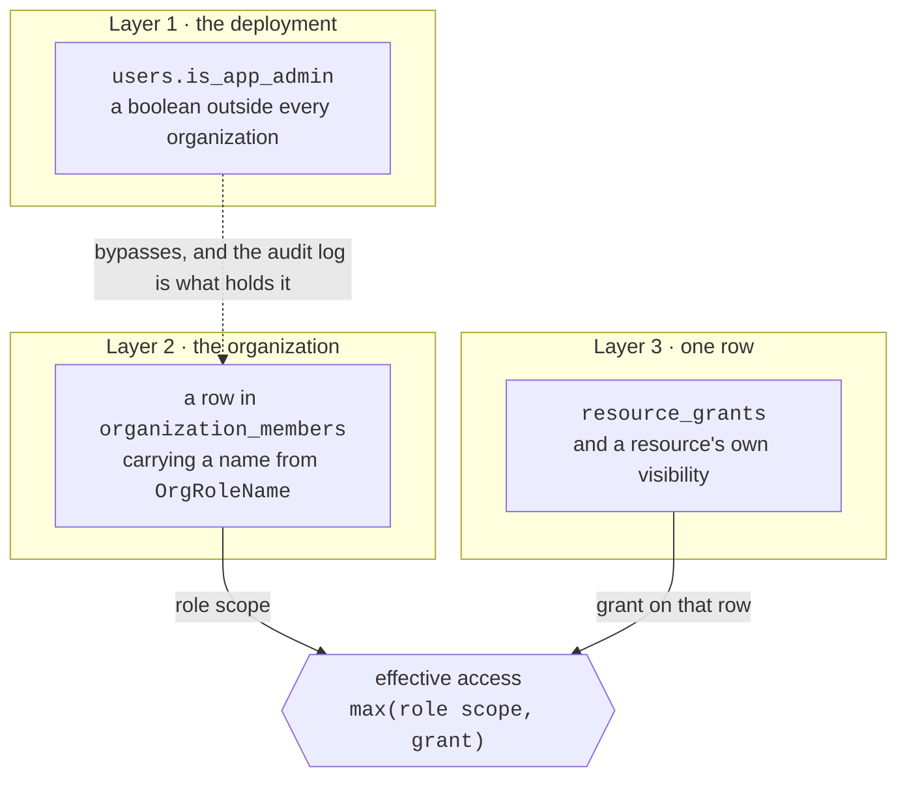
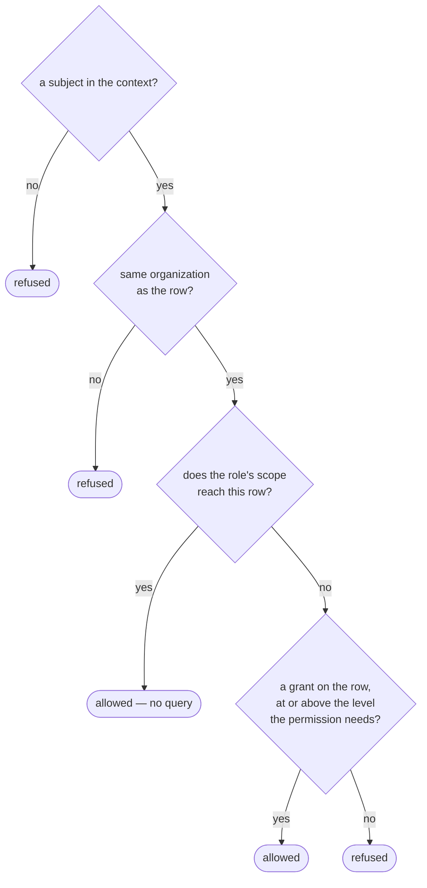

# Разрешения { #permissions }

Одно правило, которому следует вся кодовая база:

!!! quote "Разрешения определены в коде. Роли составляются из них."

    Места вызова проверяют **разрешения**, а не имена ролей — поэтому добавление
    или перекройка роли никогда не означает правку эндпоинта.

Каталог — [`app/core/permissions.py`](reference/permissions.md). Это единственный
источник истины, и эта страница его объясняет.

!!! warning "Слоёв три, и они независимы"

    Они не образуют иерархию, и ни один не подразумевает другой. Большая часть
    путаницы с доступом на этой платформе — от предположения об обратном.

    Раньше был и четвёртый — столбец `users.role` со значениями `admin` | `user`,
    унаследованный от шаблона проекта, за которым стояли `User.has_role()`,
    `RoleChecker` и псевдоним `CurrentAdmin`. Его убрали до того, как цепочку
    миграций свели в одну. Это был третий ответ на вопрос, на который два нижних
    уже отвечали, и ни с одним из них он не согласовывался: учётная запись
    `admin@example.com` сидела на `role = 'user'`, что читается как сломанный
    экземпляр и отправляло людей чинить не тот слой.

    Он был не совсем бездейственным — поэтому его удаление стало изменением
    поведения: `GET /conversations/{id}` и соседний `/messages` снимали фильтр
    владельца для всех, у кого в `role` стояло `admin`. Межпользовательского
    *чтения* диалогов теперь нет нигде: просмотр диалогов по всему экземпляру
    убрали в пользу «Активности», а `/admin/conversations?user_id=` перечисляет
    диалоги одной учётной записи, не открывая ни одного из них.



## Слой 1: `users.is_app_admin` — администратор платформы { #layer-1-usersis_app_admin-the-deployment-superadmin }

Логическое поле у пользователя, полностью вне организаций. Два следствия:

1. **Проверка на маршрутах экземпляра.** `CurrentAppAdmin` охраняет `/admin/users`,
   `/admin/stats`, `/admin/conversations` (список, а не транскрипт),
   `/admin/ratings`, `/admin/announcements`, `/admin/notifications/deliveries` и
   массовые эндпоинты `/rag`. Объявления находятся здесь, а не за `Perm`, потому
   что каждая запись каталога разрешений относится к одной организации, и
   ни одна не выражает «все организации» ([Управление](governance.md#alerts)).
2. **Обход в `AuthContext.permissions`**, который возвращает каждое разрешение с
   `Scope.ALL` — в каждой организации, где такой пользователь состоит. Он не
   достаёт до организации, где членства нет: активная организация разрешается
   раньше, чем читается любое разрешение, а это отклоняет не-участника, включая
   администратора платформы.

Обход намеренный, и в docstring сказано почему: такой человек администрирует
экземпляр и уже имеет доступ к базе данных, поэтому делать вид, что это не так,
было бы имитацией безопасности. Держит его в рамках журнал аудита.

```bash
# Grant, or revoke with --revoke.
agenticos cmd create-app-admin someone@example.com
```

`agenticos cmd bootstrap` тоже выдаёт его — идемпотентно — владельцу, которого создаёт.

!!! note "Свежий клон, старая база данных"

    Если `/admin` отклоняется для учётной записи, созданной bootstrap, база данных
    почти наверняка была инициализирована до того, как это разрешение появилось.
    Столбец по умолчанию равен `false`, и ничто не заполняет его задним числом.
    Запустите `create-app-admin`, как показано выше.

## Слой 2: роль в организации { #layer-2-the-organization-role }

Строка в `organization_members` — одна на организацию на пользователя — со
значением из `OrgRoleName`. Здесь принимается подавляющее большинство решений.

Разрешения бывают двух видов, и ведут они себя по-разному.

**Глобальные** разрешения бинарны и действуют на всю организацию: `members:view`, `members:manage`, `roles:manage`,
`org:settings`, `org:delete`, `budgets:manage`, `approvals:decide`,
`promotions:override`, `connections:view`, `connections:manage`, `channels:manage`,
`runs:view`, `audit:read`, `ml:invoke`, `api_keys:create`, `api_keys:manage`, `personal:consent`, `mcp:personal:use`.

Явная область `mcp:personal:use` позволяет внешним запускам через API или OAuth
использовать личные подключения MCP того, кто выпустил учётные данные. Выберите
её в разделе **Свой набор** (Custom) и подтвердите такое делегирование; ни один
набор, включая **Полный доступ** (Full access), её не содержит, а существующие
учётные данные сохраняют доступ только в пределах организации. Она не даёт ни
личной памяти, ни поиска по диалогам, ни согласия на автоматизации. Продолжения
после согласования сохраняют прежнего владельца и учётные данные; подключённые
учётные записи, действующие области ключа и доступ к корневому и обнаруженным
агентам-исполнителям перепроверяются перед вызовами личных инструментов.

Одобрение личных автоматизаций и наблюдений требует явной области
`personal:consent`, выбранной в разделе **Свой набор** (Custom) при выдаче ключа
или авторизации MCP-клиента. Она исключена из каждого набора, включая **Полный
доступ** (Full access). Подтверждение позволяет учётным данным одобрять постоянные
автоматизации и наблюдения, используя ваши личные подключения и данные; обычные
области `agents:run` и `runs:view` этого не делают. Существующие ключи и
авторизации MCP не получают личного согласия автоматически.

`promotions:override` переводит версию в
[окружение, которое охраняют её наборы проверок](environments.md#guarding-a-promotion-with-evals),
хотя они на нём не пройдены, и меняет, какие наборы его охраняют. Его держат Owner
и Admin; сам перевод в любом случае требует `agents:publish` на агенте.

`api_keys:create` позволяет участнику выпускать [API-ключи](api.md#organization-api-keys)
для себя; `api_keys:manage` перечисляет и отзывает ключи всех. Ключ хранит
подмножество этих разрешений — никогда больше того, что есть у выпустившего его
сейчас.

!!! example "Почему `ml:invoke` — не `agents:run`"

    [ML-сервисы](ml-services.md) вызываются другим компонентом с ключом, без
    диалога и без агента. Сложить их в `agents:run` значило бы заодно дать каждой
    такой интеграции право тратить бюджет организации на модели — только потому,
    что и то и другое «просит платформу выполнить работу».

    Его держат все роли, кроме `viewer`, потому что чтение структуры документа —
    не привилегированное действие, а трата денег на модель — да.

!!! example "Почему `connections:view` и `connections:manage` — два разрешения"

    Наблюдение за хостом песочницы — его списком сеансов, журналом активности,
    потолками памяти и CPU, которые применяет его служба, — это то, что отвечает
    на вопрос «почему этот агент только что получил 429», вопрос, из-за которого
    оператора вызывают.

    Регистрация хоста, указание ему адреса и привязка секрета хранилища, дающего
    право запускать там контейнеры, — другое полномочие.

    Сложенные в одно, они означали бы, что оператор получает чтение, только если
    ему заодно выдали создание, изменение и удаление. Здесь ни одно разрешение не
    подразумевает другое, поэтому роль, которая управляет подключениями, держит
    оба.

    `connections:manage` также редактирует профили моделей, а правка переносит
    каждого агента на профиле, включая агентов, которых редактор редактировать не
    может: со следующего запуска запросы идут на новый эндпоинт. Ключ при этом
    остаётся защищённым. Установка ключа профиля или перенос эндпоинта профиля, у
    которого ключ есть, требует `secrets:view` на этот ключ
    ([Модели](models.md#changing-a-profiles-key-or-endpoint)).

    `connections:manage` ещё и перечисляет интеграции синхронизации организации:
    источники каждой базы, с их конфигурацией, секретом хранилища, который каждый
    использует, и последней ошибкой, а также непривязанные. `/org/integrations` и
    `GET /rag/sync/sources` возвращают этот список, а запрос, которым мастер базы
    знаний предлагает переиспользовать один из них (`GET /kb/{kb_id}/sync-sources/org-integrations`),
    возвращает его без базы, на которой мастер открыт. Чтение одной базы или
    выданный доступ на неё этот список не открывает. Без разрешения
    `GET /rag/sync/sources` перечисляет только источники, питающие базу, которую
    вызывающий читает, а мастер не показывает предложение.

**Ресурсные** разрешения несут `Scope`, потому что отвечают на второй вопрос, на
который роль ответить не может: не «может ли эта роль трогать агентов?», а *каких*
агентов.

`mcp:manage` — одно из них: MCP-сервер организации можно сузить до групп или
людей, как навык ([Отделы](departments.md#a-departments-mcp-servers)). Роль,
держащая его на `SHARED`, видит серверы организации, свои и те, что с ней
поделились; `ALL` видит все.

### Область действия { #scope }

Упорядочены: `NONE < OWN < SHARED < TEAM < ALL`.

| Область | Достаёт до |
| --- | --- |
| `NONE` | ничего |
| `OWN` | строк, которыми владеет этот человек |
| `SHARED` | своих строк плюс всего видимого организации |
| `TEAM` | своих строк плюс видимого команде и организации |
| `ALL` | каждой строки в организации |

!!! info "Почему операторы сравнения перегружены"

    `Scope` наследует `str`, поэтому без них Python сравнивал бы значения по
    алфавиту — `all < none < own`, противоположность их смыслу. Смешанные
    сравнения выбрасывают `TypeError`, а не возвращают молча неверный ответ:
    неверный ответ в проверке авторизации хуже громкого.

`TEAM` сегодня не использует ни одна встроенная роль; она существует для
пользовательских ролей.

### Встроенные роли { #the-built-in-roles }

| Роль | Суть | Агенты | Секреты | Глобальные |
| --- | --- | --- | --- | --- |
| `owner` | владеет организацией | все `ALL` | `ALL` | всё, включая `org:delete` |
| `admin` | ведёт её изо дня в день | все `ALL` | `ALL` | всё, **кроме** `org:delete` |
| `builder` | создаёт и учится у всей организации | `view`/`run` `ALL`, `edit`/`publish` `SHARED` | `view` `SHARED`, `edit` `OWN` | `mcp:manage` `SHARED`, `connections:view`+`connections:manage`, `runs:view`, `ml:invoke`, `api_keys:create`, `members:view` |
| `operator` | держит работающую систему в порядке | `view`/`run` `ALL`, без редактирования | `view` `SHARED` | `approvals:decide`, `connections:view`, `runs:view`, `ml:invoke`, `api_keys:create`, `members:view` |
| `member` | обычный пользователь | `view`/`run` `SHARED`, `edit` `OWN` | `view` `SHARED`, `edit` `OWN` | `ml:invoke`, `api_keys:create`, `members:view` |
| `viewer` | читает | `view` `SHARED` | ничего | `members:view` |

Различие `builder` / `admin` — самое интересное: builder видит всю организацию,
чтобы учиться у неё, но редактирует только своё или то, чем с ним поделились, —
поэтому один builder не может переписать агента другого.

Роли не редактируются пользователем, и ничто их не засевает: таблицы ролей нет.
Роль — это строковое значение в строке членства, а её смысл задаёт `ROLE_PERMS` в коде,
поэтому добавление роли — правка там, а не миграция; в этом и смысл составления
ролей из разрешений.

У столбца нет ограничения CHECK, в отличие от `resource_grants.level`. Выдуманную
роль не пускает валидатор схем участника и приглашения, а если бы она всё же
прошла, неизвестная роль даёт пустой набор разрешений, а не чужой.

### Кто какую роль может выдать { #who-may-hand-out-which-role }

Наличие `roles:manage` говорит, что участник может менять роли; оно не говорит,
*какие*. На это отвечает `assignable_roles` по каталогу: роль может назначить ту,
чьи полномочия она строго превышает, — каждое разрешение предлагаемой роли
назначающий держит как минимум в такой же широкой области, и вдобавок у него есть
что-то, чего у неё нет. Два следствия, и оба — суть:

- **Никто не назначает `owner`**, потому что никакая роль его не превосходит.
  Владение переходит через `POST /orgs/{id}/transfer-ownership`, который в том же
  действии понижает прежнего владельца; смена роли, которая только повышает,
  оставила бы двух владельцев и запись аудита `member.role_changed` (#672).
- **Никто не назначает свой собственный уровень.** Admin может сделать Builder
  или Viewer, но никогда второго Admin: повышение коллеги до своего уровня —
  решение о владении.

Это выводится из каталога, а не из имени роли, поэтому пользовательская роль (этап 2)
ограничена тем, что она действительно держит. Потолок, который это заменило,
сравнивался с литералом `"admin"` и вообще не видел пользовательскую роль — как на
путях приглашения, так и в `change_role`; именно это закрыл #696.

!!! warning "Организация страницы — та, что в её URL"

    `X-Organization-Id` идёт с каждым запросом из *активного* выбора, поэтому
    страница, действующая с организацией из своего пути и читающая разрешения для
    активной, определяет доступ к участникам Acme по роли вызывающего в Globex.

Список организаций открывает `/orgs/{id}/members`, не переключаясь, поэтому раньше
на этой странице жили два представления о том, «какая организация».

Теперь оно одно. `ActiveOrgGuard` на странице «Обзор» принимает организацию,
которую называет путь, прежде чем страница что-либо спросит, поэтому то, что
вызывающий может делать там, — это то, что он может делать *там* (#1032).

**Приглашение — это ссылка, и отправитель всегда получает её копию.**

Диалог приглашения показывает ссылку один раз, после отправки, с кнопкой
копирования — и сообщает, ушло ли на самом деле письмо, которое её несёт. Это два
факта, а не один: экземпляр без настроенных `SMTP_*` не отправляет почту никому, а
это любой экземпляр в первый день, и раньше диалог всё равно говорил «приглашение
отправлено».

Ссылка показывается один раз, потому что это Bearer-токен:
ничто её не кэширует, ни один список её не содержит, и ни один последующий запрос её
не возвращает. Поэтому закрытие диалога — это момент, когда она пропала:
приглашение остаётся ожидающим и его можно отозвать, но новая ссылка означает новое
приглашение.

**Консоль вычисляет то же отношение сама, а не получает его готовым.**

Каждый выбор роли — два диалога приглашения и таблица участников — предлагает то,
что отвечает `assignableRoles` из `frontend/src/lib/assignable-roles.ts`, по
каталогу ролей, который `GET /roles/catalog` уже возвращает вместе с разрешениями
каждой роли.

Это арифметика на клиенте по той же причине, по которой она есть на сервере:
выбор, державший *список*, предлагал все роли, кроме `owner`, кому угодно, поэтому
Admin получал в предложении Admin и отказ после ввода адреса почты (#1028).

Роль, которую вызывающий не может назначить, — это ещё и роль, для которой таблица
участников не нарисует выбор: триггер показывает текст выбранного элемента, а
значение, отсутствующее в списке, отрисовывается пустым.

Пользовательские роли — этап 2, и они могут лишь перекомбинировать перечисленные
выше разрешения; клиенты не могут изобретать новые.

## Слой 3: видимость и выданные доступы { #layer-3-visibility-and-grants }

У каждого ресурса, которым можно поделиться, есть `owner_user_id` и `visibility`
(`private` | `team` | `org`). Поверх этого `resource_grants` хранит по строке на
каждый общий доступ: один ресурс, один человек или одна
[группа](directory.md#groups), один уровень.

**Новый агент получает `org`, если автор не сказал иначе**, и диалог создания
спрашивает об этом. Агент — то, что строит компания, поэтому компания может его
найти; приватный — исключение, для того, над чем кто-то ещё работает. Раньше правилом
было обратное: каждый агент делался невидимым и потом делился вручную, — и второму
человеку, который шёл его искать, говорили, что его не существует. Черновик не
может запускаться, и ни один способ доступа до него не достаёт в любом случае,
поэтому здесь решается, кто его видит, а не что он делает.

| Уровень | Что позволяет |
| --- | --- |
| `read` | видеть конфигурацию |
| `use` | ещё и запускать его или привязывать |
| `edit` | ещё и менять его |
| `edit_data` | ещё и менять, какие данные показывает страница — [только для страниц](#a-page-that-reads-data) |

В консоли это один диалог, как при общем доступе к документу: кнопка **Поделиться**
(Share) у агента, навыка, базы знаний или файла контекста — в любой момент после
создания, а не только при создании — добавляет человека или группу с уровнем,
перечисляет, у кого есть доступ, начиная с владельца, и задаёт **Общий доступ**
(General access): *Только люди с доступом* — это `private`, *Все в организации* —
`org`.

Выданный группе доступ достаётся тому, кто состоит в группе в момент проверки
доступа, поэтому вступление в группу — это получение доступа, а выход — его потеря.
Человек, у которого на одну строку несколько выданных доступов — свой и от его
групп, — получает наивысший из них. База данных хранит доступ ровно к одному
субъекту, человеку или группе, и группа из другой организации здесь не достаёт ни
до кого, даже если строка её назвала.

Таблица намеренно общая: `resource_type` + `resource_id`, без внешнего ключа на
цель, — потому что агенты, коллекции, навыки, файлы контекста,
[таблицы](virtual-tables.md), сценарии и сохранённые ключи подчиняются одним
правилам. Цена этого — база данных не может каскадно удалить доступ вместе с его
целью, поэтому сервисы удаляют доступы вместе с ресурсом.

## Как слои сочетаются { #how-the-layers-combine }

Одна формула, в `app/services/access.py`:

```
effective access to one row = max(role scope, grant on that row)
```

«Выданный доступ на эту строку» — лучший из собственного доступа человека и
доступов его групп.

!!! danger "Выданный доступ расширяет то, что позволяет роль; он никогда его не сужает"

    Поделиться одним агентом с Viewer можно, не повышая его, а обзор Builder по
    всей организации не отнимается отсутствием выданного доступа.

`resolve_access` по порядку:



Принадлежность к организации проверяется прежде всего остального, а контекст без
субъекта отклоняется, что бы ни говорила его роль.

### Способ доступа, перед которым никого нет { #a-surface-with-nobody-in-front-of-it }

`publisher_context` отвечает на другой вопрос в том же модуле: **какую роль берёт
ход диалога, когда человека нельзя назвать?** Виджет на чьём-то сайте, размещённая
страница за ссылкой, агент, привязанный к каналу Slack, — посетитель анонимен или
это учётная запись чата без пользователя платформы за ней, а запуску всё равно
нужен субъект, потому что именно роль определяет, до чего агент может достать.

Ответ — **тот, кто опубликовал этот способ доступа**, и запасной вариант — то, что
стоит знать: `viewer`, когда этот человек больше не участник, `viewer`, когда его
учётную запись деактивировали, и `viewer`, когда опубликовавшего вообще не
записали. Уход не должен молча *расширять* то, до чего достаёт публичный способ
доступа, а виджет на сайте клиента переживает того, кто его вставил.

Деактивация считается, потому что строка членства её переживает. Деактивированному
отказывают на каждом пути, через который человек входит, поэтому роль, прочитанная
только из членства, оставляла виджет, размещённую страницу и привязку канала
деактивированного Owner отвечающими с полными полномочиями: учётная запись, которая
не может войти, всё ещё тратит бюджет организации. Это одно соединённое чтение
(`member_repo.get_active`), а не два, потому что на него отвечают на каждом ходе
публичного способа доступа.

Кто **спросил**, передаётся отдельно: `channel_identity_id`, учётная запись чата,
которая говорила. Слить их значило бы, что запуск из канала заявляет полномочия
отправителя, которых у непривязанного отправителя как раз нет.

Одна функция, а не по одной на каждый способ доступа, с #640: её написали дважды —
против `agent_embeds.owner_user_id` и `agent_exposures.created_by_user_id`, — а две
копии решения об авторизации означают, что исправят только одну.

### Списки { #listings }

`visible_resource_ids` отвечает на тот же вопрос для списка, и у неё есть одна
ловушка, которую стоит знать: она возвращает `None`, когда роль уже достаёт до
всего («фильтрация не нужна»), и **пустой список** для контекста без субъекта. Это
противоположности, поэтому путать их значило бы расширить список до всей
организации ровно в тот момент, когда его нужно сузить до ничего.

`accessible_ids` — пакетный аналог `resolve_access`: получив уже загруженную
страницу строк, она возвращает подмножество, на котором вызывающий может применить
разрешение, по тому же правилу `max(role scope, grant)` для каждой строки, но
читая все доступы одним запросом, а не по одному на строку (и ни одного, когда роль
достаёт до всего).

`accessible_ids` заполняет построчные флаги возможностей списка —
`AgentRead.can_run` (минимум для предложения «новый триггер» на карточке),
`AgentRead.can_edit`, который консоль читает для элементов редактирования на
странице агента, тестирования черновика и остановки запуска оценки, и
`AgentRead.can_publish` для публикации, — поэтому Viewer, которому выдали запуск
одного агента, видит элемент управления там и больше нигде.

Контекст без субъекта и пустой вход разрешаются в пустое множество до любого
запроса.

Списки файлов контекста, навыков и хранилища секретов несут `can_edit` для каждого
ресурса. Консоль использует этот действующий доступ для редактирования, удаления и
общего доступа, а также для ротации ключа. Viewer с выданным доступом на
редактирование получает эти элементы управления; Builder, у которого есть только
чтение чужого приватного ресурса, — нет. Создание коллекции по-прежнему использует
разрешение роли. Сервер проверяет доступ заново при каждой записи.

Списки агентов, навыков и баз знаний принимают ещё `?shared_with_me=true`: только
строки, которыми с вызывающим намеренно поделились, — видимые организации или явно
выданные, и никогда его собственные. Сужение применяется при любой области роли, и
здесь нужна одна забота: роль, достающая до всего, никогда не ищет свои доступы для
обычного списка, поэтому фильтр всё равно их подтягивает, — без этого «со мной
поделились» у Builder выродилось бы в «вся организация минус моё». Для баз знаний
он ещё исключает личные строки (по построению принадлежащие вызывающему) и строки
области «Для всего приложения» (принадлежащие экземпляру — с ними никогда ни с кем
не делятся).

### Запуски сценариев { #workflow-runs }

У запуска нет собственной видимости: он наследует видимость сценария. Начать запуск
требует `workflows:run` на сценарии, а `test`-запуск неопубликованного черновика
требует ещё и `workflows:edit`. Чтение запуска и его событий требует
`workflows:view`, а нефильтрованный список показывает запуски сценариев, которые
вызывающий видит: свои, видимые организации и те, которыми с ним поделились. Запуск,
которого вызывающий не видит, отвечает точно так же, как несуществующий.

**Отменять может меньше людей, чем запускать.** Тот, кто начал запуск, может
отменить его, пока ещё может запускать сценарий, а любой, кто может редактировать
сценарий, может отменить любой его запуск. Member, который может запускать сценарий,
видимый организации, может остановить свои запуски, но не запуски коллеги; увидеть
запуск, не имея ни того ни другого права, — отказ с `403`. Повтор отменённого
запуска требует того же права, поэтому запуск, который кто-то остановил, не запустит
снова участник, который не мог его остановить.

**Запуск действует от имени того, кто его начал, и это проверяется снова на каждом
узле.** Узел может быть отправлен на выполнение спустя дни после начала запуска,
поэтому каждая отправка требует, чтобы учётная запись была по-прежнему активна,
по-прежнему состояла в организации — администратор платформы включительно, как и в
любом запросе — и по-прежнему имела `workflows:run` на сценарии, а для
`test`-запуска ещё и `workflows:edit`. Когда что-то из этого изменилось, запуск
завершается ошибкой `PRINCIPAL_REVOKED` до того, как сработает обработчик узла. Запуску
нужен человек, от имени которого действовать, поэтому контекст без субъекта не может
его начать.

## Страница, которая читает данные { #a-page-that-reads-data }

Опубликованная [страница, привязанная к данным таблицы](artifacts.md#live-data), —
единственное место, где человек читает таблицу **чужими полномочиями**. Каждому
зрителю записи страницы отдаются через запросы страницы, прочитанные с доступом её
**владельца**, какими бы ни были собственная роль зрителя или выданные ему доступы на
таблицу. Так что слои выше решают, кто может открыть страницу, а дальнейший набор
правил решает, кто может этот круг расширить.

**За каждую загрузку отвечает доступ владельца.** Владелец страницы должен быть
активным участником и держать `read` на каждой таблице, до которой доходят запросы,
при каждой отдаче; иначе данные `unavailable` (`creator_gone`,
`creator_lost_access`). Публикующего тоже обязывают читать каждую таблицу — при
публикации, — чтобы никто не привязывал то, чего не может прочитать.

**Данные открывает согласие владельца.** Согласие делиться данными версии даётся
владельцем на каждую версию, от собственного имени (не в режиме входа от имени
другого пользователя, не через API-ключ и никогда через инструмент агента) и
хранится вместе с членством владельца. Owner или Admin — `artifacts:edit` с областью
`ALL` — может подтвердить за владельца, и это так и записывается в аудит. Выданного
доступа на редактирование страницы недостаточно. Любой редактор может согласие
отозвать, потому что отзыв только сужает; он ещё и понижает каждый выданный доступ
`edit_data` на странице до `edit`.

**`edit_data` — уровень выданного доступа, а не роль.** «Может редактировать,
включая данные» стоит выше `edit` и принимается только для страниц (ограничение
базы данных отклоняет его в других местах). Это постоянное согласие на повторные
публикации того человека или той группы. Дать или повысить его может только
владелец, или Owner или Admin, от своего имени, после подтверждения того, что оно
разрешает. Любой, кто может редактировать, понижает его. Оно читается как уровень
выданного доступа (`grant_level`) и никогда через `resolve_access`, и никакая
область роли его не подразумевает.

**Владельца меняют, но никогда не присваивают.** Владелец, или Owner или Admin для
любой страницы, передаёт её активному участнику от своего имени; выданный доступ на
редактирование этого не позволяет. Смена аннулирует каждое согласие, понижает
выданные доступы `edit_data` до `edit` и выключает автоматическое согласие. Забрать
страницу без владельца, сделав её приватной, — то же действие и то же правило.

**Расширение под охраной.** Перед общими маршрутами совместного доступа стоит страж для
страниц, читающих данные: более широкая видимость, новый выданный доступ или более
высокий уровень — это решение владельца, а за него Owner или Admin, после того как
данные подтверждены. Любой другой с `edit` получает
[запрос](artifacts.md#share-requests) вместо отказа. Сужать может любой редактор, а
страница, которая не читает данные, сохраняет общие правила. Администраторы
действуют напрямую, а не подают запрос. Три разрешения, которые использует
страница, — `artifacts:view`, `artifacts:edit` и, для таблиц, `tables:view`; Owner,
Admin, Builder и Operator держат первое и последнее с областью `ALL`, поэтому они
входят в аудиторию каждой страницы.

## Куда ставить проверки { #where-the-gates-go }

!!! danger "`require(...)` ставится на маршрутах коллекций, а не на маршрутах одного ресурса"

    Перечисление, создание и чтение каталога несут ролевую проверку. Всё, что
    действует с *одним* агентом, навыком или коллекцией, не должно её нести.

    Ролевая проверка не видит выданные доступы на строке, поэтому она отклонила бы
    Viewer с явно выданным доступом `edit` прежде, чем `resolve_access` вообще
    расширил бы его доступ, — а это противоречит правилу «выданный доступ
    расширяет то, что позволяет роль». Маршруты одного ресурса передают решение
    сервису, который вызывает `resolve_access`.

    `tests/api/test_platform_routes.py` проверяет обе половины.

Есть и третье место — для маршрута, у которого вопрос решает **параметр**.

`GET /stats/usage` и `GET /ratings/summary` обслуживают двух спрашивающих по одному
пути. `scope=org` читает строки всех и требует `runs:view`; `scope=own` читает
только свои строки вызывающего и не требует ничего, кроме действующего членства
вошедшего пользователя.

`require(runs:view)` на уровне маршрута отклонил бы `scope=own` участника прежде,
чем параметр был бы вообще прочитан. Поэтому маршрут не несёт проверки, а решение
принимает `StatsService` — тот же принцип, что у маршрутов одного ресурса: решает
слой, который видит решающий факт, только факт здесь — параметр области действия, а
не выданный доступ на строку.

Обход маршрутов распознаёт такой сервис так же, как распознаёт сервисы, учитывающие
выданные доступы, а
`tests/api/test_platform_routes.py::TestStatsScopeIsDecidedInTheService` доказывает
отказы.

!!! warning "`?group_by=user` отвечает именами, адресами почты и тем, сколько стоили запуски каждого"

    Это то же правило области действия и никакого дополнительного разрешения:
    раскрывает его `runs:view`, а значит, **builder и operator видят его** наравне
    с owner и admin.

    Это намеренное решение, а не недосмотр. Карточка обзора, несущая эти строки,
    говорит об этом в собственном тексте, потому что разрешение шире, чем ожидают
    его субъекты, оправдано, только если они могут об этом узнать. Более узкий
    ответ был бы отдельным разрешением, а не более тихим маршрутом.

### Системный агент — это настройка организации { #system-agents }

[Системный агент](concepts.md#system-agents) — судья, генератор кейсов, составитель
или классификатор пробелов в знаниях, помощник по редактированию — оценивает,
составляет или предлагает за всех, кто пользуется тем, чему он служит. Поэтому
изменение такого агента требует `org:settings` поверх `agents:edit` или
`agents:publish` на строке: его черновик, импорт YAML, публикация, восстановление,
архивирование или удаление, его окружения. Иначе Builder доставал бы до встроенных
агентов через их видимость для всей организации. Чтение, запуск и создание такого
агента сохраняют обычные разрешения; судья, которого Builder делает для набора
данных, публикуется сразу, а последующие изменения требуют администратора.

Проверка живёт в `AgentRegistryService.get`, поэтому её держит каждый путь записи, а
`can_edit`/`can_publish` возвращают ложь для вызывающего без неё.

## Делегирование — не граница привилегий { #delegation-is-not-a-privilege-boundary }

Агент может [поручить работу другому агенту](concepts.md#delegate-vs-inline-specialist),
и модель авторизации здесь та же, которой уже следуют коллекции и подключения MCP:
**ссылка проверяется один раз, при публикации родителя, а затем агент-исполнитель
работает для всех, кто может запустить родителя.**

Конкретно: публикация агента, называющего агента-исполнителя, требует, чтобы
публикующий держал `AGENTS_RUN` на строке этого исполнителя — через
`resolve_access`, поэтому явно выданный доступ считается, и Viewer, с которым
поделились одним агентом, может закрепить его как исполнителя. Во время выполнения
ничего не перепроверяется: делегирование действует от имени того же пользователя, в
той же организации, с собственными опубликованными возможностями исполнителя.

Это намеренно, и альтернатива хуже. Перепроверка для каждого вызывающего сделала бы
один опубликованный агент работающим для одного коллеги и не работающим для другого
на той же версии, причём разница нигде не была бы видна, — и значила бы, что ответ
агента поддержки зависит от того, к каким из его исполнителей *спрашивающему*
случайно выдали доступ. Одолжить исполнителя — значит одолжить то, что держишь сам,
ровно как привязать коллекцию.

!!! note "Отказ гласит «Agent not found»"

    Отсутствующая строка, строка другой организации и строка, которую этот
    публикующий не может запустить, сообщаются одинаково и намеренно. Отказ,
    различающий их, составлял бы карту приватных агентов организации одну догадку
    за другой.

    Закреплённая *версия* проверяется на принадлежность названному агенту, а не
    просто на существование: идентификатор версии другого агента — это
    межорганизационное чтение под видом правдоподобного UUID.

Встроенный специалист проходит те же проверки, что и собственные привязки родителя:
области возможностей, владение секретами, доступ к коллекциям,
[доступ к навыкам](skills.md#access) и профиль модели, если он его называет, —
каждая сообщается с именем специалиста, чтобы форма Builder могла указать на нужное
поле. Специалист — соблазнительное место, чтобы протащить коллекцию, которой ни с
кем не делились, именно потому, что никто не думает о нём как об агенте.

Переключатель для всего экземпляра отдельный, и это область возможности, а не
разрешение: `agents:delegate`. Он отвечает на вопрос «могут ли агенты вообще
вызывать агентов в этом экземпляре», на который не ответит никакая построчная
проверка. См. [Области](reference/capabilities.md#scopes).

## Контексты без субъекта { #contexts-with-no-subject }

`AuthContext.user_id` необязателен, и это утверждение, а не удобство. У каждого
запуска на этой платформе есть субъект: на нём завязаны бюджеты, выданные доступы,
аудит и согласование.

- `AuthContext.anonymous()` — единственный конструктор такого контекста, поэтому
  «откуда может взяться контекст без субъекта» — это `grep`, а не аудит.
- Его роль — строка `"anonymous"`, намеренно не член `OrgRoleName` и не ключ
  `ROLE_PERMS`, поэтому она никогда не подхватит разрешения из более поздней правки
  ни того, ни другого.
- `.permissions` возвращает `{}`, когда субъекта нет, — проверяется субъект, а не
  строка роли, потому что иначе контекст без субъекта, собранный с `"owner"`,
  доставал бы до каждой строки в организации.
- `.subject_id` выбрасывает `AuthorizationError`, а не возвращает `None`:
  аутентифицированный путь, дошедший досюда, имеет человека, а пропуск отсутствия
  дальше пишет запись, не называющую никого, — неотличимую от двух мест, которые
  вправе так писать, и к тому моменту запрос уже наполовину произошёл. Вызывающий, у
  которого сеанса нет вовсе, читает `.user_id` и говорит об этом.

Способы доступа, открытые людям, которых этот экземпляр не может назвать, этого
конструктора не используют. Размещённая страница, виджет и канал ведут ход диалога от
имени того, кто их *опубликовал*, — владельца встраивания или привязки, поставившей
агента на бота, — с запасным вариантом `viewer`, когда этот человек ушёл из
организации или его учётную запись деактивировали, чтобы ни то ни другое не могло
молча расширить, до чего достаёт публичный способ доступа. Субъект поэтому
настоящий, и это не тот, кто набрал сообщение.

Отправитель из канала, который *привязал* учётную запись участника, работает от
имени этого участника — и то же соединённое чтение решает, остаётся ли он им.
Деактивация оставляет на месте и строку членства, и привязку учётной записи чата,
поэтому роль, прочитанная только из членства, оставляла выведенного из организации
Owner ведущим ходы из Slack как Owner. Деактивированного или ушедшего отправителя
вместо этого считают непривязанным: в личном сообщении отказывают, в комнате
работают от имени привязки.

`AuthContext.channel_identity_id` — это тот, кто набрал сообщение, когда это учётная
запись чата, а не участник. Он не несёт полномочий — ни одно разрешение его не
читает — и существует, чтобы ход из канала был атрибутирован: он проставляется на
`agent_runs`, а привязка этой учётной записи чата позже приписывает эти запуски
человеку, не переписывая, от чьего имени они шли. См.
[Каналы](channels.md#what-every-channel-shares).

Что такому запуску разрешено делать, задаёт **способ доступа**, через который он
пришёл, созданный кем-то, у кого роль была.

## Что читает фронтенд { #what-the-frontend-reads }

| Эндпоинт | Что отвечает |
| --- | --- |
| `GET /me/permissions` | роль вызывающего, `is_app_admin` и каждое разрешение с его областью действия |
| `GET /roles/catalog` | весь каталог и то, что собирает каждая роль |

Оба — **удобство для интерфейса и ничего больше**. Сервер перепроверяет каждое
разрешение на эндпоинте, который выполняет действие, поэтому клиент, игнорирующий
эти API, ничего не выигрывает.

## Итоги { #recap }

- **Три слоя, независимых.** Флаг администратора платформы, роль в организации и
  выданный доступ на одну строку. Ни один не подразумевает другой.
- Роль — это **строковое значение в строке членства**, а её смысл задаёт `ROLE_PERMS` в коде.
  Добавление роли — правка, а не миграция.
- Действующий доступ к одной строке — `max(role scope, grant)`. **Выданный доступ
  расширяет; он никогда не сужает.**
- `require(...)` ставится на маршрутах **коллекций**. Всё, что действует с одной
  строкой, передаёт решение сервису, который вызывает `resolve_access`.
- Страница, читающая данные таблицы, читается с доступом **владельца** и
  открывается только по согласию владельца; расширяет её владелец, а любой другой
  подаёт запрос.
- Способ доступа, перед которым никого нет, работает от имени **того, кто его
  опубликовал**, с запасным `viewer`, когда этот человек ушёл или был деактивирован.

## Справочник { #reference }

::: app.core.permissions.Perm

::: app.core.permissions.Scope

::: app.core.permissions.AuthContext

Администрирование экземпляра через MCP требует действующего флага администратора
платформы и отдельно одобренной области OAuth `deployment:admin`. Это не `Perm`, не
разрешение роли и не набор. Одно администрирование организации его не даёт. Его
получает только явно уполномоченный внешний клиент; внутренние агенты, автоматизации
и обычные API-ключи его никогда не наследуют. Чтобы включить его, авторизуйте
существующие подключения заново. См.
[Администрирование через MCP](mcp.md#administration-through-mcp).
