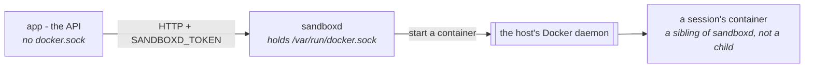

# Песочница { #the-sandbox }

Контейнер, в котором агент может писать файлы и выполнять команды.

Именно так запуск читает электронную таблицу, которую кто-то приложил, строит график,
клонирует репозиторий или хранит заметки между сообщениями.

!!! danger "Это единственная часть платформы, которая выполняет код, написанный не здесь"

    Поэтому эта страница уделяет столько же времени тому, что *ограничивает* песочницу,
    сколько тому, что в ней есть.

Эта страница — полная картина: что где работает, что такое сеанс, какие среды выполнения
агент может запросить и как их менять, что отделяет одну организацию от другой и сколько
всё это живёт.

[Конфигурация](configuration.md#the-services-own-settings) — справочник по каждой
переменной.

Развёртывания на Podman используют [ручной путь через провайдер Docker
Compose](deploy.md#podman-support) с дополнительным переопределением для сокета песочницы
и разрешений рабочего пространства. Быстрый старт поддерживает Docker; `podman-compose` 1.6.0
не поддерживается.

## Что где работает { #what-runs-where }

Три процесса, и само их расположение и есть модель безопасности:



- **Контейнер API не держит сокет Docker.** Именно поэтому `sandboxd` — отдельная служба,
  а не вызов библиотеки: запуск контейнера требует демона, а доступ к демону равносилен
  root на хосте.
- **`sandboxd` держит сокет и просит демон _хоста_** запустить контейнер. Поэтому
  песочница — **сосед** `sandboxd`, а не контейнер внутри него. Здесь нет
  Docker-in-Docker, ничто не запускается с `--privileged`, и вложенный демон не работает.
- Поэтому каталог рабочего пространства монтируется **по одному и тому же пути с обеих
  сторон**: `sandboxd` создаёт его, затем просит демон смонтировать, а демон разрешает
  этот путь на хосте. Именованный том или путь, существующий только внутри контейнера
  `sandboxd`, отклоняется с `mounts denied`.

`sandboxd` — сервер из
[`pydantic-ai-backend`](https://github.com/vstorm-co/pydantic-ai-backend), поставляемый как
`ghcr.io/vstorm-co/sandboxd`; бэкенд общается с ним по HTTP с токеном из
`SANDBOXD_TOKEN`. Остальные бэкенды песочницы — подключения `daytona` и `e2b`, а также
`state` — это размещённые сервисы и документ в Postgres, и ничего из описанного выше их не
касается; равно как и собственный компьютер человека (см. [За пределами sandboxd](#beyond-sandboxd)).

### Служба и бэкенд двигаются вместе { #the-service-and-the-backend-move-together }

Служба и клиент бэкенда берутся из одного выпуска `pydantic-ai-backend`, а клиент вызывает
маршруты, которые обслуживает только его собственный выпуск. Поэтому каждый compose-файл
закрепляет образ ровно на версии из `backend/uv.lock`, а тест бэкенда падает, если
compose-файлы или перечень лицензий называют другую. Поднимайте lock, compose-файлы и
перечень одной правкой. Новое закрепление — это тег, которого у хоста ещё нет, поэтому
`make dev` и `scripts/deploy.sh` скачают его при следующем запуске.

Закрепление живёт в рабочей копии, а не в `AGENTICOS_VERSION`, поэтому хост, который
закрепляет или откатывает бэкенд вручную, тоже переключается на тег этого выпуска
([Закрепить выпуск](deploy.md#the-images)). Установка без рабочей копии, какую создаёт
`scripts/quickstart.sh`, вместо этого скачивает `docker-compose.yml` этого выпуска
([Установка](install.md)).

Подвижный тег уже ломал это раньше (#2484). Закэшированный `sandboxd:0.2` обслуживал
более старый API, чем тот, на котором говорил клиент, и каждая команда падала с
`sandboxd session '…' is
gone`, хотя сеанс был жив. Теперь платформа различает эти два
случая. Когда 404 несёт голый `{"detail":"Not Found"}` от FastAPI, а не собственное
`No such session` службы, она читает индекс службы по `/`. Если в индексе нет маршрута,
нужного клиенту, вызов инструмента падает, и агенту сообщают:

```text
The sandbox service does not serve /sessions/{session_id}/run,
/sessions/{session_id}/runs/{run_id}/stop - its version does not match this
platform (expected <version>). Run ghcr.io/vstorm-co/sandboxd:<version> and
redeploy it
```

Та же проверка обрабатывает `409` при подключении ссылки на сеанс, сохранённой до
обновления: старая служба может отклонить эту ссылку, хотя сеанс ещё существует. Только
подтверждённое отсутствие эндпоинта превращает конфликт в несовпадение версий; обычные
конфликты и недоступные индексы сохраняют свою исходную ошибку.

В сообщении нет адреса службы, который участникам и модели может быть не положено
видеть; бэкенд пишет его в журнал как `sandboxd_version_mismatch`. Сеанс не объявляется
потерянным, но диалог забывает свою сохранённую ссылку на него: старая служба
отказывается подключаться к живому сеансу по ссылке. Следующий ход открывает сеанс по
имени, поэтому после обновления диалог подхватывает тот же сеанс, если служба его
сохранила.

`agenticos cmd doctor` делает ту же проверку по каждому зарегистрированному подключению и
называет образ, который нужно запустить. Разверните заново стек, который запускает
службу: `scripts/deploy.sh` в продакшене (он запускает профиль `sandbox`, когда задан
`SANDBOXD_TOKEN`) и `make dev` на ноутбуке. `make prod` не трогает службу, потому что не
запускает этот профиль; в стеке, запущенном так, скачайте и пересоздайте её сами:

```bash
docker compose --env-file backend/.env -f docker-compose-prod.yml --profile sandbox pull sandboxd
docker compose --env-file backend/.env -f docker-compose-prod.yml --profile sandbox up -d sandboxd
```

!!! danger "Токен равносилен root"

    У кого он есть, тот может запускать контейнеры на этом хосте. Относитесь к нему как к
    сокету Docker, перед которым он стоит.

`make sandbox-token` один раз создаёт его в `backend/.env` и больше не трогает, потому что
при пересоздании служба теряет каждое рабочее пространство, которое держит сейчас. Поэтому
же выключена собственная панель службы (`SANDBOXD_UI_ENABLED: 0`): та страница просит
человека вставить токен в браузер.

## Рабочее пространство нового агента { #a-new-agents-workspace }

Новый агент начинает с рабочего пространства, которое его организация может опубликовать.
Контейнерное рабочее пространство из начального шаблона сохраняется, когда у организации
есть подключение песочницы по умолчанию или когда этот экземпляр запускает `sandboxd`, а у
организации есть владелец, под которым его зарегистрировать, — первая публикация
настраивает это подключение. Иначе агент начинает с сохранённого рабочего пространства
`state`: файлы без оболочки, которым ничего не нужно, поэтому новый агент публикуется в
экземпляре без службы песочницы.

Каталог возможностей, с которого начинает Конструктор, и установка из шаблона спрашивают
это по каждой организации, и ответ хранится минуту. `sandboxd`, который должен отвечать и
не отвечает, записывается в журнал как `sandbox_service_not_answering`, и агент начинает
на `state`. Уже сохранённый агент сохраняет свою спецификацию.

Публикация, отклонённая из-за отсутствия песочницы, предлагает исправление рядом с
причиной. **Переключите рабочее пространство на „Файлы“** (Switch the workspace to Files)
переписывает черновик на рабочее пространство `state`, сохраняет его и проверяет снова.
**Убрать из общего доступа ресурсы, которыми агент не может поделиться** (Stop sharing
what this agent cannot share) делает то же для списка общего доступа для поручений, где
названа возможность, которой у агента больше нет, и убирает оттуда `subagents`, которые
агент-исполнитель никогда не наследует. Ни одна из них не публикует: это остаётся
отдельным нажатием. Коды передаются в `details.fixes` отказа (см.
[архитектура](architecture.md#a-refusal-that-names-a-field)).

## Сеанс и что с ним разделяют { #a-session-and-what-shares-one }

!!! abstract "Один контейнер на сеанс, никогда не один на всех"

    Ключ сеанса учитывает область, организацию, вид бэкенда и хост — и ровно это решает,
    какие запуски делят контейнер и каталог.

Сеанс определяется ключом, который выводит бэкенд, и этот ключ решает, что будет
общим:

```
xc-4f2a91c8-7b3e5d10-9c1f…      backend · scope · organization · host · subject
^^                              `x` a container service, `d` a document; `c` the conversation scope
```

**Область** — поле спецификации агента: `run`, `conversation`, `channel`, `user` или
`agent`. Так `conversation`, обычный выбор, означает один контейнер и один каталог на
чат; `agent` — что все запуски этого агента делят один контейнер.

`user` — собственная область вошедшего человека, поэтому у запуска, который действует
за кого-то другого, её нет: посетителю виджета и срабатыванию триггера отказывают, а не
отдают рабочее пространство издателя или создателя — если только триггер
[не работает от имени своего создателя](concepts.md#unless-its-creator-lets-it-run-as-them).

Ключ — это ещё и **имя** сеанса на хосте — id сеанса `sandboxd`, имя песочницы
Daytona, — поэтому каждый запуск в пределах области открывает сеанс по этому имени:
первый создаёт его, остальные подключаются, в том числе одновременные, и никому не
нужно запоминать собственный id провайдера, чтобы второй запуск его нашёл.

**После того как сеанс открыт, следующий запуск только подключается к нему.** Строка
рабочего пространства запоминает его, когда завершается запуск, открывший сеанс, и
следующий запуск запрашивает у хоста именно этот сеанс, а не имя. Сеанс, чьи файлы
были вычищены — удалены по `SANDBOXD_WORKSPACE_TTL`, потеряны при пересборке хоста, —
тогда сообщается агенту как исчезнувший, а не тихо подменяется пустым, в котором тот
продолжил бы работу. Строка забывает его в конце этого запуска, поэтому следующий ход
начинает новый сеанс.

В ключ входит и то, на каком **виде бэкенда** и на каком **хосте** живёт рабочее
пространство. Документ `state` и том контейнера — не одно и то же под разными
именами, и два экземпляра `sandboxd` — тоже: регистрация второго хоста с пометкой его
хостом организации по умолчанию раньше переносила все существующие рабочие
пространства, хотя никто не правил спецификацию.

Что отделяет одну организацию от другой:

- **свой контейнер** и **свой каталог на хосте** у каждого сеанса;
- ключи сеансов выводятся из `uuid4`, поэтому их нельзя угадать: читаемый префикс
  организации нужен, чтобы читать панель, а **не** служит границей;
- проверка организации на каждой строке, из которой выводятся эти ключи, — вот что
  на самом деле является границей;
- `tenant` (id организации), передаваемый при открытии сеанса: служба считает его по
  `SANDBOXD_MAX_SESSIONS_PER_TENANT` (10) в общем пуле `SANDBOXD_MAX_SESSIONS` (20),
  так что одна организация не может занять весь экземпляр. Сверх потолка служба
  отказывает с `already holds 10 of 10`.

## Какие среды выполнения может запросить агент { #which-environments-an-agent-may-ask-for }

**Поставляются две среды выполнения, и они определены в этом репозитории** —
`backend/app/core/catalog/sandbox_runtimes.json`:

|                   | `workbench` — 1,93 ГБ, собирается примерно за 65 с на тёплом хосте                                                                       |
| ----------------- | ---------------------------------------------------------------------------------------------------------------------------------------- |
| На основе         | `python:3.12-slim`                                                                                                                       |
| Языки             | Python 3.12; Node 24.19.0 LTS с npm 11 и `tsx` для TypeScript                                                                            |
| Агенты для работы с кодом | Claude Code 2.1.288 и Codex 0.160.0 — для [агента для работы с кодом](reference/capabilities.md#coding-agent)                            |
| Инструменты       | `git`, `curl`, `ripgrep`, `fd`, `jq`, `less`, `procps`, `unzip`, `zip`, `uv`, `pdftotext`/`pdfinfo`                                      |
| Чтение            | **liteparse** (`lit`) — PDF и изображения в текст или markdown, включая OCR; `poppler-utils` для быстрого пути по текстовому слою и подсчёта страниц |
| Документы         | `pypdf`, `python-docx`, `openpyxl`, `python-pptx`, `reportlab`; **LibreOffice** без графического интерфейса для преобразования и устаревших форматов |
| Данные            | `pandas`, `duckdb`, `tabulate`                                                                                                           |
| Графики и изображения | `matplotlib` (Agg), `pillow`                                                                                                            |
| Веб               | `httpx`, `requests`, `beautifulsoup4`, `lxml`, `markdownify`                                                                             |
| Прочее            | `pyyaml`                                                                                                                                 |
| Память            | 2 ГиБ                                                                                                                                    |
| Сеть              | да                                                                                                                                       |

|          | `desktop` — для [управления компьютером](reference/capabilities.md#computer-use)               |
| -------- | --------------------------------------------------------------------------------------------- |
| На основе     | `python:3.12-slim`                                                                       |
| Рабочий стол | Xvfb на дисплее `:0`, XFCE, Firefox ESR; `xdotool` и `scrot`, которые им управляют и его фотографируют |
| Инструменты | `git`, `curl`, `jq`, `procps`, `unzip`                                                     |
| Память   | 2 ГиБ                                                                                         |
| Сеть     | да, чтобы браузер на нём мог открыть страницу                                                 |

Две, а не восемь — и причина в `prewarm`: при старте служба собирает **каждую** запись
своего списка разрешённых. Восемь псевдонимов — это восемь `pip install` при запуске,
за которым никто не смотрит, восемь образов в кэше хоста и агент, которого попросили
прочитать PDF, получающий тот псевдоним, какой случайно оказался в его спецификации.
`workbench` собран, чтобы отвечать на задачу _написать и выполнить код, прочитать то,
что приложил пользователь, построить график, скачать страницу_, и он первый, поэтому
его получает агент, не назвавший среду выполнения.

`desktop` — то единственное, чем `workbench` быть не может: экран, на который агент с
`computer_use` смотрит и по которому щёлкает. Его рабочий стол запускается при первом
снимке экрана в запуске, а не вместе с контейнером.

До #1040 этот каталог был `BUILTIN_RUNTIMES` из библиотеки песочниц: пятнадцать
рецептов, из которых `sandboxd`, запущенный этим проектом, разрешал три. Это ещё
значило, что добавление пакета в один образ — это выпуск зависимости, повышение
версии и закрепление.

### Что в нём есть и чего в нём намеренно нет { #what-is-in-it-and-what-is-deliberately-not }

Измерено на `python:3.12-slim` (205 МБ), arm64:

- **liteparse ставится из `pip`, и это весь ответ.** Wheel-пакет занимает 13,8 МБ, несёт
  в себе бинарник на Rust и CLI `lit`, **не имеет зависимостей Python** и включает
  OCR — замеры дали 1,3 с для одностраничного PDF с OCR и 79 мс для PNG. Поэтому
  `cargo install` (набор инструментов Rust), npm-пакет (вторая копия того же
  бинарника) и сборка WASM (для браузеров) не дают здесь ничего.
- **LibreOffice — +683 МБ, и это оправдано.** Он даёт три вещи, которых здесь больше
  ничто не даёт: `lit` читает устаревшие форматы `.doc`, `.xls` и `.ppt` — то, что
  деловой пользователь и правда прикладывает; `soffice --headless
--convert-to pdf deck.pptx` отрисовывает презентацию, которую агент собрал через
  `python-pptx`, — так презентация становится тем, что человек может открыть; а
  `--convert-to png` превращает слайд в изображение, которое агент может прочитать
  обратно и _рассмотреть_, потому что `read_file` здесь мультимодальный. Около
  секунды на документ после первого. Writer и Calc — это +135 МБ из тех 683, и они
  здесь по одной причине: преобразование офисных файлов, работающее для презентаций и
  не работающее для документов, было бы исключением в продукте и исключением в
  промпте.
- **Это работает только потому, что среда выполнения _собрана_.** LibreOffice создаёт
  профиль пользователя при первом запуске, поэтому ему нужна настоящая учётная запись
  с домашним каталогом, доступным для записи, — её и создаёт сборщик, когда задан
  `SANDBOXD_SANDBOX_UID` (`useradd --uid 10001
--create-home`). Запустите тот же образ от голого uid без записи в passwd — и каждое
  преобразование падает с `User installation could not be completed`. Поэтому и
  готовый образ `image` не может просто добавить LibreOffice: два решения — одно
  решение.
- **Node с nodejs.org, а не из apt.** `nodejs npm` из Debian — это +398 МБ и npm 9 в
  комплекте; официальный tarball — +239 МБ _и_ актуальная версия, а Node 20, на
  котором этот рецепт был закреплён сначала, снят с поддержки с апреля 2026 года.
  Архитектура определяется в самой команде, потому что один и тот же каталог
  собирается и на amd64, и на arm64.
- **`poppler-utils` (+67 МБ) рядом с liteparse, а не вместо него.** `lit` читает
  лучше — вёрстка, таблицы, markdown, — а `pdftotext` быстрее на PDF, где текст уже
  есть: книга на 120 страниц меньше чем за секунду. `pdfinfo` — настоящая причина,
  почему он здесь: счётчик страниц за миллисекунды превращает «извлеки эту книгу» в
  план.
- **OCR — та самая цена, и она измерена.** `lit` распознаёт только страницы без
  текстового слоя, поэтому 120 сгенерированных страниц стоят доли секунды, а
  _отсканированная_ страница — **8,8 с**: скан на 300 страниц — это около 44 минут
  при потолке команды в 300 секунд. Его принудительно завершают, и показать нечего.
  `--target-pages 1-40` ограничивает работу (три отсканированные страницы за 1,6 с),
  а `--no-ocr` на скане **завершается успешно и возвращает 179 байт** — молчаливый
  почти пустой ответ, и это худший из двух исходов. И то и другое есть в сводке
  ниже, потому что это ровно тот запрос, который делает пользователь: «сделай
  выжимку из этой книги».
- **Нет `build-essential` (+94 МБ) и нет `scikit-learn`/`scipy` (~200 МБ).** И то и
  другое ставится одной командой `uv pip install` в среде выполнения с сетью. Цена
  того, что их нет, — установка при первом обращении; цену того, что они вшиты,
  платит каждый хост при каждом старте.
- **`requests` рядом с `httpx`, а `tabulate` рядом с `pandas`** — вместе полмегабайта:
  модель пишет `import requests` и `df.to_markdown()` по привычке, и ни то ни
  другое не стоит упавшего скрипта и повтора.
- **`tzdata` и `fonts-dejavu-core`** лежат в слое apt, потому что в `python:slim` нет
  ни того ни другого: `zoneinfo` выдаёт исключение, а `PIL.ImageDraw.text` не может
  загрузить шрифт. И то и другое проверено до и после.
- **`env_vars`, а не привычка.** `MPLBACKEND=Agg`, `PYTHONUTF8=1`,
  `PYTHONUNBUFFERED=1`, `PYTHONDONTWRITEBYTECODE=1` — свойства образа; запуск,
  которому нужно их помнить, их не вспомнит.

### Модель знает обо всём этом { #the-model-is-told-all-of-this }

Контейнер бесполезен агенту, который не знает, что в нём есть.

До #1040 агент, которого просили построить график, делал `import plotly`, а агент,
получивший PDF, писал собственный извлекатель рядом с `lit`, который этот PDF и
читает, — и каждый узнавал иначе, только упав внутри чужого запроса.

**И ему рассказывают, как работать, а не только что установлено.**

Инструкция, которая оправдывает своё место, — та, которой больше ничто не научит: _не
читайте большой файл целиком, чтобы его просмотреть_. Извлеките его один раз в
текстовый файл, найдите нужные места через `rg -n`, прочитайте одно из них через
`sed -n '400,460p'`.

В книге тысячи строк, а ответу нужны десятки. Модель, которая втягивает всё в
собственный контекст, тратит бюджет запуска на страницы, о которых никто не
спрашивал. Тот же абзац несёт обе ловушки OCR выше, потому что отсканированная книга —
это место, где обе срабатывают разом.

Поэтому к инструкциям каждого запуска в среде выполнения, которую поставляет этот
экземпляр, дописывается абзац: какая среда выполнения ему досталась, список пакетов,
строка про `lit`, что преобразует `soffice`, единственный пробел (нет компилятора C) и
есть ли сеть.

Он **составляется из каталога**, а не написан рядом с ним. `runtime_briefing` читает
список пакетов из определения, поэтому пакет, добавленный в файл, попадает в промпт
той же правкой, что и в образ. Прозаическим текстом остаётся только то, что нельзя
вывести, — в списке `briefing` записи.

Два следствия, о которых стоит знать:

- Абзац дописывается **при каждом запуске**, как промпт привязки канала, потому что
  среда выполнения запуска определяется по спецификации, подключению и хосту в момент
  старта. Опубликованная спецификация остаётся нетронутой.
- Псевдоним, который этот экземпляр **не** поставляет, абзаца не получает. Хост,
  запущенный со своим списком разрешённых, — не тот, чьи образы мы можем честно
  описать, а промпт, который угадывает, хуже промпта, который молчит.

### Как это изменить { #changing-it }

```bash
$EDITOR backend/app/core/catalog/sandbox_runtimes.json
make sandbox-runtimes          # writes SANDBOXD_RUNTIMES into all three compose files
docker compose up -d sandboxd  # prewarm rebuilds what the list now names
```

Запись имеет одну из двух форм и никогда обе:

```json
{
  "alias": "workbench",
  "description": "What it is for - shown in the connection dialog",
  "base_image": "python:3.12-slim",
  "setup_commands": [
    "apt-get update && apt-get install -y --no-install-recommends git"
  ],
  "packages": ["pillow"],
  "mem_limit": "2g",
  "needs_network": true
}
```

| Поле             |                                                                           |
| ---------------- | ------------------------------------------------------------------------- |
| `alias`          | Что называет спецификация. Строчные буквы, `[a-z][a-z0-9-]*`              |
| `description`    | Показывается в поле **Среда выполнения по умолчанию** (`Default runtime`) диалога подключения. Скажите, _для чего_ она |
| `image`          | Готовый образ. Запускается за время, которое занимает загрузка, и ничего не устанавливает |
| `base_image`     | Собирается один раз при первом использовании и дальше берётся из кэша — форма, которая может устанавливать |
| `setup_commands` | Оболочка во время сборки, до пакетов: слой apt, установщик                |
| `packages`       | `pip`, устанавливаются во время сборки. Нужен `base_image`                |
| `env_vars`       | Задаются в каждом контейнере этой среды выполнения — `MPLBACKEND`, `PYTHONUTF8` |
| `briefing`       | Фразы, которые сообщают модели и которые нельзя вывести из полей выше     |
| `mem_limit`      | Собственный синтаксис Docker (`2g`). Если не задан, действует `SANDBOXD_MEM_LIMIT` |
| `needs_network`  | Получает ли **сеанс** в ней сеть. При сборке сеть есть всегда             |

Четыре вещи, в которых файл не даст ошибиться, — или которые укусят, если пропустить
этот раздел:

- **`image` и `base_image` взаимоисключающие**, а список `packages` или
  `setup_commands` в записи с `image` отклоняется при импорте. Если бы его приняли,
  это была бы среда выполнения, чьи пакеты есть в каталоге, в файле compose, но не в
  контейнере.
- **Первая запись — значение по умолчанию** для агента, чья спецификация не называет
  среду выполнения, поэтому порядок записей в файле принципиален.
- **`network_mode` не наследуется.** `SANDBOXD_NETWORK_MODE` действует на всю службу,
  и каждый поставляемый файл compose задаёт его как `none`, поэтому записи, которая
  что-то устанавливает во время выполнения, нужна собственная сеть. `needs_network` —
  это решение, принятое один раз там, где лежат пакеты, а не припоминаемое в каждом
  файле compose; если его упустить, отказ проявится в агенте, у которого `uv pip install`
  уходит в тайм-аут.
- **Неправильная запись останавливает развёртывание** — намеренно: каталог
  проверяется при импорте, а не при первом использовании, потому что дыру в списке
  выбора находит пользователь.

### Почему значение есть ещё и в файлах compose { #why-the-value-is-also-in-the-compose-files }

`SANDBOXD_RUNTIMES` — **единственный** канал, по которому служба принимает среды
выполнения. Файл compose не может вызвать команду, поэтому значение там —
сгенерированная копия, и единственный вопрос, который стоит задать, — может ли она
разойтись: `backend/tests/test_sandbox_runtime_catalog.py` падает, когда разошлась,
называет файл и велит выполнить `make sandbox-runtimes`.

Значение генерируется _в_ отслеживаемый файл, а не читается из бокового файла при
старте, потому что `docker compose up` должен работать, ничего не сгенерировав
заранее, — иначе экземпляр молча возьмёт собственный список разрешённых библиотеки.

И это не форма в продукте. `PUT /policy` меняет потолки и сроки жизни во время
выполнения и намеренно отклоняет изменение _состава_ этого списка, как и
`network_mode`, `oci_runtime`, `sandbox_uid`, `work_dir` и `persist_containers`:
назвать образ — решение об изоляции, а токен службы держит приложение, а не тот, кто
управляет хостом. Изменить список — это перезапуск.

### Два списка в продукте, отвечающие на разные вопросы { #two-lists-in-the-product-answering-different-questions }

**Среда выполнения по умолчанию** (`Default runtime`) в **диалоге подключения**
предлагает этот каталог — то, что файлы compose дали службе: он заполнен ещё до того,
как спросили какой-либо хост, и помечается, когда один ответил. **Среда выполнения**
(`Runtime`) в **Конструкторе агента** предлагает то, что служба на этом
подключении _действительно_ разрешает, прочитанное из неё вживую, поэтому псевдоним,
который она называет, примет следующий вызов инструмента. Где эти два расходятся, прав
второй: хост могли запустить с другим списком разрешённых, и экземпляр, сгенерировавший
собственный, — ровно тот случай, который не стоит отбрасывать.

**Поэтому хост спрашивают до того, как подключение сохранено, и поэтому службу,
которую запускает `make dev`, можно спросить вообще без ключа.**

Добавление такой службы — самый частый путь через диалог, и ключа из хранилища секретов
она не называет до отправки формы. Тестировать было нечем, и устаревшую локальную
службу могли зарегистрировать со средой выполнения по умолчанию, которую отклоняет её
первый вызов инструмента.

!!! danger "Проверка без ключа подставляет `SANDBOXD_TOKEN` только для двух адресов"

    Те два, что использует собственный файл compose этого проекта. Этот токен
    запускает контейнеры на любом хосте, который его примет, и проверка не должна
    становиться способом отправить его куда-то ещё.

Любой другой адрес спрашивают с ключом из хранилища секретов и только тогда, когда
оператор нажимает кнопку.

## Когда появляется контейнер { #when-a-container-appears }

**При первой операции с рабочим пространством: вызове инструмента, который агент
делает там, или когда в него кладут приложенный кем-то файл.** Навыки агента
записываются в рабочее пространство в этот момент, прямо перед выполнением операции, а
не пока запуск готовится, поэтому ход, который песочницей не пользуется, не открывает
сеанс и не запускает контейнер. Ход, который ею пользуется, находит навыки уже на
диске. Список сеансов всё равно может показать песочницу, в журнале активности которой
только записи: ту, куда приложили файл, и которая потом простояла без дела.

## Что в ней делали и где живёт эта запись { #what-was-done-in-one-and-where-that-record-lives }

**В собственной таблице платформы, `sandbox_operations`, — не в службе.**

У службы есть собственный журнал активности, и это кольцевой буфер на 200 записей в
памяти того процесса. То, что он вытеснил, уже не спросить; диалог, в котором работали
весь день, терял своё утро; а перезапуск `sandboxd` уничтожал все журналы на хосте.
Ничто за пределами этого процесса записей не видело (#1061).

Каждый вызов рабочего пространства и так проходит через это приложение: запуск
вызывает нас, мы вызываем службу. Поэтому запись — наша.

`RecordingWorkspace` оборачивает рабочее пространство, в котором работает запуск,
поэтому девятый инструмент не сможет забыть записать. Записывается то, что дошло до
песочницы, — `read`, `write`, `ls_info`, `mkdir`, `remove` и `execute`. Инструмент,
состоящий из нескольких операций, поэтому виден как каждая из них: `edit_file` — это
`read` и `write`, а `glob` или `grep` — это `execute` того `find` или `grep`, который он
выполнил. `exists` и `stat` — вопросы, а не операции, и журнал, полный их, закопал бы
операции записи, за которыми кто-то пришёл.

Эта запись несёт два факта, которых служба не могла дать никогда, — те два, о которых на самом
деле спрашивает аудит: **какой агент и какой запуск**. Оба `SET NULL` при удалении,
потому что запись о том, что произошло, должна пережить агента, удалённого после.

!!! warning "Путь, а не содержимое"

    `write` записывает путь и то, что операция удалась. `execute` записывает команду и
    никогда её вывод: ненулевой код возврата записывается как ошибка с числовым
    статусом (`exit 2`) — единственный безопасный факт об упавшей команде. `read`
    записывает путь и число байт.

    Эти строки читает каждый, кто видит песочницу, поэтому журнал с содержимым был бы
    способом *прочитать* работу агента, а не аудитом её, — та же граница, которую
    проводит служба, проведена и здесь.

    Единственная строка об исходе написана нами и никогда не цитируется снизу:
    сообщение оболочки — это *и есть* вывод команды (#423).

Строки появляются, когда фиксируется транзакция запуска: они пишутся в собственный
сеанс запуска, а не через отдельное соединение на каждый вызов инструмента. Поэтому
операции хода появляются вместе, примерно через секунду после его окончания.

Живой счётчик в строке панели по той же самой причине по-прежнему читает буфер службы:
он отвечает посреди хода, а запись — неделю спустя.

`GET /api/v1/sandbox-connections/operations` выдаёт записи постранично, а его фильтры сужают
**запрос**: поиск в диалоге, фильтр по операции и переключатель **Только с ошибками**
(Failed only) — это параметры запроса, поэтому у постраничного просмотра трёх сотен
операций есть по чему листать.

## Когда оплачивается сборка { #when-a-build-is-paid-for }

`prewarm` включён, поэтому список разрешённых скачивается и собирается в фоне **при
старте службы**, а не внутри чьего-то первого запроса: сборка занимает от десяти секунд.
Образы кэшируются, поэтому хост платит один раз.

Развёртывание собирает их ещё раньше. `scripts/deploy.sh` запускает библиотечный
`python -m pydantic_ai_backends.remote.prepare` в одноразовом контейнере нового образа
sandboxd, прежде чем старую службу заменят. Поэтому выпуск, который меняет среду
выполнения, платит за сборку, пока старая служба ещё обслуживает запросы. До этого, 18 октября
2026 года, первый чат в песочнице после такого выпуска ждал минуты, и каждый запрос
сеанса отвечал 409, пока сборка не закончилась. Сборка, которая падает, там пробуется
трижды, а при старте — дважды. Среда выполнения, которая так и не собрана, собирается
по требованию, как и раньше, и журнал развёртывания её называет.

Пока сеанс ждёт такой сборки, чат сообщает об этом над полем ввода: «Подготовка
песочницы». Открытие ждёт до десяти минут, а не 30 секунд, как обычный запрос.

Что ещё может ждать: среда выполнения, которую развёртывание не смогло подготовить, и
хост, чей кэш образов очистили. `SANDBOXD_PERSIST_CONTAINERS: true` снимает большую
часть остального: закрытый сеанс сохраняет свой контейнер, поэтому следующий сеанс в
этом рабочем пространстве начинается без сборки и с тем, что агент установил в прошлый
раз, всё ещё установленным.

## Изоляция без прикрас { #isolation-plainly }

Что держится:

- песочница не видит сокет Docker, его видит только `sandboxd`;
- сети нет вовсе, если среда выполнения её не запросит, а обе поставляемые среды её
  запрашивают;
- 2 процессора, 512 процессов и `tmpfs` на 64 МиБ в `/tmp` у каждой песочницы, плюс
  `SANDBOXD_EXECUTE_TIMEOUT` (300 с) на каждую команду и
  `SANDBOXD_MAX_READ_BYTES` (8 МиБ) на каждое чтение;
- `SANDBOXD_SANDBOX_UID: 10001` — песочница работает от непривилегированного
  пользователя, а не от root, и каждый файл, который пишет агент, на хосте принадлежит
  этому uid. Это **должен быть uid самой службы**: при открытии сеанса рабочее
  пространство делается собственностью этого пользователя через `chown`, а
  непривилегированный `sandboxd` может сделать это только для себя, поэтому другой
  номер откажет на первом же сеансе, а не при старте. Действует это для среды
  выполнения, которую экземпляр _собирает_: у готового образа нет такой учётной записи
  и нет virtualenv, поэтому агент внутри него не смог бы ничего установить.

Что остаётся — сказано, а не подразумевается:

1. **Токен службы равносилен root.** См. выше.
2. **Побег из контейнера — это побег на хост.** Обычный `runc`; `oci_runtime` может
   назвать изолированный вариант (gVisor `runsc`), если экземпляр готов на такой
   компромисс.
3. **Среда выполнения с сетью может достучаться до портов, опубликованных на хосте.**
   `docker-compose.yml` публикует Postgres и Redis для локальной разработки, с
   `postgres/postgres`; `docker-compose-prod.yml` не публикует ни того ни другого.

!!! warning "Оговорка для ноутбука, но проверьте её, прежде чем копировать локальный файл compose"

    `docker-compose.yml` публикует Postgres и Redis с `postgres/postgres`, а обе
    поставляемые среды выполнения имеют сеть. На общем хосте до них можно добраться
    изнутри песочницы; `docker-compose-prod.yml` не публикует ни того ни другого.

## Что показывает обозреватель файлов и что оставляет за скобками { #what-the-file-browser-shows-and-what-it-leaves-out }

**Документы** (Documents) — страница `/documents`. Она показывает то, что агент хранит
**для человека**, а это не тот же набор, что лежит на томе. Три префикса отбрасываются из
каждого списка, который читает человек, — полного списка файлов, файлов одной папки и
панели диалога, — а также из счётчиков файлов:

- `skills/` — тело навыка и его ресурсы, записываемые в начале каждого запуска, у
  которого есть и навыки, и рабочее пространство. Там они нужны: ресурс — это скрипт,
  который выполняет оболочка, а `collect_changes` сравнивает эти файлы и превращает
  разницу в предложение, которое кто-то принимает. Однажды их убрали, потому что список
  состоял в основном из них: это была верная жалоба не на то (#1064).
- каталог переполнения — куда складывался слишком большой вывод инструмента.
- `.agenticos/` — события задачи по работе с кодом и сеанс, который продолжит следующая.

Как и папки, которые наполняет набор инструментов, где бы они ни лежали: `.venv`, `venv`,
`node_modules`, `__pycache__`, `.pytest_cache`, `.mypy_cache`, `.ruff_cache`, `.tox`,
`.git`, `.next` и `.cache`. Агент для работы с кодом, настроивший одно приложение
FastAPI, положил на страницу тысячу таких папок среди десятка записанных им файлов.

И счётчик должен их отбрасывать, иначе рабочее пространство, сообщающее о четырёх
файлах там, где виден один, — счётчик, который никто не может проверить.
**Все файлы** (All files) группирует оставшееся под диалогом, к которому оно относится,
по рабочему пространству, в котором лежит, начиная с самых новых: отдельные файлы и
вложения — строками, каждая папка верхнего уровня — одной строкой с именами первых
файлов и ссылкой на папку для остальных. Самые новые файлы показываются над группами, а
поиск перечисляет совпадения плоским списком.

### Чьё это рабочее пространство и кто ещё его видит { #whose-workspace-it-is-and-who-else-can-see-it }

Два ответа, и таблица несёт оба.

`access_label` — это **область** словами: «все, кто говорит с этим агентом», «кто есть
в том диалоге». Он не называет никого — а именно это оператор и хочет знать о рабочем
пространстве, заведённом на агента, которое делят шесть человек.

Поэтому строка несёт ещё и `owner_name`: адрес электронной почты учётной записи или id
платформы владельца, который пришёл через канал и учётной записи здесь не имеет. Он
выводится словами и никогда ссылкой, потому что половина из них — не учётные записи, на
которые можно сослаться. И он пуст для всех областей, кроме `user`, — единственной,
которая вообще записывает владельца: у трёх из четырёх его честно нет, и столбец так и
говорит, а не повторяет область.

### Файл говорит, кто его положил { #a-file-says-who-put-it-there }

`uploads/` — куда попадает вложение, поэтому путь под ним — файл, **приложенный
человеком**, а всё остальное — работа самого агента. Это предлагается фильтром и
сказано на плитке.

Это единственный доступный сигнал: хост не записывает автора, и документ `state`
тоже. Отсюда и его предел: агент, который сам пишет в `uploads/`, неотличим от
человека, и ничто ему не мешает.

### Перечисление контейнера стоит круговых запросов, поэтому есть два предела { #listing-a-container-costs-round-trips-so-two-things-are-bounded }

`ls` архива читает один каталог, поэтому перечисление запрашивает у хоста `tree`: один
запрос, обход в ширину по собственному диску хоста, не глубже шести уровней, с
остановкой на 2 000 записей — потому что хост с `node_modules` не должен превращать одно
рабочее пространство в десять тысяч строк.

**Оба предела сообщаются.** Страница рабочего пространства прямо говорит, что это не
все файлы: дерево, которое останавливается молча, кто-нибудь прочитает как всё, что
агент хранит.

Каталог, который не отвечает, пропускается, и перечисление сообщает о своей неполноте.
Нечитаемым рабочее пространство делает только отказ _корня_, потому что папка, которую
агент закрыл через chmod, — не хост, который никто не может прочитать.

А миниатюра изображения — это `read_bytes` для этого файла: суффикс и размер
проверяются по записи перечисления, прежде чем что-либо загружать, и один запрос рисует
не больше 24 миниатюр. Дальше плитка сохраняет глиф.

_Хранимое_ рабочее пространство не платит ни за то ни за другое: его файлы и их байты —
столбец строки, которую перечисление уже прочитало.

Панель **Файлы** (Files) в чате и собственный список рабочего пространства рисуют
плитки так же, как **Все файлы**: первые строки сохранённого текстового файла и
изображение миниатюрой в тех же пределах.

### Скачивание папки как zip-архива { #downloading-a-folder-as-a-zip }

В панели **Файлы** (Files) чата есть **Скачать как .zip** (Download as .zip) для всего
рабочего пространства и кнопка скачивания на каждой папке. Оба вызывают
`GET /api/v1/conversations/{id}/workspace/archive?path=<folder>` (пустой `path` — всё
рабочее пространство), и это авторизуется так же, как `/workspace/raw`: чтением
диалога. Поэтому человек, с которым поделились чатом, может скачать из него папку, а
больше никто.

Zip-архив содержит то, что показывает панель. Префиксы и папки инструментов, перечисленные
выше (`.git`, `node_modules`, `.venv`, ...), не попадают. Перечисление для zip идёт на
64 уровня вглубь, а не на шесть, потому что репозиторий глубже страницы плиток, и
запрашивает у хоста до 100 000 записей, потому что хост перечисляет и скрытые папки.
Файлы лежат в одной папке верхнего уровня, названной по скачанной папке.

Папки — самостоятельные записи, поэтому пустая папка, например распакованная из
приложенного архива, тоже попадает в zip. Пустая папка, скачанная сама по себе, — это
zip ровно с этой папкой, а не 404: панель её показывает, значит, скачивание отдаёт то,
что было показано. Папка, которую панель не показывает, — это 404.

Обратная косая черта, `%` или управляющий символ в имени файла кодируются в zip по
правилам процентного кодирования (`a\b` превращается в `a%5Cb`), потому что распаковщик
в Windows читает обратную косую черту как разделитель папок.

Всё перечисляется целиком, прежде чем отправлен первый байт. Папка, в которой больше
`WORKSPACE_ARCHIVE_MAX_ENTRIES` записей (файлов и папок, включая верхнюю папку; записи
приложенного архива считаются так же) или больше `WORKSPACE_ARCHIVE_MAX_BYTES`, либо
та, которую хост не смог перечислить полностью, отклоняется с 413: zip, в котором
недостаёт файлов без единого слова об этом, был бы хуже. Затем файлы читаются и
передаются по одному.

Файл, который не удаётся прочитать после начала скачивания, пропускается и называется
вместе с причиной от хоста в `NOT-INCLUDED.txt` в верхней папке zip (`_NOT-INCLUDED.txt`,
если в папке есть файл с таким именем). Это либо файл, удалённый после перечисления,
либо тот, что больше собственного предела чтения хоста (`SANDBOXD_MAX_READ_BYTES`, по
умолчанию 8 МиБ). Если хост перестаёт отвечать или файлы после перечисления вырастают
сверх предела байт, поток останавливается, и скачивание оказывается неполным и не
открывается.

У папки на этом компьютере, в приложении для компьютера, такой кнопки нет: это уже
папка на этом компьютере.

Архивы работают и в обратную сторону: `.zip` или `.tar.gz`, приложенный к чату,
распаковывается в `uploads/` — см. [Архивы](file-processing.md#archives).

## Сколько что живёт { #how-long-anything-survives }

Файлы живут на хосте, в `{SANDBOXD_WORKSPACE_ROOT}/{session_id}/workspace` —
`/tmp/agenticos-sandbox-workspaces` локально, `/var/lib/agenticos/sandbox-workspaces` на
сервере разработки и в продакшене. Это же монтирование и делает возможной панель
«Файлы» в продукте: чтение рабочего пространства никогда не запускает контейнер.

|                             | Настройка                          | Что происходит                                                                                                |
| --------------------------- | ---------------------------------- | ------------------------------------------------------------------------------------------------------------- |
| Простаивающий сеанс         | `SANDBOXD_IDLE_TIMEOUT` 1800 с     | Контейнер закрывается и удаляется. **Файлы остаются**                                                         |
| Остановленный контейнер     | `SANDBOXD_CONTAINER_TTL` 86400 с   | То, что установил сеанс, — сборка, wheel-пакеты, `node_modules` — освобождается. Рабочее пространство не тронуто    |
| Каталог рабочего пространства | `SANDBOXD_WORKSPACE_TTL` **не задан** | Хранится **бессрочно**                                                                                    |
| Запись о том, что делали    | `OPERATION_RETENTION_DAYS` 30      | Ежедневная `sandbox-log-sweep` удаляет строки. Файлы не тронуты                                               |

Последняя строка — значение библиотеки по умолчанию, и оно намеренное: заметки и
скрипты — это и есть работа, и пользователь агента ждёт их на следующей неделе.

!!! info "Место на диске только растёт"

    Ничто не вычищает рабочее пространство, диалог которого никто больше не откроет.
    Задайте `SANDBOXD_WORKSPACE_TTL` по своей политике хранения — и файлы старше этого
    срока уходят.

`/tmp` очищается при перезагрузке ноутбука; `/var/lib` — нет.

Удаление диалога вычищает его рабочее пространство через продукт, так что речь о том,
чего никто не удаляет, а не о том, что удаляют.

Эта очистка не зависит от того, отвечает ли провайдер в тот момент. Удаление в той же
транзакции пишет метку удаления с именем каждой внешней песочницы, а уничтожение убирает
метку удаления, как только провайдер это подтвердит. Когда хост песочниц недоступен, ключ
Daytona отклонён или воркер перезапустился между шагами, обход
`sandbox-destroy-retry` воркера пробует снова. Пауза каждый раз удваивается, с 2 минут до
6 часов, пока уничтожение не удастся. За песочницей Daytona нет никакого TTL, поэтому это
единственное, что её завершает.

У выключенного подключения песочницы всё равно уничтожаются: выключение останавливает
новую работу, а не счёт. Подключение с оставшимися метками удаления удалить нельзя:
метки удаления ушли бы вместе с ним, а они — единственная запись о том, что ещё работает у
провайдера. Когда обход уже никогда не сможет завершиться успешно — учётные данные
подключения удалили или отозвали, — удалите песочницы в консоли провайдера. Затем удалите
подключение снова и подтвердите, что сделали это: его метки удаления забываются, а
сколько их было, попадает в журнал аудита.

## За пределами sandboxd { #beyond-sandboxd }

Ещё два места, где могут работать инструменты песочницы запуска, — с теми же
инструментами и без всякой изоляции, описанной выше.

**Подключение E2B.** Подключение песочницы вида `e2b` запускает песочницы в собственной
учётной записи [E2B](https://e2b.dev) организации: её API-ключ — секрет подключения в
хранилище секретов, а среда выполнения подключения по умолчанию называет шаблон E2B — пусто для
значения E2B по умолчанию, `desktop` для шаблона, который использует управление
компьютером. Каждое создание, подключение и уничтожение выполняется этим ключом и никогда
не `E2B_API_KEY`, который случайно есть у процесса экземпляра, поэтому песочницы каждой
организации работают и оплачиваются в её собственной учётной записи. Песочница не
уничтожается, а приостанавливается в конце своего часа, поэтому рабочее пространство с
более долгой областью действия сохраняет файлы, а обход уничтожения завершает её так же, как
песочницу Daytona.

**Подключение OpenSandbox.** Выберите `opensandbox` в разделе **Настройки → Песочницы →
Подключения** (Settings → Sandboxes → Connections), введите URL сервера, доступный
бэкенду, выберите API-ключ этого сервера из хранилища секретов и задайте образ песочницы,
например `python:3.12-slim`. Образу нужна оболочка POSIX и базовые инструменты для работы
с файлами. Сервер обслуживается отдельно; поддерживаются развёртывания и в Docker, и в
Kubernetes. Следуйте [настройке сервера OpenSandbox](https://open-sandbox.ai/getting-started/configuration).
Используйте сервер и execd `release-1.2.0` или более поздние совместимые выпуски; execd
должен быть не ниже 1.1.1 для вывода команд. AgenticOS использует SDK 1.2 с отключёнными
повторами для команд и создания.

Нажмите **Проверить сервер и образ** (Test server and image), чтобы создать одну
одноразовую песочницу, проверить её оболочку и удалить её. Эта явная проверка может
загрузить образ и израсходовать ресурсы сервера; открытие формы песочницу никогда не
создаёт. Опубликуйте агента с существующей возможностью песочницы в этом подключении:
инструменты для файлов и оболочки, а также области совместного доступа к рабочему
пространству работают как прежде. Значение подключения по умолчанию принимает ссылки на образы до 512
символов; необязательное переопределение среды выполнения у агента по-прежнему ограничено
64.

**Безопасный доступ** (Secure Access) необязателен и требует шлюза входящего трафика
Kubernetes в OpenSandbox. Docker этот режим отклоняет. Настройка применяется к новым рабочим
пространствам; её изменение никогда не пересоздаёт существующие файлы. Чтобы сменить
режим, сбросьте или переместите рабочее пространство явно. AgenticOS всегда использует
аутентифицированный прокси API-сервера. Это защищает доступ к эндпоинту, а не изоляцию
рабочей нагрузки или исходящий трафик. API-ключ управляет всеми песочницами на этом
сервере: организации, делящие сервер, не получают отдельные учётные данные сервера или
изоляцию среды выполнения просто от создания отдельных подключений AgenticOS. Операторы
обязаны изолировать сервер, сокет Docker, рабочие нагрузки и сети; используйте отдельные
серверы там, где общий сервер выходит за границу доверия. Держите API в частной сети или
за аутентифицированным TLS и не выставляйте эндпоинты песочниц в открытый доступ.

Следующий ход подключается к записанному рабочему пространству. Отсутствующее или
недоступное рабочее пространство отклоняется; его ссылка сохраняется, а не подменяется
молча пустыми файлами. После восстановления файлов сбросьте его явно. Закрытие хода
освобождает HTTP-клиенты, а рабочее пространство живёт согласно своей области; явная
очистка использует существующую долговечную очередь уничтожения. Держите его подключение
и ключ из хранилища секретов, пока ожидающая очистка не удастся. AgenticOS не перечисляет
все песочницы на сервере OpenSandbox; панели сеансов и лимитов, специфичные для sandboxd,
этот провайдер не описывают.

Проверка этой интеграции охватила жизненный цикл Docker, сохранение файлов, повторное
подключение, отказ для отсутствующего рабочего пространства и очистку на сервере и execd
1.2.0.

Локальная проверка OpenShift 5.0.0 также задействовала BatchSandbox в Kubernetes,
безопасный доступ, проверку оболочки и сохранение файлов на сервере, контроллере, execd и
шлюзе 1.2.1. Удалению диалога нужна правка порядка очистки, описанная в [руководстве по
Kubernetes](kubernetes.md#oidc-and-sandbox-configuration); выпуск 1.80.0 оставляет
внешние рабочие пространства. Инструменты агента могут читать и записывать файлы, но API
архива рабочего пространства в консоли не просматривает и не скачивает файлы OpenSandbox.

Откат миграции `0317_opensandbox_connections.py` отклоняется, пока остаются подключения
OpenSandbox или имена сред выполнения длиннее 64 символов.

**Компьютер самого человека.** В [приложении для
компьютера](desktop.md#work-on-this-computer) чат может работать в папке на том
компьютере, где оно запущено. Инструменты добираются до неё через подключение приложения к
серверу, и приложение — не этот сервер — отклоняет любую папку или режим, которые человек
не разрешил; запись идёт под Seatbelt в macOS или bubblewrap в Linux. До компьютера
добираются только собственные чаты человека и триггеры, которые действуют от имени своего
создателя; запуск ждёт подключения до десяти минут. Здесь ничего из этого не хранится: нет
ни строки рабочего пространства, ни сеанса, который нужно удалять.

## Коротко { #recap }

- Контейнер API **не держит сокет Docker**. Его держит `sandboxd`, а песочница — его
  сосед, а не контейнер внутри него.
- **Ключ сеанса** учитывает область, организацию, вид бэкенда и хост — ровно то, что
  решает, кто делит контейнер.
- **Новый агент начинает с рабочего пространства, которое его организация может
  опубликовать**: с контейнерного, где подключение есть или его можно настроить, иначе с
  `state`.
- **Поставляются две среды выполнения**, `workbench` и `desktop`, и модель получает
  рассказ о том, что есть в той, на которой работает, — текст составляется из того же
  каталога, из которого собрана сама среда.
- Запись о том, что сделал агент, живёт в **таблице самой платформы**, содержит путь и
  никогда содержимое и переживает агента.
- **E2B и компьютер самого человека** — тоже песочницы: одна на собственном ключе
  организации, другая ограничена тем, что человек на ней разрешил.
- **Файлы хранятся бессрочно**, если не задать `SANDBOXD_WORKSPACE_TTL`. Место на диске
  только растёт.

Бэкенд `state` считает файлы и пустые каталоги против своего потолка хранения, включая
итоговое слияние одновременных записей. Если по отдельности принятые снимки не помещаются
вместе, общий документ остаётся неизменным, а более поздний снимок фиксируется как копия
для восстановления в разделе **Документы** (Documents). Запуск записывает ошибку с id
рабочего пространства восстановления; изменение проекта возвращает конфликт вместо
успеха. Копиям проекта нужен и доступ на просмотр, и доступ на использование. Внешний
ключ источника удаляет каждую копию при удалении её источника, в том числе при
одновременном стирании. Если уменьшить настройку ниже размера существующего документа,
он всё равно сможет уменьшиться.

Сводка `workbench` сообщает агентам, что команды выполняются в POSIX `/bin/sh`, а не в
Bash. Например, `mkdir -p sources inbox notes` создаёт три папки, а
`{sources,inbox,notes}` эта оболочка не раскрывает. Файлы проекта должны лежать в
`/workspace`; домашний каталог пользователя (`~`) вне общих файлов. Каждая команда
запускает новый процесс, поэтому переменные оболочки и смены каталога не переносятся в
следующий вызов. Агентам велено проверять ошибки и сверять файлы, прежде чем сообщать об
успехе.
