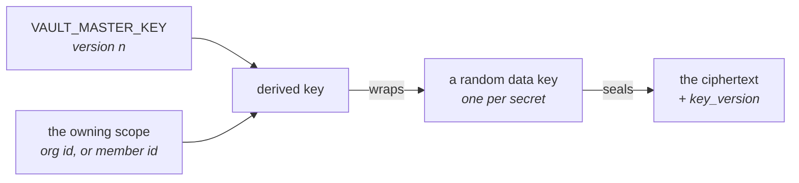

# Секреты и хранилище секретов { #secrets-and-the-vault }

!!! abstract "Один модуль и намеренно никакого второго механизма"

    Каждый ключ провайдера, токен бота канала, учётные данные MCP и API-ключ
    стороннего сервиса в этой платформе проходят через `app/core/vault.py`. Добавить
    второй способ хранить учётные данные — это дефект, который убрали две миграции.

## В консоли { #in-the-console }

В разделе «Секреты» в одной таблице перечислены ключи, ваши подключённые учётные записи и учётные записи организации. **Добавить ключ** (Add key) сохраняет учётные данные; **Подключить учётную запись** (Connect account) позволяет выбрать свою учётную запись или, при наличии разрешения, учётную запись организации. У каждой строки свои доступ и действия: открытие доступа к ключу и его ротация либо переподключение и отключение учётной записи. Токены OAuth остаются скрытыми, а при отключении учётной записи требуется подтверждение.

## Конвертное шифрование { #envelope-encryption }

Каждый секрет зашифрован собственным случайным ключом данных. Этот ключ данных
зашифрован ключом, производным от мастер-ключа **и области, которой принадлежит
секрет**, — организации или участника, которому принадлежит личное подключение.



Отсюда следуют два свойства, и оба — причина такой формы:

!!! success "Шифртекст нельзя перенести от одного владельца к другому"

    Даже при полном доступе к базе данных строка, скопированная из организации A в
    организацию B, не расшифруется. Изоляция организаций здесь криптографическая, а не
    условие `WHERE`, которое кто-то может забыть.

**Мастер-ключ можно ротировать.** Он никогда не шифрует полезную нагрузку
напрямую, только ключи данных, поэтому при ротации перешифровывается один
небольшой блок на секрет, а не перешифровывается каждое значение. Каждый конверт
записывает `key_version`, которым был зашифрован, — именно это и делает возможной
поэтапную ротацию.

Хранилище секретов ничего не решает о том, *кто* может читать секрет, — это дело
[слоя разрешений](permissions.md). Оно гарантирует лишь, что сохранённый секрет
нельзя прочитать без мастер-ключа и нельзя использовать вне области, для которой он
зашифрован.

## Как он стал единственным механизмом { #how-it-became-one-mechanism }

Это утверждение в начале стало правдой только после двух заходов, и история стоит минуты, потому
что в ней — форма ошибки.

**Секреты хранились тремя механизмами, и только один привязывал шифртекст к его
владельцу.** Ключи провайдеров шли через хранилище, токены ботов каналов — через
один ключ Fernet для всего экземпляра, токены MCP — через другой. Токен Slack можно
было скопировать из строки одной организации в строку другой, и он расшифровывался.
Одна миграция убрала эти два, прежде чем цепочку схлопнули в `0001_baseline`.

**Четвёртый пережил её — и на несколько месяцев пережил утверждение, написанное над ним.**
`app/core/crypto.py` держал один ключ Fernet для всего экземпляра над полями учётных
данных в `sync_sources.config` — JSON сервисной учётной записи Google и пару ключей
AWS, которыми аутентифицируется коннектор синхронизации RAG.

Модуль честно признавался в этом в своём докстринге, и всё же он был вторым
механизмом, так что читатель, поверивший, что «второго механизма нет», ошибался
насчёт одной таблицы.

Живучесть ему обеспечивала не разногласие, а проблема порядка: конверт выводится из
id владельца, а `sync_sources.organization_id` допускал NULL, потому что CLI создавал
строки без него.
[#707](https://github.com/vstorm-co/agenticos/issues/707) дала команде `rag-source-add`
организацию, `0042_sync_source_secret_id` сделала столбец обязательным, а
[#937](https://github.com/vstorm-co/agenticos/issues/937) удалила модуль.

**Теперь источник синхронизации ссылается на секрет хранилища по id**, как это делают
`ModelProfile.secret_id` и `CapabilityBindingSpec.secret_id`, а его `config` хранит
только то, что коннектору нужно, чтобы *найти* документы.

Два следствия за пределами криптографии, и именно их замечает оператор: учётные данные
добавляются один раз и используются каждым источником, которому они нужны, а не
вставляются для каждого источника и не ротируются в стольких же местах; и они видны
на странице «Секреты», как всё остальное, поэтому у вопроса «есть ли у этой
организации учётные данные Google» есть ответ.

## Виды { #kinds }

Секрет — не всегда строка, а попытка загнать любые учётные данные в одно поле «API-ключ»
даёт форму, которую человек заполняет правильно и всё равно получает учётные данные,
падающие при первом запуске. Поэтому у секрета есть **вид**, и вид решает, какие поля
существуют.

| Вид | Поля |
|---|---|
| `api_key` | Один непрозрачный токен |
| `azure_openai` | Ключ, эндпоинт, закреплённая версия API |
| `aws_credentials` | Идентификатор ключа доступа, секретный ключ доступа, регион, необязательный токен сеанса |
| `gcp_service_account` | JSON сервисной учётной записи, проверяемый при вводе |
| `github_oauth_app` | Публичный client id приложения GitHub OAuth и его секрет |
| `git_token` | Токен доступа для git по HTTPS и единственный хост, куда его можно отправить |
| `entra_app` | Идентификатор клиента (tenant id), client id и секрет клиента регистрации приложения Microsoft Entra |
| `http_credential` | Токен, который отправляет HTTP-шаг сценария, необязательное имя пользователя и источники, куда его можно отправлять |
| `smtp_account` | Хост SMTP, порт, режим TLS, отправитель и учётные данные для входа, зашифрованные вместе для почты из сценариев |
| `microsoft_oauth_app` | Те же три поля для регистрации приложения, через которую входят люди |
| `openai_codex` | Вход через ChatGPT: токен доступа, токен обновления и id учётной записи |
| `none` | Не секрет, а маркер эндпоинта, которому не нужны учётные данные |

`github_oauth_app` тратит платформа, а не выбирает человек: поток подключения GitHub
читает его на сервере, чтобы выполнить обмен токена, — поэтому он должен быть
**виден организации, и такой должен быть ровно один**: личные учётные данные участника
никогда молча не используются для подключения всей организации, а если сохранены два
приложения, видимых организации, подключение отклоняется (с указанием обоих), а не
привязывается к тому имени, что сортируется первым.

То же правило — **только виден организации** — действует для API-ключа, с которым
отправляются значение по умолчанию для распознавания речи в организации и собственная
пара распознавания бота канала: платформа тратит его на диктовку каждого участника и на
каждую голосовую заметку, которую получает бот, поэтому приватный ключ участника
отклоняется при сохранении любого из них, а ключ, ставший приватным позже, перестаёт
использоваться. В отличие от `github_oauth_app`, эти ключи называются по id, поэтому
их можно хранить несколько рядом.

При выборе ключа для распознавания речи по имени видны и те ключи, которые нельзя
выбрать, потому что они приватные или открыты только отдельным людям; рядом поясняется,
что сначала нужно открыть доступ к ним для организации. Вход через ChatGPT определяется
отдельно: он даёт доступ к моделям по подписке ChatGPT и не может заменить API-ключ
OpenAI для голосовых функций. Выбор ключа никогда не меняет доступ к учётным данным
автоматически.

`git_token` несёт свой хост, потому что источник синхронизации Git отправляет токен на
URL, который выбирает тот, кто редактирует источник. Привязанный к хосту, с которым
токен добавляли, он не может быть нацелен на другой сервер правкой источника, и никакой
другой ключ не может его заменить.

`http_credential` — это правило `git_token` для шага
[`http.request`](reference/workflow-nodes.md#http-request) сценария: URL шага вводит
тот, кто редактирует сценарий, и он может быть привязан ко входным данным запуска,
поэтому источники, куда может уйти токен, зашифрованы вместе с ним, например
`https://api.example.com`. Шаг проверяет источник URL, который собирается вызвать, и
каждого перенаправления, за которым идёт, и никуда больше токен не отправляет.
Никакой другой вид секрета не может его заменить.

Поле секрета в шаге сценария предлагает **Новый секрет** (New secret): собственную
форму хранилища, зафиксированную на виде, который принимает поле, и сохраняемую как
`custom` — единственное назначение, принимающее любую форму. Новый секрет выбирается
при сохранении. Его значение уходит в хранилище и никуда больше, а граф хранит только
его id.

`entra_app` — то, под чем входит источник синхронизации SharePoint или OneDrive. Его
охват задаётся в Microsoft Entra, а не здесь: разрешения Graph, на которые согласился
администратор, решают, какие сайты он может читать, а токен не говорит, какие это
сайты. Выдайте ему `Sites.Selected` на том единственном сайте, который читает
источник, — см. [Настройка SharePoint и OneDrive](howto/configure-sync-sources.md#sharepoint-and-onedrive-setup).
Его подсказка — последние четыре символа client id, который публичен, а не секрета.

У `microsoft_oauth_app` те же поля, а тратится он иначе: поток подключения триггера
Outlook входит от имени человека через него, с делегированным `Mail.Read` того, кто
даёт согласие, — его собственный ящик и общие, которые он и так может открыть, — тогда
как `entra_app` действует с разрешениями приложения, выданными на весь клиент. Как и
`github_oauth_app`, он должен быть виден организации, и такой должен быть ровно один.
См. [Outlook](triggers.md#outlook-1-minute-and-no-secret-anywhere).

`openai_codex` — единственный вид, который никто не вводит. Его сохраняет [вход через
ChatGPT](models.md#running-on-a-chatgpt-subscription), и он меняется, пока
используется: каждое обновление тратит токен обновления, поэтому новая пара
заново шифруется под тем же id. Его подсказка — последние четыре символа id
учётной записи. Когда вход перестаёт работать, **Переподключиться** (Reconnect)
выполняет вход заново вместо него.

`aws_credentials` — самый ясный случай того, зачем вообще нужны виды: идентификатор
ключа доступа не секретен, а секретный ключ доступа секретен, и одно поле этого не
выражает. `gcp_service_account` проверяется при вставке, потому что некорректное
значение даёт о себе знать через часы ошибкой аутентификации, и ничто не указывает
обратно на вставку, которая его вызвала.

`none` — то, что вы сохраняете для Ollama на localhost. Это вид, а не пустая строка:
так код, который разрешает секрет, может перебирать полный набор — и потому, что хранилище
отказывается шифровать пустое значение. `none` может держать только среда
выполнения; сохранить его нельзя, и это не даёт «секрету без значения» попасть в схему
API.

Каждое поле, которое аутентифицирует, — API-ключ, секретный ключ доступа, секрет
клиента — должно быть не короче восьми символов. В списке подсказкой служат последние
четыре символа учётных данных, поэтому более короткое значение было бы целиком
опубликовано собственной подсказкой; нижняя граница также ловит обрезанную вставку,
пока форма ещё открыта.

## Где они используются { #where-they-are-used }

**Провайдеры моделей.** Называются [профилем модели](models.md). Расходы относятся к
тому секрету, к которому пришёл запуск, поэтому у вопроса «какой ключ обходится дороже
всех» есть ответ. Когда профиль получает ключ, ключ одалживается всем, кто на нём
работает, поэтому создание или правка профиля — его ключа или эндпоинта — требует
`secrets:view` на этот ключ. Удалённый ключ оставляет свои профили помеченными
`missing_key`, пока они не получат другой, в том числе профиль перед шлюзом. Работать
без ключа продолжает только профиль, сохранённый без ключа намеренно ([Профиль без
ключа](models.md#a-profile-without-a-key)).

**Распознавание речи.** API-ключ, назначение которого — провайдер, указывается по id рядом
с провайдером и моделью везде, где настраивается распознавание речи: значение по
умолчанию организации, переопределение агента и собственная пара бота канала. Во время
выполнения ключ нигде не ищется. Ключ организации и ключ бота должны быть видны
организации; ключ агента подчиняется правилу одалживания — издатель должен иметь
возможность его видеть. [Запись об использовании](ml-services.md#what-is-recorded)
каждой транскрипции называет ключ, с которым её отправили. См. [какой движок получает
запись](ml-services.md#which-engine-a-recording-reaches). В списке агентов,
использующих ключ, это использование не отображается.

**Голосовые звонки.** Ключ, с которым держится [голосовой звонок](voice.md), назван на
карточке «Голос» агента, рядом с провайдером и моделью реального времени. Его назначение
должно быть провайдером, а вид — видом провайдера: `api_key` или секрет `azure_openai`
для Azure, который ещё несёт эндпоинт и версию API. Он подчиняется правилу одалживания —
издатель должен иметь возможность его видеть, — и во время выполнения ключ нигде не
ищется. Ключ расшифровывается, чтобы открыть звонок, и никогда не доходит до браузера:
сервер отвечает на предложение WebRTC, и клиентский секрет не выпускается. Чтобы
завершить звонок, процесс которого умер, периодический обход голосовых звонков читает
ключ через `OrganizationSecretService.voice_call_key` — читатель, чей открытый текст
уходит на эндпоинт завершения провайдера и никуда больше. В строке звонка хранится
только id ключа, а удалённый ключ лишает агента возможности принимать звонки, пока не
выбран другой.

**Возможности.** Возможность объявляет, что ей нужны учётные данные заданного *вида*, —
никогда экземпляр. Код говорит «мне нужен API-ключ»; `secret_id` привязки говорит,
какой именно. Там, где привязка называет сервис, для которого предназначен ключ, —
выбранный ею провайдер или единственный сервис, который использует возможность, например
LlamaParse, — публикация отклоняет ключ, сохранённый для другого сервиса, так как он
отправлялся бы не тому провайдеру при каждом вызове. Ключ `custom`, которым является
каждый ключ, сохранённый до появления назначений, принимается. См. [каталог
возможностей](reference/capabilities.md#what-a-binding-may-change).

**Подключения MCP.** Bearer-токены и данные OAuth, зашифрованные для организации или для
участника. См. [MCP](mcp.md#authentication).

<a id="connected-accounts"></a>

**Подключённые учётные записи.** Учётная запись Google, под которой читает папка
[виртуального терминала](reference/capabilities.md#mirage), подключённая со страницы
«Секреты». Человек подключает свои учётные записи, и агент, монтирующий «собственные
учётные записи каждого человека», находит их, когда этот человек с ним говорит. Учётные
записи организации требуют `mcp:manage` для подключения и отключения и
`connections:view` для перечисления, а папка называет одну по id. Согласие использует
секрет `google_oauth_app` организации и запрашивает Drive, Gmail, Calendar, Docs, Sheets
и Slides сразу. Google позволяет человеку не дать любое из них, и папка, которой нужно
одно из невыданных, говорит об этом. Выданный доступ — это данные OAuth, зашифрованные так же, как
у подключения MCP, а ответ называет адрес учётной записи и выданные области, но никогда
токен.

**Боты каналов.** Каждые учётные данные в строке, зашифрованные для организации бота под
одним общим `key_version`: токен бота, секрет подписи и токен приложения Slack и
общий секрет, по которому аутентифицируется входящий вебхук, — секрет в заголовке
`X-Telegram-Bot-Api-Secret-Token` у Telegram или токен исходящего вебхука Mattermost. См.
[Каналы](channels.md).

**Триггеры по событиям.** Секрет, по которому проверяется входящий вебхук триггера по событию, —
ключ HMAC GitHub или секрет подписи, который присылает почтовый или API-ретранслятор, —
зашифрован для организации и хранится прямо в строке триггера вместе с `key_version`,
который его зашифровал, той же формы, что секрет подписи бота канала. Он никогда не
возвращается и не попадает в логи в открытом виде; проверка расшифровывает его, сравнивает
за постоянное время, а доставка, которая не проходит, получает 403. См.
[Концепции](concepts.md#trigger).

**Вебхуки сценариев.** Ключ HMAC, которым подписываются доставки вебхука сценария,
созданный платформой, зашифрованный для организации и хранящийся в строке вебхука вместе с
его `key_version`. Он показывается один раз, когда создаётся или заменяется, и больше
никогда; ротация мастер-ключа перешифровывает его вместе с остальными. См.
[Сценарии](workflows.md#a-webhook-or-a-schedule).

**Встраивания.** Виджет `jwt` проверяет токены посетителей по секрету подписи HS256,
который хранит бэкенд заказчика. Он зашифрован для организации агента и записывает свой
`key_version`, как любая другая зашифрованная строка, поэтому ротация мастер-ключа может
применить к нему `rewrap`, и виджет продолжает проверять — тогда как встраивание, не записавшее свою
версию, нельзя было бы открыть после ротации.

Строка с несколькими столбцами шифртекста — четыре у бота канала, один у встраивания —
шифрует их через `vault.seal_fields`, который шифрует каждое поле на одной
версии и возвращает эту версию для сохранения: единственный способ записать такую строку,
поэтому «столбца версии нет» и «сбросить одно поле на v1» нельзя написать вручную.

**Сторонние сервисы.** Небольшой каталог сервисов, для которых организация может
принести собственный ключ:

| Сервис | Используется в |
|---|---|
| Tavily | [`web_research`](reference/capabilities.md#web-search) |
| Brave Search | `web_research` |
| Exa | `web_research` |
| Logfire | [Наблюдаемость](reference/spec.md#observability) каждого агента — трассы в собственный проект |
| LlamaParse | Разбор PDF, оплачиваемый собственным ключом организации |
| ElevenLabs | [`text_to_speech`](reference/capabilities.md#text-to-speech) — речь голосами на учётной записи ElevenLabs организации |
| BytePlus ModelArk | [`video_generation`](reference/capabilities.md#video-generation) — видеомодели Seedance от ByteDance |

## Чего никогда не происходит { #what-never-happens }

!!! success "Четыре гарантии, закреплённые тестами, а не соглашением"

    Никакого открытого текста в ответе, в строке лога, в записи аудита или в
    экспортированной спецификации — и возможность никогда не узнаёт, откуда пришли её
    учётные данные.

- **Ни один ответ API не возвращает открытый текст.** Для этого нет эндпоинта. У службы,
  которой принадлежат секреты организации, есть два читателя, дающих открытый текст, и ни
  один не передаёт его вызывающему: читатель механизма выполнения, пока тот собирает
  агента, и читатель каталога моделей, который тратит bearer-токен на один исходящий
  запрос к провайдеру и возвращает имена моделей, которые пришли в ответ. Ничто вне этой
  службы не открывает секрет — маршрут списка моделей когда-то открывал, и это был
  дефект слоёв.
- **Ни одна строка лога или запись аудита его не содержит.** Каждое поле с секретом —
  это Pydantic `SecretStr`, поэтому датаклассы, несущие учётные данные, маскируются в
  repr — а именно так открытый ключ обычно и утекает.
- **Ни одна спецификация его не несёт.** Экспортированная спецификация агента ссылается
  на секреты по id. Именно поэтому её безопасно коммитить в git-репозиторий клиента.
- **Возможность никогда не узнаёт, откуда пришли её учётные данные**, а модель не видит
  их вовсе.

Эти четыре закреплены тестами, а не соглашением.

## Доступ { #access }

| Разрешение | Что даёт |
|---|---|
| `secrets:view` | Видеть, что секрет существует, его вид, его название |
| `secrets:edit` | Создавать, ротировать, удалять |
| `mcp:manage` | Подключения MCP организации и их учётные данные |
| `connections:manage` | Учётные данные всей организации: подключения провайдеров моделей и интеграции источников синхронизации |

Области различаются по роли — Owner правит любой секрет в организации, Member — только
свои секреты. Секрет можно также открыть конкретному участнику или агенту выданным доступом,
который расширяет доступ к этой одной строке, никого не повышая. См.
[Разрешения](permissions.md).

## Эксплуатация { #operations }

Мастер-ключ — это `VAULT_MASTER_KEY`. Без него используется `SECRET_KEY`, чтобы свежий
клон репозитория работал без дополнительной настройки, а конфигурация отклоняет
незаданный ключ везде, кроме `local`/`development`: staging — полноценный экземпляр и
постоянно хранит настоящие ключи провайдеров, поэтому получает тот же отказ, что и
production.

!!! danger "Потеря всех настроенных ключей означает потерю всех сохранённых учётных данных"

    Пути восстановления нет и депонированной копии тоже: каждый секрет придётся вводить
    заново вручную. Храните копию ключа отдельно от резервной копии базы данных.

Ротация — поэтапная операция, и `VAULT_MASTER_KEYS` — её поэтапная
форма: JSON-карта всех ещё используемых версий. Наивысшая версия шифрует
новые секреты; старые держат существующие строки читаемыми, пока их не перешифруют.
`key_version` в каждой зашифрованной строке записывает, какая версия её зашифровала, а
запрос версии, для которой нет настроенного ключа, падает с указанием отсутствующей
записи, а не с общей ошибкой расшифровки.

```bash
# 1. Configure both keys — the old one as the version that sealed today's rows,
#    the new one above it — and unset the single VAULT_MASTER_KEY.
#    VAULT_MASTER_KEYS={"1": "<old>", "2": "<new>"}
# 2. Prove every stored envelope opens before anything moves:
uv run agenticos cmd vault-rotate --dry-run
# 3. Re-wrap every sealed row to the new version:
uv run agenticos cmd vault-rotate
# 4. Once it reports zero failures, drop version 1 from VAULT_MASTER_KEYS.
```

!!! warning "Не удаляйте старый ключ, пока `vault-rotate` не сообщит о нуле сбоев"

    Строка, которая не прошла, называется по имени и остаётся как была, а команда
    завершается с ненулевым кодом — удаление версии 1 при частичной ротации делает эти
    строки нечитаемыми.

`vault-rotate` проходит по каждой таблице с конвертами и переносит шифртексты каждой
строки вместе с её столбцом версии — или не переносит ничего. Строка без конверта, но с
именем версии — например, подключение, чьи учётные данные очистили, — её указание версии
тоже переносится на текущую, чтобы следующий секрет, зашифрованный в неё, попал на
ключ, который ещё существует. Заново шифруется только конверт с ключом данных —
полезные нагрузки не тронуты, и именно поэтому ротация дешёвая.

```bash
uv run agenticos cmd doctor    # says whether a dedicated key or the SECRET_KEY fallback seals the vault
```

`make platform-bootstrap BOOTSTRAP_API_KEY=sk-...` сохраняет первый ключ провайдера
за вас. Об окружении см. [Конфигурация](configuration.md), а
[контрольный список для production](configuration.md#production-checklist) — перед запуском в
работу со сгенерированным значением по умолчанию.

## Итог { #recap }

- **Один модуль**, `app/core/vault.py`. Второго механизма нет, а его добавление —
  это дефект, который убрали две миграции.
- Секрет зашифрован собственным ключом данных, который, в свою очередь, зашифрован
  ключом, производным от мастер-ключа **и области-владельца**, — поэтому шифртекст не
  может перейти от одного владельца к другому.
- У секрета есть **вид**, потому что `aws_credentials` — это четыре поля, и одно из них
  не секрет.
- Четыре гарантии, закреплённые тестами: никакого открытого текста в ответе, логе,
  записи аудита или экспортированной спецификации.
- Ротация **поэтапная** — настройте обе версии, выполните `vault-rotate --dry-run`,
  ротируйте, затем удалите старый ключ, когда она сообщит о нуле сбоев.


Согласие внешнего источника A2A привязывается также к поколению авторизации упомянутых
учётных данных хранилища. Замена их значения делает действующую проверку
недействительной, даже если id секрета не меняется. Переименование и обслуживание
ключей шифрования хранилища это поколение сохраняют. Существующие проверки A2A после
этого обновления требуют повторной проверки.
