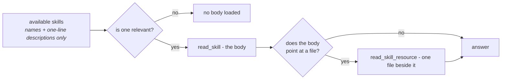

# Навыки { #skills }

Откройте навык из каталога, чтобы изменить его инструкции, описание и файлы в
модальном окне, не теряя поиск, фильтры или страницу списка. **Открыть полное представление** (Open
full view) рядом с **Поделиться** (Share) в нижней части окна открывает вкладку
«Содержимое» на её собственной странице, и рядом с ней доступны «Агенты» и «История».
При уходе с несохранёнными изменениями вас спрашивают, что сохранить. «Улучшение»
показывает следующий шаг, когда отзывов нет, вместо формы расходов, которую нельзя
запустить.


Навык — это ноу-хау, записанное один раз и привязанное ко многим агентам: как
обрабатываются возвраты, каков фирменный стиль, какие проверки должен пройти отчёт,
прежде чем уйти адресату.

Он заменяет поле инструкций, которое разрастается.

Двадцать процедур в одном промпте означают, что каждый запуск платит за все двадцать,
а двадцать первая выталкивает диалог за пределы окна. Навыки делают наоборот:



Двадцать навыков стоят примерно двадцать _описаний_ вместо двадцати _процедур_.

!!! note "Обнаружение дешёвое, но не бесплатное"

    Каждый навык, привязанный к агенту, лежит в каталоге, который модель читает при
    каждом ходе диалога, — именем и однострочным описанием, — поэтому привязка навыка
    действительно стоит токенов, независимо от того, откроет его модель или нет.

    Это строка на навык против тела на навык — вот почему числа сходятся. Но это не
    основание привязывать неограниченный каталог.

Вторая половина смысла — **кто их пишет**. Навык — это строка в базе данных,
редактируемая в интерфейсе, поэтому руководитель поддержки может исправить политику
возвратов во вторник днём. Без развёртывания, без пул-реквеста, без инженера.

!!! info "Навык, файл контекста или коллекция знаний?"

    **Навык** — это процедура, которую модель загружает, когда решит, что задача
    пришла. [Файл контекста](context.md) — это постоянные знания: короткие, всегда
    уместные, внедряемые или читаемые по требованию. [Коллекция
    знаний](file-processing.md) — это корпус, слишком большой для чтения, до которого
    доходят поиском.

В Конструкторе агентов откройте **Навыки → Новый навык** (Skills → New skill), чтобы
написать навык, не покидая панель возможностей. Сохранение создаёт запись в
библиотеке, привязывает её к текущему черновику и включает возможность «Навыки».
Публикация остаётся отдельным шагом. Действие требует разрешения на редактирование и
агента, и навыков.

## Форма { #the-shape }

```markdown
---
name: refund-policy
description: When a refund is given without asking, when it needs approval, and how to say no.
category: support
---

# Refunds

Most refund questions are decided by the order date and one exception. Check
those before escalating anything.

The **Skills** page shows the opening of each body on its card — front matter
dropped, a few lines — with a sheet stacked behind it for each file the skill
carries. `GET /api/v1/skills` returns that opening as `excerpt`; the body itself
loads when a skill is opened.

## Decide without asking

...
```

!!! tip "`description` — поле, которое решает, загрузится ли навык вообще"

    Это единственная часть, которую модель видит бесплатно. Пишите его как **когда к
    этому прибегать**, а не как заголовок.

Навык может нести **ресурсы** — дополнительные файлы рядом с ним, загружаемые по
требованию. В `refund-policy` есть `exceptions.md`, и тело говорит, когда к нему
обращаться.

Это то же постепенное раскрытие на уровень ниже: подробности, нужные лишь части
диалогов, не обязаны лежать в теле, которое загружает каждый уместный диалог.

`category` — одно из двадцати предложений (`support`, `engineering`, `finance`,
`legal`, `security`, `marketing`, …), и оно управляет фильтром в списке навыков. На
то, что видит агент, оно не влияет: модель выбирает по `description`, никогда по
категории.

Длинные текстовые ресурсы разбиваются на страницы, чтобы справочники не попадали в
каждый запрос к модели: размер страницы по умолчанию — 8 000 символов, максимум —
20 000. Передайте `args` с `offset` и `limit` в `read_skill_resource`; его ответ даёт
следующий offset. Читайте только нужные диапазоны и используйте уже загруженный
материал повторно.

## Как агент читает навык { #how-an-agent-reads-one }

Через [возможность `skills`](reference/capabilities.md#skills). Каждый навык, который
получил агент, становится **отдельной возможностью**, перечисленной для модели
именем и описанием и открываемой по требованию:

| Как | Что делает |
| --- | --- |
| Доступные навыки | Имена и однострочные описания всего, что привязано к этому агенту |
| `read_skill` | Полное тело одного навыка, подтягиваемое в диалог |
| `read_skill_resource` | Один файл рядом с навыком |

`read_skill` представляет встроенный отложенный загрузчик фреймворка в терминах
навыков. Политики согласования сохраняют стабильный ключ `load_capability`, поэтому
существующие опубликованные спецификации и ожидающие согласования продолжают
работать. Старый ключ согласования `load_skill` по-прежнему переносится на него.
Отдельного инструмента перечисления нет. `read_skill_resource` читает вспомогательные
файлы только после того, как навык открыт.

Спецификация привязывает навыки по id в `skill_ids`, поэтому агент видит те, что ему
дали, и ничего больше.

**Из самого навыка.** У каждой карточки на странице «Навыки» есть **Добавить агенту**
(Add to an agent): выберите агента, и навык добавляется в его черновик с включённой
возможностью «Навыки», готовый к публикации в Конструкторе. Карточка также говорит,
какие агенты используют навык, — или что пока ни один. То же предлагают файлы
контекста и базы знаний.

**Имя навыка — это id, по которому модель его загружает**, поэтому оно принимает ту
форму, в какой модели пишут id: строчные буквы и цифры, соединённые одиночными
дефисами, например `refund-policy`. В консоли заглавные буквы, пробелы, знаки
препинания и латинские диакритические знаки приводятся к форме автоматически, когда
вы покидаете поле имени или отправляете его: `Refund Policy` становится
`refund-policy`. API по-прежнему требует канонического формата. Совпадения с
существующими именами и имена возможностей отклоняются, не отбрасывая черновик.

Имя, которое модель должна воспроизвести точно, вроде `Refund policy`, загружалось
вместо этого как `refund-policy`, а две неверные догадки завершают ход
([#1911](https://github.com/vstorm-co/agenticos/issues/1911)).

**Навык нельзя назвать как возможность.** Каждый из них лежит под своим именем в том
же пространстве имён, что `knowledge`, `planning` и остальные, поэтому навык с именем
`planning` у агента, у которого есть и возможность планирования, — это дубликат,
который фреймворк отклоняет до первого токена. Создать такой нельзя, как нельзя и
опубликовать агента, привязанного к навыку с таким именем.

Включать возможность без привязанных навыков бесполезно: дайте агенту навыки или
оставьте возможность выключенной.

### Какие навыки использовал ответ { #which-skills-an-answer-used }

Привязка навыка не означает, что модель его прочитала. Каждый запуск записывает
навыки, которые действительно использовал, по id навыка: открыла ли модель
какой-нибудь через `read_skill` и сколько его файлов прочитала через
`read_skill_resource`. Запуск записывает это, чем бы он ни закончился, включая тот,
что упал после открытия навыка. Навык, который использовал агент-исполнитель,
записывается в том запуске, который поручил работу, под агентом самого исполнителя,
потому что ответ, который оценил человек, — это ответ того запуска.

Вызов инструмента, в котором указан путь в папке навыка внутри рабочего
пространства, например `cat /workspace/skills/refund-policy/SKILL.md`, считается
отдельно как вероятное использование. Перечисление папки не считается. Путь, который
собирает оболочка, шаблон поиска по нескольким навыкам или скрипт, читающий файл
сам, не распознаются.

`GET /api/v1/skills/{id}/usage?days=30` возвращает по каждому агенту, сколько
запусков использовали навык в этом окне, с версией, которую получил каждый, и
количеством за каждый день окна по UTC, включая нули. Запуски оценок и панели
проверки Конструктора не учитываются. Цифры читаются из запусков, поэтому нужен
`runs:view`; агент, которого вызывающий не может видеть, считается, но не называется.

Запуски, сделанные до того, как это начали записывать, говорят «использование
неизвестно», и это не то же, что «не использовался». Когда навык улучшают,
свидетельства берутся только из запусков, которые его использовали, а запуски с
низкой оценкой или неудачные, которые могли его использовать, считаются отдельно как
неизвестные.

## В рабочем пространстве навык — это ещё и файлы { #in-a-workspace-a-skill-is-also-files }

Агент, у которого есть и навыки, и [рабочее
пространство](reference/capabilities.md#files-shell), получает каждый навык ещё и
записанным в него:

```
/workspace/skills/<name>/SKILL.md      the body, with its name and description
/workspace/skills/<name>/<resource>    each resource, beside it
```

Именно это делает скрипт навыка полезным. Навык, чей ресурс — `reconcile.py`, раньше
передавался модели как текст, который она могла процитировать, но не запустить, хотя
у того же агента `execute` был в одном вызове инструмента. На диске он выполняется.

!!! note "`run_skill_script` не существует"

    Собственный `execute` песочницы уже несёт правила разрешений рабочего пространства
    и потолки оператора. Второй способ что-то запускать был бы вторым набором правил,
    в котором можно ошибиться.

## Агент может предложить изменение; вносит его человек { #an-agent-can-propose-a-change-a-person-makes-it }

Эти файлы доступны для записи, и то, что пишет агент, **не** применяется.

Навык — это инструкции, которым следует каждый привязанный к нему агент при каждом
запуске. Агент, который мог бы править его напрямую, мог бы переписать то, что делает
другой агент, внутри диалога, который никто не проверяет, и следующий читатель не
смог бы отличить обдуманное улучшение от придуманного моделью.

Поэтому запись становится **предложением**, и оно появляется над списком на странице
«Навыки» для всякого, кто может редактировать этот навык. Предложение нового навыка
появляется у всякого, у кого есть `skills:edit`. Никто другой не может его
перечислить или открыть:

- **Просмотреть** (Review) открывает предложенные инструкции, их сравнение с текущим
  навыком и справочные файлы. **Применить обновление** (Apply update) сразу сохраняет
  следующую версию. Агенты, которые следуют за этими версиями, получат её при
  следующем запуске. Оценка необязательна; отсутствие тестовых вопросов не мешает
  применить предложение.
- **Проверить перед применением (необязательно)** (Test before applying (optional))
  запускает изменение на агентах, которые следуют за этими версиями. Результат
  показывает регрессии и тех агентов, которых не удалось проверить до окончательного
  решения. См. [Проверка изменения на каждом
  агенте](#checking-a-change-on-every-agent).
- **Отклонить** (Discard) сохраняет запись. Агент, раз за разом предлагающий одну и ту
  же правку, что-то говорит кому-то о навыке, а удалённая строка делает это невидимым.

!!! warning "Решение по предложению окончательное"

    Применить дважды — сохранить вторую версию уже сохранённого тела, а отклонить
    применённое — сказать читателю, что оно так и не появилось.

Предложение несёт **всё тело** целиком, а не дифф, поэтому проверяющий недели спустя
сравнивает две полные версии, а не применяет патч туда, куда его никогда не
предназначали.

Две вещи отклоняются, а не угадываются: папка, которую агент создал без `SKILL.md` в
ней, и папка, чей frontmatter он испортил. А _удалённый_ ресурс намеренно не считается
изменением: файл, которого модель не касалась, и файл, который она хотела удалить,
оставляют одно и то же отсутствие.

Три хода одного диалога, уточняющие один и тот же навык, оставляют **одно**
предложение, а не три. Проверяющему, которому задали один и тот же вопрос трижды, дали
больше работы, а не больше сведений.

Изменение записывает версию навыка, против которой было написано: для запуска —
версию, которую получил этот запуск, а более поздний ход, переписывающий изменение,
записывает свою. Применение отклоняет его, если с тех пор кто-то изменил навык,
поэтому правка, сделанная, пока изменение ждало, не перезаписывается. Сравните две
версии и отредактируйте навык вручную или попросите снова.

[Помощник по редактированию](authoring.md#skills) предлагает изменения навыков так же,
со своим обоснованием и запусками, на которых оно основано, и применение отклоняет их
так же.

Каждое изменение говорит, какие опубликованные версии агентов читают навык, какие
наборы проверок оценки оно ставит в очередь при применении и какие обязательные
проверки проверят его только при следующем переводе в окружение. Применение сообщает
владельцам этих агентов. Решение называет версию изменения, которую вы прочитали:
изменение, переписанное с тех пор — более поздним ходом или новым запросом, —
отклоняется с «Предложение изменилось с тех пор, как вы его открыли», а из двух
решений, принятых одновременно, считается только одно. У навыка, который агент написал
с нуля, агентов пока нет, поэтому **Применить** (Apply) сразу создаёт его.

Предложения из рабочего пространства подчиняются тем же ограничениям метаданных, что и
сохранённые навыки: имя от 1 до 64 символов и описание до 500 символов. Изменение вне
этих пределов пропускается с предупреждением; его исходные файлы в рабочем
пространстве остаются целы. Запись предложения идёт в точке сохранения, поэтому
отклонённое предложение не может откатить ход или помешать записать его статус и
расходы.

## Проверка изменения на каждом агенте { #checking-a-change-on-every-agent }

Навык общий, поэтому изменение оценивается на каждом агенте, который его прочитает: в
основной версии — на агентах, следующих за её новейшей версией; в ответвлении — на
агентах этого ответвления. Агенты, закреплённые на более старой версии, и агенты других
ответвлений не запускаются: изменение до них не доходит. Опубликованная версия каждого
агента отвечает на свои вопросы дважды — с навыком в текущем виде и с изменением, — и
больше ничего не отличается.

Предложения из рабочего пространства, предложения помощника и [обновления
библиотеки](#getting-skills-into-an-organization) можно проверить и применить без этой
необязательной проверки. Применение всё равно проверяет доступ на редактирование,
ревизию предложения и версию навыка, на которой оно основано. Когда вы решаете оценить
изменение, применение через эту проверку определяется её результатом и её требованиями
к подтверждению или закреплению.

### Что она спрашивает { #what-a-check-asks }

Сначала собственные **тестовые вопросы** навыка — один и тот же набор на каждом
агенте. У каждого навыка есть один набор, запущенный на странице навыка в разделе
**Тестовые вопросы** (Test questions) — из недавних ответов, которые загрузили навык,
или пустой, — либо через API, `POST /api/v1/skills/{id}/test-set`, либо кнопкой
**Добавить тестовые вопросы** (Add test questions) рядом с агентом, которого
[Улучшение](#improving-a-skill) не смогло проверить; он редактируется как любой другой
[набор данных](datasets.md), и «Наборы данных» помечают его как набор этого навыка.

Судья оценивает набор, сравнивая каждый ответ с тем, который люди оценили
положительно. Если набор составлен из недавних ответов, каждый вопрос задаётся один
раз: ответ, который кто-то оценил, важнее того, что просто не прошёл, поэтому один
вопрос никогда не требует ответа и не запрещает его одновременно.

Затем собственные вопросы агента:

- **Быстрая** (Quick), по умолчанию: четыре вопроса из набора данных агента, чей
  новейший ответ загрузил навык, — те, что делят больше всего слов со строками, которых
  касается изменение; больше четырёх, когда собственных контрольных вопросов навыка
  слишком мало для пяти, которые нужны результату. Агент, у которого таких нет,
  проверяется только на наборе навыка, и его строка об этом говорит. Агенту, которого
  вопросы навыка показали хуже, его собственные не задаются, и его строка говорит, что
  их не задавали.
- **Тщательная** (Thorough): весь набор данных агента, задаваемый даже когда вопросы
  навыка показали агента хуже, чтобы его строка сказала, где изменение его подвело.
  Изменение описания навыка всегда тщательное, потому что описание решает, когда
  каждый агент вообще открывает навык.

!!! note "Вопросы навыка говорят, что навык должен делать"

    Их оценивают одинаково на каждом агенте, поэтому они ловят изменение, которое
    нарушает собственное правило навыка. Изменение, которое вредит одному агенту из-за
    его собственной ситуации, видно на его собственных вопросах. А намеренная смена
    правила означает, что каждый вопрос, всё ещё ждущий старого ответа, не проходит:
    сначала обновите тестовые вопросы.

Набор вопросов, который нечем оценивать, или все вопросы которого взяты из диалогов,
на которых изменение училось, для этого агента не берётся, а остальные всё равно
задаются. Агент, которому нечего больше задать, остаётся неизвестным с этой причиной.
Каждый набор считает только те вопросы, которые задаёт, а быстрая выборка никогда не
берёт один из тех диалогов. Когда в сеансе улучшения не остаётся агента с вопросом за
пределами его собственных свидетельств, шаг отклоняется до начала, с набором данных,
куда добавить другие вопросы.

### Правило { #the-rule }

- Ни один агент не может стать **хуже** (worse) из-за регрессии, которую
  подтвердил повторный опрос.
- Хотя бы один агент должен стать **лучше** (better).
- Разница, которую проверка не смогла подтвердить, — **в пределах шума**
  (within noise): предупреждение, а не блокировка.
- Агент, у которого не изменился ни один вопрос целиком, но чей критерий
  повторный опрос подтвердил как улучшившийся, а ухудшившихся нет, —
  **лучше по критериям** (better on criteria); агент с подтверждённым
  ухудшением критерия — **хуже по критериям** (worse on criteria). Ни то, ни
  другое не меняет правило выше, которое говорит о вопросах целиком: они
  учитываются на полосе вместе с агентами, ставшими лучше, и агентами,
  ставшими хуже, а в подробностях агента каждый критерий указан с числом
  пройденных до и после.
- Агент, которого проверить не удалось, — нет вопросов, вопросы нечем оценить
  или все они взяты из диалогов самого изменения, нет доступа, не осталось
  бюджета, нет опубликованной версии, запуск завершился ошибкой, проверку
  остановили, — считается **неизвестным** (unknown), и человек подтверждает
  это, прежде чем применить изменение.

Проверка, в которой нельзя проверить ни одного агента, всё равно начинается и
сразу завершается: все агенты неизвестны, и человеку нужно это подтвердить.
Диалог говорит об этом до начала и предлагает тестовые вопросы навыка или
оценивание, которого его вопросам не хватает. Изменение версий, которые не читает ни один агент, проходит сразу: оно ни до кого не доходит, и проверка
говорит, что проверять было некого.

Агента судят один раз — по контрольным вопросам всех его этапов вместе: для
результата нужно пять таких вопросов на агента, а не по пять на этап, и
регрессия, подтверждённая на одном этапе, учитывается независимо от того, что
нашёл другой. Все вопросы набора навыка контрольные, а быстрая проверка берёт
выборку только из контрольных вопросов агента.

Проверка отправляет подтверждённые регрессии и ответы, которые судья не смог
оценить, в [очередь проверки](datasets.md#review); каждый помечен как ответ,
полученный с предложенным изменением, и никогда не заменяет ответ, который уже
ждёт решения по этому вопросу. Вердикт человека по ответу, который оценивала
проверка, судит этого агента заново: его счётчики, вердикт проверки и результат
попытки улучшения, которую проверка измеряла, следуют за вердиктом.

Вердикт относится к одному ответу; повторные опросы сохраняют свои оценки,
поэтому подтверждённая ими регрессия остаётся. Агент, которому быстрая проверка
не задавала его собственных вопросов, поскольку вопросы навыка показали
ухудшение, считается неизвестным, если эту регрессию снимут. Проверка, по которой
принято решение, сохраняет его, а агент, которого проверить не удалось, остаётся
неизвестным.

Доля каждого агента — это его собственные запуски оценки, списываемые на этого
агента. Оценка даёт одну цену — наиболее вероятную и максимальную — и называет до
начала агентов, чей бюджет её не покрывает. Повторный запуск той же проверки,
пока она идёт, возвращает эту проверку, поэтому дважды за неё не платят. Для
запуска нужны `runs:view` и доступ на редактирование навыка. Агент, которого вам
нельзя запускать, не запускается, а тот, которого вам нельзя видеть, — это число,
а не имя.

### Когда агент стал хуже { #when-an-agent-got-worse }

**Проверить на агентах** (Check on agents) в разделе «Навыки» рассчитывает
стоимость проверки, запускает её, показывает результат каждого агента и затем
предлагает ровно то, что позволяет проверка. Пока она идёт, полоса показывает,
сколько агентов уже проверено. Затем каждый агент раскрывается в то, что он исправил
и что испортил, этап за этапом, со ссылкой на запуск каждого этапа; на
странице такого запуска сказано, что это один этап проверки, и есть ссылка
обратно. Окно можно закрыть: страница навыка тогда показывает **Проверка идёт**
(Check running), а **Показать** (Show) снова открывает проверку, пока вы не
примете решение. История навыка перечисляет проверки этих версий, начиная
с новых, с тем, что нашла каждая и что с ней сделали, а **Подробности** (Details)
открывают одну из них. Проверка, начатая [сеансом
улучшения](#improving-a-skill), решается в этом сеансе, и «Проверить на агентах»
вместо этого ведёт туда.

**Назад к редактированию** (Back to editing) возвращает проверенный текст в
редактор — тот, в котором его написали, или новый, открытый из «Показать» или
«Подробностей» по этим версиям, — так что набранное не теряется, а
сохранить его нельзя, если у этих версий появилась версия новее той, на
которой текст проверяли. Проверка предложения вместо этого предлагает **Улучшить
дальше** (Improve further), что открывает сеанс. В основной версии человек всё
ещё может:

- **применить изменение и оставить ухудшившихся агентов там, где они есть** —
  каждый из них закрепляется, как новая опубликованная версия, на той версии
  навыка, которую читает сейчас, ещё до того, как изменение вступит в силу, так
  что ни один из них не получит его даже однажды. Закрепление требует
  опубликовать каждого из них, а окружение, которое ждёт перевода, обязано
  сначала принять закреплённую версию;
- **создать ответвление**, оставив основную версию как есть, — предлагается при
  любом результате, в диалоге проверки, на шаге «Принятие»
  [Улучшения](#improving-a-skill) или через API,
  `POST /api/v1/skills/{id}/checks/{check_id}/fork`. Агенты, которым изменение
  помогло, переводятся в ответвление, если только вы не выберете других через
  `agent_ids`; пустой список не переводит никого, а агент, читающий навык через
  специалиста, переводится в своём Конструкторе;
- **отменить** проверку после подтверждения: отменённую проверку нельзя решить
  заново, а её запись остаётся в «Истории».

В ответвлении остаются только дальнейшее улучшение и отмена: закрепление
указывает на версию основной, а ответвление никогда не начинается с другого
ответвления. Проверка отказывается применять изменение, если у этих версий появилась более новая или какой-то агент начал следовать за ней: и то, и
другое она не измеряла.

## Версии и ответвления { #versions-and-forks }

Каждое сохранённое изменение навыка создаёт новую версию, и версия уже никогда
не меняется. Их создают редактирование текста или описания, а также добавление,
изменение или удаление файла, обновление библиотеки и применённое изменение из
рабочего пространства агента или от [помощника по
редактированию](authoring.md#skills). Одна лишь новая категория — нет, потому что
её не читает ни один агент.

**История** на странице навыка перечисляет версии, начиная с новых. У каждой
сказано, что её создало (`backfill`, `created`, `edit`, `resources`, `library`,
`workspace`, `improve`, `restore`, `catch_up` или `from_fork`) и когда, а читателю,
которому можно видеть участников организации, ещё и кто её сохранил.
Версия хранит свои файлы такими, какими они были, поэтому более позднее
изменение файла не меняет более раннюю версию.

У навыка, существовавшего до появления версий, одна версия, v1: текст и файлы,
которые у него были к началу версионирования. Ничего до этого не записывалось.

**Восстановить** (Restore) возвращает более раннюю версию как новую, поэтому
история остаётся полной, а новая версия говорит, из какой она пришла.

Изменение сохраняется относительно версии, которую прочитал редактор. Если за
это время кто-то сохранил более новую версию, изменение отклоняется, а не
перезаписывает её.

### Ответвления { #forks }

Ответвление — это именованный ряд версий навыка, который начинается с
версии основной. У него свои версии и своя последняя версия, поэтому навык может
меняться для части агентов, пока основная версия остаётся как есть. Пока у
ответвления нет собственной версии, оно отдаёт ту версию основной, с которой
началось.

- Ответвление начинается только с основной версии. Ответвление от ответвления
  отклоняется, поэтому дерево имеет один уровень.
- Имя ответвления уникально в пределах навыка, включая архивированные
  ответвления.
- Файлы ответвления — это файлы версии, из которой оно создано. Файлы
  редактируются только в основной версии и доходят до ответвления, когда оно
  обновляется до основной версии.
- **Архивировать** (Archive) не даёт ответвлению получать новые версии. Свои
  версии оно сохраняет и никогда не удаляется. Ответвление, которое ни один
  запуск не читал 30 дней, предлагается к архивированию; автоматически ничего
  не архивируется. Более старая версия агента, который всё ещё читает
  архивированное ответвление, не переводится в окружение: переведите агента на
  другую версию и проведите через перевод в окружение ту версию, которая
  публикуется.

### Какие версии читает агент { #which-version-an-agent-reads }

Каждый агент читает привязанный навык одним из трёх способов:

| Состояние | Что читает |
|---|---|
| Основная версия | Самая новая версия основной. Так читает каждый агент, который не назвал другую |
| Закреплена | Одна версия основной, пока кто-нибудь не переведёт агента |
| Ответвление | Самая новая версия одного ответвления |

Выбор — часть спецификации агента, в `skill_bindings`, поэтому он публикуется,
переводится между окружениями и экспортируется вместе с остальным агентом.
Спецификация без этого поля читает основную версию каждого навыка — так делал
каждый агент до того, как у навыков появились версии. Публикация отклоняет
версию, которой нет в основной версии навыка, ответвление другого навыка,
архивированное ответвление и что угодно из другой организации. Каждый запуск
записывает версии навыков, которые он отдал, включая версии его встроенных
специалистов.

Новая версия доходит только до агентов, которые следуют за этими версиями. Новая
версия основной доходит до агентов основной версии, а новая версия ответвления — до
агентов этого ответвления: запускаются их наборы проверок, изменение перечисляет
окружения, в которых оно вступает в силу, а их владельцам сообщают. До
закреплённого агента не доходит ни то, ни другое.

**Агенты навыка** — те, которые его выполняют: навык привязан версией, которую
отдаёт одно из их окружений — самим агентом или через встроенного специалиста.
Агент и каждый из его специалистов читают навык по-своему, поэтому каждый —
отдельная строка: страница показывает его с версией, которую он читает, на
сколько версий основной он отстаёт и любое окружение, которое читает его иначе.
Агент, который привязывает навык только в черновике, так и указан. Агенты,
которых вы не видите, считаются, но не называются. Отставание от основной
считает только те версии основной, что появились после читаемой агентом версии и
изменили то, что говорит навык: восстановление того же текста снова — не
изменение, а если основная вернулась к тексту, который агент читает, он не отстаёт
ни на одну версию.

**Сменить версию** (Change version) переводит одного агента на основную версию,
на одну из версий основной или в ответвление, и это изменение агента. Использует ли
агент навык сам, читается из его черновика, как показывает Конструктор; навык,
который привязывает только один из его специалистов, меняется в Конструкторе.
Если у вас есть право публиковать его, самая новая опубликованная спецификация
агента, где изменена только эта привязка, вступает в силу как его следующая
версия, а окружения переходят по обычным правилам следования и перевода.
Черновик получает то же изменение и сохраняет остальные незавершённые правки,
которые не вступают в силу. Только с правом редактировать агента — для агента,
который никогда не публиковался, или для того, чья опубликованная версия ещё не
привязывает навык, — изменение ждёт в черновике, и проверяется только новая
привязка. Уже открытый на агенте Конструктор не видит изменение, пока его не
перезагрузят, а сохранение до этого вернёт старую привязку.

**Отставание от основной.** Основная версия двигается дальше, но это не двигает
ни закреплённого агента, ни ответвление: само по себе ничто не обновляется,
потому что обновление стоит проверки на агентах, которых оно двигает.
`GET /api/v1/skills/behind-main` перечисляет по всей организации закреплённых
агентов и ответвления, мимо которых ушла основная версия, начиная с самых
отстающих. Закреплённый агент указан по тому, что отдаёт его окружение по
умолчанию, а ответвление — только пока его читает какой-нибудь агент. Навыки,
которые вы не можете видеть, не показываются, а закреплённые агенты, которых вы
не видите, считаются, но не называются.

**Вернуть в основную версию** (Return to main) переводит агентов ответвления
обратно на самую новую версию основной — всех или выбранных, каждого так, как его
переводит «Сменить версию». Тот, кого перевести нельзя, остаётся в ответвлении с
указанием причины. Как только ответвление никто не читает, оно архивируется.
Агент, чьё окружение ждёт перевода, всё ещё читает ответвление, пока его не
переведут, поэтому ответвление остаётся до тех пор. На странице навыка
ответвление без собственной версии предлагает вернуть своих агентов в основную, а
после говорит, кто перешёл, а кто остался.

**Обновление до основной версии.** Закреплённого агента, отставшего от основной,
сначала переводят с проверкой:
`POST /api/v1/skills/{id}/agents/{agent_id}/update-check`
опрашивает этого одного агента по его собственным вопросам и вопросам навыка — с
версией, на которой он остаётся, и с самой новой версией основной и её файлами, —
списывая расходы на агента; `…/update-check/estimate` сначала рассчитывает цену.
Проверке нужны право редактировать навык и разрешение читать запуски. Она
принимается переводом агента: `PUT …/agents/{agent_id}/binding` с `state: main` и
её `check_id`. Этот перевод отклоняется, если более новая версия сделала агента
хуже, если результат, который не удалось измерить, не подтверждён
(`acknowledge_unknown`) и если агента снова опубликовали или основная версия ушла
вперёд после проверки; он закрывает проверку и отмечает агента проверенным на
этой версии. Перевести агента без проверки по-прежнему можно, как и любое
изменение версии: тогда агент читает «неизвестно» на своей новой версии, и за это
отвечает тот, кто его перевёл. На странице навыка **Сменить версию** предлагает
**Сначала проверить** (Check first) ровно для такого перевода: этот вариант
запускает проверку и возвращается с её результатом, который перевод затем несёт с
собой.

**Обновить ответвление.** Изменения основной доходят до ответвления в сеансе. На
странице навыка ответвление, которое она показывает, предлагает **Обновить до
основной версии** (Catch up), пока основная ушла вперёд, и **Перенести в
основную версию** (Move to main), как только у него появится собственная версия,
а карточка на странице «Обзор» перечисляет ответвления, которые основная оставила
позади.
Через API: `POST /api/v1/skills/{id}/forks/{fork_id}/catch-up`, цена сначала
рассчитывается через `…/catch-up/estimate`. Сеанс сливает три версии: версию
основной, на которой основано ответвление, самую новую версию ответвления и самую
новую версию основной. Часть, которую изменила только одна сторона, берёт текст
этой стороны, а часть, изменённую обеими одинаково, берут один раз. Часть,
которую они изменили по-разному, — конфликт, и модель предлагает для него один
текст. На шаге **Изменения** (Changes) человек может переписать любую часть,
включая текст модели (`GET …/improvements/{run_id}/merge`, затем
`PATCH …/merge/description` или `…/merge/parts/{index}`). Для файла, который обе
стороны изменили по-разному, человек оставляет одну сторону
(`PATCH …/merge/files`); модель никогда не пишет файл. Проверка начинается,
только когда ничего не осталось нерешённым. Она спрашивает агентов ответвления о
слиянии и, если `main_alone` не выключен при расчёте цены проверки на шаге
«Изменения», — отдельно о самой новой версии основной. Вторая проверка говорит,
нужно ли ещё ответвление, и оценка считает её отдельной строкой (`main_alone_usd`).
Она пропускается, если слияние и так равно самой новой версии основной.
Принятие создаёт версию ответвления (`catch_up`), которая называет версию
основной, которую вобрала. С этого момента ответвление основано на этой версии
основной, поэтому больше не отстаёт. Если от одной основной версии ни один агент
не стал хуже, результат также предлагает отказаться от ответвления и вернуть его
агентов в основную; агенты, которых нельзя было проверить на одной основной
версии, переходят, только когда вы это подтвердите (`acknowledge_unknown`).

**Перенести ответвление в основную версию.** То же слияние идёт в обратную
сторону по адресу `…/forks/{fork_id}/to-main`. Проверка опрашивает агентов на
основной по [правилу](#the-rule) для любого изменения основной. Принятие создаёт
версию основной (`from_fork`), которая называет версию ответвления, которую
вобрала, включая файлы. После этого агенты ответвления могут вернуться в основную.

Оба варианта отклоняются (400), когда ответвление архивировано, и (409), когда у
него нет собственной версии (его агенты вместо этого возвращаются в основную) или
когда слияние ничего бы не изменило. Они также отклоняются (422), когда текст
слишком длинный или слишком часто повторяет свои строки, чтобы его можно было
слить построчно за разумное время; тогда изменения переносят вручную. Принятие
отклоняется, если у основной или у ответвления есть версия новее той, что
прочитало слияние, а сеанс, у версий которого появилась более новая, пока он ждал,
завершается как устаревший: начните новый, чтобы включить более новую версию.

### Удаление навыка { #deleting-a-skill }

Навык, который использует агент, удалить нельзя. Это навык, привязанный черновиком
действующего агента или версией, которую отдаёт одно из его окружений — самого
агента или встроенного специалиста. Отказ называет видимых вам агентов и считает
остальных. Навык, который никто не использует, удаляется вместе со своими
версиями и ответвлениями.

Его можно также убрать у этих агентов и удалить за один шаг
(`DELETE /api/v1/skills/{id}?remove_from_agents=true`). Каждый агент теряет навык
из черновика, у себя и у каждого встроенного специалиста. Где окружение,
которое следует за основной версией, отдаёт версию, которая его использует,
самая новая опубликованная версия агента публикуется снова, уже без него, как это
делает **Сменить версию** (Change version).

Либо каждый агент теряет навык и навык удаляется, либо ничего не меняется. Весь
запрос отклоняется с указанием агентов, когда:

- агент, который его использует, скрыт от вас;
- вы не можете редактировать одного из них или не можете опубликовать того, кого
  нужно опубликовать;
- окружение, которое ждёт перевода, отдаёт версию, которая его использует. Такое
  окружение двигает только перевод, и это решение его владельца.

[API-ключ организации](api.md#organization-api-keys) получает доступ к версиям
навыка, его ответвлениям и агентам, как перечислено в таблице ниже.

Проверки (`…/checks…` и `…/update-check`), тестовый набор (`…/test-set`), а также
сеансы улучшения, обновления ответвлений и переносы в основную версию вместе с их
слияниями отвечают только человеку, вошедшему в систему, либо «Архитектору», либо
MCP-клиенту, действующему за него; предложения изменений (`/api/v1/skill-changes`)
отвечают только человеку в консоли. Ключ получает `403` "API keys are not
accepted on this endpoint": каждый такой маршрут тратит от чьего-то имени или
заканчивается решением, которое принимать им.

| Маршрут | Что делает |
|---|---|
| `GET /api/v1/skills/{id}/versions` | Версии основной или ответвления с `?fork_id=`, начиная с новых |
| `GET /api/v1/skills/{id}/versions/{version_id}` | Одна версия с её текстом и списком файлов, у каждого — свой SHA-256 |
| `GET /api/v1/skills/{id}/versions/{version_id}/resources/{name}` | Один файл в том виде, какой он был в этой версии |
| `POST /api/v1/skills/{id}/versions` | Сохраняет изменение в основной или в ответвлении относительно `base_version_id` |
| `POST /api/v1/skills/{id}/versions/{version_id}/restore` | Восстанавливает версию там, где она была, — в основной или в ответвлении |
| `GET`, `POST /api/v1/skills/{id}/forks` | Перечисляет ответвления или начинает одно с версии основной |
| `PATCH /api/v1/skills/{id}/forks/{fork_id}`, `POST …/archive` | Переименовывает ответвление или архивирует его |
| `GET /api/v1/skills/{id}/agents` | Агенты навыка, версия, которую читает каждый, и сколько скрыто |
| `PUT /api/v1/skills/{id}/agents/{agent_id}/binding` | Переводит агента на основную версию, на одну из версий основной или в ответвление |
| `GET /api/v1/skills/behind-main` | Закреплённые агенты и ответвления, мимо которых ушла основная, по всей организации |
| `POST /api/v1/skills/{id}/forks/{fork_id}/return-to-main` | Возвращает агентов ответвления в основную и архивирует ответвление, когда его никто не читает |
| `POST /api/v1/skills/{id}/agents/{agent_id}/update-check`, `…/estimate` | Проверяет самую новую версию основной на одном закреплённом агенте или рассчитывает цену этой проверки |
| `POST /api/v1/skills/{id}/improvements/estimate`, `POST /api/v1/skills/{id}/improvements` | Рассчитывает цену и начинает сеанс улучшения в основной версии или в ответвлении |
| `POST /api/v1/skills/{id}/improvements/{session_id}/apply`, `…/fork`, `…/discard` | Применяет результат сеанса — с закреплением ухудшившихся агентов или без, — создаёт из него ответвление для выбранных агентов или отменяет его |
| `POST /api/v1/skills/{id}/improvements/{session_id}/recheck` | Проверяет результат заново на этих версиях навыка в их нынешнем виде |
| `GET /api/v1/skill-improvements/awaiting` | Сеансы навыков, ожидающие человека |
| `GET /api/v1/skill-checks/awaiting` | Проверки, начатые человеком, — идущие или ожидающие решения — по навыкам, которые вызывающий может редактировать |

## Как навыки попадают в организацию { #getting-skills-into-an-organization }

**Напишите навык сами.** **Навыки → Новый** (Skills → New) в интерфейсе. Это
обычный путь.

**Встроенная библиотека приходит сама.** Новые организации получают всю
библиотеку, включая процедуры построения платформы, долговечную работу,
исследования, визуальный дизайн и навыки для приложений и презентаций. Страница
навыков помечает эти копии `built-in`. Это обычные навыки, принадлежащие
организации, а не ссылки на удалённый реестр.

Значок `built-in` также отмечает установленные копии из поставляемой галереи
навыков, включая навыки, прикреплённые стартовыми агентами. Он говорит о
происхождении из поставки, а не о том, установила ли их организация
автоматически. Установка из галереи по-прежнему происходит только по запросу, а
существующие настройки остаются редактируемыми.

Существующие установки получают новые встроенные навыки, когда их поставляемые
агенты обновляются при открытии консоли; создание агента из стандартного стартера
тоже выполняет эту синхронизацию. Ручная команда заполнения не нужна. Нетронутые
копии обновляются вместе со своими ресурсами; отредактированные или отличающиеся
копии, которые не отслеживаются, остаются без изменений. Записи об установке
сохраняют намеренное удаление, поэтому автоматическое обновление не восстанавливает
выведенные из обращения навыки. Явная команда заполнения может восстановить их по
запросу. Сам список навыков остаётся доступным только для чтения.

Страница навыков также помечает навыки, которые привязывает
[ИИ-архитектор](console.md), значком `Architect`, потому что редактирование
такого навыка меняет, как работает «Архитектор».

AgenticOS, «Архитектор» и новые агенты по умолчанию привязывают платформенные
навыки: `platform-agents`, `platform-workflows`, `platform-automation`,
`durable-work`, `document-production`, `research-and-evidence`.

Необязательные руководства `platform-tables`, `platform-context`,
`platform-skills` и руководства по API галереи остаются доступны в библиотеке, но
больше не привязываются по умолчанию. Обычные чтение и правка через MCP не
требуют загрузки навыка. Текущие описания инструментов определяют названия
операций, параметры и разрешения; навыки добавляют понимание того, как
проектировать, и методы проверки. Подробные визуальные рецепты — это ресурсы,
которые загружаются только тогда, когда нужны.

Они также привязывают процедуры для приложений, визуальных материалов и
презентаций, включая сюжетную линию и проверку. Навыки загружаются постепенно:
сначала названия и описания, тела и ресурсы — только когда они уместны. Навыки
учат методам; они не дают инструментов, учётных записей или локального
компилятора. «Архитектор» также поставляется с инструментами для приложений и
диаграмм.

Обновление агентов по умолчанию сохраняет настроенные поля по отдельности,
включая промпт, инструменты и привязки навыков. Изменение только модели не мешает
обновлению остальных нетронутых значений по умолчанию. Новые значения по
умолчанию применяются к новым агентам; существующие агенты, написанные
пользователями, не перезаписываются.

Платформенный MCP умеет находить, создавать и редактировать файлы контекста,
привязывать их `context_ids` к черновику агента, читать или редактировать навыки и
добавлять текстовые ресурсы. Контекст поддерживает `inject` для
постоянного материала промпта и `link` для чтения по запросу. Правка привязанного
файла вступает в силу со следующего запуска; изменение привязки в черновике всё
ещё требует публикации. Запись ресурсов подчиняется обычным разрешениям и
согласованиям.

Навык `document-production` включает стартовые исходники LaTeX и процедуру сборки
и рендеринга. HTML-приложения и браузерные презентации остаются отличными от
скомпилированных PDF и редактируемых файлов PPTX. Агент должен проверить, какие
компилятор, генератор и рендерер действительно доступны, и честно
сообщить об отсутствующей сборке или визуальной проверке.

Команда заполнения делает то же самое из терминала, для настройки скриптами:

```bash
uv run agenticos cmd seed-skills                    # every organization
uv run agenticos cmd seed-skills --org <org-id>     # one
uv run agenticos cmd seed-skills --dry-run          # say what would happen, do nothing
uv run agenticos cmd seed-skills --replace          # also overwrite copies edited here
```

Она устанавливает недостающее и **обновляет то, что никто не редактировал**.
Каждая копия записывает, из какой встроенной версии она написана, поэтому, когда
выпуск улучшает встроенный навык, нетронутая копия организации заменяется новой —
вместе с файлами, как новая версия, с записью аудита `skill.refreshed`. Если
только за этой версией не следуют агенты: тогда встроенная версия ждёт в разделе
«Навыки» как изменение и вступает в силу, когда её разрешит [проверка на этих
агентах](#checking-a-change-on-every-agent).

Копия, отредактированная здесь, остаётся точно как есть, поэтому отредактированная
политика возвратов переживает повторное заполнение; `--replace` — единственный
способ взять встроенную версию поверх таких правок, и запись аудита говорит, что
так и было. Копия, сделанная до того, как версии стали записываться, и
отличающаяся от встроенной, тоже попадает в отчёт и остаётся нетронутой, поскольку
невозможно определить, редактировали ли её.

Команда печатает, что она сделала с каждым навыком, а `--dry-run` печатает тот же
план, ничего не записывая.

`e2e/seed.setup.ts` тоже создаёт один навык через интерфейс, и именно это
проверяет E2E-набор.

### Галерея — ещё семьдесят, и ни один не приходит без приглашения { #the-gallery-seventy-more-and-none-of-them-arrive-uninvited }

**Навыки → Галерея навыков** (Skills → Skill gallery) открывает каталог готовых
навыков, сгруппированных по отраслям: здравоохранение; финансы и страхование;
электронная коммерция и печать по требованию; команды разработки ПО;
государственный сектор и коммунальные услуги; юридические и профессиональные
услуги; производство и логистика. По десять в каждой.

Выберите отрасль, затем установите один навык или всю полку. С этого момента это
обычный навык, которым организация владеет и который редактирует, точно как
встроенный. **Просмотр** (Preview) читает инструкции навыка и файлы, которые идут
с ним, до установки, а **Установлен** (Installed) открывает собственную копию
организации.

!!! info "Галерея — только по запросу, и в этом вся разница"

    Встроенная библиотека лежит в `app/core/catalog/skills/` и копируется в
    **каждую** организацию автоматически. Галерея лежит в
    `app/core/catalog/skill_gallery/` и не копируется **ни в одну** — её читает
    тот же парсер из второй папки, и она никогда не заполняется автоматически.

    Семьдесят отраслевых навыков в первой папке стали бы семьюдесятью строками,
    которых никто не просил, в каждой организации при следующем развёртывании.

Установка полки, где у вас уже есть один из её навыков, устанавливает остальные и
оставляет этот как есть: существующее имя пропускается, а не перезаписывается, и
запрос отвечает тем, что установил, что пропустил и каких ключей в этом экземпляре
нет.

Добавить в галерею — то же, что добавить встроенный навык: папка с `SKILL.md` под
отраслью, к которой он относится, — с одним дополнительным правилом: **имя не
должно совпадать с именем встроенного навыка или другого навыка галереи,** и это
имя самой папки. Установка сопоставляет по имени, поэтому совпадение молча
пропускалось бы навсегда. Один тест читает все семьдесят и падает при любом из
двух.

### Копии из заполнения { #seeding-copies }

Навык, созданный заполнением, — обычный навык, принадлежащий организации и
редактируемый с момента, когда организация существует. Это **копия**, а не
ссылка.

Так задумано. Смысл навыка в том, что руководитель поддержки может исправить
политику возвратов без развёртывания, а живая ссылка обратно на копию в
репозитории отняла бы именно это — организация читала бы файл, который может
изменить только инженер.

Редактирование и удаление окончательны обычным образом. Отключение по-прежнему
есть для навыка, который организация хочет сохранить, но не запускать — его
соблюдает каждый агент, — но оно больше не единственный способ избавиться от
встроенного навыка.

### Почему библиотека встроенная, а не загружается извне { #why-the-library-is-bundled-and-not-fetched }

Добавить навык в поставляемую библиотеку или в галерею — это развёртывание.

Альтернатива — импорт по URL git — стоит исходящего сетевого трафика из бэкенда,
парсера, направленного на чужой репозиторий, и обещания о содержимом, которое
здесь никто не читал. Каждая папка в `app/core/catalog/skills/` и
`app/core/catalog/skill_gallery/` — то же небольшое обещание, которое даёт
[каталог MCP](mcp.md#the-catalog): кто-то на неё посмотрел.

## Страница навыка { #a-skills-page }

Откройте навык из списка, чтобы увидеть его страницу. На ней четыре вкладки.

**Агенты** (Agents) перечисляют каждого агента, который использует навык, и версию,
которую он получает:

- `v12 · main` — агент следует за основной версией и получает каждую новую сразу.
- `v9 · pinned · 3 behind main` — агент остаётся на более старой версии основной.
- `Fork "Returns" · from v7 · 2 changes` — агент использует ответвление: версии с
  собственными изменениями, начатые с одной версии основной.

Окружение, которое отдаёт другую версию, названо под агентом, а встроенный
специалист, привязывающий навык, получает собственную строку — см. [Какие версии
читает агент](#which-version-an-agent-reads). Агент, который привязывает навык
только в черновике, помечен **Только в черновике** (Only in the draft) и не
следует ни за какой линией. Агенты, которых вы не видите, считаются, но не
называются. Чипы над таблицей показывают всех, агентов основной версии,
закреплённых, одно ответвление или агентов только в черновике, так что их счётчики
в сумме дают всех. Ответвление, выбранное там, — это и есть те версии, которые перечисляет **История** (History) и в которые сохраняет **Изменить**
(Edit).

Каждая строка говорит, измеряла ли [проверка](#checking-a-change-on-every-agent)
версию, которую получает агент, и с каким итогом. Версия, которую не измеряла ни
одна проверка, — **неизвестно** (unknown), если изменение дошло до агента без
проверки (его ответы использовали более раннюю версию), и **ещё не проверялось**
(not checked yet), если агент никогда не отвечал с другой версией.

Под ней **Тестовые вопросы** (Test questions) считают собственные [тестовые
вопросы](#what-a-check-asks) навыка и ведут к их набору данных или начинают их.
Навык, который не использует ни один агент, вместо таблицы предлагает **Добавить
агенту** (Add to an agent).

Под таблицей читатель, которому можно смотреть запуски, видит, как часто каждый
агент открывал навык за последние 30 дней: один график по дням, на который
накладываются выбранные вами из списка выше агенты, каждый своим цветом, затем
таблица загрузок каждого агента, прочитанных им файлов и того, когда он последний
раз использовал навык. Запуски оценок и панели проверки Конструктора не считаются.

**Сменить версию** (Change version) переводит одного агента на основную версию, на
закреплённую версию основной или в ответвление, как описывает [Какие версии читает
агент](#which-version-an-agent-reads): что вступает в силу, что ждёт в черновике и
что меняется в Конструкторе. Версия, отличная от той, которую агент получает
сейчас, которую не измеряла на нём ни одна проверка и с которой он ещё не
отвечал, там не проверена, поэтому сначала вы это подтверждаете или нажимаете
**Сначала проверить** (Check first), когда перевод — это переход закреплённого
агента на самую новую версию основной; если проверка её измеряла, строка говорит,
с каким итогом. Диалог также говорит, когда агент перестанет получать новые версии
основной, и датирует каждую версию основной, которую предлагает закрепить, со
ссылкой на то, что она изменила. Элемент управления видят те, кто может
редактировать агента.

**Содержимое** (Content) показывает, что сейчас отдаёт выбранная основная версия или ответвление, —
описание, инструкции и файлы, — без открытия редактора.

**История** перечисляет версии выбранного — основной или
ответвления — начиная с новых: откуда пришла каждая (правка, изменение файла,
библиотека, рабочее пространство агента, «Улучшение» или восстановление), кто её
сделал и когда. **Показать изменения** (Show changes) сравнивает описание и
инструкции с предыдущей версией — для первой версии ответвления с его базой в
основной — и называет добавленные, удалённые или изменённые файлы.
**Восстановить** (Restore) возвращает более раннюю версию как самую новую в основной версии или ответвлении, и агенты, следующие за ними, получают её сразу. Ответвление
нумерует свои версии с 1, как и основная, поэтому они несут имя ответвления,
например «Returns v2», а история основной отмечает версию, с которой начинается
каждое ответвление.

Под версиями читатель, которому можно смотреть запуски, видит **Сеансы улучшения**
(Improve sessions) этих версий: когда шёл каждый и кто его начал, чем он
закончился — применён как версия, ответвление, отменён, истёк — и сколько стоил.
**Продолжить** (Continue) открывает сеанс, который всё ещё ждёт вас; **Открыть**
(Open) читает завершённый. Версия, применённая сеансом, ссылается обратно на него.

**Изменить** сохраняет новую версию туда, что сейчас на экране: в основную или
в ответвление. В
основной агенты, следующие за основной, получают её сразу; закреплённые агенты и
ответвления сохраняют свою версию. Изменённый текст не сохраняется при первом
нажатии: диалог называет агентов, до которых он дойдёт в их следующем запуске, и
предлагает **Сначала проверить на агентах** (Check on agents first), что проверяет
несохранённый текст на них и применяет его по результату, рядом с сохранением
сейчас. Если за это время кто-то сохранит туда новую версию, проверка отклоняется, а ваш
текст остаётся в редакторе. Файлы и категория принадлежат основной, поэтому
редактирование ответвления меняет только его описание и инструкции.
«Восстановить» и «Сменить версию» видят только те, кто может сделать это
изменение; все остальные открывают навык только для чтения.

**Новое ответвление** (New fork) начинает ответвление с самой новой версии
основной под данным вами именем и может сразу перевести в него агентов, каждого
как «Сменить версию». Ответвление читается так же, как его база, пока его не
отредактируют.

**Удалить** (Delete) рядом с «Изменить» в заголовке страницы удаляет навык вместе
с его версиями и ответвлениями. Пока его используют агенты, диалог их называет.
Если вы можете изменить каждого из них, он предлагает **Убрать у N агентов и
удалить** (Remove from N agents and delete), что снова перечисляет их для второго
подтверждения.
Затем он убирает навык у каждого агента и удаляет его. Если среди агентов есть те,
кого вы не можете изменить или видеть, он говорит об этом и не предлагает
удаления: сначала уберите навык у этих агентов в Конструкторе или попросите того,
кто может. Окружение, которое ждёт перевода и всё ещё отдаёт навык, тоже названо,
поскольку двигает его только перевод.

### Улучшение навыка { #improving-a-skill }

**Улучшить** (Improve) на странице навыка открывает сеанс для того, что на
экране: для основной версии или ответвления, выбранного в чипах, — в тех же пяти
шагах, что и [улучшение агента](authoring.md#the-improve-wizard): «Понимание»,
«Изменения», «Проверка», «Результат» и «Принятие». Он останавливается для вас
после «Понимания», после «Изменений» и на результате и ничего не меняет, пока вы
не примете.

Его начало говорит, сколько оценённых отрицательно или завершившихся ошибкой
ответов он читает и сколько агентов следует за этими версиями. Оно также говорит,
сколько стоят первое предложение и каждая следующая попытка. Лимит расходов
заполнен так, чтобы покрыть первое предложение и все попытки, которые сеанс может
сделать, и ограничивает весь сеанс. Прежде чем изменения будут проверены,
«Следующий шаг» называет каждого агента на этих версиях, на котором идёт проверка, и
тех, на ком её провести нельзя, с причиной — нет тестовых вопросов, нет права его
запускать, не осталось бюджета, нет опубликованной версии или запуск не смог
оценить все ответы. Агенты, которых вы не видите, считаются.

Результат открывается полосой, которая считает, сколько агентов вышло лучше, без
изменений, хуже или неизвестно. Под ней — строка на каждого агента: лучше, лучше
по критериям, без изменений, в пределах шума, хуже по критериям, хуже или
неизвестно, причём агенты, на которых смотреть в первую очередь, — сверху. У
каждой строки небольшая полоска: сколько вопросов агент исправил против тех,
которые испортил.

Целая строка раскрывается в подробности — щелчком в любом её месте, клавишами
Enter или Space: для каждого набора вопросов, которые агенту задавали, —
собственных вопросов навыка, его собственного набора или его выборки, — сколько
вышло лучше, так же, хуже или неизвестно, со ссылкой на этот запуск, и проверялся
ли он только на вопросах навыка. Открытая вами строка помечена **Просмотрен**
(Seen).

Над строками **Осталось просмотреть** (Left to look at) считает ухудшившихся и
неизвестных агентов, которых вы ещё не открывали. Каждый счётчик на полосе
фильтрует строки до своих агентов, поле поиска находит агента по имени, а **Только
непросмотренные** (Only the ones not looked at) скрывает тех, кого вы уже
открывали.

Строки сгруппированы по тому, как агенты вышли: сначала ухудшившиеся, самые
пострадавшие сверху, затем неизвестные — по причине, почему их нельзя было
проверить, — со способом добавить тестовые вопросы, когда причина в этом, — затем
те, кого ещё проверяют, без изменений и лучше. Начиная с восьми агентов «без
изменений» и «лучше» начинают свёрнутыми и считаются, пока вы их не откроете.

Что предлагает «Принятие», зависит от результата:

- **Никому не хуже** (Nobody worse), а кому-то лучше: применить его как следующую версию навыка.
- **Кому-то хуже** (Somebody worse): применить и оставить этих агентов
  закреплёнными на имеющейся у них версии, улучшить дальше или отменить. В
  ответвлении предлагаются только дальнейшее улучшение и отмена, поскольку
  ответвление нельзя закрепить.
- **Никому не лучше** (Nobody better): результат всё равно ждёт вашего решения,
  предлагая **Улучшить дальше** (Improve further) и **Отменить** (Discard), а в
  основной — **Сохранить как ответвление…** (Save as a fork).
- **При любом результате** в основной **Сохранить как ответвление…** (Save as a
  fork) создаёт ответвление с изменением: назовите его и выберите агентов, которые
  в него перейдут, — тех, кому оно помогло, других или никого. Ответвление никогда
  не ответвляется снова.
- **Неизвестных агентов** нужно подтвердить, прежде чем что-либо применить.
  **Добавить тестовые вопросы** (Add test questions) рядом с ними записывает
  собственные вопросы навыка из ответов, в которых агенты его загружали, чтобы их
  можно было проверить в следующий раз.

Когда после проверки у этих версий появляется новая или меняются их агенты,
результат больше не держится и предлагает **Проверить ещё раз** (Check again)
вместо применения: те же выбранные изменения, измеренные на версиях в их нынешнем виде, по цене, показанной заранее. Отмена остаётся доступной; для дальнейшего
улучшения изменения нужно сначала проверить заново. Если версии меняются, пока
сеанс ждёт на шаге «Изменения», цена рассчитывается заново: «Следующий шаг»
проверяет изменения на самой новой версии.

[«Архитектор»](console.md#the-assistant) читает агентов навыка, версии и сеансы, а
также закреплённых агентов и ответвления, мимо которых ушла основная. Он начинает
сеанс, выполняет шаг или повторяет его, принимает результат, завершает сеанс,
переводит агента на другую версию или обновляет закреплённого агента либо
ответвление до основной версии только когда вы попросите, каждый раз через
карточку согласования.

## Навыки или знания? { #skills-or-knowledge }

Они отвечают на разные вопросы, и разница важна, когда агент получает не то, что
нужно.

|  | Навыки | [Знания](file-processing.md) |
| --- | --- | --- |
| Содержит | Процедуру — как мы это делаем | Документы — что мы знаем |
| Как появился | Человеком, намеренно | Массовой индексацией |
| Извлекается | Моделью, выбирающей имя | Семантическим поиском по фрагментам |
| Ссылается | Ни на что; это и _есть_ инструкция | На фрагмент и его источник |
| Масштаб | Десятки | Тысячи документов |

!!! example "Что есть что"

    «Возвраты свыше £500 требуют менеджера» — это **навык**. Подписанный договор,
    где так сказано, — **знания**.

    Агент, обрабатывающий возвраты, обычно хочет и то, и другое, и две возможности
    сочетаются — `skills` для процедуры, `knowledge` для свидетельств.

## Доступ { #access }

Навыки — ресурсы уровня организации, управляемые так же, как агенты и коллекции:
видимость плюс выданный доступ к отдельным строкам поверх роли. См.
[Разрешения](permissions.md#layer-3-visibility-and-grants).

!!! important "Привязка навыка одалживает его"

    Каждый запуск агента читает тело и файлы, кто бы его ни запустил, — поэтому
    публикация требует, чтобы у **публикующего** был `skills:view` на этой строке.

Эта проверка идёт через `resolve_access`, поэтому выданный доступ считается:
участник, которому открыли доступ к одному навыку, может привязать его, не получая
повышения.

Навык, к которому нет доступа, отклоняется как `Skill not found: <id>`,
с той же формулировкой, что и несуществующий идентификатор. Навыки привязываются
по UUID из API и из отредактированного вручную черновика, а не только выбираются из
списка Конструктора, а отказ, который читался бы иначе, составлял бы карту
приватных навыков организации по одной догадке за раз.

Та же проверка выполняется для `skill_ids` [встроенного
специалиста](concepts.md#delegate-vs-inline-specialist) и сообщается с именем
специалиста.

Во время выполнения ничего не перепроверяется. Навыки замороженной спецификации
разрешаются внутри организации запуска и передаются агенту — по тому правилу,
которому уже следуют коллекции и агенты-исполнители: [ссылка проверяется один раз,
при публикации](permissions.md#delegation-is-not-a-privilege-boundary).

Альтернатива хуже в двух конкретных отношениях:

- Каждый контекст без субъекта — API-ключ, встроенный виджет, сообщение канала —
  отклоняется `resolve_access` по замыслу, поэтому проверка на каждого исполнителя
  отняла бы каждый навык именно у этих способов доступа.
- Там, где субъект _есть_, одна опубликованная версия дала бы участнику — чья роль
  даёт доступ только к открытым ему навыкам — более скудные инструкции, чем
  тому, кто редактирует агента, причём разница нигде не была бы видна.

У навыков нет отдельного переключателя включения: агент может использовать
привязанные к нему навыки. Уберите привязку и опубликуйте агента, чтобы перестать
использовать этот навык. Навык, удалённый после публикации, пропускается с
предупреждением, а не приводит к сбою запуска.

## Итог { #recap }

- Навык — это **процедура**, написанная человеком и загружаемая только когда модель
  решит, что его _описание_ уместно: обнаружение стоит строку на навык, а тело
  ничего не стоит, пока его не откроют.
- В рабочем пространстве навык — это ещё и **файлы**, и именно поэтому его скрипты
  можно запускать.
- Агент **предлагает** изменение; человек применяет его один раз, и решение
  окончательно.
- Привязка навыка **одалживает** его, поэтому публикующий должен его видеть — и во
  время выполнения ничего не перепроверяется.
- **Галерея** — это семьдесят готовых навыков по отраслям, устанавливаемых по
  запросу, в отличие от встроенной библиотеки, которая приходит сама.

### Предложение нового навыка { #proposing-a-new-skill }

Помощник может предложить **Стоит создать навык** (Worth creating a skill), когда
повторяемая процедура встречается как минимум в трёх разных ответах, служащих
свидетельствами. Каждый подтверждающий фрагмент должен присутствовать в самом
ответе; одни комментарии читателей не устанавливают повторяемую процедуру.
Карточка показывает название, описание, полное тело, обоснование и проверенные
свидетельства. Проверка привязывает временный навык только к кандидату: ни строки
навыка, ни опубликованной версии не создаётся.

**Принять** (Accept) создаёт приватный навык и привязывает его к черновику агента в
той же транзакции. Для этого нужны `skills:edit`, а также доступ на редактирование
агента. Без права создавать предложение остаётся читаемым и проверяемым, но
«Принять» объясняет, почему оно недоступно. **Скрыть** (Dismiss) ничего не создаёт.
**Отменить** (Undo) убирает привязку и сохраняет независимый навык; повторное
принятие использует его, только пока его имя и тело всё ещё совпадают. Навыки
содержат записанное ноу-хау и не дают инструментов. Дополнительный доступ к
инструментам требует отдельных предложений, прошедших проверку политик, а
инструменты записи требуют согласования.

Процедура, взятая менее чем из трёх разных ответов, не предлагается как
рекомендация. Она перечислена вместе с полным текстом в разделе **Больше идей ждут
вашего решения** (more ideas need your decision). **Создать навык** (Create skill)
открывает предпросмотр: название, описание и тело можно редактировать, а
предупреждение говорит, на скольких ответах это основано. **Создать навык** в
предпросмотре создаёт навык в библиотеке и привязывает его к черновику агента,
никогда — к опубликованной версии. Для этого нужны те же разрешения, что и для
«Принять», и ни одного вызова модели не делается. Повторное нажатие возвращает уже
созданный навык.

Оценка резервирует полное предложенное тело для каждого ответа-кандидата и его
подтверждающих повторных запусков, вдобавок к исторической цене за ответ.

## Ресурсы дизайна для приложений и визуальных материалов { #design-resources }

`artifact-pages` — руководство по переиспользуемым приложениям, отчётам на основе
свидетельств, рабочим местам для решений и браузерным презентациям.
`visual-design` — руководство по интерактивным объяснениям, сравнениям, диаграммам
и оригинальной процедурной графике. Оба выбирают композицию, стиль и
взаимодействия для учёбы, игры или работы, а не применяют одну и ту же панель к
любому предмету.
Подробные методики и полные примеры HTML загружаются только когда нужны.

В примерах есть фильтр свидетельств, редактируемые критерии решений, прозрачное
сравнение затрат, воспроизводимое генеративное поле и презентация слайдов,
управляемая с клавиатуры, с обзором, четырьмя визуальными темами и полной
раскладкой для печати. Примерные данные и допущения помечены. Элементы управления,
состояния ошибок, сброс, раскладки для телефона и уменьшенная анимация входят в
проверку.

Приложения могут экспортировать опубликованную страницу HTML/Markdown или
браузерную презентацию через `export_artifact`. Оператор должен настроить
`ARTIFACT_RENDER_CDP_URL` и установить дополнительный пакет `browser`; агенту нужно
рабочее пространство, чтобы сохранить настоящий PDF. Экспорт использует те же
правила доступа и аудитории, что и предпросмотр приложений, и отклоняет недоступные
привязанные данные. Файл ограничен 50 страницами и 20 МБ и получает уникальное имя.
Проверьте PDF, включая разрывы страниц и все слайды. Это не вводит формат
PowerPoint.

Чат может встраивать интерактивное содержимое. Mattermost и другие текстовые каналы
получают авторизованную ссылку на приложение, отрисованное изображение, где это
поддерживается, или запрошенный PDF через доставку файлов; HTML не исполняется
внутри таких сообщений. Публикация ссылки не даёт публичного доступа. Существующие
установки получают эти ресурсы через обычное обновление библиотеки: нетронутые
копии обновляются, навыки, за которыми следуют агенты, ждут своей проверки, а
настроенные копии остаются защищёнными.

Встроенные платформенные навыки и навыки, поставляемые с ИИ-архитектором, можно
читать и использовать через обычный доступ к ресурсам, но менять их содержимое,
файлы, версии или ответвления, удалять их или претендовать на их зарезервированное
имя требует права редактировать агентов в масштабе всей организации (Owner/Admin
во встроенных ролях). Выданный доступ на редактирование навыка не обходит эту
защиту. Обычные навыки организации сохраняют свои прежние правила владения и
совместного доступа.
