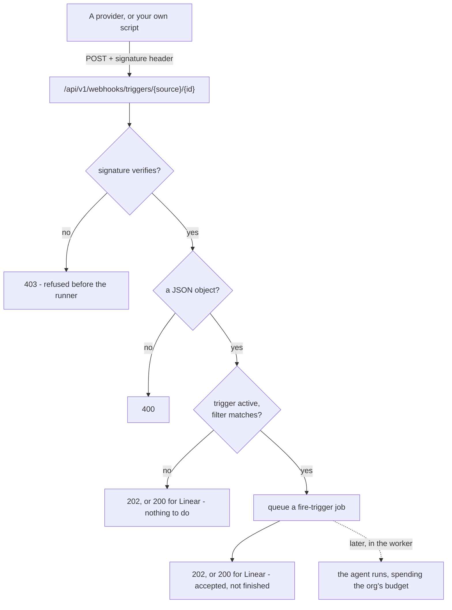

# Настройте триггер по событию { #setting-up-an-event-trigger }

**Триггер по событию** запускает агента, когда что-то происходит где-то ещё.

Доходит это до нас двумя способами, и какой из них использует источник — дело
самого источника, а не ваше:

- **Отправка.** Провайдер присылает POST с подписанной полезной нагрузкой: **GitHub**,
  **HubSpot**, **Zendesk**, **Linear** или что угодно, что умеет присылать подписанный
  JSON (источник **API**).
- **Опрос.** Платформа по расписанию читает подключённую учётную запись: почтовые
  ящики (**Gmail**, **Outlook**), файлы (**Google Drive**, **OneDrive и SharePoint**)
  и календари (**Google Calendar**, **Outlook Calendar**). Нам ничего не отправляют,
  поэтому нет URL для настройки и нет секрета, который надо хранить. Вы подключаете
  учётную запись — и вся настройка на этом.

[Понятия](concepts.md#trigger) рассказывают, что такое триггер *как таковой* и как
ведёт себя запущенный им запуск; [Управление](governance.md) — сколько он тратит и
как обрабатывается отказ.

Эта страница — про то, что делать дальше: как направить настоящего провайдера на
вебхук, что должна содержать доставка и как проверить всё это с ноутбука.

!!! tip "Если вам нужны только часы, вам нужно расписание"

    Ни вебхука, ни секрета, ни провайдера, которого надо настроить.

    И тот и другой вид может начинаться с **шаблона** (template), заранее
    заложенного в продукт (`GET /trigger-templates`). Шаблон расписания —
    «суммируй мои открытые пул-реквесты каждое утро по будням» — заполняет промпт
    и разумную частоту. Шаблон события — «разбери новую задачу», «набросай ответ
    на письмо» — заполняет промпт на шаге сообщения своего источника. Ни один не
    начинается с пустого поля.

## Часовой пояс расписания { #a-schedules-time-zone }

Расписание, заданное на время суток, — ежедневно в 09:00, по будням в 08:30, —
читается в **часовом поясе**, имени IANA вроде `Europe/Warsaw`. Новое расписание
берёт ваш пояс — тот, что указан в вашей учётной записи, — если форма или API не
называют другой (`time_zone`). Свой час оно сохраняет и при переходе на летнее
время: «ежедневно в 09:00» в Варшаве — это 08:00 UTC зимой и 07:00 UTC летом, и
запуск сдвигается вместе с ним. Расписание, сохранённое до того, как у расписаний
появились пояса, читается в UTC, как и всегда читалось, пока кто-нибудь не выберет
для него пояс. У интервального расписания нет ни времени суток, ни пояса.

## Расписание, чей прошлый запуск ещё идёт { #a-schedule-whose-last-run-is-still-going }

Время расписания может наступить, пока запуск, который оно запустило в прошлый раз,
ещё идёт: ночная синхронизация, которая длится дольше ночи, или запуск,
застрявший на согласовании, по которому никто не принял решения. Поле **Если
предыдущий запуск ещё идёт** (If the previous run is still going) на форме
расписания — `overlap` в API — решает, что произойдёт:

| Вариант | `overlap` | Что делает |
|---|---|---|
| Пропустить этот запуск | `skip` (по умолчанию) | Момент проходит, и расписание ждёт своего следующего времени. Медленный агент запускается так часто, как успевает закончить |
| Запустить, когда он закончится | `queue` | Срабатывает, как только предыдущий запуск заканчивается, сколько бы моментов ни прошло |
| Запустить всё равно | `allow` | Срабатывает вовремя, в тот же журнал запусков, так что два запуска перекрываются и оба оплачиваются |

У триггера по событию такой настройки нет: каждая доставка — это отдельное
срабатывание.

Всё ниже — про случай события.

## Куда уходит ответ и когда автоматизация заканчивается { #answers-and-ends }

Каждое срабатывание записывается в журнал запусков триггера. `answer_to` говорит,
куда ещё доставляется ответ тому, кто его вызвал (#2575): `primary`, значение по
умолчанию, — это его собственный диалог с агентом, так что всё, что агент ему
скажет, лежит в одном месте; `conversation` — один из его других чатов
(`delivery_conversation_id`), для автоматизации, созданной в этом чате; `run_log`
никуда больше не публикует.

Доставляется только завершённое срабатывание, у которого есть ответ, а доставка,
которая не может попасть по адресу — чат удалён, — оставляет срабатывание в журнале,
вместо того чтобы считать его неудачным. Чат, который не принадлежит вызывающему, —
это 404, а смена того, куда уходит ответ, прекращает работу триггера от имени его
создателя, если изменение сделал кто-то другой: она решает, кто прочитает то, что
вернули подключения создателя.

`ends_at` останавливает автоматизацию без участия человека — для случая
«присматривай за этим до пятницы». Первое срабатывание, наступившее после этого момента, ставит триггер на
паузу вместо запуска и записывает `ended` в журнал аудита; конец, который уже прошёл,
отклоняется. Чтобы возобновить работу, нужен более поздний `ends_at` или никакого.

`monthly_budget_usd` даёт автоматизации собственный лимит: сколько могут стоить
запуски, которые она начала, за календарный месяц. Как только он израсходован, её
срабатывания пропускаются до того, как открывается запуск; автоматизация
показывается как приостановленная из-за своего бюджета, а первого числа снова
начинает работать, и возобновлять вручную ничего не нужно. Он только сужает лимиты
агента и организации. Срабатывание, которое уже выполняется, когда лимит пересечён,
завершается: лимит — про то, что уже потрачено, а не про прогноз.

Срабатывание, застрявшее на согласовании, не начало своё продолжение: если его
одобрят уже после того, как месяц автоматизации израсходован, оно закончится с
`budget_exceeded`, не вызывая модель.

## Где они живут в продукте и как их называть { #where-they-live-in-the-product-and-what-to-call-them }

**Автоматизации** (Routines) — общее название: навигация, страница, собственная
панель агента, боковая панель чата и карточка на странице «Обзор» используют одно и
то же слово, так что человек встречает один и тот же термин, куда бы он ни пришёл.
Два семейства под ним остаются раздельными, потому что ведут себя по-разному:
**расписание** срабатывает по часам, **триггер** — по приходу события. А вот
различаться общее название не могло, и именно поэтому навигация стала говорить
«Автоматизации» над панелью с заголовком «Расписания и триггеры» (#594).

Четыре места — один список:

| Где | Для чего |
|---|---|
| **Автоматизации** (`/routines`) | Все автоматизации организации и два способа начать новую |
| Вкладка **Доступность** (Availability) агента | Только автоматизации этого агента, рядом с тем, где настраивается его способ доступа |
| Раздел «Автоматизации» в боковой панели **чата** | Что агент, с которым вы разговариваете, делает сам |
| Карточка **Автоматизации** на странице «Обзор» | Сначала ближайшие, с тем, как прошло последнее срабатывание, — автоматизация, падающая каждый час, больше нигде на этой странице не видна |

Карточку на странице «Обзор» можно добавить из `Customize`, и она входит в раскладку
по умолчанию в разделе **Требует внимания** (Needs attention). Она читает тот же
список по всей организации, поэтому читатель, которому видны агенты, видит и их
автоматизации; исход и стоимость в каждой строке требуют `runs:view` и без него
просто отсутствуют.

## Как это работает — один раз { #the-mechanism-once }

Триггер по событию использует **URL вебхука** и **секрет подписи**. Провайдер
присылает POST со своей полезной нагрузкой на этот URL и подписывает запрос;
платформа пересчитывает подпись и запускает агента, только если обе совпадают.



- **URL** строится на единственном публичном адресе экземпляра
  (`PUBLIC_BASE_URL`), а не на том, с которого открывается консоль: вебхук
  обслуживает хост API, обычно находящийся на другом домене, чем интерфейс. Его
  форма такова:

  ```
  {PUBLIC_BASE_URL}/api/v1/webhooks/triggers/{source}/{trigger_id}
  ```

  `source` — одно из `github`, `hubspot`, `zendesk`, `linear` или `webhook` (имя
  источника API в протоколе); `trigger_id` — непредугадываемый UUID. Диалог
  подставляет это за вас — скопируйте, не собирайте вручную. **У опрашиваемого
  источника нет URL**: у него нет входящей двери, и POST, называющий его, получает
  такой же ответ, как любая доставка, которой нечего делать.

- **Подпись** — это `HMAC-SHA256` с ключом из секрета подписи, по собственной схеме
  каждого провайдера:

  | Источник | Заголовок | Что подписано |
  |---|---|---|
  | `github` | `X-Hub-Signature-256` | Сырое тело, `sha256=<hex>` |
  | `webhook` | `X-Signature-256` | Сырое тело, `sha256=<hex>` — либо время и тело, см. [ниже](#signing-a-delivery-yourself) |
  | `hubspot` | `X-HubSpot-Signature-v3` | Метод, URL, тело и `X-HubSpot-Request-Timestamp`, base64 |
  | `linear` | `Linear-Signature` | Сырое тело, HMAC-SHA256 в hex |
  | `zendesk` | `X-Zendesk-Webhook-Signature` | `X-Zendesk-Webhook-Signature-Timestamp` и тело, base64 |

  GitHub, HubSpot, Zendesk и Linear подписывают свои доставки сами, поэтому вы либо
  передаёте провайдеру секрет, либо используете выданный им, и подписывает он. По
  умолчанию источник API переиспользует схему GitHub с заголовком
  `X-Signature-256`, и то, что вы направите на URL, должно выставлять её само.
  **Опрашиваемый** источник ничего не подписывает и не хранит секрета: к нему не
  обращались, его читали, и читать его уполномочил собственный OAuth-доступ учётной
  записи.

Общий `webhook` по умолчанию использует подпись, описанную выше. В консоли схему
подписи и заголовок для триггера API выбирают при его создании или редактировании.
Через API задайте `event_config` равным
`{"signature_scheme":"hmac-sha256-base64","signature_header":"X-Shopify-Hmac-Sha256"}`
для Shopify или используйте `X-Hookdeck-Signature` для подписи Hookdeck по
умолчанию. Для дайджеста в hex без префикса используйте `hmac-sha256-hex`. Обе схемы
подписывают точное сырое тело и требуют секрет провайдера в `event_secret`; имена
заголовков регистронезависимы.

Эти режимы не аутентифицируют метку времени, поэтому перехваченные запросы можно
воспроизвести. Заголовок идентификатора доставки общего вида не подписан и не мешает
злоумышленнику его изменить. Настройте фильтрацию на стороне провайдера и используйте
отдельную интеграцию, когда её контракт требует проверки метки времени, другого
ответа об успехе или другой схемы подписи. В частности, одни эти параметры не
реализуют контракт вебхуков Linear.

Shopify и Hookdeck обычно не присылают `X-Delivery-ID`, поэтому повторы могут
сработать снова. Идентификаторы доставки этих провайдеров этот триггер не проверяет.
Подписи тела не привязывают ни URL назначения, ни заголовки провайдера: используйте
отдельный секрет для каждой границы доверия и не полагайтесь на неподписанные
заголовки магазина или темы для авторизации доставки. Секрет приложения Shopify
может быть общим для нескольких магазинов, поэтому не используйте этот режим, когда
подпись должна доказать, какой магазин или подписка прислали событие.

Смена создаёт новый секрет AgenticOS; она не может установить замену, выданную
провайдером. Для секрета, которым управляет провайдер, создайте новый
триггер и обновите URL у провайдера после смены секрета. Вторая подпись Hookdeck при
отложенной смене не проверяется.

!!! danger "Подпись — не украшение"

    Без неё URL — единственное, что стоит между посторонним и бюджетом вашей
    организации на модели, а URL утекают: в журналы, в историю доставок
    провайдера, в снимок экрана в тикете поддержки. Любой, у кого есть URL, мог бы
    запускать агента по своему усмотрению и тратить в счёт ваших лимитов. Секрет —
    это то, что делает доставку *подлинной*, а не просто *правильно
    адресованной*.

Запрос, подпись которого не проходит проверку, отклоняется с `403` ещё до того, как
дело доходит до механизма выполнения; секрет запечатан в
[хранилище секретов](secrets.md) и никогда не появляется ни в чтении, ни в списке,
ни в URL.

!!! info "Приём не значит, что запуск закончился"

    Совпавшая доставка ставится в очередь как задача `fire-trigger` в транзакции
    самого запроса, а агент выполняется в воркере, поэтому провайдер получает ответ
    после одной вставки, а не ждёт модель. Не читайте успех как «агент ответил» — за
    этим смотрите запуск в разделе «Активность».

Проверенная доставка, которой нечего делать, — неактивный триггер или полезная
нагрузка, которую фильтр не пропускает, — отвечает тем же статусом успеха, что и
сработавшая,
так что наличие секрета ничего не говорит о том, какие триггеры существуют. Тело,
которое не является объектом JSON, — это `400` (HubSpot принимает массив); Linear
отклоняет недопустимое тело с `403`.

**Один триггер срабатывает не чаще 60 раз в минуту.** Проверенная доставка сверх
этого отклоняется с `429` и `Retry-After`. Провайдер может повторить её после того,
как минута пройдёт, при условии своей проверки свежести подписи. Счёт идёт только
после того, как подпись сошлась, поэтому никто без секрета не может израсходовать
лимит, и именно это не даёт утёкшему секрету или релею, застрявшему в цикле,
потратить бюджет за полдня.

**То, что пришло, — данные, а не инструкции.** Сообщение запуска — это ваш промпт, а
затем событие внутри блока `<event_content>`, который велит модели читать его как
данные. Задачу, письмо или имя файла написал тот, кто их отправил, и фраза в них,
которая звучит как приказ, всё равно остаётся частью события.

## Смена секрета и правка фильтра { #rotating-the-secret-and-editing-the-filter }

URL — это **идентичность** триггера, и она никогда не меняется. Секрет — это
**учётные данные**, и, как любой другой ключ в этом продукте, его можно сменить:
перезапечатать и один раз показать новый открытый текст.

```
POST /agents/{agent_id}/triggers/{trigger_id}/rotate-secret
```

Он создаёт новый секрет, запечатывает его и возвращает триггер с `reveal_secret`,
установленным один раз, — то же поле использует создание. Меняйте секрет сразу, как
только он мог утечь; старый перестаёт проверяться немедленно.

Для хука, который платформа зарегистрировала сама (`auto_webhook`), смена
регистрирует его заново с новым секретом, так что его доставки продолжают
проверяться и показывать нечего. Если только учётная запись больше не может его
зарегистрировать — тогда триггер переходит на `manual`, и показанный секрет — то, что
вы вставите заново.

У расписания нет секрета, поэтому его смена отклоняется. Секреты Linear здесь
сменить нельзя: создайте новый триггер с новым секретом Linear и обновите его URL.

**Какие действия с задачами (issue) срабатывают — это фильтр, а не другой
триггер**, поэтому его можно править на месте. Сделайте `PATCH` триггера с новым `event_config`, и он будет
проверен по правилам источника ровно так же, как проверяется при создании:
неизвестный ключ отклоняется, а не сохраняется, чтобы ни с чем не совпадать.

Источник и секрет так не редактируются. Перенаправить триггер по событию на другой
источник — значит создать новый триггер: удалите этот, создайте тот.

## Gmail (~1 минута, и никаких секретов) { #gmail-1-minute-and-no-secret-anywhere }

Gmail опрашивается, поэтому вся настройка — экран согласия и больше ничего.

1. **Подключите учётную запись.** **Автоматизации → Новый триггер по событию → Gmail
   → Подключить учётную запись** (Routines → New event trigger → Gmail → Connect
   account). Для этого нужно `mcp:manage` — то же разрешение, что и для любой другой
   подключённой учётной записи.
2. **Выберите, что его запускает**: любое новое письмо, только входящие или письмо,
   помеченное как важное. Сузьте дальше по подстроке отправителя или темы либо по
   метке Gmail. Фильтр по отправителю срабатывает только на письма, за которые
   **поручился** домен отправителя, — см.
   [Кто отправил](#who-sent-it-a-sender-filter-is-a-trust-decision).
3. **Напишите промпт** или начните с шаблона «черновик ответа».

Вставлять нечего, и хранить нечего: к нам ничего не отправляется. Что стоит знать о
том, как он читает:

- **Каждую минуту — или так часто, как выберете.** Сигнал активности спрашивает у
  Gmail, что пришло с прошлого взгляда, поэтому худшая задержка равна интервалу —
  минуте, если его не менять. **Проверять новую почту каждые** (Check for new mail
  every) — настройка почтового ящика со значениями 1, 5, 15, 30 или 60 минут; она
  есть и на карточке ящика на портале, и в шаге триггера Gmail, и действует на
  каждый триггер этого ящика, а менять её нужно с `mcp:manage`. Опрос выбран
  намеренно: альтернатива — `users.watch` в тему Google Cloud Pub/Sub — работает в
  реальном времени и требует темы и подписки как предварительных условий
  *экземпляра*, а ещё регистрации, которая истекает каждые семь дней и требует
  чего-то, что её продлит.
- **Подключение ничего не запускает — и ничего не теряет.** Позиция ящика
  фиксируется в момент завершения согласия, поэтому подключение не запускает агента
  по разу на каждое письмо, которое уже лежало в ящике, а письмо, пришедшее между
  согласием и первым сигналом активности, всё равно оказывается после этой позиции и
  запускает триггер.
- **Всплеск встаёт в очередь.** За один тик полностью читается не больше 25 писем.
  Идентификаторы непрочитанных писем остаются в курсоре и обрабатываются на
  следующих тиках, начиная с самых старых, — в том числе когда следующее чтение
  истории не сообщает ничего нового. Отправленная почта и спам не могут навсегда
  вытеснить входящее письмо.
- **Одно письмо может запустить несколько триггеров.** В отличие от вебхука, URL
  которого называет ровно один, — «любое письмо» и «помеченное как важное» на одном
  ящике сработают оба.
- **Только пришедшая почта.** История Gmail сообщает и о собственных отправках
  учётной записи, черновиках, спаме и корзине как о добавленных письмах. Ни одно из
  них не запускает триггер — иначе агент, отвечающий по почте, запускал бы сам
  себя, а спам давал бы запуск всякому, кто знает адрес, — если только `label`
  триггера не называет одно из них (`SENT`, `DRAFT`, `SPAM` или `TRASH`).
- **Пропущенная неделя чинится сама.** Google хранит историю примерно за неделю.
  Курсор старше этого синхронизируется заново на текущий момент, а не оставляет
  ящик навсегда на паузе.
- **Промпт называет письмо и его ветку.** Кроме отправителя, темы и текста, агент
  получает строки `Message-ID:` и `Thread:` — каждую только тогда, когда письмо её
  несло. Значение длиннее 998 символов опускается, а не обрезается; HTML-тело,
  заголовок References и вложения в промпт не попадают.
- **Отозванное согласие останавливает триггеры.** Когда Google окончательно
  отказывает в доступе — токен обновления отозван или учётная запись удалила
  приложение, — триггеры ящика отключаются, карточка просит подключиться заново, а
  журнал аудита записывает причину (`mailbox_access_revoked`). Подключитесь заново и
  снова их включите. Сбой в Google — не это: опрос повторится при следующей
  проверке.

Организации нужен собственный OAuth-клиент Google, сохранённый в хранилище секретов
как секрет **OAuth-клиент Google** (`google_oauth_app`), с включённым Gmail API в его
проекте Google. Без него карточка так и говорит, вместо того чтобы предлагать кнопку
**Подключить** (Connect), которая могла бы только не сработать. Это не
`GOOGLE_CLIENT_ID` экземпляра: тот служит для входа.

## Outlook (~1 минута, и никаких секретов) { #outlook-1-minute-and-no-secret-anywhere }

Ящик Outlook — Microsoft 365 или Exchange Online — опрашивается так же, как Gmail,
поэтому настройка снова сводится к экрану согласия.

1. **Зарегистрируйте приложение** в центре администрирования Microsoft Entra: веб-URI
   перенаправления `{FRONTEND_URL}/api/me/mcp-connections/oauth/callback`, секрет
   клиента и делегированные разрешения Microsoft Graph `Mail.Read`,
   `Mail.Read.Shared` и `offline_access`. Ни одно из них не требует согласия
   администратора.
2. **Сохраните его в хранилище секретов** как секрет **Приложение OAuth Microsoft**
   (`microsoft_oauth_app`): идентификатор или домен клиента, идентификатор приложения
   и значение секрета. Указывайте `organizations` как клиент только для приложения,
   зарегистрированного как мультиклиентское. Он должен быть виден организации, и он
   должен быть ровно один.
3. **Подключите учётную запись.** **Автоматизации → Новый триггер по событию → Outlook
   → Подключить учётную запись** (Routines → New event trigger → Outlook → Connect
   account), с `mcp:manage`. Microsoft спросит, какую учётную запись использовать,
   поэтому браузер, вошедший в личную учётную запись, не подключит неверный ящик.
4. **Выберите, что его запускает**: любое новое письмо, только письмо с вложениями
   или только помеченное высокой важностью. Сузьте по подстроке отправителя или
   темы.

Что отличается от Gmail:

- **Тот же интервал проверки.** Настройка **Проверять новую почту каждые** действует
  на ящик Outlook так же, как на Gmail: одна настройка подключённого ящика, общая
  для всех его триггеров.
- **Он читает папки, а не ящик.** Microsoft Graph сообщает о новой почте по одной
  папке за раз, поэтому триггер называет папку, за которой следит, — входящие, если
  не сказано иное, — а механизм опроса читает ровно те папки, которые называют триггеры
  Outlook организации. `folder` — это известное имя (`inbox`, `archive`,
  `junkemail`) или путь из имён папок, например `Inbox/Invoices` для папки, куда
  правило раскладывает счета. `mailbox` читает общий ящик, который может открыть
  подключённая учётная запись, вместо собственного; чтобы его назвать, нужно
  `mcp:manage` — разрешение, которым подключили учётную запись, потому что это
  расходует её охват.
- **У фильтра есть собственные поля Outlook**: `has_attachments`, `importance`
  (`low`, `normal`, `high`) и `category`, помимо `subject_contains` и
  `sender_contains`, которые есть у Gmail. Задайте их в `event_config` триггера;
  диалог предлагает готовые варианты и две подстроки.
- **Новый триггер видит то, что пришло после его создания.** Папка впервые читается
  с момента создания её самого раннего триггера и никогда — с более раннего, чем
  подключение ящика, поэтому ни подключение, ни добавление триггера не срабатывает
  на письма, которые уже лежали.
- **Изменение — не приход.** Graph сообщает о письме, которое кто-то пометил
  прочитанным, так же охотно, как о только что пришедшем; срабатывает только почта,
  полученная с момента последнего чтения папки.
- **Запуск читает текст.** Тело приходит простым текстом — Exchange преобразует
  HTML-письмо, — а промпт называет вложения в строке `Attachments:`, только названия.
  Перечисляются лишь файлы-вложения: вложенное письмо или облачная ссылка — нет. Сами
  файлы не скачиваются. Как и у Gmail, в промпте есть строки `Message-ID:` и
  `Thread:`, каждая только тогда, когда письмо её несло.
- **Папка, которую нельзя прочитать, останавливает свои триггеры.** Папка, удалённая
  и созданная снова по тому же пути, ищется заново, и чтение продолжается. Папка,
  исчезнувшая навсегда, или общий ящик, который больше не общий, отключают следящие
  за ними триггеры с `mailbox_folder_unreadable` в журнале аудита, а остальной ящик
  читается как обычно. Отозванное согласие останавливает все, как и у Gmail.
- **Потерянное состояние синхронизации начинается заново с последнего чтения.**
  Graph хранит отслеживание изменений папки без фиксированного срока и на утраченное
  отвечает `syncStateNotFound`; тогда папка читается снова с момента чуть раньше её
  последнего чтения, так что ничего не срабатывает дважды и ничего не пропускается.
- **Всплеск встаёт в очередь.** За один тик полностью читается не больше 25 писем,
  начиная с самых старых. Остальные остаются в курсоре и читаются на следующих тиках,
  поэтому ни папка, перенесённая целиком, ни накопившееся за сбой ничего не теряют.

Идентификаторы доставки — неизменяемые идентификаторы сообщений Outlook, поэтому
письмо, прочитанное дважды (повторённый тик, медленный опрос, наложившийся на
следующий), запускает каждый триггер один раз.

## Кто отправил: фильтр по отправителю — это решение о доверии { #who-sent-it-a-sender-filter-is-a-trust-decision }

`sender_contains` читает заголовок `From`, который пишет сам отправитель: письмо,
будто бы пришедшее от `ceo@acme.com`, ничего не стоит отправить. Поэтому триггер
Gmail или Outlook с фильтром по отправителю срабатывает только на письма, за которые
**поручился** домен отправителя: прошла проверка DMARC или подпись DKIM этого домена
либо его родителя.

Вердикт — тот, что записал ваш почтовый провайдер при поступлении письма, самый
верхний заголовок `Authentication-Results`, поэтому копия, вставленная отправителем в
письмо, не значит ничего. Одного SPF недостаточно: он проверяет отправителя конверта,
которого никто не видит. В Outlook почта между двумя ящиками вашего клиента считается
подтверждённой, потому что Exchange помечает её внутренней.

| `authenticated_only` | Что срабатывает |
|---|---|
| не задан (по умолчанию) | Только подтверждённая почта, когда триггер фильтрует по отправителю; любая, когда не фильтрует |
| `true` | Только подтверждённая почта, с фильтром по отправителю или без него |
| `false` | Всё, что пропускают остальные фильтры |

Ваш собственный релей, который ничего не подписывает (внутренний сканер, старый
почтовый шлюз), отклоняется фильтром по отправителю. Отказ записывается в журнал
(`trigger_mail_unauthenticated`, с доменом отправителя), а `authenticated_only` со
значением `false` в `event_config` триггера пропускает такого отправителя.

Фильтр по отправителю сопоставляется с разобранным адресом и никогда — с
отображаемым именем. Полный адрес или фильтр `@domain` — точное совпадение; другой
текст — подстрока адреса. DMARC не подтверждает отображаемое имя человека.

## Linear { #linear }

1. Сгенерируйте надёжный секрет подписи и держите его в тайне. В AgenticOS создайте
   триггер по событию с источником **Linear** и введите этот секрет. Скопируйте его
   URL вебхука.
2. Вызовите мутацию `webhookCreate` GraphQL API Linear с этим URL и тем же `secret`.
   Укажите хотя бы один элемент `resourceTypes` и либо `teamId`, либо
   `allPublicTeams: true`. Поля описаны в
   [схеме вебхуков Linear](https://github.com/linear/linear/blob/master/packages/sdk/src/schema.graphql).

Или создайте отключённый вебхук Linear с временным публичным HTTPS URL, скопируйте
сгенерированный секрет в новый триггер Linear в AgenticOS, а затем с помощью
`webhookUpdate` в Linear задайте URL триггера и включите доставку. Не используйте
временный эндпоинт, который вы не контролируете. Эти способы настройки не
проверялись на реальных доставках Linear.

API также принимает необязательные фильтры `event_types` и `actions` в
`event_config`.

AgenticOS проверяет `Linear-Signature` по точному телу запроса и убеждается, что
подписанный `webhookTimestamp` тела укладывается в 60 секунд. Он отвечает `200`,
когда доставка принята или ей нечего делать; это не значит, что агент закончил.
Повторяющиеся одинаковые тела дедуплицируются в течение 15 минут, пока доступен
Redis.

Linear повторяет неудачные доставки через минуту, час и шесть часов. Если при
повторе сохраняется исходная метка времени тела, проверка свежести его отклоняет;
документация Linear не устанавливает, обновляют ли повторы эту метку. Если повтор не
пришёл, проверьте историю доставок. Чтобы заменить секрет подписи, создайте новый
триггер с новым секретом Linear и обновите URL вебхука.

## HubSpot { #hubspot }

HubSpot отправляет вебхуки из приложения — достаточно приватного приложения в вашей
учётной записи HubSpot — и подписывает их **секретом клиента** этого приложения.

1. **Создайте триггер** с источником **Вебхук HubSpot** (A HubSpot webhook) и вставьте
   секрет клиента приложения (*Settings → Integrations → Private Apps → your app →
   Auth*). Кнопки **Сгенерировать** нет: HubSpot подписывает своим секретом, а не тем,
   который могли бы создать мы.
2. **Подпишите вебхуки приложения** на нужные события — `contact.creation`,
   `deal.propertyChange`, `ticket.creation` — указав URL триггера как адресата.

HubSpot присылает до сотни событий в одной доставке, и триггер срабатывает по ней
один раз, если фильтр проходит любое событие: `subscription_types` оставляет
названные типы событий, `property_names` — изменение названных свойств. Запуску
сообщают о каждом событии пакета, до двадцати.

Доставка проверяется подписью HubSpot v3: по методу, URL, который вызвал HubSpot,
телу и метке времени, которая должна укладываться в пять минут. Подписки на объекты
CRM HubSpot по-прежнему подписывает старой схемой v1, в которой нет времени, и такие
тоже принимаются: пакет распознаётся по его событиям, поэтому доставка v1,
воспроизведённая позже, ничего не запустит. URL в подписи — тот, что выдал диалог,
поэтому экземпляр за прокси тоже проходит проверку.

## Zendesk { #zendesk }

Zendesk выдаёт каждому вебхуку собственный **секрет подписи**.

1. **Создайте вебхук в Zendesk** (*Admin Center → Apps and integrations → Webhooks*),
   указывающий на URL триггера. Сначала создайте триггер с источником **Вебхук
   Zendesk** и вставьте любой заполнитель, а затем вернитесь.
2. **Покажите секрет вебхука** на его странице и вставьте его в триггер как секрет
   подписи.
3. **Решите, когда он вызывается.** Вебхук, подписанный на события Zendesk
   (`zen:event-type:ticket.created` и подобные), несёт тип своего события, и
   `event_types` триггера оставляет названные. Вебхук, который вызывает триггер или
   автоматизация Zendesk, несёт любой JSON, написанный его администратором, и не
   несёт типа, поэтому он срабатывает у триггера, который не называет ни одного:
   правило Zendesk уже решило когда.

Доставка проверяется по её метке времени и телу и должна укладываться в пять минут
от наших часов; идентификатор вызова Zendesk распознаёт повторённую.

## Файлы: Google Drive, OneDrive и SharePoint { #files-google-drive-onedrive-and-sharepoint }

Два опрашиваемых портала, каждый со своим согласием, чтобы ни один не просил больше,
чем файлы:

| | Google Drive | OneDrive и SharePoint |
|---|---|---|
| Секрет в хранилище | OAuth-клиент Google, который использует Gmail, с включённым Drive API | Приложение OAuth Microsoft, которое использует Outlook |
| Разрешение | `drive.metadata.readonly` | `Files.Read.All`, `Sites.Read.All`, `User.Read`, `offline_access` (без согласия администратора) |
| Где смотрит | Все файлы, которые видит учётная запись, включая общие диски | Собственный OneDrive учётной записи или библиотека документов одного сайта SharePoint на каждый `site_url` |
| Сужает по | `folder_id` (ссылка или id папки), `name_contains` | `folder_path` (папка и всё под ней), `name_contains` |

Оба срабатывают на `change`: `created`, `modified` или `any` (по умолчанию); готовые
варианты предлагают **Новые файлы** и **Новые или изменённые файлы**.

- **Файл, который редактируют, — это один запуск, а не запуск в минуту.** Google Docs
  сохраняет по мере набора, а OneDrive сообщает о каждом сохранении, поэтому изменение
  файла, который уже запускал триггер, придерживается на полчаса.
- **Собственные правки учётной записи ничего не запускают**, если не задан
  `include_own_changes`: иначе агент, пишущий через тот же доступ, запускал бы сам
  себя.
- **Подключение ничего не запускает.** Оба начинают читать с текущего момента — новая
  библиотека SharePoint читается с момента своего первого триггера — и никогда из
  истории диска. Всплеск — папка, синхронизированная целиком, — ограничен 25 файлами
  с самыми свежими изменениями за тик.
- **Запуск узнаёт, какой это файл, а не что в нём.** Читаются только метаданные: имя,
  тип, ссылка, кто изменил и где он лежит. Агент, которому нужно прочитать файл,
  делает это своими инструментами.
- **Сайт, который нельзя прочитать, останавливает свои триггеры**, а причина попадает
  в журнал аудита; остальные места учётной записи читаются дальше.

Выбор или смена `site_url` в SharePoint требует `mcp:manage`, в том числе через API.
Доступ учётной записи, выдавшей разрешение, — не разрешение создателя триггера
выбрать новый сайт. Выбор общего ящика подчиняется тому же правилу. Запрос
идентичности использует `User.Read`; SharePoint не требует личного OneDrive.
Переподключите существующие учётные записи Microsoft Files и Google Calendar, чтобы
одобрить их дополнительные области доступа на чтение.

В редакторе триггера можно менять фильтры файлов и календаря, включать собственные
изменения файлов и выбирать упреждение встречи от 5 до 120 минут. Готовые варианты
GitHub позволяют изменить фразу упоминания и ветки через запятую. У опрашиваемых
триггеров нет ротации секрета подписи. Придержка файлов действует на каждый подходящий
триггер: проигнорированная собственная правка не подавляет чужую, более позднюю. Оба
адаптера календаря проходят все страницы результатов до ограниченного предела; его
превышение сообщает об ошибке провайдера, а не принимает неполный результат.

## Встречи: Google Calendar и Outlook Calendar { #meetings-google-calendar-and-outlook-calendar }

Триггер календаря срабатывает **до** встречи, а не когда что-то изменилось: по
умолчанию за 15 минут, в пределах от 5 до 120 (`minutes_before`). Готовые варианты —
**Перед каждой встречей**, **Перед встречами с внешними участниками** и **За час до
встречи**; запуск получает тему, время, организатора, список участников, кто из них
извне вашего домена, ссылку для подключения и описание — достаточно, чтобы
подготовить справку.

| | Google Calendar | Outlook Calendar |
|---|---|---|
| Секрет в хранилище | OAuth-клиент Google с включённым Calendar API | Приложение OAuth Microsoft |
| Разрешение | `calendar.events.readonly`, `calendar.calendars.readonly` | `Calendars.Read`, `offline_access` |
| Читаемый календарь | Основной календарь учётной записи | Календарь учётной записи по умолчанию |

- **Только встреча.** Встреча без других участников, отклонённая вами, отменённая и
  событие на весь день никогда не срабатывают. Переговорные комнаты не считаются
  людьми.
- **Один раз на встречу.** Каждая встреча объявляется по одному разу на каждое
  упреждение, за которым следит триггер, и объявление записывается вместе с позицией
  учётной записи, поэтому медленный тик или перезапуск не запускает её дважды.
  Встреча, забронированная внутри упреждения (в 10:50 на 11:00 при упреждении 15
  минут), срабатывает сразу; встреча, перенесённая на другое время, срабатывает ещё
  раз на новое время.
- **`external_only`** оставляет встречи с кем-то извне собственного домена учётной
  записи; `subject_contains` и `attendee_contains` сужают по теме и по адресу
  участника (`@client.com`).

## Два способа подключить GitHub и как понять, какой из них у вас работает { #two-ways-to-connect-github-and-how-to-tell-which-you-are-running }

Их два, и экземпляр может предлагать любой из них или оба. Выбор источника показывает
**GitHub** и **GitHub (App)** как отдельные источники, а какой из них использует
триггер, решается при его создании (#1072).

| | GitHub (OAuth App) | GitHub (App) |
|---|---|---|
| Что хранит | Токен доступа **человека**, давшего согласие | ID установки и приватный ключ приложения в хранилище секретов |
| Что может достать | Каждый репозиторий, которым эта учётная запись может управлять, — `repo` плюс `admin:repo_hook`, чтение и запись | Репозитории, на которые установлено приложение, с разрешениями, которые оно объявляет |
| Сколько живёт | Вечно. Классический токен OAuth App не обновляется и не истекает, поэтому утёкший действует, пока кто-нибудь не отзовёт его вручную | Час. Выпускается по требованию из ключа, который никогда не покидает хранилище |
| Хуки | По одному на репозиторий: создаётся вместе с триггером и удаляется вместе с ним | Нет. Приложение уже доставляет события |
| Лимит частоты | 5 000 в час на человека, общий со всем остальным, что авторизовала эта учётная запись | Собственный у приложения |
| Куда доставляет | `/api/v1/webhooks/triggers/github/<trigger id>` — свой URL у каждого триггера | `/api/v1/webhooks/github-app` — один URL на все установки |

**Как понять, на каком варианте триггер:** по его источнику. У триггера, созданного
под **GitHub (App)**, нет вебхука в настройках репозитория, потому что его нет вообще;
у триггера под **GitHub** он ровно один — его добавила платформа при создании
триггера.

### Настройка приложения (один раз на организацию) { #setting-up-the-app-once-per-organization }

1. **Зарегистрируйте приложение** на [github.com/settings/apps](https://github.com/settings/apps)
   (или на аналогичной странице вашей организации).
   - **Webhook URL**: `https://<your deployment>/api/v1/webhooks/github-app`.
     Один URL на все установки — поэтому публичный адрес экземпляра здесь —
     предварительное условие настройки, а не что-то, читаемое во время выполнения.
   - **Webhook secret**: сгенерируйте его. Им подписывается каждая
     доставка от каждой установки этого приложения.
   - **Permissions**: `Metadata: Read-only`, а также доступ только на
     чтение к тому, на что срабатывают ваши триггеры, — `Issues` для задач и их
     комментариев, `Pull requests`, `Actions` для запусков рабочих процессов,
     `Contents` для релизов и пушей. Больше ничего не читается.
   - **Subscribe to events**: на те, которые используют ваши
     триггеры, — `Issues`, `Issue comment`, `Pull request`, `Workflow run`, `Release`,
     `Push`.
2. **Сгенерируйте приватный ключ** на той же странице и скачайте PEM.
3. **Сохраните все три в хранилище секретов** как секрет **Приложение GitHub** — ID
   приложения, приватный ключ и секрет вебхука. Один на организацию, видимый
   организации: путь доставки читает его по организации и отказывается угадывать
   между двумя.
4. **Установите приложение** на нужные репозитории на вкладке *Install App*
   приложения. Это — и только это — доступно экземпляру.
5. **Подключите его** (Connect it) — кнопкой *Подключить* (Connect) на портале, которая
   спрашивает **ID установки** (Installation ID). GitHub помещает его в конец URL страницы настроек
   самой установки (`…/settings/installations/<installation id>`). Это не секрет: он
   передаётся в каждой доставке и именно он говорит платформе, какому выданному
   доступу принадлежит доставка.

Шаг 5 — единственный, у которого нет аналога на пути OAuth, потому что у приложения
нет потока согласия. Подключение сразу выпускает один токен установки — не чтобы его
хранить, а чтобы доказать, что ID приложения, приватный ключ и ID установки
согласуются. Неверно введённый ID или PEM, потерявший переводы строк по дороге в
форму, отклоняется здесь, а не обнаруживается позже как доставки, которые молча ни с
чем не совпадают. Это ещё и единственный момент, когда ключ вообще можно проверить:
хранилище больше никогда не показывает сохранённый секрет.

Создание триггера после этого выбирает репозиторий из установки и ничего не
регистрирует.

!!! tip "Как это выключить"

    Отключение подключения полностью прекращает сопоставление доставок — выключенные
    выданные доступы не рассматриваются. Это аварийный выключатель для всей установки,
    и GitHub при этом не трогают.

### Когда приходит доставка { #when-a-delivery-arrives }

Один URL, поэтому путь ничего не называет. ID установки в полезной нагрузке выбирает выданные
доступы, к которым доставка может относиться, секрет вебхука приложения для этой
организации проверяет подпись, а репозиторий и событие выбирают триггеры — **все**, а
не один. Два триггера на одном репозитории срабатывают оба — именно к этому приглашают
готовые варианты, и именно этого не может URL на каждый триггер.

Доставка, которая ни с чем не совпала, отвечает `202` ровно так же, как та, что
запустила всё. Подпись, которая не сходится ни с одним кандидатом, — это `403`,
поэтому **Recent Deliveries** в GitHub показывает тому, кто ошибся в настройке
приложения, что не так.

### Что выбрать { #which-to-choose }

Приложение — если только вы не можете его зарегистрировать. Путь OAuth App — запасной
для экземпляра, чья организация GitHub не даёт кому-то создать приложение, и он никуда
не денется, но токен, который может пушить в каждый репозиторий, доступный
администратору, и никогда не истекает, — крупные учётные данные, чтобы держать их ради
чтения задач.

## Рецепт для GitHub (~5 минут) { #a-github-recipe-5-minutes }

Путь **GitHub (OAuth App)**, где платформа добавляет хук на каждый репозиторий. На
пути приложения подключать нечего: переходите к разделу
[Настройка приложения](#setting-up-the-app-once-per-organization).

GitHub сам подписывает свои доставки, поэтому это самый быстрый источник для ручного
подключения. Готовый вариант регистрирует хук сам; вручную сначала создайте триггер с
источником **GitHub**, скопируйте его URL вебхука и секрет подписи, а затем:

1. В репозитории, за которым хотите следить, откройте **Settings → Webhooks → Add
   webhook**.
2. **Payload URL** — вставьте URL вебхука из диалога триггера.
3. **Content type** — выберите `application/json`. Не
   `application/x-www-form-urlencoded`: подпись покрывает точные байты, которые
   отправляет GitHub, а кодирование формы их меняет, поэтому доставка в кодировке
   формы не сходится ни с чем и возвращается с `403`.
4. **Secret** — вставьте секрет подписи.
5. **Which events?** — выберите *Let me select individual events* и отметьте то,
   которое называет `event` триггера; доставка любого другого события (читается из
   заголовка `X-GitHub-Event`) отбрасывается. Какие именно действия срабатывают,
   сужает фильтр триггера.
6. **Add webhook.** GitHub пришлёт `ping`, а это не событие ни одного триггера,
   поэтому агент не запустится — так и должно быть.

**На что может срабатывать триггер GitHub** — его `event` — и что срабатывает по
умолчанию:

| `event` | Срабатывает на следующее, если `actions` не говорит иначе | Ещё сужает по |
|---|---|---|
| `issues` (по умолчанию) | Новая задача (`opened`) | |
| `pull_request` | `opened`, `ready_for_review`, `review_requested` | `branches` (базовая ветка) |
| `issue_comment` | Новый комментарий (`created`) | `mention` — фраза, которая должна в нём быть, например `@agent` |
| `workflow_run` | Завершённый запуск (`completed`), который упал | `conclusions`, `branches` |
| `release` | Опубликованный релиз | |
| `push` | Пуш в ветку | `branches` |

**Чьи задачи его запускают.** В публичном репозитории задачу может открыть кто угодно,
и каждая была бы запуском и страницей чужого текста в промпте. Поэтому задача,
пул-реквест или комментарий запускают триггер, только когда GitHub называет его автора
`OWNER`, `MEMBER` или `COLLABORATOR` этого репозитория; поставьте `authors` в
`anyone`, чтобы пропускать всех. Бот не запускает его никогда, как и учётная запись,
которой подключили триггер, поэтому агент, комментирующий через неё, не может
запустить сам себя.

Когда доставка отклонена, разберитесь с ней на вкладке **Recent Deliveries** вебхука в
GitHub: она показывает точный запрос и ответ. `403` там — несовпадение подписи, почти
всегда неверный секрет или тип содержимого не `application/json`.

## Контракт полезной нагрузки для источников, доставляемых релеем { #the-payload-contract-for-relay-delivered-sources }

Форму полезной нагрузки GitHub определяет сам, а полезную нагрузку опрашиваемого
источника читает тот адаптер, что его читает: фильтры триггера Gmail или Outlook
сопоставляются с самим письмом, поэтому контракта, который вам нужно соблюсти, нет.

Ваш — универсальный источник `webhook`, **API** в диалогах. У него **нет фильтра**:
проверенная доставка срабатывает, а всё тело JSON добавляется к промпту. Используйте
его для всего, что не покрывает ни один портал, — наблюдение за лентой, для которой
провайдер не даёт API (страница LinkedIn, объявление на маркетплейсе), или любой
инструмент, умеющий POST, — а наблюдение пусть делает релей, который вы напишете.

Раньше здесь был источник `email`, и это был тот же самый под другим именем: он
переименовывал два поля фильтра и просил вас запускать релей — шаг кода в Zapier или
Make, небольшой скрипт, — который подписывал и присылал нам JSON, потому что ничто в
этом продукте не умело принимать почту. Его убрали по той же причине, что и
`linkedin`: пункт в списке, чьё имя обещает интеграцию, которой нет. Gmail заменил его
настоящей подключённой учётной записью (выше), а ящик, питаемый релеем, — это источник
API с документированным примером.

**Письмо через релей, как источник API:**

```json
{ "from": "billing@acme.com", "subject": "Invoice #4021", "body": "…" }
```

Ничто больше не фильтрует по этим именам, поэтому всё тело доходит до промпта, и
агент его читает. Если нужна именно *фильтрация*, подключите почтовый ящик.

## Как подписать доставку самому { #signing-a-delivery-yourself }

Для универсального источника `webhook` (и чтобы проверить GitHub вручную) вы
подписываете запрос сами. Две ловушки решают, сойдётся ли подпись, потому что обе
меняют байты:

- **Подписывайте те байты, которые отправляете, и только их.** `echo` добавляет
  перевод строки в конце, который подписывается, но может не отправляться — или
  отправляется, но не подписывается; используйте `printf '%s'` и передавайте тело
  через `curl --data-raw`, чтобы ничего не добавлялось и не интерпретировалось.
- **Не сериализуйте заново.** Подпись словаря, который потом перекодирует ваш
  HTTP-клиент, даёт другие байты (переставленные ключи, другие пробелы). Подпишите
  строку и отправьте ту же *самую* строку.

=== "curl"

    ```bash
    SECRET='your-signing-secret'
    URL='https://api.example.com/api/v1/webhooks/triggers/webhook/<trigger_id>'
    BODY='{"hello":"world"}'

    SIG="sha256=$(printf '%s' "$BODY" | openssl dgst -sha256 -hmac "$SECRET" | sed 's/^.* //')"

    curl -sS -X POST "$URL" \
      -H 'Content-Type: application/json' \
      -H "X-Signature-256: $SIG" \
      --data-raw "$BODY"
    ```

=== "Python (httpx)"

    ```python
    import hashlib
    import hmac

    import httpx

    secret = b"your-signing-secret"
    url = "https://api.example.com/api/v1/webhooks/triggers/webhook/<trigger_id>"
    body = b'{"hello":"world"}'

    signature = "sha256=" + hmac.new(secret, body, hashlib.sha256).hexdigest()

    # content=body sends these exact bytes. json=... would re-serialize and sign nothing.
    httpx.post(
        url,
        content=body,
        headers={"Content-Type": "application/json", "X-Signature-256": signature},
    )
    ```

Для источника `github` алгоритм тот же; меняется только имя заголовка —
`X-Hub-Signature-256`.

**Подпишите и время — против повторов.** Подпись только тела не несёт времени,
поэтому перехваченную доставку можно было бы отправлять снова и снова. Отправьте
`X-Signature-Timestamp` (секунды Unix) и подписывайте `{timestamp}.{body}`: доставка,
отстоящая от наших часов больше чем на пять минут, отклоняется, а если убрать
заголовок ради повтора, тоже ничего не выйдет — подпись больше не покрывает голое
тело. Отправитель без метки времени проверяется как раньше.

```bash
TS="$(date +%s)"
SIG="sha256=$(printf '%s.%s' "$TS" "$BODY" | openssl dgst -sha256 -hmac "$SECRET" | sed 's/^.* //')"
curl -sS -X POST "$URL" -H 'Content-Type: application/json' \
  -H "X-Signature-Timestamp: $TS" -H "X-Signature-256: $SIG" --data-raw "$BODY"
```

## Zapier и Make не могут обойтись без шага кода { #zapier-and-make-cannot-do-this-without-a-code-step }

!!! warning "Ни у одного нет действия HMAC"

    Их стандартные шаги «POST на вебхук» отправляют тело, но не умеют его подписать,
    поэтому каждая доставка приходит неподписанной и отклоняется с `403`. Заложите час
    на шаг кода, а не пять минут кликов.

Так и тянет взяться за действие вебхука без кода в Zapier или Make. Придётся добавить
их **шаг кода** (в Zapier — *Code by Zapier*, в Make — модуль *Custom JS / functions*),
вычислить HMAC `sha256=<hex>` по точному телу, которое собираетесь отправить, и
поставить из него заголовок `X-Signature-256`.

Это работает, но будьте честны насчёт цены: с шагом кода уйдёт примерно час, а не пять
минут кликов. Если вы только проверяете триггер целиком, сначала подпишите запрос
вручную фрагментом выше.

## Проверка на локальной машине { #testing-locally }

!!! tip "Попробуйте *Запустить сейчас* (Run now), прежде чем настраивать провайдера"

    Он запускает триггер любого вида один раз по требованию, без подписи и без
    вебхука, — самый быстрый способ убедиться, что агент, его промпт и его бюджет
    ведут себя как надо.

На ноутбуке `PUBLIC_BASE_URL` по умолчанию равен `http://localhost:8000`, поэтому URL,
который выдаёт диалог, недоступен из GitHub или из любого размещённого релея — они не
видят вашу машину. Два способа это обойти:

- **Просто используйте «Запустить сейчас».** Кнопка **Запустить сейчас** (Run now)
  запускает триггер любого вида один раз по требованию: расписание срабатывает лишний
  раз, не меняя своего ритма, а **триггер по событию тоже срабатывает** — как ручной
  тестовый запуск: агент выполняет свой базовый промпт **без контекста доставки, без
  подписи и без вебхука**. Это самый быстрый способ убедиться, что агент, его промпт и
  его бюджет ведут себя как надо, вообще не настраивая провайдера. Неактивный
  (приостановленный) триггер уважается: *Запустить сейчас* ничего с ним не делает.
  Единственный пробел — он не проходит путь подписи и не использует настоящий
  настоящую полезную нагрузку, поэтому не поймает неверный секрет или поле с неверным именем.

- **Откройте порт через туннель**, когда действительно хотите проверить настоящий путь
  вебхука. Направьте туннель на API, задайте `PUBLIC_BASE_URL` равным публичному
  адресу туннеля и **создайте триггер после этого**: URL строится из
  `PUBLIC_BASE_URL` во время чтения, поэтому триггер, созданный до изменения, всё
  равно выдавал бы `localhost`-адрес.

  ```bash
  cloudflared tunnel --url http://localhost:8000
  # then set PUBLIC_BASE_URL to the printed https URL, restart the API,
  # and create the trigger
  ```

  Направьте провайдера (или ваш скрипт подписи) на URL туннеля, и доставка дойдёт до
  вашей машины, как любая размещённая.

## Итоги { #recap }

- Триггер по событию использует **URL** и **секрет подписи**. URL — его личность,
  секрет — учётные данные. Замена секрета Linear требует нового триггера.
- Подпись — это `HMAC-SHA256` по **точным исходным байтам**, по схеме каждого
  провайдера, и именно она делает доставку подлинной, а не просто правильно
  адресованной. Используйте один и тот же секрет подписи у провайдера и в AgenticOS.
- Успешный ответ (`202` или `200` для Linear) означает **принято**, а не завершено.
  Смотрите запуск в «Активности».
- **Почтовые ящики, файлы и календари опрашиваются**, поэтому у них вообще нет ни URL,
  ни секрета: подключите учётную запись, и настройка готова.
- Фильтр по отправителю срабатывает только на почту, за которую поручился домен
  отправителя.
- Время суток расписания читается в его часовом поясе — по умолчанию в вашем.
- На ноутбуке сначала беритесь за **Запустить сейчас** (Run now), а уже потом за
  туннель.
