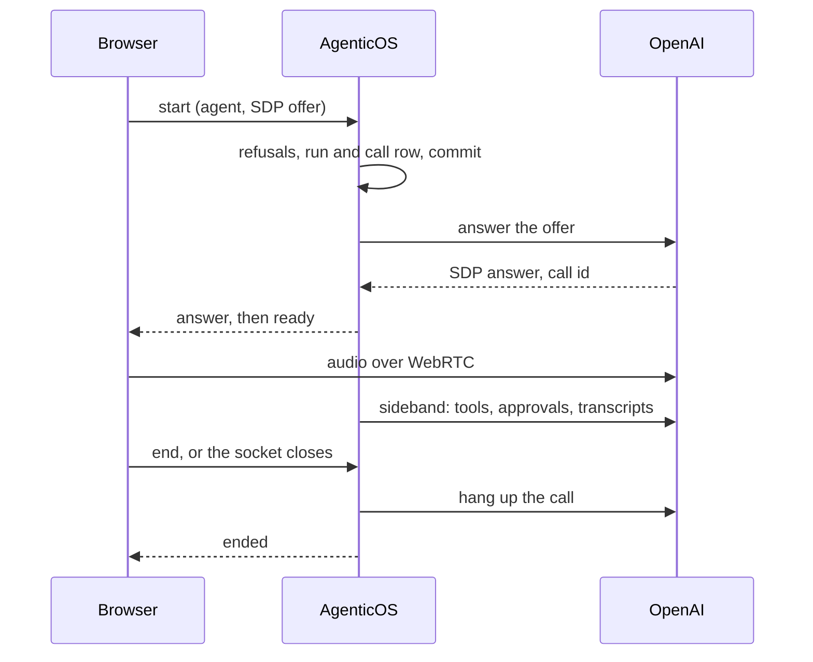

# Голосовые разговоры { #voice-conversations }

**Голосовой звонок** — это разговор вслух с опубликованным агентом. Вы говорите,
агент отвечает вслух, и вы можете перебить его на полуслове. Агент сохраняет всё,
что у него есть в текстовом чате: свои инструменты, свои знания, свои
согласования и свои бюджеты. Каждый ход звонка сохраняется как текст в том же
диалоге, поэтому его можно перечитать или продолжить, набрав текст. Аудио не
сохраняется нигде.

Звонки совершаются из `/chat` в консоли, а также из виджета или с размещённой
страницы, когда в настройках встраивания включён его собственный переключатель
голосовых звонков. Каждый звонок — это один [запуск](concepts.md), в котором указана
модель реального времени, поэтому «Активность», экран стоимости и журнал аудита видят
его как любой другой запуск.

В `/chat` звонок — это плавающая плашка над полем ввода, и её состав не меняется:
состояние, время, звуковая волна, выключение микрофона, режим рации и «Завершить».
Звонок идёт в диалоге: каждый ход показан сообщением, в которое он
превращается, а между ними — запуски инструментов и карточки согласования.
Черновик сообщения и его вложения остаются в поле ввода, когда звонок
заканчивается. Размещённая страница использует панель звонка без элементов
согласования, а виджет загружает собственную, меньшую. См.
[Консоль](console.md#voice-calls) и
[Каналы](channels.md#voice-calls-on-a-widget-or-a-hosted-page).

Смена организации или вход в другую учётную запись завершает звонок в консоли и
отменяет незавершённую настройку или переподключения. Если разрешение на микрофон
приходит после этого, его дорожки останавливаются, и звонок старой организации не
открывается. Публичные встраивания сохраняют отдельную область для посетителя.

## Включение { #turn-it-on }

**Звонки включаются в агенте.** У организации нет настроек звонков: опубликованный
агент с голосом принимает звонки в пределах своей максимальной длительности звонка и
бюджетов — как и любой запуск.

**Агент.** Его карточка **Голос** (Voice) в Конструкторе перечисляет **Звонки** (Voice
calls) и **Диктовка** (Dictation) вертикально, без внутренних вкладок. У каждого свой
переключатель. Настройки транскрипции остаются доступными для правки, когда
диктовка выключена, потому что они же применяются к голосовым заметкам в каналах.
Раздел звонков записывается в [поле `voice`](reference/spec.md#voice)
спецификации. В нём указываются провайдер, модель (а для Azure — имя развёртывания
и базовая модель, на которой оно работает), ключ хранилища секретов, на котором
держатся звонки, голос, необязательный язык, необязательная максимальная длительность
звонка (10 минут, если не задана, максимум 50) и необязательная голосовая заметка.
Заметка добавляется к инструкциям агента только во время звонков. Раздел вступает в
силу при публикации агента.

**Сначала послушайте голос.** Кнопка воспроизведения рядом с выбором голоса
проигрывает одну фразу голосом черновика, на языке раздела или консоли, ещё до того,
как что-либо опубликовано. Это короткий платный сеанс на ключе
раздела, вне бюджетов, как диктовка, поэтому он ограничен на человека
(`RATE_LIMIT_VOICE_PREVIEW_PER_MINUTE`) и кэшируется на неделю для каждого голоса и
языка.

**Кнопку предлагает каждый агент.** В `/chat` кнопка звонка стоит на месте кнопки
«Отправить», пока поле пустое, а «Отправить» возвращается, как только что-то
набрано. У агента без голоса или с ключом, который больше не может держать звонок,
она перечёркнута, и её причина ведёт того, кто может править агента, к разделу
звонков в карточке «Голос». Окно Архитектора и панель проверки в Конструкторе
предлагают её так же; в панели проверки звонок идёт на опубликованной версии, а не
на проверяемом черновике, и кнопка об этом говорит.

**Встраивание.** Виджет или размещённая страница предлагают звонки, только когда
включён их собственный переключатель **Голосовые звонки** (Voice calls). Сохранение
включённого переключателя отклоняется, пока у агента нет опубликованного голоса, с
которым можно звонить. См.
[Каналы](channels.md#voice-calls-on-a-widget-or-a-hosted-page).

## Модели и ключи { #models-and-keys }

Модели, которые может использовать звонок, берутся из одного файла каталога,
`backend/app/core/catalog/realtime_models.json`, описанного в разделе
[Модели](models.md#realtime-models). Для голоса нет ни профиля модели, ни умолчания
организации: модель реального времени указывается только в разделе «Голос» агента.

| Провайдер | Модели | Транспорт | Проверено |
|---|---|---|---|
| OpenAI | `gpt-realtime`, `gpt-realtime-2.1`, `gpt-realtime-2.1-mini` | WebRTC | Проверено вживую |
| Azure OpenAI | развёртывание `gpt-realtime` | Ретрансляция | **Вживую не проверено** |
| Google | Gemini Live: `gemini-2.5-flash-native-audio-latest`, `gemini-3.1-flash-live-preview` | Ретрансляция | **Вживую не проверено** |
| xAI | `grok-voice-latest`, оплата по минутам | Ретрансляция | **Вживую не проверено** |
| ElevenLabs | `eleven_realtime_v1_mini`, `eleven_realtime_v1_max` | Ретрансляция | **Вживую не проверено** |

Только OpenAI удалось проверить на реальной учётной записи. Azure, Gemini,
ElevenLabs и xAI собраны по документации провайдеров и Pydantic AI и проверены на
заглушках. Они должны работать, но проверьте их на своей учётной записи, прежде чем
полагаться на них.

**Ключ — это явный секрет из хранилища.** Его назначение должно быть провайдером, а
вид — совпадать: `api_key` или секрет `azure_openai` для Azure, который также несёт
эндпоинт и версию API. Публикующий должен видеть ключ, как и при любой
привязке. См. [Секреты](secrets.md#where-they-are-used).

**GPT-Live не предлагается.** Он принимает историю диалога только при старте сеанса
и не поддаётся перенастройке, поэтому переподключение не смогло бы продолжить
звонок, который оно возобновляет.

## Как проходит звонок { #how-a-call-runs }

Браузер открывает сокет к этому экземпляру, `/api/v1/ws/voice`, и отправляет кадр
`start`, в котором назван агент и, необязательно, диалог. Всё, что связано со
звонком, проходит через этот сокет: кадры перечислены на
[странице API](api.md#voice-calls).

**OpenAI, через WebRTC.** Браузер устанавливает одноранговое соединение со своим
микрофоном и отправляет SDP-предложение внутри `start`. Сервер передаёт его
провайдеру, получает ответ и отправляет его обратно, а затем держит *боковое*
(sideband) соединение с тем же звонком, пока открыт сокет. Аудио идёт между браузером
и OpenAI; инструменты, согласования, транскрипты и учёт стоимости выполняются на
сервере. Сервер читает сокет, пока настраивает звонок, поэтому `end` или закрытая
вкладка останавливают настройку до того, как откроется сеанс у провайдера. Предложению,
уже отправленному провайдеру, дают завершиться, после чего созданный им звонок
завершается, чтобы он не работал до собственного предела провайдера.

Две вещи отклоняются намеренно. Предложение, открывающее **канал данных** (секцию
`m=application`), отклоняется: браузеру он никогда не нужен, а канал данных позволил
бы странице посылать события провайдеру за спиной сервера. И **клиентский секрет не
выпускается никогда**, поэтому браузер никогда не держит учётные данные, которыми
можно открыть собственный звонок.

**Azure, Gemini и xAI, через ретрансляцию.** Браузер передаёт 16-битное PCM-аудио
через тот же сокет, с входной частотой модели, и воспроизводит то, что возвращается,
с её выходной частотой. Когда вы говорите поверх агента, сервер обрывает его ответ и
велит браузеру отбросить то, что уже в очереди. Аудио, приходящее намного быстрее,
чем кто-либо говорит, отбрасывается, а длительный поток завершает звонок.

## Что доступно в звонке { #what-a-call-can-use }

Звонок запускает агента в том виде, как его описывает опубликованная спецификация,
собранного той же фабрикой, что и текстовый запуск. Различия идут от сеанса
реального времени: его инструменты фиксируются при подключении звонка, он не может
встать на паузу ради согласования и не может взять с собой рабочее пространство,
браузер, рабочий стол или агентов-исполнителей. Всё это звонок вместо этого передаёт
собственной текстовой модели агента.

| Голосом | Возможности |
|---|---|
| Как есть | дата и время (время в инструкциях фиксируется при подключении звонка), контекст, знания, поиск в интернете, чтение веб-страниц, диаграммы, приложения, вычисления, прошлые диалоги, память, планирование, лимиты вывода инструментов, генерация изображений, синтез речи |
| На экране | вопросы пользователю: в `/chat` карточка вопроса появляется в представлении звонка и зачитывается вслух, а звонящий нажимает ответ или произносит его; звонку из виджета или с размещённой страницы она не предлагается |
| Адаптировано | навыки: загружаются как инструкции по запросу, без инструментов, которыми текстовый запуск их читает |
| Отброшено | поиск инструментов: MCP-инструменты, которые он отложил бы, передаются звонку напрямую |
| Сопоставлено | размышления: превращаются в собственную настройку рассуждений модели реального времени, если у модели она есть |
| Передано | песочница, веб-браузер, управление компьютером, субагенты, агент для работы с кодом, генерация видео, работа в ожидании инструментов: выполняется текстовой моделью агента, см. [Передача работы](#handing-work-off) |

Карточка «Голос» в Конструкторе перечисляет возможности, которые этот агент
передаёт в звонках.

### Передача работы { #handing-work-off }

Когда у агента есть возможность, которую звонок не может использовать, его звонок
получает ещё один инструмент, `hand_off`. Модель звонка описывает задачу, и тот же
агент выполняет её на своей текстовой модели — той, что указана на вкладке
«Конструктор»: с песочницей, браузером и субагентами, в том же рабочем
пространстве, под тем же бюджетом. Он отвечает тем, что сделал, и модель звонка
произносит это вслух.

- **Звонок тем временем продолжается.** Агент сначала говорит, что работает над
  этим, а панель звонка показывает каждый шаг по мере выполнения.
- **Каждый шаг сохраняется.** Шаги сохраняются на том ходе, который передал
  работу, поэтому диалог потом показывает их так же, как показывает шаги чата.
- **Согласования принадлежат звонку.** Инструмент, требующий согласования, который
  вызывает текстовая модель или один из её субагентов, показывает ту же карточку
  согласования, что и вызов из звонка. Звонок посетителя и здесь не получает ни одного
  инструмента, требующего согласования.
- **Звонок, который всегда спрашивает, решается в тексте.** Такой инструмент, как
  `share_memory`, ждёт, пока кто-то прочитает, что именно он изменит, а карточка
  звонка этого показать не может. Звонок отказывает ему, и агент предлагает
  спросить в текстовом чате.
- **Одна передача за раз.** Каждая продолжает с того, на чём остановилась предыдущая
  в этом звонке, поэтому «а теперь отправь этот файл» работает после «напиши это».
- **О неудаче говорят, её не скрывают.** Передача, у которой кончился бюджет или
  шаги либо чья модель дала сбой, возвращается фразой, которую агент произносит;
  звонок продолжается.

Передача занимает столько же, сколько сама работа, часто минуту или больше, и
тратит и на текстовую модель, и на модель звонка.

**Встроенный стиль речи.** Каждый звонок добавляет к инструкциям агента одни и те
же указания: короткие фразы; никакой разметки, списков, таблиц и ссылок вслух;
числа и даты произносятся так, как их произносит человек; имена, суммы, адреса и
даты зачитываются обратно, прежде чем действовать по ним; и говорить о том, что
ждёт согласования, вместо того чтобы сначала объявить результат. Звонку посетителя
о согласованиях не говорят ничего; вместо этого агенту велят прямо говорить, чего
он не может сделать в звонке. Голосовая заметка агента идёт следом.

При WebRTC агент собирается дважды: один раз, чтобы ответить на предложение, и один
раз для бокового соединения. MCP-серверы подключаются дважды, динамические
инструкции выполняются дважды, поэтому поиск в памяти оплачивается дважды; и то и
другое учитывается в запуске.

## Согласования в звонке { #approvals-in-a-call }

Сеанс реального времени не может встать на паузу, поэтому согласование решается
внутри звонка.

Когда агент вызывает инструмент, которому нужно согласование, сервер сразу
записывает строку согласования и показывает человеку в звонке карточку: инструмент,
**точные аргументы, с которыми он будет выполнен**, и то, что услышали от
звонящего. Риск здесь — неверно расслышанное имя («Acme» как «Ahmad»), и карточка
служит его проверкой. Одобрение выполняет ровно эти аргументы, один раз; повторный
вызов того же инструмента требует нового согласования. Второе решение по той же
карточке, отправленное до того, как дошло первое, ничего не меняет: первое решение
остаётся в силе.

- **60 секунд** без решения — и запрос истекает без того, кто его принял, а агент об
  этом говорит.
- Решает только **человек в звонке**, и только с `approvals:decide`. Очередь
  согласований отклоняет запрос, принадлежащий действующему звонку, а фоновая очистка
  устаревших запросов его не трогает.
- У участника **без** `approvals:decide` инструмент остаётся. Когда агент тянется к
  нему, звонок показывает уведомление, инструмент отклоняется, и агент говорит, что
  здесь нужно согласование, которое звонящий не может дать голосом, и предлагает
  текстовый чат.
- **Анонимный посетитель** в виджете или на размещённой странице никогда не видит
  инструмент, которому нужно согласование: такие инструменты целиком исключаются из
  звонка.

Когда модель вызывает инструмент, которого у звонка нет, — исключённый для
посетителя или придуманный ею, — инструмент не выполняется. Модели сообщают, что
инструмент недоступен в этом звонке, агент говорит, что не может этого сделать, и
звонок продолжается.

Звонок, заканчивающийся по любой причине, отменяет всё, чего он ещё ждал.

## Ограничения и стоимость { #limits-and-cost }

**Время.** Звонок идёт не дольше максимальной длительности звонка агента: 10 минут,
если раздел «Голос» её не задаёт, и никогда больше 50. Его отсчёт начинается, когда
звонок готов, как и таймер в представлении звонка, поэтому время настройки не
считается. За минуту до конца представление звонка получает предупреждение. В конце
агент произносит одну короткую фразу о причине, и звонок останавливается как
`time_limit`.

**Минуты.** Минуты звонков считаются по строкам звонков (`voice_calls`): каждый — до
конца или до последнего сигнала активности, пока он ещё идёт. Месячного лимита
минут нет; расходы звонков ограничивают бюджеты ниже. Карточка «Минуты голоса» в
Обзоре и `GET /api/v1/voice/usage` читают одни и те же строки.

**Деньги.** Звонки учитываются в бюджетах агента и организации, как и текстовые
запуски:

- Перед началом звонка его наибольшая возможная длительность, умноженная на худшую
  цену модели за минуту, сверяется с остатком бюджета. Звонок, на который бюджета
  не хватает, отклоняется, а не начинается и обрывается.
- Во время звонка каждый ответ учитывается по завершении, а бюджет перечитывается
  при каждом сигнале активности. Лимит стоимости сеанса может превысить бюджет не
  более чем на один ответ (на два в Azure, чьё развёртывание здесь оценивается как
  его базовая модель).
- Каждый сигнал активности также записывает текущую стоимость звонка в его запуск,
  поэтому проверки бюджета других запусков и звонков видят расходы идущего звонка в
  пределах 15 секунд, а не только после его конца.
- Ответ, который сеанс реального времени оставил без цены, оценивается здесь по его
  счётчикам токенов, и лимит стоимости сеанса его учитывает. Тот, что не удаётся
  оценить ни тем ни другим способом, записывается как неоценённый.
- xAI оплачивается по подключённым минутам по ставке каталога.
- Модель, чью цену нельзя вычислить, отклоняется при настройке, поэтому бюджет
  никогда не остаётся молча без проверки.
- Транскрипция речи звонящего не оценивается, поэтому записанная стоимость звонка
  чуть ниже того, что выставляет провайдер.

**Одновременные звонки.** Один человек ведёт один звонок за раз
(`VOICE_MAX_CALLS_PER_USER`, по умолчанию 1). Звонок, завершённый мгновение назад,
всё ещё считается, пока не записан его конец, поэтому новый звонок того же человека
ждёт его до четырёх секунд, прежде чем отклониться как `busy`: «Позвонить снова»
сразу после «Завершить» начинает звонок. Одно встраивание держит не больше трёх
открытых звонков от всех посетителей вместе (`VOICE_MAX_CALLS_PER_EMBED`);
четвёртому звонящему отказывают как `line_busy`. См.
[Конфигурация](configuration.md#voice-calls).

## Завершение звонка и что ограничивает потерянный звонок { #ending-a-call-and-what-bounds-a-lost-one }

Закрытие сокета не завершает звонок OpenAI по WebRTC: аудио принадлежит браузеру и
провайдеру, и звонок продолжает говорить и тарифицироваться, пока его не завершат
или пока он не достигнет собственного часового предела провайдера. Поэтому
завершать звонок — работа сервера, на каждом пути:

1. **`finally` на каждом выходе.** Завершение, лимит, потерянный сокет, ошибка,
   отозванный доступ или остановка сервера — всё кончается одной и той же процедурой
   завершения. Она записывает конец звонка, чтобы переподключение, ждущее его, не
   ждало ещё и завершения, затем завершает звонок у провайдера (эндпоинт завершения
   OpenAI; звонок через ретрансляцию заканчивается, когда сервер закрывает свой
   восходящий сокет), а затем доводит запуск до конца вместе с его стоимостью.
2. **Сигналы активности.** Процесс, держащий звонок, записывает его стоимость и
   секунды каждые 15 секунд, с начала настройки, чтобы медленный старт не приняли за
   потерянный звонок. Каждый сигнал активности также заново проверяет сеанс
   звонящего, его членство, его доступ к агенту и опубликованное состояние агента и
   завершает звонок, если что-то из этого не сходится. Звонку посетителя ещё нужно,
   чтобы его встраивание оставалось активным, со включёнными звонками и нацеленным
   на того же агента.
3. **Очистка.** Плановая задача — раз в минуту и один раз при старте — завершает любой
   звонок, чей сигнал активности старше 45 секунд или чей конец записан больше 45
   секунд назад, а завершение не удалось. Ей нужны только идентификатор звонка и
   ключ, и каждый звонок она закрывает отдельно, поэтому один звонок, который ей не
   закрыть, не задерживает остальные. Звонок, который ей не удаётся завершить, —
   например, тот, чей ключ больше нельзя прочитать, — считается заброшенным,
   когда ему исполняется час: к этому времени провайдер его уже завершил.
4. **Остановка.** Сервер, которому велели остановиться, завершает свои звонки, прежде
   чем уйти.
5. **Браузер** закрывает своё одноранговое соединение, когда вкладка скрывается
   насовсем (`pagehide`) или сокет закрывается. Это удобство; четыре пункта выше —
   гарантия.

!!! danger "Худший случай потерянного звонка OpenAI"

    Если бы отказали все страховки, молчаливый звонок стоит почти ничего, а
    разговорчивый — около $5–15 за свой час. Больший риск не в деньгах: это ключ
    вашей организации, открытый без инструментов, без согласований и без аудита.
    Очистка сокращает это окно примерно до минуты.

## Переподключение { #reconnecting }

Оборванное соединение получает **одну автоматическую повторную попытку в течение 10
секунд**. Новое соединение принимается только для того же человека, агента и
диалога, только с токеном возобновления, который предыдущее соединение получило при
настройке, и только в течение 10 секунд после закрытия предыдущего. Сервер хранит
лишь хеш этого токена. Переподключение завершает предыдущее соединение, если оно ещё
полуоткрыто, и считает его закончившимся на последнем сигнале активности.

Время и бюджет переносятся: переподключение продолжает отсчёт звонка, а не начинает
его заново, и представление звонка сохраняет весь лимит времени звонка. Звонок,
состоящий уже из 20 соединений, больше не возобновляется, поэтому его время не
может выпасть из счёта.

Новый сеанс начинается с ходов, сохранённых к этому моменту, в виде **текста**,
поэтому ничего не повторяется, ни один инструмент не выполняется дважды и аудио не
тарифицируется снова. Когда эти ходы заняли бы больше половины контекстного окна
модели, старшие становятся коротким резюме, написанным чат-моделью агента (стоимость
относится на запуск), а недавние идут слово в слово.

!!! note "Собственное возобновление Gemini"

    Gemini завершает свои соединения примерно через десять минут и возобновляет их
    внутри процесса, в рамках одного звонка. Переподключение из браузера — это новый
    сеанс, засеянный текстом, как и у любого другого провайдера.

Каждое соединение — это свой запуск, связанный с тем, который он возобновил.
«Активность» показывает цепочку как один звонок, суммируя время и стоимость каждого
соединения.

## Транскрипты { #transcripts }

Каждый ход сохраняется в момент завершения как обычное сообщение в диалоге: слова
звонящего — из входного транскрипта, слова агента — из того, что он сказал. Вызовы
инструментов видны прямо в тексте, как в текстовом чате; инструмент, который
попросил модель попробовать снова, сохраняется как неудавшийся, с типовым
уведомлением, а не с собственным текстом ошибки инструмента. Сбой теряет не больше
хода, который шёл в этот момент, а переподключение не может сохранить ход дважды.

Когда вы говорите поверх агента, его ответ обрезается до услышанного и помечается
как прерванный. Через ретрансляцию сервер точно знает, что было проиграно. Через
WebRTC — нет, поэтому обрезка приблизительная и считается от момента, когда вы
начали говорить. Живые субтитры могут немного опережать аудио.

**Защитные проверки** (Guardrails) работают по транскриптам. Срабатывание на словах
агента обрывает его на полуслове и показывает уведомление; срабатывание на словах
звонящего не объявляется. В любом случае срабатывание учитывается на звонке, а весь
ход сохраняется как `[withheld by a guardrail]`, и проверка, которая вырезает, а не
блокирует, сохраняет вырезанный текст. Произнесённые слова нельзя отфильтровать до
того, как их услышат, — карточка «Голос» об этом говорит.

На обратном пути инструменты проходят проверку: результат инструмента отсеивается и
блокируется, прежде чем агент его прочитает. Проверка перед запуском инструмента —
это согласование, для инструментов, которым оно нужно. Защитные проверки не смотрят
аргументы инструмента.

## Частые вопросы { #frequently-asked-questions }

### Записывается ли аудио? { #is-audio-recorded }

Нет. Звонок хранит только текст: транскрипт каждого хода сохраняется сообщением в
диалоге, а аудио этот экземпляр не хранит — ни в базе данных, ни на диске, ни в
памяти после звонка. Что хранит провайдер, определяется вашим договором с ним.

### Почему посетитель не может одобрить инструмент? { #why-cant-a-visitor-approve-a-tool }

Посетитель виджета или размещённой страницы анонимен, а согласование — решение, за
которое кто-то должен отвечать. Поэтому инструменты, которым нужно согласование,
целиком исключаются из звонка посетителя, и агент прямо говорит, чего он там не может
сделать.

### Что будет, если вкладка закроется посреди звонка? { #what-happens-if-my-tab-closes-mid-call }

Сокет закрывается, и сервер завершает звонок у провайдера и записывает его время и
стоимость. Если остановился сам сервер, очистка завершает звонок примерно в пределах
минуты после его последнего сигнала активности. Ходы, произнесённые до закрытия
вкладки, уже сохранены в диалоге.

## Телефонные звонки { #telephone-calls }

Настройте в разделе «Каналы» существующего SMS-бота Twilio с секретом из хранилища,
затем включите его телефонный маршрут. Используйте HTTPS `PUBLIC_BASE_URL`,
скопируйте показанный URL входящих звонков в голосовой вебхук (POST) номера и держите
подписанные обратные вызовы статуса доступными. Выберите для входящих звонков
опубликованное публичное голосовое встраивание; определитель номера никогда не
удостоверяет входящего посетителя. Существующая модель реального времени работает
через серверную ретрансляцию аудио, с текстовыми транскриптами и без записи аудио.

В разделе **Настройки → Уведомления** (Settings → Notifications) выберите свой
подтверждённый номер для SMS и явно разрешите звонки, голосовые отчёты и/или переводы.
Задайте часовой пояс, тихие часы, суточный лимит и язык отчётов. Эти разрешения не
зависят от согласия на SMS-уведомления. Отчёты могут попасть на голосовую почту;
включая отчёты, вы разрешаете такую возможность. Вы можете отозвать согласие в любое
время. Администратор задаёт длительность маршрута, одновременность, число звонков,
контакты для перевода и дневной бюджет телефонии.

Для разговора или голосового отчёта используйте личный набор номера. Возможность
`phone_calls` привязывает один маршрут: `call_me` звонит только на давший согласие
контакт прошедшего проверку участника. Автоматизации по расписанию могут отправлять
голосовые отчёты, но не могут начать интерактивный разговор с более широкими
полномочиями источника. `list_phone_transfer_contacts` возвращает разрешённые
идентификаторы контактов; `transfer_phone_call` и `end_phone_call` действуют только в
текущем доверенном телефонном сеансе. Переводы сохраняют исходный предел времени и
требуют отдельного согласия получателя.

У каждого исходящего запроса есть постоянный ключ идемпотентности. Неизвестный ответ
провайдера о приёме ждёт подписанного обратного вызова и никогда не приводит к
автоматическому повторному набору. Согласие, членство, полномочия источника и
поколения маршрута проверяются заново перед выполнением и во время активных звонков.
Подготовленный отчёт не доказывает, что его кто-то услышал. Карточки звонков
показывают состояние у провайдера, расчётную стоимость и доступные ссылки на
транскрипт; личные исходные чаты могут продолжаться приватно, а общие чаты проекта
получают квитанцию без приватного транскрипта.

Укажите осторожную цену за минуту, покрывающую направление, синтез речи и другие
применимые сборы. Платформа резервирует округлённые минуты, включая возможный перевод,
ещё до звонка; эти оценки отдельны от бюджетов ИИ-моделей и не являются счётом
Twilio. Квитанции истекают через 30 дней; диалоги сохраняют обычную политику
хранения. Личный экспорт включает ваше согласие и квитанции, без учётных данных
провайдера. Проверьте реальные номера, аудио, голосовую почту, перевод и выставление
счетов провайдером на своей учётной записи Twilio, прежде чем полагаться на живые
звонки.

Выберите агентов, которым разрешено запрашивать звонки или отчёты по расписанию.
Связь по важным инцидентам требует отдельного согласия и ваших письменных критериев
важности. Агент читает эти критерии и открытые инциденты текущего диалога с помощью
`get_phone_contact_policy`, затем передаёт существующий идентификатор инцидента и свою
оценку в `call_me`. Задайте нулевую задержку для немедленной связи или задержку после
первого непрочитанного уведомления.

Пометка инцидента «Просмотрено», «Готово» или «Больше не спрашивать», а также
прочтение его уведомления отменяют поставленные в очередь звонки и требуют прекращения
звонков, которые уже начинаются или идут. Приём инцидентов и изменения уведомлений
используют общие блокировки базы данных; запрос провайдера, который уже в пути,
завершается, как только приходит его идентификатор звонка. На каждый инцидент
допускается одна попытка телефонного звонка; эта защита от повторов переживает
истечение срока квитанций. Исходные диалоги и текущие разрешения по-прежнему
обязательны.

Удаление учётной записи и организации отклоняется, пока остаются незавершённые
телефонные звонки. Завершите эти звонки и дождитесь их окончательного статуса, прежде
чем повторять удаление; это сохраняет обратные вызовы провайдера и лимиты
длительности. Личный экспорт включает все инциденты, в том числе без попытки
телефонного звонка, причём полное содержимое учитывается в лимите размера экспорта.

Замена учётных данных SMS-бота также отклоняется, пока не закончатся его телефонные
звонки. Отмена, пока запрос дозвона ещё в пути, записывает намерение остановиться и
завершает звонок, как только придёт идентификатор звонка у провайдера. Процедура
очистки фиксирует это намерение до обращения к провайдеру, что позволяет подписанным
обратным вызовам статуса одновременно закрыть квитанцию.

ElevenLabs Realtime добавляет `eleven_realtime_v1_mini` и `eleven_realtime_v1_max`
через ретрансляцию PCM 24 кГц, с голосом `brian` по умолчанию и семантическим
определением конца реплики.

SDK не сообщает о списаниях за токены. Звонки с заданным бюджетом расходов отклоняются
до подключения; звонки без бюджета расходов сохраняют предел времени и записывают
подключённое аудио как нижнюю оценку стоимости, а не полный счёт. Ставка каталога за
аудио — $0,08 в минуту ($0,16 при всплеске); списания за токены добавляются сверху.
Значение контекста 16k — консервативный бюджет платформы на заполнение истории, а не
опубликованное контекстное окно производителя. Интеграция проверена офлайн на сборке
SDK и управляемых транспортах, а не на живых учётных записях.
[SDK](https://pydantic.dev/docs/ai/api/realtime/elevenlabs/),
[Цены API ElevenLabs](https://elevenlabs.io/pricing/api).

Если язык реального времени не указан, используется английский; выбор голоса
показывает это умолчание, а не предлагает автоматическое определение языка.
